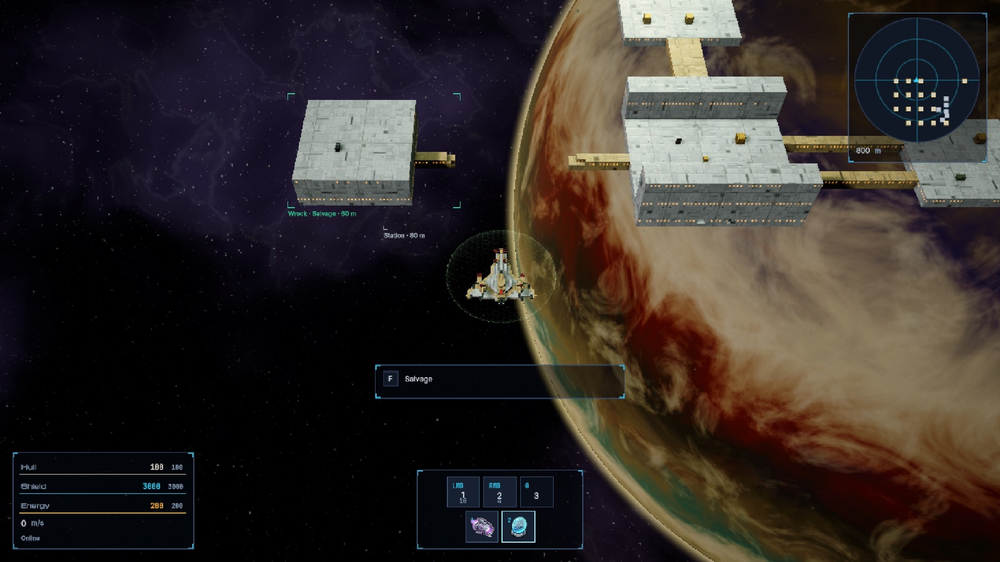
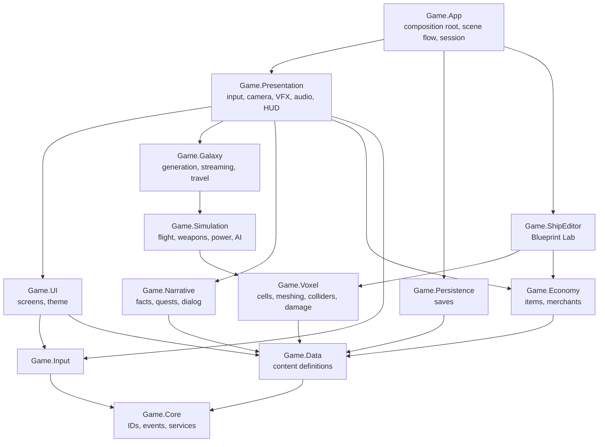
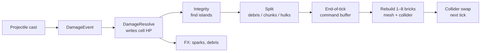

# Voxel Spacegame

Build your ship block by block, fly from star system to star system to uncover a mystery, and tear massive voxel ships and stations apart one cell at a time.


Every ship, station and asteroid is made of real voxel cells, and every hit removes them. Shoot the engines off a cruiser and it limps. Ram it hard enough and it breaks in two, and both halves tumble away with their own momentum. Wrecks stay in the world as hulks you can salvage for blocks, and the blocks you salvage are how your own ship grows.

The game is written in Unity 6.6 on DOTS: Entities, Burst, and Unity Physics.

## The game

- **Destruction you can read.** Damage is resolved per cell. A ship loses exactly the parts that were hit, and its thrust, turning, power and weapons change to match.
- **Your ship is your progression.** Hull, armour, reactors, capacitors, thrusters, weapons, shields and utility blocks each do one job. The Blueprint Lab editor shows every stat change before you commit it, and nothing leaves your inventory until you do.
- **Massive scale.** Stations and capital ships of hundreds of thousands to a million cells are the normal case, not a tech demo.
- **A galaxy with a secret.** Star systems are generated from a seed, but the mystery is authored. Clues found in one place point to another, and knowledge opens the lanes and gates forward.
- **One coherent look.** A single art direction (NOCTURNE) covers ships, space, effects and UI alike.

<table>
<tr>
<td></td>
<td></td>
</tr>
<tr>
<td align="center"><sub>A shot-through bridge drops a station pod; it drifts as a wreck you can salvage</sub></td>
<td align="center"><sub>The Blueprint Lab with a 757-block ship and its live mass, thrust, power and DPS</sub></td>
</tr>
</table>

<sub>All screenshots are from the game running in the Unity Editor's development playground.</sub>

The core loop: fly a star system, explore and trade, fight, salvage the wrecks, dock and rebuild your ship, then jump along a lane to wherever the clues point next.

## Systems

| System | What it does |
|---|---|
| **Voxel model** | A cell is 4 bytes inside a sparse 16³ brick. Plain hull never becomes an entity or GameObject. The editor, the runtime and save files share the same `VoxelStructure` layout, so nothing is lost between them. |
| **Rendering** | Bricks are meshed by budgeted Burst jobs and drawn from pooled buffers, so a hit rebuilds only the bricks it touched. Distant grids switch to merged, lower-detail meshes. |
| **Physics** | Unity Physics only. Each grid is one compound body built from brick colliders, with incremental mass, centre of mass and inertia. Ships fly on a plane while their structures stay fully 3D. |
| **Damage and destruction** | Projectiles, beams, explosions and rams all become damage events. One resolver writes cell HP. An integrity pass finds islands that broke free and splits them into debris, tumbling chunk bodies or salvageable hulks. Losing the core turns a ship into a hulk. |
| **Flight and propulsion** | Thrusters push from the blocks where they sit. A deterministic allocator solves throttles for the requested motion, and a core assist keeps small ships responsive. Losing thrusters really changes how a ship handles. |
| **Weapons** | Turrets aim and fire projectiles, beams and explosives that carve cells. |
| **Power, shields and abilities** | Reactors and capacitors supply a power budget that is granted by priority. Shields absorb hits, and active abilities (boost, shield toggle and others) spend energy and charges. |
| **AI** | Spatial queries, faction standing and staggered decisions drive enemy ships. They fly through the same propulsion code as the player. |
| **Galaxy and travel** | Seeded galaxy generation, star-system streaming, bodies on analytic orbits and a floating origin. Lane jumps unload one system and build the next from its seed plus saved changes. |
| **Encounters and factions** | An encounter director spawns fights and events. Factions keep a stance table that player actions shift. |
| **Narrative** | A typed fact store with a shared condition/effect language drives story beats, quests, a clue graph and branching dialog. |
| **Economy** | Items, inventory, wallet, loot tables, merchants and salvage. |
| **Ship editor** | The Blueprint Lab: place, paint and remove blocks with undo/redo, a bill of materials and validation, then commit against your inventory. |
| **Persistence** | Save anywhere outside combat. The save is a chunked binary container with binary voxel chunks, written atomically on a worker thread. The galaxy is stored as seed plus deltas, and damage persists. |
| **UI, camera, VFX and audio** | UI Toolkit screens with theme tokens, a third-person camera rig, VFX Graph effects and voice-capped audio, all fed by event streams from the simulation. |
| **Co-op prototype** | Experimental, outside the v1 scope. 2–4 players with the host as authority, a brick-diff voxel stream over Unity Transport, and client-side prediction of each player's own ship. Every system runs one code path: a system either decides (host only) or applies (every machine) ([ADR-0116](docs/decisions/ADR-0116-coop-prototype-host-authority.md), [ADR-0117](docs/decisions/ADR-0117-coop-one-code-path.md)). |

## Architecture

The code is split into one assembly per module. A module may reference only the modules below it; anything that has to travel upward goes through events and interfaces declared in `Game.Core`. Tests enforce this.



Rules that hold everywhere:

1. **Cells are data, not entities.** A cell becomes its own object only at the moment it breaks free as debris.
2. **One deterministic tick.** Gameplay runs at a fixed 60 Hz, and its stages hand work to each other through event streams within the same tick. There is exactly one structural-change sync point per tick.
3. **One writer per piece of state.** An ownership table names the only system allowed to write each piece of state; everyone else sends a request or an event.
4. **Stable identity.** Content uses stable string IDs and the galaxy is a seed plus deltas. Simulation and saves never use unseeded randomness or runtime hash codes.
5. **Presentation is swappable.** Visuals and sounds come from content definitions and theme tokens, never from hard-coded assets.

One hit, from trigger to new collider:



The full design lives in [docs/01-architecture.md](docs/01-architecture.md): the frame pipeline, shared contracts, the state ownership table, coordinate frames and scalability rules. Each system has its own spec in [docs/specs/](docs/specs/), and every significant decision is recorded as an ADR in [docs/decisions/](docs/decisions/).

## Status

In active development. The foundations, the voxel core and flight are complete. Combat and destruction are nearly done, and the vertical slice (a few star systems, a hub station, a derelict and the opening of the mystery) is in progress.

| Milestone | Scope | Done |
|---|---|---|
| M0 Foundations | Boot, core, input, content, saves, tooling | 71 / 71 |
| M1 Voxel core and flight | Voxel model, rendering, physics, flight | 109 / 109 |
| M2 Combat and destruction | Weapons, damage, power, shields, AI | 83 / 92 |
| M3 Vertical slice | Galaxy, travel, narrative, economy, editor, UI | 158 / 182 |
| M4 Depth and scale | Abilities, larger content, co-op prototype | 22 / 33 |

Live progress is in [docs/LEDGER.md](docs/LEDGER.md), and the order of work is in [docs/ROADMAP.md](docs/ROADMAP.md).

## Running it

- Install Unity **6000.6.5f1** (Apple Silicon or Windows) and open this folder in Unity Hub. The first import takes a few minutes.
- Press Play in any scene; the game boots through `Boot`. The `World` scene drops you into a development playground with test pads for flight, combat, salvage and the editor.
- Keyboard and mouse: W/S to thrust, A/D to turn, Q/E to strafe, Ctrl to boost, X to brake. Space or the mouse buttons fire (LMB, RMB and G pick weapon groups), 1–4 trigger abilities, F interacts, and the mouse wheel zooms.

Common commands:

```bash
tools/compile.sh              # compile and print C# errors
tools/test.sh editmode        # EditMode tests
tools/test.sh playmode        # PlayMode tests
tools/playtest/coop.sh start  # co-op: the Editor hosts, a dev build joins as a guest
```

## Repository layout

```
Assets/Game/     game code and assets, one assembly per module
docs/            vision, architecture, specs, decisions (ADRs), design guide and look book, progress ledger
ArtSource/       Blender look-dev and procedural texture scripts
tools/           compile, test, docs and playtest scripts
Import/Legacy/   content exported from the earlier prototype, used only as converter input
```

## Contributing

This project is built by its owner with AI coding agents. The rules for anyone writing code here, human or AI, are in [AGENTS.md](AGENTS.md).
