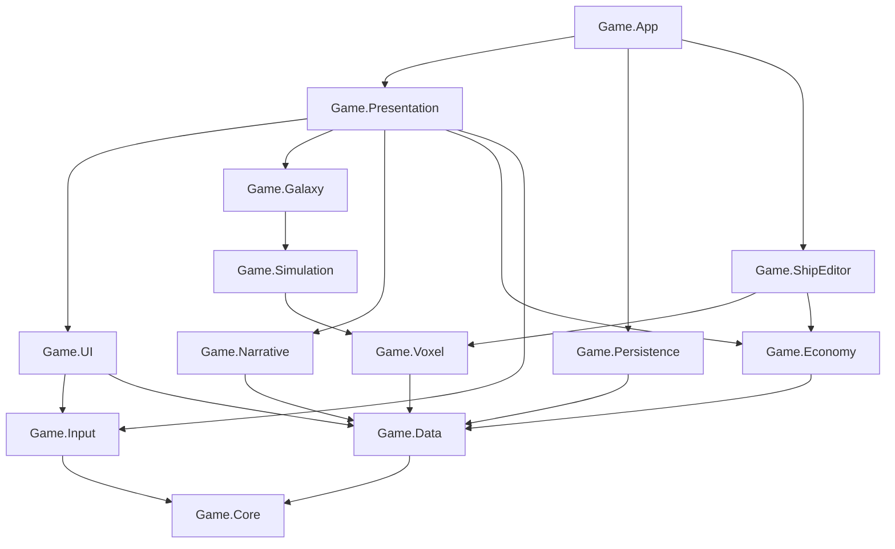

# 01 — Architecture

**Status: BINDING.** Every spec and every line of code follows this document. To change it, write an ADR in `docs/decisions/` and get owner approval first. If a spec appears to contradict this document, this document wins; log the conflict in `docs/LEDGER.md` → *Open questions*.

Read [00-vision.md](00-vision.md) first for what the game is. This document says how it is built.

---

## 1. The rules (memorize these)

1. **Cells are data, not entities.** A voxel is a 4-byte cell inside a 16³ brick. Plain hull never becomes an entity or a GameObject. A cell becomes its own object only at the moment it breaks free (as debris).
2. **One voxel model everywhere.** The ship editor, the runtime and save files all use the same `VoxelStructure` layout. There is no conversion step that can lose information.
3. **One deterministic tick.** Gameplay simulation runs in `FixedStepSimulationSystemGroup` at exactly 60 Hz. Stages communicate through event streams produced and consumed in the same tick. There is exactly one structural-change sync point per tick in gameplay (`GameplayEndCommandBufferSystem`).
4. **One writer per piece of state.** The ownership table in §8 names the only system or service allowed to write each piece of state. Everyone else reads or sends a request/event.
5. **Stable identity.** Content uses stable string IDs (`block_hull`). The galaxy is a seed plus saved deltas. No `UnityEngine.Random`, no `string.GetHashCode()`, no `System.Random` in anything that affects simulation or saves.
6. **Presentation is swappable.** All visuals and sounds are referenced through content definitions and theme tokens, never hard-coded. Every current art asset is a placeholder (see [design/DESIGN-SYSTEM.md](design/DESIGN-SYSTEM.md) and ADR-0009).
7. **Downward dependencies only.** Assemblies may only reference the assemblies listed for them in §3. Upward communication uses events and interfaces defined in `Game.Core`.

---

## 2. Technical shape of the game

| Topic | Decision | Source |
|---|---|---|
| Engine | Unity 6000.6.5f1, URP 17.6, Entities / Unity Physics / Entities Graphics 6.6 | ADR-0001 |
| Units | 1 Unity unit = 1 metre | — |
| Cell size | Per grid (`VoxelGrid.CellSize`). Default **0.5 m** for ships, stations and asteroids | ADR-0002 |
| Flight plane | Ships fly on the local **XZ plane** and rotate around **Y** only. Voxel structures are fully 3D. The plane lock is one component (`PlanarConstraint`) so it can be removed later | ADR-0003 |
| Gameplay physics | **Unity Physics (DOTS) only.** PhysX exists only because Unity Physics bakes from PhysX authoring components; PhysX never simulates (`Physics.simulationMode = Script`) | ADR-0004 |
| Fixed tick | 60 Hz (`FixedStepSimulationSystemGroup.Timestep = 1/60`), also `Time.fixedDeltaTime = 1/60` | — |
| UI | UI Toolkit only (no uGUI, no TextMeshPro). MVVM with Unity runtime data binding | ADR-0005 |
| Narrative | Typed `FactStore` + condition/effect vocabulary; dialog in Yarn Spinner 3 after a compatibility spike | ADR-0006 |
| Saves | Chunked binary container; binary voxel chunks; JSON (Newtonsoft) only inside non-voxel chunks | ADR-0007 |
| Platform | macOS (Apple Silicon) and Windows desktop, keyboard + mouse first; gamepad later | — |
| Determinism | Reproducible on one machine (same inputs + seed → same result). Not lockstep across machines | — |
| Out of scope for v1 | Multiplayer/netcode, modding, localization (re-added later with Yarn line IDs), planetary landing, ship interiors / first person, consoles | 00-vision |

---

## 3. Modules and assemblies

All game code lives under `Assets/Game/`. Each folder below is one assembly definition (`.asmdef`) with `autoReferenced: false` and `rootNamespace` equal to the assembly name. **A module may reference only the modules listed in its row.** The compile will fail if you add an undeclared reference — and you must not "fix" that by adding a reference; follow §3.2 instead.

| Assembly | Folder | May reference (game) | Purpose |
|---|---|---|---|
| `Game.Core` | `Core/` | — | IDs, stable hashing, deterministic RNG streams, `EventBus<T>`, `Services`, `ISaveParticipant` + `SaveWriter`/`SaveReader`, `InputContext`, pause tokens interface, logging, math helpers |
| `Game.Data` | `Data/` | Core | Content definitions (ScriptableObjects), `ContentDatabase`, block definitions and their blob, the 24-orientation tables, content validation hooks |
| `Game.Input` | `Input/` | Core | `Controls.inputactions`, the generated `Controls` class, `InputService` (contexts → action maps) |
| `Game.Persistence` | `Persistence/` | Core, Data | `SaveService`, the binary container, chunk registry, migrations, slots and profiles |
| `Game.Economy` | `Economy/` | Core, Data | Items, `InventoryModel`, `Wallet`, loot tables, merchants, pricing |
| `Game.Voxel` | `Voxel/` | Core, Data | `VoxelStructure`, grid/brick ECS data, spawning grids, brick meshing, brick colliders, mass properties, **damage resolution, integrity, splitting, debris** (the only code that writes cells) |
| `Game.Simulation` | `Simulation/` | Core, Data, Voxel | Ship commands, flight/propulsion, power, shields, weapons, projectiles, beams, rams, abilities, AI, spatial hash, factions/allegiance |
| `Game.Galaxy` | `Galaxy/` | Core, Data, Voxel, Simulation | Galaxy generation, coordinate frames, `OriginRebaseSystem`, star-system streaming, bodies on rails, interaction query, travel, encounter director, territory |
| `Game.Narrative` | `Narrative/` | Core, Data | `FactStore`, conditions/effects, story beats, quests, clues/mystery graph, dialog runner adapter |
| `Game.ShipEditor` | `ShipEditor/` | Core, Data, Voxel, Economy | `EditSession`, tools, undo/redo, bill of materials, validation, editor picking and overlays |
| `Game.UI` | `UI/` | Core, Data, Input | `UIRoot`, `UINavigator`, screens, views, view models, theme (USS tokens), shared UI services (tooltip, notifications, dialogs) |
| `Game.Presentation` | `Presentation/` | Core, Data, Input, Voxel, Simulation, Galaxy, Narrative, Economy, UI | The bridges between simulation and the player: input sampling → ECS, camera rig, VFX, audio, HUD/view-model sync |
| `Game.App` | `App/` | everything above | Composition root: Boot scene, `GameRoot`, service construction order, `GameSession`, `SceneFlow`, save participants for session-level state |
| `Game.Editor` | `Editor/` | everything (Editor platform only) | Project setup, importers, content validators, legacy converters, inspectors |
| `Game.DevTools.Editor` | `DevTools/Editor/` | everything (Editor platform only) | CLI playtest harness (`gh_*` commands), debug windows |
| `Game.Tests.EditMode` | `Tests/EditMode/` | everything | EditMode unit and integration tests |
| `Game.Tests.PlayMode` | `Tests/PlayMode/` | everything | PlayMode smoke, scenario and performance tests |



### 3.1 Third-party and Unity packages per module

| Package | Allowed in |
|---|---|
| Entities, Collections, Burst, Mathematics | Core, Data, Voxel, Simulation, Galaxy, ShipEditor, Presentation, App, tests. `Game.Core` uses Entities only to declare the custom system groups, `GameplayActive`, `SimClock` and `GameplayEndCommandBufferSystem` |
| Unity Physics | Voxel, Simulation, Galaxy, Presentation, App, tests. `Game.Core` references it only for `[UpdateBefore/After(typeof(PhysicsSystemGroup))]` on its group declarations |
| Entities Graphics | Voxel, Presentation |
| Input System | Input, Presentation, App, DevTools, tests |
| UI Toolkit (`UnityEngine.UIElements`) | UI, Presentation, App, Editor, DevTools |
| Newtonsoft JSON | Persistence, Data (importers), Narrative (importers), Editor |
| VFX Graph | Presentation |
| Unity Pipeline (`com.unity.pipeline`) | DevTools.Editor only |

Adding any package to `Packages/manifest.json` requires an ADR.

### 3.2 Content definitions and the logic vocabulary live in `Game.Data`

Two kinds of types are needed by many modules, so they sit low in the graph even though a higher-level spec designs them:

- **Every content definition class** (`*Definition : ContentDefinition : ScriptableObject`) lives in `Assets/Game/Data/Definitions/<Area>/` (namespace `Game.Data.Definitions`), so the single `ContentDatabase` can reference all of them. The spec of the area that uses a definition designs its fields and owns the task that creates it (for example SPEC-21 designs `WeaponDefinition`), but the file goes in `Game.Data`. Definitions hold data only — no behaviour that needs higher modules.
- **The condition/effect logic vocabulary** (`ICondition`, `IEffect`, the compiled node types and the text compiler) lives in `Assets/Game/Data/Logic/` (namespace `Game.Data.Logic`). It is designed by SPEC-40 (Narrative core) and used by narrative, quests, encounters and spawn rules. Conditions and effects talk to the game only through the `ILogicContext` interface (also in `Game.Data.Logic`), which `Game.App` implements by routing to `FactStore`, inventory, galaxy and simulation services.

### 3.3 How a lower module talks to a higher one

- **Events:** the lower module raises a typed event (`EventBus<T>` for managed code, an ECS event stream for Burst code). The higher module subscribes.
- **Interfaces:** the lower module declares an interface in `Game.Core` (or in itself); `Game.App` registers the implementation in `Services`.
- **Singletons:** ECS systems read configuration and session data through singleton components, written once by `Game.App` or the owning module. ECS never reads managed statics.

---

## 4. Runtime topology

### 4.1 Scenes

| Scene | Build index | Contains |
|---|---|---|
| `Boot` | 0 | The `GameRoot` prefab only |
| `MainMenu` | 1 | Menu backdrop only. No managers |
| `World` | 2 | Lighting/volume only. Everything else is spawned at runtime from data |
| `BlueprintLab` | 3 | Empty build grid environment for the ship editor (no economy) |

- Managers never live in content scenes. `Bootstrap` (`[RuntimeInitializeOnLoadMethod(BeforeSceneLoad)]`) guarantees `GameRoot` exists whichever scene you press Play in.
- **Enter Play Mode Options are on with domain reload disabled.** Every static field must be reset in a `[RuntimeInitializeOnLoadMethod(RuntimeInitializeLoadType.SubsystemRegistration)]` method. Prefer no mutable statics at all.
- `SceneFlow` (in `Game.App`) is the only code that loads or unloads scenes.

### 4.2 Services (managed side)

`GameRoot.Awake` constructs services **in this exact order** and registers them in the typed `Services` locator (`Game.Core`):

1. `SettingsService` (player prefs: audio, graphics, controls)
2. `ContentService` (wraps `ContentDatabase`, builds the block blob)
3. `InputService`
4. `AudioService`
5. `PauseService` (ref-counted pause tokens)
6. `SaveService`
7. `SceneFlow`
8. `GameSession` (holds runtime state; restored in place on load)
9. `UIRoot` + `UINavigator`

Shutdown runs in reverse order. No service may create another service. No `FindObjectOfType`, no `Resources.Load` (except `GameRoot` itself), no self-creating singletons.

### 4.3 ECS world

- One default `World`. Systems are created automatically but **every gameplay system declares `state.RequireForUpdate<GameplayActive>()`** (or a more specific singleton) so nothing runs in the menu.
- `SceneFlow` creates the `GameplayActive` singleton entity when the World scene is ready and destroys it on exit.
- Entities that belong to a loaded star system carry `StarSystemMember { StarSystemId }`. Unloading a star system is one `DestroyEntity(query)`.
- No subscenes for gameplay content in v1. Configuration singletons are created by `Game.App` at boot from the `ContentDatabase` (`GameConfig` singleton, block blob singleton).

---

## 5. Frame pipeline (system groups and ordering)

This is the complete group tree. Every new system must be placed in exactly one of these groups with explicit `[UpdateInGroup]` and, where order matters, `[UpdateBefore]`/`[UpdateAfter]`. The spec that owns a system says where it goes; the spec may not invent a new group without an ADR.

```
InitializationSystemGroup
└─ GameInitGroup                         (custom; OrderLast)
   ├─ OriginRebaseSystem                 GAL  single floating-origin owner
   ├─ PlayerInputSampleSystem            INP  managed; writes PlayerCommand singleton
   └─ GridSpawnSystem                    VOX  GridSpawnRequest → grid root + bricks + functional entities

SimulationSystemGroup
├─ FixedStepSimulationSystemGroup        60 Hz, runs 0..N times per frame
│  ├─ GameplayPrePhysicsGroup            (custom; UpdateBefore PhysicsSystemGroup)
│  │  ├─ ShipCommandGroup                (custom)
│  │  │  ├─ PlayerCommandApplySystem     FLT  PlayerCommand → player ship's ShipCommand
│  │  │  └─ AI decision + steering       AI   → ShipCommand (staggered)
│  │  ├─ PowerAllocationSystem           PWR  sets Powered enable bits
│  │  ├─ ShipStatsAggregateSystem        PWR  recompute ShipStats for dirty ships
│  │  ├─ PropulsionSystem                FLT  thruster impulses; never overwrites velocity
│  │  ├─ PlanarConstraintSystem          FLT  keeps Y = 0 and rotation about Y only
│  │  ├─ WeaponAimSystem                 WPN
│  │  ├─ WeaponFireSystem                WPN  spawns projectiles, toggles beams
│  │  ├─ AbilityActivationGroup          ABL
│  │  └─ ColliderSwapSystem              PHY  installs rebuilt brick colliders; queues old blobs
│  ├─ PhysicsSystemGroup                 (Unity Physics)
│  └─ GameplayPostPhysicsGroup           (custom; UpdateAfter PhysicsSystemGroup)
│     ├─ SpatialHashBuildSystem          AI   ShipProxy hash for this tick
│     ├─ ImpactEventSystem               DMG  collision events → ram DamageEvents
│     ├─ ProjectileStepSystem            WPN  casts → DamageEvents, FxEvents
│     ├─ BeamStepSystem                  WPN
│     ├─ ExplosionSystem                 WPN  ExplosionRequest → ShieldHits / DamageEvents per overlapped grid
│     ├─ ShieldSystem                    PWR  regen + ShieldHit → ShieldState HP; overflow → DamageEvents
│     ├─ DamageResolveSystem             DMG  one job per grid; the ONLY cell-HP writer
│     ├─ IntegritySystem                 DMG  islands after removals
│     ├─ SplitSystem                     DMG  debris particles / chunk bodies / hulk grids
│     ├─ ShipDeathSystem                 DMG  core lost → Hulk state
│     ├─ GridMassUpdateSystem            PHY  incremental mass, centre of mass, inertia
│     ├─ BrickDirtyScheduleSystem        VOX  marks bricks for remesh / collider rebuild
│     └─ GameplayEndCommandBufferSystem  CORE THE ONLY structural sync point in the fixed step
├─ VoxelRebuildGroup                     (custom; after FixedStep; variable rate)
│  ├─ BrickMeshBuildSystem               REN  budgeted Burst jobs → MeshDataArray
│  └─ BrickColliderBuildSystem           PHY  budgeted Burst jobs → blobs, swapped next tick
├─ WorldGroup                            (custom; variable rate)
│  ├─ StarSystemStreamingSystem          SYS  tiers T1–T3 with hysteresis
│  ├─ BodyOnRailsSystem                  SYS  analytic orbits from UniversalTime
│  ├─ InteractionQuerySystem             SYS  nearest interactable → singleton
│  ├─ EncounterDirectorSystem            ENC
│  └─ GridLodSystem                      REN  LOD + dormancy
└─ TransformSystemGroup                  (Unity)

PresentationSystemGroup
├─ PresentationBridgeGroup               (custom)
│  ├─ BrickMeshApplySystem               REN  main thread; swaps MaterialMeshInfo
│  ├─ FxUploadSystem                     VFX  FxEvents → VFX Graph event buffers
│  ├─ AudioEventDrainSystem              AUD  SfxEvents → voice-capped playback
│  ├─ CameraTargetSyncSystem             CAM
│  ├─ HudSyncSystem                      HUD  ECS → view models, only on change
│  └─ ManagedEventDrainSystem            CORE ECS NativeQueue events → EventBus<T>
├─ (Entities Graphics)
└─ DeferredDisposalSystem                VOX  OrderLast; frees meshes/blobs N frames later
```

Codes on the right are spec area codes (§10).

### 5.1 Timing rules

- Anything that changes simulation state runs in `FixedStepSimulationSystemGroup`. Variable-rate groups may only build caches (meshes, colliders, LOD), stream, or present.
- Input is sampled once per frame into `PlayerCommand`. Edge-triggered actions (fire once, toggle) are **latched** until a fixed tick consumes them, so a 144 FPS frame and a 30 FPS frame produce the same gameplay.
- Cooldowns and rates use accumulators in fixed ticks (`Tick` counter), never `Time.deltaTime`.
- Presentation interpolates from the physics state using `PhysicsGraphicalSmoothing`; gameplay logic always reads the physics transform (`LocalTransform` inside the fixed step), never the smoothed `LocalToWorld`.

---

## 6. Shared contracts

These types cross module boundaries. **Their names and owning module are binding.** The owning spec defines the remaining fields; consuming specs must use them as-is and request changes through the owning spec's *Open questions*.

### 6.1 Core (`Game.Core`, spec SPEC-02)

| Type | Shape (binding parts) | Notes |
|---|---|---|
| `ContentId` | `readonly struct { string Value; ulong Hash; }` | Hash = `StableHash.Hash64(Value)` (xxHash3-64 over UTF-8). Lowercase `snake_case` |
| `StableHash` | static: `Hash64(string)`, `Hash64(ReadOnlySpan<byte>)`, `Combine(ulong, ulong)` | Never use `GetHashCode` for anything persisted or simulated |
| `Tick` | `uint` fixed-step counter in `SimClock` singleton | Starts at 0 per session |
| `UniversalTime` | `double` seconds since campaign start, in `SimClock` | Saved |
| `RngStreams` | `static Unity.Mathematics.Random For(ulong seed, RngPurpose purpose, ulong salt)` | All randomness. `RngPurpose` is an enum; add values, never reorder |
| `EventBus<T>` | `Subscribe`, `Unsubscribe`, `Publish` (deferred), `Drain()` once per frame | Per-handler try/catch; re-entrancy safe |
| `Services` | `Register<T>`, `Get<T>`, `TryGet<T>`, `Reset()` | Reset on `SubsystemRegistration` |
| `ISaveParticipant` | `string Key {get;}` (4-char), `int Version {get;}`, `void Capture(SaveWriter)`, `void Restore(SaveReader, int fromVersion)` | Implemented by owning modules |
| `InputContext` | `enum { None, Flight, Editor, Menu, Dialog, TextEntry }` | Plus the always-on Global map |
| `IPauseService` | `PauseToken Acquire(string reason)`; `bool IsPaused` | Ref-counted |

### 6.2 Data (`Game.Data`, spec SPEC-04)

| Type | Shape | Notes |
|---|---|---|
| `BlockIndex` | `ushort`; 0 = air | Runtime index, rebuilt every boot from `ContentDatabase` order. **Never saved** — saves use `ContentId` palettes |
| `Orientation` | `byte` 0..23 | The 24 proper rotations of a cube. `OrientationTables` blob: `Rotate(int3, o)`, `Compose(a,b)`, `Mirror(o, axis)`, `Inverse(o)` |
| `BlockKind` | `enum : byte { Structural, Prop, Functional }` | Structural = brick-meshed; Prop = instanced mesh; Functional = has an entity |
| `BlockDef` | blob struct: `Index`, `MirrorIndex`, `Kind`, `Cells` (footprint), `Clearance`, `AllowedOrientations` (24-bit mask), `AttachFaces`, `CellHp`, `CellMass`, `MaterialLayer`, `PropMeshIndex`, `Function` | Built from `BlockDefinition` ScriptableObjects |
| `BlockDefsBlob` | `BlobArray<BlockDef>` indexed by `BlockIndex` | ECS singleton `BlockDefsRef` |
| `ContentDatabase` | ScriptableObject with direct references to every content asset | The only content entry point |

### 6.3 Voxel (`Game.Voxel`, specs SPEC-10 … SPEC-13)

| Type | Shape (binding parts) | Notes |
|---|---|---|
| `Cell` | 4 bytes: `ushort Ref` (bit 15 = 0 → palette index; bit 15 = 1 → `BlockInstance` index; 0 = air), `byte Hp`, `byte Flags` | `Hp` is quantised 0..255 of the block's `CellHp` |
| `PaletteEntry` | `ushort Block` (BlockIndex), `byte Orient`, `byte Color` | Per grid |
| `VoxelStructure` | Managed class owning `NativeList`s: palette, instances, bricks (coord → 4096 cells) | Same layout as ECS; used by editor, saves, tests |
| `VoxelGrid` | `IComponentData`: `int3 BrickMin, BrickDims; float CellSize; uint Revision; int AnchorInstance; GridKind Kind` | Root entity of a ship, station, asteroid or hulk |
| `GridKind` | `enum : byte { Ship, Station, Asteroid, Hulk }` | |
| `Brick` | `IComponentData`: `Entity Grid; int3 Coord; ushort SolidCount` + buffer `BrickCells` (4096 × `Cell`) + `BrickSolidMask` (512 B) + enableable `BrickDirty` | 16³ cells |
| `BlockInstance` | buffer element on the grid: `ushort Block; byte Orient, Color; int3 Origin; float FunctionHp; Entity Functional` | Multi-cell and functional blocks |
| `FunctionalBlock` | `IComponentData`: `Entity Grid; int InstanceIndex` | On thruster/weapon/reactor/shield/core entities |
| `GridSpawnRequest` | entity with `ContentId Blueprint` or a structure handle, pose, `GridKind`, allegiance | Consumed by `GridSpawnSystem` |
| `DamageEvent` | `Entity Grid; float3 LocalPoint, LocalDir; float Amount, Radius, Penetration; DamageType Type; Entity Source; float3 WorldImpulse` | Grid-space. Written to `DamageStreams` by producers |
| `CellRemoved` | `Entity Grid; int3 Cell; ushort Block; byte Color; float3 WorldPos, WorldVel, Kick` | Output of the resolver; consumed by split, VFX, audio, salvage |
| `ExplosionRequest` | `float3 WorldPos; float Radius, Amount; DamageType Type; Entity Source` | Defined here so Voxel code (reactor chain reactions) can request explosions; consumed by `ExplosionSystem` in Simulation (SPEC-21), which tests shields first |
| `DamageType` | `enum : byte { Kinetic, Energy, Explosive, Ram }` | Add values at the end only |
| `Hulk` | tag | Dead ship: still physical and damageable, no AI/power |

### 6.4 Simulation (`Game.Simulation`, specs SPEC-20 … SPEC-24)

| Type | Shape (binding parts) | Notes |
|---|---|---|
| `ShipCommand` | per ship: `float2 Thrust` (x = strafe, y = forward, −1..1), `float Turn` (−1..1), `float3 AimWorld`, `uint FireGroups` (bitmask), `byte Flags` (boost, brake…) | The single interface between "who controls the ship" (player or AI) and "how the ship moves/fires" |
| `PlayerCommand` | singleton: same fields as `ShipCommand` plus latched edge flags | Written only by `PlayerInputSampleSystem` |
| `PlayerShip` | tag on the player's current ship | |
| `Allegiance` | `byte Faction; byte Team` | `ContentId` → byte index via `FactionTable` |
| `ShipStats` | aggregated mass, thrust, turn rate, power gen/storage, DPS, shield capacity | Written only by `ShipStatsAggregateSystem` |
| `ShipPower` + buffer `PowerConsumer` + enableable `Powered` | | |
| `ShieldState` | analytic ellipsoid in grid space + HP | |
| `ShieldHit` | event: `Entity Grid; float3 LocalPoint; float Amount; DamageType Type; Entity Source` | Producers test shields first (analytically) and emit this instead of a `DamageEvent` |
| `SpatialHash` | singleton, rebuilt per tick | Used by AI, homing, explosions, radar |

### 6.5 Galaxy (`Game.Galaxy`, specs SPEC-30 … SPEC-33)

| Type | Shape | Notes |
|---|---|---|
| `StarSystemId` | `readonly struct { uint Value; }` | Use "star system" in prose and `StarSystem*` in code — "system" alone always means an ECS system |
| `BodyId` | `StarSystemId System; BodyRole Role; ushort Slot, SubSlot` | Structural, never derived from rolled values |
| `UniversePosition` | `double3` metres relative to the current star | On every persistent root entity |
| `FrameOrigin` | singleton: `double3 OriginInStarSystem` | Owned by `OriginRebaseSystem` |
| `OriginShifted` | event `{ float3 Delta }` | Camera, VFX and trails listen |
| `StarSystemMember` | `StarSystemId` | Unload = destroy by this |

### 6.6 Presentation event streams

| Stream | Producer → consumer | Notes |
|---|---|---|
| `FxEvent` | Simulation/Voxel → `FxUploadSystem` | `FxKind Kind; float3 Pos, Dir, Vel; float Scale; uint Color` |
| `SfxEvent` | Simulation/Voxel → `AudioEventDrainSystem` | `ContentId Cue; float3 Pos; float Volume` |
| Managed events | via `ManagedEventDrainSystem` → `EventBus<T>` | `ShipDestroyed`, `StarSystemEntered`, `BodyInteracted`, `BodyDestroyed`, `LaneJumped`, `ItemAcquired`, `FactChanged`, `SessionReset`, `GameSaved`, `GameLoaded` |

### 6.7 Content and logic (`Game.Data`, specs SPEC-04 and SPEC-40)

| Type | Shape | Notes |
|---|---|---|
| `ContentDefinition` | abstract `ScriptableObject` with `[SerializeField] string id` → `ContentId Id` | Base of every definition. Designed by SPEC-04 |
| `*Definition` | e.g. `BlockDefinition`, `ItemDefinition`, `ShipBlueprintDefinition`, `WeaponDefinition`, `FactionDefinition`, `BodyTemplateDefinition`, `EncounterDefinition`, `AbilityDefinition`, `AudioCueDefinition`, `StoryBeatDefinition`, `QuestDefinition`, `ClueDefinition` | All in `Game.Data.Definitions`; fields designed by the owning area spec |
| `ICondition` / `IEffect` | `bool Evaluate(ILogicContext)`, `void Apply(ILogicContext)`, `void Validate(ValidationReport)` | Compiled from a text syntax at import. Unknown function = import error (fail closed) |
| `ILogicContext` | facts, inventory, location, time and world queries/commands | Implemented in `Game.App` |
| `ValidationReport` | collects errors/warnings with asset path + field | Used by every importer and validator |

---

## 7. Key flows

### 7.1 Spawn a ship

1. Game code asks `ShipSpawnService.Spawn(blueprintOrStructure, pose, allegiance)` (Game.App / Galaxy), which creates a `GridSpawnRequest` entity.
2. `GridSpawnSystem` (init group) creates the grid root, one entity per non-empty brick (cells memcpy'd from the structure), and one entity per functional block. It marks every brick `BrickDirty = Mesh | Collider`.
3. Bricks get meshes and colliders over the next frames from `VoxelRebuildGroup` (budgeted). The root gets a provisional box collider until the first full compound is ready.

### 7.2 One hit

`ProjectileStepSystem` casts → finds a grid → converts to grid space → `DamageEvent` → `DamageResolveSystem` (DDA or blast rasterization, writes `Cell.Hp`, removes cells, emits `CellRemoved`, marks bricks dirty) → `IntegritySystem` → `SplitSystem` → `GameplayEndCommandBufferSystem` → `VoxelRebuildGroup` rebuilds 1–8 bricks → `ColliderSwapSystem` installs the new collider next tick → `FxUploadSystem` sprays debris.

### 7.3 Save and load

`SaveService.Save(slot)`: each `ISaveParticipant` captures a snapshot on the main thread → a worker serializes and compresses → atomic replace. `Load(slot)`: `SceneFlow` unloads gameplay, `GameSession` restores **in place** and raises `SessionReset` once, the galaxy regenerates from the seed and applies deltas, then the player ship spawns at the saved `UniversePosition`. Loading never executes narrative effects.

### 7.4 Jump to another star system

Lane jump request → warp transition starts → `StarSystemStreamingSystem` unloads the current star system (`StarSystemMember` query) → generator builds the target from `(GalaxySeed, StarSystemId)` and applies its `StarSystemDelta` → `OriginRebaseSystem` re-centres on the lane entry point → player ship placed at the entry → `StarSystemEntered` event.

### 7.5 Edit a ship

`EditSession` copies the ship's `VoxelStructure` to a draft → tools produce `DiffCommand`s with undo/redo → commit computes the bill of materials against the original, checks the inventory, applies it, swaps the structure, marks all bricks dirty. Cancel discards the draft. No inventory change ever happens before commit.

---

## 8. State ownership (single writer)

| State | Only writer | Everyone else |
|---|---|---|
| Cell contents and `Cell.Hp` | `DamageResolveSystem` at runtime; `EditSession.Commit` in the editor | Read only |
| `BlockInstance.FunctionHp` | `DamageResolveSystem` | Read |
| `VoxelGrid.Revision`, `BrickDirty` | `DamageResolveSystem`, `SplitSystem`, `GridSpawnSystem` | Read |
| Brick render mesh (`MaterialMeshInfo`) | `BrickMeshApplySystem` | — |
| Grid `PhysicsCollider` | `ColliderSwapSystem` | — |
| `PhysicsMass` | `GridMassUpdateSystem` | — |
| `PhysicsVelocity` | Unity Physics + `PropulsionSystem` (impulses only) + `ImpactEventSystem` (impulses only). **Nobody assigns velocity directly** | Read |
| `ShipCommand` (player ship) | `PlayerCommandApplySystem` | Read |
| `ShipCommand` (AI ship) | the AI steering system | Read |
| `ShipStats` | `ShipStatsAggregateSystem` | Read |
| `Powered` bits, `ShipPower` | `PowerAllocationSystem` | Read |
| `ShieldState` HP | `ShieldSystem` (resolves shield hits before grid damage) | Read |
| Root `LocalTransform` shift for floating origin | `OriginRebaseSystem` | — |
| `FrameOrigin`, `UniversePosition` sync | `OriginRebaseSystem` | Read |
| Loaded star system set | `StarSystemStreamingSystem` | Read |
| Facts | `FactStore` (via effects only) | Read via conditions |
| Inventory, wallet | `InventoryModel` / `Wallet` methods called by commit/merchant/loot code | Read through view models |
| Pause state | `PauseService` (tokens from `UINavigator` and others) | Read |
| Active input context | `InputService` (set by `UINavigator`) | Read |
| Scenes | `SceneFlow` | — |
| Save files | `SaveService` | — |

---

## 9. Coordinate frames and the floating origin

| Frame | Type and unit | Used for |
|---|---|---|
| Galaxy | `double2`, light-years | Galaxy map, lanes, territory |
| Star system | `double3`, metres relative to the star | Orbits, stations, fleets on rails, saves (`UniversePosition`) |
| Local | `float3`, metres relative to `FrameOrigin` | Unity Physics, voxel grids, rendering |

- `OriginRebaseSystem` re-centres when the player ship is more than **2,000 m** from the local origin, and always on star-system entry. It shifts every **root** `LocalTransform` (`WithNone<Parent>`), resets graphical smoothing history, shifts debris particle buffers, and raises `OriginShifted`.
- Bodies on rails compute their position as `f(UniversalTime, orbit)` in double precision and convert to local each frame. Their velocity is analytic.
- Nothing else may move the origin or shift root transforms.

---

## 10. Spec map and area codes

| Code | Spec | Module |
|---|---|---|
| FND | [SPEC-01 Boot, services and scene flow](specs/SPEC-01-boot-services-sceneflow.md) | App |
| CORE | [SPEC-02 Core utilities](specs/SPEC-02-core-utilities.md) | Core |
| INP | [SPEC-03 Input and input contexts](specs/SPEC-03-input.md) | Input, Presentation |
| DATA | [SPEC-04 Content database and block definitions](specs/SPEC-04-content-and-blocks.md) | Data |
| PERS | [SPEC-05 Persistence](specs/SPEC-05-persistence.md) | Persistence |
| VOX | [SPEC-10 Voxel data model and spawning](specs/SPEC-10-voxel-data-model.md) | Voxel |
| REN | [SPEC-11 Voxel rendering and LOD](specs/SPEC-11-voxel-rendering.md) | Voxel |
| PHY | [SPEC-12 Voxel physics and mass](specs/SPEC-12-voxel-physics.md) | Voxel |
| DMG | [SPEC-13 Damage, integrity and destruction](specs/SPEC-13-damage-destruction.md) | Voxel |
| FLT | [SPEC-20 Flight and propulsion](specs/SPEC-20-flight-propulsion.md) | Simulation |
| WPN | [SPEC-21 Weapons, projectiles and beams](specs/SPEC-21-weapons.md) | Simulation |
| PWR | [SPEC-22 Power, shields and ship stats](specs/SPEC-22-power-shields-stats.md) | Simulation |
| AI | [SPEC-23 AI and fleets](specs/SPEC-23-ai.md) | Simulation |
| ABL | [SPEC-24 Abilities](specs/SPEC-24-abilities.md) | Simulation |
| GAL | [SPEC-30 Galaxy generation and coordinate frames](specs/SPEC-30-galaxy-generation.md) | Galaxy |
| SYS | [SPEC-31 Star-system streaming, bodies and interaction](specs/SPEC-31-star-system-streaming.md) | Galaxy |
| TRV | [SPEC-32 Travel](specs/SPEC-32-travel.md) | Galaxy |
| ENC | [SPEC-33 Encounters and factions](specs/SPEC-33-encounters-factions.md) | Galaxy, Simulation |
| NAR | [SPEC-40 Narrative core](specs/SPEC-40-narrative-core.md) | Narrative |
| DLG | [SPEC-41 Dialog](specs/SPEC-41-dialog.md) | Narrative, UI |
| QST | [SPEC-42 Quests, clues and the mystery](specs/SPEC-42-quests-mystery.md) | Narrative |
| ECO | [SPEC-50 Economy and inventory](specs/SPEC-50-economy-inventory.md) | Economy |
| EDT | [SPEC-51 Ship editor](specs/SPEC-51-ship-editor.md) | ShipEditor |
| UI | [SPEC-60 UI framework](specs/SPEC-60-ui-framework.md) | UI |
| HUD | [SPEC-61 Screens and HUD](specs/SPEC-61-screens-hud.md) | UI, Presentation |
| CAM | [SPEC-62 Camera](specs/SPEC-62-camera.md) | Presentation |
| VFX | [SPEC-63 Visual effects](specs/SPEC-63-vfx.md) | Presentation |
| AUD | [SPEC-64 Audio](specs/SPEC-64-audio.md) | Presentation |
| DEV | [SPEC-70 Dev tools and CLI harness](specs/SPEC-70-devtools-harness.md) | DevTools |
| TST | [SPEC-71 Testing and performance gates](specs/SPEC-71-testing-perf-gates.md) | Tests |
| MIG | [SPEC-72 Legacy content migration](specs/SPEC-72-legacy-migration.md) | Editor |
| ART | [SPEC-80 Art direction and design system](specs/SPEC-80-art-direction.md) | Art (docs, definitions) |
| AST | [SPEC-81 Asset production](specs/SPEC-81-asset-production.md) | Art (assets) |
