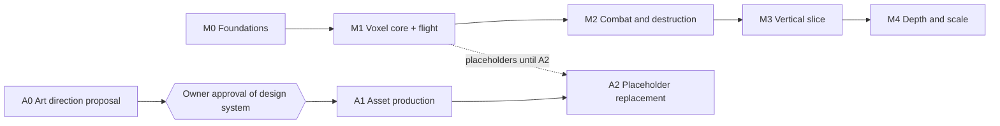

# Roadmap

**Status: BINDING order of work.** Milestones run in order. Within a milestone, any task whose dependencies are `done` may start.

**Design system approved 2026-10-11 (NOCTURNE, [DESIGN-GUIDE.md](design/DESIGN-GUIDE.md)); gate `ART-013` passed, so M0 may start.** History: owner decision 2026-10-10, the design system comes first. No other work proceeded until the owner approved the design system (`ART-013`). The only exceptions are the tasks the look tests themselves need: `CORE-001`, `DATA-001`, the SPEC-04 validation chain that `ART-007` registers into (`DATA-002`, `DATA-004`, `DATA-005`, `DATA-008`), and SPEC-81 `AST-001`…`AST-003` (ledger open question 4).

Task status lives in [LEDGER.md](LEDGER.md). Task definitions live in the specs.

**Performance never blocks the next phase ([ADR-0042](decisions/ADR-0042-advisory-performance-targets.md), owner 2026-10-12).** Numbers in exit gates below and all specs are advisory suggestions. Complete the functional scope and system review, record performance gaps, and continue in roadmap order. At most two initial optimization passes per system/feature across workers and handoffs; then prioritize connected systems and live gameplay. Correctness, safety and explicit owner/art gates still apply.

**Every milestone's exit gate also needs its system review** ([04-workflow §8](04-workflow.md), [ADR-0019](decisions/ADR-0019-system-reviews-instead-of-per-task-reviews.md)): tasks are `done` at their Definition of Done, and the milestone's systems are reviewed in depth together before the gate passes.

## M0 — Foundations

**Goal:** an empty but correctly structured game that boots from any scene, with the content pipeline, saves container and the test/CLI loop working.

| Specs | Scope in this milestone |
|---|---|
| SPEC-01 Boot, services, scene flow | All |
| SPEC-02 Core utilities | All |
| SPEC-03 Input | Action maps, contexts, `PlayerCommand` sampling |
| SPEC-04 Content and blocks | `ContentDatabase`, `BlockDefinition`, orientation tables, block blob |
| SPEC-05 Persistence | Container, slots, participants, migrations framework |
| SPEC-70 Dev tools | Harness port, playtest scripts |
| SPEC-71 Testing | Test helpers, `EcsTestWorld`, perf harness |
| SPEC-72 Legacy migration | Blocks, items and ship blueprints converted |

**Exit gates:** Play from `Boot`, `MainMenu` or `World` boots correctly; Enter Play Mode ≤ 1 s with domain reload off and no leaked state between plays; save round-trip test passes; all legacy blocks and ships import with zero validator errors; `tools/compile.sh`, `tools/test.sh editmode` and `tools/check-docs.py` all pass.

**M0 gate status: passed 2026-10-11.** The [ledger](LEDGER.md) records the system review, five repairs, safety/functional/performance evidence and remaining nonblocking historical-crash uncertainty.

## M1 — Voxel core and flight

**Goal:** ships and a 1M-cell station render and collide at scale, and the player can fly a ship built from blocks.

| Specs | Scope |
|---|---|
| SPEC-10 Voxel data model | All |
| SPEC-11 Voxel rendering | LOD0, LOD1, prop instancing |
| SPEC-12 Voxel physics | All |
| SPEC-20 Flight | All |
| SPEC-62 Camera | Third-person follow rig |
| SPEC-60 UI framework | `UIRoot`, `UINavigator`, pause/input contexts (needed for menus) |

**Exit gates:** ships/station render and collide; the player can fly; a ship with off-centre thrusters turns because of torque; ramming pushes ships physically. Record advisory voxel performance results against [06](06-performance-budgets.md), including idle/spawn targets; missed numbers do not block M2.

## M2 — Combat and destruction

**Goal:** the core fantasy: weapons carve ships, structures break apart into debris, chunks and hulks.

| Specs | Scope |
|---|---|
| SPEC-13 Damage and destruction | All |
| SPEC-21 Weapons | All weapon types used by legacy content |
| SPEC-22 Power, shields, stats | All |
| SPEC-23 AI | Single-ship combat AI with ability rules (fleets and wings in M3, ADR-0017) |
| SPEC-24 Abilities | Framework + the 2 legacy abilities |
| SPEC-63 VFX | Debris particles, hits, explosions, beams |
| SPEC-64 Audio | Event drain, voice caps, mixer |

**First playable checkpoint (owner priority, 2026-10-12):** correct the Fighter controls (FLT-013), then a stationary-target firing range: real weapons remove hull cells, rendering/colliders update, sustained-fire frame timing is recorded. Demonstrate this before the complete milestone; structural breakup is the next checkpoint. Use existing local grid spawning without waiting for AI or galaxy travel. V2 implementation only; never copy V1 code.

**Exit gates:** combat/destruction systems work together; determinism test passes at 30/60/144 FPS; 10-minute soak with zero errors and zero leaks. Record combat performance results and defer missed numeric targets; they do not block M3.

## M3 — Vertical slice

**Goal:** the loop from [00-vision.md](00-vision.md) end to end in 2–4 star systems.

| Specs | Scope |
|---|---|
| SPEC-30 Galaxy generation | All |
| SPEC-31 Star-system streaming | All |
| SPEC-32 Travel | Lanes and jumps (supercruise may slip to M4) |
| SPEC-23 AI (fleets) | Fleets and wings with member short-cut thinking; swarm gate (ADR-0017) |
| SPEC-33 Encounters and factions | Director + one hostile encounter type |
| SPEC-40 Narrative core | All |
| SPEC-41 Dialog | Yarn spike, runner, presenter |
| SPEC-42 Quests and mystery | Opening chapter |
| SPEC-50 Economy | Inventory, wallet, loot, merchant |
| SPEC-51 Ship editor | Blueprint Lab + commit against inventory |
| SPEC-61 Screens and HUD | Menus, HUD, inventory, map, dialog, editor UI |
| SPEC-05 Persistence | All participants |

**Exit gates:** every old-prototype regression scenario in [05-testing.md §5](05-testing.md#5-old-prototype-regression-scenarios) passes; a scripted full playthrough of the opening (harness) passes; save/load anywhere outside combat.

**Owner sequencing correction (2026-10-14): finish and connect M1–M3 systems, then let Frank verify them before starting further M4 depth, scale or polish. Preserve already-delivered M4 work without advancing it. Current playground work exposes existing M1–M3 systems; it does not authorize new M4 features. Advisory performance work remains deferred unless an integrated gameplay defect requires it.**

## M4 — Depth and scale

In-world editing when docked, supercruise, faction territory, more content, LOD2/dormancy polish, gamepad. Specs mark these tasks with milestone `M4`.

## Art track (first: A0 gates every milestone, owner decision 2026-10-10)

| Step | Spec | Gate |
|---|---|---|
| **A0** Art direction and design system proposal (visual pillars, palette, typography, UI tokens and components, block design language, VFX language, sample mockups) | SPEC-80 | **Owner approval** recorded in SPEC-80 §Approval. Nothing in A1 starts before this |
| **A1** Asset production: block kit, materials, VFX, UI kit, icons, audio pass | SPEC-81 | Each asset reviewed against the approved design system |
| **A2** Placeholder replacement: swap every `_Placeholder` reference, delete the folder | SPEC-81 | `Assets/Game/Art/_Placeholder/` is empty and deleted; no third-party art left |

Until A2, all milestones use placeholders. Code must keep visuals swappable (conventions §5).
