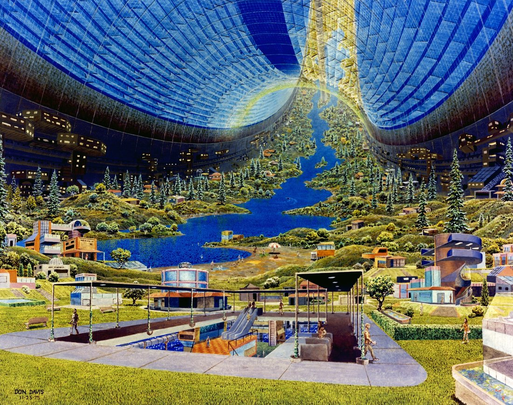
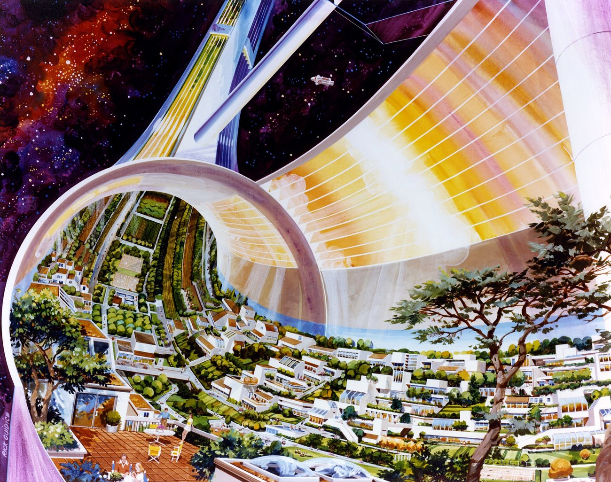
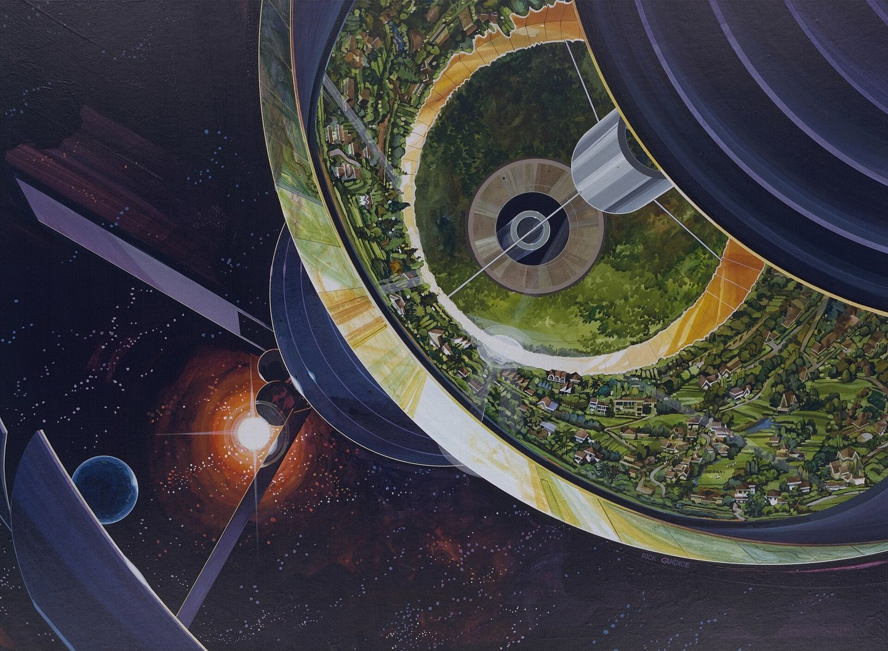

# Mood board — PULP HORIZON

*Graphic colour blocks, crisp ink edges, painterly gradient skies with a three-colour key per star system. A paperback cover you can blow apart.* — [DESIGN-SYSTEM §7](../DESIGN-SYSTEM.md#7-direction-c--pulp-horizon)

**What to look for:** big, honest fields of colour with a clean ink edge; each place remembered by its colour key; destruction that is graphic and joyful but still physical; mystery carried by composition and negative space, so the look never tips into toy-like.

**Images:** four public-domain NASA Ames space-colony paintings by Don Davis and Rick Guidice (1970s) from Wikimedia Commons, approved by the owner on 2026-10-10. Every other reference is a link only.

## Ships and stations

### British SF paperback covers
- **Creator:** Chris Foss
- **Year:** 1970–1985
- **Take:** Colour-blocked spacecraft with hazard stripes and huge hull numbers, painted big and confident.
- **Touchstone:** Chris Foss
- **Link:** https://en.wikipedia.org/wiki/Chris_Foss

### Stanford torus paintings for NASA Ames
- **Creator:** Rick Guidice (for NASA Ames Research Center)
- **Year:** 1975
- **Take:** Warm, optimistic engineering drawn at enormous scale, with cutaways that explain how the place works.
- **Touchstone:** Rick Guidice
- **Link:** https://en.wikipedia.org/wiki/Stanford_torus

Source: https://commons.wikimedia.org/wiki/File:Stanford_Torus_interior.jpg · Licence: Public domain

Source: https://commons.wikimedia.org/wiki/File:Stanford_Torus_cutaway.jpg · Licence: Public domain

### Bernal sphere paintings for NASA Ames
- **Creator:** Don Davis and Rick Guidice (for NASA Ames Research Center)
- **Year:** 1976
- **Take:** Simple primary shapes (sphere, ring, mirror) carrying huge stations, our station silhouette rule.
- **Touchstone:** Rick Guidice
- **Link:** https://en.wikipedia.org/wiki/Bernal_sphere

Source: https://commons.wikimedia.org/wiki/File:Artwork_by-_Rick_Guidice_Space_Colonization_-_Bernal_Sphere_(ARC-1976-AC76-1089).jpg · Licence: Public domain

Source: https://commons.wikimedia.org/wiki/File:Bernal_sphere_exterior.jpg · Licence: Public domain

## Space and lighting

### Moebius: vast, quiet places
- **Creator:** Jean Giraud (Moebius)
- **Year:** 1975–1990
- **Take:** Clean line, flat colour and enormous empty skies that feel calm and strange at once.
- **Touchstone:** Moebius
- **Link:** https://en.wikipedia.org/wiki/Jean_Giraud

### Sable
- **Creator:** Shedworks
- **Year:** 2021
- **Take:** Moebius-style line rendering made to work in a real-time 3D engine, with skies keyed to a few flat colours.
- **Touchstone:** Sable
- **Link:** https://en.wikipedia.org/wiki/Sable_(video_game)

### Chesley Bonestell's space paintings
- **Creator:** Chesley Bonestell
- **Year:** 1944–1986
- **Take:** Painterly gradient skies that make each world memorable by its colour, the idea behind the sky keys.
- **Link:** https://en.wikipedia.org/wiki/Chesley_Bonestell

## Destruction and VFX

### Teardown
- **Creator:** Tuxedo Labs
- **Year:** 2022
- **Take:** Voxel destruction that stays readable because every cell keeps its colour as it falls apart.
- **Touchstone:** Teardown
- **Link:** https://en.wikipedia.org/wiki/Teardown_(video_game)

### Whaam!
- **Creator:** Roy Lichtenstein
- **Year:** 1963
- **Take:** A flat starburst explosion with ink outlines and dot shading, our hit and explosion flipbooks.
- **Link:** https://en.wikipedia.org/wiki/Whaam!

### Ben Day dots
- **Creator:** Benjamin Henry Day Jr. (printing process)
- **Year:** 1879
- **Take:** Halftone dot density as a graphic way to show value, used here for damage stages.
- **Link:** https://en.wikipedia.org/wiki/Ben-Day_dots

## UI and typography

### Into the Breach
- **Creator:** Subset Games
- **Year:** 2018
- **Take:** Flat, crystal-clear tactical UI where every threat is shown before it happens.
- **Touchstone:** Into the Breach
- **Link:** https://en.wikipedia.org/wiki/Into_the_Breach

### FTL: Faster Than Light
- **Creator:** Subset Games
- **Year:** 2012
- **Take:** Ship systems shown as simple coloured rooms and segmented bars that are readable at a glance.
- **Touchstone:** FTL
- **Link:** https://en.wikipedia.org/wiki/FTL:_Faster_Than_Light

### Saul Bass title sequences
- **Creator:** Saul Bass
- **Year:** 1955–1995
- **Take:** Bold motion of flat shapes, the stamp and card-drop animations of the UI.
- **Touchstone:** Saul Bass
- **Link:** https://en.wikipedia.org/wiki/Saul_Bass

### Atkinson Hyperlegible (the proposed body type)
- **Creator:** Braille Institute of America and Applied Design Works
- **Year:** 2019
- **Take:** Letterforms designed so similar characters never get confused, under the SIL Open Font License.
- **Link:** https://fonts.google.com/specimen/Atkinson+Hyperlegible

## Otherness

### Outer Wilds: the Nomai and the Eye
- **Creator:** Mobius Digital
- **Year:** 2019
- **Take:** A stylised, warm world that still delivers awe and dread through the mystery it hides.
- **Touchstone:** Outer Wilds
- **Link:** https://en.wikipedia.org/wiki/Outer_Wilds

### Art Deco crowns (the Chrysler Building)
- **Creator:** William Van Alen (architect)
- **Year:** 1930
- **Take:** Stepped, fan-like gold and white plates, the Vanguard's shape language.
- **Link:** https://en.wikipedia.org/wiki/Chrysler_Building

### Risograph misregistration
- **Creator:** Riso Kagaku Corporation (printing process)
- **Year:** 1986–present
- **Take:** Ink layers that do not quite line up, the offset halo that makes the Silence look like a printing error in the world.
- **Link:** https://en.wikipedia.org/wiki/Risograph

## Audio playlist

### Outer Wilds (soundtrack)
- **Creator:** Andrew Prahlow
- **Year:** 2019
- **Take:** Banjo, harmonica and strings that turn lonely and cosmic, for exploration.
- **Link:** https://en.wikipedia.org/wiki/Outer_Wilds

### FTL: Faster Than Light (soundtrack)
- **Creator:** Ben Prunty
- **Year:** 2012
- **Take:** Each track has a calm and a battle version that cross-fade, the model for combat layers.
- **Link:** https://en.wikipedia.org/wiki/FTL:_Faster_Than_Light

### Oxygène
- **Creator:** Jean-Michel Jarre
- **Year:** 1976
- **Take:** Warm analogue synths that sound like the 1970s future, for travel between systems.
- **Link:** https://en.wikipedia.org/wiki/Oxyg%C3%A8ne

## Anti-references

### Plastic toy rendering (Lego Star Wars: The Skywalker Saga)
- **Creator:** TT Games
- **Year:** 2022
- **Take:** Avoid glossy plastic and bouncy comedy, since the tone must hold dread and destruction must feel physical.
- **Link:** https://en.wikipedia.org/wiki/Lego_Star_Wars:_The_Skywalker_Saga

### Borderlands: hatching everywhere
- **Creator:** Gearbox Software
- **Year:** 2009
- **Take:** Avoid hand-drawn hatching inside textures, since PULP HORIZON draws ink only at silhouettes and cell edges.
- **Link:** https://en.wikipedia.org/wiki/Borderlands_(video_game)

### The prototype's mixed icon styles (`22-inventory`)
- **Creator:** The old `spaceship-game` prototype
- **Year:** 2025–2026
- **Take:** Avoid outlined pixel-art icons at mixed scales beside vector UI, since one icon grid and one fill style is the rule.
- **Link:** [22-inventory.png](../../reference/audit-2026-10/screenshots/22-inventory.png)
