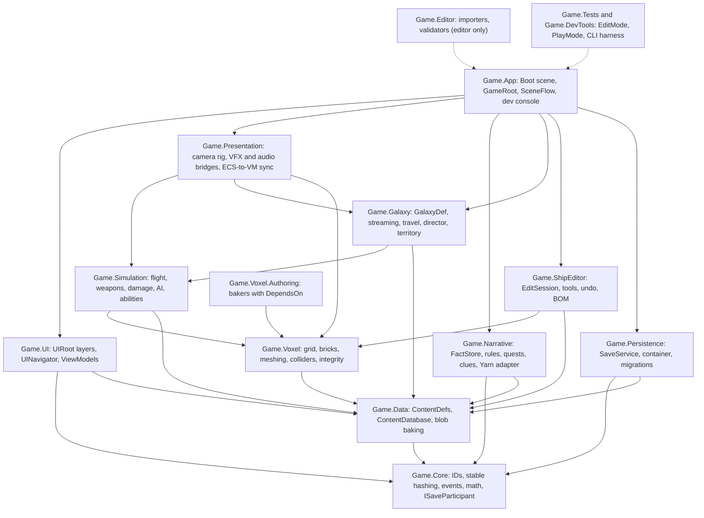
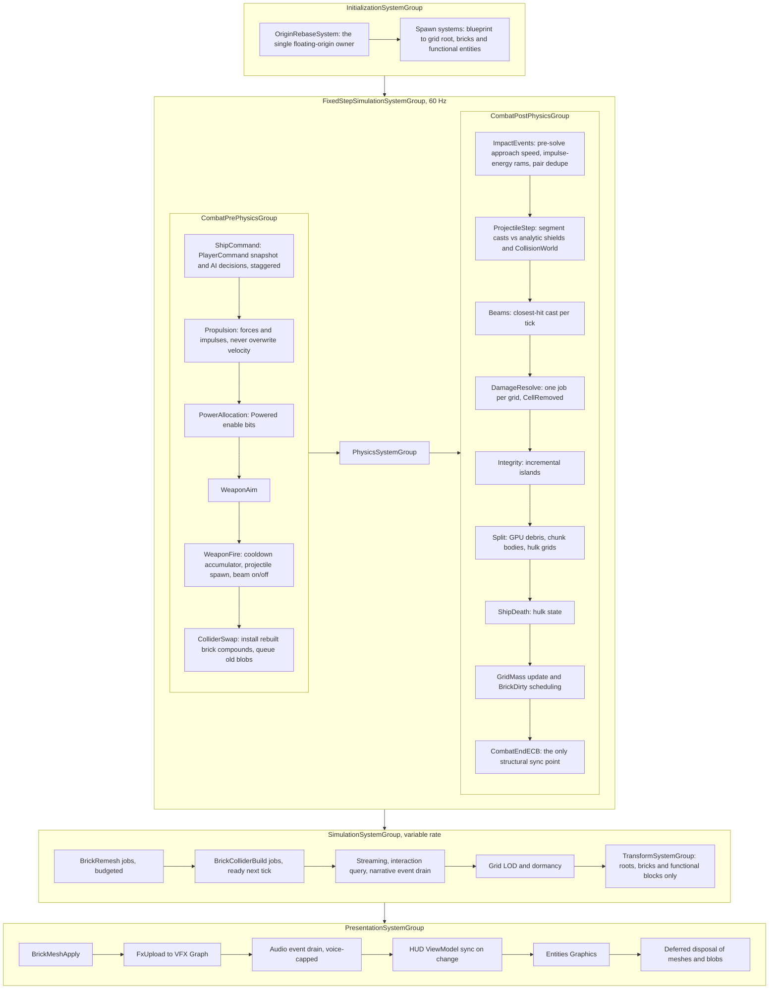

# 00: Synthesis brief for the Spaceship Game technical audit

**Date:** 2026-10-09. **Project:** `/Users/frank/DEV/spaceship-game`, Unity 6000.6.5f1 (Entities, Physics and Entities Graphics 6.6.0; URP 17.6).
**Inputs:** subsystem reports `01-voxel-core`, `02-combat-destruction`, `03-galaxy-world`, `04-persistence-data`, `05-narrative-quests`, `06-ui-shipeditor`, `07-project-health` (all in `docs/audit/`), plus the lead auditor's `LEDGER.md`.

**How to read the evidence**
- **`R#`** is a ledger runtime entry: something seen while playing the game through the Unity CLI and `Assets/_DevTools/Editor/GameTestHarness.cs`. These carry the most weight.
- **`01-B2`, `02-C05`, `03-S1`, `04-B1`, `05-B3`, `06-A1`, `07 §5`** are report and finding IDs. Several reports found the same defect, and every report that found it is listed.
- **runtime-confirmed** means a static finding that a ledger entry reproduced. **static** means it was read in code or assets but not reproduced. **[I]** marks an inference or estimate.
- File paths are relative to the repo root. File names are given without folders where the reports did the same.

---

## 1. Executive verdict

1. **Overall state.** The project is a DOTS prototype of about 39.4k LOC in 247 files, all compiled into one `Assembly-CSharp`. It carries three generations of design at once:
   - the roguelike node-map era (runs, permadeath, creative-mode loot);
   - a GameObject-based open world;
   - an ECS open world bolted on "side by side" (commit `bfa6daaf`).

   Several migrations stopped halfway. The project did not compile on Unity 6.6 until vendor code and one stale `using` were patched (ledger F1; 07 §4).
2. **What works (runtime-verified).**
   - The start menu renders (R1).
   - The six-page intro dialog plays with number-key choices (R6).
   - The player's ECS voxel ship spawns and flies at about 70 u/s once the legacy input reads were ported (R7 FIX).
   - Beams and plasma fire, asteroids die, and the explosion VFX look right (R20).
   - Buying from the merchant works (R12), and a manual save writes a slot (R27).
   - A force-spawned AI frigate orbits and fires (R21).
   - **The voxel debris spray looks good, so the core fantasy is already visible on screen** (R26).
   - At today's scale idle performance is fine: 4.4 ms CPU and 4.4 ms GPU with about 1,350 entities (R22).
3. **The open-world loop breaks in exactly the ways the owner remembers.**
   - "Systems not showing up" was reproduced three separate ways: loading from the pause menu (R28), a ship-editor round trip (R16, R19), and a hyperlane jump (R30).
   - "Data reset" comes mainly from a silent save-rejection gate and from state that is never persisted (04-B1, 03-D2, 04-B3).
   - Visual bugs come from UI layout, shaders Metal can't run, a camera pitch bug and stale ship blobs.
4. **Every solar system exists twice.** A GameObject generator (interaction, radar) and an ECS generator (colliders, belts) run side by side on the global `UnityEngine.Random`. They produce two different, overlapping systems (R9; 03-B1).
5. **Combat can't happen in normal play.** Nothing spawns an enemy ship (02-C13); the audit had to spawn one through the harness (R21). Once one is forced in:
   - the smallest frigate takes over a minute to kill (R21);
   - ship death throws ECB exceptions (R25, R26);
   - beams render through their targets (R26).
6. **The core loop has softlocks and an exploit.**
   - Stations are effectively impossible to interact with. The interaction radius is 7.2 u from the centre of a hull about 300 u across (R10).
   - "Visit Hangar Bay" leaves the dialog stuck open and the player parented to an orbiting station, after which nothing can ever be interacted with again (R19).
   - The ship editor duplicates items without limit (R15).
7. **The "massive ships" goal is blocked by the data representation, not by tuning.**
   - One entity per voxel costs about 0.14 µs of main thread per *idle* voxel. That puts a 1M-voxel station at about 140 ms per frame (R24).
   - Ships draw about 66 triangles per voxel, with no hidden-face culling (R24).
   - Combat between 12 ships (12.3k voxels) costs 38–44 ms of main thread (R26).
   - Saves cost about 150 B of JSON per voxel, so a 1M-voxel station would be about 150 MB (R27).
8. **The single biggest architectural constraint: there is no single ship model.** The same ship exists three ways, and none of them scales:
   - **In the editor:** one GameObject per block (`PlacedBlock` plus a `Dictionary<Vector3Int,…>`), which is 965 GameObjects for the starter fighter (R13).
   - **At runtime:** one ECS entity and one sphere collider per voxel (01 §1).
   - **In saves and ScriptableObjects:** a `List<VoxelData>` of strings and Euler floats (04 §2.3).

   The conversions between these three cause most of the voxel bugs. Examples are multi-cell blocks being ignored at runtime (01-B1), blob-cache mismatches (01-B8) and the editor item dupe (06-A1). The fix is one chunked 16³ grid model used everywhere (§6b).
9. **The second constraint: nobody owns state.**
   - Nine managers sit on one prefab, with about 40 mutable statics and singletons that create themselves on first access.
   - Pause is one bool, and all input maps are always enabled.
   - Narrative has four action vocabularies and five condition dialects (04 §2.2; 05 §3.1).

   Bugs appear at seams no one owns. For example, loading a save replaces the `Inventory` object and orphans everything subscribed to the old one (04-B2).
10. **Project hygiene slows everything down.**
    - The repo is 1.9 GB with no LFS, and history holds 672 MB of a texture pack that was already deleted.
    - One 577 MB vendor folder has 2 files in use.
    - Art that appears to come from the commercial game *Starsector* ships in builds, including the default cursor.
    - 4 of the 6 quality tiers point at deleted URP assets.
    - There are no tests (07 §0–§5).
11. **Recommendation.** Build the next version in a **fresh repo** (LFS, asmdefs, a Boot scene) around:
    - one voxel grid model;
    - a fixed-step, event-driven combat pipeline;
    - a seeded galaxy that saves only deltas;
    - a fact-store narrative.

    Port the writing, the content data, selected algorithms and the CLI harness. After a short Phase 0 stabilization, keep this repo as a playable reference (§8).

---

## 2. Root causes of the owner's remembered bugs

### 2a. "Solar systems not showing up"

There are five independent mechanisms. Any one of them is enough to leave the player in empty space.

**Chain A: loading from the pause menu applies the floating origin twice.** *Runtime-confirmed (R28; 03-S2; 04-B6).*
1. `PauseView.cs:105-114` calls `SaveManager.LoadSlot`. Because the active scene is GalaxyMapScene, the loaded state is applied immediately (`SaveManager.cs:563, 675-712`). The pause menu then reloads `GalaxyMapScene` in Single mode.
2. Until the new scene activates, the old `OpenWorldGalaxyManager.Update → SavePlayerState` keeps writing the *current* position into the freshly loaded save (`OpenWorldGalaxyManager.cs:159-197`). In R28 the player saved at (250,−300), moved to (600,600) and loaded; the absolute position stayed at (600,600).
3. The generator GameObjects are children of the DontDestroyOnLoad manager (`:455, :471`), so they survive the reload, anchored to the old origin. `activeSystems` still marks them as loaded, so nothing regenerates. `OnSceneLoaded` only resets for non-world scenes (`:60-71`).
4. `InitializeOpenWorld` sets a new origin from the save (`:81`), so the offset is now applied twice. The R28 log shows "Loading system ark_start at (0,0) (Distance: 848.53)" followed by "Unloading system ark_start out of range (Distance: 1697.06)": the home system unloads.
5. Collateral damage:
   - The player GameObject dies with the scene, but its ECS ship leaks (03-B7b, `CombatShip.cs:92-95`). Voxels carry the subscene `SceneTag` and ship roots don't (01-B6), so the leaked root survives with its voxels gone. In R28 `ShipVoxel` went from 966 to 1, and the root sat at (14419, 0, 13736).
   - World entities fell from 1,229 to 69.
   - An ECB `AppendRemovedComponentRecordError` was thrown during `OnSceneLoaded → InitializeOpenWorld → SpawnPlayerAtOrigin` (`OpenWorldGalaxyManager.cs:62/115/344/411`).
   - The load-list UI stayed open over the running game.

**Chain B: a ship-editor round trip shifts the player.** *Runtime-confirmed (R16, R19; 03-S1; 05-B5).*
1. In flight, `_lastPlayerLocalPosition` holds P, the position relative to the floating origin (`OpenWorldGalaxyManager.cs:172-178`). The save receives the absolute `origin + P` every frame (`:193-196`).
2. "Visit Hangar Bay" runs `DialogManager.ResolveOpenShipEditor` (`DialogManager.cs:626-640`), which loads the editor without calling `EndDialog`.
   - `IsDialogActive` stays true.
   - `LockPlayerForDialog` has already parented the player to the *orbiting* station, so `lastLocal` drifts with the orbit. In R19 the real ship was at (100,100) while lastLocal read (−31,222) and then (−41,234).
3. Leaving the world calls `ResetEntireState` (`:666-692`). It resets the origin but not `_lastPlayerLocalPosition`.
4. On return, `InitializeOpenWorld` sets the origin to the saved `origin + P` (`:81`) and spawns the ship at P (`:401`), so the player ends up at `origin + 2P`. In R16 the player came back at (−6.7, 0, 244.8) instead of about (60, 0, 0).
5. Systems load only within 1500 u, so one trip can strand the player, and each trip adds another P.
6. The stale `dialogEntity` makes `OpenWorldPlayerController.Update` return early forever (`OpenWorldPlayerController.cs:43`). That is a permanent interaction softlock (R19).

**Chain C: hyperlanes sit outside their own system's unload radius.** *Runtime-confirmed (R29, R30; 03-S3, 03-B18).*
1. The load radius equals the unload radius, both 1500 (`OpenWorldGalaxyConfig.asset` lines 19-20), with `<=` and `>` tests at `OpenWorldGalaxyManager.cs:448, 479`. There is no hysteresis.
2. Commit `bfa6daaf` raised the system scale from 1.5 to 4, which moved the hyperlanes out to about 1620–1670 u (`OpenWorldSolarSystemGenerator.cs:189`, `EcsSolarSystemGenerator.cs:163, 252`).
   - Flying toward a lane unloads the system that owns it.
   - Hovering near 1500 thrashes load and unload. Every reload re-rolls the system non-deterministically (03-D3) and leaks ECS entities (03-B7).
3. Using a lane flings the ship 300 u/s × 6 s = 1800 u, aimed exactly at the centre of the destination star 1350 u away (`HyperlaneEntityInstance.cs:93-101`, `hyperlane_default.asset:35-36`).
4. What R30 recorded after one lane:
   - The absolute position jumped to (7087, −13591), about 15k u from both systems, and `activeSystems` was empty.
   - `AsteroidConstructionJobSystem.cs:122` threw 1,635 NullReferenceExceptions.
   - 2,308 asteroid entities had leaked.

**Chain D: even loaded systems are hard to see.** *Runtime-confirmed (R7, R8, R21, R24, R29; 03-S4, S5).*
1. The content has only 2 systems, 3000 u apart (R29).
2. Nothing shows where systems are:
   - There is no galaxy map, and other systems aren't drawn beyond the 5000 u far clip.
   - The radar covers 1000 u, but a system extends to about 1670 u. The radar uses `overflow: hidden` and draws no edge arrows (`GalaxyView.Map.cs:15`, `GalaxyViewUI.uxml:25`).
   - The radar showed only the player (R8), none of 44 ships (R24) and no enemy (R21).
3. A new game spawns the ship 50 u from the star's centre (`OpenWorldGalaxyManager.cs:103`). That is inside both the star's 120–160 u visual radius and its 60–80 u collider. During the intro the camera sits at (0,0,0), the star's centre (`ThirdPersonCamera.cs:71-73`). In R7 the ship spawned hugging a voxel star that filled half the screen.
4. `ThirdPersonCamera.OnEnable` overwrote the 20° default pitch with 0. The camera started edge-on to the play plane, so belts and orbits drew as flat lines. This was fixed during the audit (R7 FIX).
5. Exponential grey fog greys lit objects by about 14% at 1500 u and about 39% at 5000 u (03-S8, static).

**Chain E: leaks and duplicates blur what is really there.** *Runtime-confirmed (R9, R16; 03-B1, 03-B7, 01-B10).*
- Two planet sets sit at different orbits. In R9 the GameObject rocky planet was at (−609,−334) and the ECS one at (−160,−319).
- Asteroid belts double after every editor trip. In R16 `Asteroid*` went from 962 to 1,924, because `EcsSolarSystemGenerator.DestroySystem` destroys only the centre entity (`:355-376`).
- Leaked planet bodies orbit the floating origin as invisible colliders (`OrbitSimulationSystem.cs:66-70`).

### 2b. "Data getting reset"

Ranked by likely contribution:

1. **A save is rejected after any content change.** *Static (04-B1 = 03-D1).*
   - `LoadSlot` refuses the save if `Version != 3` (`SaveManager.cs:513-518`), or if any of four fingerprints differs (`:788-841`). The fingerprints cover:
     - every item key, faction ID and `SolarSystemData`/`SolarSystemEntity` ID in all of Resources (`:856-940`);
     - `Application.version` (`:942-945`);
     - the *number* of `StartingItems` entries (`:947-961`).
   - Adding one item or bumping the version therefore rejects every existing save.
   - `StartView.cs:140-144` returns without a message. In the editor dev path, `EncounterManager.EnsureActiveSaveData` (`:195-206`) quietly hydrates a blank campaign instead.
2. **The rejected slot is then overwritten.** *Static (03-D1).* `StartView.cs:138-139` and `PauseView.cs:103-104` call `SetActiveSlot` *before* `LoadSlot`. When the load fails, the running game keeps the rejected slot active, and the next encounter checkpoint (`EncounterManager.cs:309-311`) overwrites it permanently.
3. **The galaxy regenerates differently, so saved IDs drift.** *Partly runtime-confirmed (R9; 03-D3, 03-B16).*
   - Instance IDs are `"{entityId}_{systemSeed}_{i}"` (`OpenWorldSolarSystemGenerator.cs:79`, `EcsSolarSystemGenerator.cs:89`). The type at slot `i` is a weighted roll on the *global* `UnityEngine.Random`, made after a coroutine `yield`.
   - Between those calls, other code consumes the same RNG: the other generator, `AudioManager.cs:149-150`, `DialogManager.cs:270`, `LootSystem.cs:27-86` and more.
   - The ECS generator skips some rolls for destroyed entities (`:244`), which shifts every later roll.
   - Saved "interacted" and "destroyed" flags then point at the wrong bodies.
   - The campaign seed is also never assigned (04-B11). R27 found `MapSeed=0` and `Seed=0`.
4. **Destroyed entities are never persisted.** *Static (03-D2).*
   - `EncounterManager.cs:278, 378, 386` call the legacy `MarkEntityDestroyed(int,…)` overload, which passes `string.Empty` as the system ID (`OpenWorldGalaxyManager.cs:587-592`).
   - `GetSolarSystemSaveData("")` returns null (`:539`), so the upsert does nothing (`:608`).
   - Derelicts and quest targets come back.
5. **Loading swaps out the `Inventory` object.** *Static (04-B2).*
   - `Player.cs:196` creates a new `Inventory` on every load.
   - The HUD (`GalaxyView.cs:20-34, 65-73`), the toast relay (`InventoryNotificationRelay.cs:12-25`) and the ShipItem-to-fleet conversion (`Player.cs:61-62`) stay subscribed to the old instance.
   - After any load, bought ships stay as inventory items and the HUD labels stop updating.
6. **Some state is never saved at all.** *Static (04-B3, B4, B7).*
   - Ship damage: `CombatManager.CaptureShipDamage` (`CombatManager.cs:173`) has no callers, so ships heal on load.
   - Inventory slot positions, the toolbar and capacity (`Player.cs:144-229`): the hotbar is reshuffled, and stacks beyond the 60th are dropped.
   - There is no autosave (`QueueAutosave` has no callers, `SaveManager.cs:567-577`) and no save on quit.
7. **Editor round trips desync state.** *Runtime-confirmed (R15; 06-A1, 04-B14).*
   - Inventory changes apply immediately, but the ship only changes on save. Leaving with Tab desyncs the two. In R15 the inventory gained 11 items while the ship was unchanged.
   - In DEV mode, auto-load leaves a stale pending clone. It reverts editor work when you enter the galaxy (`GameInitializer.cs:51-56`, `SaveManager.cs:668-712`).
8. **Roguelike flows still wipe progress.** *Static (04-B8).*
   - New games get `CreativeModeLootTable` plus 5000 credits (`NewGameSettings.asset:16`, `EncounterManager.cs:557-585`).
   - Defeat trims the fleet to the flagship.
   - "Continue" after a run ends wipes inventory, fleet and quests (`EncounterManager.cs:483-555`).
9. **Scene changes destroy voxels.** *Runtime-confirmed (R28; 01-B6).* Voxel instances inherit the subscene `SceneTag`. Leaving GalaxyMapScene destroys them, while the ship roots survive.
10. **Some settings don't stick.** *Static (04-B12, B13).*
    - Music volume compounds toward 0 on every slider tick (`AudioManager.cs:81-93`).
    - Brightness, sensitivity, invert-Y, resolution, rebinds and locale are stored but either unused or not persisted.

### 2c. Visual bugs

| Class | Symptom | Cause | Evidence |
|---|---|---|---|
| Shaders | Magenta ghost block in the editor | `Wireframe.shader` uses `#pragma geometry`, and Metal has no geometry shaders | **R13**; 06-C7 |
| | Magenta plane on the star | `StarlightMat.mat` uses the built-in `Particles/Standard Unlit` shader | 07 §6 (static) |
| Camera | Belts and orbits drawn as lines; edge-on start | `ThirdPersonCamera.OnEnable` set the pitch to 0 (fixed during the audit) | **R7 FIX** |
| | Camera swoops on an origin shift; camera inside the star | The camera isn't shifted with the origin (`ThirdPersonCamera.cs:114-127`); it has no target until the ship exists (`:71-73`) | 03-B9c, 03-S5 |
| Wrong or stale ship blocks | Repaints and rotations don't show; different ships share one look; R23 found distinct ship types with identical voxel counts | The blob cache hash ignores rotation, colour and modules and treats unresolved block IDs as 0 (`GameDatabase.cs:62-77`, `ShipData.cs:88-115`). The cache is never cleared. | 01-B8, 04-B5; R23 suggests this |
| | New or renamed blocks render as mesh 0 | The baker keys meshes by `string.GetHashCode` and declares no `DependsOn` (`VoxelPrefabAuthoring.cs:61, 89-90, 117-136`) | 01-B9, 04-B31 (static) |
| Duplicated world | Two planet sets, two stars and two shadowed point lights per star; doubled belts | Two generators; belts are never destroyed | **R9, R16**; 03-B1, 01-B10 |
| Combat | Beams pass through targets | Beam length isn't clipped at the hit point | **R26** (static cause not isolated) |
| | Debris vanishes the moment a ship dies | Voxels stay in the ship's `LinkedEntityGroup` | 01-B5 = 02-C04 |
| | Half the asteroids look identical | Negative seeds all map to 1 (`AsteroidLayoutJobSystem.cs:45`) | 01-B11 |
| HUD and UI | Unreadable name field; a stray rectangle and a line across the screen at y≈360; AUTOFIRE over FUEL; dark-on-dark text; the portrait covers dialog text and options run off-screen; tab rows overflow; the inventory top row is clipped; Fleet headers overlap and its stats read 0; the editor HUD shows in the galaxy | PanelSettings uses 1200×800 matched on width, which is 675 logical px tall on 16:9 (06-E7). 17 UIDocuments have tied sort orders (06-E2). A global rule centres every scroll view (06-E8). Some USS classes are undefined (06-E10). FleetView stats are never queried (06-E1). The stats HUD is never hidden after a Single load (06-B7). | **R4, R5, R7, R11, R12, R13, R16, R31** |
| Shadows and lighting | Blotchy or missing self-shadowing on voxels; washed-out silhouettes | The shadowmap is 512 px over 500 m (about 1–2 m per texel against 0.5 m voxels); fog and realtime GI are on in space; MSAA and FXAA run together | 07 §5 (static) |
| Dialog | The text box opens scrolled mid-paragraph | Not root-caused by any report | **R5, R6** |

---

## 3. Top 25 bugs

Severity: **Crit** blocks the core loop or loses progress; **High** is a frequent visible break or a correctness bug at the heart of a system; **Med** is narrower in impact.

| # | Sev | Subsystem | Title | Evidence (file:line, report) | Runtime | Fix direction |
|---|---|---|---|---|---|---|
| 1 | Crit | Galaxy, persistence | Loading from the pause menu applies the origin twice; the home system unloads; the player ship leaks | `PauseView.cs:105-114`; `OpenWorldGalaxyManager.cs:58-72, 81, 159-197, 455, 471`; `CombatShip.cs:92-95` (03-S2, 03-B7b, 04-B6) | **R28** | Reset world state in `InitializeOpenWorld`; don't write the position during transitions; despawn by a `PlayerTag` query |
| 2 | Crit | Galaxy, narrative | Editor round trip: the position doubles (origin + 2P), the dialog never ends, and the player stays parented to an orbiting station, so interaction softlocks | `OpenWorldGalaxyManager.cs:172-196, 401, 666-692`; `DialogManager.cs:626-640`; `OpenWorldPlayerController.cs:43, 143-146` (03-S1, 05-B5) | **R16, R19** | Zero the local offset on reset; one `AbortEncounter` path that unparents and unlocks |
| 3 | Crit | Galaxy | Hyperlanes sit outside the unload radius, and the fling aims through the star, stranding the player about 15k u out | `OpenWorldGalaxyConfig.asset:19-20`; `OpenWorldGalaxyManager.cs:448, 479`; `HyperlaneEntityInstance.cs:93-101` (03-S3, 03-B18) | **R29, R30** | Hysteresis derived from system extent; jumps arrive at the lane's entry point |
| 4 | Crit | Persistence | The fingerprint and version gate rejects saves silently, and the rejected slot is later overwritten | `SaveManager.cs:513-526, 788-961`; `StartView.cs:138-144`; `PauseView.cs:103-111`; `EncounterManager.cs:309-311` (04-B1, 03-D1) | static | Validate the schema only; migrate; show errors; set the active slot only after a successful load |
| 5 | Crit | Ship editor | Infinite item duplication: inventory edits apply at once but the ship only on save, and Tab exits. Templates also give free blocks, and destroyed blocks refund in full | `ShipEditorManager.cs:377-397, 716-748`; `ShipEditorController.cs:75-95, 178-189` (06-A1, A2, A4) | **R15** | A draft/commit edit session with a bill of materials; snapshot and restore in the meantime |
| 6 | Crit | Galaxy | Two different solar systems are generated per system (GameObject and ECS, on the global RNG) | `OpenWorldGalaxyManager.cs:454-477`; `OpenWorldSolarSystemGenerator.cs:41, 51`; `EcsSolarSystemGenerator.cs:56, 66` (03-B1, B16) | **R9** | One ECS path with a local seeded RNG |
| 7 | Crit | Combat | No enemy ship ever spawns; combat encounters are rejected | `OpenWorldGalaxyManager.cs:399-405`; `EncounterManager.cs:177-192`; `DialogManager.cs:579-593` (02-C13) | **R21** (enemy only via the harness) | An encounter director that spawns ECS fleets |
| 8 | Crit | Interaction | Stations can't be interacted with: the radius is 7.2 u from the centre of a hull about 300 u across. PhysX triggers never fire because nothing has a Rigidbody | `OpenWorldPlayerController.cs:55-80, 165`; `NEW COMBAT SHIP PLAYER.prefab:102-121` (03-B15) | **R10** | Measure to the collider surface or use a per-entity radius; an ECS interaction query |
| 9 | Crit | Narrative | `system.entered`, `territory.entered` and `entity.interacted` are never published, so 3 objective types and 2 triggers are dead and the Whisper Chain can't be completed | `GameEventBus.cs:7-9`; `QuestManager.cs:987-1027` (05-B1, 03-B12) | static | Publish typed world events |
| 10 | Crit | Narrative | Content uses removed item IDs (`500`, `717185106`), so the gate, the survey and every collect quest are impossible | `GameDatabase.cs:221`; `StoryEvents.json`, `QuestDefinitions.json` (05-B2) | static | Use registry keys; make the importers validate them |
| 11 | High | Galaxy, persistence | Destroyed entities are never persisted, and generated IDs drift | `EncounterManager.cs:278, 378, 386`; `OpenWorldGalaxyManager.cs:539, 587-608`; `EcsSolarSystemGenerator.cs:244, 280-281` (03-D2, D3) | partly (**R9**) | Structural IDs; pass the system ID; generate everything first, then apply deltas |
| 12 | High | Combat, ECS | Ship death throws during ECB playback, the `LinkedEntityGroup` deletes all in-flight debris, and 60% of the ship vanishes in one frame | `ShipHealthSystem.cs:29-33`; `EntityLifetimeSystem.cs:158-161, 172-175`; `ShipConstructionJobSystem.cs:264-265, 321`; `VoxelDestructionSystem.cs:209-343` (02-C04, C05; 01-B5) | **R25, R26** | Explicit system order; a `Dying` state; keep voxels out of the LEG; turn dead ships into hulks instead of deleting them |
| 13 | High | Combat | Hits damage the wrong voxel or none: a key-bit bug for power-of-two child counts, plus splash centred on the post-step position with a radius smaller than one step's travel | `VoxelPhysicsUtils.cs:63-72`; `ProjectileCollisionSystem.cs:103-111`; `EntityLifetimeSystem.cs:102-107, 223-255` (01-B2 = 02-C01; 02-C03) | **R21** (TTK over a minute; the enemy's voxel count never dropped) | Cast from the previous to the current position; resolve hits in grid space |
| 14 | High | Combat, physics | Collision and trigger events are consumed outside the fixed step, so ram damage scales with FPS and hits are lost below 60 FPS | `ShipCollisionSystem.cs:71-72, 167-169`; `ProjectileCollisionSystem.cs:24, 55` (02-C02) | static | Consume the events in FixedStep after physics |
| 15 | High | Voxel, physics | Compound collider blobs leak, and rebuilds starve under sustained fire, leaving invisible blockers | `ShipColliderRebuildSystem.cs:31-35, 46-56, 178-181`; `VoxelDestructionSystem.cs:242` (01-B3, B7 = 02-C06, C07) | static | A cleanup component with deferred dispose; a rebuild deadline that new damage can't reset |
| 16 | High | Voxel | Multi-cell blocks are treated as one root cell at runtime, causing false detachment and collider holes | `VoxelConnectivitySystem.cs:104-115`; `ShipConstructionJobSystem.cs:370-387`; `BlockDatabaseBlob.cs:12-40` (01-B1, 02-C32) | static | Store cells in the block definition and occupancy in the grid |
| 17 | High | ECS lifecycle | Unload and scene changes leak: belts double, physics bodies orbit the origin, voxels are scene-tagged, and an NRE storm follows | `EcsSolarSystemGenerator.cs:196-213, 355-376`; `OrbitSimulationSystem.cs:66-70`; `AsteroidConstructionJobSystem.cs:122` (03-B7, 01-B6, 01-B10) | **R16, R28, R30** | A `SystemMember` tag and one destroy query; stop instancing subscene prefabs |
| 18 | High | Persistence | Loading replaces the `Inventory` instance, orphaning the HUD, the toasts and ship conversion | `Player.cs:62, 196`; `GalaxyView.cs:20-34`; `InventoryNotificationRelay.cs:12-25` (04-B2) | static | Restore in place; session objects with a stable identity |
| 19 | High | UI, input | Pause is one bool. Fleet's X button leaves the game paused; Esc closes 5 of 17 views, then unpauses; hotkeys fire while typing; Tab is bound to 3 actions | `PauseManager.cs:10-15`; `FleetView.cs:75`; `UIManager.cs:85-94, 254-258`; `InputManager.cs:39-59` (06-B1–B5; 04-B16, B17) | **R17, R19** (Tab opened Intel) | A navigation stack that drives ref-counted pause and input contexts |
| 20 | High | Narrative | Dialog softlocks: PLAY_FROM_POOL with no pools (reachable from the ARK Station Bar), 5 dangling START_COMBAT assets and missing pages; option buttons are never re-enabled | `NarrativeView.cs:472-479`; `DialogManager.cs:111-116, 296-317, 589-593` (05-B4) | **R11** (the hub path is reachable) | One abort path; a guaranteed "Leave" option; content validation |
| 21 | High | Narrative | Quests complete instantly or retroactively from lifetime history; renamed quests auto-complete on load and run their side effects | `QuestManager.cs:221, 255, 978-981, 1068-1158, 1516-1519` (05-B3, B8) | static | Baselines captured at accept time; never run effects during a load |
| 22 | High | Persistence | Ship damage and inventory layout/capacity are never saved; there is no autosave and no save on quit | `CombatManager.cs:173`; `Player.cs:144-229`; `SaveManager.cs:567-577` (04-B3, B4, B7) | static | A save-participant writeback; autosave plus `wantsToQuit` |
| 23 | Med | Voxel, data | The ship blob cache key is incomplete, and the baker uses `GetHashCode` with no `DependsOn`, giving wrong or stale block visuals; blobs leak | `GameDatabase.cs:62-77`; `ShipData.cs:88-115, 173-196`; `VoxelPrefabAuthoring.cs:61, 89-90, 133-135` (01-B8, B9; 04-B5, B9, B31) | suggested by **R23** | Key on a revision counter or xxHash; stable IDs; declare `DependsOn` |
| 24 | Med | Ship editor | Loading runs O(N²) validation, and every block is a GameObject with a canvas and one BoxCollider per cell | `ShipEditorManager.cs:238-270, 835-970`; `PlacedBlock.cs:26-45` (06-P1, P2) | **R13** (965 GameObjects) | Validate once; a shared grid with chunk meshing |
| 25 | Med | Flight, physics | Movement overwrites `PhysicsVelocity` every frame, so rams have no physical response; ram speed is read after the solver; drag depends on frame rate | `ShipMovementSystem.cs:107, 119, 181`; `ShipCollisionSystem.cs:139-148` (01-B13, 02-C09) | not isolated (R20 saw +X drift of ~0.3 u/s with no input [I], possibly related) | Force-driven thrust in FixedStep; exponential damping |

---

## 4. Dead, deprecated and duplicate code

**Proof types:**
- **NR**: no references (grep across `Assets/Game`).
- **GUID**: the script or asset GUID appears in no scene, prefab or asset.
- **CO**: commented out.
- **UR**: unreachable at runtime (a query never matches, or the caller never runs).
- **DUP**: duplicate.

**Estimated total [I]:** at least 3.5k deletable lines. That adds up the reports' own estimates (about 400 + 1,000 + 500 + 480 + 236 + ~760 in SaveManager), *before* counting the legacy GameObject generator path and the dead UI views.

### 4.1 Voxel core (about 400 lines and 2 meshes; 01 §4 and §7.17)

| Item | Proof | Found by |
|---|---|---|
| `ShipVoxelBuffer.cs` (duplicates `ShipVoxelIndex`) | NR | 01 |
| `ShipDefinitionAuthoring` | GUID `70909ad3…` unused; baker body CO `:16-19` | 01 |
| `Camera/PlayerShipCameraFollowSystem.cs` (61 lines) | CO in full | 01, 03 |
| `GameObjectSyncSystem`, `ObjectTransformSync`; `GameDatabase.SyncTransformDictionary`, `RegisterSyncTransform`, `TryGetSyncObject`, `UnregisterSyncTransform` (`GameDatabase.cs:12, 157-176`) | UR: nothing adds the component, so `RequireForUpdate` never passes | Ledger F2, 01, 04 |
| `ShipBlobReference` (`ShipDataBlob.cs:53-56`), `VoxelPrefabReference` (`VoxelPrefabAuthoring.cs:23-26`) | NR | 01 |
| `ShipDataBlob.AllModuleSlots`, `VoxelBlobData.ModuleSlotsStart/Count` | Allocation CO (`ShipBlobBuilder.cs:47, 72-79`) | 01 |
| `ShipData.GetOrCreateBlobAsset`, `InvalidateBlobAsset`, `_blobAsset` and the finalizer (`ShipData.cs:139-146, 253-254`) | NR (spawning uses the GameDatabase cache) | 01, 04 |
| `ShipStatCalculator.CalculateShipStats`, `GetNeighborPositions`, `ComputedVoxelStats` | NR | 01 |
| `ShipVoxel.Size`, `ShipVoxel.IsExposed` | NR | 01, 02 |
| Four `VoxelVisualData` fields; `GameDatabase.ShipMeshDictionary`, `RegisterVisualData`, `TryGetVisual`, `_registry` | NR | 01, 04 |
| `shipVoxel_cube.obj`, `shipVoxel_verticalslab.obj` | GUID | 01 |
| `ShipInputComponent.PitchInput/RollInput`; `IsSinking`, `SinkTimer`, `MarkShipForSinking` | UR | 01, 02 |

### 4.2 Combat (about 1,000 lines and 6 assets; 02 §3)

| Item | Proof |
|---|---|
| `ScrapMagnetismSystem` (OnUpdate CO `:33-79`), `ShieldComponent` [Obsolete], `ShieldHitEvent`, `ProjectileHit`, `CombatResult` | CO / NR |
| `AIWeaponTag`, `MirrorTag`, `MirrorComponent.AccumulatedDamage/BeamCount/BeamDamageMultiplier/BeamThickness`, `BeamComponent.DamageAccumulator`, `ProjectileComponent.ProjectileSize`, `ShipMaster.MaxRange/targetShipPos`, `AIShipNavigationComponent.NextTargetCheckTime` | Written, never read |
| `JustTeleportedTag`, `TeleportCooldownJob` | CO |
| `ExtractionRiftTrigger` (stub); `PortalTrigger.cs` (contains class `PortalInteractable`, so the file and class names don't match) plus `CombatExitPortal.prefab` | Stub / GUID |
| `OverclockAbilitySO` (a copy of Boost, no asset), `BoostCameraController` ("TODO:REMOVE"), `AsteroidMiner`, `CameraShake`, `CameraShakeController` | GUID |
| `EnsurePhysicsSimulateSystem` | UR (its `WithNone<Simulate>` query never matches) |
| NetCode `WorldSystemFilter` remnants (`WeaponFireSystem.cs:14-15, 244`) | Dead config |
| Direct-hit branch (`EntityLifetimeSystem.cs:108-137`), `ScrapTag` branches (`:130-133, 248-251`), asteroid "debris" spawning (`:261-300`) | UR |
| AI pitch and roll maths (`AIShipNavigationSystem.cs:183-191, 270-289`) | UR, and wrong |
| `base_projectilePrefab.prefab`, `base_projectileLighting.prefab`; `ParticleSpawner.explosionParticle/SpawnSmoke` | GUID / NR |
| `CombatManager`: `using QFSW.QC`, `defaultSpawnSpacing`, `maxShipsPerRow`, `DespawnShips` | NR. Note that `CaptureShipDamage` should be *wired up*, not deleted |
| Pipelines that are functionally dead: shields (`ShieldSystem`, `ShieldVisualSystem`, `ShieldToggleAbilitySO`, `ShieldBubblePrefabAuthoring` with `ShieldEntityPrefab`), abilities (`Abilities/*`, `CombatHudSystem.cs:43-70`), AI (`AI/*`) | UR (01-B4, 02-C14/C15/C13). Rewrite these; don't just delete them |

### 4.3 Galaxy and world (03 §3)

| Item | Proof |
|---|---|
| `MapConnectionVisualizer.cs` (a single comment line), `MapCameraController.cs` (236 lines, GUID `4b85b02a…` unused) | NR / GUID |
| `OrbitalCamera.cs` (on no GameObject), `SolarSystemCameraStateData`, `OrbitalCameraStateData` | GUID; the save types are never written |
| `EntitySpawnCondition.cs`; `SolarSystemEntityCatalog.cs` (its fallback is never taken, and it calls `Resources.LoadAll("")`) | NR / UR |
| `GalaxyData.cs` and `GalaxyData_01.asset` (`GetCurrentGalaxy()` returns null) | No loader |
| `CombatEncounter`, `FleetFormation`, and the boss, extraction and survivor encounter assets (two have missing scripts) | UR |
| Legacy API bridge at `OpenWorldGalaxyManager.cs:655-738`, including the stubs `QueueEntitySpawn`, `RegisterPersistentEntityReplacement` and `RequestExitCurrentSolarSystem` (`:699-715`) | Stubs that still have callers (03-B11). Replace them; don't just delete them |
| Declaration-only members on `StarEntity`, `SolarSystemData`, `PlanetEntity`, `PlanetInstance` and `StarInstance`; `FloatingOriginOffset`; `OrbitComponent.PositionOffset`; `isGenerating` (×2); `HyperlaneEntityInstance.isActive/activeParticles` | NR |
| `PersistentSingleton.cs:22-26` special case for "GalaxyManager"; `SceneLoader` constants `BattleSceneName`, `ManagersSceneName`, `SpaceStationScene` | NR (the referenced types and scenes no longer exist) |
| Scene leftovers: the inactive Blackhole (`GalaxyMapScene.unity:562`), the unbaked `PhysicsStepAuthoring` (`:154-180`), the disabled directional light, `Galaxy.prefab` (missing script), the StarNode, Tile and Unit layers, and 55 disabled CFXR explosion GameObjects pre-placed as a manual pool (R5) | GUID / UR |
| **The entire legacy GameObject generator path** (`OpenWorldSolarSystemGenerator`, `OpenWorldSolarSystemEntityInstance`, `HyperlaneEntityInstance`) | About 80% DUP of the ECS path (`:32-231` vs `:51-229`) |

### 4.4 Persistence, data and managers (04 §4)

| Item | Proof |
|---|---|
| `InventoryData.cs`, `BindableProperty.cs`, `SerializableGuid.cs`, `GuidExtensions.cs`, `Utils/Editor/InstanceCombiner.cs`, `TimelineSpeed.cs`, `LootObject.cs`, `StorageObject.cs`, `CombatAudioListener.cs`, `BrightnessController.cs`, `GameDataExporterWindow.cs` | NR / GUID |
| `Data/GameData.json`, `ItemsData.json`, `CombatEncountersData.json`, `NarrativeEvents.csv`, `Loot Tables/StartShipsTable.asset`; `GameDescription.txt` (describes the old roguelike; rewrite it) | GUID |
| `SaveManager.cs` (1,749 lines): the audit subsystem (about 560 lines at `:54-167, :1031-1479`) should become dev-only; the fingerprint baseline (`:758-961`) is harmful; the autosave machinery, `CreateProfile`, `ListProfiles` and `ResolveExistingGalaxyManager` (`:778-786`) have no callers | NR / harmful |
| Dead `GameSaveData` schema: `SpawnedEntityRecords`, `ReplacementRecords`, `RuntimeSpawnCounter`, `PlayerAnchorState`, `CameraState`, `HasSpawnedInCampaign`, `PersistentWorldMutations`, `Extensions` (×2), `TotalPlayTimeTicks`, `EntityStateEntryData.HasTransform/Position/EulerRotation`, `PlayerState.Fuel/ToolbarInventory`, `MapSeed` | Never written or never read |
| `GameInitializer.disableBurst/ConfigureBurstForBuildDebugging`; `Player.ProfileImageName/GetProfileTexture/RemoveShipFromFleet/EnsureFleetThumbnailsLoaded/OnInitialized/Name`; `Ship.RepairVoxel`; `GameDatabase.HandleScrapGained` | NR |
| 48 assets still carry an orphaned YAML `Id:` field | Fix with *Force Reserialize Assets* |

### 4.5 Narrative (about 500 lines; 05 §3.2)

| Item | Proof |
|---|---|
| `NarrativeEvents.csv` (a stale subset: 27 of 34 encounters) | NR |
| `NarrativePool.cs`, `DialogManager.PlayFromPool` | 0 assets, and the folder doesn't exist |
| `DialogManager.ResolveOutcome/ResolveRepairAllShips/IsFleetDamaged/CurrentOptions`; `EncounterManager.ResolveOutcome/GetIntVariable`; `NarrativeView.ParseEndEncounterSuccess` | NR |
| The Trade, StartCombat, Repair, OpenShipEditor and PlayAudio branches of `NarrativeActionEngine` | UR (reachable only when DialogManager is null) |
| `QuestManager` marker API (`GetMissionMarkerIcon`, `ShouldShowMarkerForSystem`, `TryGetSystemMarkerLabel`, `MarkerSystemMatches`, `GetActiveQuests`); `hiddenUntilActive`; the `legacy_requirement` primitive | NR |
| Tautological bridges of the form `if (X.Instance != null) X.Instance.M(); else X.Instance?.M();` (`QuestActionExecutor.cs:119-122, 133-137, 142-145, 195-197`; `NarrativeActionRuntime.cs:562-563, 589-592, 607-609, 690-691`; `EncounterManager.cs:418-420, 479-480, 508-509, 525-526`) | Dead `else` branches |
| `SpaceStationTimeline.playable`, `Galaxy CutsceneTimeline.playable` | Unreachable |
| Dead content: 13 of 34 encounters can't be reached, 42 world variables are written but never read, and a debug "Mission Control" page ships on the ARK station | UR |
| Note: `DialogManager.IsOptionConsumed` has no callers, but it should be *wired up* (05-B6) | — |

### 4.6 UI and ship editor (06 §3)

| Item | Proof |
|---|---|
| `TradeView.cs` (480 lines), `TradeUI.uxml`, `Pages/TradePageUI.uxml` (0 bytes) | GUID `8857ae61…` |
| `StorageViewPage` with `StoragePageUI.uxml` and the UIStorage GameObject; `LootPickerView` with `LootPickerUI.uxml` and UILootPicker (keep `LootPickerStyles.uss`, which Merchant uses); `RunEndView` with `RunEndUI.uxml`, `RunEndStyles.uss` and UIRunEnd, plus `EncounterManager.EndRun/HandleRunEndContinue/GenerateEncounterLoot/AddEncounterLoot` | UR (no callers) |
| `ShipSelectionController`, `ShipSelectionVisualizer`, `ShipBlockVisualOnly.prefab` | GUID (`f370f2f4…`, `8a1a2298…`) |
| `GhostBlockCollision.cs` and its runtime `AddComponent` (`ShipEditorController.cs:698`) | UR: the MeshCollider has no mesh |
| `ShipEditorController`: `FixedUpdate` (`:166-176`), `PlaceSlottable` (`:834-841`), `neighborChecks` (`:1018-1023`), `voxelPrefab`, `ghostCollision`, and others. `ShipEditorManager`: `EditVoxel` (`:58-62`), `ChangeCurrentEditShip` (`:804-808`), `AddShipSlottable`, an unused `queue` (`:887`) | NR |
| `UIManager.ToggleCombatHudView`, `RefreshView` and commented-out blocks; `ItemInfoHelper.GetAbilityTooltipData` (use it or delete it) | NR |
| `UIShaders/TestShader.shadergraph`, `UITestMat.mat`, `WorldUI.uxml`, `event_dialogue.uss`; the UXML content of Inventory, Toolbar and Storage (wiped by `root.Clear()` at runtime); stale overrides at `ShipEditorScene.unity:708-739` | GUID / UR |

**Conflicts resolved:**
- 06 calls MicroBar unreferenced. 04 and 07 show that `CombatShip.cs:1,28` and the NEW COMBAT SHIP prefabs use it. It is **live**: replace it first, then remove it.
- 04 lists `Inventory.CreateSnapshot/RestoreFromSnapshot` as dead along with TradeView, but 06's quick win uses them. **Keep them** until the editor's draft/commit session lands.

### 4.7 Project level (07)

- **Packages:** PPv2 (and its `UNITY_POST_PROCESSING_STACK_V2` define on 16 platforms), Visual Scripting, AI Navigation (and the AI module), Collab-proxy, ide.vscode, Timeline (together with `ShipSelection*`), plus the unused engine modules listed in 07 §1. Also the `USE_NEW_INPUT` define and the Netcode ProjectSettings leftovers (`NetCodeClientAndServerSettings.asset`, `NetCodeClientSettings.asset`, `NetCodeServerSettings.asset`, `MultiplayerManager.asset`).
- **Repo root:** 14 tracked log and scratch files, including the 30 MB `build_log4.txt`, plus `old_ui.cs`, `prev_gv.cs`, `Spaceship Game.slnx` and `UIElementsSchema/`.
- **Assets:**
  - `SceneDependencyCache/`, `StarMat.mat`, `cfxr magic star hdr ab.mat`, `BaseHeightMat.mat`.
  - Two BiRP surface shaders, plus `MetallicShipShader.shader` (an HLSL duplicate of the shadergraph), `HeightColorShader.shadergraph` and `Water.shadergraph`.
  - `MultiplayerShip.prefab`.
  - 74 unreachable non-code files (20.1 MB).
- **Settings:** the build list still has `CombatScene.unity` (enabled) and `SpaceStationScene.unity`, both deleted; 4 quality tiers reference deleted URP assets.

### 4.8 Duplicated logic clusters

| Cluster | Copies | Where | Keep |
|---|---|---|---|
| Solar-system generation | 2 live, plus a deleted Gen-1 | `OpenWorldSolarSystemGenerator` vs `EcsSolarSystemGenerator` (03) | One seeded ECS path |
| Ship representation | 3, plus a 4th format | Editor GameObjects and dictionary; one ECS entity per voxel; `List<VoxelData>` YAML/JSON; `ShipTemplates/*.json` (04 §4.4, 06 §1.4) | One grid model (§6b) |
| Physics engines | 2 | PhysX at 50 Hz and Unity Physics at 60 Hz (07 §5) | Unity Physics |
| PhysicsStep sources | 2 | `PhysicsSetup.cs:15-21` and the unbaked authoring | A baked `PhysicsStep.Default` |
| Narrative actions | 4 vocabularies | `OutcomeType`, CUSTOM_ACTION strings, `QuestActionType`, `DialogManager.Resolve*` plus its copy in `NarrativeActionEngine` (05) | One `IEffect` |
| Narrative conditions | 5 dialects | `ConditionNode`, `REQ_*` strings, a REQ fallback, `EntitySpawnCondition`, `CanAffordOption` (05) | One `ICondition` |
| Narrative helpers | ParseFuncParams ×3, PlayAudioByName ×3, bool parsing ×4 (each accepting different tokens), faction resolution ×3 | 05 §3.1 | Delete |
| "Current encounter" owners and importers | 2 owners; 2 JSON libraries | `NarrativeView` vs `DialogManager`; JsonUtility vs Newtonsoft (05) | One of each |
| World-state stores | 3 | EncounterManager run/persist dictionaries, QuestManager history sets, GameDatabase faction relations | `FactStore` |
| Repair cost | 3 | `FleetView.cs:356-381`, `DialogManager.cs:646-680`, `NarrativeActionRuntime.cs:419-439` | `ShipService` |
| Open the ship editor | 2 | `DialogManager.cs:626-640`, `NarrativeActionRuntime.cs:441-462` | 1 |
| Thumbnail loading | 2 loaders, 2 naming schemes | `FleetView.cs:498-532`, `Player.cs:250-312` | 1, keyed by ship ID |
| Cell rotation maths | 5 | ShipEditorController ×3, ShipEditorManager ×2 (06 §1.5) | 24-orientation tables |
| Camera-state DTOs | 2 identical | `GameSaveData.cs:262-308` | Delete both |
| `ResolveExistingGalaxyManager` | 2 | `SaveManager.cs:778`, `EncounterManager.cs:751` | Delete |
| Inventory combine APIs | 3 | `Inventory.cs:76-89, 348-418` | 1 |
| Volume maths | 5 | `AudioManager` | An AudioMixer |
| Damage-type multiplier; asteroid "wasAlive" pattern | ×2; ×3 | `EntityLifetimeSystem.cs:186-192, 210-216`; Lifetime, Beam and ShipCollision systems | One resolver |
| Shield tests and emitter gathering; all-ships gathering | ×2 each | `ShieldSystem` vs `BeamSystem`; `AIShipFindTargetSystem.cs:33-35` vs `ProjectileHomingSystem.cs:29-35` | A spatial hash |
| Ship shader | 2 | `MetallicShipShader.shader` vs `.shadergraph` | The shadergraph |
| ParrelSync installs; "Tlaxcala" factions | 2; 2 (`faction_4`, `faction_tlaxcala`) | 04, 03-B13 | 0; 1 |

---

## 5. Third-party assets and packages

Sizes are on-disk sizes from 07. "Used" is the number of files reachable from the build out of the total.

| Name | Used? | Size | Recommendation | Why |
|---|---|---|---|---|
| Entities, Entities Graphics, Unity Physics, Collections (6.6.0); Burst (2.0.0); Mathematics (1.4.0) | Heavily (98 files use Entities) | — | **Keep** | The foundation. Managed components are deprecated in 6.6, so use unmanaged components with `UnityObjectRef<T>` (the ledger lists uses in 6 files, e.g. `CombatManager.cs:98`, `VoxelPrefabAuthoring.cs:106`) |
| URP 17.6 | Yes | — | **Keep** | Consolidate 5 scattered URP assets into 3 tiers that share one renderer |
| VFX Graph | Small (2 graphs) | — | **Keep** | The right tool for GPU voxel debris and hit FX (02 §5.8, 07) |
| Input System 1.20 | Partly | — | **Keep** | Port the 36 legacy `Input.*` calls in 9 files, then switch to Input System only |
| uGUI | Marginal | — | Keep while TMP and QFSW need it | Use UI Toolkit for all game UI |
| Localization (manifest 1.5.13; an embedded 1.5.9 copy was overriding it) | Barely: 3,599 entries against 5 keys | — | **Remove for now**; re-add with Yarn Spinner line IDs | It's broken (05-B12), drags in Addressables, and the embedded copy didn't compile on 6.6 |
| Addressables (transitive) | Only through Localization | — | Remove with Localization | — |
| Timeline | Only by dead `ShipSelection*` | — | **Remove** | Re-add when cutscenes exist |
| Cinemachine 6.6 | 0 references | — | **Remove now; add Cinemachine 3 when the camera rig is rebuilt** (Phase 5) | 03 wants it (`OnTargetObjectWarped` for origin rebasing, Impulse for shake); 07 wants unused packages gone. Both are satisfied |
| PPv2, Visual Scripting, AI Navigation, Collab-proxy, ide.vscode | 0 references or deprecated | — | **Remove** | PPv2 is BiRP-only and its define sits on 16 platforms |
| Test Framework, feature.development | No tests exist | — | **Keep and use** | §6m |
| Newtonsoft JSON (transitive 3.2.1) | Quest importer only | — | **Adopt** for JSON save chunks and importers | Handles dictionaries, polymorphism, `JObject` migrations and strict missing-member errors |
| com.unity.pipeline 0.8.0-exp.1 | Added during the audit | — | Keep as dev tooling | Required for live Editor control from the CLI |
| ScriptableSheets (embedded) | Editor tool | 5.2 MB, 12 asmdefs | **Remove** | Broke the 6.6 compile; don't hand-patch vendor code |
| wooshii.foldericons | Cosmetic | — | Pin to a commit or remove | The git URL is unpinned |
| FastScriptReload | 0 references | **23 MB** | **Remove** | Broke the 6.6 compile; Harmony fails on Apple Silicon (W^X, "mprotect returned EACCES"); its welcome screen throws; 80 analyzer warnings |
| ParrelSync (2 installs) | 0 | 188 KB | **Remove** | Leftover from the netcode experiment; its feedback modal froze the Editor main thread (R18) |
| SerializedCollections | 0 | 700 KB | **Remove** | — |
| EasyWallCollider | 1 helper | 584 KB | **Remove** | Inline the 6-line `SetLayerRecursive` |
| DOTween | 3 live uses | 420 KB | Keep short-term, then replace | Doesn't work with ECS; its modules compile into firstpass, which asmdefs can't reference. Enable "Create ASMDEF" before splitting assemblies |
| Quantum Console (QFSW) | 3 commands | 6.7 MB | **Keep as a dev tool** (strip from release builds) | Copy its `OfficeCodePro` font out, because game UI uses it. Delete the demo scene |
| Cartoon FX Remaster | 20 of 484 files | 39 MB | Keep trimmed, then move to VFX Graph | Its hit-FX "pool" degenerates into Instantiate per hit (02-C29). `RotateObject.cs` (namespace `CartoonFX`) is copied into game code |
| Microlight MicroBar | 6 of 55 | 1.4 MB | **Replace**, then remove | Has no asmdef, so 5.3k LOC lands in Assembly-CSharp; it's uGUI world canvases |
| Planets of the Solar System 3D | 18 of 78 (30.9 MB shipped) | 67 MB | Keep the used files as placeholders | Ships its own URP asset (delete that); long-term, use a procedural planet shader |
| Space Skyboxes | 7 of 110 | 203 MB | Keep 1, compressed, or replace | Imported uncompressed, roughly 134 MB of VRAM [I] |
| Starfield Skybox | 7 of 7 (316.7 MB shipped) | **302 MB** | **Replace** with a procedural star shader | Roughly 134 MB of VRAM [I]; 299 MB in git history |
| **Starsector Visuals** | **22 of 651 shipped**, including the default cursor | 51 MB | **Replace before anything public** | **Legal risk** (see below) |
| YughuesFreeMetalMaterials | 2 of 228 | **577 MB** | **Remove** (copy the 2 textures) | The largest folder; 567 MB of TGA in git |
| TextMesh Pro | Through QFSW | 4.1 MB | Keep while QFSW stays | — |
| scifi_ui white | 5 of 603 | 9.3 MB | Keep the 5 files | Move them to `Game/UI/Sprites` |
| HOLO UI | 6 of 265 | 2.1 MB | Keep the used files | — |
| Food pixel sprites | 0 of 64 | 512 KB | **Remove** | Only used by the dead `WorldUI.uxml` |
| Kontrapunkt font; Input Sprites png | Used | small | Keep | Move to `Game/UI/Fonts` |
| *Proposed:* Yarn Spinner 3 | — | — | Adopt in Phase 6, **after verifying 6.6 and UI Toolkit compatibility** | Pluggable variable storage backed by the FactStore; line IDs; storylet-style node groups ([I] per 05) |

> **Legal-risk note: "Starsector Visuals."** The folder appears to be art extracted from the commercial game *Starsector*. Examples are `illustrations/hegemony_bar.jpg`, `kazeron.jpg`, `cryosleeper_interior.jpg` and `icons/cryosleeper.png`. There is no license file. Twenty-two of these files ship in builds today:
> - 13 map icons on Solar System Entity ScriptableObjects;
> - narrative illustrations;
> - the sun and ring textures;
> - the mission marker;
> - the **default cursor** set in PlayerSettings.
>
> Treat all of it as placeholder. Replace it before any public build, demo, trailer or stream, and keep it out of any fresh repo (07 §2; 03 §1.4). This is not legal advice; the inference rests on the file names and the subject matter.

---

## 6. Target architecture

**One model, one tick, one owner.** All seven reports converge on the same shape:
- **One voxel model.** A chunked 16³ grid is used by the editor, the runtime and saves.
- **One deterministic tick.** Simulation runs in fixed steps and communicates through event streams.
- **One owner per piece of state.** That means a session, a fact store, a coordinate-frame owner and a navigation stack.
- **Data with stable identity.** Content uses stable string IDs and is baked into blobs. The galaxy is seeded data plus saved deltas.

The design below is opinionated. The decisions table in §6.n explains each place where the reports disagreed.

### 6a. Layered module layout

This is 07's 12-asmdef layout plus a `Game.ShipEditor` module. Dependencies point downward only, every asmdef has `autoReferenced: false`, and modules communicate upward through Core events and interfaces. The current dependency cycles must not be recreated: VoxelShip↔Combat, Managers↔UI and Inventory→UI (07 §7).



### 6b. Voxel data model, shared by the editor, the runtime and saves

**Decisions:**
- **Cells are data, not entities.** A ship, station, asteroid or hulk is one `VoxelGrid` root. Its children are sparse **16³ bricks** (one entity each) plus **functional block** entities: thrusters, weapons, shields, reactors and cores. Plain hull is never an entity (01 §6.1, 02 §5.0, 06 §5.3.1).
- **A cell is 4 bytes.** It holds either a **palette** reference (a single-cell block's type, orientation and colour) or a **BlockInstance** reference (a multi-cell or functional block), plus a quantised HP byte.
- **Orientation is a byte from 0 to 23**, the proper rotations of a cube. Precomputed tables handle footprint rotation, composition and mirroring (including chiral pairs, so `mirror(place(t,o,p)) == place(t.Mirror,o′,p′)`). This removes the five copies of rotation maths and the float-Euler equality problems (06-C3, C13).
- **Multi-cell blocks store their cells in the definition.** Every occupied cell points at the instance, so physics, connectivity, damage and the editor all see the same footprint. This fixes 01-B1 by construction.
- **Block definitions come from ContentDefs with stable string IDs** (the existing 69 `RegistryKey`s are reused verbatim). The runtime index runs 1..N, with 0 reserved for air or none (04-B10). They are baked to a blob with `DependsOn` and an xxHash-based stable hash, never `string.GetHashCode` (01-B9).

```csharp
// Sketch 1: block definitions and the orientation group (baked once from ContentDefs)
public struct BlockDef {
    public ushort Index, MirrorIndex;              // runtime index (0 = air); chiral pair, or self
    public BlockKind Kind;                         // Structural (brick-meshed) | Prop (instanced) | Functional (entity)
    public BlobArray<int3> Cells, Clearance;       // canonical footprint (root at 0,0,0); must-stay-empty cells
    public uint AllowedOrientations;               // 24-bit mask (replaces "rotation locked")
    public byte AttachFaces, MaterialLayer, ArmorClass;
    public half CellHp; public float CellMass; public int PropMeshIndex;
    public FunctionParams Function;                // thrust / weapon / shield / reactor / core / socket
}
public struct OrientationTables {                  // the 24-element cube rotation group
    public BlobArray<int3x3> Rot;                  // orient -> matrix
    public BlobArray<byte> Compose;                // 24x24
    public BlobArray<byte> Mirror;                 // [orient*3 + axis] -> orient'
}
```

```csharp
// Sketch 2: cells, palette and bricks
public struct PaletteEntry { public ushort Block; public byte Orient; public byte Color; }   // per grid, usually < 256
public struct Cell {                               // 4 bytes, 0 = air
    public ushort Ref;                             // bit15 = 0: palette index (single-cell block); bit15 = 1: BlockInstance index
    public byte Hp;                                // quantized structural HP of THIS cell
    public byte Flags;                             // InstanceRoot | Damaged | Scorched ...
}
public struct Brick : IComponentData { public Entity Grid; public int3 Coord; public ushort SolidCount; }
[InternalBufferCapacity(0)] public struct BrickCells : IBufferElementData { public Cell Value; }   // 4096 entries = 16 KB
public struct BrickSolidMask : IComponentData { public FixedBytes512 Bits; }                       // bit ops for meshing and integrity
public struct BrickDirty : IComponentData, IEnableableComponent { public byte Flags; }             // Mesh | Collider | Integrity
public struct BrickColliderBlob : ICleanupComponentData { public BlobAssetReference<Collider> Value; } // always disposed
```

```csharp
// Sketch 3: grid root. Ships, stations, asteroids and hulks are all the same thing.
public struct VoxelGrid : IComponentData {
    public int3 BrickMin, BrickDims; public float CellSize;   // per grid (replaces the global GlobalShipScale)
    public uint Revision;                                     // bumps on any change: blob-cache key, VM refresh, save dirty
    public int AnchorInstance;                                // core block instance; -1 means the largest island anchors
}
[InternalBufferCapacity(0)] public struct BrickSlot : IBufferElementData { public Entity Brick; }   // dense table, O(1) lookup
[InternalBufferCapacity(0)] public struct PaletteElem : IBufferElementData { public PaletteEntry Value; }
[InternalBufferCapacity(0)] public struct BlockInstance : IBufferElementData {
    public ushort Block; public byte Orient, Color; public int3 Origin; public float FunctionHp; public Entity Functional;
}
public struct GridMass : IComponentData { public float Mass; public float3 MassMoment; public float3x3 InertiaAccum; } // incremental
```

**Outside ECS** (the editor, saves, tests), the same data lives in a `VoxelStructure` class that owns `NativeList`s of palette, instances and bricks. It is the same layout, so converting to and from ECS is a memcpy.

**Brick size.** Use 16³ for ships. Use 32³, or merged static meshes, for undamaged stations and asteroids (01 §6.2). A 1M-cell hollow capital ship comes to about 2.5k bricks and roughly 15–40 MB [I] (01 §6.11).

### 6c. Rendering

- **Structural blocks** (about 95% of cells) get a **per-brick culled-face mesh**:
  - built by a Burst job into `Mesh.MeshDataArray`;
  - registered with `EntitiesGraphicsSystem.RegisterMesh`;
  - rendered through the brick entity's `MaterialMeshInfo`.

  The packed vertex is about 8 B: position within the brick, face, texture-array layer, AO and colour index. Damage cracks come from cell HP. Per-frame cost is O(bricks), not O(voxels) (01 §6.3).
- **Prop blocks** (turret bodies, thrusters, antennae) are GPU-instanced from a per-grid buffer. Any prop that needs its own transform (a rotating turret) is a functional entity drawn by Entities Graphics; there are hundreds of those, not millions.
- **Greedy meshing** is used only for LOD1 and for undamaged stations. Greedy merging fights per-cell colour, AO and damage (01 §6.3).
- **LOD levels:**
  - LOD0 is the culled-face brick mesh.
  - LOD1 is a 2× downsampled greedy mesh.
  - LOD2 is a merged ship mesh or an impostor.
  - Debris and far LODs don't cast shadows.
- **Remeshing** is budgeted: dirty bricks are meshed in jobs, applied next frame, and old meshes are freed through a deferred-destroy queue.
- **Render settings** (07 §5):
  - shadows at 2048–4096 px with 4 cascades over about 150–300 m;
  - one AA method, not MSAA plus FXAA;
  - no fog and no realtime GI in space;
  - camera-relative culling on;
  - the opaque texture only where distortion needs it.
- **Shaders** must be URP and DOTS-instancing compatible. Editor overlays use edge-UV cube meshes, not geometry shaders (06-C7).

### 6d. Physics and colliders

- **Unity Physics is the only gameplay physics.** Delete the PhysX gameplay paths, set both fixed rates explicitly, and build the step from `PhysicsStep.Default` inside a baked authoring (07 §5, 02-C31).
- **Ship collider** (01 §6.4, 02 §5.9):
  - one **nested compound**, with one child per brick;
  - each child is a sub-compound of **greedy-merged boxes** decomposed from `BrickSolidMask`;
  - a solid brick becomes about 1 box, against up to 4,096 spheres today.

  The key budget fits easily: 4,096 bricks is 13 bits, and 64 boxes per brick is 7 more.
- **Incremental rebuild.**
  1. Dirty bricks rebuild in Burst jobs.
  2. `ColliderSwapSystem` installs the new compound before the next physics step.
  3. The old blob is disposed one step later through `ICleanupComponentData` and a deferred queue. This fixes 01-B3 and 01-B7.
- **Mass, centre of mass and inertia** are maintained incrementally per removed cell (01-B14).
- **Movement is force-driven.**
  - Thrusters apply impulses at their cell in FixedStep, which gives torque from off-centre thrusters for free.
  - A soft speed cap and exponential damping replace the hard limit.
  - Velocity is **never overwritten**, so collisions and explosions push ships (01-B13, 02-C09).
- **Physics material:** friction about 0.3 and restitution about 0.1. Collision events are raised only on materials that should ram, to keep event volume down.

### 6e. Destruction pipeline

**Principles** (02 §5.0, 01 §6.5):
- Everything that changes the simulation runs in `FixedStepSimulationSystemGroup` at 60 Hz.
- Stages communicate through **event streams** that are produced and consumed in the same tick.
- Each piece of data has **one writer**: one resolver owns cell HP.
- **Grid space is truth.** Colliders exist for broadphase and contact only, never to identify cells.
- **Structural changes happen at one ECB sync point** per tick.

```csharp
// Sketch 4: damage events and per-tick streams
public struct DamageEvent {
    public Entity Grid; public float3 LocalPoint, LocalDir;          // grid space
    public float Amount, Radius, Penetration;                        // Radius 0 = point/penetrating; >0 = rasterized blast
    public DamageType Type; public Entity Source; public float3 WorldImpulse;
}
public struct CellRemoved { public Entity Grid; public int3 Cell; public ushort Block; public byte Color; public float3 WorldPos, WorldVel, Kick; }
public struct CombatStreams : IComponentData {                       // allocated once, cleared every tick
    public NativeStream Damage; public NativeList<CellRemoved> Removed; public NativeList<FxEvent> Fx; public NativeList<SfxEvent> Sfx;
}
```

1. **Producers** are projectile casts, beams, explosions, rams and abilities. They write `DamageEvent`s and never touch cell HP.
2. **`DamageResolveSystem`** buckets events by grid and sorts them for reproducibility. It then runs **one job per grid**, so there are no races (this fixes 02-C08).
   - **Point damage** walks a 3D DDA along `LocalDir` for `Penetration` cells; overflow carries into the next cell.
   - **Blast damage** rasterizes a sphere over the cells with a `(1 − d/r)²` falloff, optionally occluded by cell HP.
   - Removed cells are emitted with velocity `v + ω × r` plus a kick.
   - Block-function HP is updated through the instance map.
3. **`IntegritySystem`** handles connectivity (02 §5.7, 01 §6.5):
   - Fast reject: removing a cell that had at most one solid neighbour can't split the grid.
   - Otherwise it flood-fills from the solid neighbours of removed cells, with an early exit as soon as the fill reaches the anchor (the core, or the largest island on coreless grids, which fixes 01-B17).
   - Cost is O(island + path to the anchor).
   - Huge stations add a brick-level graph.
4. **`SplitSystem`** chooses a result by island size, with tunable thresholds (02 §5.7):

   | Island size | Result |
   |---|---|
   | 1–8 cells | GPU debris particles (VFX Graph event buffer, no entities) |
   | 9 to about 500 cells | A pooled chunk-debris rigid body with a greedy box collider and a small mesh, dissolving after 10–30 s |
   | More than about 500 cells, or containing functional blocks | A new **hulk grid** with copied bricks, its own mass and velocity `v + ω × (com_island − com_ship)`, and no allegiance. It can be salvaged |
5. **Ship death is a state, not a deletion.** When the core is lost the ship becomes a hulk: AI and power off, still physical and damageable, with reactor blasts chaining as secondary explosions. Despawning goes through the same convert-to-debris path, so nothing pops out of existence (this fixes 01-B5 and 02-C04/C05).
6. **`CombatEndECBSystem`** is the only structural sync point in combat.

**Per-frame ECS pipeline.** `FixedStepSimulationSystemGroup` is `OrderFirst` inside `SimulationSystemGroup` and runs 0..N times per frame.



### 6f. Combat, AI and abilities

- **Projectiles are casts, not physics bodies** (02 §5.4).
  - Each tick a projectile casts from p0 to p0 + v·dt, which is continuous collision detection by construction.
  - It tests analytic shields first, then the `CollisionWorld`, ignoring its own source body.
  - On a hit, the point is transformed into grid space, nudged inward and floored to a cell, then walked by DDA for penetration.
  - Projectiles are spawned in the same tick from the physics transform, inherit the shooter's velocity, and are pooled (enableable `ProjectileDead`, never destroyed per hit).
  - Beyond about 10–20k projectiles, they move to a `NativeList` rendered by VFX Graph or BRG.
- **Fire rate** uses a cooldown accumulator with sub-tick spawn offsets (02-C18). Vertical spread is removed for the planar game (02-C20).
- **Beams** are one persistent entity per beam weapon, toggled on and off. A closest-hit cast each tick emits `DamageEvent{Amount = DPS·dt}`, and the beam is clipped at the hit point (R26). Beams draw energy only through power allocation.
- **Shields** are a per-ship `ShieldState` aggregated from emitter blocks: an analytic ellipsoid in ship space with a ripple ring buffer. Hits drain shield HP, not raw energy. The enable bit of `ShipEnergyComponent` stops meaning "shields on" (02-C33).
- **Power:** `ShipPower` plus a `DynamicBuffer<PowerConsumer>`, allocated by priority in one job that sets `Powered` enable bits. This removes the shared-energy writes from parallel jobs.
- **Spatial index:** a per-tick Burst `SpatialHash` of `ShipProxy` with cells of about 100 u. It serves AI, homing, avoidance, explosions and the radar.
- **AI** (02 §5.11):
  - Perception runs at 5 Hz, staggered by entity index.
  - **Utility AI** decides at 2–5 Hz between Engage, Kite, Ram, Flank, Retreat, Escort, Patrol and Salvage. The existing `AIShipNavigationComponent.Create` presets become the first curve sets.
  - Steering every tick (arrive/orbit/pursuit, separation, predictive avoidance, formation slots) feeds a PD controller that respects real thrust limits.
  - Fleets are entities. Each weapon group targets a sub-system block.
- **Abilities** (02 §5.12): `AbilityDefsBlob` and `AbilitySlot` buffers are granted at construction from block data (`ShipData.AbilityIds` already exists). Activation is an enableable request, with one small system per effect. Ability ScriptableObjects become authoring-only.
- **Spawning enemies:** a data-driven **encounter director** (§6g) spawns ECS fleets from faction doctrine when they enter the simulation bubble. This fills the missing spawner (02-C13).
- **Determinism:** reproducible on one machine, not lockstep. Fixed dt, input sampled per tick, RNG from `Random.CreateFromIndex(hash(tick, entity, salt))`, sorted single-writer damage. Remove the half-NetCode filters (02 §5.13).

### 6g. Galaxy, coordinates and travel

- **The galaxy is pure seeded data** (03 §5).
  - It is generated from `(GalaxySeed, GeneratorVersion)` and is never saved; only deltas are.
  - Every random decision comes from a named, purpose-separated sub-stream (layout, loot, encounters per visit). There is no `UnityEngine.Random` and no `string.GetHashCode`.
  - **Body IDs are structural** (system, role, slot), never derived from what was rolled.
  - Everything is generated first and deltas are applied after, so destroying one body can never shift another.

```csharp
// Sketch 5: galaxy definition (regenerated) and save deltas (persisted)
public struct StarSystemDef { public SystemId Id; public double2 PosLy; public ulong Seed; public byte StarClass;
                              public ushort Region, Template, AuthoredOverride; public SystemFlags Flags; }
public struct LaneDef { public SystemId A, B; public float LengthLy; public LaneKind Kind; public FactId GateFact; }  // mystery-gated lanes
public readonly struct BodyId { public readonly SystemId System; public readonly BodyRole Role; public readonly ushort Slot, SubSlot; }
static ulong SubSeed(ulong systemSeed, Purpose p, ulong salt = 0) => SplitMix64(systemSeed ^ ((ulong)p * 0x9E3779B97F4A7C15UL) ^ salt);
[Serializable] public sealed class SystemDelta { public uint System; public uint VisitCount;
    public List<ulong> Destroyed, Interacted; public List<SpawnRecord> StorySpawns; public List<ReplaceRecord> Replacements;
    public List<VoxelDiffRef> StructureDiffs; }                      // edited stations/asteroids -> VOXS chunks
```

- **Three coordinate frames** (03 §5.4):

  | Frame | Type and unit | Used for |
  |---|---|---|
  | Galaxy | `double2`, light-years | Map, lanes, territory |
  | System | `double3`, relative to the star | Analytic orbits, stations, fleets "on rails" |
  | Local bubble | `float3` | Unity Physics, voxel grids, rendering |

  Persistent entities carry a `UniversePosition` (`double3`). **One** `OriginRebaseSystem` in `InitializationSystemGroup` shifts every root `LocalTransform` (`WithNone<Parent>`), including debris, projectiles and belt data centres. It also resets smoothing and interpolation history and raises `OriginShifted` for the camera (Cinemachine's `OnTargetObjectWarped`), VFX and trails. This replaces `OpenWorldGalaxyManager.cs:204-329` and fixes 03-B9a–d and 01-B10/B18.
- **Bodies on rails** (planets, moons, orbiting stations, belts) compute position as `f(UniversalTime, orbit)` in double precision. There is nothing to simulate, save or shift, and kinematic velocities are analytic, never Δ/dt (03-B9b).
- **Travel model: hyperlane jumps between instanced systems, plus free flight and supercruise inside a system** (03 §5.5).
  - A jump is fuel-gated and plays a warp transition while the old system unloads and the new one generates in jobs.
  - The ship arrives at the lane's entry point, not aimed at the star.
  - Lanes double as faction chokepoints and mystery gates.
  - This removes the 3000 u of dead space, the precision limits and the streaming thrash.
- **Streaming tiers:**

  | Tier | Contents | Representation |
  |---|---|---|
  | T0 | Galaxy map | Instanced points and lane lines |
  | T1 | System far | Analytic impostors, no colliders |
  | T2 | System near | ECS stations and points of interest, plus an ECS `Interactable` with a spatial query |
  | T3 | Bubble | Full physics and voxel destruction |

  Every boundary has hysteresis (unload ≈ 1.25 × load), computed per system from its extent. Each loaded system tags its entities `SystemMember{SystemId}`, so unloading is one `DestroyEntity(query)` and never leaks (03-B7).
- **Gameplay layers on top of the world:**
  - a seeded **faction territory** baseline with a low-frequency tick, saving diffs only;
  - a data-driven **encounter director** that reuses the narrative condition vocabulary;
  - a `MysteryState` that is simply facts in the FactStore (§6h), gating lanes and revealing systems.
- The world layer publishes typed events (`SystemEntered`, `BodyInteracted`, `BodyDestroyed`, `LaneJumped`), which fixes 05-B1 and 03-B12.
- **Interaction** comes from an ECS proximity query measured to the collider surface or the body's radius, written to a singleton the HUD reads. There are no PhysX triggers and no MonoBehaviour proxies (fixes R10, 03-B15).

### 6h. Narrative and mystery

This follows 05 §5, with 03's mystery gating folded into the same store.

- **One truth: a typed `FactStore`.** It replaces run/persist world state, `SeenEncounters`, the QuestManager history sets, the `interacted_*`/`destroyed_*` keys, the magic `run.*` keys and the 42 write-only flags. Faction relations and `MysteryState` are also facts, or services implementing the same condition interface.
- **One Condition/Effect vocabulary,** used by dialog, quests, triggers, beats, encounter selection and spawn rules.
  - Authored in one text syntax and **compiled at import** into typed objects with typed refs (`ItemRef`, `EntityRef`, `SystemRef`, `QuestRef`, `ClueRef`, `BeatRef`).
  - **Fail closed:** an unknown function is an import error, never `true` (05-B17).
- **The mystery spine is a clue and rumor graph**, in the style of Outer Wilds. Clues are revealed by beats; rumors point at places and drive map markers; mysteries resolve when their required clues are known. The existing writing already forms threads: the Arks, the Vanguard, the Silence, messages from yourself, gates and strangelets, and the Whisper signal.
- **Storylets.** On interaction, `BeatSelector` picks the highest-salience eligible `StoryBeat`. Hubs become repeatable because every visit re-selects. Quest turn-ins become beats.
- **Quests are declarative views over facts.** Each quest has **stages**, and objectives are conditions with `since_accept(...)` baselines captured when a stage starts. This kills retroactive completion (05-B3). Objectives re-evaluate only when a fact they depend on changes.
- **Dialog is authored in Yarn Spinner 3**:
  - its `VariableStorageBehaviour` is backed by the FactStore;
  - commands and functions are generated from the Effect/Condition registry;
  - presentation is a UI Toolkit presenter that reuses NarrativeView's visuals.

  Verify 6.6 compatibility first. Ink is the better pure writing tool, but its opaque state fights "facts are truth".
- **Typed `EventBus<T>`:**
  - per-handler try/catch (fixes 05-B13);
  - a deferred queue drained once per frame, so rules are re-entrancy-safe (fixes 05-B14);
  - a `SubsystemRegistration` reset;
  - an ECS bridge, where Burst systems append to a `NativeQueue` that one managed system drains.

```csharp
// Sketch 6: facts and the shared vocabulary
public sealed class FactStore {                    // narrative, mystery gating, world flags, relations
    public int Get(FactId id); public void Set(FactId id, int v); public void Add(FactId id, int d); // raises deferred FactChanged
    public FactSnapshot Capture(); public void Restore(FactSnapshot s);
}
public interface ICondition { bool Evaluate(in NarrativeContext c); void Validate(ValidationReport r); }
public interface IEffect { void Apply(NarrativeContext c); bool CanApply(in NarrativeContext c); void Validate(ValidationReport r); }
// compiled at import:  has_item("strange_matter_container_full") and not fact("ark.gate.activated")
public sealed class StoryBeat : ScriptableObject { public string id; public LocationSelector where;
    [SerializeReference] public ICondition when; public int salience; public bool once; public string yarnNode;
    [SerializeReference] public List<IEffect> onComplete; }
```

- **Saves hold facts, known clues, quest stage pointers and baselines, and fired rules, never definition text.** Loading never executes effects (fixes 05-B8).
- **Localization** keys derive from stable IDs (`quest.<id>.title`), never from position or text equality.

### 6i. Persistence

This follows 04 §6.4, using 01's and 06's binary voxel encoding.

- **Every system saves through `ISaveParticipant`** (Core interface, explicit registration order). A participant captures a cheap snapshot on the main thread; serialization and Deflate run on a worker.
- **Writes are atomic:** write `world.sav.tmp`, then `File.Replace(tmp, sav, bak)` (fixes 04-B21). `meta.json` is written last.
- **Loads never reject.** Schema versions are per chunk and migrate step by step through `(key, fromVersion) → JObject transform`. Unknown content IDs map to a "Missing" placeholder and log a warning. That removes the 04-B1 gate.
- **Triggers:** autosave on a timer and on scene transitions; save on quit through `Application.wantsToQuit`; quick save from the pause menu. Errors are always shown in the UI.
- **Layout:** `saves/<profile>/<slot>/{meta.json, world.sav, world.bak, thumbs/*.png}`. Thumbnail paths are relative and keyed by ship ID (fixes 04-B19 and 06-A9).
- **The galaxy is saved as seed plus deltas.** Edited procedural voxel bodies save only their edited chunks.

```csharp
// Sketch 7: participant contract and container
public interface ISaveParticipant { string Key { get; } int Version { get; } void Capture(SaveWriter w); void Restore(SaveReader r, int fromVersion); }
// world.sav = Header{ "SSGS", u16 formatVersion, u32 contentVersion, i64 savedUtc, f64 playtime }
//           + Chunks{ fourCC, u16 chunkVersion, u32 length, u32 crc32, payload }   (unknown chunks preserved on rewrite)
// META | IDPL (string-id palette -> local u16) | PLYR (wallet, cargo + hotbar WITH slot indices + capacity, location)
// FLET | VOXS x N (grid palette + per-brick RLE of Cell.Ref + HP/damage bitset; Deflate) | GLXY (seed + deltas) | FACT | QUST
```

- **Size target [I]:** a hull-heavy 1M-cell ship is about 2 MB of raw `u16`, about 50–200 KB after RLE, and about 20–80 KB after Deflate (04 §6.4). Today the same ship would be roughly 120–150 MB of JSON (R27).
- **Ship damage** is written back to the `VoxelStructure` on save and on despawn (fixes 04-B3).
- **The player location** (system ID, anchor and a full 3D pose) is captured by the galaxy participant at save time, not written every frame (fixes 04-B6 and R28).

### 6j. UI

This follows 06 §5.2.

- **One `UIDocument` root with DOM layers:** world, HUD, screens, modals, toasts and tooltip. Layer order replaces 17 sorting-order integers (06-E2). Panel scaling targets 1920×1080 with Match 0.5, and a `theme.uss` holds the tokens. There are no inline styles, and fonts and art live under `Game/UI`.
- **`UINavigator` is the single mechanism for navigation, pause and input.** Screens declare whether they pause and which input context they need. The stack derives **ref-counted pause tokens** and the active **input context**: Flight, Editor, Menu, Dialog or TextEntry, each enabling exactly its action maps plus Global. Close buttons call `Pop`, and Esc calls `Back`. This fixes 06-B1–B5, 04-B16/B17 and R17 by construction.
- **MVVM with Unity 6 runtime binding.** View models are plain C# with `[CreateProperty]` and `INotifyBindablePropertyChanged`. The ECS-to-VM bridge writes only when values change and doesn't format strings, which fixes the GC churn in 06-P6.
- **Shared services:** `TooltipService` (using `RuntimePanelUtils.ScreenToPanel`), `NotificationService` with coalescing ("+12 Hull" instead of 12 toasts), `ConfirmDialog` and `TextPrompt`.

```csharp
// Sketch 8: navigator drives pause and input
public abstract class Screen { public virtual InputContext Context => InputContext.Menu; public virtual bool PausesSimulation => true;
    public virtual bool BlocksWorldPointer => true; public virtual void OnPush(object a) {} public virtual void OnPop() {} public virtual bool OnBack() => false; }
public sealed class UINavigator {
    public void Push(Screen s, object args = null); public void Pop(Screen s); public void Back();   // Esc == Back(), always
    void Sync() { pause.Set(this, stack.Exists(s => s.PausesSimulation)); input.Set(Top?.Context ?? GameContext.Current); }
}
```

### 6k. Ship editor

This follows 06 §5.3, built on §6b.

- **The editor uses the same `VoxelStructure`, the same brick mesher and the same orientation tables as the runtime.** There are no GameObjects per block and no conversion step.
- **Picking** uses a DDA traversal along the *mouse* ray, with no reach limit and no colliders (fixes 06-C14 and R14).
- **Overlays** are one instanced draw: ghost, footprint, clearance and mirrored ghosts, with a per-instance tint for invalid or disconnected blocks.
- **Edits are transactions.** Every tool produces a `DiffCommand` (removed and added records) recorded in an `EditHistory` with stroke merging and a memory budget, which gives **undo and redo**.
- **Economy happens once, at commit,** through a bill of materials (BOM) diffed against the original. That makes 06-A1–A5, A8 and A12 impossible. Leaving the editor prompts **Commit / Discard / Keep editing**. Removing a destroyed block yields salvage, not a full refund. "Creative" is a session flag, not `Global.DEV_MODE`.
- **Symmetry:**
  - up to three planes, each anchored at the core or a user point;
  - planes snap to a cell centre *or* a cell boundary, so even widths work;
  - optional radial symmetry;
  - placed with the `MirrorMap` chirality tables;
  - validated as one atomic set (fixes 06-C2/C3).
- **Validation is incremental.** Placement-time checks cover occupancy, clearance, attach faces and budgets. Connectivity uses union-find on add and a bounded local flood on remove. A running stats accumulator shows the diff against the original (mass, T/W, power, DPS, cost). This removes the O(N²) load (06-P1).
- **Tools:** place, line, box, fill, remove, replace, paint, eyedropper, select/transform, copy/paste, blueprints and module sockets. For large ships: layer slicing, X-ray and an orbit camera around a pivot.
- **Location.** Build a **Blueprint Lab** first: an empty grid with no economy, using the same code, which can be tested without the world. The primary mode comes second: **in-world edit mode** when docked or in a safe zone, which station building will need anyway. On commit, the definition is swapped, chunks are marked dirty, and render and collision rebuild asynchronously.

```csharp
// Sketch 9: draft/commit session
public sealed class EditSession {
    public VoxelStructure Original, Draft; public EditHistory History;          // DiffCommand{Removed, Added} per tool stroke
    public BillOfMaterials Bom => BillOfMaterials.Diff(Original, Draft);        // required vs refunded per block type
    public CommitResult TryCommit(InventoryModel cargo, bool creative);         // validate -> afford -> apply BOM -> swap definition -> save dirty
}
```

### 6l. Boot and services

This follows 04 §6.1–§6.3 and 07 §7.

- **One Boot scene** at build index 0, holding one `GameRoot` prefab. Content scenes (Menu, Galaxy, ShipEditor/Lab) never contain managers.
  - A `BeforeSceneLoad` bootstrap guarantees the root exists whichever scene you press Play in.
  - A `SubsystemRegistration` reset clears every static, so **Enter Play Mode Options (no domain reload) can be switched on**. Domain reload currently costs about 1.5 s per Play (07 §5).
- **`GameRoot.Awake` constructs services in an explicit order:** Settings, ContentRegistry, Input, Audio (an AudioMixer with log-dB parameters), Pause, Save, SceneFlow and Session. A tiny typed `Services` locator holds them; VContainer is optional later. `PersistentSingleton`, `GameInitializer`-in-every-scene and the `GameDatabase` statics are deleted.
- **`GameSession` is the single source of truth for runtime state.** It is restored **in place** and raises `SessionReset` once, so no subscriber is ever orphaned (fixes 04-B2). ECS reads content and session data through singleton components, never through statics.
- **`SceneFlow`** is awaitable: capture participants, load (single or additive), await activation, then call `ISceneReady`. This removes "pending apply" polling (04-B6, B14).
- **No `Resources/` folder** except the GameRoot prefab. A `ContentDatabase` ScriptableObject holds direct references and is validated by an editor postprocessor (unique, non-empty IDs).

```csharp
// Sketch 10: composition root and session
public static class Bootstrap {
    [RuntimeInitializeOnLoadMethod(RuntimeInitializeLoadType.SubsystemRegistration)] static void Reset() => Services.Reset();
    [RuntimeInitializeOnLoadMethod(RuntimeInitializeLoadType.BeforeSceneLoad)] static void EnsureRoot() { /* instantiate GameRoot once, DDOL */ }
}
public sealed class GameSession {                  // restored IN PLACE on load; one SessionReset event
    public Wallet Wallet; public InventoryModel Cargo, Hotbar; public FleetModel Fleet;
    public GalaxyState Galaxy; public FactStore Facts; public QuestLog Quests; public PlayerLocation Location;
}
```

### 6m. Testing and tooling

**A CLI-driven playtest harness already exists.** `Assets/_DevTools/Editor/GameTestHarness.cs` (854 lines, Editor-only, reflection-based) provides 19 `[CliCommand]`s:
- `gh_snapshot`, `gh_logs`, `gh_mark`, `gh_ui`, `gh_click`, `gh_get`, `gh_invoke`, `gh_find`, `gh_ecs`
- `gh_key`, `gh_mouse`, `gh_unfocused_input`
- `gh_teleport`, `gh_near`, `gh_interact`, `gh_inv`, `gh_entities`, `gh_spawn_ship`, `gh_aim`

Scripts in `tools/playtest/` drive the flows: a new game to the galaxy in about 13 s, to the world in about 20 s, to the hangar in about 25 s.

Lessons already learned building it:
- The official `simulate_key` didn't reach `Keyboard.current`, so key injection needed Input System state events.
- A virtual "AgentMouse" device was needed because the native mouse clobbered injected state.
- `capture_game_view --save_path` writes under `Assets/`.
- The ParrelSync modal can block the Editor main thread (R18).

The plan:
1. **Port the harness** into the new repo as a `Game.DevTools` editor asmdef. Keep it reflection-free by targeting the new service and ECS APIs directly.
2. **Turn the ledger repros into regression scenarios** with assertions and exit codes:
   - R15 (editor dupe);
   - R16 and R19 (round-trip drift and softlock);
   - R28 (pause-menu load);
   - R30 (hyperlane);
   - R10 (station interaction);
   - R25 and R26 (ship death without ECB errors).
3. **EditMode tests:**
   - orientation group closure and mirror involution;
   - footprint rotation;
   - brick-mesher face counts;
   - greedy-box volume equality;
   - DDA hit cell;
   - damage-resolver determinism;
   - integrity and split;
   - save round trip with byte equality;
   - galaxy determinism (same seed gives the same hash, and destroying one body doesn't move others);
   - narrative validator rules.
4. **A PlayMode smoke test:** Boot → New Game → Galaxy → Save → Load → assert the position is unchanged within ε.
5. **Performance gates.** Turn R24 (44 idle ships) and R26 (12-ship combat) into benchmark scenes with thresholds, plus 02's targets:
   - 30 ships × 20k cells at 60 FPS;
   - 5k projectiles under 1 ms;
   - a 2k-cell cut including the split under 2 ms amortized;
   - zero GC allocations per frame in combat.
6. **CI batch validators** (`-executeMethod`):
   - content ID uniqueness and references;
   - unreachable beats or encounters;
   - facts that are read but never written, or written but never read;
   - every mystery solvable.
7. **Dev tools:** a Narrative Debugger window (live fact table, rule log, jump to beat) and the QFSW console in dev builds only.

### 6n. Where the reports disagree, and the choice made

| Topic | Positions in the reports | Decision and reason |
|---|---|---|
| Cell encoding | 01: a 4 B cell holding a block-or-instance ref and an orientation byte, with no colour. 04: a `u16` palette entry (block, rotation, colour). 06: a `uint` instance ID per cell, making every block an instance | **A hybrid 4 B cell holding a palette *or* an instance reference, plus HP.** The palette gives colour and orientation without growing the cell and doubles as the save palette. Instances exist only for the few multi-cell and functional blocks; making every hull cell an instance would mean 1M instance records for a 1M-cell ship |
| Structural meshing | 01: culled-face by default, greedy for LOD. 06: greedy | **Culled-face by default**, because greedy merging fights per-cell colour, AO and damage. Greedy is used for LOD1 and undamaged stations |
| Debris tiers | 01: two tiers (K = 32). 02: three tiers | **02's three tiers**, with tunable thresholds. The hulk tier serves salvage and exploration |
| Debris renderer | 01: Burst simulation with `RenderMeshIndirect`. 02 and 07: VFX Graph | **VFX Graph** for cosmetic debris (no CPU integration, and the package is already present). 01's approach is the fallback if small debris ever needs to collide |
| Ship death | 01: explode into islands. 02: a hulk state | **Hulk state**, which converts to debris only on despawn |
| Hit resolution | 01: DDA from the ray. 02: cast, then nudge inward and floor | **Both:** the physics cast finds the body and entry point, and DDA inside the grid handles penetration. Rams use the contact point nudged half a cell inward |
| Connectivity | 01: per-brick components plus face labels and union-find. 02: an incremental flood with early exit | **Start with 02** (simpler, O(island)). Add 01's per-brick labels only if stations over about 1M cells need them |
| Coordinates | 01: `double3`, or a sector plus local offset. 03: three frames | **03's three frames,** with a single rebase owner |
| Travel | Only 03 proposes a model | **Lane jumps between instanced systems** |
| Cinemachine | 03: adopt. 07: remove | **Remove now; add Cinemachine 3 with the camera rebuild** |
| Localization | 05: Yarn with Unity Localization. 07: remove | **Remove now; re-add with Yarn line IDs** once the narrative stabilizes |
| Editor location | 06: in-world first, Lab optional | **Lab first** (the same code, and testable without the world), **then in-world** |
| Service locator | 04: tiny static locator, VContainer later | **Tiny locator**; ECS uses singletons |
| JSON library | JsonUtility today; Newtonsoft in 04 and 05 | **Newtonsoft** with `MissingMemberHandling.Error`, so typos fail at import |

---

## 7. What to keep

| Keep | Where | How to carry it forward |
|---|---|---|
| **All narrative writing and lore** | `Assets/Game/Data/Narrative/*.json` (34 encounters, 11 quests, 4 triggers, 3 templates): the intro, NORA, the 15 unique mystery events, and the threads of the Arks, the Vanguard, the Silence, messages from yourself, gates and the Whisper | Convert to `.yarn` mechanically (05 §5.13 Phase 3). The 42 write-only flags become real clues and effects |
| **Item and block identity** | 69 clean `RegistryKey`s (`block_hull`, `ship_frigate`, …) | Reuse them verbatim as `ContentDef.id`, so no remapping is needed |
| **Block authoring data** | `BlockItem` `BlockSize`, `VoxelShape`, `Modifiers`, `GetOccupiedCells()` (`BlockItem.cs:18-21, 59-88`) | Becomes `BlockDef.Cells` and features |
| **Ship templates** | `Assets/Resources/Items/Ships/*.asset` (50–965 voxels each) | A one-shot converter into binary blueprints |
| **The asteroid culled-face mesher** | `AsteroidConstructionJobSystem.cs:273-357` | The seed for the Burst brick mesher (port it to `MeshDataArray`) |
| **Multi-cell connectivity BFS** | `ShipEditorManager.cs:889-930` (the correct, multi-cell version) | The reference for the integrity pass |
| **Combat ideas** | The `FireWeaponTag` enableable pattern; turret rotation and arc clamp (`WeaponTurretSystem.cs:156-201`); energy aggregation (`ShipConstructionJobSystem.cs:353-361`); cached collider singletons; AI personality presets (`AIShipNavigationComponent.Create`); material-property overrides for shield flash and arc colour; the thruster `PostTransformMatrix` approach; collision layers and the outline renderer features | Move into the new systems as described in 02 §5.14 |
| **Bridges** | `EcsToGameObjectSyncSystem` (TransformAccessArray); `ShipConstructionLinkSystem`'s managed link | Keep for hero VFX and camera targets only |
| **Galaxy content model** | The `SolarSystemEntity` SO taxonomy (prefab, icon, colour, pool, spawn type, satellites) as body templates; `SolarSystemData` as a system archetype; `FactionData` (ID, doctrine, relations); `StarInstance.TemperatureToColor` and the spectral mapping; the asteroid sector-streaming concept; the delta-save idea (`SolarSystemSaveData`/`EntityStateEntryData`) | Templates and archetypes for `GalaxyDef` |
| **Persistence shapes** | Profile and slot folders; descriptor kept separate from state; temp-plus-backup writes; the `BeforeSave`/`SaveDataLoaded` hooks; faction-relation persistence (`GameDatabase.cs:589-670`); the audit hashing idea, as an automated round-trip test | Formalize as `ISaveParticipant` and tests |
| **Data and pipeline** | The quest importer's path-qualified `ImportContext` validation (`QuestJsonImporter.cs:1480-1518`); the condition-tree concept; contextual quest options in dialog; `AudioLibrary` SO; the weighted `LootSystem` picker (add a seed) | Becomes the validator and vocabulary |
| **UI pieces** | NarrativeView outcome icons, number-key shortcuts and entry animation; `ViewUI` USS-class hiding; one shared PanelSettings; `SaveSlotListPresenter`; `ItemInfoHelper`; NotificationView transitions; `VisualElementExtensions`; the `CombatHudSystem` push direction; UXML/USS as layout reference | Port into the new screens |
| **Art and FX** | DOTS-ready shaders (MetallicShipShader.shadergraph, ShieldShader, WeaponArcShader, GhostBlock, VoxelOutline, HeatDistortion, Sun, Fresnel); VFX graphs (GalaxyVFX, NebulaDust, SpaceDebris); block meshes in `shipVoxels.obj`; the Kontrapunkt font; 5–6 used sprites per UI pack; licensed music and SFX | Port the assets before the code (07 §7) |
| **Tooling** | `GameTestHarness.cs` and `tools/playtest/*.sh` | §6m |

---

## 8. Roadmap

### Fresh project or refactor in place?

**Recommendation: build in a fresh project and repo, and keep this one as a runnable reference after a short Phase 0.**

Reasons:
1. **The core representation has to change at the root.** Moving from entity-per-voxel to bricks touches combat, the editor, saves and rendering all at once. Every one of the three ship representations is replaced, not refactored.
2. **Nothing in production depends on today's combat.** No enemies spawn (02-C13). Saves are effectively disposable already, because the fingerprint gate rejects them after any content change (04-B1).
3. **The repo itself is a liability.**
   - It is 1.9 GB with no LFS, with 672 MB of deleted packs in history.
   - It ships Starsector art.
   - It has 39.4k LOC in one assembly with dependency cycles that must be broken before asmdefs are possible.
   - A new repo with LFS, asmdefs, a Boot scene and no `Resources/` is cheaper than `git filter-repo` plus untangling (07 §3, §7).
4. **The owner explicitly invites bold re-architecture.**

The counter-argument is that refactoring in place keeps the game playable. The mitigations:
- Phase 0 makes the old build playable and scripted.
- The harness gives a regression net.
- The new project ports *assets, content and tested algorithms first* (07 §7). The old project stays available as a side-by-side reference for feel and content.

### Phases

Durations are rough estimates [I] for a solo developer.

| Phase | Goal | Deliverables | Exit criteria | Deletes or replaces |
|---|---|---|---|---|
| **0. Stabilize and tooling** (old repo, about 1–2 weeks) | A playable, scripted reference build | Commit the 6.6 upgrade only once it compiles; remove FastScriptReload, ScriptableSheets, both ParrelSync installs, SerializedCollections and EasyWallCollider; apply the 20 quick wins (§9); harness scenarios for R10/R15/R16/R19/R28/R30; the Starsector replacement list | The R-scenarios pass; zero ECB exceptions in R25/R26-style fights; no per-frame log spam; saves load after a content change | Dead code from §4.1–4.6 that blocks the quick wins; dead packages |
| **1. Foundations** (new repo, about 2–3 weeks) | Skeleton with owners | LFS and `.gitattributes`; the asmdef layout (§6a); Boot scene, `GameRoot`, `Services`, `GameSession`, `SceneFlow`; `ContentDatabase` with stable IDs and index 1..N; Input contexts and `UINavigator`/`PauseService` skeleton; `SaveService` container with participants; the ported harness; Test Framework running EditMode tests in CI; no domain reload | Play from any scene boots correctly; Enter Play Mode Options are on with no leaks; a save round-trip test passes | (Replaces) `GameInitializer`, `PersistentSingleton`, `GameDatabase` statics, `SaveManager`, `UIManager` toggles, `InputManager`, `PauseManager`, all `Resources.Load` calls |
| **2. Voxel core** (about 4–6 weeks) | One grid model rendering and colliding at scale | `BlockDef` blob with cells and 24 orientations; `VoxelGrid` and bricks; Burst culled-face mesher (port of the asteroid mesher); greedy-box brick colliders with cleanup ownership; force-driven movement; blueprint converter from the old ShipItem YAML; LOD0/1 | A 1M-cell static station idles at **under 2 ms main thread** (about 140 ms projected today, R24); a 1M-cell spawn finishes in **under 100 ms** async; tris per cell drop from about 66 to roughly 2 per exposed face | `ShipConstructionJobSystem`, `ShipColliderRebuildSystem`, `VoxelPhysicsUtils`, `VoxelPrefabAuthoring`, `ShipVoxel`/`VoxelData`/`ShipData`, `ShipBlobBuilder`, `BlockBlobBuilder`, `ShipMovementSystem`, `GlobalShipScale` |
| **3. Combat and destruction** (about 4–6 weeks) | The vision's core: realistic voxel destruction | Fixed-step Pre/Post groups; `DamageEvent` streams and the per-grid resolver; projectile casts and pooling; persistent beams; integrity and split into GPU debris, chunk bodies and hulks; impulse-based rams; VFX Graph FX upload; power and analytic shields; a minimal enemy spawner | 02's gates: a 10-ship skirmish deals identical damage at 30, 60 and 144 FPS; 30 ships × 20k cells at 60 FPS; 5k projectiles under 1 ms; a 2k-cell cut including the split under 2 ms; zero GC and zero ECB errors | `EntityLifetimeSystem`, `ProjectileCollisionSystem`, `BeamSystem`, `VoxelDestructionSystem`, `VoxelConnectivitySystem`, `ShipHealthSystem`, `ShipCollisionSystem`, `ShieldSystem`, `ParticleSpawner`/`SimplePool`, `ProjectileHitVisualSystem`, `CombatManager` |
| **4. Ship editor** (about 3–5 weeks) | Building ships progressively from functional blocks | Blueprint Lab on `VoxelStructure`; DDA picking; instanced overlays; `EditSession` with undo/redo and BOM commit; symmetry tables; incremental validation and stats diff; then in-world edit mode when docked | A 100k-block ship edits at 60 FPS; the dupe exploit is impossible (a scripted test); undo/redo survives a 1,000-step stroke | `ShipEditorController`, `ShipEditorManager`, `PlacedBlock`, `GhostBlockCollision`, `Wireframe.shader`, `ShipEditorScene`, the uGUI block canvases and EventSystem, `ShipTemplates/*.json` |
| **5. Galaxy, travel and camera** (about 4–6 weeks) | Travel between systems uncovering the world | `GalaxyDef` (seeded, Burst); `SystemDelta` saves; three coordinate frames and `OriginRebaseSystem`; analytic orbits; streaming tiers with hysteresis and `SystemMember` unload; lane jumps; galaxy and system map UI; an ECS interaction query; Cinemachine 3 rig; encounter director spawning faction fleets | Same seed gives the same galaxy hash; scripted 50-jump soak with no leaks (entity count stable); interaction works on 300 u stations; R28/R30-style scenarios pass | `OpenWorldGalaxyManager`, both solar-system generators, `HyperlaneEntityInstance`, `OpenWorldPlayerController`, `ThirdPersonCamera`, `OrbitalCamera`, `EncounterManager`, `AsteroidBeltCullingSystem` (rewritten), `GalaxyView.Map` |
| **6. Narrative and mystery** (about 3–5 weeks, then content-led) | The mystery as the progression | `FactStore`, typed `EventBus<T>`, Condition/Effect vocabulary with import-time compilation, the validator, Yarn Spinner 3 adapter and converter, `StoryBeat`/`BeatSelector`, staged quests with baselines, clue graph and Ship Log UI, Narrative Debugger | The validator reports zero errors; every mystery is solvable by graph search; no quest completes on accept (a test) | `DialogManager`, `NarrativeActionEngine`/`Runtime`, `QuestActionExecutor`, `QuestNarrativeActionHandlers`, `QuestManager`, `QuestTriggerEngine`, `NarrativeView`, `IntelView`, `EntitySpawnCondition`, both importers, `NarrativePool`, `GameEventBus` (string-typed) |
| **7. AI, abilities, polish** (ongoing) | Depth and scale | Spatial hash and utility AI with fleets; data-driven abilities; MVVM screens for Fleet, Inventory and HUD; theme; LOD2 and dormancy; faction territory sim; Localization re-added with Yarn line IDs; procedural sky and planets | Perf gates still hold with 50+ AI ships; zero GC in flight | `AI/*`, `Abilities/*`, `AbilityController`, `CombatHudSystem`, `FleetView`, `InventoryView`, `MerchantView` and the remaining UI views |

---

## 9. Quick wins

Effort: **S** is under half a day, **M** is half a day to 2 days, **L** is more than 2 days. These are for the old repo (Phase 0). Several of them are throwaway once the matching phase lands, so do them only to keep the reference build playable and to learn.

| # | Fix | Where | Fixes | Effort |
|---|---|---|---|---|
| 1 | **World re-entry hygiene.** Zero `_lastPlayerLocalPosition` in `ResetEntireState` and spawn at `savedAbsolute − origin`; call `ResetEntireState()` at the start of `InitializeOpenWorld`; despawn the player's ECS ship by a `PlayerTag` query; write the position only in `BeforeSave`, not every frame | `OpenWorldGalaxyManager.cs:74-116, 159-197, 401, 666-692` | #1, #2 (R16, R19, R28; 03-S1/S2, 04-B6) | M |
| 2 | **Streaming hysteresis and lane exit.** Set load to 2200 and unload to 2800 (both above the about 1670 u lane radius), or derive both from system extent; stop the fling short of the star | `OpenWorldGalaxyConfig.asset:19-20`; `HyperlaneEntityInstance.cs:93-101` | #3 (R30; 03-S3, B18) | S |
| 3 | **Stop double generation.** Disable one of the two spawn blocks (keep the legacy one short-term because it has interaction) | `OpenWorldGalaxyManager.cs:454-477` | #6 (R9) | S |
| 4 | **One encounter abort path.** `AbortEncounter(success)` tears down NarrativeView, DialogManager (including `dialogStack`) and EncounterManager and unparents/unlocks the player. Call it on START_COMBAT, OPEN_SHIP_EDITOR, and a missing page, pool, asset or loot table. Always render a "Leave" option | `DialogManager.cs:111-116, 296-317, 584-593, 626-640`; `NarrativeView.cs:472-479`; `OpenWorldPlayerController.cs:43, 209-217` | #2, #20 (R19; 05-B4/B5) | M |
| 5 | **Station interaction radius.** Measure distance to the collider surface or use a per-entity radius from bounds | `OpenWorldPlayerController.cs:55-80` | #8 (R10) | S |
| 6 | **Editor economy hotfix.** `Inventory.CreateSnapshot()` on entry, `RestoreFromSnapshot` on exit without a successful save; `SaveShipDataToShip` returns `bool` and the save persists only on true; no refund for `IsDestroyed`; disable template loading outside DEV | `ShipEditorController.cs:75-95, 178-189`; `ShipEditorManager.cs:377-397, 734-748`; `Inventory.cs:317` | #5 (R15; 06-A1–A4) | M |
| 7 | **Stop rejecting saves.** Turn fingerprint mismatches into warnings and accept `Version <= 3`; call `SetActiveSlot` only after a successful load; show a toast on failure; delete the per-save `Resources.LoadAll("")` and the always-on audit log | `SaveManager.cs:513-526, 788-841, 899, 919, 1067`; `StartView.cs:138-144`; `PauseView.cs:103-111` | #4 (04-B1, 03-D1) | S |
| 8 | **Restore Inventory in place.** Replace `new Inventory(...)` with clear/resize/fill | `Player.cs:196` | #18 (04-B2) | S |
| 9 | **Persist destroys; seed new games; real starter loot.** Pass `currentInteractingSystemId` and delete the int overload; assign `campaignState.Seed` in `StartNewGame`; point `StartingItems` at a real starter table | `EncounterManager.cs:278, 378, 386`; `OpenWorldGalaxyManager.cs:587-592`; `SaveManager.cs:363-397`; `NewGameSettings.asset:16` | #11 (03-D2; 04-B11, B8; R27) | S |
| 10 | **Publish the world events.** Raise `system.entered` and `territory.entered` (with `firstVisit`) and `entity.interacted`, using the deleted code in `git show 1069164e` as reference | `OpenWorldGalaxyManager.cs:427-495`; `OpenWorldSolarSystemEntityInstance.cs:133-153`; `EcsSolarSystemEntityInstance.cs:85-103` | #9 (05-B1, 03-B12) | S |
| 11 | **Fix item references in content.** Replace `500` and `717185106` with registry keys; make `REQ_ITEM`, `REMOVE_ITEM` and `collect_item` resolve keys; make both importers reject unknown items | `StoryEvents.json`, `NarrativeEvents.json`, `QuestDefinitions.json`; `DialogManager.cs:718-839`; `NarrativeActionRuntime.cs:290-314` | #10 (05-B2) | S |
| 12 | **No retroactive objectives.** Skip untargeted and destroy objectives in `TryAdvanceObjectiveFromHistory`, or snapshot counts on accept | `QuestManager.cs:1068-1158` | #21 (05-B3) | S |
| 13 | **Collider key-bit fix.** `return 32 - math.lzcnt((uint)count);` | `VoxelPhysicsUtils.cs:63-72` | #13 (01-B2 = 02-C01) | S |
| 14 | **Ship-death ordering.** Stop appending voxels to the LEG; add an explicit `[UpdateAfter]` chain (Fire after Turret; Lifetime after ProjectileCollision; Destruction after Lifetime, ShipCollisionDamage and Connectivity); skip `Dying` ships in destruction | `ShipConstructionJobSystem.cs:321`; `ShipHealthSystem.cs:29-43`; `EntityLifetimeSystem.cs:172-175` | #12 (R25, R26; 02-C04/C05/C30) | M |
| 15 | **Fixed-step events and an exact hit point.** Move `ShipCollisionDamageSystem` and `ProjectileCollisionSystem` into FixedStep after physics; store `PrevPosition` and raycast previous→current for the exact hit point; scale splash radii by cell size | `ShipCollisionSystem.cs:167-169`; `ProjectileCollisionSystem.cs:24, 103-111` | #13, #14 (R21; 02-C02/C03) | M |
| 16 | **Collider hygiene.** Dispose the replaced compound (deferred one step); add `ColliderRebuildRequired` only when it's absent; `RequireForUpdate` on the rebuild system | `ShipColliderRebuildSystem.cs:31-35, 178-181`; `VoxelDestructionSystem.cs:242` | #15 (01-B3/B7) | S |
| 17 | **UI navigation patch.** Route close buttons through their toggles; make `CloseAllPages` close the stack in reverse; null-check before `PauseGame`; a ref-counted `HashSet` of pause owners; disable gameplay maps while a `TextField` has focus; hide the editor HUD and toolbar on leave | `FleetView.cs:75`; `SettingsView.cs:74`; `ShipEditorController.cs:78`; `UIManager.cs:85-94, 254-258`; `PauseManager.cs:10-15`; `ShipEditorManager.cs:86-89, 126-131` | #19 (R13, R16, R17; 06-B1–B7) | M |
| 18 | **Scene and render fixes.** Add an AudioListener to the GalaxyMapScene camera (5,772 warnings, R5/R7); swap the ghost material from `Wireframe.shader` to URP Unlit (R13); switch `StarlightMat.mat` to URP Particles/Unlit; repoint the 4 broken quality tiers; remove `CombatScene` and `SpaceStationScene` from the build list; build `PhysicsStep` from `PhysicsStep.Default` | GalaxyMapScene Main Camera; `Wireframe.shader`/`WireframeMat`; `StarlightMat.mat`; `QualitySettings.asset`; `EditorBuildSettings.asset:15`; `PhysicsSetup.cs:15-21` | R5, R13 (06-C7; 07 §5, §6) | S |
| 19 | **Blob and baker hygiene.** Hash rotation, colour and resolved IDs; resolve IDs in place with a `for` loop; clear the cache on scene change; add `DependsOn` and a stable hash in the baker; fix the asteroid seed with `Random.CreateFromIndex` | `GameDatabase.cs:62-91`; `ShipData.cs:88-115, 173-196`; `VoxelPrefabAuthoring.cs:61, 78-96`; `AsteroidLayoutJobSystem.cs:45` | #23 (01-B8/B9/B11; 04-B5/B9) | M |
| 20 | **Strip broken and unused vendor code and packages.** FastScriptReload, ScriptableSheets, ParrelSync ×2, SerializedCollections, EasyWallCollider (inline `SetLayerRecursive`), Yughues (keep 2 textures), PPv2, Visual Scripting, AI Navigation, Collab-proxy and ide.vscode, plus the stale defines | `Assets/FastScriptReload`, `Packages/com.lunawolfstudios.scriptablesheets`, `Packages/manifest.json`, `ProjectSettings.asset:679-695` | 07 §0–§2, §8; R18; ledger compile notes | S–M |

---

## 10. Numbers worth quoting

### Runtime performance (Editor play mode, M-series Mac)

| Scenario | Numbers | Source |
|---|---|---|
| Galaxy, about 1,350 entities, 2 ships | CPU 4.4 ms, GPU 4.4 ms, 240 draws, 64 SetPass, **1.77M tris / 2.0M verts**, mono heap 185 MB, total alloc 1.06 GB | R22 |
| 1 ship (966 voxels) | CPU 3.7 ms, main thread 2.8 ms, GPU 2.7 ms, 184 draws, 0.22M tris | R24 |
| 44 vestari idle (42,590 voxels) | CPU 10.5 ms, main thread 8.5 ms, GPU 5.8 ms, 1,172 draws, 306 SetPass, 2.81M tris (**about 66 tris/voxel**) | R24 |
| Extrapolation | **About 0.14 µs main thread per idle voxel, so a 1M-voxel station is about 140 ms/frame idle** | R24 |
| 63 overlapping ships (about 24k voxels) ramming | 40 destroyed, CPU spike 16.4 ms, **15 ECB ArgumentExceptions** | R25 |
| 12 hostile vestari (12.3k voxels) in combat | **Main thread 38–44 ms (about 22 FPS)**, against 8.5 ms for 42k idle voxels | R26 |
| Combat balance | Frigate 119 HP / 124 voxels went from 119 to 73 HP in about 30 s with no voxel loss; energy 200 → 1 in about 10 s of autofire (regen about 40/s); the player lost about 1 HP/s | R21 |
| Editor | About 260 fps on the start menu; domain reload about 1.5 s per Play | R3; 07 §5 |

### Runtime entity and log counts

| Item | Value | Source |
|---|---|---|
| After the intro | 966 `ShipVoxel` entities; player LEG 994; `MaterialMeshInfo` 1,196 | R7 |
| Ship sizes | From 5 voxels up to the starting fighter at 994 (the largest); a voxel is 0.5 u, so a 955-voxel ship is about 8 u across | R23 |
| After one editor round trip | `Asteroid*` 962 → 1,924; `PhysicsCollider` 192 → 383; entities 1,229 → 1,432 | R16 |
| After a pause-menu load | Entities 1,229 → 69; `ShipVoxel` 966 → 1 | R28 |
| After a hyperlane jump | 1,635 NREs; 2,308 `Asteroid*` | R30 |
| Missing-AudioListener warnings | 5,772 before the ship spawned (2,000+ in seconds) | R5, R7 |
| GalaxyMapScene | 60 roots, including 55 pre-placed disabled CFXR explosions | R5 |
| Editor | 965 `PlacedBlock` GameObjects for one ship | R13 |
| UI | 17 UIDocuments alive in DontDestroyOnLoad from the start menu; 9 managers on one GameObject | R3; 07 §6 |

### Per-voxel cost model (01 §5, estimates [I])

| Item | Value |
|---|---|
| CPU per voxel entity | About 264 B of chunk data, about 300 B including tables (about 60 voxels per 16 KB chunk); 112 B of GPU instance data; 100–200 B per compound child |
| At 1M voxels | About 300 MB CPU, 112 MB GPU, **about 96 MB per frame of matrix upload (about 5.8 GB/s)**, about 17k chunks, 100–200 MB of compound, about 36M triangles with shadows (over 80% of them internal faces) |
| Construction | About 2–4 µs per voxel: 30 ms for 10k, 0.3 s for 100k, **over 3 s for 1M**, plus 0.2–1 s of compound build |
| Collider rebuild | 5–15 ms for 10k voxels; 0.5–1.5 s for 1M, repeated every 0.1 s under fire |
| Current ceiling | About **20–50k live voxels** |
| A 2,000-voxel cut on a 10k ship | About 10k chunk moves, about 10⁷ `Child` shifts, 2,000 new rigid bodies (02 §4.2) |
| Target (bricks) for a 1M-cell ship | About 2.5k bricks, about 300 functional blocks, **15–40 MB**, about 3k entities, 1–2M tris (0.2M at LOD1). One hit costs about 0.2 ms remesh, 0.5 ms collider and 0.1 ms connectivity, all off the main thread |
| Brick | 4,096 cells × 4 B = 16 KB, plus a 512 B mask; remesh 20–60 µs; box collider 50–150 µs |
| Projectile geometry | 150 u/s means 2.5 u per 60 Hz step, against a voxel sphere radius of 0.25 u and a splash radius of 0.5–1 u (the cause of 02-C03) |

### Saves and data size

| Item | Value | Source |
|---|---|---|
| One save | `state.json` 132 KB, plus `state.bak.json`, `descriptor.json`, `audit_save_state.json` and `audit_history.log` | R27 |
| Fleet share | A 1-ship fleet (994 voxels) is 148 KB of 150 KB, **about 150 B per voxel, so a 1M-voxel station would be about 150 MB** | R27 |
| Static estimates | About 120 B of JSON per voxel (04); `ship_fighter.asset` is 165 KB for 965 voxels, about 170 B per voxel in YAML (01); `ship_vestari.asset` is 162 KB | 04, 01 |
| Target | A 1M-cell ship is 2 MB of raw `u16`, 50–200 KB after RLE, **20–80 KB after Deflate** | 04 §6.4 |
| Slots | Every New Game creates a slot: 19 from audit runs; all labelled "Commander 2026-10-09" | R27 |

### Code and content

| Item | Value | Source |
|---|---|---|
| Game code | **39.4k LOC in 247 files, one assembly**; only 29 of 247 files declare a namespace; 98 files use Entities (27 `ISystem`, 14 `SystemBase`) | 07 |
| Narrative | About 8,900 lines across 23 files; 34 encounters (**13 unreachable**), 11 quests, 4 triggers, 3 templates; **42 write-only variables**; **3,599 localization entries against 5 keys** (each string about 25 times) | 05 |
| Large files | `SaveManager.cs` is 1,749 lines, about 560 of them audit code; `TradeView.cs` is 480 lines (dead) | 04, 06 |
| Statics and input | About 40 mutable statics; 36 legacy `Input.*` calls across 9 files | 07, 04 |
| Items | 69 items in the registry at runtime (R1, 04); 05 counted 74 `.asset` files under `Items/`. The difference is probably non-registry assets [I] | R1, 04, 05 |
| Resources | 170 files (2.6 MB), 158 of them `.asset`. 07 counts 27 `Resources.Load*` call sites in 15 files (04 counted 17); 3 paths don't exist | 07, 04 |
| Compile state | 80 CS0619 errors at audit start; `Assembly-CSharp.dll` had never been built under 6.6 | 07 §4, ledger |
| Dead code | At least 3.5k deletable lines [I] (§4) | 01–06 |

### Repo and assets

| Item | Value | Source |
|---|---|---|
| Git | **`.git` 1.86 GiB**, 27,913 objects, 134 commits (2025-10-25 to 2026-02-23), **no LFS** | 07 §3 |
| HEAD tree | 1,416 MB: PNG 621 MB (2,008 files), TGA 567 MB (163), WAV 56 MB, DLL 24.6 MB | 07 §3 |
| History by folder | Cartoon_Texture_Pack 672 MB (deleted); Starfield 299 MB; Yughues 230 MB; Space Skyboxes 202 MB; Game 133 MB; Resources 81 MB; AllSkyFree 64 MB (deleted); Planets 63 MB; Starsector 46 MB; PolygonPirates 29 MB (deleted) | 07 §3 |
| Root clutter | 14 tracked log and scratch files; `build_log4.txt` is 30 MB (313,638 lines) | 07 §3 |
| Usage ratios | Yughues 2/228 (8.4 of 604 MB); Space Skyboxes 7/110; Cartoon FX 20/484; Starsector 22/651; scifi_ui 5/603; HOLO UI 6/265; QFSW 27/270; Food 0/64 | 07 §2 |
| Unreachable | 74 non-code files (20.1 MB); 25 MonoBehaviour/SO classes with no asset reference | 07 §6 |
| VRAM | Starfield skybox about 134 MB; Space Skyboxes about 134 MB uncompressed [I] | 07 §2 |
| Audit index | 25,134 GUIDs; 870 YAML files indexed | 07 |

### World configuration

| Item | Value | Source |
|---|---|---|
| Systems | 2 systems, 3000 u apart | R29 |
| Streaming | Load radius = unload radius = 1500; origin shift threshold 5000; far clip 5000; radar 1000 u | 03 §1.3 |
| Scale | System scale ×4 (was 1.5; the old lane radius was about 540); orbit multiplier 7.5 | 03 §1.3 |
| Layout | Planets at about 290–1370 u; **hyperlanes at about 1620–1670 u**; star visual radius about 120–160 u, collider 60–80 u; new-game spawn offset 50 u | 03 §1.3, S5 |
| Hyperlane fling | 300 u/s × 6 s = 1800 u, aimed at a star 1350 u away | 03-B18 |
| Physics | PhysX at 50 Hz alongside Unity Physics at 60 Hz; PhysX max timestep 0.333 s | 07 §5 |
| Shadows | 512 px over 500 m with 2 cascades, about 1–2 m per texel against 0.5 m voxels | 07 §5 |
| Ship death | A ship dies at 40% voxel loss | 01-B5 |
