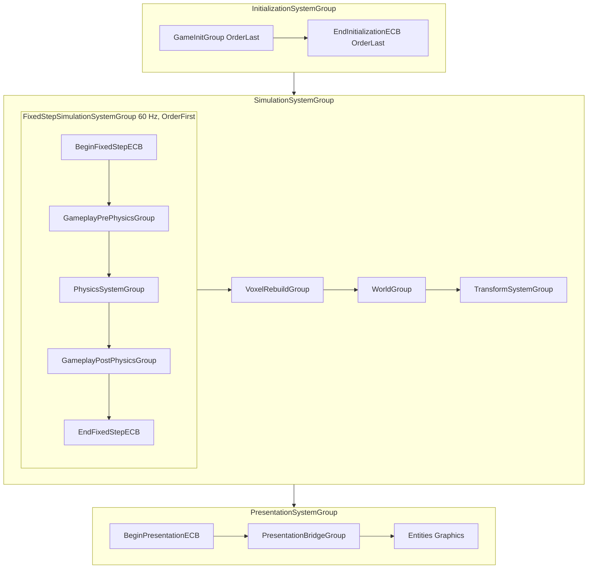

# SPEC-02 — Core utilities

| | |
|---|---|
| **Status** | Draft |
| **Area code** | CORE (task IDs are `CORE-001`, `CORE-002`, …) |
| **Module(s)** | `Game.Core` (folder `Assets/Game/Core/`); two shared ECS files in `Game.Data` (`Assets/Game/Data/Components/`) and the drain system in `Game.Presentation` (`Assets/Game/Presentation/Systems/`), see Decision 3 |
| **Depends on specs** | none (lowest module) |
| **Depended on by** | every spec. SPEC-01 implements `IPauseService`, `ISettingsService`, `IGameFlow`, allocates `PersistentId`, creates `GameplayActive`/`SimClock`; SPEC-03 uses `InputContext`, `Services`, `ISettingsService`, `IWorldPointerGate`; SPEC-04 uses `ContentId`, `ContentHash`, `StableHash`, `GameLog`; SPEC-05 implements `ISaveIdPalette`/`ISaveJsonCodec`, frames `SaveWriter` payloads and publishes `GameSaved`/`GameLoaded`; SPEC-64 adds `Assets/Game/Core/Audio/`; SPEC-10…SPEC-33 place systems in the groups and use `RngStreams`, `SimClock`, `GameplayEndCommandBufferSystem`; SPEC-40…SPEC-64 use `EventBus<T>` |
| **Milestone** | M0 |

> Read [01-architecture.md](../01-architecture.md), [02-conventions.md](../02-conventions.md) and [03-glossary.md](../03-glossary.md) before this spec. This spec may not contradict them.

## 1. Purpose

`Game.Core` is the bottom of the dependency graph. It holds the small, stable vocabulary every module shares: content identity (`ContentId`, `ContentHash`), runtime identity (`PersistentId`), stable hashing, deterministic random streams, the simulation clock, the typed managed event bus and its ECS bridge, the service locator, logging, the binary save primitives, pause and input-context contracts, scene-flow and session contracts, the settings model, small math helpers, and the declarations of every custom ECS system group so that all other specs can place their systems. It avoids the old prototype's string-typed event bus, `string.GetHashCode` keys (04-B31, 01-B9), unseeded `UnityEngine.Random` (04-B27), boolean pause (04-B16) and leaking statics when domain reload is off (04 §2.7).

## 2. Scope

**In scope:**
- `ContentId`, `ContentHash`, `PersistentId`, `StableHash` (xxHash3-64 with frozen test vectors).
- `RngPurpose`, `RngStreams`, `SimTime`, the `SimClock` singleton type.
- `EventBus<T>`, `EventHub` (deferred, globally ordered, re-entrancy safe) and the Core-owned managed event payloads.
- The ECS→managed bridge: `ManagedEventQueue<T>`, `ManagedEventEnvelope<T>`, `ManagedEventDrainSystem`, `ManagedEventChannels`.
- `Services` locator, `GameLog` (+ `GameLog.Burst`), `LogCategories`.
- `ISaveParticipant`, `SaveWriter`, `SaveReader`, `SaveKey`, `SaveFormatException`, `SaveReason`, `SaveBlockReason`, and the save extension interfaces SPEC-05 needs (`ISaveIdPalette`, `ISaveIdPaletteReader`, `ISaveJsonCodec`, `ISaveDeferredBlock`).
- `IPauseService`, `PauseToken`, `InputContext`, `IWorldPointerGate`.
- Flow contracts used across modules: `GameScene`, `ISceneReady`, `ISceneExiting`, `IGameFlow`, `NewGameArgs`, `BlueprintLabArgs`, `ISessionModel`, `ISessionWriteback`, `INewGameInitializer`, `ISaveBlocker`.
- Settings model: `ISettingsService`, `GameSettings` and its section classes.
- `MathD`, `Planar`.
- Simulation event channels and guarded access: `SimEventChannel<T>`, `SimEventReadSet`, `SimEventGather`, `GuardedHandles`, `ProducerKind` (files in `Game.Data`, Decision 20).
- Custom system groups `GameInitGroup`, `GameplayPrePhysicsGroup`, `ShipCommandGroup`, `AbilityActivationGroup`, `GameplayPostPhysicsGroup`, `VoxelRebuildGroup`, `WorldGroup`, `PresentationBridgeGroup`, the `GameplayEndCommandBufferSystem`, and the `GameplayActive` tag.

**Out of scope (and who owns it instead):**
- Implementations of `IPauseService`, `ISettingsService`, `IGameFlow`, `PersistentId` allocation, creation of `GameplayActive`/`SimClock`, the `SimClockAdvanceSystem`, the static-state audit test: SPEC-01.
- Save container, chunk framing, compression, profiles, slots, autosave, save-on-quit, the IDPL palette and JSON codec implementations, publishing `GameSaved`/`GameLoaded`: SPEC-05.
- Audio contracts in `Assets/Game/Core/Audio/` (`IAudioService`, `AudioVolumes`, `UiSound`): SPEC-64 owns those files.
- Content ID format rules (`ContentIdRules`), `ContentDatabase`, hash-collision checks at boot: SPEC-04.
- Managed event payloads produced by gameplay (`ShipDestroyed`, `StarSystemEntered`, `BodyInteracted`, `BodyDestroyed`, `LaneJumped`, `ItemAcquired`, `FactChanged`): their fields are designed by the producing spec; their files go in `Assets/Game/Core/Events/` under the rules of §5.6.
- `EcsTestWorld` helper: SPEC-71.

## 3. Decisions (binding)

1. **Core uses Entities only for the declarations architecture §3.1/§6.1 allow**: the custom groups, `GameplayActive`, `SimClock`, `PersistentId`, `GameplayEndCommandBufferSystem`. Core references Unity.Physics only for `[UpdateBefore/After(typeof(PhysicsSystemGroup))]`. Reason: binding architecture.
2. **`ContentId` is managed and never enters ECS data.** `ContentId { string Value; ContentHash Hash; }`; ECS data uses `ContentHash { ulong Value; }`. Reason: architecture §6.1 erratum; Burst cannot hold strings.
3. **The ECS→managed bridge is split across three modules.** Payload structs live in `Game.Core/Events` (visible to Narrative and UI, which have no Entities); the singleton component `ManagedEventQueue<T>` and `ManagedEventEnvelope<T>` live in `Game.Data/Components` (lowest module with Entities that every producer references); `ManagedEventDrainSystem` (a `SystemBase`) lives in `Game.Presentation/Systems` (the only runtime module besides App allowed `SystemBase`). All three are owned by this spec. Reason: §3.1 forbids further Entities types in Core; conventions §2.2 restricts `SystemBase`. Logged as a binding-doc conflict (see §10 #1).
4. **`StableHash` = Unity.Collections `xxHash3.Hash64`, seed 0 unless given, over UTF-8 bytes for strings; the 64-bit result is `((ulong)r.y << 32) | r.x`.** `Combine(a, b)` = `Hash64` of the 16 bytes `LE64(a) ‖ LE64(b)`. Outputs are frozen by the vectors in §5.1. Reason: architecture §6.1; the vectors match the reference XXH3 implementation, so the hash can be reproduced outside Unity.
5. **Random streams derive a 32-bit seed with `StableHash` (§5.2)** and construct `new Unity.Mathematics.Random(seed)` (fully qualified, never `new Random(` which the conventions guard test rejects). `RngPurpose` values are explicit and append-only. Reason: architecture §1 rule 5.
6. **`SimClock.Tick` counts completed fixed ticks of the current session.** During the first simulated tick every system reads `Tick == 0`; `SimClockAdvanceSystem` (SPEC-01) increments it after `GameplayEndCommandBufferSystem`. `UniversalTime` is computed as `SessionStartUniversalTime + Tick * (1.0 / 60.0)`, never accumulated. Reason: drift-free, deterministic.
7. **`EventBus<T>` is deferred and globally ordered.** `Publish` enqueues; `EventHub.DrainAll()` delivers every pending event of every type in publish order. It runs once per frame at the end of `PresentationBridgeGroup` (inside `ManagedEventDrainSystem`) and at the explicit flush points SPEC-01 names. Events published by handlers during a drain are delivered in the same `DrainAll` call, up to 8 passes. Main thread only. Payloads are `struct`s. Reason: architecture §6.1; prevents the old order-of-subscription bugs.
8. **Every handler call is wrapped in try/catch;** an exception is logged with `GameLog.Exception` and the next handler still runs. Reason: architecture §6.1, conventions §6.
9. **ECS-produced managed events use one `ManagedEventQueue<T>` singleton per payload type** (a `NativeQueue`, allowed for managed events by architecture §5.1). The drain sorts each frame's batch by `(Tick, SortKey, payload hash)` before publishing, so delivery order does not depend on job scheduling. Reason: conventions §2.9.
10. **`Services` is a typed static locator** with one generic slot per type, `Register` throws on a duplicate, `Reset()` clears without disposing (the composition root disposes). Reason: architecture §4.2.
11. **`GameLog` categories are strings** (`LogCategories` holds the common ones). `GameLog.cs` is the only file that calls `UnityEngine.Debug.Log*` (enforced by `ConventionsTests`). Burst code logs through the nested `GameLog.Burst`. Reason: conventions §6; SPEC-04 and SPEC-60 already log with string categories.
12. **Save primitives are binary, little-endian, deterministic.** Same sequence of writes → same bytes. Variable-length integers are LEB128 (zig-zag for signed). Strings are UTF-8 with a length prefix where 0 means null. Any malformed read throws `SaveFormatException`, never `IndexOutOfRangeException`. Reason: ADR-0007 byte-identical round trip.
13. **System groups are declared exactly as in §4.12 and the table in §5.8.** No attribute may target a system of a different ordering bucket (OrderFirst / normal / OrderLast), because Entities logs a warning for that. Reason: architecture §5; zero new warnings (05-testing §4).
14. **`GameplayPrePhysicsGroup`, `GameplayPostPhysicsGroup` and `WorldGroup` call `RequireForUpdate<GameplayActive>()` themselves.** Member systems still declare it (conventions §2.4). `GameInitGroup`, `VoxelRebuildGroup` and `PresentationBridgeGroup` do not, because the Blueprint Lab spawns and meshes grids without gameplay. Reason: defence in depth for the fixed step.
15. **No mutable static without a `[RuntimeInitializeOnLoadMethod(RuntimeInitializeLoadType.SubsystemRegistration)]` reset in the same file.** Static generic classes (`EventBus<T>`, `Services` slots) cannot carry that attribute, so a non-generic registry in the same file resets them. Reason: architecture §4.1 (domain reload off).
16. **Core ECS tests build their own `World`** instead of `EcsTestWorld` (SPEC-71), because `EcsTestWorld` is built on these groups. Reason: avoids a dependency cycle.
17. **Folder layout.** Root of `Assets/Game/Core/` (namespace `Game.Core`) holds identity, hashing, randomness, time, services, logging, pause, input and math. Sub-folders, each its own namespace: `Components/` (`Game.Core.Components`), `Systems/` (`Game.Core.Systems`), `Events/` (`Game.Core.Events`), `Save/` (`Game.Core.Save`), `Flow/` (`Game.Core.Flow`), `Settings/` (`Game.Core.Settings`), and SPEC-64's `Audio/` (`Game.Core.Audio`). Reason: conventions §1 allows extra folders with a reason; Core is many small contracts grouped by concern.
18. **The locator is always written `Game.Core.Services`** in any module that has a `Services/` sub-folder (`Game.Data.Services`, `Game.UI.Services`, `Game.Presentation.Services`, `Game.App.Services` exist or are specified). Inside such a module the bare identifier `Services` resolves to the module's own `…Services` namespace and does not compile. Reason: C# name lookup; keeps the binding name `Services` (architecture §6.1).
19. **`SimClock` is read on the main thread only** (`SystemAPI.GetSingleton<SimClock>()` in `OnUpdate`), and its values are passed into jobs as fields. No job reads `SimClock` through a lookup. Reason: `SimClockAdvanceSystem` writes it on the main thread each tick.
20. **Simulation event channels and guarded access are owned here and placed in `Game.Data`** (`Assets/Game/Data/Streams/`, namespace `Game.Data.Streams`; `ProducerKind` in `Assets/Game/Data/Combat/`), because they need `SystemState` and Collections types that Decision 1 keeps out of Core, and every simulation module references `Game.Data`. One implementation replaces the per-spec registries and handle code (extensibility review X8). Reason: architecture §5.1 deterministic order stated and tested once.

## 4. Data model

All types below are **public contract** unless marked *internal*. Every public type gets a `/// <summary>` naming this spec section (conventions §8). Code is given exactly; CORE-001 transcribes it, replacing method bodies marked `/* CORE-0xx */` with `throw new System.NotImplementedException("CORE-0xx");`.

### 4.1 Identity (`Assets/Game/Core/`, namespace `Game.Core`)

```csharp
// ContentHash.cs
/// <summary>Unmanaged content reference for ECS/Burst data. Implements SPEC-02 §4.1.</summary>
public readonly struct ContentHash : System.IEquatable<ContentHash>
{
    public readonly ulong Value;                       // StableHash.Hash64(id string); 0 = none
    public ContentHash(ulong value) { Value = value; }
    public static ContentHash None => default;
    public bool IsNone => Value == 0UL;
    public bool Equals(ContentHash other) => Value == other.Value;
    public override bool Equals(object obj) => obj is ContentHash o && o.Value == Value;
    public override int GetHashCode() => (int)Value ^ (int)(Value >> 32);   // in-memory only, never persisted
    public override string ToString() => "0x" + Value.ToString("X16");
    public static bool operator ==(ContentHash a, ContentHash b) => a.Value == b.Value;
    public static bool operator !=(ContentHash a, ContentHash b) => a.Value != b.Value;
}

// ContentId.cs
/// <summary>Stable managed content identity (architecture §6.1). Never inside IComponentData, buffers, blobs, jobs or ECS events.</summary>
public readonly struct ContentId : System.IEquatable<ContentId>
{
    public readonly string Value;                      // e.g. "block_hull"; null = None. Format rules: SPEC-04 ContentIdRules
    public readonly ContentHash Hash;                  // StableHash.Hash64(Value); None when Value is null

    public ContentId(string value)
    {
        if (string.IsNullOrEmpty(value)) { Value = null; Hash = default; }
        else { Value = value; Hash = new ContentHash(StableHash.Hash64(value)); }
    }
    public static ContentId None => default;
    public bool IsNone => Value == null;
    public bool Equals(ContentId other) => Hash.Value == other.Hash.Value && string.Equals(Value, other.Value, System.StringComparison.Ordinal);
    public override bool Equals(object obj) => obj is ContentId o && Equals(o);
    public override int GetHashCode() => Hash.GetHashCode();
    public override string ToString() => Value ?? "<none>";
    public static bool operator ==(ContentId a, ContentId b) => a.Equals(b);
    public static bool operator !=(ContentId a, ContentId b) => !a.Equals(b);
}
```

```csharp
// Components/PersistentId.cs   (namespace Game.Core.Components)
/// <summary>Stable identity of a runtime-spawned object across save/load (architecture §6.1). Allocated by GameSession (SPEC-01).</summary>
public struct PersistentId : Unity.Entities.IComponentData, System.IEquatable<PersistentId>
{
    public ulong Value;                                // 0 = none; allocated values start at 1 and are never reused
    public PersistentId(ulong value) { Value = value; }
    public bool IsNone => Value == 0UL;
    public bool Equals(PersistentId other) => Value == other.Value;
    public override bool Equals(object obj) => obj is PersistentId o && o.Value == Value;
    public override int GetHashCode() => (int)Value ^ (int)(Value >> 32);
    public override string ToString() => "pid:" + Value.ToString();
}

// Components/PersistentIdAllocator.cs   (namespace Game.Core.Components)
/// <summary>Singleton block of pre-granted PersistentIds for Burst systems (SPEC-13 hulks, SPEC-31 spawns).
/// GameSession (SPEC-01 §5) refills it on the main thread; Burst systems take ids with Next++ while Next &lt; End.</summary>
public struct PersistentIdAllocator : Unity.Entities.IComponentData
{
    public ulong Next;                                 // next id to hand out
    public ulong End;                                  // exclusive; Next == End means empty (consumer defers its work)
}

// IPersistentIdAllocator.cs   (namespace Game.Core)
/// <summary>Managed PersistentId source, implemented by GameSession (SPEC-01). Main thread only.</summary>
public interface IPersistentIdAllocator
{
    ulong Allocate();                                  // never returns 0; never returns a value twice in a campaign
}
```

`PersistentIdAllocator` is a Core ECS type in addition to those listed in architecture §6.1 (same justification as `PersistentId`: every module that spawns needs it). Ids handed out in a granted block but never used are skipped, never reused.

### 4.2 Hashing and randomness (`Assets/Game/Core/`, namespace `Game.Core`)

```csharp
// StableHash.cs
/// <summary>xxHash3-64 stable hashing (SPEC-02 §5.1). Never use GetHashCode for persisted or simulated data.</summary>
public static class StableHash
{
    public const ulong EmptyHash = 0x2D06800538D394C2UL;          // Hash64(empty input)
    public static ulong Hash64(string value);                      // UTF-8, seed 0. ArgumentNullException on null. Managed only
    public static ulong Hash64(System.ReadOnlySpan<byte> data);    // seed 0. Managed only
    public static ulong Hash64(System.ReadOnlySpan<byte> data, ulong seed);
    public static unsafe ulong Hash64(byte* data, int length);     // Burst-compatible; length >= 0
    public static unsafe ulong Hash64(byte* data, int length, ulong seed);
    public static ulong Hash64(in Unity.Collections.FixedString32Bytes text);   // Burst-compatible; hashes the UTF-8 content bytes only
    public static ulong Hash64(in Unity.Collections.FixedString64Bytes text);
    public static ulong Hash64(in Unity.Collections.FixedString128Bytes text);
    public static ulong Combine(ulong a, ulong b);                 // Burst-compatible; order matters: Combine(a,b) != Combine(b,a)
}

// RngPurpose.cs
/// <summary>Random stream purposes (SPEC-02 §5.2). Append only; never reorder or renumber.</summary>
public enum RngPurpose : ushort
{
    None = 0,                    // invalid: RngStreams.For throws
    GalaxyLayout = 1,
    StarSystemGeneration = 2,
    BodyGeneration = 3,
    AsteroidField = 4,
    EncounterDirector = 5,
    Loot = 6,
    Merchant = 7,
    AiDecision = 8,
    WeaponSpread = 9,
    Damage = 10,
    Debris = 11,
    Narrative = 12,
    NameGeneration = 13,
    CosmeticFx = 14,
    Audio = 15,
    ShipEditor = 16,
    NewGameSeed = 17,
    GalaxyLanes = 18,            // SPEC-30 procedural lane graph
    StarSystemLayout = 19,       // SPEC-30 body counts and orbit spacing
    AsteroidShape = 20,          // SPEC-31 per-asteroid shape noise
    StationShape = 21,           // SPEC-31 procedural station shapes
    EncounterFleet = 22,         // SPEC-33 fleet composition
    EncounterPlacement = 23,     // SPEC-33 spawn placement
    Territory = 24,              // SPEC-33 faction territory
    Salvage = 25,                // SPEC-50 salvage yields
    Test = 1000,
}

// RngStreams.cs
/// <summary>All randomness (architecture §1 rule 5, SPEC-02 §5.2).</summary>
public static class RngStreams
{
    public const uint ZeroSeedReplacement = 0x6C8E9CF5u;
    public static uint DeriveSeed(ulong seed, RngPurpose purpose, ulong salt);                      // Burst-compatible, never returns 0
    public static Unity.Mathematics.Random For(ulong seed, RngPurpose purpose, ulong salt);         // ArgumentException when purpose == None
    public static Unity.Mathematics.Random ForEntityTick(uint tick, int entityIndex, uint salt);   // per-entity, per-tick (conventions §2.10)
}

// SimTime.cs
/// <summary>Fixed-step constants (architecture §2). Implements SPEC-02 §4.2.</summary>
public static class SimTime
{
    public const int TicksPerSecond = 60;
    public const float FixedTimestep = 1f / 60f;
    public const double FixedTimestepD = 1.0 / 60.0;
    public const int MaxTicksPerFrame = 6;                          // Time.maximumDeltaTime = 0.1 (architecture §5.1)
    public static uint SecondsToTicks(float seconds);              // round-half-up of seconds*60, negative → 0. Burst-compatible
    public static double TicksToSeconds(uint ticks) => ticks * FixedTimestepD;
}
```

### 4.3 ECS components (`Assets/Game/Core/Components/`, namespace `Game.Core.Components`)

```csharp
/// <summary>Tag singleton: exists only while the World scene is ready. Created/destroyed by SceneFlow (SPEC-01).</summary>
public struct GameplayActive : Unity.Entities.IComponentData { }

/// <summary>Simulation clock singleton, on the same entity as GameplayActive (SPEC-02 §5.9).</summary>
public struct SimClock : Unity.Entities.IComponentData
{
    public uint Tick;                          // completed fixed ticks this session; 0 during the first tick
    public double UniversalTime;               // seconds since campaign start at the start of the current tick
    public double SessionStartUniversalTime;   // UniversalTime when this session's gameplay began (from the save)
}

/// <summary>Mirror of the last floating-origin rebase for modules that cannot read SPEC-30's FrameOrigin (Simulation).
/// On the FrameOrigin entity; created by OriginRebaseSystem.OnCreate (all zero) and written only by its DecideJob (SPEC-30 §5.10).
/// Holds the last rebase only: a consumer whose last applied Sequence is more than 1 behind treats it as a star-system change.</summary>
public struct OriginShiftRecord : Unity.Entities.IComponentData
{
    public uint Sequence;                      // FrameOrigin.ShiftSequence after the rebase; 0 = no rebase yet
    public Unity.Mathematics.float3 Delta;     // newLocal = oldLocal + Delta; zero when StarSystemChanged == 1
    public byte StarSystemChanged;             // 1: everything local was replaced
}
```
`PersistentId` is in §4.1.

### 4.4 Services, logging, pause, input (`Assets/Game/Core/`, namespace `Game.Core`)

```csharp
// Services.cs
/// <summary>Typed service locator (architecture §4.2). Main thread only.</summary>
public static class Services
{
    public static T Register<T>(T service) where T : class;   // ArgumentNullException; InvalidOperationException if T already registered
    public static T Get<T>() where T : class;                 // InvalidOperationException("Service <T.Name> is not registered")
    public static bool TryGet<T>(out T service) where T : class;
    public static bool IsRegistered<T>() where T : class;
    public static bool Unregister<T>(T service) where T : class;  // true only if the registered instance is reference-equal to service
    public static int Count { get; }
    public static void Reset();                               // clears every slot; does not dispose
}

// LogLevel.cs
public enum LogLevel : byte { Info = 0, Warning = 1, Error = 2, Off = 3 }

// LogCategories.cs
/// <summary>Common log category names (SPEC-02 §5.4). Specs may log with other strings.</summary>
public static class LogCategories
{
    public const string Core = "Core", Boot = "Boot", Flow = "Flow", Session = "Session", Settings = "Settings",
        Input = "Input", Content = "Content", Save = "Save", Ecs = "Ecs", Voxel = "Voxel", Render = "Render",
        Physics = "Physics", Damage = "Damage", Flight = "Flight", Weapons = "Weapons", Power = "Power", AI = "AI",
        Abilities = "Abilities", Galaxy = "Galaxy", StarSystem = "StarSystem", Travel = "Travel", Encounter = "Encounter",
        Narrative = "Narrative", Dialog = "Dialog", Quest = "Quest", Economy = "Economy", Editor = "Editor", UI = "UI",
        Hud = "Hud", Camera = "Camera", Vfx = "Vfx", Audio = "Audio", Dev = "Dev", Test = "Test";
}

// GameLog.cs   (the only file allowed to call UnityEngine.Debug.Log*)
/// <summary>Logging facade (conventions §6, SPEC-02 §5.4).</summary>
public static class GameLog
{
    public static LogLevel DefaultMinimumLevel { get; set; }                  // Info in Editor/development builds, Warning in release
    public static void SetMinimumLevel(string category, LogLevel level);
    public static LogLevel GetMinimumLevel(string category);
    public static void Info(string category, string message);
    public static void Warn(string category, string message);
    public static void Error(string category, string message);
    public static void Exception(string category, System.Exception exception, string context);
    public static bool WarnOnce(string key, string category, string message);   // true if this call logged
    public static bool ErrorOnce(string key, string category, string message);
    public static int GetOnceCount(string key);                                 // calls with this key since the last reset
    public static void ResetOnceKeys();

    /// <summary>Burst-callable logging. Errors and one-off warnings only; never per frame.</summary>
    public static class Burst
    {
        public static void Warn(in Unity.Collections.FixedString128Bytes message);
        public static void Error(in Unity.Collections.FixedString128Bytes message);
    }
}

// IPauseService.cs
/// <summary>Ref-counted pause (architecture §6.1). Implemented by SPEC-01 PauseService.</summary>
public interface IPauseService
{
    PauseToken Acquire(string reason);                    // reason: non-empty, e.g. "UINavigator", "SceneFlow"
    bool IsPaused { get; }                                // ActiveTokenCount > 0
    int ActiveTokenCount { get; }
    void Release(PauseToken token);                       // idempotent per token; unknown token → no-op
    void GetActiveReasons(System.Collections.Generic.List<string> results);   // clears results first
}

// PauseToken.cs
/// <summary>Handle for one pause request. Dispose releases it; disposing twice is a no-op.</summary>
public readonly struct PauseToken : System.IDisposable, System.IEquatable<PauseToken>
{
    public readonly uint Id;                              // 0 = default/invalid
    private readonly IPauseService owner;
    public PauseToken(IPauseService owner, uint id) { this.owner = owner; Id = id; }
    public bool IsValid => owner != null && Id != 0;
    public void Dispose() { if (owner != null && Id != 0) owner.Release(this); }
    public bool Equals(PauseToken other) => Id == other.Id && ReferenceEquals(owner, other.owner);
    public override bool Equals(object obj) => obj is PauseToken o && Equals(o);
    public override int GetHashCode() => (int)Id;
}

// InputContext.cs
/// <summary>Input contexts (architecture §6.1). Each enables exactly its action map plus Global (SPEC-03).</summary>
public enum InputContext : byte { None = 0, Flight = 1, Editor = 2, Menu = 3, Dialog = 4, TextEntry = 5 }

// IWorldPointerGate.cs
/// <summary>Lets world input ignore clicks meant for UI. Implemented by SPEC-60 (registered by SPEC-01).</summary>
public interface IWorldPointerGate
{
    bool IsWorldPointerAllowed(UnityEngine.Vector2 screenPositionBottomLeft);
}
```

### 4.5 Managed events (`Assets/Game/Core/Events/`, namespace `Game.Core.Events`)

```csharp
// EventBus.cs
/// <summary>Typed deferred event bus (architecture §6.1, SPEC-02 §5.5). Main thread only.</summary>
public static class EventBus<T> where T : struct
{
    public static void Subscribe(System.Action<T> handler);     // duplicate subscription ignored with WarnOnce
    public static void Unsubscribe(System.Action<T> handler);   // safe at any time, including inside a handler
    public static void Publish(in T evt);                       // deferred until the next EventHub.DrainAll()
    public static void Drain();                                 // delivers only T's pending events (tests); no-op + WarnOnce inside DrainAll
    public static int SubscriberCount { get; }
    public static int PendingCount { get; }
}

// EventHub.cs
/// <summary>Global drain point for every EventBus&lt;T&gt; (SPEC-02 §5.5).</summary>
public static class EventHub
{
    public const int MaxCascadePasses = 8;
    public static void DrainAll();                // delivers all pending events in publish order
    public static bool IsDraining { get; }
    public static int PendingCount { get; }       // pending entries across all types (stale entries included)
    public static void Reset();                   // SubsystemRegistration and tests: clears all buses, handlers and pending events
}

// Payloads owned by this spec (all readonly structs; constructor assigns every field)
public enum SessionResetReason : byte { NewGame = 0, Loaded = 1, Cleared = 2 }
public readonly struct SessionReset { public readonly SessionResetReason Reason; public SessionReset(SessionResetReason reason) { Reason = reason; } }

// Published by SPEC-05 SaveService after a successful save / restore (SPEC-05 §5.4 step 17, §5.6 step 6).
public readonly struct GameSaved
{
    public readonly string ProfileId; public readonly string SlotId; public readonly Game.Core.Save.SaveReason Reason;   // e.g. "p001", "manual_001"
    public GameSaved(string profileId, string slotId, Game.Core.Save.SaveReason reason) { ProfileId = profileId; SlotId = slotId; Reason = reason; }
}
public readonly struct GameLoaded
{
    public readonly string ProfileId; public readonly string SlotId; public readonly int WarningCount;
    public GameLoaded(string profileId, string slotId, int warningCount) { ProfileId = profileId; SlotId = slotId; WarningCount = warningCount; }
}
public readonly struct PauseStateChanged { public readonly bool IsPaused; public readonly int TokenCount; public PauseStateChanged(bool isPaused, int tokenCount) { IsPaused = isPaused; TokenCount = tokenCount; } }
public readonly struct InputContextChanged { public readonly InputContext Previous; public readonly InputContext Current; public InputContextChanged(InputContext previous, InputContext current) { Previous = previous; Current = current; } }
public readonly struct SettingsChanged { public readonly Game.Core.Settings.SettingsSection Sections; public SettingsChanged(Game.Core.Settings.SettingsSection sections) { Sections = sections; } }
public readonly struct SceneTransitionStarted
{
    public readonly Game.Core.Flow.GameScene From; public readonly Game.Core.Flow.GameScene To; public readonly Game.Core.Flow.SceneEntryReason Reason;
    public SceneTransitionStarted(Game.Core.Flow.GameScene from, Game.Core.Flow.GameScene to, Game.Core.Flow.SceneEntryReason reason) { From = from; To = to; Reason = reason; }
}
public readonly struct SceneTransitionFinished
{
    public readonly Game.Core.Flow.GameScene Scene; public readonly Game.Core.Flow.SceneEntryReason Reason; public readonly bool Success;
    public SceneTransitionFinished(Game.Core.Flow.GameScene scene, Game.Core.Flow.SceneEntryReason reason, bool success) { Scene = scene; Reason = reason; Success = success; }
}
```

*Internal* (`EventChannel.cs`, same namespace): `internal interface IEventChannel { int Id { get; set; } bool DispatchIfHead(long sequence); void Reset(); int PendingCount { get; } }` and `internal sealed class EventChannel<T> : IEventChannel where T : struct` (fields: `System.Action<T>[] handlers` copy-on-write, `System.Collections.Generic.Queue<Entry> queue` with `struct Entry { public long Sequence; public T Value; }`, `System.Action detach`). Shape and algorithm in §5.5.

### 4.6 ECS→managed bridge (owned here, placed per Decision 3)

```csharp
// Assets/Game/Data/Components/ManagedEventEnvelope.cs   (namespace Game.Data.Components)
/// <summary>One ECS-produced managed event (SPEC-02 §5.6).</summary>
public struct ManagedEventEnvelope<T> where T : unmanaged
{
    public uint Tick;          // SimClock.Tick when produced (0 if no SimClock)
    public ulong SortKey;      // producer-chosen stable key, normally PersistentId.Value of the subject
    public T Payload;          // unmanaged payload type from Game.Core.Events
}

// Assets/Game/Data/Components/ManagedEventQueue.cs   (namespace Game.Data.Components)
/// <summary>Singleton queue for one managed event type (SPEC-02 §5.6). Created and disposed by ManagedEventDrainSystem.</summary>
public struct ManagedEventQueue<T> : Unity.Entities.IComponentData where T : unmanaged
{
    public Unity.Collections.NativeQueue<ManagedEventEnvelope<T>> Queue;   // Allocator.Persistent
}

// Assets/Game/Presentation/Systems/ManagedEventDrainSystem.cs   (namespace Game.Presentation.Systems)
/// <summary>Moves ECS-produced events into EventBus&lt;T&gt; and drains EventHub once per frame (architecture §5, SPEC-02 §5.6).</summary>
[Unity.Entities.UpdateInGroup(typeof(Game.Core.Systems.PresentationBridgeGroup), OrderLast = true)]
public partial class ManagedEventDrainSystem : Unity.Entities.SystemBase
{
    public void RegisterChannel<T>() where T : unmanaged;   // idempotent; main thread; creates the singleton entity
    public int ChannelCount { get; }
    protected override void OnCreate();                     // ManagedEventChannels.RegisterAll(this)
    protected override void OnUpdate();                     // transfer all channels, then EventHub.DrainAll()
    protected override void OnDestroy();                    // complete dependencies, dispose every queue
}

// Assets/Game/Presentation/Systems/ManagedEventChannels.cs   (namespace Game.Presentation.Systems)
/// <summary>The one list of ECS-produced managed event types. Producing specs add one line each.</summary>
public static class ManagedEventChannels
{
    public static void RegisterAll(ManagedEventDrainSystem system) { /* producing specs add: system.RegisterChannel<ShipDestroyed>(); */ }
}
```
*Internal* (in `ManagedEventDrainSystem.cs`): `interface IManagedEventChannel { void Transfer(Unity.Entities.EntityManager em); void Dispose(Unity.Entities.EntityManager em); }`, `sealed class ManagedEventChannel<T> : IManagedEventChannel where T : unmanaged` holding the `EntityQuery` of its singleton, and `struct EnvelopeComparer<T> : System.Collections.Generic.IComparer<ManagedEventEnvelope<T>>`.

### 4.7 Save primitives (`Assets/Game/Core/Save/`, namespace `Game.Core.Save`)

```csharp
/// <summary>Implemented by every module that owns persistent state (architecture §6.1, ADR-0007).</summary>
public interface ISaveParticipant
{
    string Key { get; }                                  // exactly 4 chars [A-Z0-9], see SaveKey; unique per game
    int Version { get; }                                 // current chunk schema version, >= 1
    void Capture(SaveWriter writer);                     // main thread; reads managed state only (ECS was written back first, SPEC-01)
    void Restore(SaveReader reader, int fromVersion);    // fromVersion <= Version; restores IN PLACE
}

/// <summary>Why a save happened (values defined with SPEC-05 §4.4; append only).</summary>
public enum SaveReason : byte { Manual = 0, Quick = 1, AutoTimer = 2, AutoSceneTransition = 3, AutoStarSystemEntered = 4, Quit = 5, NewGame = 6 }

/// <summary>Why saving is not possible right now (values defined with SPEC-05 §4.4; append only).</summary>
public enum SaveBlockReason : byte { None = 0, NoSession = 1, InCombat = 2, Transitioning = 3, PlayerDead = 4, EditorOpen = 5 }

/// <summary>Save-wide ContentId palette, writer side (implemented by SPEC-05 SaveIdPalette).</summary>
public interface ISaveIdPalette { ushort GetOrAdd(in Game.Core.ContentId id); }

/// <summary>Save-wide ContentId palette, reader side.</summary>
public interface ISaveIdPaletteReader { Game.Core.ContentId Get(ushort local); }

/// <summary>JSON for non-voxel payloads (implemented by SPEC-05 NewtonsoftSaveJsonCodec; Core has no Newtonsoft).</summary>
public interface ISaveJsonCodec
{
    byte[] Serialize<T>(T value);
    T Deserialize<T>(System.ReadOnlySpan<byte> utf8);
}

/// <summary>A payload part encoded later on the save worker (e.g. SPEC-05 VoxsSnapshotBlock).</summary>
public interface ISaveDeferredBlock : System.IDisposable
{
    byte[] Encode();                                     // called once, on the save worker; then Dispose() on the worker
}

public static class SaveKey
{
    public static bool IsValid(string key);              // non-null, Length == 4, every char in 'A'..'Z' or '0'..'9'
    public static uint ToFourCC(string key);             // ArgumentException if !IsValid; c0 | c1<<8 | c2<<16 | c3<<24
    public static string FromFourCC(uint fourCC);        // inverse; SaveFormatException if a byte is not [A-Z0-9]
}

public sealed class SaveFormatException : System.Exception
{
    public readonly int Position;                        // reader position at failure, -1 if unknown
    public SaveFormatException(string message, int position) : base(message + " (at byte " + position + ")") { Position = position; }
}

/// <summary>Opaque handle for a length-prefixed block (SPEC-02 §5.7).</summary>
public readonly struct SaveBlock
{
    internal readonly int Start;                         // writer: position of the 4-byte length; reader: end position
    internal readonly int Depth;
    internal SaveBlock(int start, int depth) { Start = start; Depth = depth; }
}

public sealed class SaveWriter : System.IDisposable
{
    public const int DefaultCapacity = 4096;
    /// palette: null → ContentIds are written as strings; json: null → WriteJson throws InvalidOperationException.
    public SaveWriter(ISaveIdPalette palette = null, ISaveJsonCodec json = null, int initialCapacity = DefaultCapacity);   // buffer rented from ArrayPool<byte>.Shared
    public int Length { get; }                                  // bytes written so far, excluding deferred blocks
    public int DeferredCount { get; }
    public void Reset();                                        // Length = 0; open blocks discarded
    public void WriteByte(byte value);
    public void WriteSByte(sbyte value);
    public void WriteBool(bool value);                          // 0x00 / 0x01
    public void WriteUInt16(ushort value);
    public void WriteInt16(short value);
    public void WriteUInt32(uint value);
    public void WriteInt32(int value);
    public void WriteUInt64(ulong value);
    public void WriteInt64(long value);
    public void WriteSingle(float value);                       // IEEE-754 bits, LE
    public void WriteDouble(double value);
    public void WriteVarUInt32(uint value);                     // LEB128
    public void WriteVarUInt64(ulong value);
    public void WriteVarInt32(int value);                       // zig-zag, then LEB128
    public void WriteVarInt64(long value);
    public void WriteString(string value);                      // null → VarUInt32(0); else VarUInt32(byteCount + 1) + UTF-8 bytes
    public void WriteContentId(in Game.Core.ContentId id);      // palette != null: WriteUInt16(palette.GetOrAdd(id)); else WriteString(id.Value)
    public void WriteJson<T>(T value);                          // VarUInt32(length) + UTF-8 JSON from the codec
    public void WriteDeferred(ISaveDeferredBlock block);        // placeholder; becomes VarUInt32(length) + Encode() bytes in ToArray(encoder)
    public void WriteFloat2(Unity.Mathematics.float2 v);
    public void WriteFloat3(Unity.Mathematics.float3 v);
    public void WriteFloat4(Unity.Mathematics.float4 v);
    public void WriteQuaternion(Unity.Mathematics.quaternion q); // x, y, z, w
    public void WriteDouble3(Unity.Mathematics.double3 v);
    public void WriteInt3(Unity.Mathematics.int3 v);
    public void WriteBytes(System.ReadOnlySpan<byte> bytes);    // raw
    public void WriteByteArray(System.ReadOnlySpan<byte> bytes);// VarUInt32 length + raw
    public void WriteNativeArray<T>(Unity.Collections.NativeArray<T> array) where T : unmanaged;   // VarUInt32 count + raw element bytes
    public SaveBlock BeginBlock();                              // writes a 4-byte placeholder
    public void EndBlock(SaveBlock block);                      // back-patches UInt32 byte length; LIFO only
    public System.ReadOnlySpan<byte> AsSpan();                  // valid until the next write or Dispose; InvalidOperationException if DeferredCount > 0
    public byte[] ToArray();                                    // InvalidOperationException if DeferredCount > 0
    public byte[] ToArray(System.Func<ISaveDeferredBlock, byte[]> encodeDeferred);   // splices each deferred block in place
    public void Dispose();                                      // returns the buffer; does NOT dispose deferred blocks (their owner does); later calls throw ObjectDisposedException
}

public sealed class SaveReader
{
    public const int MaxStringBytes = 16 * 1024 * 1024;
    public static SaveReader Empty { get; }                     // zero-length payload; IsAtEnd == true
    public SaveReader(byte[] data);
    public SaveReader(byte[] data, int offset, int count);
    public SaveReader(System.ReadOnlyMemory<byte> payload, ISaveIdPaletteReader palette = null, ISaveJsonCodec json = null);
    public int Position { get; }                                // relative to offset
    public int Length { get; }
    public int Remaining { get; }
    public bool IsAtEnd { get; }
    public byte ReadByte(); public sbyte ReadSByte(); public bool ReadBool();
    public ushort ReadUInt16(); public short ReadInt16(); public uint ReadUInt32(); public int ReadInt32();
    public ulong ReadUInt64(); public long ReadInt64(); public float ReadSingle(); public double ReadDouble();
    public uint ReadVarUInt32(); public ulong ReadVarUInt64(); public int ReadVarInt32(); public long ReadVarInt64();
    public string ReadString();
    public Game.Core.ContentId ReadContentId();                 // palette != null: palette.Get(ReadUInt16()); else new ContentId(ReadString()); no validation
    public T ReadJson<T>();                                     // InvalidOperationException without a codec; codec exceptions → SaveFormatException
    public Unity.Mathematics.float2 ReadFloat2(); public Unity.Mathematics.float3 ReadFloat3(); public Unity.Mathematics.float4 ReadFloat4();
    public Unity.Mathematics.quaternion ReadQuaternion(); public Unity.Mathematics.double3 ReadDouble3(); public Unity.Mathematics.int3 ReadInt3();
    public void ReadBytes(System.Span<byte> destination);
    public byte[] ReadByteArray();
    public Unity.Collections.NativeArray<T> ReadNativeArray<T>(Unity.Collections.Allocator allocator) where T : unmanaged;
    public SaveBlock BeginBlock();                              // reads UInt32 length, validates <= Remaining
    public void EndBlock(SaveBlock block);                      // overread → throw; otherwise skips to block end
    public void Skip(int count);
}
```
Slot listing and slot identity (`SlotRef`, `SlotInfo`) belong to SPEC-05 and are used only from `Game.App` presenters (SPEC-61), so Core has no slot catalog.

### 4.8 Flow and session contracts (`Assets/Game/Core/Flow/`, namespace `Game.Core.Flow`)

```csharp
/// <summary>The four scenes (architecture §4.1). Build index = (int)scene - 1.</summary>
public enum GameScene : byte { None = 0, Boot = 1, MainMenu = 2, World = 3, BlueprintLab = 4 }

public enum SceneEntryReason : byte { Startup = 0, NewGame = 1, LoadGame = 2, EnterBlueprintLab = 3, ExitBlueprintLab = 4, QuitToMenu = 5, DevQuickStart = 6, ErrorRecovery = 7 }

public enum BlueprintLabMode : byte { Creative = 0, FleetShip = 1 }

public readonly struct BlueprintLabArgs
{
    public readonly BlueprintLabMode Mode;
    public readonly ulong FleetShipId;          // FleetShip mode: PersistentId.Value of the fleet ship; 0 in Creative
    public readonly Game.Core.ContentId StartBlueprint; // Creative mode: blueprint to open; None = empty grid with a core
    public BlueprintLabArgs(BlueprintLabMode mode, ulong fleetShipId, Game.Core.ContentId startBlueprint) { Mode = mode; FleetShipId = fleetShipId; StartBlueprint = startBlueprint; }
}

public readonly struct SceneReadyContext
{
    public readonly GameScene Scene; public readonly SceneEntryReason Reason; public readonly BlueprintLabArgs LabArgs;
    public SceneReadyContext(GameScene scene, SceneEntryReason reason, BlueprintLabArgs labArgs) { Scene = scene; Reason = reason; LabArgs = labArgs; }
}
public readonly struct SceneExitContext
{
    public readonly GameScene Scene; public readonly GameScene NextScene; public readonly SceneEntryReason Reason;
    public SceneExitContext(GameScene scene, GameScene nextScene, SceneEntryReason reason) { Scene = scene; NextScene = nextScene; Reason = reason; }
}

/// <summary>Called by SceneFlow after a scene is loaded and GameplayActive exists (World). Sequential by order (SPEC-01 §5.4).</summary>
public interface ISceneReady
{
    int SceneReadyOrder { get; }                                     // ascending; see SceneHookOrder
    void OnSceneReady(in SceneReadyContext context);                 // called once per scene entry
    bool IsSceneReadyComplete(in SceneReadyContext context);         // polled once per frame until true (timeout: SPEC-01)
}

/// <summary>Called by SceneFlow before a scene is torn down. Synchronous.</summary>
public interface ISceneExiting
{
    int SceneExitOrder { get; }                                      // ascending
    void OnSceneExiting(in SceneExitContext context);
}

public static class SceneHookOrder
{
    public const int Session = 50, Galaxy = 100, PlayerShip = 200, Camera = 300, Ui = 400, Narrative = 500, Audio = 600, Editor = 700, Default = 1000;
}

public enum FlowResult : byte { Ok = 0, Busy = 1, Blocked = 2, Failed = 3, NotAllowed = 4 }

public readonly struct NewGameArgs
{
    public readonly string CommanderName;      // trimmed; 1..32 chars (UI validates)
    public readonly ulong GalaxySeed;          // 0 = generate (SPEC-01)
    public readonly bool Creative;
    public readonly Game.Core.ContentId StartScenario;   // None = GameConfigDefinition default (SPEC-01)
    public NewGameArgs(string commanderName, ulong galaxySeed, bool creative, Game.Core.ContentId startScenario) { CommanderName = commanderName; GalaxySeed = galaxySeed; Creative = creative; StartScenario = startScenario; }
}

/// <summary>Game-level flows for modules below Game.App (ShipEditor, Narrative adapters, tools). Implemented by SPEC-01 GameSession. Methods never throw.
/// Slot IDs are SPEC-05 folder names inside the active profile: "manual_001", "quick", "auto_0".</summary>
public interface IGameFlow
{
    GameScene CurrentScene { get; }
    bool IsTransitioning { get; }
    bool HasActiveSession { get; }
    bool IsCreativeSession { get; }
    Game.Core.Save.SaveBlockReason GetSaveBlock();
    UnityEngine.Awaitable<FlowResult> NewGameAsync(NewGameArgs args);
    UnityEngine.Awaitable<FlowResult> LoadGameAsync(string slotId);
    UnityEngine.Awaitable<FlowResult> SaveGameAsync(string slotId, Game.Core.Save.SaveReason reason);
    UnityEngine.Awaitable<FlowResult> QuitToMainMenuAsync(bool saveFirst);
    UnityEngine.Awaitable<FlowResult> EnterBlueprintLabAsync(BlueprintLabArgs args);
    UnityEngine.Awaitable<FlowResult> ExitBlueprintLabAsync();
    void QuitToDesktop();
}

/// <summary>A session-scoped model with stable identity, reset in place (architecture §4.2, glossary "Session").</summary>
public interface ISessionModel { void ResetToEmpty(); }

/// <summary>Copies ECS-held session state into managed models before save capture or World teardown (SPEC-01 §5.6).</summary>
public interface ISessionWriteback { int WritebackOrder { get; } void WriteBackFromWorld(); }

/// <summary>Seeds a model's initial state for a new game (SPEC-01 §5.6).</summary>
public interface INewGameInitializer { int NewGameOrder { get; } void InitializeNewGame(in NewGameArgs args); }

/// <summary>Vetoes saving (combat, death). SaveBlockReason.None = not blocking. Registered with SPEC-01 GameSession.</summary>
public interface ISaveBlocker { Game.Core.Save.SaveBlockReason GetSaveBlock(); }
```

### 4.9 Settings model (`Assets/Game/Core/Settings/`, namespace `Game.Core.Settings`)

```csharp
[System.Flags] public enum SettingsSection : byte { None = 0, Audio = 1, Video = 2, Controls = 4, Gameplay = 8, Accessibility = 16, All = 31 }

/// <summary>Player settings (SPEC-02 §5.11). Persistence and application: SPEC-01 SettingsService.</summary>
public sealed class GameSettings
{
    public const int CurrentVersion = 1;
    public readonly AudioSettingsData Audio = new AudioSettingsData();
    public readonly VideoSettingsData Video = new VideoSettingsData();
    public readonly ControlSettingsData Controls = new ControlSettingsData();
    public readonly GameplaySettingsData Gameplay = new GameplaySettingsData();
    public readonly AccessibilitySettingsData Accessibility = new AccessibilitySettingsData();
    public void CopyFrom(GameSettings source, SettingsSection sections);
    public GameSettings Clone();                                     // deep copy of all sections
    public void ResetToDefaults(SettingsSection sections);
    public void Clamp();                                             // applies every section's Clamp()
    public SettingsSection DiffersFrom(GameSettings other);          // sections whose values differ
}

public sealed class AudioSettingsData   // defaults equal SPEC-64 AudioVolumes.Default
{
    public float MasterVolume = 0.8f;   // [0, 1]
    public float MusicVolume = 0.6f;    // [0, 1]
    public float SfxVolume = 0.8f;      // [0, 1]
    public float UiVolume = 0.7f;       // [0, 1]
    public float AmbienceVolume = 0.6f; // [0, 1]
    public bool MuteWhenUnfocused = true;
    public void CopyFrom(AudioSettingsData o); public void Clamp(); public bool ValueEquals(AudioSettingsData o);
}
public sealed class VideoSettingsData
{
    public int ResolutionWidth = 0;     // 0 = keep current; else [640, 7680]
    public int ResolutionHeight = 0;    // 0 = keep current; else [360, 4320] (both 0 or both set; one 0 → both 0)
    public int RefreshRateHz = 0;       // 0 = default; else [24, 500]
    public UnityEngine.FullScreenMode FullScreenMode = UnityEngine.FullScreenMode.FullScreenWindow;
    public bool VSync = true;
    public int TargetFrameRate = -1;    // -1 = platform default; else [30, 500]
    public int QualityLevel = -1;       // -1 = keep project default; else [0, 15] (SPEC-01 re-clamps to QualitySettings.names.Length - 1)
    public byte VfxQuality = 2;         // 0 Low, 1 Medium, 2 High (SPEC-63 FxQuality); [0, 2]
    public void CopyFrom(VideoSettingsData o); public void Clamp(); public bool ValueEquals(VideoSettingsData o);
}
public sealed class ControlSettingsData
{
    public float MouseSensitivity = 1f;          // [0.1, 5]
    public bool InvertCameraY = false;
    public float CameraZoomSensitivity = 1f;     // [0.1, 5]
    public string BindingOverridesJson = "";     // InputActionAsset.SaveBindingOverridesAsJson(); null → ""
    public void CopyFrom(ControlSettingsData o); public void Clamp(); public bool ValueEquals(ControlSettingsData o);
}
public sealed class GameplaySettingsData
{
    public int AutosaveIntervalMinutes = 5;      // one of {0, 5, 10, 15, 30}; 0 = off; other values snap to the nearest (ties → larger). 5 = SPEC-05 default 300 s
    public bool ShowControlHints = true;
    public void CopyFrom(GameplaySettingsData o); public void Clamp(); public bool ValueEquals(GameplaySettingsData o);
}
public sealed class AccessibilitySettingsData
{
    public float UiScale = 1f;                   // [0.8, 1.5] (SPEC-60 UIConfig range)
    public byte TextScaleIndex = 0;              // 0 = 100 %, 1 = 115 %, 2 = 130 % (SPEC-60 TextScale)
    public bool ReduceMotion = false;
    public float ScreenShakeScale = 1f;          // [0, 1]
    public void CopyFrom(AccessibilitySettingsData o); public void Clamp(); public bool ValueEquals(AccessibilitySettingsData o);
}

/// <summary>Implemented by SPEC-01 SettingsService.</summary>
public interface ISettingsService
{
    GameSettings Current { get; }                                    // read-only by convention: never mutate
    GameSettings CreateEditableCopy();                               // Current.Clone()
    void Apply(GameSettings edited, SettingsSection sections);       // copy, clamp, publish SettingsChanged for changed sections, schedule save
    void ResetToDefaults(SettingsSection sections);
    void Flush();                                                    // write now if dirty
}
```
`Clamp()` of floats also replaces NaN with the default value. `ValueEquals` compares floats with `==` after clamping.

### 4.10 Math helpers (`Assets/Game/Core/`, namespace `Game.Core`)

```csharp
/// <summary>Double-precision frame helpers (architecture §9). Burst-compatible.</summary>
public static class MathD
{
    public static Unity.Mathematics.float3 ToLocal(Unity.Mathematics.double3 positionInStarSystem, Unity.Mathematics.double3 frameOrigin);  // (float3)(p - o)
    public static Unity.Mathematics.double3 ToStarSystem(Unity.Mathematics.float3 local, Unity.Mathematics.double3 frameOrigin);          // o + (double3)local
    public static double DistanceSq(Unity.Mathematics.double3 a, Unity.Mathematics.double3 b);
    public static bool IsFinite(Unity.Mathematics.double3 v);
    public static bool IsFinite(Unity.Mathematics.float3 v);
}

/// <summary>XZ-plane helpers for planar flight (ADR-0003). Y up; yaw +θ turns +Z toward +X (clockwise seen from above). Burst-compatible.</summary>
public static class Planar
{
    public const float RayEpsilon = 1e-6f;
    public static Unity.Mathematics.float2 XZ(Unity.Mathematics.float3 v);                        // (v.x, v.z)
    public static Unity.Mathematics.float3 FromXZ(Unity.Mathematics.float2 xz, float y = 0f);    // (xz.x, y, xz.y)
    public static Unity.Mathematics.float3 FlattenY(Unity.Mathematics.float3 v);                 // (v.x, 0, v.z)
    public static float YawFromForward(Unity.Mathematics.float3 forward);                        // atan2(f.x, f.z); 0 if |f.xz| < 1e-6
    public static Unity.Mathematics.float3 ForwardFromYaw(float yaw);                            // (sin yaw, 0, cos yaw)
    public static Unity.Mathematics.quaternion YawRotation(float yaw);                           // quaternion.RotateY(yaw)
    public static float WrapAngle(float radians);                                                // result in [-π, π)
    public static float SignedAngleXZ(Unity.Mathematics.float3 from, Unity.Mathematics.float3 to); // atan2(f.z*t.x - f.x*t.z, f.x*t.x + f.z*t.z); 0 if either |xz| < 1e-6
    public static bool RayPlaneY(Unity.Mathematics.float3 origin, Unity.Mathematics.float3 direction, float planeY,
                                 out Unity.Mathematics.float3 hit, out float distance);          // false if |dir.y| < RayEpsilon or t < 0
}
```

### 4.11 Custom system groups (`Assets/Game/Core/Systems/`, namespace `Game.Core.Systems`)

```csharp
using Unity.Entities;
using Unity.Physics.Systems;
using Unity.Transforms;
using Game.Core.Components;

[UpdateInGroup(typeof(InitializationSystemGroup), OrderLast = true)]
[UpdateBefore(typeof(EndInitializationEntityCommandBufferSystem))]
public partial class GameInitGroup : ComponentSystemGroup { }

[UpdateInGroup(typeof(FixedStepSimulationSystemGroup))]
[UpdateBefore(typeof(PhysicsSystemGroup))]
public partial class GameplayPrePhysicsGroup : ComponentSystemGroup
{
    protected override void OnCreate() { base.OnCreate(); RequireForUpdate<GameplayActive>(); }
}

[UpdateInGroup(typeof(GameplayPrePhysicsGroup), OrderFirst = true)]
public partial class ShipCommandGroup : ComponentSystemGroup { }

[UpdateInGroup(typeof(GameplayPrePhysicsGroup))]
public partial class AbilityActivationGroup : ComponentSystemGroup { }   // ordering set by members' neighbours, see §5.8

[UpdateInGroup(typeof(FixedStepSimulationSystemGroup))]
[UpdateAfter(typeof(PhysicsSystemGroup))]
public partial class GameplayPostPhysicsGroup : ComponentSystemGroup
{
    protected override void OnCreate() { base.OnCreate(); RequireForUpdate<GameplayActive>(); }
}

[UpdateInGroup(typeof(SimulationSystemGroup))]
[UpdateBefore(typeof(TransformSystemGroup))]
public partial class VoxelRebuildGroup : ComponentSystemGroup { }

[UpdateInGroup(typeof(SimulationSystemGroup))]
[UpdateAfter(typeof(VoxelRebuildGroup))]
[UpdateBefore(typeof(TransformSystemGroup))]
public partial class WorldGroup : ComponentSystemGroup
{
    protected override void OnCreate() { base.OnCreate(); RequireForUpdate<GameplayActive>(); }
}

[UpdateInGroup(typeof(PresentationSystemGroup), OrderFirst = true)]
[UpdateAfter(typeof(BeginPresentationEntityCommandBufferSystem))]
public partial class PresentationBridgeGroup : ComponentSystemGroup { }
```

```csharp
// GameplayEndCommandBufferSystem.cs
/// <summary>THE only structural sync point in the fixed step (architecture §1 rule 3, §5).</summary>
[UpdateInGroup(typeof(GameplayPostPhysicsGroup), OrderLast = true)]
public unsafe partial class GameplayEndCommandBufferSystem : EntityCommandBufferSystem
{
    public unsafe struct Singleton : IComponentData, IECBSingleton
    {
        internal Unity.Collections.LowLevel.Unsafe.UnsafeList<EntityCommandBuffer>* pendingBuffers;
        internal Unity.Collections.AllocatorManager.AllocatorHandle allocator;

        public EntityCommandBuffer CreateCommandBuffer(WorldUnmanaged world)
            => EntityCommandBufferSystem.CreateCommandBuffer(ref *pendingBuffers, allocator, world);
        public void SetPendingBufferList(ref Unity.Collections.LowLevel.Unsafe.UnsafeList<EntityCommandBuffer> buffers)
            => pendingBuffers = (Unity.Collections.LowLevel.Unsafe.UnsafeList<EntityCommandBuffer>*)
                                Unity.Collections.LowLevel.Unsafe.UnsafeUtility.AddressOf(ref buffers);
        public void SetAllocator(Unity.Collections.Allocator allocatorIn) => allocator = allocatorIn;
        public void SetAllocator(Unity.Collections.AllocatorManager.AllocatorHandle allocatorIn) => allocator = allocatorIn;
    }

    protected override void OnCreate()
    {
        base.OnCreate();
        this.RegisterSingleton<Singleton>(ref PendingBuffers, World.Unmanaged);
    }
}
```

### 4.12 Simulation event channels and guarded access (owned here, placed in `Game.Data` per Decision 20)

```csharp
// Assets/Game/Data/Combat/ProducerKind.cs   (namespace Game.Data.Combat)
/// <summary>Who produced a simulation event; part of every deterministic sort key (architecture §5.1). One enum for every channel
/// (damage, explosions, shield hits, impulses, restores, inhibits). Add values at the end only. Implements SPEC-02 §4.12.</summary>
public enum ProducerKind : byte
{ Unknown = 0, Impact = 1, Projectile = 2, Beam = 3, Explosion = 4, ShieldOverflow = 5, Ability = 6, Status = 7, Repair = 8, Environment = 9, MainThread = 10, Test = 255 }

// Assets/Game/Data/Streams/GuardedHandles.cs   (namespace Game.Data.Streams)
/// <summary>Job-handle guard embedded in every singleton that owns native memory shared by several systems (architecture §5.1;
/// the access pattern of SPEC-12 §5.1). Main thread only; never passed into a job. Implements SPEC-02 §4.12.</summary>
public struct GuardedHandles
{
    public Unity.Collections.NativeReference<Unity.Jobs.JobHandle> Exclusive;   // last job with exclusive access (writers)
    public Unity.Collections.NativeReference<Unity.Jobs.JobHandle> Readers;     // shared readers since the last exclusive access

    public static GuardedHandles Create();                 // Allocator.Persistent, both handles default
    public bool IsCreated => Exclusive.IsCreated;
    /// Exclusive access: waits for the last writer and every reader. Pair with exactly one Release.
    public Unity.Jobs.JobHandle Acquire(Unity.Jobs.JobHandle dependsOn)
        => Unity.Jobs.JobHandle.CombineDependencies(dependsOn, Exclusive.Value, Readers.Value);
    /// lastJob must depend on the handle Acquire returned.
    public void Release(Unity.Jobs.JobHandle lastJob) { Exclusive.Value = lastJob; Readers.Value = default; }
    /// Shared read access: waits for the last writer only; readers run in parallel. Pair with exactly one EndRead.
    public Unity.Jobs.JobHandle BeginRead(Unity.Jobs.JobHandle dependsOn)
        => Unity.Jobs.JobHandle.CombineDependencies(dependsOn, Exclusive.Value);
    public void EndRead(Unity.Jobs.JobHandle readerJob)
    { Readers.Value = Unity.Jobs.JobHandle.CombineDependencies(Readers.Value, readerJob); }
    /// Main thread outside FixedStepSimulationSystemGroup only: completes every guarded job.
    public void CompleteAccess() { Exclusive.Value.Complete(); Readers.Value.Complete(); }
    public void Dispose();                                 // CompleteAccess, then dispose both references; no-op if !IsCreated
}

// Assets/Game/Data/Streams/SimEventChannel.cs   (namespace Game.Data.Streams)
/// <summary>Per-tick registry of deterministic simulation event streams of one event type (architecture §5.1). Any number of
/// producers register a NativeStream each, in call order (= system update order, deterministic); exactly one consumer reads every
/// registration in that order. The struct holds only a pointer, so the owning singleton is taken with SystemAPI.GetSingleton
/// (read-only) by producers and consumer alike: no sync points. Implements SPEC-02 §4.12; algorithm §5.13.</summary>
public unsafe struct SimEventChannel<T> where T : unmanaged
{
    [Unity.Collections.LowLevel.Unsafe.NativeDisableUnsafePtrRestriction] internal SimEventChannelData<T>* Data;

    public static SimEventChannel<T> Create(Unity.Collections.FixedString32Bytes name);   // Allocator.Persistent; name for logs
    public bool IsCreated => Data != null;
    public void Dispose();                                 // completes every stored handle, disposes every stream still registered

    /// Channel owner, once per tick before producers or the consumer run (or anywhere in the tick; see §5.13 step 1).
    public void BeginTick(uint tick);

    /// Producer, main thread inside OnUpdate: registers a new NativeStream (Allocator.TempJob) with forEachCount indices.
    public Unity.Collections.NativeStream.Writer BeginWrite(ref Unity.Entities.SystemState state, Game.Data.Combat.ProducerKind producer, int forEachCount);
    /// Producer: exactly once after scheduling the job that writes the stream returned by the matching BeginWrite.
    public void EndWrite(Unity.Jobs.JobHandle writerJob);

    /// Consumer, main thread inside OnUpdate: every registration not yet read, in registration order. Combines all their
    /// writer handles into state.Dependency. Registrations made after this call are read by the next BeginRead.
    public SimEventReadSet BeginRead(ref Unity.Entities.SystemState state);
    /// Consumer: exactly once after scheduling the last job that uses the read set; disposes those streams and the set after it.
    public void EndRead(Unity.Jobs.JobHandle readerJob);

    public int PendingCount { get; }                       // registrations not yet read (tests, harness)

    /// Main thread OUTSIDE FixedStepSimulationSystemGroup (narrative effects, services, dev commands; ADR-0016): appends one event to the
    /// channel's inbox, read by the consumer's next BeginRead as the first registration (ProducerKind.MainThread). Not frame-rate deterministic:
    /// never used by replayed simulation.
    public void PostFromMainThread(in T evt);
}

/// <summary>This tick's registrations of one channel, in registration order. Arrays are Allocator.TempJob, disposed by EndRead.</summary>
public struct SimEventReadSet
{
    [Unity.Collections.ReadOnly] public Unity.Collections.NativeArray<Unity.Collections.NativeStream.Reader> Readers;
    [Unity.Collections.ReadOnly] public Unity.Collections.NativeArray<Game.Data.Combat.ProducerKind> Producers;
    [Unity.Collections.ReadOnly] public Unity.Collections.NativeArray<int> ForEachCounts;
    public int Count => Readers.Length;
}

/// <summary>Burst helper for consumers: appends every event of a read set to output, registrations in order, foreach indices ascending.
/// Consumers then stable-sort with their own key (the gather order is the tie-break).</summary>
public static class SimEventGather
{
    public static Unity.Jobs.JobHandle Schedule<T>(SimEventReadSet set, Unity.Collections.NativeList<T> output, Unity.Jobs.JobHandle dependsOn) where T : unmanaged;
}
// internal: struct SimEventChannelData<T> { UnsafeList<Registration> Pending; FixedString32Bytes Name; uint Tick; JobHandle LastConsumer; byte OpenWrite; }
//           (plus byte StaleWarned; NativeList<T> Inbox for PostFromMainThread)
//           struct Registration { NativeStream Stream; JobHandle Writer; ProducerKind Producer; int ForEachCount; uint Tick; }
```

Every deterministic simulation stream is one `SimEventChannel<T>` held as a field of its owner's singleton: SPEC-13 `DamageStreams.Damage` and `.Explosions`, SPEC-22 `ShieldHitStreams.Hits`, and the request channels of SPEC-13/22/24 (`ImpulseRequest`, `CellRestoreRequest`, `InhibitRequest`). Every singleton that owns native memory shared across systems embeds one `GuardedHandles Access` and forwards `Acquire`/`Release`/`BeginRead`/`EndRead`/`CompleteAccess` to it (SPEC-11 `BrickMeshQueue`, SPEC-12 `ColliderDirtyQueue`/`ColliderBuildCache`, SPEC-21 `ProjectileStore`, SPEC-23 `SpatialHash`). No spec writes its own handle bookkeeping or stream registry.

## 5. Systems, services and flow

### 5.1 `StableHash` (CORE-002)

Algorithm:
1. `Hash64(byte* data, int length, ulong seed)`: `uint2 r = Unity.Collections.xxHash3.Hash64(data, length, seed); return ((ulong)r.y << 32) | r.x;`. `length < 0` → `ArgumentOutOfRangeException` (managed) / undefined in Burst (callers never pass negative).
2. `Hash64(ReadOnlySpan<byte> data, ulong seed)`: `fixed (byte* p = data)` then step 1 (an empty span gives a null pointer; xxHash3 never dereferences it for length 0).
3. `Hash64(string value)`: `ArgumentNullException` on null. `int n = Encoding.UTF8.GetByteCount(value)`. If `n <= 512`: `Span<byte> buf = stackalloc byte[n]`; else rent `ArrayPool<byte>.Shared.Rent(n)` and return it in `finally`. `Encoding.UTF8.GetBytes(value, buf)` then step 2 with seed 0. Lone surrogates encode as U+FFFD (EF BF BD), the .NET default; this is part of the frozen behaviour.
4. `Hash64(in FixedStringNBytes text)`: `Hash64(text.GetUnsafePtr(), text.Length, 0)` (the UTF-8 content bytes only; identical to hashing the equivalent `string`).
5. `Combine(ulong a, ulong b)`: a private `struct Pair { public ulong A; public ulong B; }` on the stack, `Hash64((byte*)&pair, 16, 0)`. All supported platforms are little-endian; `CORE-002` adds a static check `if (!BitConverter.IsLittleEndian) throw new PlatformNotSupportedException()` in the managed `Hash64(string)` path.

Complexity O(n) in bytes, zero GC allocation for strings ≤ 512 UTF-8 bytes.

**Frozen test vectors** (verified against the reference XXH3_64bits implementation; CORE-002 asserts all of them):

| Input | Seed | Hash64 |
|---|---|---|
| `""` | 0 | `0x2D06800538D394C2` |
| `"a"` | 0 | `0xE6C632B61E964E1F` |
| `"abc"` | 0 | `0x78AF5F94892F3950` |
| `"block_hull"` | 0 | `0x208BCD2F5794080C` |
| `"ship_frigate"` | 0 | `0x40C77FB94A14632E` |
| `"item_fuel"` | 0 | `0xF1D231B0FE914DC8` |
| `"faction_vestari"` | 0 | `0x4F914742E8527D13` |
| `"config_game"` | 0 | `0xC55C4B09BD9D8A60` |
| `"Kraków_ünïcödé"` (UTF-8, 20 bytes) | 0 | `0xD028B4D41FD1611B` |
| 97-char `"block_thruster_large_mk2_with_a_long_suffix_exceeding_sixty_four_bytes_for_path_test_0123456789"` | 0 | `0x5B6AC785A9FB5E77` |
| 300 chars, char *i* = `"abcdefghijklmnopqrstuvwxyz0123456789_"[i % 37]` | 0 | `0x7CD2B0369ED482C7` |

Sanity buffer (reference xxHash test buffer, 2,367 bytes): `ulong gen = 2654435761UL; for i in 0..2366: buf[i] = (byte)(gen >> 56); gen *= 11400714785074694797UL;` (unchecked). With `P64 = 11400714785074694797UL`:

| Length | Seed 0 | Seed P64 |
|---|---|---|
| 0 | `0x2D06800538D394C2` | `0xA8A6B918B2F0364A` |
| 1 | `0xC44BDFF4074EECDB` | `0x032BE332DD766EF8` |
| 6 | `0x27B56A84CD2D7325` | `0x84589C116AB59AB9` |
| 12 | `0xA713DAF0DFBB77E7` | `0xE7303E1B2336DE0E` |
| 24 | `0xA3FE70BF9D3510EB` | `0x850E80FC35BDD690` |
| 48 | `0x397DA259ECBA1F11` | `0xADC2CBAA44ACC616` |
| 80 | `0xBCDEFBBB2C47C90A` | `0xC6DD0CB699532E73` |
| 195 | `0xCD94217EE362EC3A` | `0xBA68003D370CB3D9` |
| 403 | `0xCDEB804D65C6DEA4` | `0x6259F6ECFD6443FD` |
| 512 | `0x617E49599013CB6B` | `0x3CE457DE14C27708` |
| 2048 | `0xDD59E2C3A5F038E0` | `0x66F81670669ABABC` |
| 2240 | `0x6E73A90539CF2948` | `0x757BA8487D1B5247` |
| 2367 | `0xCB37AEB9E5D361ED` | `0xD2DB3415B942B42A` |

`Combine` vectors: `Combine(0,0) = 0xD0A66A65C7528968`; `Combine(1,2) = 0x07EE86C281446BEF`; `Combine(2,1) = 0xFB54CB6322BE3888`; `Combine(0x208BCD2F5794080C, 42) = 0x8504F741EA77AA46`; `Combine(ulong.MaxValue, ulong.MaxValue) = 0x722A202F07A4B313`.

### 5.2 `RngStreams` (CORE-003)

1. `DeriveSeed(seed, purpose, salt)`: `ulong h = StableHash.Combine(StableHash.Combine(seed, (ulong)purpose), salt); uint s = (uint)h ^ (uint)(h >> 32); return s != 0 ? s : ZeroSeedReplacement;`
2. `For(seed, purpose, salt)`: if `purpose == RngPurpose.None` throw `ArgumentException("RngPurpose.None is not a valid stream")`; return `new Unity.Mathematics.Random(DeriveSeed(seed, purpose, salt))`.
3. `ForEntityTick(tick, entityIndex, salt)`: `return Unity.Mathematics.Random.CreateFromIndex((uint)StableHash.Combine(tick, (ulong)(uint)(entityIndex ^ (int)salt)));`
4. Usage rule: one stream per (purpose, logical object): e.g. a star system's generation uses `For(galaxySeed, StarSystemGeneration, starSystemId.Value)`; a body inside it uses `For(galaxySeed, BodyGeneration, StableHash.Combine(starSystemId.Value, bodySlotKey))`. Destroying or adding one object never shifts another object's stream.

Frozen vectors: `DeriveSeed(12345, GalaxyLayout, 0) = 0x2802D39D`; `DeriveSeed(12345, StarSystemGeneration, 7) = 0x75087B51`; `DeriveSeed(12345, StarSystemGeneration, 8) = 0xDDB0BEDE`; `DeriveSeed(0, Loot, 0) = 0x45FC6D40`; `DeriveSeed(0xDEADBEEFCAFEF00D, WeaponSpread, 123456789) = 0x017DA3BE`.

`SimTime.SecondsToTicks(s)`: `s <= 0 → 0`; else `(uint)math.floor(s * 60f + 0.5f)`; values above `uint.MaxValue / 60` seconds clamp to `uint.MaxValue`.

### 5.3 `Services` (CORE-005)

State: `private static class Slot<T> where T : class { internal static T Instance; internal static bool Tracked; }`, plus in `Services`: `static readonly List<System.Action> resetters = new List<System.Action>(64)` and `static int count`.
1. `Register<T>(s)`: null → `ArgumentNullException`. If `Slot<T>.Instance != null` → `InvalidOperationException("Service " + typeof(T).Name + " is already registered")`. Set `Instance = s`, `count++`. If `!Tracked`: `Tracked = true; resetters.Add(static () => { Slot<T>.Instance = null; Slot<T>.Tracked = false; })`. Return `s`.
2. `Get<T>()`: return `Instance` or throw `InvalidOperationException("Service " + typeof(T).Name + " is not registered")`.
3. `TryGet<T>(out s)`: `s = Instance; return s != null;` (O(1), 0 B).
4. `Unregister<T>(s)`: if `ReferenceEquals(Instance, s)` and not null: `Instance = null; count--; return true;` else false.
5. `Reset()`: invoke every resetter, clear the list, `count = 0`.
6. `[RuntimeInitializeOnLoadMethod(RuntimeInitializeLoadType.SubsystemRegistration)] static void ResetOnPlay() => Reset();` in `Services.cs`.

### 5.4 `GameLog` (CORE-004)

1. Message format: `"[" + category + "] " + message` sent to `Debug.Log`, `Debug.LogWarning` or `Debug.LogError`.
2. Filter: a message is emitted when its level ≥ `GetMinimumLevel(category)`. `GetMinimumLevel` returns the per-category override from a `Dictionary<string, LogLevel>` (ordinal comparer) or `DefaultMinimumLevel`. Default: `Info` when `Application.isEditor || Debug.isDebugBuild`, else `Warning` (computed on first use and at reset).
3. `Exception(category, e, context)`: `Debug.LogError("[" + category + "] " + context + ": " + e.GetType().Name + ": " + e.Message)` then `Debug.LogException(e)`. Never filtered.
4. `WarnOnce(key, category, message)`: `onceCounts[key]++`; log only when the count becomes 1; return whether it logged. `ErrorOnce` the same with `Error`. Null key → treated as `"<null>"`.
5. `Burst.Warn/Error(in FixedString128Bytes)`: `UnityEngine.Debug.LogWarning(message)` / `LogError(message)` (Burst supports `FixedString` arguments). Callers prefix `[Category]` inside the fixed string.
6. Static state (`onceCounts`, `levels`, default level) resets in a `SubsystemRegistration` method in `GameLog.cs`; `ResetOnceKeys()` clears only the counts (tests).
7. No per-frame logging anywhere (conventions §6); repeated conditions use `WarnOnce`.

### 5.5 `EventBus<T>` and `EventHub` (CORE-006)

State in `EventHub`: `List<IEventChannel> channels`; `List<PendingRef> pending` and `List<PendingRef> processing` (`struct PendingRef { public int Channel; public long Sequence; }`, initial capacity 256 each); `long sequence`; `bool draining`.

`EventBus<T>` holds `static EventChannel<T> channel`, created on first use: `channel ??= EventHub.Register(new EventChannel<T>(DetachChannel))` where `static void DetachChannel() => channel = null;`. `Register` sets `Id = channels.Count` and adds it.

Algorithms:
1. **Subscribe(h)**: null → `ArgumentNullException`. If `h` is already in `handlers` (delegate equality) → `GameLog.WarnOnce("EventBus.DuplicateSubscribe." + typeof(T).FullName, LogCategories.Core, …)` and return. Else replace `handlers` with a new array of length+1 (copy-on-write).
2. **Unsubscribe(h)**: find index; if absent return; replace `handlers` with a new array without it.
3. **Publish(in e)**: `long s = ++EventHub.sequence; channel.queue.Enqueue(new Entry { Sequence = s, Value = e }); EventHub.pending.Add(new PendingRef { Channel = channel.Id, Sequence = s });` 0 B after the lists have grown.
4. **DrainAll()**:
   1. If `draining`: `GameLog.WarnOnce("EventHub.Reentrant", …)`; return.
   2. `draining = true`; `try`:
   3. For `pass = 0 .. MaxCascadePasses - 1`: if `pending.Count == 0` break. Swap `pending` and `processing`. For each `ref` in `processing` in order: `channels[ref.Channel].DispatchIfHead(ref.Sequence)`. `processing.Clear()`.
   4. After the loop, if `pending.Count > 0`: `GameLog.WarnOnce("EventHub.Cascade", LogCategories.Core, "events still pending after 8 passes; delivered next frame")`.
   5. `finally { draining = false; }`
5. **DispatchIfHead(seq)**: if the queue is empty or `queue.Peek().Sequence != seq`, return false (the event was already delivered by `EventBus<T>.Drain`). Else dequeue and invoke: `var snapshot = handlers; for i: var h = snapshot[i]; if (!ReferenceEquals(handlers, snapshot) && System.Array.IndexOf(handlers, h) < 0) continue; try { h(value); } catch (System.Exception ex) { GameLog.Exception(LogCategories.Core, ex, "EventBus<" + typeof(T).Name + ">"); }`. A handler subscribed during dispatch does not receive the event being dispatched; a handler unsubscribed during dispatch is not called afterwards.
6. **EventBus<T>.Drain()**: if `EventHub.IsDraining` → `WarnOnce` and return. Else dequeue and invoke every queued entry of `T` in order (their hub entries become stale and are skipped later).
7. **Reset()**: for each channel: `Reset()` (handlers = empty array, queue cleared, `detach()` nulls the static field); clear `channels`, `pending`, `processing`; `sequence = 0`; `draining = false`. Called from a `SubsystemRegistration` method in `EventHub.cs` and by tests.

Complexity: Publish O(1); DrainAll O(events × handlers). Order guarantee: across all types, events are delivered in publish order within a pass; cascaded events follow in the next pass.

### 5.6 ECS→managed bridge (CORE-009)

Payload rules (binding for every spec that adds a managed event):
1. The payload is a `readonly struct` with a past-tense name (conventions §1) in `Assets/Game/Core/Events/<Name>.cs` (namespace `Game.Core.Events`). Exception: payloads that belong to the logic vocabulary live in `Game.Data.Logic` (SPEC-40's `FactChanged`); both locations are visible to Narrative and UI.
2. Payloads produced by ECS must be **unmanaged** and use only Core-visible types: primitives, enums from `Game.Core`, `ContentHash`, `PersistentId`-style `ulong` ids, `Unity.Mathematics` types. No `Entity`, `ContentId`, `string`, arrays.
3. The producing spec adds `[assembly: Unity.Entities.RegisterGenericComponentType(typeof(Game.Data.Components.ManagedEventQueue<Game.Core.Events.<Name>>))]` in its own assembly's `AssemblyInfo.cs` and one line `system.RegisterChannel<<Name>>();` in `ManagedEventChannels.RegisterAll`.
4. Payloads produced only by managed code (`FactChanged`, `ItemAcquired`) may contain `string` but still live in `Game.Core/Events`.

Producer pattern (Burst `ISystem`, any group):
```csharp
var tick = SystemAPI.HasSingleton<SimClock>() ? SystemAPI.GetSingleton<SimClock>().Tick : 0u;
var writer = SystemAPI.GetSingleton<ManagedEventQueue<ShipDestroyed>>().Queue.AsParallelWriter();   // read-only access
state.Dependency = new EmitJob { Writer = writer, Tick = tick }.ScheduleParallel(state.Dependency);
// in the job struct:  [NativeDisableContainerSafetyRestriction] public NativeQueue<ManagedEventEnvelope<ShipDestroyed>>.ParallelWriter Writer;
// inside the job:     Writer.Enqueue(new ManagedEventEnvelope<ShipDestroyed> { Tick = Tick, SortKey = pid.Value, Payload = e });
```
Producers take the queue **read-only** (`GetSingleton`) and mark the writer `[NativeDisableContainerSafetyRestriction]`. Reason: concurrent `ParallelWriter.Enqueue` is thread-safe, and read-only access lets producers in different systems run in parallel; `GetSingletonRW` in the fixed step would serialise every producer and complete other systems' jobs (SPEC-21 Q7, item 34). Order does not matter because the drain sorts. The drain (step 4 below) declares RW access and completes every producer job (readers included) before it reads. A main-thread producer outside the fixed step calls `em.CompleteDependencyBeforeRO<ManagedEventQueue<T>>()` and then `.Queue.Enqueue(...)` directly; the same rule holds for every presentation stream (SPEC-63 `FxEventQueue`, SPEC-64 `SfxEventQueue`).

`ManagedEventDrainSystem`:
1. `OnCreate`: create `List<IManagedEventChannel> channels` and `HashSet<System.Type> registered`; call `ManagedEventChannels.RegisterAll(this)`. No `RequireForUpdate` (managed events also flow in menus).
2. `RegisterChannel<T>()`: if `typeof(T)` already in `registered`, return. Create one entity named `"ManagedEventQueue<" + typeof(T).Name + ">"` with `ManagedEventQueue<T> { Queue = new NativeQueue<ManagedEventEnvelope<T>>(Allocator.Persistent) }`. Store a channel holding a query for that component. Main thread, outside any world update of the fixed step (structural change allowed: system creation time or between frames).
3. `OnUpdate` (once per frame, OrderLast in `PresentationBridgeGroup`): for each channel in registration order `Transfer(EntityManager)`, then `EventHub.DrainAll()`.
4. `Transfer`: `em.CompleteDependencyBeforeRW<ManagedEventQueue<T>>()`; read the queue from the singleton; if `Count == 0` return. `var batch = queue.ToArray(Allocator.Temp); queue.Clear();` sort `batch` with `EnvelopeComparer<T>`: compare `Tick`, then `SortKey`, then `xxHash3.Hash64(payload)` (as ulong); equal → equal. Then `EventBus<T>.Publish(batch[i].Payload)` for i ascending. Dispose `batch`.
5. `OnDestroy`: `CompleteDependencyBeforeRW` for each channel, dispose each queue (if `IsCreated`).
6. Throughput: Temp allocation only; 0 B GC per frame when no events and when events exist (payloads are structs; `Publish` reuses list capacity).

### 5.7 Save primitives (CORE-007)

Encoding table (all little-endian):

| Call | Bytes |
|---|---|
| `WriteBool` | 1 byte, 0x00 or 0x01 (reader: any other value → `SaveFormatException`) |
| `WriteInt16/UInt16/Int32/UInt32/Int64/UInt64` | 2/4/8 bytes LE (two's complement) |
| `WriteSingle/Double` | `BitConverter.SingleToInt32Bits` / `DoubleToInt64Bits`, LE; NaN payload and −0 preserved |
| `WriteVarUInt32/64` | LEB128: 7 data bits per byte, low group first, high bit = continuation. `0` → `00`; `127` → `7F`; `128` → `80 01`; `300` → `AC 02`; `uint.MaxValue` → `FF FF FF FF 0F` |
| `WriteVarInt32/64` | zig-zag (`(v << 1) ^ (v >> 31)` / `>> 63`) then LEB128: `0→00`, `−1→01`, `1→02`, `−2→03` |
| `WriteString(null)` | `00` |
| `WriteString(s)` | VarUInt32(UTF-8 byte count + 1) then bytes: `""` → `01`; `"ab"` → `03 61 62` |
| `WriteFloat3` etc. | components in x, y, z(, w) order, each `WriteSingle`/`WriteDouble`/`WriteInt32` |
| `WriteByteArray` | VarUInt32(length) + bytes |
| `WriteNativeArray<T>` | VarUInt32(count) + `count * sizeof(T)` raw bytes (memcpy) |
| `BeginBlock`/`EndBlock` | UInt32 length of the bytes written between them, placed before them |

Writer rules:
1. Growth: when capacity is short, rent `max(2 × capacity, needed)` from `ArrayPool<byte>.Shared`, copy, return the old array.
2. `EndBlock(b)` must match the most recent open `BeginBlock` (depth check) else `InvalidOperationException`; blocks nest.
3. `ToArray`/`AsSpan` with open blocks → `InvalidOperationException`.
4. After `Dispose`, every method throws `ObjectDisposedException`.
5. `WriteContentId` with a palette writes `UInt16 palette.GetOrAdd(id)` (SPEC-05 maps `ContentId.None` to `0xFFFF`); without a palette it writes the string. A payload written with a palette must be read with a palette reader and vice versa (the reader cannot tell them apart).
6. `WriteJson<T>`: `bytes = json.Serialize(value)`; `WriteVarUInt32(bytes.Length)`; `WriteBytes(bytes)`. No codec → `InvalidOperationException`.
7. `WriteDeferred(block)`: forbidden while a `BeginBlock` is open (`InvalidOperationException`, because the block length would be wrong). Records `(Length, block)` in an ordered list; writes no bytes now.
8. `ToArray(encode)`: output = buffer bytes with, at each recorded offset in order, `VarUInt32(encoded.Length)` + `encoded` inserted, where `encoded = encode(block)`; a null `encoded` → `InvalidOperationException`. Thread-agnostic (SPEC-05 calls it on the save worker). The writer never calls `Encode` or `Dispose` on blocks itself.

Reader rules:
1. Every read checks `Remaining`; short data → `SaveFormatException("unexpected end", Position)`.
2. `ReadVarUInt32` accepts at most 5 bytes and rejects a 5th byte > 0x0F; `ReadVarUInt64` at most 10 bytes, 10th byte ≤ 0x01; otherwise `SaveFormatException("varint overflow")`.
3. `ReadString`: length prefix 0 → null; `n = prefix − 1`; `n > MaxStringBytes` or `n > Remaining` → exception; decode with `new UTF8Encoding(false, throwOnInvalidBytes: true)`; `DecoderFallbackException` → `SaveFormatException("invalid UTF-8")`.
4. `ReadNativeArray<T>`: `count * sizeof(T)` overflow or `> Remaining` → exception before allocating.
5. `BeginBlock`: read UInt32 `len`; `len > Remaining` → exception; push end = `Position + len`. Reads past the innermost block end throw. `EndBlock`: if `Position > end` throw; else `Position = end` (unread trailing bytes are skipped: forward compatibility).
6. `ReadByteArray()` reads `VarUInt32 n` then `n` bytes: it reads both `WriteByteArray` values and spliced deferred blocks.
7. `ReadJson<T>()`: `n = ReadVarUInt32()`, slice `n` bytes, `json.Deserialize<T>(slice)`; any exception from the codec is wrapped in `SaveFormatException("invalid JSON: " + message)`.
8. `SaveReader.Empty` is a shared instance over a zero-length array (immutable; `Position` stays 0).

### 5.8 System groups and pipeline placement (CORE-008)

| Group / system | Parent | Bucket | Ordering attributes | RequireForUpdate |
|---|---|---|---|---|
| `GameInitGroup` | `InitializationSystemGroup` | OrderLast | `UpdateBefore(EndInitializationEntityCommandBufferSystem)` | — |
| `GameplayPrePhysicsGroup` | `FixedStepSimulationSystemGroup` | normal | `UpdateBefore(PhysicsSystemGroup)` | `GameplayActive` |
| `ShipCommandGroup` | `GameplayPrePhysicsGroup` | OrderFirst | — | — |
| `AbilityActivationGroup` | `GameplayPrePhysicsGroup` | normal | none on the group; `WeaponFireSystem` declares `[UpdateBefore(typeof(AbilityActivationGroup))]` and `ColliderSwapSystem` declares `[UpdateAfter(typeof(AbilityActivationGroup))]` | — |
| `GameplayPostPhysicsGroup` | `FixedStepSimulationSystemGroup` | normal | `UpdateAfter(PhysicsSystemGroup)` | `GameplayActive` |
| `GameplayEndCommandBufferSystem` | `GameplayPostPhysicsGroup` | OrderLast | — | — |
| `VoxelRebuildGroup` | `SimulationSystemGroup` | normal | `UpdateBefore(TransformSystemGroup)` (FixedStep is OrderFirst, so it already runs after it) | — |
| `WorldGroup` | `SimulationSystemGroup` | normal | `UpdateAfter(VoxelRebuildGroup)`, `UpdateBefore(TransformSystemGroup)` | `GameplayActive` |
| `PresentationBridgeGroup` | `PresentationSystemGroup` | OrderFirst | `UpdateAfter(BeginPresentationEntityCommandBufferSystem)` | — |
| `ManagedEventDrainSystem` | `PresentationBridgeGroup` | OrderLast | — | — |
| `PowerDemandGroup` (declared by SPEC-22 in `Game.Simulation`, ADR-0014, because it orders against `PowerAllocationSystem`) | `GameplayPrePhysicsGroup` | normal | `UpdateBefore(PowerAllocationSystem)` | — |

Placement rules for other specs (architecture §5): members of `GameplayPrePhysicsGroup` other than `ShipCommandGroup` order themselves with `[UpdateAfter]`/`[UpdateBefore]` in the §5 list order (`PowerAllocationSystem` → `ShipStatsAggregateSystem` → `PropulsionSystem` → `PlanarConstraintSystem` → `WeaponAimSystem` → `WeaponFireSystem` → `AbilityActivationGroup` → `ColliderSwapSystem`); each system declares the attribute towards its predecessor. Members of `GameplayPostPhysicsGroup` do the same in §5 order and must not use `OrderLast` (reserved for `GameplayEndCommandBufferSystem` and SPEC-01's `SimClockAdvanceSystem`). No spec may put an `UpdateBefore/After` on a system in a different bucket (Decision 13).

Fixed-step usage of the end buffer: `var ecb = SystemAPI.GetSingleton<GameplayEndCommandBufferSystem.Singleton>().CreateCommandBuffer(state.WorldUnmanaged);` then `ecb.AsParallelWriter()` with `[ChunkIndexInQuery]` sort keys (conventions §2.16). Systems call `state.RequireForUpdate<GameplayEndCommandBufferSystem.Singleton>()` when they record.



### 5.9 `SimClock` lifecycle (contract; implemented by SPEC-01)

1. SceneFlow creates one entity with `GameplayActive` and `SimClock { Tick = 0, UniversalTime = start, SessionStartUniversalTime = start }` when the World scene is ready, and destroys it on exit.
2. During fixed tick N (0-based) every system reads `Tick == N` and `UniversalTime == start + N/60`.
3. `SimClockAdvanceSystem` (SPEC-01, `GameplayPostPhysicsGroup`, `OrderLast`, `[UpdateAfter(typeof(GameplayEndCommandBufferSystem))]`) sets `Tick += 1; UniversalTime = SessionStartUniversalTime + Tick * SimTime.FixedTimestepD`.
4. Pause (`Time.timeScale = 0`, SPEC-01) runs zero fixed ticks, so `Tick` does not move.

### 5.10 Math helpers (CORE-010)

Exact formulas are in §4.10. Additional rules: `WrapAngle(x)`: `x - 2π * floor((x + π) / (2π))`; returns `-π` for input `π`. `RayPlaneY`: `t = (planeY - origin.y) / direction.y`; fail when `|direction.y| < RayEpsilon` or `t < 0`; `hit = origin + direction * t`, `distance = t * length(direction)`. All functions are `static` with no managed state (Burst-callable).

### 5.11 Settings model (CORE-011)

1. `Clamp()` per section clamps every numeric field to the range in §4.9, replaces NaN/±∞ with the default, maps `null` strings to `""`, forces both resolution fields to 0 when either is 0, and snaps `AutosaveIntervalMinutes` to the nearest of {0, 5, 10, 15, 30} (ties → larger; negative → 0; > 30 → 30).
2. `CopyFrom(source, sections)` copies field by field only the flagged sections (no shared references between instances).
3. `DiffersFrom(other)` returns the union of sections where `ValueEquals` is false.
4. `ResetToDefaults(sections)` assigns the field initialiser values of §4.9 (implemented by copying from a fresh `new XSettingsData()`).

### 5.12 Static state rules (all CORE tasks)

Every Core file with a mutable static has `[UnityEngine.RuntimeInitializeOnLoadMethod(UnityEngine.RuntimeInitializeLoadType.SubsystemRegistration)] static void ResetStatics()` in the same file: `Services`, `EventHub` (also resets every `EventBus<T>` through channel detach), `GameLog`. Immutable statics (`const`, `static readonly` of immutable types, xxHash tables) need no reset. SPEC-01's `StaticStateAuditTests` enforces this for every `Game.*` assembly.

### 5.13 `SimEventChannel<T>` and `GuardedHandles` (CORE-012)

`SimEventChannel<T>` (all methods main thread; Burst-compatible structs, no managed allocations):
1. **`BeginTick(tick)`**: for each pending registration with `Tick + 1 < tick` (written at least one full tick ago and never read: the consumer did not run), `Stream.Dispose(Writer)`, remove it, and log once per channel (`StaleWarned` flag in the data block; `GameLog.Burst.Warn("[Core] stale stream: " + Name)` so Burst owners can call it); then `Data->Tick = tick`. Owners call it first in their `OnUpdate`; calling it twice in a tick is a no-op the second time.
2. **`BeginWrite(ref state, producer, n)`**: `n ≥ 1` (else `ArgumentOutOfRangeException`). If `OpenWrite == 1` (a previous `BeginWrite` without `EndWrite`) → `InvalidOperationException` (fail loudly). Allocate `new NativeStream(n, Allocator.TempJob)`; append `Registration { Stream, Writer = default, Producer = producer, ForEachCount = n, Tick = Data->Tick }`; `OpenWrite = 1`; `state.Dependency = JobHandle.CombineDependencies(state.Dependency, LastConsumer)` (a producer never overtakes the consumer of the previous registration set); return `Stream.AsWriter()`.
3. **`EndWrite(h)`**: requires `OpenWrite == 1`; sets the last registration's `Writer = h`; `OpenWrite = 0`.
4. **`BeginRead(ref state)`**: if the inbox is non-empty, move it into a new registration (one `NativeStream` with one index, `ProducerKind.MainThread`) inserted **first**, then clear the inbox. `k = Pending.Length`. Allocate the three arrays of length `k` (`Allocator.TempJob`), fill them from `Pending[0..k)` in order (`Readers[i] = Pending[i].Stream.AsReader()`), combine every `Pending[i].Writer` into `state.Dependency`, and remember `k` as the number of registrations taken. Return the set. A second `BeginRead` before `EndRead` → `InvalidOperationException`.
5. **`EndRead(h)`**: for the `k` taken registrations `Stream.Dispose(h)`; dispose the three arrays with `h`; remove them from `Pending` (keeping later ones in order); `LastConsumer = h`.
6. **`Dispose()`**: complete `LastConsumer` and every pending `Writer`, dispose every pending stream and the data block.
7. **`SimEventGather.Schedule`**: one Burst `IJob`; for `r` in `0..Count`, for index in `0..ForEachCounts[r]`: `BeginForEachIndex`, read all, `EndForEachIndex`, append to `output`. Output order = registration order, then index order, then write order: the deterministic order of architecture §5.1. Consumers sort with `NativeSortExtension` on a key that ends with the gather position (stable by construction).

`GuardedHandles` is complete as written in §4.12 (bodies are one-liners). Pattern rules (binding for every user, unchanged from SPEC-12 §5.1): fixed-step systems use `Acquire`/`Release` (writers) or `BeginRead`/`EndRead` (readers) around the jobs they schedule; main-thread users outside the fixed step call `CompleteAccess()` first; nobody calls `GetSingletonRW` on a guarded singleton or writes its fields after `Create()`.

## 6. Public API

| API | Preconditions | Postconditions / errors |
|---|---|---|
| `new ContentId(s)` | any string | `IsNone` for null/""; otherwise `Hash.Value == StableHash.Hash64(s)`; no format validation (SPEC-04 does that) |
| `ContentId ==` | — | equal iff hash and string are equal (ordinal); hash collisions compare unequal |
| `StableHash.*` | `Hash64(string)`: not null | matches §5.1 vectors; Burst overloads usable in jobs |
| `RngStreams.For` | `purpose != None` | `ArgumentException` otherwise; same inputs → same sequence forever |
| `Services.Register/Get/TryGet` | main thread | duplicates and missing services throw `InvalidOperationException` with the type name |
| `EventBus<T>.Publish` | main thread | delivered at the next `EventHub.DrainAll` (or `Drain`) in publish order |
| `EventHub.DrainAll` | main thread | all events published before and during the call delivered (≤ 8 cascade passes); re-entrant call is a logged no-op |
| `ManagedEventDrainSystem.RegisterChannel<T>` | main thread, not during a fixed-step update | singleton exists afterwards; idempotent |
| `GameLog.*` | — | never throws (null message logs `"<null>"`) |
| `SaveWriter`/`SaveReader` | single thread per instance | byte layout per §5.7; reader throws only `SaveFormatException` for malformed data |
| `SaveKey.ToFourCC` | `IsValid(key)` | `ArgumentException` otherwise |
| `PauseToken.Dispose` | — | releases once; further calls no-op (owner decides) |
| `GameSettings.Clamp` | — | all values within §4.9 ranges |
| `Planar.*`, `MathD.*` | finite inputs | formulas of §4.10/§5.10; Burst-compatible |
| Groups | — | runtime order as §5.8; no Entities ordering warnings |
| `SimEventChannel<T>.BeginWrite/EndWrite` | main thread, inside `OnUpdate`; `forEachCount ≥ 1`; one `EndWrite` per `BeginWrite` before the next `BeginWrite` on the same channel | Registered in call order; read by the next `BeginRead`; unread for a full tick → disposed with one warning |
| `SimEventChannel<T>.BeginRead/EndRead` | the channel's single consumer, main thread, inside `OnUpdate` | Every registration not yet read, in order; streams disposed after the reader job |
| `GuardedHandles.*` | main thread; `CompleteAccess` never inside `FixedStepSimulationSystemGroup` | Jobs scheduled between `Acquire`/`Release` or `BeginRead`/`EndRead` never race (safety checks on) |

## 7. Edge cases and failure behaviour

| Situation | Required behaviour |
|---|---|
| `new ContentId("")` / `null` | `ContentId.None`, `Hash.Value == 0` |
| Two different strings with the same 64-bit hash | `ContentId` equality is false (string compare); SPEC-04 fails boot on collision |
| `StableHash.Hash64((string)null)` | `ArgumentNullException` |
| String longer than 512 UTF-8 bytes | Hashes correctly using a pooled buffer; no GC allocation from the hash itself |
| `RngStreams.For(..., RngPurpose.None, ...)` | `ArgumentException` |
| `DeriveSeed` computes 0 | Returns `0x6C8E9CF5` |
| `Services.Register` twice for one type | `InvalidOperationException`; first instance stays registered |
| `Services.Get` before registration | `InvalidOperationException` naming the type |
| Enter Play Mode twice with domain reload off | All `Services` slots, `EventBus` handlers/queues and `GameLog` once-keys are empty at the start of the second play |
| Handler throws | Logged once per throw via `GameLog.Exception`; remaining handlers run; drain continues |
| Handler unsubscribes itself during dispatch | It is not called again; other handlers unaffected |
| Handler subscribes another handler during dispatch | New handler receives only later events |
| Handler publishes an event of the same type | Delivered in the next cascade pass of the same `DrainAll` |
| Infinite publish loop | Stops after 8 passes per `DrainAll`; `WarnOnce("EventHub.Cascade")`; continues next frame |
| `DrainAll` called inside a handler | No-op + `WarnOnce("EventHub.Reentrant")` |
| `EventBus<T>.Drain()` inside `DrainAll` | No-op + `WarnOnce` |
| Publish from a worker thread | Not supported; ECS code uses `ManagedEventQueue<T>` |
| ECS producer runs before `RegisterChannel<T>` | `GetSingletonRW` throws in the producer; `ManagedEventChannels.RegisterAll` runs in `OnCreate` of the drain system, which is created with the world, so this only happens if the line in `RegisterAll` is missing (test `ManagedEventChannelsTests.AllPayloadQueues_Registered` catches it) |
| 10,000 managed events in one frame | All delivered in sorted order the same frame; cost within §8 |
| World disposed with events still queued | Queues disposed in `OnDestroy`; no leak |
| `SaveReader` on truncated data | `SaveFormatException` with position; never `IndexOutOfRangeException` |
| `SaveReader.ReadBool` byte 0x02 | `SaveFormatException` |
| VarInt with too many continuation bytes | `SaveFormatException("varint overflow")` |
| `ReadString` invalid UTF-8 | `SaveFormatException("invalid UTF-8")` |
| Unbalanced `SaveWriter.EndBlock` | `InvalidOperationException` |
| `WriteDeferred` while a block is open | `InvalidOperationException` (block lengths are back-patched before deferred bytes exist) |
| `ToArray(encode)` where `encode` returns null | `InvalidOperationException`; SPEC-05 treats it as a failed save |
| Payload written with a palette, read without one (or the reverse) | Undefined content; SPEC-05 always pairs them per chunk |
| Reader skips unread tail of a newer block version | `EndBlock` jumps to the block end (forward compatible) |
| Settings with NaN or out-of-range values | `Clamp` restores defaults/ranges |
| Group attribute targeting another bucket | Forbidden (Decision 13); `SystemGroupOrderTests` fails on any Entities ordering warning |
| A channel's consumer did not run this tick | Registrations stay pending; at the next tick's `BeginTick` those older than one tick are disposed with one warning per channel; no leak |
| `BeginWrite` twice without `EndWrite` | `InvalidOperationException` naming the channel (fail loudly) |
| A producer registers after the consumer's `BeginRead` | Its events are read by the next tick's consumer (one tick later, still deterministic) |

## 8. Performance budget

| Item | Budget | Measured by |
|---|---|---|
| `StableHash.Hash64(string)` 16-char id | ≤ 0.3 µs, 0 B GC | `StableHashPerfTests.Hash64_ShortString` (`[Category("Performance")]`, 10,000 iterations) |
| `Services.TryGet<T>` | O(1), 0 B GC | `ServicesTests.TryGet_DoesNotAllocate` (`GC.GetAllocatedBytesForCurrentThread`) |
| `EventBus<T>.Publish` + `DrainAll` of 1,000 events to 3 handlers | ≤ 0.3 ms, 0 B GC after warm-up | `EventBusPerfTests.Drain1000` |
| `ManagedEventDrainSystem` with 0 events | ≤ 0.02 ms per frame, 0 B GC | `ManagedEventDrainSystemTests.NoEvents_NoAllocation` |
| `ManagedEventDrainSystem` transfer of 1,000 envelopes | ≤ 0.5 ms main thread | `ManagedEventDrainPerfTests.Transfer1000` |
| `SimEventChannel<T>` `BeginWrite`+`EndWrite` or `BeginRead`+`EndRead` | ≤ 5 µs main thread each, 0 B GC | `SimEventChannelTests.Overhead` (`Performance`) |
| `SaveWriter` 1 MiB of mixed primitives | ≤ 3 ms, ≤ 1 pooled growth per doubling | `SaveWriterPerfTests.Write1MiB` |
| Menus/flight frame GC | 0 B/frame contributed by Core | 06 frame budget; covered by the tests above |

## 9. Tasks

### CORE-001 — Public contract types
- **Milestone:** M0
- **Tier:** standard — transcribes the exact code of §4
- **Depends on:** —
- **Do:**
  1. Create every type of §4.1–§4.11 in the files and namespaces given there (one public type per file; file name = type name; `EventBus<T>` in `EventBus.cs`; `ManagedEventEnvelope<T>`/`ManagedEventQueue<T>` in `Game.Data`; `ManagedEventDrainSystem`/`ManagedEventChannels` in `Game.Presentation`).
  2. Method bodies not given in §4 throw `new System.NotImplementedException("CORE-0xx")` naming the task that implements them (StableHash/ContentId → CORE-002, RngStreams/SimTime → CORE-003, GameLog → CORE-004, Services → CORE-005, EventBus/EventHub → CORE-006, Save → CORE-007, math → CORE-010, settings → CORE-011, drain system → CORE-009, `SimEventChannel`/`SimEventGather` → CORE-012). `GuardedHandles` is complete as written except `Create`/`Dispose`, which are also real (two lines each). `PauseToken`, `ContentHash`, `PersistentId`, enums, events payloads, interfaces, groups and `GameplayEndCommandBufferSystem` are complete as written.
  3. `ManagedEventChannels.RegisterAll` has an empty body with the comment shown in §4.6.
  4. Every public type has a `/// <summary>` naming its SPEC-02 section.
- **Files:** `Assets/Game/Core/{ContentHash,ContentId,StableHash,RngPurpose,RngStreams,SimTime,Services,LogLevel,LogCategories,GameLog,IPauseService,PauseToken,InputContext,IWorldPointerGate,MathD,Planar}.cs`; `Assets/Game/Core/Components/{GameplayActive,SimClock,PersistentId,OriginShiftRecord}.cs`; `Assets/Game/Core/Systems/{GameInitGroup,GameplayPrePhysicsGroup,ShipCommandGroup,AbilityActivationGroup,GameplayPostPhysicsGroup,GameplayEndCommandBufferSystem,VoxelRebuildGroup,WorldGroup,PresentationBridgeGroup}.cs`; `Assets/Game/Core/Events/{EventBus,EventHub,EventChannel,SessionResetReason,SessionReset,GameSaved,GameLoaded,PauseStateChanged,InputContextChanged,SettingsChanged,SceneTransitionStarted,SceneTransitionFinished}.cs`; `Assets/Game/Core/Save/{ISaveParticipant,SaveReason,SaveBlockReason,ISaveIdPalette,ISaveIdPaletteReader,ISaveJsonCodec,ISaveDeferredBlock,SaveKey,SaveFormatException,SaveBlock,SaveWriter,SaveReader}.cs`; `Assets/Game/Core/Flow/{GameScene,SceneEntryReason,BlueprintLabMode,BlueprintLabArgs,SceneReadyContext,SceneExitContext,ISceneReady,ISceneExiting,SceneHookOrder,FlowResult,NewGameArgs,IGameFlow,ISessionModel,ISessionWriteback,INewGameInitializer,ISaveBlocker}.cs`; `Assets/Game/Core/Settings/{SettingsSection,GameSettings,AudioSettingsData,VideoSettingsData,ControlSettingsData,GameplaySettingsData,AccessibilitySettingsData,ISettingsService}.cs`; `Assets/Game/Data/Components/{ManagedEventEnvelope,ManagedEventQueue}.cs`; `Assets/Game/Data/Combat/ProducerKind.cs`; `Assets/Game/Data/Streams/{GuardedHandles,SimEventChannel,SimEventReadSet,SimEventGather}.cs`; `Assets/Game/Presentation/Systems/{ManagedEventDrainSystem,ManagedEventChannels}.cs`
- **Acceptance criteria:**
  - [ ] `tools/compile.sh` passes with zero new warnings.
  - [ ] `AssemblyRulesTests` and `ConventionsTests` pass (no `Debug.Log` outside `GameLog.cs`, no `new Random(`).
  - [ ] Entering Play Mode in an empty scene logs no Entities "Ignoring invalid" ordering warning.
- **Tests:** none new (compile and the existing `Project` guard tests).

### CORE-002 — StableHash and content identity
- **Milestone:** M0
- **Tier:** frontier — F1 hashing and determinism; F3 wrong hashes corrupt saves silently
- **Depends on:** `CORE-001`
- **Do:** Implement `StableHash` per §5.1 (all overloads, stackalloc ≤ 512 bytes, ArrayPool above), `ContentId` constructor/equality, `ContentHash` (already complete). Add the little-endian guard. Write the tests with every vector of §5.1.
- **Files:** `Assets/Game/Core/StableHash.cs`, `Assets/Game/Core/ContentId.cs`, `Assets/Game/Tests/EditMode/Core/StableHashTests.cs`, `Assets/Game/Tests/EditMode/Core/ContentIdTests.cs`, `Assets/Game/Tests/EditMode/Core/StableHashPerfTests.cs`
- **Acceptance criteria:**
  - [ ] Every string, sanity-buffer (both seeds) and `Combine` vector of §5.1 matches.
  - [ ] `Hash64(string)`, `Hash64(ReadOnlySpan<byte>)`, `Hash64(byte*, int)` and `Hash64(in FixedString64Bytes)` agree for the same UTF-8 content.
  - [ ] `Hash64(in FixedString64Bytes)` and `Combine` compile and run inside a `[BurstCompile]` job.
  - [ ] Hashing a 16-char string allocates 0 bytes.
- **Tests:** `StableHashTests.Hash64_StringVectors_Match`, `.Hash64_SanityBuffer_Seed0_Matches`, `.Hash64_SanityBuffer_SeedPrime64_Matches`, `.Combine_Vectors_Match`, `.Combine_IsOrderDependent`, `.AllOverloads_Agree`, `.BurstJob_MatchesManaged`, `.Hash64_Null_Throws`, `.Hash64_LongString_Matches`; `ContentIdTests.Empty_IsNone`, `.Hash_EqualsStableHash`, `.Equality_ComparesHashAndString`, `.ContentHash_IsUnmanaged` (asserts `UnsafeUtility.IsUnmanaged<ContentHash>()` and `UnsafeUtility.IsUnmanaged<PersistentId>()`); `StableHashPerfTests.Hash64_ShortString` (`Performance`).

### CORE-003 — Random streams and fixed-step time
- **Milestone:** M0
- **Tier:** frontier — F1 RNG streams and determinism
- **Depends on:** `CORE-002`
- **Do:** Implement `RngStreams` and `SimTime.SecondsToTicks` per §5.2. Document the per-object stream rule (§5.2 step 4) in the XML summary of `RngStreams`.
- **Files:** `Assets/Game/Core/RngStreams.cs`, `Assets/Game/Core/SimTime.cs`, `Assets/Game/Tests/EditMode/Core/RngStreamsTests.cs`, `Assets/Game/Tests/EditMode/Core/SimTimeTests.cs`
- **Acceptance criteria:**
  - [ ] The five `DeriveSeed` vectors of §5.2 match.
  - [ ] `For(s, p, salt)` produces the same first 100 `NextUInt()` values as `new Unity.Mathematics.Random(DeriveSeed(s, p, salt))`.
  - [ ] Different purposes or salts with the same seed give different first values (1,000 random triples, no equal pair).
  - [ ] `For(..., None, ...)` throws `ArgumentException`; `ForEntityTick` works inside a Burst job.
  - [ ] `SecondsToTicks(0.5f) == 30`, `(1/120f) == 1`, `(-1) == 0`.
- **Tests:** `RngStreamsTests.DeriveSeed_Vectors_Match`, `.For_EqualsRandomFromDerivedSeed`, `.Purposes_AreIndependent`, `.PurposeNone_Throws`, `.ForEntityTick_IsDeterministic_InBurst`; `SimTimeTests.SecondsToTicks_Rounds`.

### CORE-004 — GameLog
- **Milestone:** M0
- **Tier:** standard — behaviour fully specified in §5.4
- **Depends on:** `CORE-001`
- **Do:** Implement §5.4 including per-category levels, `WarnOnce`/`ErrorOnce` counters, `Exception`, `GameLog.Burst`, and the `SubsystemRegistration` reset.
- **Files:** `Assets/Game/Core/GameLog.cs`, `Assets/Game/Tests/EditMode/Core/GameLogTests.cs`
- **Acceptance criteria:**
  - [ ] Messages appear as `[Category] message` with the right Unity log type (checked with `LogAssert.Expect`).
  - [ ] `WarnOnce` logs once for 100 calls with the same key and `GetOnceCount` returns 100.
  - [ ] A category set to `Error` suppresses `Info`/`Warn` but not `Error`/`Exception`.
  - [ ] `GameLog.Burst.Error` called from a Burst job logs the message.
- **Tests:** `GameLogTests.Info_FormatsCategory`, `.WarnOnce_LogsOnce_CountsAll`, `.CategoryLevel_FiltersBelow`, `.Exception_LogsContextAndException`, `.BurstError_LogsFromJob`, `.ResetOnceKeys_AllowsLogAgain`.

### CORE-005 — Services locator
- **Milestone:** M0
- **Tier:** frontier — F1 boot and service lifecycle; static state with domain reload off
- **Depends on:** `CORE-001`
- **Do:** Implement §5.3 with generic slots, resetter list and the `SubsystemRegistration` reset.
- **Files:** `Assets/Game/Core/Services.cs`, `Assets/Game/Tests/EditMode/Core/ServicesTests.cs`
- **Acceptance criteria:**
  - [ ] Register/Get/TryGet/Unregister/Reset behave as §5.3 and §7.
  - [ ] Interface and concrete registrations of the same object are independent slots.
  - [ ] `TryGet` allocates 0 bytes; `Reset` leaves `Count == 0` and every previously used type unregistered.
- **Tests:** `ServicesTests.Register_Get_ReturnsInstance`, `.Register_Twice_Throws`, `.Get_Missing_ThrowsWithTypeName`, `.TryGet_Missing_False`, `.Unregister_OnlyMatchingInstance`, `.Reset_ClearsAllSlots`, `.TryGet_DoesNotAllocate`.

### CORE-006 — EventBus and EventHub
- **Milestone:** M0
- **Tier:** frontier — F1 foundation; F3 deterministic event ordering and re-entrancy
- **Depends on:** `CORE-004`
- **Do:** Implement §5.5 (`EventChannel<T>`, copy-on-write handlers, global pending list with sequences, cascade passes, stale-entry skipping, per-type `Drain`, `Reset` with detach, `SubsystemRegistration`).
- **Files:** `Assets/Game/Core/Events/{EventBus,EventHub,EventChannel}.cs`, `Assets/Game/Tests/EditMode/Core/EventBusTests.cs`, `Assets/Game/Tests/EditMode/Core/EventBusPerfTests.cs` (every fixture calls `EventHub.Reset()` in `[SetUp]` and `[TearDown]`; test payloads are `struct`s declared inside the test file)
- **Acceptance criteria:**
  - [ ] Events of two types published A1, B1, A2 are delivered A1, B1, A2.
  - [ ] Nothing is delivered before `DrainAll`; handler exceptions don't stop later handlers.
  - [ ] Every row of §7 about handlers, cascades and re-entrancy holds.
  - [ ] Publish + drain allocates 0 bytes after warm-up; 1,000 events × 3 handlers drain in ≤ 0.3 ms.
  - [ ] After `EventHub.Reset()` every `EventBus<T>.SubscriberCount` and `PendingCount` is 0.
- **Tests:** `EventBusTests.Publish_IsDeferred_UntilDrain`, `.DrainAll_PreservesGlobalOrder_AcrossTypes`, `.HandlerThrows_OthersStillCalled`, `.UnsubscribeDuringDispatch_NotCalledAgain`, `.SubscribeDuringDispatch_GetsOnlyLaterEvents`, `.PublishInHandler_DeliveredSameDrain`, `.InfiniteCascade_StopsAfter8Passes_Warns`, `.ReentrantDrainAll_NoOp`, `.TypedDrain_ThenDrainAll_NoDuplicates`, `.DuplicateSubscribe_Ignored`, `.Reset_ClearsEverything`, `.PublishDrain_DoesNotAllocate`; `EventBusPerfTests.Drain1000` (`Performance`).

### CORE-007 — Binary save primitives
- **Milestone:** M0
- **Tier:** frontier — F3 binary encoding: bugs corrupt saves silently
- **Depends on:** `CORE-002`
- **Do:** Implement `SaveWriter`, `SaveReader`, `SaveKey`, `SaveFormatException`, `SaveBlock` per §4.7 and §5.7 including pooled growth, nested blocks, palette-mode content IDs, JSON via `ISaveJsonCodec`, deferred blocks with `ToArray(encoder)`, `SaveReader.Empty`, and all reader validation. Tests use a test palette (`Dictionary`-backed `ISaveIdPalette`/`ISaveIdPaletteReader`) and a test JSON codec (UTF-8 of `value.ToString()` for `int` only) declared in the test file.
- **Files:** `Assets/Game/Core/Save/{SaveWriter,SaveReader,SaveKey,SaveFormatException,SaveBlock}.cs`, `Assets/Game/Tests/EditMode/Core/SaveWriterReaderTests.cs`, `Assets/Game/Tests/EditMode/Core/SaveWriterFuzzTests.cs`, `Assets/Game/Tests/EditMode/Core/SaveWriterPerfTests.cs`
- **Acceptance criteria:**
  - [ ] Every example byte sequence in the §5.7 table is produced exactly.
  - [ ] Round trip of every write method (including −0.0f, NaN with payload, `long.MinValue`, `uint.MaxValue`, `""`, null, non-ASCII strings, empty and 1 MiB native arrays) returns equal values.
  - [ ] Writing the same values twice yields byte-identical arrays.
  - [ ] A newer writer adding fields at the end of a block is read by an older reader that calls `EndBlock` (skips the tail).
  - [ ] Fuzz: 10,000 random truncations/bit flips of a valid stream (seeded `RngStreams.For(1, Test, i)`) only ever throw `SaveFormatException` or succeed.
  - [ ] `SaveKey.IsValid("SESS") == true`, `("sess")`, `("SES")`, `("SESS1")` false; `FromFourCC(ToFourCC(k)) == k`.
  - [ ] With a palette, `WriteContentId(block_hull)` twice writes two identical `UInt16`s and the reader with the matching palette returns `block_hull`.
  - [ ] Two deferred blocks between primitives produce, after `ToArray(encode)`, exactly `prefix ‖ varint(len1) ‖ bytes1 ‖ middle ‖ varint(len2) ‖ bytes2 ‖ suffix`, and `ReadByteArray` returns each encoded block; `WriteDeferred` inside an open block throws; `ToArray()` without encoder throws.
  - [ ] `ReadJson` with codec exceptions throws `SaveFormatException`; `SaveReader.Empty.IsAtEnd` is true.
- **Tests:** `SaveWriterReaderTests.Encoding_Examples_Exact`, `.RoundTrip_AllPrimitives`, `.RoundTrip_Strings_NullEmptyUnicode`, `.RoundTrip_NativeArray`, `.Deterministic_SameBytes`, `.Blocks_Nested_RoundTrip`, `.Block_OlderReaderSkipsNewTail`, `.EndBlock_Unbalanced_Throws`, `.Reader_Truncated_ThrowsSaveFormat`, `.Reader_BadBool_Throws`, `.Reader_VarIntOverflow_Throws`, `.Reader_InvalidUtf8_Throws`, `.SaveKey_Validation`, `.ContentId_PaletteMode_RoundTrip`, `.ContentId_StringMode_RoundTrip`, `.Deferred_SplicedInOrder`, `.Deferred_InsideBlock_Throws`, `.ToArrayWithoutEncoder_Throws`, `.Json_RoundTrip_AndErrorsWrapped`, `.Empty_IsAtEnd`; `SaveWriterFuzzTests.CorruptStreams_OnlySaveFormatException`; `SaveWriterPerfTests.Write1MiB` (`Performance`).

### CORE-008 — System groups and pipeline order
- **Milestone:** M0
- **Tier:** frontier — F1 ECS world and system-group wiring
- **Depends on:** `CORE-001`
- **Do:**
  1. Verify the §4.11 declarations against §5.8 (they are complete from CORE-001); fix any attribute that produces an Entities ordering warning.
  2. Write an EditMode test that creates `World w = new World("order")`, adds all systems with `DefaultWorldInitialization.AddSystemsToRootLevelSystemGroups(w, DefaultWorldInitialization.GetAllSystems(WorldSystemFilterFlags.Default))`, calls `SortSystems()` on the three root groups, and asserts the relative order of §5.8 by reading each group's `GetUnmanagedSystems()`/`ManagedSystems` lists.
  3. Write a test that a fixed tick runs `GameplayPrePhysicsGroup` and `GameplayPostPhysicsGroup` only when a `GameplayActive` entity exists (manual `World`, `FixedStepSimulationSystemGroup.Timestep = 1/60`, `world.SetTime`, `Update()`; count updates with two tiny test systems placed in each group by test-only classes).
  4. Write a test that `GameplayEndCommandBufferSystem.Singleton` exists and plays back a command recorded inside a pre-physics test system in the same tick.
- **Files:** `Assets/Game/Core/Systems/*.cs` (fixes only), `Assets/Game/Tests/EditMode/Core/SystemGroupOrderTests.cs`
- **Acceptance criteria:**
  - [ ] Order inside `FixedStepSimulationSystemGroup`: BeginFixedStep ECB < `GameplayPrePhysicsGroup` < `PhysicsSystemGroup` < `GameplayPostPhysicsGroup` < EndFixedStep ECB.
  - [ ] `ShipCommandGroup` is the first member of `GameplayPrePhysicsGroup`; `GameplayEndCommandBufferSystem` is in the last bucket of `GameplayPostPhysicsGroup`.
  - [ ] `VoxelRebuildGroup` < `WorldGroup` < `TransformSystemGroup` inside `SimulationSystemGroup`, both after `FixedStepSimulationSystemGroup`.
  - [ ] `PresentationBridgeGroup` runs before every Entities Graphics system; `GameInitGroup` is in the last bucket of `InitializationSystemGroup` before `EndInitializationEntityCommandBufferSystem`.
  - [ ] No log message containing "Ignoring invalid" during world creation (`LogAssert.NoUnexpectedReceived`).
  - [ ] Without `GameplayActive` the gameplay groups do not update; with it they update once per fixed tick.
- **Tests:** `SystemGroupOrderTests.FixedStep_Order`, `.PrePhysics_ShipCommandGroupFirst`, `.PostPhysics_EndEcbLastBucket`, `.Simulation_VariableRateOrder`, `.Presentation_BridgeBeforeGraphics`, `.Init_GameInitGroupLast`, `.NoOrderingWarnings`, `.GameplayGroups_RequireGameplayActive`, `.EndEcb_PlaysBackSameTick`.

### CORE-009 — ECS→managed event bridge
- **Milestone:** M0
- **Tier:** frontier — F2 native memory across frames and parallel writers; F3 deterministic ordering
- **Depends on:** `CORE-006`, `CORE-008`
- **Do:** Implement `ManagedEventDrainSystem`, its internal channel and comparer per §5.6. Add a test-only payload `BridgeTestEvent { public readonly uint A; public readonly ulong B; }` in the test assembly with its `RegisterGenericComponentType` attribute in the test assembly, registered by the test through `RegisterChannel<BridgeTestEvent>()`. Add `ManagedEventChannelsTests` that asserts, by reflection over `Game.Core.Events`, that every unmanaged payload type whose name is listed in architecture §6.6 and which exists in the assembly has a registered channel after the drain system is created.
- **Files:** `Assets/Game/Presentation/Systems/ManagedEventDrainSystem.cs`, `Assets/Game/Presentation/Systems/ManagedEventChannels.cs`, `Assets/Game/Tests/EditMode/Core/ManagedEventDrainSystemTests.cs`, `Assets/Game/Tests/EditMode/Core/ManagedEventChannelsTests.cs`, `Assets/Game/Tests/PlayMode/Core/ManagedEventDrainPerfTests.cs`
- **Acceptance criteria:**
  - [ ] Events enqueued by a parallel Burst job (1,000 entities, 8 worker threads) arrive in `EventBus<BridgeTestEvent>` sorted by `(Tick, SortKey, payload hash)` regardless of thread timing (run 20 times, identical order).
  - [ ] Two producer systems writing the same queue in one frame raise no safety errors.
  - [ ] Disposing the world disposes every queue (leak detection `EnabledWithStackTrace` clean).
  - [ ] `RegisterChannel<T>` twice creates one singleton.
  - [ ] 0 B GC per frame with no events; transfer of 1,000 envelopes ≤ 0.5 ms.
- **Tests:** `ManagedEventDrainSystemTests.ParallelProducer_DeliveredSorted_Deterministic`, `.TwoProducers_NoSafetyErrors`, `.RegisterTwice_OneSingleton`, `.WorldDispose_NoLeaks`, `.NoEvents_NoAllocation`, `.DrainAll_RunsAfterTransfer`; `ManagedEventChannelsTests.AllPayloadQueues_Registered`; `ManagedEventDrainPerfTests.Transfer1000` (`Performance`).

### CORE-010 — Math helpers
- **Milestone:** M0
- **Tier:** standard — exact formulas in §4.10 and §5.10
- **Depends on:** `CORE-001`
- **Do:** Implement `MathD` and `Planar` exactly as specified.
- **Files:** `Assets/Game/Core/MathD.cs`, `Assets/Game/Core/Planar.cs`, `Assets/Game/Tests/EditMode/Core/PlanarTests.cs`, `Assets/Game/Tests/EditMode/Core/MathDTests.cs`
- **Acceptance criteria:**
  - [ ] `YawFromForward((1,0,0)) == π/2`, `ForwardFromYaw(π/2) ≈ (1,0,0)` (1e-6), `YawRotation(y) * (0,0,1) ≈ ForwardFromYaw(y)` for 100 angles.
  - [ ] `SignedAngleXZ((0,0,1),(1,0,0)) == +π/2`; `WrapAngle(π) == -π`; `WrapAngle(3π) == -π`.
  - [ ] `RayPlaneY` hits `(2,0,3)` for origin `(2,10,3)` dir `(0,-1,0)`; returns false for upward rays and parallel rays.
  - [ ] `ToStarSystem(ToLocal(p, o), o)` returns `p` within 1 mm for |p − o| ≤ 10,000 m.
- **Tests:** `PlanarTests.Yaw_Conventions`, `.SignedAngle_Clockwise_Positive`, `.WrapAngle_Range`, `.RayPlaneY_HitAndMiss`; `MathDTests.LocalRoundTrip_Within1mm`, `.IsFinite_DetectsNaN`.

### CORE-011 — Settings model
- **Milestone:** M0
- **Tier:** standard — ranges and defaults listed field by field
- **Depends on:** `CORE-001`
- **Do:** Implement `GameSettings` and the five section classes per §4.9 and §5.11.
- **Files:** `Assets/Game/Core/Settings/{GameSettings,AudioSettingsData,VideoSettingsData,ControlSettingsData,GameplaySettingsData,AccessibilitySettingsData}.cs`, `Assets/Game/Tests/EditMode/Core/GameSettingsTests.cs`
- **Acceptance criteria:**
  - [ ] Defaults equal §4.9; `Clamp` enforces every range, NaN → default, null → "".
  - [ ] Autosave snapping: 7 → 5, 8 → 10, 12 → 10, 13 → 15, 22 → 15, 23 → 30, 99 → 30, −3 → 0.
  - [ ] `Clone` shares no references; `CopyFrom(…, Audio)` changes only audio fields; `DiffersFrom` reports exactly the changed sections.
- **Tests:** `GameSettingsTests.Defaults_MatchSpec`, `.Clamp_EnforcesRanges`, `.Clamp_NaN_ToDefault`, `.Autosave_Snaps`, `.Clone_IsDeep`, `.CopyFrom_OnlyFlaggedSections`, `.DiffersFrom_ReportsSections`.

### CORE-012 — Simulation event channels
- **Milestone:** M0
- **Tier:** frontier — F2 native memory and job handles shared across systems; F3 deterministic ordering for every simulation stream
- **Depends on:** `CORE-001`, `CORE-004`
- **Do:** Implement `SimEventChannel<T>`, `SimEventChannelData<T>`, `SimEventReadSet` and `SimEventGather` per §5.13. Tests use their own `World` (Decision 16) with two producer systems (parallel `IJobChunk` writers) and one consumer system on a test event type.
- **Files:** `Assets/Game/Data/Streams/{SimEventChannel,SimEventChannelData,SimEventReadSet,SimEventGather}.cs`, `Assets/Game/Tests/EditMode/Core/SimEventChannelTests.cs`, `Assets/Game/Tests/EditMode/Core/GuardedHandlesTests.cs`
- **Acceptance criteria:**
  - [ ] Two producers writing from parallel jobs (8 workers) and one consumer: the gathered list equals registration order, then index order, on 20 runs; no safety errors with safety checks on.
  - [ ] A registration written after the consumer's `BeginRead` arrives in the next tick's read set.
  - [ ] With the consumer disabled, every registration is disposed at the following tick's `BeginTick`, one warning per channel, leak detection `EnabledWithStackTrace` clean.
  - [ ] `BeginWrite` twice without `EndWrite` and `BeginRead` twice without `EndRead` throw `InvalidOperationException`.
  - [ ] `GuardedHandles`: a writer between `Acquire`/`Release` and two readers between `BeginRead`/`EndRead` in different systems raise no safety errors; `CompleteAccess` leaves no running job.
  - [ ] Overhead within §8.
- **Tests:** `SimEventChannelTests.Order_RegistrationThenIndex_Deterministic`, `.LateRegistration_ReadNextTick`, `.NoConsumer_DisposedNextTick_NoLeak`, `.DoubleBegin_Throws`, `.Overhead` (`Performance`); `GuardedHandlesTests.WriterAndReaders_NoSafetyErrors`, `.CompleteAccess_CompletesAll`.

## 10. Open questions

| # | Question | Default if unanswered | Decider |
|---|---|---|---|
| 1 | Architecture §5 lists `ManagedEventDrainSystem` as CORE, but §3.1/§6.1 forbid further Entities types in `Game.Core` and conventions §2.2 restricts `SystemBase` to Presentation/App | Decision 3 placement (payloads in Core, queue component in `Game.Data/Components`, drain system in `Game.Presentation/Systems`); logged in LEDGER *Open questions* | Owner / tech lead (ADR) |
| 2 | Producer specs (SPEC-13/20/23/31/32/33/50/40) need the exact fields of `ShipDestroyed`, `StarSystemEntered`, `BodyInteracted`, `BodyDestroyed`, `LaneJumped`, `ItemAcquired`, `FactChanged` | Each producing spec defines them under §5.6 rules in `Assets/Game/Core/Events/`; ids as `ulong`/`uint`, content as `ContentHash` | Producing specs |
| 3 | `GameSaved`/`GameLoaded` publisher | SPEC-05 `SaveService` (its §5.4 step 17 and §5.6 step 6) with the fields of §4.5; SPEC-01 publishes neither | Tech lead |
| 4 | SPEC-05 §4.4 declares its own `SaveReason` and `SaveBlockReason` in `Game.Persistence.Data` | SPEC-05 deletes its copies and uses `Game.Core.Save.SaveReason`/`SaveBlockReason` (same names and values, so `ISaveBlocker` in lower modules and UI can use them); until then SPEC-01 casts between the two by value | SPEC-05 |
| 5 | Should `EventBus` assert main-thread use? | No runtime check (cost); documented contract; ECS uses the bridge | Tech lead |
| 6 | 8 cascade passes enough? | Yes; raise only with a measured case | Tech lead |
| 7 | SPEC-05 §4.10 asked for `SaveWriter(ISaveIdPalette, ISaveJsonCodec)`, `WriteJson`, `WriteDeferred`, `ToArray(encoder)`, `SaveReader.Empty`, `ReadJson` | Adopted in §4.7 with optional (nullable) palette/codec parameters so settings files and tests can use the primitives without a container | SPEC-05 |
| 8 | Does any spec need more `RngPurpose` values? | Append at the end with the next free number in the same commit as the first use | Each spec |
| 9 | Accessibility `TextScaleIndex` mirrors SPEC-60's `TextScale` enum by number | Keep the mapping 0/1/2; SPEC-01 converts | SPEC-60 |

## 11. References

- Audit: `00-synthesis.md` §6l (boot and services sketch), §6i (participants), §6j (pause tokens); `04-persistence-data.md` §2.7 (statics), B16, B27, B31, §6.1, §6.4; `01-voxel-core.md` B9; `05-narrative-quests.md` (string-typed `GameEventBus`).
- Reference XXH3 test vectors: xxHash `sanity_test_vectors.h` (also in `com.unity.collections` `Unity.Collections.Tests/xxHash3Tests.cs`).
- Unity: `Unity.Collections.xxHash3`, `EntityCommandBufferSystem.RegisterSingleton`, `ComponentSystemGroup` ordering (OrderFirst/OrderLast buckets), `RuntimeInitializeLoadType.SubsystemRegistration`, Enter Play Mode options.
