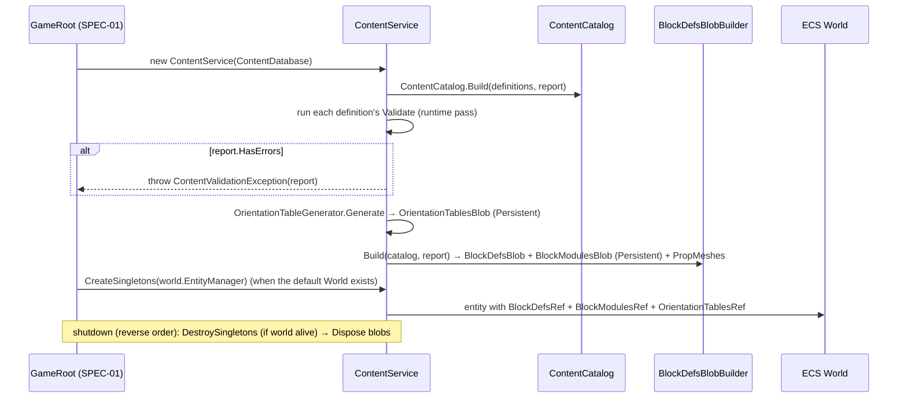
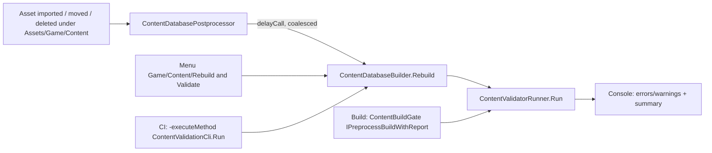

# SPEC-04 — Content database and block definitions

| | |
|---|---|
| **Status** | Draft |
| **Area code** | DATA (task IDs are `DATA-001`, `DATA-002`, …) |
| **Module(s)** | `Game.Data` (folder `Assets/Game/Data/`); content tooling in `Game.Editor` (folder `Assets/Game/Editor/Content/`); content assets in `Assets/Game/Content/` |
| **Depends on specs** | SPEC-02 (`ContentId`, `StableHash`, `GameLog`); SPEC-21 (`WeaponDefinition`, only for DATA-010); SPEC-24 (`AbilityDefinition`, only for DATA-010) |
| **Depended on by** | SPEC-01 (constructs `ContentService`, creates the ECS singletons), SPEC-05 (content IDs in saves, Missing placeholders), SPEC-10/11/12/13 (`BlockDefsBlob`, orientation tables, placement math), SPEC-20/21/22/24 (function params), SPEC-30…33, SPEC-40…42 (`ContentDefinition`, `ValidationReport`), SPEC-50 (`ItemDefinition` base), SPEC-51 (placement, mirror, orientation rotation), SPEC-72 (target types and the legacy block value table §4.10) |
| **Milestone** | M0 (DATA-011/012 in M1, DATA-010 in M2) |

> Read [01-architecture.md](../01-architecture.md), [02-conventions.md](../02-conventions.md) and [03-glossary.md](../03-glossary.md) before this spec. This spec may not contradict them.

## 1. Purpose

This spec defines how every piece of authored content is identified, stored, validated and handed to the game. Content is ScriptableObject definitions with stable string IDs (`block_hull`), collected by one `ContentDatabase` asset and turned at boot into a read-only `ContentCatalog` plus Burst-readable blobs. It also defines the block model shared by the editor, the runtime and saves: footprints, clearance, the 24 cube orientations, mirroring with chiral partners, and per-block function parameters. The old prototype loaded content with `Resources.LoadAll`, assigned 0-based runtime IDs that collided with "unresolved" (04-B10), wrote into ScriptableObjects at runtime (04-B20), keyed baked data on `string.GetHashCode` (04-B31, 01-B9), ignored multi-cell footprints at runtime (01-B1) and stored rotations as float Euler angles with five copies of the rotation maths (06-C3, C13). This spec makes all of those impossible by construction.

## 2. Scope

**In scope:**
- `ContentDefinition` base class, `ContentIdPrefixAttribute`, ID format and prefix rules, former-ID aliases.
- `ContentDatabase` ScriptableObject, the editor builder, asset postprocessor, validator runner, batch CLI and build gate.
- `ContentCatalog` (runtime lookups, per-family 1-based indices, Missing placeholders, unresolved-ID tracking) and `ContentService` (boot, blob lifetime, ECS singletons).
- `ValidationReport` and the `IContentDatabaseValidator` hook used by every importer and validator.
- `ItemDefinition` base fields (category, rarity, price, stack size, icon).
- `BlockDefinition`, `BlockKind`, `BlockShape`, `BlockFace`, masks, `BlockCategory`, block modules (`BlockModule`, `BlockModuleId`, the v1 modules and their rows, ADR-0013), `BlockModulesBlob` and `BlockStatMath`.
- `OrientationTables`: generation, `Rotate`, `Compose`, `Inverse`, `Mirror`, face rotation, axis turns, forward/up lookup.
- `BlockDefsBlob` / `BlockDef` and `BlockModulesBlob` building with stable ordering and a content hash; ECS singletons `BlockDefsRef`, `BlockModulesRef` and `OrientationTablesRef`.
- Placement maths: footprint cells, clearance cells, mirrored placement (`BlockPlacementMath`).
- System placeholder content (`block_missing`, `item_missing`) and the v2 block additions needed for the M3 block list (reactor, cargo).
- The value table that SPEC-72 uses to convert every legacy block.

**Out of scope (and who owns it instead):**
- Economy fields on items (volume, salvage value, merchant tags, …): SPEC-50 adds them to `ItemDefinition` (§3 decision 11).
- `WeaponDefinition` fields and weapon behaviour: SPEC-21. `AbilityDefinition`: SPEC-24.
- `ShipBlueprintDefinition`, `VoxelStructure`, `Cell`, `PaletteEntry`, `BlockInstance`: SPEC-10. The blueprint *byte format* (VOXS): SPEC-05.
- How cells are meshed (wedge geometry, material texture array): SPEC-11. Colliders and mass integration: SPEC-12. Damage semantics of `CellHp`, `FunctionHp`, `ArmorClass`: SPEC-13. Thrust/power/shield behaviour: SPEC-20/22.
- Editor placement rules (attach faces, clearance, budgets) and symmetry UI: SPEC-51 (uses this spec's maths).
- Converting legacy JSON: SPEC-72. Creating the ECS singleton entities at boot: SPEC-01 (calls `ContentService.CreateSingletons`).
- The ship paint palette (what colour a `Color` byte means): SPEC-11 / SPEC-80.

## 3. Decisions (binding)

1. **IDs are lowercase `snake_case` strings matching `^[a-z][a-z0-9]*(_[a-z0-9]+)+$`, 3–64 characters, globally unique across all definition types.** Reason: one palette namespace in saves; IDs are readable in data and logs.
2. **Each definition class declares its allowed ID prefixes with `[ContentIdPrefix(...)]`; the nearest declaration in the class hierarchy wins.** Reason: "prefixed by category" (conventions §1) becomes checkable. Default prefixes for every type are in §4.3.
3. **Definitions reference each other by direct asset reference, never by ID string.** Strings appear only in saves (palettes), in text-compiled logic (SPEC-40) and in legacy conversion. Reason: references survive renames and are validated by the editor.
4. **ScriptableObjects are never written at runtime.** All runtime tables (indices, lookups, hashes) live in `ContentCatalog` / `ContentService`, plain C# objects built at boot. Reason: 04-B20 (editor/build divergence).
5. **Runtime indices are 1-based per family and never saved.** A family is a definition type `T`; `All<T>()` is every definition assignable to `T` sorted by `string.CompareOrdinal` of the ID; `IndexOf<T>(def)` is its position + 1. `BlockIndex` = `IndexOf<BlockDefinition>`, 0 = air. Reason: deterministic, no "0 means unresolved" ambiguity (04-B10), architecture §6.2.
6. **`BlockDefinition : ItemDefinition`.** Every block is also an inventory item with category `Block`; its item index and block index are separate families. Reason: salvage and editor commits count blocks as items (glossary *BOM*) without a second asset per block.
7. **Orientation is a `byte` 0..23 generated by the algorithm in §5.3; orientation 0 is identity and yaw-only orientations are 0, 4, 8, 12.** Never Euler angles. Reason: architecture §6.2, exact equality and tables (06-C13).
8. **Footprints rotate about the root cell.** `cells(t, o, p) = { p + Rotate(c, o) | c ∈ Footprint(t) }`. The footprint always contains `(0,0,0)` (the root). Reason: one formula for editor, runtime and saves (01-B1).
9. **Block local frame: +Z = forward (muzzle / exhaust / functional face), +Y = up. A grid's forward is +Z and up is +Y.** Thrusters push along block-local −Z (exhaust leaves through +Z). Reason: matches every legacy ship (weapons face +Z, thrusters are mounted rotated 180°) and ADR-0003 planar flight on XZ.
10. **Mirroring uses chiral partners defined against the local X reflection.** A block's mirror partner has footprint `Sx(F) + MirrorOffset` (set equality). `MirrorIndex` = self for achiral blocks. Mirrored placement is computed by §5.6, never by negating Euler angles. Reason: 06-C2/C3.
11. **`ItemDefinition.cs` is owned by this spec.** SPEC-50 may add economy fields to it in its own task, below the marked line, and must not change or remove the base fields in §4.4. Reason: one class, two designers, no merge ambiguity.
12. **Block functions are composable modules (ADR-0013).** A functional block carries a list of `BlockModule`s (at most one per `BlockModuleId`); each module bakes one unmanaged row into `BlockModulesBlob`, and systems read only the rows of the modules they own. `BlockCategory` is display-only. Reason: a new function (hangar, repair bay) is a new module, never an edit of an enum, a fat struct or a central switch; mixed blocks (reactor + explosive, core + power) are free.
13. **Single-cell structural blocks use the grid palette; a block uses a `BlockInstance` iff it is Functional or has more than one cell** (`BlockDef.RequiresInstance`). ADR-0018/0028 permit the two-cell long slope with per-cell shapes; other multi-cell structural kits remain owner gates. A block is Functional iff it has at least one module. Each structural cell is meshed independently.
14. **Content errors fail loudly**: in the editor (postprocessor + console), in CI (`-executeMethod`, exit code 1), at build time (build fails) and at boot (`ContentValidationException`). Never silently at runtime. Reason: conventions §6.
15. **Missing content degrades, never rejects.** Unknown IDs read from saves resolve to `block_missing` / `item_missing` and are recorded for a warning (SPEC-05 surfaces them). Reason: 04-B1.
16. **Content assets live in `Assets/Game/Content/<Area>/<id>.asset`; the database asset is `Assets/Game/Content/ContentDatabase.asset`.** All definition *classes* are in `Assets/Game/Data/Definitions/<Area>/` with namespace `Game.Data.Definitions` (architecture §3.2 wins over the sub-folder namespace rule).
17. **Hashes use `StableHash` (xxHash3-64) only.** `BlockDefsBlob.BlockDefsHash`, `ContentCatalog.IdentityHash` and `ContentService.DatabaseHash` are reproducible across machines and runs (§5.5). (These are database fingerprints, not to be confused with the per-ID `Game.Core.ContentHash` type.)
18. **`ContentId` is managed and never appears in blobs, components, buffers, jobs or ECS events.** ECS data refers to content by `ContentHash` (blueprints, cues, factions) or by a dense runtime index (`BlockIndex`); `ContentCatalog.TryGet(in ContentHash, ...)` maps a hash back to its definition. Two IDs with equal hashes fail validation and boot (`DATA-E005`). Reason: architecture §6.1 erratum.

## 4. Data model

### 4.1 Folders and namespaces

| Folder | Namespace | Contents |
|---|---|---|
| `Assets/Game/Data/` | `Game.Data` | `ContentDatabase` |
| `Assets/Game/Data/Definitions/Common/` | `Game.Data.Definitions` | `ContentDefinition`, `ContentIdPrefixAttribute` |
| `Assets/Game/Data/Definitions/Items/` | `Game.Data.Definitions` | `ItemDefinition`, `ItemCategory`, `ItemRarity` |
| `Assets/Game/Data/Definitions/Blocks/` | `Game.Data.Definitions` | `BlockDefinition` |
| `Assets/Game/Data/Blocks/` | `Game.Data.Blocks` | `BlockKind`, `BlockShape`, `BlockFace`, `BlockFaceMask`, `OrientationMask`, `BlockCategory`, `BlockModuleId`, `BlockModule`, `BlockModule<TRow>`, `BlockModuleBakeContext`, the v1 modules and their row structs (§4.6), `BlockStatContribution`, `BlockStatMath`, `BlockDef`, `BlockDefsBlob`, `BlockModuleTable`, `BlockModulesBlob`, `BlockDefsBlobBuilder`, `OrientationTablesBlob`, `OrientationTables`, `OrientationTableGenerator`, `OrientationData`, `BlockPlacementMath`, `BlockIndex`, `Orientation` |
| `Assets/Game/Data/Components/` | `Game.Data.Components` | `BlockDefsRef`, `BlockModulesRef`, `OrientationTablesRef` |
| `Assets/Game/Data/Validation/` | `Game.Data.Validation` | `ValidationReport`, `ValidationEntry`, `ValidationSeverity`, `ValidationScope`, `IContentDatabaseValidator`, `ContentValidationContext`, `ContentValidationException`, `ContentIdRules` |
| `Assets/Game/Data/Services/` | `Game.Data.Services` | `ContentCatalog`, `ContentService`, `UnresolvedContentId` |
| `Assets/Game/Editor/Content/` | `Game.Editor.Content` | builder, postprocessor, validator runner, CLI, build gate, drawers |

`Blocks/` and `Validation/` are new folder names (conventions §1 allows them with a reason): they group the block maths and the validation API that many modules import.

### 4.2 Constants and small types (public contract)

```csharp
namespace Game.Data.Blocks
{
    /// <summary>Implements SPEC-04 §4.2. BlockIndex is a plain ushort (architecture §6.2); these are its constants.</summary>
    public static class BlockIndex { public const ushort Air = 0; public const ushort MaxCount = 65535; }

    /// <summary>Orientation is a plain byte 0..23 (architecture §6.2).</summary>
    public static class Orientation { public const byte Identity = 0; public const int Count = 24; public const byte Invalid = 255; }

    public enum BlockKind : byte { Structural = 0, Prop = 1, Functional = 2 }        // binding (architecture §6.2)

    public enum BlockShape : byte { Cube = 0, Wedge = 1, HipCorner = 2, LongSlopeHigh = 3, LongSlopeLow = 4 }   // add values at the end only (ADR-0018)

    public enum BlockFace : byte { PosX = 0, NegX = 1, PosY = 2, NegY = 3, PosZ = 4, NegZ = 5 }

    [System.Flags] public enum BlockFaceMask : byte
    { None = 0, PosX = 1, NegX = 2, PosY = 4, NegY = 8, PosZ = 16, NegZ = 32, All = 63 }

    // Block functions are modules (BlockModuleId, BlockCategory: §4.6, ADR-0013).

    /// <summary>24-bit set of allowed orientations (bit o = orientation o allowed). Serializable.</summary>
    [System.Serializable]
    public struct OrientationMask
    {
        public uint Bits;                                   // only bits 0..23 may be set
        public const uint AllBits = 0x00FFFFFF;
        public const uint HorizontalForwardBits = 0x0000FFFF; // orientations 0..15: forward ∈ {+Z,+X,-Z,-X}, any roll
        public const uint YawOnlyBits = (1u << 0) | (1u << 4) | (1u << 8) | (1u << 12);
        public static OrientationMask All => new OrientationMask { Bits = AllBits };
        public bool Allows(byte o) => o < 24 && (Bits & (1u << o)) != 0;
    }
}
```

Block shape geometry (canonical, in cell-centred coordinates `[-0.5, 0.5]³`; SPEC-11 meshes it, SPEC-12 may treat any sloped shape as a full cube for collision). The kit is ADR-0018: cube, slope (`Wedge`), hip corner and the long slope 1×2, which is one placeable block whose two cells store `LongSlopeHigh` and `LongSlopeLow`:

| Shape | Solid region | Full faces | Notes |
|---|---|---|---|
| `Cube` | whole cell | all 6 | Default |
| `Wedge` | `y + z ≤ 0` | `NegY`, `NegZ` | Slope normal `(0, 1, 1)/√2` (faces up-forward); triangular faces on ±X. Symmetric under the X reflection, so a wedge is its own mirror partner. Matches the legacy `hull_1x1_angled` mesh |
| `HipCorner` | `y + z ≤ 0` and `x + z ≤ 0` | `NegZ` | Where two slopes meet on a ridge, a nose or a chamfered edge. Two slope faces, normals `(0, 1, 1)/√2` and `(1, 0, 1)/√2`. Symmetric under swapping x and y, so it is its own mirror partner |
| `LongSlopeHigh` | `y + 2z ≤ 0.5` | `NegY`, `NegZ` | The tall cell of the long slope 1×2 (rise 1 over 2 cells, normal `(0, 1, 2)/√5`): full height at its −Y side, half height at +Y. Own mirror partner |
| `LongSlopeLow` | `y + 2z ≤ −0.5` | `NegZ` | The low cell of the long slope, placed at +Y of the tall cell: half height at −Y, zero at +Y. Own mirror partner |

### 4.3 `ContentDefinition`, ID rules and prefixes (public contract)

```csharp
namespace Game.Data.Definitions
{
    /// <summary>Base of every content definition. Implements SPEC-04 §4.3. Data only; never written at runtime.</summary>
    public abstract class ContentDefinition : UnityEngine.ScriptableObject
    {
        [UnityEngine.SerializeField, UnityEngine.Delayed] private string id;          // e.g. "block_hull"
        [UnityEngine.SerializeField] private string[] formerIds = System.Array.Empty<string>(); // aliases for renamed released content

        [System.NonSerialized] private Game.Core.ContentId cachedId;                  // derived cache only (not data)
        [System.NonSerialized] private bool cacheValid;

        public Game.Core.ContentId Id { get; }            // new ContentId(id), cached; returns default if id is null/empty
        public string IdString => id;
        public System.Collections.Generic.IReadOnlyList<string> FormerIds => formerIds;

        /// <summary>Per-definition field checks. Base does nothing; override and call base.</summary>
        public virtual void Validate(Game.Data.Validation.ValidationScope scope, Game.Data.Validation.ContentValidationContext context) { }

        protected virtual void OnValidate() { cacheValid = false; }                  // editor only; resets the ID cache
    }

    /// <summary>Allowed ID prefixes for a definition type. Inherited; the nearest declaration wins.</summary>
    [System.AttributeUsage(System.AttributeTargets.Class, Inherited = true, AllowMultiple = false)]
    public sealed class ContentIdPrefixAttribute : System.Attribute
    {
        public ContentIdPrefixAttribute(params string[] prefixes) { Prefixes = prefixes; }
        public string[] Prefixes { get; }                 // each ends with '_'
    }
}
```

`ContentIdRules` (static, `Game.Data.Validation`): `bool IsValidFormat(string id)`, `bool HasAllowedPrefix(System.Type defType, string id, out string[] allowed)`, `const int MinLength = 3, MaxLength = 64`.

**Prefix registry.** The owning spec adds `[ContentIdPrefix]` to its class with these values unless it records a different choice in its own *Open questions* (then it must tell SPEC-04 so this table is updated):

| Definition type | Owner | Prefixes |
|---|---|---|
| `BlockDefinition` | SPEC-04 | `block_`, `weapon_` |
| `ItemDefinition` (non-block) | SPEC-04 / SPEC-50 | `item_`, `resource_`, `module_`, `officer_`, `paint_` |
| Every `*ConfigDefinition` (one instance each): `GameConfigDefinition` (SPEC-01), `VoxelConfigDefinition` (SPEC-10), `VoxelRenderConfigDefinition`, `VoxelPaletteDefinition` (SPEC-11), `PhysicsVoxelConfigDefinition` (SPEC-12), `DamageConfigDefinition` (SPEC-13), `FlightConfigDefinition` (SPEC-20), `WeaponTuningDefinition` (SPEC-21, id `config_weapons`), `AiConfigDefinition` (SPEC-23), `StreamingConfigDefinition` (SPEC-31), `TravelConfigDefinition` (SPEC-32), `EncounterConfigDefinition` (SPEC-33), `EconomyConfigDefinition` (SPEC-50), `VfxConfigDefinition` (SPEC-63), `AudioConfigDefinition` (SPEC-64) | owning spec | `config_` |
| `ShipBlueprintDefinition` | SPEC-10 | `ship_` |
| `WeaponDefinition` | SPEC-21 | `wpn_` |
| `DamageTypeDefinition` | SPEC-13 | `dmg_` |
| `ArmorClassDefinition` | SPEC-13 | `armor_` |
| `PowerTuningDefinition` | SPEC-22 | `tuning_` |
| `AiProfileDefinition` | SPEC-23 | `ai_` |
| `FormationDefinition` | SPEC-23 | `formation_` |
| `AbilityDefinition` | SPEC-24 | `ability_` |
| `GalaxyGenerationDefinition` | SPEC-30 | `galaxy_` |
| `StarSystemTemplateDefinition` | SPEC-30 | `systpl_` |
| `AuthoredStarSystemDefinition` | SPEC-30 | `starsys_` |
| `BodyTemplateDefinition` | SPEC-30 | `body_` |
| `BodyVisualDefinition` | SPEC-30 | `bodyvis_` |
| `FactionDefinition` | SPEC-33 | `faction_` |
| `EncounterDefinition` | SPEC-33 | `encounter_` |
| `FactCatalogDefinition` | SPEC-40 | `facts_` |
| `NarrativeConfigDefinition` | SPEC-40 | `narrative_` |
| `SpeakerDefinition` | SPEC-41 | `speaker_` |
| `IllustrationDefinition` | SPEC-41 | `illustration_` |
| `DialogCommandTableDefinition`, `DialogProgramDefinition` | SPEC-41 | `dialog_` |
| `StoryBeatDefinition` | SPEC-42 | `beat_` |
| `QuestDefinition` | SPEC-42 | `quest_`, `contract_` |
| `ClueDefinition` | SPEC-42 | `clue_` |
| `RumorDefinition` | SPEC-42 | `rumor_` |
| `MysteryDefinition` | SPEC-42 | `mystery_` |
| `LootTableDefinition` | SPEC-50 | `loot_` |
| `MerchantDefinition` | SPEC-50 | `merchant_` |
| `FxDefinition` | SPEC-63 | `fx_` |
| `AudioCueDefinition` | SPEC-64 | `cue_` |
| `ArtDirectionDefinition` | SPEC-80 | `artdir_` |
| `BrickMaterialDefinition` | SPEC-80 | `brickmat_` |
| `BlockVisualDefinition` | SPEC-80 | `vis_` |

A new definition type adds its row here in the same commit as its class (code review checks it); `DATA-E003` catches a class with no prefix at all.

A definition class without any `[ContentIdPrefix]` in its hierarchy fails validation (`DATA-E003`), so every new type must declare one.

### 4.4 `ItemDefinition` (public contract; base owned here, economy fields added by SPEC-50)

```csharp
namespace Game.Data.Definitions
{
    public enum ItemCategory : byte { Block = 0, Resource = 1, Consumable = 2, Module = 3, Officer = 4, Paint = 5, Quest = 6, Misc = 7 }  // add at end only
    public enum ItemRarity : byte { Common = 0, Uncommon = 1, Rare = 2, Epic = 3, Legendary = 4, Unique = 5 }                           // add at end only

    /// <summary>Base inventory item. Implements SPEC-04 §4.4. Plain items are instances of this class.</summary>
    [ContentIdPrefix("item_", "resource_", "module_", "officer_", "paint_")]
    [UnityEngine.CreateAssetMenu(menuName = "Game/Content/Item", fileName = "item_new")]
    public class ItemDefinition : ContentDefinition
    {
        [UnityEngine.SerializeField] private string displayName;                   // player-facing, English (no localization in v1)
        [UnityEngine.SerializeField, UnityEngine.TextArea(2, 6)] private string description;
        [UnityEngine.SerializeField] private ItemCategory category = ItemCategory.Misc;
        [UnityEngine.SerializeField] private ItemRarity rarity = ItemRarity.Common;
        [UnityEngine.SerializeField, UnityEngine.Min(0)] private int basePrice;    // credits
        [UnityEngine.SerializeField, UnityEngine.Min(1)] private int maxStack = 999; // 1 = not stackable
        [UnityEngine.SerializeField] private UnityEngine.Sprite icon;              // placeholder sprite until SPEC-81

        public string DisplayName => displayName;
        public string Description => description;
        public ItemCategory Category => category;
        public ItemRarity Rarity => rarity;
        public int BasePrice => basePrice;
        public int MaxStack => maxStack;
        public bool IsStackable => maxStack > 1;
        public UnityEngine.Sprite Icon => icon;

        // ---- SPEC-50 economy fields go below this line (ECO tasks). Do not edit the fields above. ----
        // ECO-001 adds: [SerializeField] private bool tradeable = true; public bool Tradeable => tradeable && Category != ItemCategory.Quest;
    }
}
```

Localization keys, when added later, derive from the ID: `item.<id>.name`, `item.<id>.desc`.

### 4.5 `BlockDefinition` (public contract)

```csharp
namespace Game.Data.Definitions
{
    /// <summary>A placeable block. Implements SPEC-04 §4.5. Category is always ItemCategory.Block.</summary>
    [ContentIdPrefix("block_", "weapon_")]
    [UnityEngine.CreateAssetMenu(menuName = "Game/Content/Block", fileName = "block_new")]
    public sealed class BlockDefinition : ItemDefinition
    {
        [UnityEngine.Header("Shape")]
        [UnityEngine.SerializeField] private Game.Data.Blocks.BlockKind kind;
        [UnityEngine.SerializeField] private Game.Data.Blocks.BlockShape shape;                  // Structural only; Cube otherwise
        [UnityEngine.SerializeField] private UnityEngine.Vector3Int[] cells = { UnityEngine.Vector3Int.zero }; // unrotated footprint, must contain (0,0,0)
        [UnityEngine.SerializeField] private Game.Data.Blocks.BlockShape[] shapes = System.Array.Empty<Game.Data.Blocks.BlockShape>(); // optional, parallel to authored cells
        [UnityEngine.SerializeField] private UnityEngine.Vector3Int[] clearance = System.Array.Empty<UnityEngine.Vector3Int>(); // must-stay-empty cells, block-local
        [UnityEngine.SerializeField] private Game.Data.Blocks.OrientationMask allowedOrientations = Game.Data.Blocks.OrientationMask.All;
        [UnityEngine.SerializeField] private Game.Data.Blocks.BlockFaceMask attachFaces = Game.Data.Blocks.BlockFaceMask.All;
        [UnityEngine.SerializeField] private BlockDefinition mirrorPartner;                       // null = self (achiral)

        [UnityEngine.Header("Durability and mass")]
        [UnityEngine.SerializeField, UnityEngine.Min(1f)] private float cellHp = 100f;           // HP of ONE cell; Cell.Hp 255 == cellHp
        [UnityEngine.SerializeField, UnityEngine.Min(0f)] private float functionHp;              // whole-block function HP (Functional only)
        [UnityEngine.SerializeField, UnityEngine.Min(0.01f)] private float cellMass = 25f;       // kg per cell
        [UnityEngine.SerializeField] private byte armorClass;                                     // 0 = standard; meaning defined by SPEC-13

        [UnityEngine.Header("Presentation")]
        [UnityEngine.SerializeField] private byte materialLayer;                                   // 0..63, structural texture-array layer (SPEC-11)
        [UnityEngine.SerializeField] private UnityEngine.Mesh propMesh;                           // Prop/Functional: pivot at root cell centre

        [UnityEngine.Header("Function")]
        [UnityEngine.SerializeField] private Game.Data.Blocks.BlockCategory blockCategory;    // display only (§4.6); rules in §6.4
        [UnityEngine.SerializeReference] private Game.Data.Blocks.BlockModule[] modules = System.Array.Empty<Game.Data.Blocks.BlockModule>(); // §4.6; empty unless Functional

        // DATA-010 (M2) adds: [SerializeField] AbilityDefinition[] grantedAbilities; (the weapon link lives in WeaponMountModule)

        public Game.Data.Blocks.BlockKind Kind => kind;
        public Game.Data.Blocks.BlockShape Shape => shape;
        public System.Collections.Generic.IReadOnlyList<UnityEngine.Vector3Int> Cells => cells;
        public System.Collections.Generic.IReadOnlyList<Game.Data.Blocks.BlockShape> Shapes => shapes;
        public Game.Data.Blocks.BlockShape GetShape(int footprintIndex); // explicit shape or default Shape
        public System.Collections.Generic.IReadOnlyList<UnityEngine.Vector3Int> Clearance => clearance;
        public Game.Data.Blocks.OrientationMask AllowedOrientations => allowedOrientations;
        public Game.Data.Blocks.BlockFaceMask AttachFaces => attachFaces;
        public BlockDefinition MirrorPartner => mirrorPartner != null ? mirrorPartner : this;
        public float CellHp => cellHp; public float FunctionHp => functionHp; public float CellMass => cellMass;
        public byte ArmorClass => armorClass; public byte MaterialLayer => materialLayer;
        public UnityEngine.Mesh PropMesh => propMesh;
        public Game.Data.Blocks.BlockCategory BlockCategory => blockCategory;
        public System.Collections.Generic.IReadOnlyList<Game.Data.Blocks.BlockModule> Modules => modules;
        public bool TryGetModule<T>(out T module) where T : Game.Data.Blocks.BlockModule;   // first module of type T, else false
        public bool RequiresInstance => kind == Game.Data.Blocks.BlockKind.Functional || cells.Length > 1;
    }
}
```

`category` inherited from `ItemDefinition` must be `Block` (validated; the inspector shows it read-only for blocks).

### 4.6 Block modules (public contract; ADR-0013)

A functional block is a list of **modules**. Each module is a small serializable class authored on the `BlockDefinition` (`[SerializeReference]`, so the inspector shows a typed list with an "Add module" menu), validated by itself, baked into one unmanaged row of the `BlockModulesBlob` (§4.7), and able to add its own editor stats. A block has at most one module per `BlockModuleId`. Gameplay systems read the rows of the modules they own; nothing switches over a list of all module types. Units: force N, power E and E/s, HP abstract, lengths in **cells** (multiply by `VoxelGrid.CellSize` at runtime).

```csharp
namespace Game.Data.Blocks
{
    /// <summary>Identity of a module type: one append-only list (ADR-0013), at most 63 values (bit index in BlockDef.ModuleMask).
    /// A spec that adds a module appends its value here in the task that creates the module class.</summary>
    public enum BlockModuleId : byte
    { None = 0, Core = 1, PowerSource = 2, PowerStorage = 3, Thruster = 4, WeaponMount = 5, ShieldEmitter = 6, Cargo = 7, Explosive = 8 }

    /// <summary>Display-only grouping: editor palette tabs (SPEC-51), function colours and glyphs (SPEC-80, DESIGN-SYSTEM). Gameplay never reads it.</summary>
    public enum BlockCategory : byte { Structure = 0, Detail = 1, Core = 2, Propulsion = 3, Power = 4, Weapon = 5, Shield = 6, Utility = 7 }   // add at end only

    /// <summary>Managed context for baking module rows (boot and editor).</summary>
    public readonly struct BlockModuleBakeContext
    {
        public readonly Game.Data.Services.ContentCatalog Catalog;
        public readonly Game.Data.Definitions.BlockDefinition Block;
        public BlockModuleBakeContext(Game.Data.Services.ContentCatalog catalog, Game.Data.Definitions.BlockDefinition block) { Catalog = catalog; Block = block; }
    }

    /// <summary>One block's editor stats at one orientation, summed by BlockStatMath (SPEC-51 preview, SPEC-61 fleet screen). Add fields at the end only.</summary>
    public struct BlockStatContribution
    {
        public float Mass;                         // kg = cells × cellMass (BlockStatMath fills it; modules do not)
        public Unity.Mathematics.float3 Thrust;    // N, grid space at the given orientation
        public float PowerGeneration;              // E/s
        public float PowerDraw;                    // E/s at full demand
        public float PowerStorage;                 // E
        public float SustainedDps;
        public float ShieldCapacity, ShieldRegen;  // HP, HP/s
        public float CargoUnits;
    }

    /// <summary>Base of every module. Implements SPEC-04 §4.6 (ADR-0013).</summary>
    [System.Serializable]
    public abstract class BlockModule
    {
        public abstract BlockModuleId Id { get; }
        public abstract int RowSize { get; }
        /// Writes exactly RowSize bytes. Called by BlockDefsBlobBuilder only.
        internal abstract unsafe void BakeRow(in BlockModuleBakeContext ctx, void* destination);
        /// Range checks of this module's fields: report DATA-E041 with the field name. Default: nothing to check.
        public virtual void Validate(Game.Data.Definitions.BlockDefinition owner, Game.Data.Validation.ValidationReport report) { }
        /// Adds this module's editor stats for orientation `orient`. Default: nothing.
        public virtual void ContributeStats(ref BlockStatContribution stats, byte orient) { }
    }

    /// <summary>Typed base: TRow is the unmanaged row baked into BlockModulesBlob and read by Burst code with TryGet&lt;TRow&gt;.</summary>
    [System.Serializable]
    public abstract class BlockModule<TRow> : BlockModule where TRow : unmanaged
    {
        public sealed override int RowSize => Unity.Collections.LowLevel.Unsafe.UnsafeUtility.SizeOf<TRow>();
        protected abstract TRow Bake(in BlockModuleBakeContext ctx);
        internal sealed override unsafe void BakeRow(in BlockModuleBakeContext ctx, void* destination)
            => Unity.Collections.LowLevel.Unsafe.UnsafeUtility.WriteArrayElement(destination, 0, Bake(in ctx));
    }

    // ---- Rows (unmanaged; Burst reads them) ----
    [System.Serializable] public struct CoreParams { public int MaxCells; public int MaxExtentCells; }   // ≥ 1 each: build budget and max AABB edge (SPEC-51 enforces)
    [System.Serializable] public struct PowerSourceParams { public float Generation; }                  // E/s, > 0
    [System.Serializable] public struct PowerStorageParams { public float Storage; }                    // E, > 0
    [System.Serializable] public struct ThrusterParams { public float ThrustNewtons; public float PowerDraw; }   // > 0 along block-local −Z; E/s at full throttle, ≥ 0
    [System.Serializable] public struct ShieldEmitterParams
    { public float Capacity; public float RegenPerSecond; public float RechargeDelaySeconds; public float PowerDraw; }   // > 0, ≥ 0, ≥ 0, ≥ 0
    [System.Serializable] public struct CargoParams { public float Capacity; }                          // capacity units (SPEC-50: 10 units = 1 slot), > 0
    [System.Serializable] public struct ExplosiveParams { public float BlastRadiusCells; public float BlastDamage; }   // ExplosionRequest when the block is destroyed (SPEC-13); > 0 each
    public struct WeaponMountParams                                                                     // baked from WeaponMountModule (DATA-010)
    { public ushort WeaponIndex; /* IndexOf<WeaponDefinition>, 0 = none */ public Unity.Mathematics.float3 MuzzleOffsetCells; /* block-local, from the root cell centre; fire dir = +Z */ }

    // ---- v1 modules (SPEC-04 designs them; later modules are designed by their own spec, files in this folder) ----
    [System.Serializable] public sealed class CoreModule : BlockModule<CoreParams>
    { public CoreParams Params; public override BlockModuleId Id => BlockModuleId.Core; protected override CoreParams Bake(in BlockModuleBakeContext ctx) => Params; }
    [System.Serializable] public sealed class PowerSourceModule : BlockModule<PowerSourceParams>          // stats: PowerGeneration
    { public PowerSourceParams Params; public override BlockModuleId Id => BlockModuleId.PowerSource; protected override PowerSourceParams Bake(in BlockModuleBakeContext ctx) => Params; }
    [System.Serializable] public sealed class PowerStorageModule : BlockModule<PowerStorageParams>        // stats: PowerStorage
    { public PowerStorageParams Params; public override BlockModuleId Id => BlockModuleId.PowerStorage; protected override PowerStorageParams Bake(in BlockModuleBakeContext ctx) => Params; }
    [System.Serializable] public sealed class ThrusterModule : BlockModule<ThrusterParams>                // stats: Thrust += OrientationTables.Rotate((0,0,−1), orient) × ThrustNewtons; PowerDraw
    { public ThrusterParams Params; public override BlockModuleId Id => BlockModuleId.Thruster; protected override ThrusterParams Bake(in BlockModuleBakeContext ctx) => Params; }
    [System.Serializable] public sealed class ShieldEmitterModule : BlockModule<ShieldEmitterParams>      // stats: ShieldCapacity, ShieldRegen, PowerDraw
    { public ShieldEmitterParams Params; public override BlockModuleId Id => BlockModuleId.ShieldEmitter; protected override ShieldEmitterParams Bake(in BlockModuleBakeContext ctx) => Params; }
    [System.Serializable] public sealed class CargoModule : BlockModule<CargoParams>                      // stats: CargoUnits
    { public CargoParams Params; public override BlockModuleId Id => BlockModuleId.Cargo; protected override CargoParams Bake(in BlockModuleBakeContext ctx) => Params; }
    [System.Serializable] public sealed class ExplosiveModule : BlockModule<ExplosiveParams>
    { public ExplosiveParams Params; public override BlockModuleId Id => BlockModuleId.Explosive; protected override ExplosiveParams Bake(in BlockModuleBakeContext ctx) => Params; }
    [System.Serializable] public sealed class WeaponMountModule : BlockModule<WeaponMountParams>
    {
        public Unity.Mathematics.float3 MuzzleOffsetCells;
        // DATA-010 (M2) adds: [SerializeField] WeaponDefinition weapon (+ getter); Bake then sets WeaponIndex = ctx.Catalog.IndexOf<WeaponDefinition>(weapon)
        // (0 if null); ContributeStats adds weapon.SustainedDps and weapon.PowerDraw (SPEC-21 getters). Until then WeaponIndex = 0 (unarmed).
        public override BlockModuleId Id => BlockModuleId.WeaponMount;
        protected override WeaponMountParams Bake(in BlockModuleBakeContext ctx) => new WeaponMountParams { WeaponIndex = 0, MuzzleOffsetCells = MuzzleOffsetCells };
    }

    /// <summary>Editor stats of one block at one orientation: Mass from cells, then every module's ContributeStats in list order.</summary>
    public static class BlockStatMath
    {
        public static BlockStatContribution Of(Game.Data.Definitions.BlockDefinition block, byte orient);
    }
}
```

Every v1 module overrides `Validate` with the range checks in the row comments (DATA-E041) and `ContributeStats` as commented (the core contributes nothing; its power comes from its `PowerSource`/`PowerStorage` modules). The legacy portal and prismatic mirrors have no module (they are props, §4.10 and open question 6).

### 4.7 Blobs and ECS singletons (public contract)

```csharp
namespace Game.Data.Blocks
{
    /// <summary>Baked block definition. Implements SPEC-04 §4.7 (architecture §6.2 BlockDef).</summary>
    public struct BlockDef
    {
        public ushort Index;                 // == position in BlockDefsBlob.Blocks; 0 = air
        public ushort MirrorIndex;           // chiral partner's index, or Index if achiral; 0 for air
        public BlockKind Kind;
        public BlockShape Shape;
        public BlockFaceMask AttachFaces;    // block-local faces
        public byte MaterialLayer;
        public byte ArmorClass;
        public uint AllowedOrientations;     // 24-bit mask
        public Unity.Mathematics.int3 MirrorOffset;   // Footprint(MirrorIndex) == { Sx(c) + MirrorOffset | c ∈ Footprint(Index) }
        public Unity.Mathematics.int3 BoundsMin;      // inclusive, unrotated footprint
        public Unity.Mathematics.int3 BoundsMax;      // inclusive
        public float CellHp;
        public float FunctionHp;             // 0 unless Functional
        public float CellMass;               // kg per cell
        public int PropMeshIndex;            // index into ContentService.PropMeshes, -1 = none
        public Game.Core.ContentHash IdHash; // ContentId.Hash: lets ECS code map a BlockIndex back to its content (diagnostics, saves go through the catalog)
        public Unity.Entities.BlobArray<Unity.Mathematics.int3> Cells;      // [0] == (0,0,0); rest sorted by (z, y, x)
        public Unity.Entities.BlobArray<BlockShape> Shapes; // resolved, parallel to canonical Cells (ADR-0028)
        public Unity.Entities.BlobArray<Unity.Mathematics.int3> Clearance;  // sorted by (z, y, x)
        public Unity.Entities.BlobArray<ushort> AbilityIndices;             // IndexOf<AbilityDefinition>; empty until DATA-010
        public ulong ModuleMask;             // bit (int)BlockModuleId set for every module of the block (§4.6); 0 for non-functional blocks
        public BlockCategory Category;       // display only

        public BlockShape GetShape(int footprintIndex); // Shapes[index], or Shape if empty (synthetic callers)
        public bool RequiresInstance => Kind == BlockKind.Functional || Cells.Length > 1;
        public bool HasModule(BlockModuleId id) => (ModuleMask & (1ul << (int)id)) != 0;
        public bool IsCore => HasModule(BlockModuleId.Core);
    }

    /// <summary>Rows of one module type for every block (ADR-0013).</summary>
    public struct BlockModuleTable
    {
        public BlockModuleId Id;
        public int RowSize;                                   // bytes; 0 when no block uses this module
        public int DataOffset;                                // into BlockModulesBlob.RowData; 16-byte aligned
        public Unity.Entities.BlobArray<short> RowByBlock;    // length = Blocks.Length; −1 = the block has no such module
    }

    /// <summary>Every module row of every block. Tables indexed by (int)BlockModuleId. Methods are called through `ref` to the blob value.</summary>
    public struct BlockModulesBlob
    {
        public Unity.Entities.BlobArray<BlockModuleTable> Tables;   // length = highest BlockModuleId value + 1
        public Unity.Entities.BlobArray<byte> RowData;
        public bool Has(BlockModuleId id, ushort block);
        /// Copies the row; false (row = default) if absent. Debug builds assert UnsafeUtility.SizeOf<T>() == RowSize.
        public bool TryGet<T>(BlockModuleId id, ushort block, out T row) where T : unmanaged;
    }

    /// <summary>All block definitions indexed by BlockIndex. Blocks[0] is the air entry.</summary>
    public struct BlockDefsBlob
    {
        public Unity.Entities.BlobArray<BlockDef> Blocks;   // length = blockCount + 1
        public ulong BlockDefsHash;                          // database fingerprint of all BlockDefs, §5.5
        public ushort MissingBlockIndex;                     // index of block_missing
    }

    /// <summary>The 24-orientation group. Methods must be called through `ref` to the blob value.</summary>
    public struct OrientationTablesBlob
    {
        public Unity.Entities.BlobArray<Unity.Mathematics.int3x3> Matrices;   // 24; column c = image of local basis vector c
        public Unity.Entities.BlobArray<Unity.Mathematics.quaternion> Rotations; // 24; same rotation as Matrices
        public Unity.Entities.BlobArray<byte> ComposeTable;   // 576; [a*24+b] = Compose(a, b)
        public Unity.Entities.BlobArray<byte> InverseTable;   // 24
        public Unity.Entities.BlobArray<byte> MirrorTable;    // 72;  [o*3+axis], axis 0=X 1=Y 2=Z
        public Unity.Entities.BlobArray<byte> FaceTable;      // 144; [o*6+face] = rotated face
        public Unity.Entities.BlobArray<byte> AxisTurnTable;  // 12;  [axis*4+q] = rotation by q·90° about the grid axis (right-hand rule)
        public Unity.Entities.BlobArray<byte> ForwardUpTable; // 36;  [fwdFace*6+upFace] = orientation, or 255 if not perpendicular

        public Unity.Mathematics.int3 Rotate(Unity.Mathematics.int3 v, byte o);
        public Unity.Mathematics.float3 Rotate(Unity.Mathematics.float3 v, byte o);
        public byte Compose(byte a, byte b);          // R[a]·R[b]: apply b first, then a
        public byte Inverse(byte o);
        public byte Mirror(byte o, int axis);         // index of M_axis · R[o] · Sx
        public BlockFace RotateFace(BlockFace face, byte o);
        public byte AxisTurn(int axis, int quarterTurns);   // quarterTurns taken modulo 4 (negative allowed)
        public byte FromForwardUp(BlockFace forward, BlockFace up);
    }
}

namespace Game.Data.Components
{
    /// <summary>ECS singleton holding the block blob (architecture §6.2). Created by ContentService.CreateSingletons.</summary>
    public struct BlockDefsRef : Unity.Entities.IComponentData
    { public Unity.Entities.BlobAssetReference<Game.Data.Blocks.BlockDefsBlob> Value; }

    /// <summary>ECS singleton holding the module rows (§4.6). Created by ContentService.CreateSingletons with BlockDefsRef.</summary>
    public struct BlockModulesRef : Unity.Entities.IComponentData
    { public Unity.Entities.BlobAssetReference<Game.Data.Blocks.BlockModulesBlob> Value; }

    public struct OrientationTablesRef : Unity.Entities.IComponentData
    { public Unity.Entities.BlobAssetReference<Game.Data.Blocks.OrientationTablesBlob> Value; }
}
```

Builder and generator signatures (public contract):

```csharp
namespace Game.Data.Blocks
{
    /// <summary>Immutable managed copy of the orientation tables (same layout as OrientationTablesBlob).</summary>
    public sealed class OrientationData
    {
        public System.ReadOnlySpan<Unity.Mathematics.int3x3> Matrices { get; }      // 24
        public System.ReadOnlySpan<Unity.Mathematics.quaternion> Rotations { get; } // 24
        public System.ReadOnlySpan<byte> ComposeTable { get; }   // 576
        public System.ReadOnlySpan<byte> InverseTable { get; }   // 24
        public System.ReadOnlySpan<byte> MirrorTable { get; }    // 72
        public System.ReadOnlySpan<byte> FaceTable { get; }      // 144
        public System.ReadOnlySpan<byte> AxisTurnTable { get; }  // 12
        public System.ReadOnlySpan<byte> ForwardUpTable { get; } // 36
    }

    public static class OrientationTableGenerator
    {
        public static OrientationData Generate();                                   // §5.3
        public static Unity.Entities.BlobAssetReference<OrientationTablesBlob> BuildBlob(OrientationData data, Unity.Collections.Allocator allocator);
    }

    public static class BlockDefsBlobBuilder
    {
        /// <summary>§5.5. propMeshes receives the prop mesh table (index = BlockDef.PropMeshIndex); modules receives the module rows.</summary>
        public static Unity.Entities.BlobAssetReference<BlockDefsBlob> Build(
            Game.Data.Services.ContentCatalog catalog,
            Game.Data.Validation.ValidationReport report,
            System.Collections.Generic.List<UnityEngine.Mesh> propMeshes,
            Unity.Collections.Allocator allocator,
            out Unity.Entities.BlobAssetReference<BlockModulesBlob> modules);
    }
}
```

`OrientationTables` (static, managed, thread-safe) exposes the same methods with the same results for non-Burst code (editor, MIG, tests); it is backed by an immutable `OrientationData` produced by `OrientationTableGenerator.Generate()` and stored in a `static readonly` field (immutable, deterministic, so no `SubsystemRegistration` reset is needed). It also exposes `int3x3 Matrix(byte o)`, `bool TryFromMatrix(int3x3 m, out byte o)` and `quaternion ToQuaternion(byte o)`.

### 4.8 Validation types (public contract)

```csharp
namespace Game.Data.Validation
{
    public enum ValidationSeverity : byte { Info = 0, Warning = 1, Error = 2 }

    public readonly struct ValidationEntry
    {
        public readonly ValidationSeverity Severity;
        public readonly string Code;       // stable, e.g. "DATA-E004", "MIG-W030", "PERS-W001"
        public readonly string AssetPath;  // asset path, file path or logical path ("save:p001/manual_001")
        public readonly string Field;      // field or JSON path, "" if none
        public readonly string Message;    // one sentence, English
    }

    /// <summary>Collects errors and warnings (architecture §6.7). Not thread-safe; one report per pass.</summary>
    public sealed class ValidationReport
    {
        public ValidationReport(string context);                 // e.g. "ContentDatabase", "MIG", "Load p001/auto_0"
        public string Context { get; }
        public System.Collections.Generic.IReadOnlyList<ValidationEntry> Entries { get; }
        public int ErrorCount { get; } public int WarningCount { get; } public int InfoCount { get; }
        public bool HasErrors => ErrorCount > 0;
        public void Add(ValidationSeverity severity, string code, string assetPath, string field, string message);
        public void Error(string code, string assetPath, string field, string message);
        public void Warning(string code, string assetPath, string field, string message);
        public void Info(string code, string assetPath, string field, string message);
        public ValidationScope For(string assetPath);           // convenience: binds AssetPath
        public void Merge(ValidationReport other);
        public System.Collections.Generic.IEnumerable<ValidationEntry> Sorted();  // by AssetPath, Field, Code, Message (ordinal)
        public string ToText(int maxEntries = 500);              // deterministic, uses Sorted()
        public void LogTo(string gameLogCategory, int maxEntries = 50); // errors→GameLog.Error, warnings→Warn; then one summary line
    }

    public readonly struct ValidationScope
    {
        public void Error(string code, string field, string message);
        public void Warning(string code, string field, string message);
        public void Info(string code, string field, string message);
        public string AssetPath { get; }
    }

    public sealed class ContentValidationContext
    {
        public string AssetPath { get; }                         // editor: AssetDatabase path; runtime: "content:<id>"
        public bool IsInDatabase(Game.Data.Definitions.ContentDefinition def);
        public bool IsEditorPass { get; }                        // true when run by the editor validator (asset paths available)
    }

    /// <summary>Extra database-wide checks contributed by other specs (e.g. SPEC-10 blueprints, SPEC-40 narrative).</summary>
    public interface IContentDatabaseValidator
    {
        int Order { get; }                                       // ascending; ties by type full name
        void Validate(Game.Data.Services.ContentCatalog catalog, ValidationReport report);
    }

    public sealed class ContentValidationException : System.Exception
    { public ContentValidationException(ValidationReport report); public ValidationReport Report { get; } }
}
```

### 4.9 Catalog, service and database (public contract)

```csharp
namespace Game.Data
{
    /// <summary>The only content entry point (architecture §6.2). Holds direct references; maintained by the editor builder.</summary>
    [UnityEngine.CreateAssetMenu(menuName = "Game/Content/Content Database", fileName = "ContentDatabase")]
    public sealed class ContentDatabase : UnityEngine.ScriptableObject
    {
        [UnityEngine.SerializeField] private System.Collections.Generic.List<Game.Data.Definitions.ContentDefinition> definitions = new();
        public System.Collections.Generic.IReadOnlyList<Game.Data.Definitions.ContentDefinition> Definitions => definitions;
        internal void EditorSetDefinitions(System.Collections.Generic.List<Game.Data.Definitions.ContentDefinition> sortedById); // Game.Editor + tests only
    }
}

namespace Game.Data.Services
{
    public readonly struct UnresolvedContentId { public readonly string Id; public readonly string ExpectedType; public readonly string Context; }

    /// <summary>Read-only runtime view of all content. Implements SPEC-04 §5.4. Reads are thread-safe; Try/Resolve recording is main-thread only.</summary>
    public sealed class ContentCatalog
    {
        public static ContentCatalog Build(System.Collections.Generic.IReadOnlyList<Game.Data.Definitions.ContentDefinition> definitions, Game.Data.Validation.ValidationReport report);

        public int Count { get; }
        public ulong IdentityHash { get; }                    // fingerprint of all (ID, type) pairs, §5.4 step 7
        public Game.Data.Definitions.BlockDefinition MissingBlock { get; }
        public Game.Data.Definitions.ItemDefinition MissingItem { get; }

        public bool TryGet(in Game.Core.ContentId id, out Game.Data.Definitions.ContentDefinition def);   // live IDs, then former IDs
        public bool TryGet<T>(in Game.Core.ContentId id, out T def) where T : Game.Data.Definitions.ContentDefinition;
        public bool TryGet(in Game.Core.ContentHash hash, out Game.Data.Definitions.ContentDefinition def);   // for hashes coming from ECS data; live IDs only
        public bool TryGet<T>(in Game.Core.ContentHash hash, out T def) where T : Game.Data.Definitions.ContentDefinition;
        public T Get<T>(in Game.Core.ContentId id) where T : Game.Data.Definitions.ContentDefinition;      // KeyNotFoundException if absent
        public bool TryResolve<T>(in Game.Core.ContentId id, string context, out T def) where T : Game.Data.Definitions.ContentDefinition; // records unresolved on failure
        public Game.Data.Definitions.BlockDefinition ResolveBlockOrMissing(in Game.Core.ContentId id, string context);
        public Game.Data.Definitions.ItemDefinition ResolveItemOrMissing(in Game.Core.ContentId id, string context);

        public System.Collections.Generic.IReadOnlyList<T> All<T>() where T : Game.Data.Definitions.ContentDefinition; // sorted by ID (ordinal)
        public ushort IndexOf<T>(T def) where T : Game.Data.Definitions.ContentDefinition;     // 1-based; 0 if not in family
        public T GetByIndex<T>(ushort index) where T : Game.Data.Definitions.ContentDefinition; // null for 0 / out of range

        public ushort BlockCount { get; }
        public ushort GetBlockIndex(Game.Data.Definitions.BlockDefinition block);        // == IndexOf<BlockDefinition>
        public Game.Data.Definitions.BlockDefinition GetBlock(ushort blockIndex);        // null for Air
        public bool TryGetBlockIndex(in Game.Core.ContentId id, out ushort blockIndex);
        public bool IsPlaceholder(Game.Data.Definitions.ContentDefinition def);          // block_missing, item_missing

        public System.Collections.Generic.IReadOnlyList<UnresolvedContentId> Unresolved { get; }
        public void ClearUnresolved();
    }

    /// <summary>Boot-time owner of the catalog and blobs (architecture §4.2, service #2).</summary>
    public sealed class ContentService : System.IDisposable
    {
        public ContentService(Game.Data.ContentDatabase database);   // throws ContentValidationException on errors
        internal static ContentService CreateForTests(System.Collections.Generic.IReadOnlyList<Game.Data.Definitions.ContentDefinition> definitions);

        public ContentCatalog Catalog { get; }
        public Game.Data.Validation.ValidationReport BootReport { get; }
        public Unity.Entities.BlobAssetReference<Game.Data.Blocks.BlockDefsBlob> BlockDefs { get; }
        public Unity.Entities.BlobAssetReference<Game.Data.Blocks.OrientationTablesBlob> Orientations { get; }
        public System.Collections.Generic.IReadOnlyList<UnityEngine.Mesh> PropMeshes { get; } // index = BlockDef.PropMeshIndex
        public ulong DatabaseHash { get; }                                         // Combine(BlockDefsHash, IdentityHash); saved as diagnostics by SPEC-05

        public void CreateSingletons(Unity.Entities.EntityManager entityManager);  // idempotent per world
        public void DestroySingletons(Unity.Entities.EntityManager entityManager);
        public void Dispose();                                                     // disposes both blobs; idempotent
    }
}
```

### 4.10 Block value table (legacy blocks → v2 values) and v2 additions

SPEC-72 writes exactly these values (MIG-006). Footprints and clearance are block-local. `HF` = `OrientationMask.HorizontalForwardBits`, `All` = `AllBits`. Attach `−PosZ` = `All` minus `PosZ` (47). Price, rarity, display name and description are the legacy values. Formulas (so new blocks stay consistent): `FunctionHp = legacy Health × cell count` for Functional blocks; `ThrustNewtons = legacy ThrusterForce modifier × 2000`; `MuzzleOffsetCells = (centre x of bounds, centre y of bounds, BoundsMax.z + 0.5)`; legacy `BlockSize [sx,sy,sz]` means cells `x∈[0,sx), y∈[0,sy), z∈[0,sz)` unless a `VoxelShape` is given.

| ID | Kind | Shape | Cells | Clearance | Orient. | Attach | CellHp | FuncHp | Mass | Category: modules | Prop mesh (placeholder `.obj` : sub-mesh) |
|---|---|---|---|---|---|---|---|---|---|---|---|
| `block_hull` | Structural | Cube | 1 | — | All | All | 100 | 0 | 25 | Structure: — | — |
| `block_hull_angled` | Structural | Wedge | 1 | — | All | All | 50 | 0 | 15 | Structure: — | — |
| `block_core_small` | Functional | Cube | 1 | — | All | All | 300 | 300 | 60 | Core: Core (MaxCells 4000, MaxExtent 100), PowerSource (gen 40), PowerStorage (200) | shipVoxels : `hull_1x1_Cube.008` |
| `block_core_cross` | Functional | Cube | 7: (0,0,0),(0,1,0),(0,2,0),(1,1,0),(−1,1,0),(0,1,1),(0,1,−1) | — | All | All | 500 | 3500 | 60 | Core: Core (MaxCells 8000, MaxExtent 150), PowerSource (gen 40), PowerStorage (200) | hulls : `cross_3x3_hull_cross_3x3_hull` |
| `block_capacitor_small` | Functional | Cube | box 2×2×1 | — | All | All | 100 | 400 | 35 | Power: PowerStorage (40) | shipVoxels : `capacitor_2x1_base_1x1_hull.002` |
| `block_shield_small` | Functional | Cube | 1 | — | All | All | 100 | 100 | 40 | Shield: ShieldEmitter (capacity 300, regen 15, delay 3, draw 10) | hulls : `base_1x1_hull_base_1x1_hull` |
| `block_thruster_small` | Functional | Cube | box 1×1×2 | (0,0,2),(0,0,3),(0,0,4) | HF | −PosZ | 100 | 200 | 30 | Propulsion: Thruster (20000 N, draw 0) | shipVoxels : `thruster1x2_Cube.004` |
| `block_thruster_medium` | Functional | Cube | 10: (0,0,0),(1,0,0),(2,0,0),(1,1,0),(1,−1,0) and the same at z=1 | — | HF | −PosZ | 100 | 1000 | 30 | Propulsion: Thruster (40000 N, draw 0) | shipVoxels : `thruster3x3x2.001_Cube.007` |
| `block_thruster_large` | Functional | Cube | box 2×1×2 | (0..1,0,2..4) (6 cells) | HF | −PosZ | 100 | 400 | 30 | Propulsion: Thruster (40000 N, draw 0) | hulls : `base_2x2_thruster_base_2x2_thruster` |
| `block_portal_small` | Prop | Cube | 1 | (0,0,2) | HF | −PosZ | 150 | 0 | 30 | Detail: — (behaviour deferred, Q6) | hulls : `base_1x1_hull_base_1x1_hull` |
| `block_prismatic_mirror_small` | Prop | Cube | 1 | (0,0,1) | HF | −PosZ | 100 | 0 | 30 | Detail: — (behaviour deferred, Q6) | hulls : `base_1x1_hull_base_1x1_hull` |
| `block_prismatic_mirror_fixed_small` | Prop | Cube | 1 | (0,0,1) | HF | −PosZ | 100 | 0 | 30 | Detail: — (behaviour deferred, Q6) | hulls : `base_1x1_hull_base_1x1_hull` |
| `weapon_plasma_turret_small` | Functional | Cube | box 1×1×2 | (0,0,2..4) | HF | −PosZ | 100 | 200 | 30 | Weapon: WeaponMount (weapon `wpn_*` per SPEC-72 MIG-009, muzzle (0,0,1.5)) | shipVoxels : `gun_turret_1x2_base_1x2_gun.001` |
| `weapon_plasma_turret_small_fixed` | Functional | Cube | box 1×1×2 | (0,0,2..4) | HF | −PosZ | 150 | 300 | 30 | Weapon: WeaponMount (weapon `wpn_*` per SPEC-72 MIG-009, muzzle (0,0,1.5)) | shipVoxels : `gun_turret_1x2_base_1x2_gun.001` |
| `weapon_plasma_turret_medium` | Functional | Cube | box 2×1×2 | (0..1,0,3..4) | HF | −PosZ | 100 | 400 | 30 | Weapon: WeaponMount (weapon `wpn_*` per SPEC-72 MIG-009, muzzle (0.5,0,1.5)) | shipVoxels : `gun_turret_2x1x3_Cube.005` |
| `weapon_small_beam_turret` | Functional | Cube | box 1×1×2 | (0,0,2..4) | HF | −PosZ | 100 | 200 | 30 | Weapon: WeaponMount (weapon `wpn_*` per SPEC-72 MIG-009, muzzle (0,0,1.5)) | shipVoxels : `beam_turret_1x2_Cube.002` |
| `weapon_fixed_beam_turret_small` | Functional | Cube | box 1×1×2 | (0,0,2),(0,0,3) | HF | −PosZ | 200 | 400 | 30 | Weapon: WeaponMount (weapon `wpn_*` per SPEC-72 MIG-009, muzzle (0,0,1.5)) | shipVoxels : `beam_turret_1x2_Cube.002` |
| `weapon_railgun_medium` | Functional | Cube | box 1×1×2 | (0,0,2..4) ¹ | HF | −PosZ | 200 | 400 | 30 | Weapon: WeaponMount (weapon `wpn_*` per SPEC-72 MIG-009, muzzle (0,0,1.5)) | shipVoxels : `beam_turret_1x2_Cube.002` |
| `weapon_ark_lance_medium` | Functional | Cube | box 1×2×3 | (0,0,3),(0,0,4) ¹ | HF | −PosZ | 200 | 1200 | 30 | Weapon: WeaponMount (weapon `wpn_*` per SPEC-72 MIG-009, muzzle (0,0.5,2.5)) | shipVoxels : `gun_turret_2x1x3_Cube.005` |
| `weapon_flak_cannon_medium` | Functional | Cube | box 3×1×3 | (0..2,0,4) | HF | −PosZ | 200 | 1800 | 30 | Weapon: WeaponMount (weapon `wpn_*` per SPEC-72 MIG-009, muzzle (1,0,2.5)) | shipVoxels : `flak_cannon_3x3x3_Cube` |
| `weapon_missile_launcher_small` | Functional | Cube | box 2×1×2 | (0..1,0,3..4) | HF | −PosZ | 200 | 800 | 30 | Weapon: WeaponMount (weapon `wpn_*` per SPEC-72 MIG-009, muzzle (0.5,0,1.5)) | shipVoxels : `missile_launcher_2x1_Cube.006` |

¹ Legacy clearance cells that fall inside the block's own footprint are dropped (railgun `(0,0,1)`, ark lance `(0,0,1)`, `(0,0,2)`). The portal's legacy clearance `(1,0,0)` is dropped so the block stays achiral. All legacy blocks are achiral (`mirrorPartner` = null), `ArmorClass` 0, `MaterialLayer` 0, `maxStack` 999, category `Block`. Mesh paths are `Assets/Game/Art/_Placeholder/Meshes/<file>.obj`.

**System placeholders and v2 additions** (authored by DATA-009, DATA-011 and DATA-012, not migrated):

| ID | Kind | Shape | Cells | Orient. | Attach | CellHp | FuncHp | Mass | Category: modules | Price / rarity | Prop mesh |
|---|---|---|---|---|---|---|---|---|---|---|---|
| `block_missing` | Structural | Cube | 1 | All | All | 100 | 0 | 25 | Structure: — | 0 / Common; display name "Missing block"; `MaterialLayer` 63 (reserved "missing" look) | — |
| `item_missing` (ItemDefinition) | — | — | — | — | — | — | — | — | — | 0 / Common, category Misc, maxStack 999, display name "Missing item" | — |
| `block_reactor_small` | Functional | Cube | box 2×2×2 | All | All | 150 | 1200 | 50 | Power: PowerSource (gen 60), Explosive (radius 4 cells, damage 400) | 300 / Rare | hulls : `base_2x2_hull_base_2x2_hull` |
| `block_cargo_small` | Functional | Cube | box 2×1×1 | All | All | 100 | 200 | 20 | Utility: Cargo (50) | 20 / Common | hulls : `base_1x2_hull.001_base_1x2_hull.001` |
| `block_hull_hip` | Structural | HipCorner | 1 | All | All | 50 | 0 | 15 | Structure: — | 4 / Common | — |
| `block_hull_slope_long` | Structural | LongSlopeHigh; shapes High/Low | (0,0,0),(0,1,0) | All | All | 50 | 0 | 15 | Structure: — | 8 / Common | — |

Slope-kit defaults (ADR-0028): display names "Hip Corner Hull 1x1" / "Long Slope Hull 1x2", reuse the `block_hull_angled` icon; armor/material 0, stack 999, no clearance/modules. HP/mass are per cell, inherited from angled hull; prices are provisional gameplay tuning.

With these, the M3 block list in [00-vision.md](../00-vision.md) is covered: hull (`block_hull`), armour slope (`block_hull_angled`), core, reactor, capacitor, 2 thrusters, 3 weapons, shield emitter, cargo.

## 5. Systems, services and flow

This spec adds **no ECS systems**. Its runtime part is `ContentService` (managed, constructed once at boot) and two singleton components read by Burst systems of other specs.

### 5.1 Boot flow



### 5.2 `ContentService` construction (numbered steps)

1. `report = new ValidationReport("ContentDatabase")`.
2. `Catalog = ContentCatalog.Build(database.Definitions, report)` (§5.4).
3. For each definition in global ID order: `def.Validate(report.For("content:" + id), context)` with `context.IsEditorPass = false`.
4. If `report.HasErrors`: `report.LogTo("Content")` and throw `ContentValidationException(report)`. Nothing is allocated before this point except managed objects.
5. Build orientation tables (§5.3) into a `BlobBuilder(Allocator.Temp)` → `CreateBlobAssetReference<OrientationTablesBlob>(Allocator.Persistent)`.
6. Build `BlockDefsBlob` and `BlockModulesBlob` (§5.5) the same way; keep `PropMeshes`.
7. `DatabaseHash = StableHash.Combine(BlockDefs.Value.BlockDefsHash, Catalog.IdentityHash)`. `BootReport = report` (it may contain warnings); log the summary line once: `Content: N definitions, B blocks, hash 0x<16 hex digits>, W warnings`.

`CreateSingletons(em)`: if a `BlockDefsRef` singleton already exists in `em`'s world, do nothing; else create one entity named `ContentSingletons` with `BlockDefsRef`, `BlockModulesRef` and `OrientationTablesRef`. `DestroySingletons(em)` destroys it if present. `Dispose()` disposes the three blobs if created (safe to call twice). The service must be disposed after the singletons are destroyed or the world is disposed (SPEC-01 shutdown order).

Complexity: O(D log D) for D definitions (sorting), O(Σ cells) for the blob. Failure: any exception other than `ContentValidationException` propagates (bug); blobs created before the exception are disposed in a `finally`.

### 5.3 Orientation table generation (`OrientationTableGenerator.Generate`)

1. Direction vectors: `PosX(1,0,0) NegX(−1,0,0) PosY(0,1,0) NegY(0,−1,0) PosZ(0,0,1) NegZ(0,0,−1)`.
2. Forward order `F = [PosZ, PosX, NegZ, NegX, PosY, NegY]`. Canonical up for each forward: `PosY` for the four horizontal forwards, `NegZ` for `PosY`, `PosZ` for `NegY` (= "pitch from identity").
3. For `f = 0..5`, `u = canonicalUp(F[f])`; for `r = 0..3`: orientation `o = f*4 + r`; matrix columns `col0 = cross(u, F[f])`, `col1 = u`, `col2 = F[f]` (images of local +X, +Y, +Z); then `u = cross(F[f], u)` (roll +90° about the forward axis, right-hand rule).
4. `Compose[a*24+b] = index(M[a]·M[b])`; `Inverse[o] = index(transpose(M[o]))`; `Mirror[o*3+axis] = index(Refl(axis)·M[o]·Refl(X))` where `Refl(axis)` is the diagonal matrix with −1 on `axis`; `Face[o*6+f] = face(M[o]·vec(f))`; `AxisTurn[axis*4+q] = index(rotation by q·90° about grid axis, right-hand rule)`; `ForwardUp[fwd*6+up] = o` with `M[o]` col2 = fwd and col1 = up, else 255; `Rotations[o] = quaternion(float3x3(M[o]))`.
5. `index(m)` is a linear search over the 24 matrices (generation only; 24×24 work).

Cost: < 0.2 ms; done once per boot. Test vectors (any implementation must reproduce them):

| Check | Expected |
|---|---|
| Identity | orientation 0; yaw +90° (+Z→+X) = 4, 180° = 8, 270° = 12 |
| `AxisTurn` X q=0..3 / Y / Z | `[0,20,10,16]` / `[0,4,8,12]` / `[0,1,2,3]` |
| `Inverse` 0..23 | `[0,3,2,1,12,19,6,21,8,9,10,11,4,23,14,17,20,15,18,5,16,7,22,13]` |
| `Mirror` axis X | `[0,3,2,1,12,15,14,13,8,11,10,9,4,7,6,5,16,19,18,17,20,23,22,21]` |
| `Mirror` axis Y | `[2,1,0,3,6,5,4,7,10,9,8,11,14,13,12,15,22,21,20,23,18,17,16,19]` |
| `Mirror` axis Z | `[8,11,10,9,4,7,6,5,0,3,2,1,12,15,14,13,18,17,16,19,22,21,20,23]` |
| `Compose(4,4)`, `Compose(4,8)`, `Compose(1,1)` | 8, 12, 2 |
| `FaceTable` o=4 for faces PosX..NegZ | `[NegZ, PosZ, PosY, NegY, PosX, NegX]` |
| Orientation 1 / 5 / 16 / 20 | fwd +Z up −X / fwd +X up +Z / fwd +Y up −Z / fwd −Y up +Z |

### 5.4 `ContentCatalog.Build`

1. For each entry `i` of `definitions`: null → `DATA-E007` (field `definitions[i]`), skip.
2. ID checks: empty → `E001`; `!IsValidFormat` → `E002`; prefix not allowed for the type (nearest `[ContentIdPrefix]`; none found → also `E003`) → `E003`.
3. Insert into `Dictionary<string, ContentDefinition>` (ordinal); duplicate → `E004` naming both assets. Insert `Id.Hash` into `Dictionary<ContentHash, ContentDefinition>`; a different ID with the same hash → `E005` (boot then fails, decision 18).
4. Former IDs: each must pass the format check, must not equal any live ID or another former ID → `E006`. Store in a separate alias dictionary.
5. Families: for each definition, walk its type chain from the concrete type up to (excluding) `ContentDefinition`; append it to the family list of every type on the chain. Sort every family list by `string.CompareOrdinal(Id.Value)`. A family with more than 65,535 entries → `E009`. Store `def → index` maps per family.
6. Required system definitions: `block_missing` must exist and be a `BlockDefinition`; `item_missing` an `ItemDefinition` (not a block) → else `E008`.
7. `ContentCatalog.IdentityHash` = `StableHash.Hash64(bytes)` where `bytes` = for every definition in global ordinal ID order: UTF-8 ID, `0x00`, UTF-8 `GetType().FullName`, `0x00`. (`ContentService.DatabaseHash` combines it with the block blob hash, §5.2 step 7.)
8. Lookups: `TryGet` checks live IDs then aliases; alias hits log `GameLog.Info("Content", ...)` once per alias.
9. `TryResolve` / `Resolve*OrMissing`: on failure append `UnresolvedContentId(id, typeof(T).Name, context)` unless an equal `(Id, ExpectedType)` pair is already recorded; `ResolveBlockOrMissing` returns `MissingBlock`, `ResolveItemOrMissing` returns `MissingItem` (an ID that resolves to a definition of the wrong type also counts as unresolved).

Complexity: O(D·depth + D log D). Errors are collected, never thrown here.

### 5.5 `BlockDefsBlobBuilder.Build(ContentCatalog catalog, ValidationReport report)`

1. `blocks = catalog.All<BlockDefinition>()` (index `i+1` for element `i`). Allocate `Blocks` with `blocks.Count + 1` entries; entry 0 = air: all fields zero, `PropMeshIndex = −1`, empty arrays, `ModuleMask = 0`, `Category = Structure`.
2. Prop meshes: iterate blocks in index order; for each non-null `PropMesh` not yet seen (reference equality) append to `PropMeshes`; `PropMeshIndex` = its position, or −1.
3. For each block `b` at index `k`: `Cells` = `(0,0,0)` first then the remaining cells sorted by `(z, y, x)`; `Shapes` = resolved authored shape for each matching canonical cell (empty authored array inherits `shape`); scalar `Shape` = resolved root shape; `Clearance` sorted by `(z, y, x)`; `BoundsMin/Max` over `Cells`; `MirrorIndex` = `catalog.GetBlockIndex(b.MirrorPartner)`; `MirrorOffset` = §5.6 step 1 (validated earlier, so it exists); copy scalar fields; `ModuleMask` = OR of `1ul << (int)m.Id` over `b.Modules`; `Category = b.BlockCategory`; `AbilityIndices` empty (DATA-010 fills them); `IdHash = b.Id.Hash`; `MissingBlockIndex` = index of `catalog.MissingBlock`.
3b. **Modules blob:** `maxId` = highest `BlockModuleId` value; `Tables` has `maxId + 1` entries. For each id `m` in ascending order: the blocks having a module with that id, in block-index order, get rows `0..n−1`; `RowByBlock[k]` = the row or −1; `RowSize` = that module's `RowSize` (all modules of one id share the row type); `DataOffset` = running offset rounded up to 16. Each row is written with `module.BakeRow(new BlockModuleBakeContext(catalog, b), RowData + DataOffset + row × RowSize)`. Tables of unused ids have `RowSize = 0` and all `RowByBlock = −1`.
4. `BlockDefsHash = StableHash.Hash64(canonical)`, where `canonical` is, for `k = 1..N`, little-endian: `IdHash.Value u64, Kind u8, Shape u8, AttachFaces u8, MaterialLayer u8, ArmorClass u8, AllowedOrientations u32, MirrorIndex u16, MirrorOffset 3×i32, CellHp f32, FunctionHp f32, CellMass f32, Cells.Length u16 + 3×i32 each, resolved Shapes u8 per cell (same length), Clearance.Length u16 + 3×i32 each, AbilityIndices.Length u16 + u16 each, ModuleMask u64, Category u8`; then, for each module id ascending and each block with that module in index order, `block index u16` followed by the row's raw bytes (rows hold only blittable fields: f32 as IEEE bits, ints little-endian; padding bytes are zero because rows are written into zero-initialised memory). `PropMeshIndex` is excluded (presentation only).
5. Return both blobs (`Allocator.Persistent`).

Complexity O(Σ cells). Memory: ~(128 B + 13 B × cells) per block; < 64 KB for 200 blocks.

### 5.6 Placement maths (`BlockPlacementMath`, static, Burst-compatible)

Signatures in §6.3. Definitions: `Sx(c) = (−c.x, c.y, c.z)`. A mirror plane is given by `axis` (0, 1, 2) and `planeTwice` (int): the plane sits at coordinate `planeTwice / 2` in cell-boundary space (cell `i` spans `[i, i+1)`), so even `planeTwice` = plane on a cell boundary, odd = through cell centres. Cell reflection: `refl(c)[axis] = planeTwice − 1 − c[axis]`, other components unchanged.

1. **Mirror offset** (blob build and validation): for block `t` with partner `t′`, `d = min(F(t′)) − min(Sx(F(t)))` per component; valid iff `{Sx(c) + d | c ∈ F(t)} == F(t′)` (set equality) and the same `d` maps `Clearance(t)` onto `Clearance(t′)` and `AttachFaces` with `PosX`/`NegX` swapped equals `t′.AttachFaces`. Otherwise `DATA-E043` (partner) or `DATA-E044` (self).
2. **Cells**: `GetCells(ref BlockDef def, ref OrientationTablesBlob ot, byte o, int3 origin, NativeList<int3> output)` appends `origin + ot.Rotate(c, o)` for each `c` in `def.Cells`, in `def.Cells` order (root first). `GetClearanceCells` likewise for `Clearance`.
3. **Mirrored placement**: `MirrorPlace(ref BlockDef def, ref OrientationTablesBlob ot, byte o, int3 origin, int axis, int planeTwice, out ushort mirroredBlock, out byte mirroredOrient, out int3 mirroredOrigin)`:
   - `mirroredBlock = def.MirrorIndex`; `mirroredOrient = ot.Mirror(o, axis)`;
   - `p = origin; p[axis] = planeTwice − 1 − origin[axis]`;
   - `mirroredOrigin = p − ot.Rotate(def.MirrorOffset, mirroredOrient)`.
   - Postcondition (property-tested): `GetCells(partner, mirroredOrient, mirroredOrigin)` equals `{refl(c) | c ∈ GetCells(def, o, origin)}` as sets.
4. **Faces**: `WorldAttachFaces(BlockFaceMask local, byte o, ref ot)` maps each set bit through `ot.RotateFace`.

All are O(cells). No allocation except the caller's output list.

### 5.7 Editor tooling flow



`ContentDatabaseBuilder.Rebuild()`:
1. `AssetDatabase.FindAssets("t:ContentDefinition", new[] { "Assets/Game/Content" })` → load all.
2. Sort by ordinal ID (empty IDs last, then by asset path) → if the list differs from `database.Definitions` (reference sequence), call `EditorSetDefinitions`, `EditorUtility.SetDirty`, `AssetDatabase.SaveAssetIfDirty(database)`.
3. Never react to the postprocess event of `ContentDatabase.asset` itself (prevents loops). If the database asset is missing, create it at `Assets/Game/Content/ContentDatabase.asset`.

`ContentValidatorRunner.Run(out ValidationReport report)` (editor pass, `context.IsEditorPass = true`):
1. Everything in §5.4 and every `Validate` override.
2. `DATA-E011`: any `ContentDefinition` asset outside `Assets/Game/Content/` (search whole `Assets/`).
3. `DATA-E010`: for every definition, every serialized field (reflection over `[SerializeField]` and public instance fields, including arrays/lists, recursively into `[Serializable]` structs/classes, max depth 4) of a type assignable to `ContentDefinition` that is non-null must reference an asset in the database.
4. `DATA-W012`: asset file name (without extension) ≠ ID.
5. Every `IContentDatabaseValidator` implementation (`TypeCache.GetTypesDerivedFrom<IContentDatabaseValidator>()`, non-abstract, parameterless constructor) ordered by `Order`, then type full name; an exception inside one validator becomes `DATA-E099` with the exception message and does not stop the others.
6. Log: each error as one `Debug.LogError` line `"{Code} {AssetPath} {Field}: {Message}"` with the asset as context object, warnings as `LogWarning`, then a summary line. At most 200 lines per kind, then "… and N more".

`ContentValidationCli.Run()` (for `-batchmode -executeMethod Game.Editor.Content.ContentValidationCli.Run`): rebuild, run, write `report.ToText()` to stdout, `EditorApplication.Exit(report.HasErrors ? 1 : 0)`.
`ContentBuildGate` (`IPreprocessBuildWithReport`, `callbackOrder = 0`): run the validator; on errors throw `BuildFailedException` with the first 20 entries.

### 5.8 Validation rules (codes)

| Code | Severity | Rule |
|---|---|---|
| DATA-E001 | Error | ID empty |
| DATA-E002 | Error | ID does not match `^[a-z][a-z0-9]*(_[a-z0-9]+)+$` or length outside 3..64 |
| DATA-E003 | Error | ID prefix not allowed for the type, or the type declares no prefix |
| DATA-E004 | Error | Duplicate ID |
| DATA-E005 | Error | Two IDs share a 64-bit hash |
| DATA-E006 | Error | Former ID invalid, duplicated, or equal to a live ID |
| DATA-E007 | Error | Null entry in the database |
| DATA-E008 | Error | `block_missing` or `item_missing` missing or of the wrong type |
| DATA-E009 | Error | More than 65,535 definitions in one family |
| DATA-E010 | Error | Reference to a definition that is not in the database (editor) |
| DATA-E011 | Error | Content asset outside `Assets/Game/Content/` (editor) |
| DATA-W012 | Warning | Asset file name differs from ID (editor) |
| DATA-E020 | Error | Item `displayName` empty |
| DATA-E021 | Error | `maxStack` < 1 |
| DATA-E022 | Error | `basePrice` < 0 |
| DATA-W023 | Warning | `icon` null (not reported for placeholders) |
| DATA-E024 | Error | `BlockDefinition` category ≠ `Block`, or a non-block item with category `Block` |
| DATA-E030 | Error | Footprint empty or without `(0,0,0)` |
| DATA-E031 | Error | Duplicate footprint cell |
| DATA-E032 | Error | Footprint or clearance coordinate outside `[−32, 31]` |
| DATA-E033 | Error | Clearance cell inside the footprint, or duplicate clearance cell |
| DATA-E034 | Error | `AllowedOrientations` is 0 or has bits above 23 |
| DATA-E035 | Error | Kind/module mismatch: Structural or Prop with any module, or Functional without modules |
| DATA-E036 | Error | Structural shape/footprint outside approved kit: single Cube/Wedge/HipCorner, or exactly root High + +Y Low with scalar shape High |
| DATA-E037 | Error | Non-structural block with `Shape ≠ Cube` |
| DATA-E038 | Error | Prop or Functional block without `propMesh` |
| DATA-E039 | Error | `cellHp ≤ 0` or `cellMass ≤ 0` |
| DATA-E040 | Error | Functional block with `functionHp ≤ 0`, or non-functional with `functionHp ≠ 0` |
| DATA-E041 | Error | Module params out of range (§4.6 row comments; reported by the module's `Validate` with the field name) |
| DATA-E042 | Error | Mirror partner not reciprocal (`partner.MirrorPartner ≠ this`) or partner of a different `Kind` or with different module ids |
| DATA-E043 | Error | Partner geometry is not the X-mirror of this block (§5.6 step 1) |
| DATA-E044 | Error | Achiral block (no partner) whose footprint/clearance/attach faces are not X-symmetric |
| DATA-E045 | Error | `materialLayer` ≥ 64 |
| DATA-E047 | Error | (from DATA-010) `WeaponMountModule` without `weapon` (before DATA-010 the field does not exist and the mount is unarmed) |
| DATA-E048 | Error | Null entry in `modules`, or two modules with the same `Id` |
| DATA-E049 | Error | Category mismatch: Structural must be `Structure`, Prop must be `Detail`, Functional must be neither |
| DATA-E050 | Error | Shape or explicit shapes entry outside the five approved enum values |
| DATA-E051 | Error | Nonempty shapes length differs from Cells length |
| DATA-E052 | Error | Non-structural block with nonempty shapes override |
| DATA-E099 | Error | An `IContentDatabaseValidator` threw |

## 6. Public API

### 6.1 Content lookup (all managed modules)

| Call | Pre | Post / errors |
|---|---|---|
| `ContentService.Catalog.Get<T>(id)` | Catalog built | Returns the definition; `KeyNotFoundException` if absent or wrong type. Use only for IDs that are guaranteed by validation (e.g. authored references) |
| `TryGet<T>(id, out def)` | — | `false` if absent or wrong type; nothing recorded |
| `TryResolve<T>(id, context, out def)` | Main thread | `false` + records `UnresolvedContentId` (used when reading saves) |
| `ResolveBlockOrMissing` / `ResolveItemOrMissing` | Main thread | Never null; records unresolved |
| `All<T>()` / `IndexOf<T>` / `GetByIndex<T>` | — | Deterministic order; index 0 = none |
| `IsPlaceholder(def)` | — | Editor palettes, loot and merchants must exclude placeholders |
| `TryGet(in ContentHash, out def)` | — | Maps a hash stored in ECS data (`GridSpawnRequest.Blueprint`, `SfxEvent.Cue`) to its definition; `false` if unknown |

### 6.2 Burst access

```csharp
ref var blocks = ref SystemAPI.GetSingleton<BlockDefsRef>().Value.Value.Blocks;
ref BlockDef def = ref blocks[blockIndex];          // blockIndex from PaletteEntry.Block / BlockInstance.Block
ref var modules = ref SystemAPI.GetSingleton<BlockModulesRef>().Value.Value;
if (def.HasModule(BlockModuleId.Thruster) && modules.TryGet(BlockModuleId.Thruster, blockIndex, out ThrusterParams thruster)) { /* … */ }
ref var ot = ref SystemAPI.GetSingleton<OrientationTablesRef>().Value.Value;
int3 c = ot.Rotate(def.Cells[i], orient);
```

Systems that need these call `state.RequireForUpdate<BlockDefsRef>()` (and `<BlockModulesRef>` when they read module rows) in `OnCreate`. The blobs never change during a session.

### 6.3 Placement maths

```csharp
public static class BlockPlacementMath   // Game.Data.Blocks; [BurstCompile]-safe (no managed types)
{
    public static void GetCells(ref BlockDef def, ref OrientationTablesBlob ot, byte orient, int3 origin, NativeList<int3> output);
    public static void GetClearanceCells(ref BlockDef def, ref OrientationTablesBlob ot, byte orient, int3 origin, NativeList<int3> output);
    public static void MirrorPlace(ref BlockDef def, ref OrientationTablesBlob ot, byte orient, int3 origin, int axis, int planeTwice,
                                   out ushort mirroredBlock, out byte mirroredOrient, out int3 mirroredOrigin);
    public static BlockFaceMask WorldAttachFaces(BlockFaceMask local, byte orient, ref OrientationTablesBlob ot);
    public static int3 ComputeMirrorOffset(ReadOnlySpan<int3> footprint, ReadOnlySpan<int3> partnerFootprint, out bool valid); // managed helper used by validation
}
```

Preconditions: `orient < 24` (else results are undefined; debug builds assert), `axis ∈ {0,1,2}`. `MirrorPlace` never fails; validation guarantees partner geometry.

### 6.4 Authoring rules (inspector)

- `kind = Structural` → no modules, `blockCategory = Structure`, one approved single cell or the approved two-cell long slope, `propMesh` null. Optional shapes are parallel to authored cells; empty inherits shape. Standalone long-slope halves are invalid.
- `kind = Prop` → no modules, `blockCategory = Detail`, `shape = Cube`, `propMesh` required.
- `kind = Functional` → at least one module (at most one per `BlockModuleId`), `blockCategory` not Structure/Detail, `shape = Cube`, `propMesh` required, `functionHp > 0`.
- A chiral block needs a partner asset whose `cells` are the X-mirror (`ContentTools` menu "Create Mirror Partner" in DATA-008 generates it).

## 7. Edge cases and failure behaviour

| Situation | Required behaviour |
|---|---|
| Two assets with the same ID | `DATA-E004` naming both paths; boot throws; editor logs error with both assets pingable |
| Asset renamed in the Project window (file name ≠ ID) | `DATA-W012`; ID unchanged (IDs never derive from file names) |
| ID changed on released content | Author must add the old ID to `formerIds`; saves keep loading through the alias |
| Content definition deleted while a save references it | Load resolves to `block_missing` / `item_missing`, one unresolved entry per ID (SPEC-05 reports it) |
| `ContentDatabase.asset` missing in the editor | Builder recreates it; at runtime `GameRoot` has a null reference → SPEC-01 fails boot loudly |
| Definition outside `Assets/Game/Content/` | `DATA-E011` (editor). It is not in the database, so runtime can't see it |
| Reference to a definition not in the database | `DATA-E010` (only possible for assets outside the folder) |
| Block with `propMesh` whose bounds don't match the footprint | Not a validation error (placeholder art); SPEC-72 reports `MIG-W` for migrated blocks |
| Orientation byte ≥ 24 passed to tables | Undefined; debug builds assert in `OrientationTables` (managed) and Burst safety checks catch the blob index |
| `GetBlock(0)` | Returns null (air) |
| Postprocessor triggered during play mode | Rebuild deferred until play mode exits (`EditorApplication.isPlayingOrWillChangePlaymode`) |
| Domain reload disabled, second Play | `ContentService` is created and disposed per Play; no static holds catalog state; the `OrientationTables` static is immutable |
| Former ID equals a different live ID | `DATA-E006` |
| Validator extension throws | `DATA-E099`, others continue |

## 8. Performance budget

| What | Budget | Measured by |
|---|---|---|
| `ContentService` construction, shipped content (~150 definitions) | ≤ 20 ms main thread | `ContentServicePerfTests.Construct_ShippedContent` |
| `ContentService` construction, synthetic 2,000 definitions incl. 500 blocks of ≤ 27 cells | ≤ 100 ms | `ContentServicePerfTests.Construct_Synthetic2000` |
| Orientation table generation | ≤ 1 ms | `OrientationTablesPerfTests.Generate` |
| `BlockDefsBlob` memory, 500 blocks | ≤ 256 KB | asserted in the synthetic test via blob length |
| `ContentCatalog.TryGet` | O(1), 0 B allocation | `ContentCatalogTests.TryGet_DoesNotAllocate` (GC.GetAllocatedBytesForCurrentThread) |
| Editor rebuild + validation, 2,000 definitions | ≤ 2 s | manual check, recorded in the ledger |

These are boot/editor costs; no per-frame cost exists. Enter Play Mode gate (≤ 1 s, 06 iteration gates) must still pass with `ContentService` included.

## 9. Tasks

### DATA-001 — Public contract types
- **Milestone:** M0
- **Tier:** standard — transcribes the exact code of §4 (bodies throw NotImplementedException)
- **Depends on:** `CORE-001`
- **Do:** Create every public type of §4 with fields, enums, attributes and method signatures exactly as written; method bodies `throw new System.NotImplementedException()` except trivial property getters, `OrientationMask.Allows`, `BlockDef.HasModule`/`IsCore` and the module classes' `Id`/`Bake`/`RowSize`/`BakeRow` one-liners. `BlockModule<TRow>` is generic: one file `BlockModule.cs` holds both base classes. Add `/// <summary>` lines naming the spec section. Create folders of §4.1.
- **Files:** `Assets/Game/Data/ContentDatabase.cs`; `Assets/Game/Data/Definitions/Common/{ContentDefinition,ContentIdPrefixAttribute}.cs`; `Assets/Game/Data/Definitions/Items/{ItemDefinition,ItemCategory,ItemRarity}.cs`; `Assets/Game/Data/Definitions/Blocks/BlockDefinition.cs`; `Assets/Game/Data/Blocks/{BlockIndex,Orientation,BlockKind,BlockShape,BlockFace,BlockFaceMask,OrientationMask,BlockCategory,BlockModuleId,BlockModule,BlockModuleBakeContext,BlockStatContribution,BlockStatMath,CoreParams,PowerSourceParams,PowerStorageParams,ThrusterParams,ShieldEmitterParams,CargoParams,ExplosiveParams,WeaponMountParams,CoreModule,PowerSourceModule,PowerStorageModule,ThrusterModule,ShieldEmitterModule,CargoModule,ExplosiveModule,WeaponMountModule,BlockDef,BlockDefsBlob,BlockModuleTable,BlockModulesBlob,OrientationTablesBlob,OrientationTables,OrientationData,OrientationTableGenerator,BlockPlacementMath,BlockDefsBlobBuilder}.cs`; `Assets/Game/Data/Components/{BlockDefsRef,BlockModulesRef,OrientationTablesRef}.cs`; `Assets/Game/Data/Validation/{ValidationSeverity,ValidationEntry,ValidationReport,ValidationScope,ContentValidationContext,IContentDatabaseValidator,ContentValidationException,ContentIdRules}.cs`; `Assets/Game/Data/Services/{ContentCatalog,ContentService,UnresolvedContentId}.cs`
- **Acceptance criteria:**
  - [ ] `tools/compile.sh` passes with zero warnings in `Game.Data`.
  - [ ] Every type in §4 exists with the stated namespace, file name and member names.
  - [ ] `BlockKind` has exactly the binding values `Structural, Prop, Functional` (byte).
  - [ ] No type references a module other than `Game.Core` and Unity packages allowed for `Game.Data`.
- **Tests:** `ContractShapeTests.BlockKind_HasBindingValues`, `ContractShapeTests.OrientationMask_Allows_RespectsBits` (EditMode, `Tests/EditMode/Data/`).

### DATA-002 — ValidationReport implementation
- **Milestone:** M0
- **Tier:** standard — small managed class fully specified in §4.8
- **Depends on:** `DATA-001`
- **Do:** Implement `ValidationReport`, `ValidationScope`, `ValidationEntry`, `ContentValidationException` per §4.8: counters, `Merge`, deterministic `Sorted()` (ordinal on AssetPath, Field, Code, Message), `ToText` (one line per entry: `"[E] DATA-E004 Assets/... id: message"`, then `"N errors, M warnings, K infos"`), `LogTo` via `GameLog` with the 50-line cap.
- **Files:** `Assets/Game/Data/Validation/*.cs` (bodies); `Assets/Game/Tests/EditMode/Data/ValidationReportTests.cs`
- **Acceptance criteria:**
  - [ ] Counts match the entries added by severity.
  - [ ] `ToText` output is identical for the same entries added in different orders.
  - [ ] `Merge` preserves all entries and counts.
  - [ ] `LogTo` never logs more than `maxEntries` entry lines plus one summary line.
- **Tests:** `ValidationReportTests.Counts_MatchSeverities`, `ValidationReportTests.ToText_IsOrderIndependent`, `ValidationReportTests.Merge_CombinesEntries`, `ValidationReportTests.LogTo_CapsLines`.

### DATA-003 — Orientation tables
- **Milestone:** M0
- **Tier:** frontier — F1/F3: orientation group every voxel module relies on; a wrong table silently corrupts placement and saves
- **Depends on:** `DATA-001`
- **Do:** Implement `OrientationTableGenerator.Generate()` exactly as §5.3, `OrientationData` (immutable arrays exposed as `ReadOnlySpan`), the managed `OrientationTables` facade (static readonly data; `Matrix`, `TryFromMatrix`, `ToQuaternion`, `Rotate`, `Compose`, `Inverse`, `Mirror`, `RotateFace`, `AxisTurn`, `FromForwardUp`), `OrientationTablesBlob` methods and `OrientationTableGenerator.BuildBlob(data, allocator)` that copies `OrientationData` into a blob.
- **Files:** `Assets/Game/Data/Blocks/{OrientationTableGenerator,OrientationData,OrientationTables,OrientationTablesBlob}.cs`; `Assets/Game/Tests/EditMode/Data/OrientationTablesTests.cs`; `Assets/Game/Tests/EditMode/Data/OrientationTablesPerfTests.cs`
- **Acceptance criteria:**
  - [ ] All 24 matrices are integer, orthonormal, determinant +1 and pairwise distinct.
  - [ ] Every test vector in §5.3 is reproduced.
  - [ ] `Compose` is closed and associative over all 24³ triples; `Rotate(Rotate(v,b),a) == Rotate(v, Compose(a,b))` for 64 seeded random vectors.
  - [ ] `Compose(o, Inverse(o)) == 0` for all o; `Mirror(Mirror(o,a),a) == o` for all o and axes.
  - [ ] Blob tables equal managed tables element by element; blob is disposed in the test (leak detection on).
  - [ ] Generation ≤ 1 ms (median of 20 runs).
- **Tests:** `OrientationTablesTests.Generate_Produces24DistinctProperRotations`, `.Identity_IsZero_AndYawIsMultipleOfFour`, `.Compose_IsClosedAndAssociative`, `.Compose_MatchesSequentialRotate`, `.Inverse_ComposesToIdentity`, `.Mirror_IsInvolution_AllAxes`, `.Mirror_MatchesTestVectors`, `.AxisTurn_MatchesTestVectors`, `.FaceTable_MatchesRotate`, `.FromForwardUp_RoundTrips`, `.TryFromMatrix_RoundTripsAll24`, `.Quaternion_MatchesMatrix`, `.Blob_EqualsManagedTables`; `OrientationTablesPerfTests.Generate` (`[Category("Performance")]`).

### DATA-004 — Definition self-validation and ID rules
- **Milestone:** M0
- **Tier:** standard — explicit rule table with codes and fixtures
- **Depends on:** `DATA-002`
- **Do:** Implement `ContentIdRules` (regex compiled once, prefix lookup walking the type chain with a per-type cache built on first use and reset in a `SubsystemRegistration` method), `ContentDefinition.Id` caching, `ItemDefinition.Validate` (E020–E024, W023) and `BlockDefinition.Validate` (E030–E045, using `BlockPlacementMath.ComputeMirrorOffset`). Add a test helper that creates definitions in memory via `ScriptableObject.CreateInstance` + `SerializedObject` (no assets).
- **Files:** `Assets/Game/Data/Validation/ContentIdRules.cs`; `Assets/Game/Data/Definitions/Common/ContentDefinition.cs`; `Assets/Game/Data/Definitions/Items/ItemDefinition.cs`; `Assets/Game/Data/Definitions/Blocks/BlockDefinition.cs`; `Assets/Game/Data/Blocks/BlockPlacementMath.cs` (`ComputeMirrorOffset` only); `Assets/Game/Tests/EditMode/Data/TestContentFactory.cs`; `Assets/Game/Tests/EditMode/Data/DefinitionValidationTests.cs`
- **Acceptance criteria:**
  - [ ] Each rule E020–E045 has at least one failing fixture that produces exactly that code and one passing fixture.
  - [ ] `block_hull`, `weapon_railgun_medium`, `paint_05_yellow`, `faction_4` pass the format check; `PaintBucket_05_Yellow`, `block-hull`, `hull`, `_block`, `block__a` fail.
  - [ ] A `BlockDefinition` with ID `item_x` fails E003; an `ItemDefinition` with ID `block_x` fails E003.
  - [ ] The capacitor footprint (box 2×2×1) passes E044 with computed offset (1,0,0); an L-shaped chiral footprint without partner fails E044; with a correct partner both pass; with a wrong partner E043.
- **Tests:** `DefinitionValidationTests.IdFormat_AcceptsAndRejects`, `.Prefix_BlockAndItemRules`, `.Item_RulesE020ToE024`, `.Block_FootprintRules`, `.Block_KindFunctionRules`, `.Block_MirrorRules`, `.Block_FunctionParamRanges`.

### DATA-005 — ContentCatalog
- **Milestone:** M0
- **Tier:** frontier — F1/F3: deterministic runtime indices and ID resolution used by every module and by saves
- **Depends on:** `DATA-004`
- **Do:** Implement `ContentCatalog.Build` per §5.4 and every lookup of §4.9 / §6.1 (including the `ContentHash` lookups); eager family tables; unresolved tracking; placeholder detection. Add an `internal` test hook `ContentCatalog.HashOverrideForTests` (a `Func<string, ContentHash>`, null in production, reset in a `SubsystemRegistration` method) so tests can force a collision.
- **Files:** `Assets/Game/Data/Services/{ContentCatalog,UnresolvedContentId}.cs`; `Assets/Game/Tests/EditMode/Data/ContentCatalogTests.cs`
- **Acceptance criteria:**
  - [ ] Block indices are 1..N in ordinal ID order regardless of input order; `GetBlock(0) == null`.
  - [ ] `All<ItemDefinition>()` contains blocks and plain items; `All<BlockDefinition>()` only blocks.
  - [ ] Duplicate IDs, null entries, missing placeholders and alias collisions produce E004/E007/E008/E006.
  - [ ] `ResolveItemOrMissing("item_gone", ...)` returns `MissingItem` and records one unresolved entry even when called twice.
  - [ ] An alias resolves to the live definition.
  - [ ] `IdentityHash` is identical for the same set in two different input orders and differs when one ID changes.
  - [ ] `TryGet(ContentHash)` finds every definition by `Id.Hash`; two test IDs forced to collide (test hook replacing the hash function) produce `DATA-E005`.
  - [ ] `TryGet` allocates 0 bytes after warm-up.
- **Tests:** `ContentCatalogTests.BlockIndices_AreOrdinalAndOneBased`, `.Families_IncludeSubclasses`, `.Build_ReportsDuplicatesNullsAndMissingPlaceholders`, `.Resolve_UnknownId_ReturnsMissingAndRecordsOnce`, `.FormerId_ResolvesToLiveDefinition`, `.IdentityHash_IsOrderIndependent`, `.TryGetByHash_FindsDefinitions`, `.HashCollision_IsE005`, `.TryGet_DoesNotAllocate`.

### DATA-006 — Block blob builder and placement maths
- **Milestone:** M0
- **Tier:** frontier — F1/F3: content baking into blobs, content hash, mirror placement maths
- **Depends on:** `DATA-003`, `DATA-005`
- **Do:** Implement `BlockDefsBlobBuilder.Build` per §5.5 (including the air entry, prop mesh table, canonical cell order and content hash) and the rest of `BlockPlacementMath` per §5.6 / §6.3.
- **Files:** `Assets/Game/Data/Blocks/{BlockDefsBlobBuilder,BlockPlacementMath}.cs`; `Assets/Game/Tests/EditMode/Data/{BlockDefsBlobBuilderTests,BlockPlacementMathTests}.cs`
- **Acceptance criteria:**
  - [ ] `Blocks[0]` is air; `Blocks[k].Index == k`; `Cells[0] == (0,0,0)`.
  - [ ] Two builds from the same definitions (different input order) give identical `BlockDefsHash`; changing any hashed field changes it; changing only `propMesh` does not.
  - [ ] `MirrorPlace` postcondition holds for: a chiral 4-cell pair `{(0,0,0),(1,0,0),(1,1,0),(1,1,1)}` and its X-mirror, the capacitor box, and the 10-cell medium-thruster cross, for all 24 orientations, 3 axes and `planeTwice ∈ {0, 1, 7, −3}`.
  - [ ] Mirroring twice returns the original block, orientation and origin.
  - [ ] No proper rotation maps the chiral 4-cell shape onto its mirror (up to translation).
  - [ ] Built blob is disposed in every test (leak detection on).
- **Tests:** `BlockDefsBlobBuilderTests.AirEntry_IsIndexZero`, `.Cells_RootFirstThenSorted`, `.BlockDefsHash_IsDeterministic`, `.BlockDefsHash_IgnoresPropMesh`, `.MirrorIndexAndOffset_Computed`, `.PropMeshTable_DeduplicatesByReference`; `BlockPlacementMathTests.GetCells_RotatesAroundRoot`, `.MirrorPlace_ReflectsCellsExactly`, `.MirrorPlace_Twice_ReturnsOriginal`, `.Chirality_NoRotationEqualsMirror`, `.WorldAttachFaces_RotatesBits`.

### DATA-007 — ContentService and ECS singletons
- **Milestone:** M0
- **Tier:** frontier — F1/F2: boot service lifecycle and Persistent blobs living for the whole session
- **Depends on:** `DATA-006`
- **Do:** Implement `ContentService` per §5.1–§5.2 (validation throw, blob creation with `finally` cleanup, `CreateSingletons`/`DestroySingletons`, idempotent `Dispose`, `CreateForTests`). Add performance tests with a synthetic content generator (2,000 definitions, 500 blocks, seeded `Unity.Mathematics.Random`).
- **Files:** `Assets/Game/Data/Services/ContentService.cs`; `Assets/Game/Tests/EditMode/Data/{ContentServiceTests,ContentServicePerfTests,SyntheticContent}.cs`
- **Acceptance criteria:**
  - [ ] Invalid content throws `ContentValidationException` whose report contains the error, and leaks nothing.
  - [ ] `CreateSingletons` twice on the same world creates one entity; systems can read `BlockDefsRef`, `BlockModulesRef` and `OrientationTablesRef` via singleton queries.
  - [ ] Construct → CreateSingletons → DestroySingletons → Dispose under `NativeLeakDetection.Mode = Enabled` reports no leak; `Dispose` twice is safe.
  - [ ] `ContentService.DatabaseHash` equals `StableHash.Combine(BlockDefs.Value.BlockDefsHash, Catalog.IdentityHash)` and is identical across two constructions from the same database.
  - [ ] Performance budgets of §8 met for both content sets.
- **Tests:** `ContentServiceTests.InvalidContent_Throws_AndDoesNotLeak`, `.CreateSingletons_IsIdempotent`, `.Lifecycle_NoLeaks`, `.DatabaseHash_CombinesBlobAndCatalog`; `ContentServicePerfTests.Construct_ShippedContent`, `.Construct_Synthetic2000` (`[Category("Performance")]`).

### DATA-008 — Editor database builder, postprocessor, validator runner and CLI
- **Milestone:** M0
- **Tier:** standard — editor tooling with explicit steps; no runtime data path
- **Depends on:** `DATA-005`
- **Do:** Implement `ContentDatabaseBuilder`, `ContentDatabasePostprocessor`, `ContentValidatorRunner`, `ContentValidationCli`, `ContentBuildGate` per §5.7; menu items `Game/Content/Rebuild and Validate` and `Game/Content/Create Mirror Partner` (selected `BlockDefinition` → new asset `<id>_mirrored` with X-mirrored cells/clearance, swapped ±X attach bits, both partner references set); property drawers for `OrientationMask` (24 toggles in 6 rows labelled by forward face, plus buttons All / Horizontal / Yaw / None) and `BlockFaceMask`.
- **Files:** `Assets/Game/Editor/Content/{ContentDatabaseBuilder,ContentDatabasePostprocessor,ContentValidatorRunner,ContentValidationCli,ContentBuildGate,ContentMenu,MirrorPartnerCreator,OrientationMaskDrawer,BlockFaceMaskDrawer}.cs`; `Assets/Game/Tests/EditMode/Editor/Content/ContentValidatorRunnerTests.cs`
- **Acceptance criteria:**
  - [ ] Creating, renaming or deleting a definition asset under `Assets/Game/Content/` updates `ContentDatabase.asset` within one editor update, sorted by ID, without re-entrant rebuild loops.
  - [ ] Validator reports E010, E011, W012 and runs a test `IContentDatabaseValidator`; a throwing validator yields E099 and others still run.
  - [ ] `ContentValidationCli.Run` exits 1 when an error exists and 0 otherwise (verified by calling its inner `RunAndGetExitCode()` in a test).
  - [ ] A player build is refused when the content has an error.
  - [ ] Mirror-partner creation produces a pair that passes E042–E044.
- **Tests:** `ContentValidatorRunnerTests.ReportsReferenceOutsideDatabase`, `.ReportsAssetOutsideContentFolder`, `.ReportsFileNameMismatch`, `.RunsExtensionValidators_InOrder`, `.ThrowingExtension_BecomesE099`, `.Cli_ExitCodeReflectsErrors`, `.MirrorPartnerCreator_ProducesValidPair` (temporary assets under `Assets/Game/Content/_Test/`, deleted in `TearDown`).

### DATA-009 — System placeholder content and the database asset
- **Milestone:** M0
- **Tier:** standard — content authoring with given values plus a gate test
- **Depends on:** `DATA-008`
- **Do:** Create folders `Assets/Game/Content/{Blocks,Items,Ships,Weapons,Abilities,Audio,Factions,Loot,Bodies,Encounters,Narrative}/`, the `ContentDatabase.asset`, and the assets `block_missing` and `item_missing` with the §4.10 values (icon null; `block_missing` has no prop mesh). Add the EditMode gate test that loads the real database and runs the full editor validator.
- **Files:** `Assets/Game/Content/ContentDatabase.asset`; `Assets/Game/Content/Blocks/block_missing.asset`; `Assets/Game/Content/Items/item_missing.asset`; `Assets/Game/Tests/EditMode/Editor/Content/ProjectContentTests.cs`
- **Acceptance criteria:**
  - [ ] `ProjectContentTests.ProjectContent_HasZeroValidationErrors` passes on `main`.
  - [ ] `ContentService` constructed from the real database succeeds and reports `block_missing` as `MissingBlock`.
- **Tests:** `ProjectContentTests.ProjectContent_HasZeroValidationErrors`, `ProjectContentTests.RealDatabase_BootsContentService`.

### DATA-010 — Weapon and ability links on blocks
- **Milestone:** M2
- **Tier:** standard — two fields and an index lookup with explicit rules
- **Depends on:** `DATA-007`, `WPN-001`, `ABL-001`
- **Do:** Add the `weapon` field to `WeaponMountModule` (§4.6 comment: `Bake` fills `WeaponIndex`, `Validate` reports E047, `ContributeStats` from `WeaponDefinition.SustainedDps`/`PowerDraw`) and `[SerializeField] AbilityDefinition[] grantedAbilities` (+ getter) on `BlockDefinition`; E010 coverage for both links; fill `AbilityIndices` in authored order in the blob builder. Both are in the content hash (module rows and `AbilityIndices` are part of the canonical layout).
- **Files:** `Assets/Game/Data/Blocks/WeaponMountModule.cs`; `Assets/Game/Data/Definitions/Blocks/BlockDefinition.cs`; `Assets/Game/Data/Blocks/BlockDefsBlobBuilder.cs`; `Assets/Game/Tests/EditMode/Data/BlockLinksTests.cs`
- **Acceptance criteria:**
  - [ ] A weapon block's `WeaponMountParams` row has `WeaponIndex == IndexOf<WeaponDefinition>(weapon)` (non-zero).
  - [ ] A `WeaponMountModule` without `weapon` fails E047.
  - [ ] `AbilityIndices` preserve authored order.
- **Tests:** `BlockLinksTests.WeaponIndex_IsFilled`, `.E047_WeaponLinkRules`, `.AbilityIndices_PreserveOrder`.

### DATA-011 — v2 block additions (reactor, cargo)
- **Milestone:** M1
- **Tier:** standard — content authoring with given values
- **Depends on:** `DATA-009`
- **Do:** Author `block_reactor_small` and `block_cargo_small` with the §4.10 values (icons: reuse `item_icons_sheet` sprites `spritetest2_transparent_12` for the reactor and `spritetest2_transparent_0` for cargo until SPEC-81). Display names "Reactor Small", "Cargo Pod Small".
- **Files:** `Assets/Game/Content/Blocks/block_reactor_small.asset`; `Assets/Game/Content/Blocks/block_cargo_small.asset`
- **Acceptance criteria:**
  - [ ] Both assets pass validation; `ProjectContentTests` still has zero errors.
  - [ ] Their `BlockDef` entries have the module masks `{PowerSource, Explosive}` / `{Cargo}`, categories Power / Utility, and 8 / 2 cells.
- **Tests:** `ProjectContentTests.ProjectContent_HasZeroValidationErrors` (existing), `ProjectContentTests.V2Additions_HaveExpectedFunctions`.

### DATA-012 — Approved slope kit per-cell data and content
- **Milestone:** M1
- **Tier:** frontier — public blob schema and canonical shape mapping
- **Depends on:** `DATA-006`, `DATA-009`
- **Do:** Implement Q14 under ADR-0028: optional authored shapes, canonical baked shapes, validation limited to the approved kit, and hip/long-slope content. Include resolved per-cell shapes in the block hash; document snapshot lookup.
- **Files:** `Assets/Game/Data/Definitions/Blocks/BlockDefinition.cs`; `Assets/Game/Data/Blocks/BlockDef.cs`; `Assets/Game/Data/Blocks/BlockDefsBlobBuilder.cs`; `Assets/Game/Content/Blocks/block_hull_hip.asset`; `Assets/Game/Content/Blocks/block_hull_slope_long.asset`; `Assets/Game/Tests/EditMode/Data/SlopeKitTests.cs`; existing content memory accounting and migration-owned asset/manifest reserialization
- **Acceptance criteria:**
  - [x] Empty authored shapes inherit the default; explicit shapes follow cells through canonical sorting and affect the canonical hash; single-cell root Shape agrees with its resolved shape.
  - [x] Invalid shape values, lengths, non-structural overrides and unapproved multi-cell structural footprints fail validation. The approved long slope has High at the root and Low at +Y.
  - [x] Both registered assets pass project validation, have the specified values and reuse existing icons. No new visual assets or ships.
- **Tests:** `SlopeKitTests.Validation_ApprovedKitOnly`, `SlopeKitTests.Bake_CanonicalShapeMappingAndHash`, `SlopeKitTests.ShippedKit_ValuesAndInstances`; existing full validation/performance suites.

## 10. Open questions

| # | Question | Default if unanswered | Decider | Answer |
|---|---|---|---|---|
| 1 | Prefix list for other specs' definitions (§4.3) | Use the table; owning spec may change its own row and must notify SPEC-04 | Owning spec leads |  |
| 2 | Should legacy core build limits be cells instead of blocks? | `MaxCells` = legacy `MaxVoxelsSupported × 4` (4000 / 8000) so every legacy ship fits; `MaxExtentCells` = legacy `MaxBuildDimensions` | Owner (with SPEC-51) |  |
| 3 | Thrust scale: legacy modifier × 2000 N | Keep; SPEC-20 retunes in M1 using `ShipStats` thrust-to-weight | SPEC-20 |  |
| 4 | Thruster power draw | 0 (legacy thrusters consumed nothing) | SPEC-22 |  |
| 5 | `block_thruster_medium` has no exhaust clearance in legacy data | Keep none (adding it would invalidate legacy ships) | Owner |  |
| 6 | Keep `block_portal_small` and the prismatic mirrors (no v1 behaviour) | **Answered (2026-10-10, owner, extensibility review X11):** they stay as content but become `Prop` blocks with no module (category Detail), so no dead function contract ships; a later spec can give them modules | Owner |  |
| 7 | Meaning of `ArmorClass` and `MaterialLayer` values | All legacy blocks 0; `MaterialLayer` 63 reserved for `block_missing`; SPEC-11/13 define tables | SPEC-11, SPEC-13 |  |
| 8 | Cargo capacity unit | **Answered (SPEC-50 decision 1):** 10 capacity units = 1 cargo slot, so a block with 50 units adds 5 slots | SPEC-50 |  |
| 9 | Should `CellHp` be a `half` in the blob (synthesis sketch) | `float`; memory is irrelevant at < 1,000 blocks | Tech lead |  |
| 10 | Do non-block `ItemDefinition`s need subclasses (paint colour, module modifiers)? | No subclass in SPEC-04; SPEC-50/51 may add `*Definition : ItemDefinition` subclasses (prefixes from §4.3) | SPEC-50, SPEC-51 |  |
| 11 | Shield emitter values (capacity 300, regen 15/s, delay 3 s) | Keep as initial values; SPEC-22 retunes | SPEC-22 |  |
| 12 | Does a ContentId with uppercase letters need lower-casing on read (saves typed by hand)? | No; IDs are compared exactly; invalid IDs are unresolved | Tech lead |  |
| 13 | Where is `ContentService` registered/constructed | `GameRoot.Awake` step 2 (architecture §4.2) by SPEC-01; `CreateSingletons` right after the default World exists, before any gameplay system updates | SPEC-01 |  |
| 14 | ADR-0018 multi-cell structural blocks: how does `BlockDefinition` give each cell of the long slope 1×2 its own shape (`LongSlopeHigh` at cell (0,0,0), `LongSlopeLow` at (0,1,0))? | An optional per-cell `shapes` array parallel to `Cells` (structural blocks only; defaults to `shape` for every cell); validator error if lengths differ. Content rows `block_hull_hip` (HipCorner) and `block_hull_slope_long` (two cells) are added with it | Tech lead | Resolved: ADR-0028 / DATA-012; canonical baked Shapes and approved-kit validation implement the documented default. |
| 15 | Missing task and initial gameplay values for the approved slope kit | Add DATA-012; inherit angled-hull per-cell values and existing icon | Tech lead | Resolved: ADR-0028, §4.10 values; larger blocks remain owner-gated. |

## 11. References

- Audit background: `docs/reference/audit-2026-10/00-synthesis.md` §6b (block definitions and the orientation group), §6l (ContentDatabase); `04-persistence-data.md` B9, B10, B20, B31, §6.2; `01-voxel-core.md` B1, B9, §6.2, §6.6; `06-ui-shipeditor.md` C2, C3, C13, §5.3.1, §5.3.3.
- Legacy block data: `Import/Legacy/content/Items/Blocks/**` (21 assets). Legacy mesh bounds were checked against `Assets/Game/Art/_Placeholder/Meshes/{shipVoxels,hulls}.obj` (the Unity OBJ importer negates X; block meshes are pivoted at the root cell centre and extend towards +X, +Y, +Z after import).
- Unity: Blob assets (`BlobBuilder`), `AssetPostprocessor.OnPostprocessAllAssets`, `IPreprocessBuildWithReport`, `TypeCache`.
