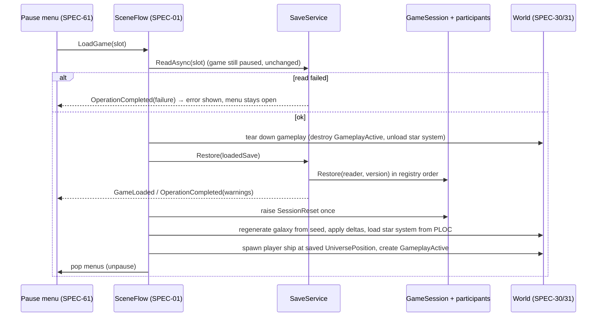

# SPEC-05 — Persistence

| | |
|---|---|
| **Status** | Draft |
| **Area code** | PERS (task IDs are `PERS-001`, `PERS-002`, …) |
| **Module(s)** | `Game.Persistence` (folder `Assets/Game/Persistence/`); the VOXS voxel encoder/decoder in `Game.Voxel` (folder `Assets/Game/Voxel/Data/`) because Persistence may not reference Voxel (architecture §3) |
| **Depends on specs** | SPEC-02 (`ISaveParticipant`, `SaveWriter`/`SaveReader`, `ContentId`, `StableHash`, `IPauseService`, `EventBus<T>`, `GameSaved`/`GameLoaded`, `GameLog`); SPEC-04 (`ContentService`, `ContentCatalog`, Missing placeholders, `ValidationReport`); SPEC-10 (`Cell`, `PaletteEntry`, `BlockInstance`, `VoxelStructure`); SPEC-01 (constructs `SaveService`, implements `ISaveContext`, orchestrates load in `SceneFlow`) |
| **Depended on by** | SPEC-01 (save/load flow, autosave wiring, `SESS`/`FLET` participants); SPEC-10 (decodes blueprints with `VoxsCodec`); SPEC-30, 31, 33, 40, 41, 42, 50 (participants); SPEC-51 (blueprint files, ship thumbnails); SPEC-61 (save/load screens, error toasts); SPEC-72 (encodes converted blueprints with `VoxsCodec`) |
| **Milestone** | M0 (container, slots, participants framework, VOXS); M3 (regression scenarios with all real participants) |

> Read [01-architecture.md](../01-architecture.md), [02-conventions.md](../02-conventions.md) and [03-glossary.md](../03-glossary.md) before this spec. This spec may not contradict them.

## 1. Purpose

The player can save and load anywhere outside combat, across game updates, without ever losing a save. Every module that owns runtime state saves it through an `ISaveParticipant`; this spec owns the files, the chunked binary container, the order in which participants are captured and restored, compression, atomic writes, backups, autosave, and how errors reach the UI. It also owns the VOXS byte format that stores voxel structures (ships, stations, edited asteroids, blueprints) compactly. The old prototype rejected every save after any content change without telling the player (04-B1), lost the position when loading from the pause menu because a manager kept writing it during the reload (R28 / 04-B6), never autosaved or saved on quit (04-B7), wrote non-atomically (04-B21), stored thumbnails with absolute paths (04-B19) and would have needed about 120 MB of JSON for a 1M-cell ship (R27). This design makes those impossible.

## 2. Scope

**In scope:**
- Save folder layout: profiles, slots (`manual_NNN`, `quick`, `auto_0..2`), `meta.json`, `world.sav`, `world.bak`, `thumbs/`.
- The `world.sav` container: header `"SSGS"`, format version, content hash, chunk table (fourCC, version, flags, lengths, CRC32), Deflate per chunk, unknown-chunk preservation.
- The `IDPL` chunk (save-wide `ContentId` palette) and the `META` chunk.
- `SaveChunkRegistry`: the fixed list of chunk keys, their owners and their capture/restore order.
- `SaveService`: capture on the main thread, serialize/compress/write on a worker, atomic replace with backup, load with backup fallback, restore orchestration, never-reject policy, reports.
- Autosave (timer, scene transitions, star-system entry), save on quit (`Application.wantsToQuit`), quick save.
- Error surfacing (`OperationCompleted` event, `GameSaved`/`GameLoaded` events, message texts).
- Thumbnails stored inside the slot with relative keys.
- The VOXS byte format and its codec `VoxsCodec` in `Game.Voxel`, plus `VoxsSnapshotBlock` for deferred encoding.
- Migration rules for participants, the fixture harness, container fixtures, round-trip byte-equality tests.
- Regression scenarios R28 and 04-B1 ([05-testing.md §5](../05-testing.md#5-old-prototype-regression-scenarios)).

**Out of scope (and who owns it instead):**
- `ISaveParticipant`, `SaveWriter`/`SaveReader` primitives, `SaveFormatException`: SPEC-02 (this spec lists what it needs in §4.10).
- What each participant writes: the owning spec (table §4.8). `SceneFlow` (tearing gameplay down, restoring, respawning): SPEC-01.
- `VoxelStructure` and its conversion to/from the codec's arrays: SPEC-10. `ShipBlueprintDefinition` fields: SPEC-10.
- Writing ship damage back into structures before capture: the `FLET` owner (SPEC-01) with SPEC-10/13.
- Save/load screens, confirmation dialogs and toasts: SPEC-61. Settings (`settings.json`): SPEC-01.
- Converting old-prototype saves: not done; old saves are not supported (open question 1).

## 3. Decisions (binding)

1. **One binary file per slot, `world.sav`, little-endian, with a fixed header and a chunk table (§4.2).** `meta.json` mirrors the `META` chunk for fast slot listing. Reason: ADR-0007; listing 50 slots must not open 50 large files.
2. **A chunk is opaque bytes to the container.** Each participant owns exactly one chunk whose fourCC equals `ISaveParticipant.Key`. `META` and `IDPL` are the only container-owned chunks. Reason: Persistence stays independent of every gameplay module.
3. **Persistence never references `Game.Voxel`.** The VOXS encoder/decoder (`VoxsCodec`) lives in `Game.Voxel`; a participant that saves voxel structures embeds VOXS bytes inside its own chunk payload. Reason: architecture §3 dependency table.
4. **Loads never reject because of content or versions.** Unknown content IDs become placeholders with a warning; a chunk that can't be restored resets only its participant; unknown chunks are preserved. The only failed loads are: file not found, file unreadable (header corrupt in both `world.sav` and `world.bak`), or a container format newer than this build. Every failure is reported to the UI. Reason: 04-B1.
5. **Migrations are owned by participants.** `SaveService` passes the chunk's stored version as `fromVersion`; each participant reads every version from 1 to its current `Version`. `fromVersion == 0` means "no data: reset to new-game defaults". Container-level format changes are handled inside `SaveContainerReader`. Reason: the binding `ISaveParticipant.Restore(SaveReader, int fromVersion)` signature; modules below `Game.App` cannot reference Persistence types.
6. **Capture and restore order is fixed by `SaveChunkRegistry`, not by registration call order.** Registering a key that is not in the registry, or registering a key twice, throws at boot. Reason: deterministic files and dependency-safe restores.
7. **Capture runs on the main thread and copies state; serialization, deferred encoding, Deflate, CRC, PNG encoding and file I/O run on one background thread** (`Awaitable.BackgroundThreadAsync`). No other Unity API is called off the main thread except `ImageConversion.EncodeArrayToPNG`. Reason: ≤ 5 ms main-thread capture gate.
8. **Writes are atomic.** Write `world.sav.tmp`, then `File.Replace(tmp, world.sav, world.bak)` (or `File.Move` when no `world.sav` exists), then thumbnails, then `meta.json` last. A failure leaves the previous save intact. Reason: 04-B21.
9. **Saves store content as `ContentId` strings** (in `IDPL` and in VOXS block tables), never `BlockIndex`, item indices or hashes. Reason: architecture §6.2.
10. **One save or load operation at a time.** Requests while busy are queued (§5.3). Reason: no interleaved writes to the same slot.
11. **Nothing is written to save state every frame.** Participants capture current state only inside `Capture`. Loading never runs narrative effects (architecture §7.3). Reason: R28 / 04-B6.
12. **Byte stability.** Capturing the same session state twice produces identical bytes except the header fields `savedUtcTicks`, `playtimeSeconds`, `headerCrc32` and the `META` chunk. Reason: the round-trip gate in [06-performance-budgets.md](../06-performance-budgets.md).
13. **Thumbnails live in the slot (`thumbs/<key>.png`) and are referenced by key, never by absolute path.** Reason: 04-B19.
14. **Every save/load outcome raises `SaveService.OperationCompleted`** (and `GameSaved`/`GameLoaded` on success). Blocked autosaves are the only silent outcome. Reason: 04-B1 "start menu fails silently".

## 4. Data model

### 4.1 Folder layout on disk

```
<Application.persistentDataPath>/saves/            (SavePaths.Root; tests pass a temp folder)
  p001/                                            profile folder: "p" + 3 digits, lowest free number
    profile.json                                   ProfileDescriptor (§4.6)
    manual_001/ … manual_999/                      manual slots
    quick/                                         quick-save slot
    auto_0/ auto_1/ auto_2/                        autosave ring (config: 3 slots)
      meta.json                                    SaveMeta (§4.6), written last
      world.sav                                    container (§4.2)
      world.bak                                    previous world.sav (absent after the first save)
      world.sav.tmp                                exists only while writing
      thumbs/
        slot.png                                   slot screenshot (320×180)
        ship_<recordId>.png                        ship thumbnails (keys from ISaveContext)
```

Key and folder names are ASCII `[a-z0-9_]`; display names live only inside JSON.

### 4.2 Container byte layout (`world.sav`, format version 1)

All integers little-endian. Header (36 bytes):

| Offset | Size | Field | Notes |
|---|---|---|---|
| 0 | 4 | magic | ASCII `S S G S` (0x53 0x53 0x47 0x53) |
| 4 | 2 | `formatVersion` u16 | 1 |
| 6 | 2 | `headerFlags` u16 | 0 (reserved; nonzero → `CorruptHeader` in v1 readers) |
| 8 | 4 | `databaseHash32` u32 | low 32 bits of `ContentService.DatabaseHash` (SPEC-04); diagnostics only |
| 12 | 8 | `savedUtcTicks` i64 | `DateTime.UtcNow.Ticks` at capture (volatile) |
| 20 | 8 | `playtimeSeconds` f64 | from `ISaveContext` (volatile) |
| 28 | 4 | `chunkCount` u32 | 2..4096 |
| 32 | 4 | `headerCrc32` u32 | CRC32 over bytes 0..31 followed by the whole chunk table (volatile) |

Chunk table: `chunkCount` entries of 20 bytes, immediately after the header:

| Offset | Size | Field | Notes |
|---|---|---|---|
| 0 | 4 | `fourCC` | 4 ASCII chars `[A-Z0-9]`; unique in the file |
| 4 | 2 | `chunkVersion` u16 | participant `Version` at capture (1..65535); `META` and `IDPL` are version 1 |
| 6 | 2 | `chunkFlags` u16 | bit 0 = Deflate; other bits must be 0 |
| 8 | 4 | `storedLength` u32 | bytes in the file |
| 12 | 4 | `rawLength` u32 | bytes after decompression (= `storedLength` if not deflated); ≤ 268,435,456 |
| 16 | 4 | `crc32` u32 | CRC32 of the stored bytes |

Payloads follow the table back to back in table order; the file ends exactly at the last payload. Chunk order in a file: `META`, `IDPL`, participants in registry order, then preserved unknown chunks in their original relative order.

CRC32 is IEEE 802.3 (reflected polynomial 0xEDB88320, initial value 0xFFFFFFFF, final XOR 0xFFFFFFFF; `CRC32("123456789") = 0xCBF43926`). Deflate is raw RFC 1951 via `System.IO.Compression.DeflateStream` with `CompressionLevel.Optimal`; a payload is deflated only if `rawLength ≥ 64` and the compressed size is smaller than `rawLength`.

### 4.3 `META` and `IDPL` payloads

- `META`: UTF-8 JSON of `SaveMeta` (§4.6), `Formatting.None`. Identical content to `meta.json`.
- `IDPL`: `varuint count` then `count × (varuint byteLength, UTF-8 bytes)`. Local index = position (0..65534). Local index `0xFFFF` is reserved for "no ID" (empty `ContentId`). Strings are stored as written, unvalidated (old or unknown IDs survive a round trip); a string longer than 256 bytes makes the chunk corrupt.

`varuint` is unsigned LEB128 (7 bits per byte, least significant group first, continuation bit 0x80; max 5 bytes for u32). `varint` is zigzag (`(n << 1) ^ (n >> 31)`) then `varuint`.

### 4.4 VOXS format (voxel structures; owned here, implemented in `Game.Voxel`)

A VOXS blob is self-contained: it carries its own block-ID table so it can be decoded anywhere (save chunks, blueprint assets, clipboards) without `IDPL`. Little-endian:

| Part | Encoding |
|---|---|
| magic | 4 bytes ASCII `V O X S` |
| `voxsVersion` | u16 = 1 |
| `flags` | u16: bit 0 = Deflated (everything after byte 8 is one raw Deflate stream of the body), bit 1 = Partial (bricks replace a baseline; removed-brick list present); other bits 0 |
| body: `cellSize` | f32 |
| body: `anchorInstance` | i32 (−1 = none) |
| body: block table | `varuint B`; then `B × string` (`varuint byteLength` + UTF-8 `ContentId.Value`). Local block 0 = air (not stored); table entry `i` is local block `i + 1` |
| body: palette | `varuint P`; then `P × (varuint localBlock, u8 orient, u8 color)` — written verbatim, including entry 0 |
| body: instances | `varuint I`; then `I × (varuint localBlock, u8 orient, u8 color, varint originX, varint originY, varint originZ, f32 functionHp)`. `BlockInstance.Functional` is not stored |
| body: bricks | `varuint K`; then `K × brick`, sorted ascending by brick coordinate `(z, then y, then x)` |
| brick: coordinate | `varint cx, cy, cz` |
| brick: order | u8: 0 = X-fastest, 1 = Y-fastest, 2 = Z-fastest, 3 = Uniform |
| brick: refs | order 3: one u16 `Cell.Ref` for all 4096 cells. Orders 0–2: runs `(u16 ref, varuint runLength − 1)` covering exactly 4096 cells in that traversal |
| brick: HP | u8 `hpMode`: 0 = every solid cell has `Hp = 255`; 1 = runs `(u8 hp, varuint runLength − 1)` over the solid cells only, in the brick's traversal order |
| brick: flags | u8 `flagsMode`: 0 = every solid cell has `Flags = 0`; 1 = runs `(u8 flags, varuint runLength − 1)` over solid cells, same order |
| body: removed bricks | `varuint R` (0 unless Partial); `R × (varint cx, cy, cz)` |

Traversals over local cell coordinates `(x, y, z) ∈ [0,16)³`: order 0 = `for z { for y { for x } }`; order 1 = `for z { for x { for y } }`; order 2 = `for y { for x { for z } }`. A cell is *solid* iff `Ref != 0`. Air cells are always decoded as `Ref = 0, Hp = 0, Flags = 0`. Bricks with no solid cell are never written. The encoder picks, per brick, the order with the fewest bytes in the refs section (ties → lowest code); order 3 is used whenever all 4096 refs are equal. `Cell.Ref` values (palette index or `0x8000 | instanceIndex`) are stored unchanged, so palette and instance order are preserved exactly.

Decoder limits (violations → `VoxsCodec.TryDecode` returns `false` with an error naming the byte offset): `B ≤ 65535`, `P ≤ 32768`, `I ≤ 32768`, `K ≤ 1,048,576`, strings ≤ 256 bytes, runs sum to exactly 4096 (refs) or to the brick's solid count (HP, flags), every palette ref `< P`, every instance ref's index `< I`, every `localBlock ≤ B`, `orient < 24`, no duplicate brick coordinates, no trailing bytes.

### 4.5 Container and service types (public contract, `Game.Persistence`)

```csharp
namespace Game.Persistence.Data
{
    public readonly struct ProfileId : System.IEquatable<ProfileId> { public ProfileId(string value); public readonly string Value; }  // "p001"
    public readonly struct SlotId : System.IEquatable<SlotId> { public SlotId(string value); public readonly string Value; }           // "manual_001", "quick", "auto_0"
    public readonly struct SlotRef : System.IEquatable<SlotRef> { public SlotRef(ProfileId profile, SlotId slot); public readonly ProfileId Profile; public readonly SlotId Slot; }

    public enum SlotKind : byte { Manual = 0, Quick = 1, Auto = 2 }
    public enum SaveReason : byte { Manual = 0, Quick = 1, AutoTimer = 2, AutoSceneTransition = 3, AutoStarSystemEntered = 4, Quit = 5, NewGame = 6 }  // add at end only
    public enum SaveBlockReason : byte { None = 0, NoSession = 1, InCombat = 2, Transitioning = 3, PlayerDead = 4, EditorOpen = 5 }
    public enum SaveErrorKind : byte { None = 0, Blocked = 1, IoError = 2, DiskFull = 3, ParticipantFailed = 4, Unreadable = 5, NewerFormat = 6, NotFound = 7, SlotLimit = 8 }
    public enum SlotStatus : byte { Ok = 0, MetaMissing = 1, Corrupt = 2, BackupOnly = 3, NewerFormat = 4 }
    public enum AutosaveTrigger : byte { Timer = 0, SceneTransition = 1, StarSystemEntered = 2, Quit = 3 }

    public sealed class SlotInfo
    {
        public SlotRef Ref; public SlotKind Kind; public SlotStatus Status;
        public SaveMeta Meta;            // null when Status is Corrupt or NewerFormat and no META could be read
        public long WorldBytes;          // size of world.sav (or world.bak for BackupOnly)
    }

    public sealed class ProfileInfo { public ProfileId Id; public string DisplayName; public System.DateTime CreatedUtc; public string LastSlotId; }

    /// <summary>One image to store in the slot's thumbs folder. Pixels are RGBA32, bottom row first (Texture2D layout).</summary>
    public sealed class ThumbnailRequest { public string Key; public byte[] Rgba32; public int Width; public int Height; }

    public readonly struct SaveResult
    {
        public readonly bool Success; public readonly SaveErrorKind Error; public readonly string Message;
        public readonly SlotRef Slot; public readonly long Bytes; public readonly double CaptureMs; public readonly double TotalMs;
    }

    public readonly struct LoadResult
    {
        public readonly bool Success; public readonly SaveErrorKind Error; public readonly string Message;
        public readonly Game.Persistence.Container.LoadedSave Save;   // null unless Success
    }

    /// <summary>Raised for every save and load outcome except blocked autosaves (§3 decision 14).</summary>
    public readonly struct SaveOperationResult
    {
        public readonly bool IsLoad; public readonly bool Success; public readonly SaveErrorKind Error;
        public readonly string Message;             // player-facing English (§5.8)
        public readonly SlotRef Slot; public readonly SaveReason Reason;
        public readonly int WarningCount;           // loads only
        public readonly Game.Data.Validation.ValidationReport Report;   // loads only; null for saves
    }

    public sealed class SaveServiceConfig
    {
        public float AutosaveIntervalSeconds = 300f;     // unpaused gameplay seconds between timer autosaves
        public float AutosaveMinSpacingSeconds = 60f;    // real seconds; Timer/StarSystemEntered requests closer than this to the last save are dropped
        public int AutosaveSlotCount = 3;                // auto_0..auto_{n-1}
        public float BlockedRetrySeconds = 10f;          // real seconds between re-checks of a blocked pending autosave
        public float QuitSaveTimeoutSeconds = 10f;       // real seconds before quitting anyway
        public int MaxManualSlots = 999;
        public int ThumbnailWidth = 320, ThumbnailHeight = 180;
        public int MinCompressBytes = 64;
        public int MaxQueuedOperations = 4;
    }
}

namespace Game.Persistence.Container
{
    [System.Flags] public enum ChunkFlags : ushort { None = 0, Deflate = 1 }

    public struct ContainerHeader
    {
        public ushort FormatVersion; public ushort HeaderFlags; public uint DatabaseHash32;
        public long SavedUtcTicks; public double PlaytimeSeconds; public uint ChunkCount; public uint HeaderCrc32;
        public const int Size = 36; public const ushort CurrentFormatVersion = 1;
    }

    /// <summary>A chunk as stored: fourCC, version, flags and the RAW (decompressed) payload.</summary>
    public sealed class RawChunk
    {
        public string Key; public ushort Version; public ChunkFlags StoredFlags;
        public byte[] Payload;          // decompressed
        public bool Corrupt;            // CRC or decompression failed; Payload is null
    }

    public enum ContainerReadStatus : byte { Ok = 0, CorruptChunks = 1, CorruptHeader = 2, NewerFormat = 3, NotAContainer = 4 }

    public static class SaveContainerWriter
    {
        /// <summary>Compresses and checksums each chunk, writes header + table + payloads. Thread-agnostic.</summary>
        public static byte[] Write(in ContainerHeader header, System.Collections.Generic.IReadOnlyList<RawChunk> chunks, int minCompressBytes);
    }

    public static class SaveContainerReader
    {
        public static ContainerReadStatus Read(System.ReadOnlySpan<byte> file, out ContainerHeader header,
            System.Collections.Generic.List<RawChunk> chunks, Game.Data.Validation.ValidationReport report, string sourceLabel);
    }

    public static class Crc32 { public static uint Compute(System.ReadOnlySpan<byte> data); public static uint Append(uint crc, System.ReadOnlySpan<byte> data); }

    /// <summary>Save-wide ContentId palette (IDPL). Implements the SPEC-02 palette interfaces (§4.10).</summary>
    public sealed class SaveIdPalette : Game.Core.ISaveIdPalette, Game.Core.ISaveIdPaletteReader
    {
        public const ushort None = 0xFFFF;
        public static SaveIdPalette CreateEmpty();
        public static SaveIdPalette SeededFrom(SaveIdPalette loaded);      // keeps loaded order as prefix
        public static SaveIdPalette Parse(System.ReadOnlySpan<byte> idplPayload);  // throws SaveFormatException
        public ushort GetOrAdd(in Game.Core.ContentId id);
        public Game.Core.ContentId Get(ushort local);
        public int Count { get; }
        public byte[] Serialize();
    }

    public sealed class NewtonsoftSaveJsonCodec : Game.Core.ISaveJsonCodec { }   // settings in §5.4 step 4

    /// <summary>Opaque result of ReadAsync, consumed once by Restore.</summary>
    public sealed class LoadedSave
    {
        public Game.Persistence.Data.SlotRef Slot { get; }
        public ContainerHeader Header { get; }
        public Game.Persistence.Data.SaveMeta Meta { get; }
        public bool FromBackup { get; }
        public System.Collections.Generic.IReadOnlyList<RawChunk> Chunks { get; }
        public Game.Data.Validation.ValidationReport Report { get; }   // read-phase entries; Restore appends
    }

    /// <summary>Compares two save files ignoring volatile fields (decision 12). Used by tests and tools.</summary>
    public static class SaveFileComparer
    {
        public static bool EqualIgnoringVolatile(System.ReadOnlySpan<byte> a, System.ReadOnlySpan<byte> b, out string firstDifference);
    }
}

namespace Game.Persistence.Services
{
    /// <summary>Implemented by Game.App (SPEC-01). The only way SaveService learns about the session.</summary>
    public interface ISaveContext
    {
        bool HasActiveSession { get; }
        Game.Persistence.Data.SaveBlockReason GetBlockReason();                  // None when saving is allowed
        void DescribeForMeta(Game.Persistence.Data.SaveMeta meta);               // fills CommanderName, LocationText, PlaytimeSeconds
        bool TryCaptureSlotThumbnail(out Game.Persistence.Data.ThumbnailRequest thumbnail); // Key must be "slot"
        void CollectThumbnails(System.Collections.Generic.List<Game.Persistence.Data.ThumbnailRequest> changed,
                               System.Collections.Generic.HashSet<string> keep);  // keep = every non-slot key that must exist after the save
    }

    public sealed class SavePaths
    {
        public SavePaths(string root);
        public static SavePaths CreateDefault();                     // Path.Combine(Application.persistentDataPath, "saves"); main thread
        public string Root { get; }
        public string ProfileDir(Game.Persistence.Data.ProfileId p);
        public string ProfileFile(Game.Persistence.Data.ProfileId p); // .../profile.json
        public string SlotDir(Game.Persistence.Data.SlotRef s);
        public string WorldFile(Game.Persistence.Data.SlotRef s);     // world.sav
        public string BackupFile(Game.Persistence.Data.SlotRef s);    // world.bak
        public string TempFile(Game.Persistence.Data.SlotRef s);      // world.sav.tmp
        public string MetaFile(Game.Persistence.Data.SlotRef s);      // meta.json
        public string ThumbsDir(Game.Persistence.Data.SlotRef s);
        public string ThumbnailFile(Game.Persistence.Data.SlotRef s, string key);   // thumbs/<key>.png
    }

    public readonly struct ChunkRegistration { public readonly string Key; public readonly int Order; public readonly string OwnerSpec; public readonly string Description; }

    public sealed class SaveChunkRegistry
    {
        public static SaveChunkRegistry Default { get; }             // table §4.8; immutable
        public SaveChunkRegistry(System.Collections.Generic.IEnumerable<ChunkRegistration> entries); // validates keys/orders; throws ArgumentException
        public System.Collections.Generic.IReadOnlyList<ChunkRegistration> Entries { get; }   // sorted by Order
        public bool TryGetOrder(string key, out int order);
    }

    public sealed class SaveService : System.IDisposable
    {
        public SaveService(SavePaths paths, Game.Data.Services.ContentService content, Game.Core.IPauseService pause,
                           Game.Persistence.Data.SaveServiceConfig config, SaveChunkRegistry registry = null);
        public void AttachContext(ISaveContext context);
        public void Register(Game.Core.ISaveParticipant participant);   // InvalidOperationException: unknown key, duplicate key, META/IDPL

        // Profiles
        public System.Collections.Generic.IReadOnlyList<Game.Persistence.Data.ProfileInfo> ListProfiles();
        public Game.Persistence.Data.ProfileInfo CreateProfile(string displayName);
        public bool DeleteProfile(Game.Persistence.Data.ProfileId id);
        public Game.Persistence.Data.ProfileId ActiveProfile { get; }
        public void SetActiveProfile(Game.Persistence.Data.ProfileId id);

        // Slots
        public System.Collections.Generic.IReadOnlyList<Game.Persistence.Data.SlotInfo> ListSlots(Game.Persistence.Data.ProfileId profile);
        public bool TryCreateManualSlot(Game.Persistence.Data.ProfileId profile, out Game.Persistence.Data.SlotRef slot);
        public Game.Persistence.Data.SlotRef QuickSlot(Game.Persistence.Data.ProfileId profile);
        public Game.Persistence.Data.SlotRef NextAutosaveSlot(Game.Persistence.Data.ProfileId profile);
        public bool DeleteSlot(Game.Persistence.Data.SlotRef slot);
        public bool HasCurrentSlot { get; }
        public Game.Persistence.Data.SlotRef CurrentSlot { get; }       // last slot saved to or loaded from in this session

        // State and operations
        public bool IsBusy { get; }
        public bool CanSave(out Game.Persistence.Data.SaveBlockReason reason);
        public void ResetForNewGame();                                  // clears preserved chunks, seeded palette, thumbnail cache, CurrentSlot
        public UnityEngine.Awaitable<Game.Persistence.Data.SaveResult> SaveAsync(Game.Persistence.Data.SlotRef slot, Game.Persistence.Data.SaveReason reason, string displayName = null);
        public UnityEngine.Awaitable<Game.Persistence.Data.LoadResult> ReadAsync(Game.Persistence.Data.SlotRef slot);
        public Game.Data.Validation.ValidationReport Restore(Game.Persistence.Container.LoadedSave save);   // main thread
        public Game.Data.Validation.ValidationReport LastLoadReport { get; }
        public event System.Action<Game.Persistence.Data.SaveOperationResult> OperationCompleted;

        // Thumbnails
        public bool TryLoadThumbnail(Game.Persistence.Data.SlotRef slot, string key, out UnityEngine.Texture2D texture);  // caller destroys texture
        public bool TryGetSessionThumbnail(string key, out byte[] png);

        public AutosaveScheduler Autosave { get; }
        public void Dispose();

        // Synchronous seams for tests (InternalsVisibleTo):
        internal CapturedSave CaptureNow(Game.Persistence.Data.SlotRef slot, Game.Persistence.Data.SaveReason reason, string displayName);
        internal Game.Persistence.Data.SaveResult WriteCaptured(CapturedSave captured);          // thread-agnostic
        internal Game.Persistence.Data.LoadResult ReadNow(Game.Persistence.Data.SlotRef slot);    // thread-agnostic
        internal bool HandleWantsToQuit();
    }

    /// <summary>Main-thread snapshot produced by capture (internal).</summary>
    internal sealed class CapturedSave { }

    public sealed class AutosaveScheduler
    {
        public void Update(float unscaledDeltaTime);       // called once per frame by Game.App (SPEC-01)
        public void Request(Game.Persistence.Data.AutosaveTrigger trigger);
        public void NotifySaved();                          // called by SaveService after any successful save
        public float SecondsUntilTimerSave { get; }         // diagnostics / HUD
        public bool HasPendingRequest { get; }
    }
}
```

### 4.6 JSON DTOs (`Game.Persistence.Data`)

```csharp
public sealed class SaveMeta                       // meta.json and the META chunk
{
    public int MetaVersion = 1;
    public int FormatVersion;                      // container formatVersion
    public string GameVersion;                     // Application.version (captured on the main thread)
    public string DatabaseHash;                    // 16 lowercase hex digits of ContentService.DatabaseHash
    public string ProfileId;
    public string SlotId;
    public string DisplayName;                     // slot name shown in UI; default rules §5.2
    public SaveReason Reason;                      // serialized as its name (StringEnumConverter)
    public System.DateTime SavedUtc;               // ISO 8601, UTC
    public double PlaytimeSeconds;
    public string CommanderName;
    public string LocationText;                    // e.g. "Ark Start - near ARK station"
    public string Thumbnail;                       // "thumbs/slot.png" or null
    public long WorldBytes;                        // size of world.sav after the write (0 inside the META chunk)
}

public sealed class ProfileDescriptor              // profile.json
{
    public int MetaVersion = 1;
    public string Id;
    public string DisplayName;                     // 1..32 chars after trim; default "Commander"
    public System.DateTime CreatedUtc;
    public string LastSlotId;                      // null until the first save/load
}
```

### 4.7 VOXS codec types (public contract, `Game.Voxel`, namespace `Game.Voxel.Data`)

```csharp
namespace Game.Voxel.Data
{
    /// <summary>Input views for encoding. The caller keeps ownership of every array.</summary>
    public struct VoxsSource
    {
        public float CellSize;
        public int AnchorInstance;
        public Unity.Collections.NativeArray<PaletteEntry> Palette;
        public Unity.Collections.NativeArray<BlockInstance> Instances;
        public Unity.Collections.NativeArray<Unity.Mathematics.int3> BrickCoords;  // K bricks
        public Unity.Collections.NativeArray<Cell> Cells;                          // K × 4096; brick b at [b*4096, (b+1)*4096), index = VoxsCodec.CellIndex(local)
        public bool Partial;
        public Unity.Collections.NativeArray<Unity.Mathematics.int3> RemovedBricks; // only when Partial; may be default (empty)
    }

    /// <summary>Decoder output; owns its containers.</summary>
    public sealed class VoxsDecoded : System.IDisposable
    {
        public float CellSize; public int AnchorInstance; public bool Partial;
        public Unity.Collections.NativeList<PaletteEntry> Palette;
        public Unity.Collections.NativeList<BlockInstance> Instances;          // Functional = Entity.Null
        public Unity.Collections.NativeList<Unity.Mathematics.int3> BrickCoords; // sorted (z, y, x)
        public Unity.Collections.NativeList<Cell> Cells;                        // BrickCoords.Length × 4096
        public Unity.Collections.NativeList<Unity.Mathematics.int3> RemovedBricks;
        public int DriftWarningCount;                                           // content drift fixes applied (§5.7)
        public void Dispose();
    }

    /// <summary>Immutable BlockIndex → ContentId string table, safe to read from the save worker thread.</summary>
    public sealed class VoxsBlockNames
    {
        public static VoxsBlockNames FromCatalog(Game.Data.Services.ContentCatalog catalog);   // main thread
        public string Get(ushort blockIndex);                                                  // null for Air
    }

    public struct VoxsEncodeOptions
    {
        public bool Deflate;                                  // true for assets/clipboard, false inside save chunks (container deflates)
        public static VoxsEncodeOptions ForSaveChunk => new VoxsEncodeOptions { Deflate = false };
        public static VoxsEncodeOptions ForAsset => new VoxsEncodeOptions { Deflate = true };
    }

    public static class VoxsCodec
    {
        public const ushort Version = 1;
        public static int CellIndex(Unity.Mathematics.int3 local);   // x + 16 * (y + 16 * z); must equal SPEC-10's BrickCells layout
        public static byte[] Encode(in VoxsSource source, VoxsBlockNames names, VoxsEncodeOptions options);   // thread-agnostic
        public static bool TryDecode(System.ReadOnlySpan<byte> data, Game.Data.Services.ContentCatalog catalog,
                                     Unity.Collections.Allocator allocator, out VoxsDecoded result, out string error); // main thread (records unresolved IDs)
        public static bool TryPeek(System.ReadOnlySpan<byte> data, out ushort version, out bool partial, out int brickCount);
    }

    /// <summary>Deferred save block: copies a structure at capture (main thread), encodes on the save worker.</summary>
    public sealed class VoxsSnapshotBlock : Game.Core.ISaveDeferredBlock
    {
        public static VoxsSnapshotBlock Capture(in VoxsSource source, VoxsBlockNames names);   // copies arrays with Allocator.Persistent
        public byte[] Encode();                                                                // VoxsEncodeOptions.ForSaveChunk
        public void Dispose();                                                                 // idempotent
    }
}
```

### 4.8 Chunk registry (`SaveChunkRegistry.Default`)

| Order | Key | Owner spec | Implemented in | Contents (layout decided by the owner) |
|---|---|---|---|---|
| — | `META` | SPEC-05 | container | `SaveMeta` JSON |
| — | `IDPL` | SPEC-05 | container | ContentId palette |
| 10 | `SESS` | SPEC-01 | `Game.App` | galaxy seed, `UniversalTime`, playtime, the `PersistentId` counter of `GameSession.AllocatePersistentId`, session flags (creative), new-game options |
| 20 | `FACT` | SPEC-40 | `Game.Narrative` | `FactStore` |
| 30 | `FACN` | SPEC-33 | `Game.Galaxy` | faction relations |
| 40 | `QUST` | SPEC-42 | `Game.Narrative` | quests, stage baselines, clues, mysteries |
| 50 | `DLGS` | SPEC-41 | `Game.Narrative` | dialog state (once-only lines, active beat) |
| 60 | `INVT` | SPEC-50 | `Game.Economy` | wallet, cargo and hotbar with slot indices and capacity, merchant stock |
| 70 | `FLET` | SPEC-01 | `Game.App` | fleet records, flagship, ship structures as VOXS (damage written back first) |
| 80 | `GLXY` | SPEC-30 | `Game.Galaxy` | per-star-system deltas, edited structures as Partial VOXS |
| 90 | `PLOC` | SPEC-31 | `Game.Galaxy` | player location: `StarSystemId`, `UniversePosition` (double3), yaw, docked body |
| 100 | `ENCT` | SPEC-33 | `Game.Galaxy` | encounter director state |

Capture and restore both run in ascending `Order`. Adding a participant = adding a row here in the same commit (owner's task edits `SaveChunkRegistry.cs` and this table). Keys are 4 characters `[A-Z0-9]`; orders are unique multiples of 10. Tests build their own registries with keys `TSTA` (1000), `TSTB` (1010), `TSTC` (1020).

### 4.9 Participant rules (every `ISaveParticipant` must follow)

1. `Key` is its registry key; `Version` starts at 1 and increments on any change of its payload layout.
2. `Capture` is deterministic: iterate collections in a defined order (sort by a stable key or keep list order), use `SimClock` values only, never wall-clock time, never `GetHashCode`, never `Dictionary` enumeration order.
3. `Capture` does not mutate state and costs ≤ 1 ms main thread, except copying voxel structures (use `VoxsSnapshotBlock`).
4. Content references are written with `SaveWriter.WriteContentId`, never as indices or hashes.
5. `Restore(reader, fromVersion)` mutates the existing objects in place (never replaces objects other code subscribed to); handles every `fromVersion` from 1 to `Version`; `fromVersion == 0` resets to new-game defaults; throws `SaveFormatException` for a version it cannot read.
6. Unknown content IDs are resolved with `ContentCatalog.TryResolve` / `Resolve*OrMissing` so they are reported (never dropped silently).
7. When `Version` is bumped, the owner first writes a fixture of the old version with `SaveFixtureHarness.WriteFixture` (§5.9) and adds `Restore_FromV<N>_Fixture` tests.
8. JSON DTOs (if the participant uses `WriteJson`) keep their old class for reading older versions (`MissingMemberHandling.Error` is used, conventions §3.7). Dictionaries are written as arrays sorted by key.
9. Participants never touch files, never call `SaveService`, and never hold Unity object references in captured data.
10. **Never save an `Entity`.** Runtime-spawned objects (grid roots, fleets, encounters) are referenced across save/load by `PersistentId` (architecture §6.1); restore re-creates them with the same `PersistentId`. Content is referenced by `ContentId` (via `WriteContentId`), never by `ContentHash` or index.

### 4.10 Required from SPEC-02 (`Game.Core`)

| Need | Shape this spec assumes | If CORE-001 differs |
|---|---|---|
| `ISaveParticipant` | binding (architecture §6.1) | — |
| `SaveWriter` | `SaveWriter(ISaveIdPalette palette, ISaveJsonCodec json)`; `WriteByte/WriteBool/WriteUInt16/WriteInt32/WriteUInt32/WriteInt64/WriteUInt64/WriteSingle/WriteDouble/WriteVarUInt32/WriteString/WriteBytes(ReadOnlySpan<byte>)/WriteByteArray(byte[])` (varuint length + bytes); `WriteContentId(in ContentId)` (writes the palette's u16); `WriteJson<T>(T)` (varuint length + UTF-8 JSON); `WriteDeferred(ISaveDeferredBlock)`; `byte[] ToArray(Func<ISaveDeferredBlock, byte[]> encodeDeferred)` (each deferred block becomes varuint length + bytes in place) | Use SPEC-02's names for the same operations |
| `SaveReader` | `SaveReader(ReadOnlyMemory<byte> payload, ISaveIdPaletteReader palette, ISaveJsonCodec json)`; mirror `Read*` methods; `byte[] ReadByteArray()` (reads a deferred block or `WriteByteArray` value); `ContentId ReadContentId()`; `T ReadJson<T>()`; `bool IsAtEnd`; `int Remaining`; `static SaveReader Empty`; reading past the end throws `SaveFormatException` | Use SPEC-02's names |
| `ISaveIdPalette` / `ISaveIdPaletteReader` | `ushort GetOrAdd(in ContentId id)` / `ContentId Get(ushort local)` | If absent: participants write `ContentId.Value` with `WriteString`, the container writes an empty `IDPL` (count 0) |
| `ISaveJsonCodec` | `byte[] Serialize<T>(T value)`, `T Deserialize<T>(ReadOnlySpan<byte> utf8)` | If absent: participants use binary primitives only |
| `ISaveDeferredBlock : IDisposable` | `byte[] Encode()` — called once on the save worker, then `Dispose()` on the worker; if the save is abandoned before encoding, `Dispose()` on the main thread | If absent: participants call `VoxsCodec.Encode` inside `Capture` (main thread) and write the bytes; the 5 ms capture gate is then only checked for ≤ 100k-cell fleets |
| `SaveFormatException : Exception` | thrown by readers on malformed data | — |
| `GameSaved`, `GameLoaded` (architecture §6.6) | `GameSaved { string ProfileId; string SlotId; byte Reason; }`, `GameLoaded { string ProfileId; string SlotId; int WarningCount; }` | Fill whichever of these fields exist |

## 5. Systems, services and flow

No ECS systems. `SaveService` and `AutosaveScheduler` are managed services (architecture §4.2, service #6) constructed by `GameRoot` after `ContentService` and `PauseService`.

### 5.1 Boot and wiring (SPEC-01 does this; listed so both specs agree)

1. `GameRoot.Awake` step 6: `save = new SaveService(SavePaths.CreateDefault(), content, pause, new SaveServiceConfig())`.
2. Step 8 (`GameSession`): `save.AttachContext(sessionSaveContext)`; register participants in any order: `save.Register(x)` for each row of §4.8 that exists (missing rows are allowed; their chunks are written by nobody and restored as "no data").
3. Every frame (`GameRoot.Update`): `save.Autosave.Update(Time.unscaledDeltaTime)`.
4. `SceneFlow` calls `save.Autosave.Request(AutosaveTrigger.SceneTransition)` before leaving the World scene (to the Blueprint Lab or the main menu) and `Request(StarSystemEntered)` after each `StarSystemEntered` event.
5. New game: `save.ResetForNewGame()`, then `SaveAsync(NextAutosaveSlot(profile), SaveReason.NewGame)` once the World is ready.

### 5.2 Profiles and slots

- `ListProfiles`: enumerate `Root/p???/profile.json`; parse; skip unreadable files with one `GameLog.Warn`; sort by `CreatedUtc` then ID. O(profiles).
- `CreateProfile(name)`: trim; empty → "Commander"; cut to 32 chars; ID = lowest unused `p001..p999` (none free → `InvalidOperationException`); write `profile.json` (tmp + replace); return. Sets it active.
- `DeleteProfile`: `Directory.Delete(profileDir, recursive: true)`; if it was active, `ActiveProfile` becomes the first remaining profile or none.
- `ListSlots(profile)`: for each sub-folder whose name matches `manual_\d{3}|quick|auto_\d`: read `meta.json` (JObject; `MetaVersion > 1` → `NewerFormat`; else deserialize with `MissingMemberHandling.Error`). If `meta.json` is missing or invalid: try reading only the header + table + `META` chunk of `world.sav` (status `MetaMissing`); if `world.sav` is missing but `world.bak` exists → `BackupOnly`; if nothing readable → `Corrupt`. Sort by `Meta.SavedUtc` descending (null metas last, then by slot ID). Never throws. O(slots), reads ≤ 64 KB per slot.
- `TryCreateManualSlot`: next number = max existing manual number + 1 (no folder created yet); > `MaxManualSlots` → `false` (UI shows `SlotLimit` message).
- `NextAutosaveSlot`: among `auto_0..auto_{n-1}`, the first missing one, else the one with the oldest `SavedUtc`, ties → lowest index.
- Default `DisplayName` when `SaveAsync` receives null: manual → "Save {n}" (n = slot number), quick → "Quick Save", auto → "Autosave".
- `DeleteSlot`: `Directory.Delete(slotDir, true)` (UI confirms first, SPEC-61); clears `CurrentSlot` if equal; returns false if the folder didn't exist.

### 5.3 Operation queue

`SaveAsync` and `ReadAsync` go through one FIFO queue (max `MaxQueuedOperations` = 4). Rules, applied when a request arrives:
1. If an autosave request (`AutoTimer`, `AutoStarSystemEntered`, `AutoSceneTransition`) arrives while any operation is running or queued, it is dropped (`AutosaveScheduler` keeps it pending and retries).
2. A `Quit` save is queued behind the running operation and ahead of any queued ones.
3. Other requests append; if the queue is full the request completes immediately with `IoError` "Too many save operations queued" (raised through `OperationCompleted`).
`IsBusy` is true while an operation runs or the queue is non-empty.

### 5.4 Save pipeline (`SaveAsync(slot, reason, displayName)`)

Main thread, capture (`CaptureNow`):
1. If `!CanSave(out r)`: result `Blocked` with message §5.8. Raise `OperationCompleted` only for `Manual`, `Quick`, `Quit`. Stop.
2. `palette = (preservedChunks.Count > 0 && loadedPalette != null) ? SaveIdPalette.SeededFrom(loadedPalette) : SaveIdPalette.CreateEmpty()`.
3. For each registered participant in registry order: `w = new SaveWriter(palette, jsonCodec)`; `p.Capture(w)`; keep `(key, (ushort)p.Version, w)`. Any exception: dispose every deferred block already captured (main thread), log `GameLog.Error("Save", ...)`, result `ParticipantFailed` naming the key; no file is touched. Stop.
4. `meta = new SaveMeta { FormatVersion = 1, GameVersion = Application.version, DatabaseHash = content.DatabaseHash.ToString("x16"), ProfileId, SlotId, DisplayName, Reason, SavedUtc = DateTime.UtcNow }`; `context.DescribeForMeta(meta)`.
5. Thumbnails: `context.TryCaptureSlotThumbnail(out slotThumb)`; `context.CollectThumbnails(changed, keep)`.
6. Header: `databaseHash32 = (uint)content.DatabaseHash`, `savedUtcTicks = meta.SavedUtc.Ticks`, `playtimeSeconds = meta.PlaytimeSeconds`.
7. Copy the preserved unknown chunks list. Record capture time (`Stopwatch`) → `CaptureMs`.

Background thread (`await Awaitable.BackgroundThreadAsync()`), `WriteCaptured`:
8. For each participant writer: `payload = w.ToArray(b => { var bytes = b.Encode(); b.Dispose(); return bytes; })`.
9. `IDPL = palette.Serialize()` (after step 8, so deferred encoders could add IDs).
10. `META` = UTF-8 JSON of `meta` (with `WorldBytes = 0`) using `NewtonsoftSaveJsonCodec` settings: `Formatting.None`, `MissingMemberHandling.Error`, `NullValueHandling.Include`, `DateTimeZoneHandling.Utc`, `DateFormatString = "yyyy-MM-ddTHH:mm:ss.fffZ"`, `Culture = InvariantCulture`, `StringEnumConverter`, `TypeNameHandling.None`.
11. Chunks = `META, IDPL, participants…, preserved…` → `bytes = SaveContainerWriter.Write(header, chunks, MinCompressBytes)` (§5.5).
12. Delete a stale `world.sav.tmp` if present. Write `bytes` to `world.sav.tmp` with `FileStream(FileMode.CreateNew, FileAccess.Write, FileShare.None, 65536, FileOptions.WriteThrough)` then `Flush(true)`.
13. If `world.sav` exists: `File.Replace(tmp, world.sav, world.bak, ignoreMetadataErrors: true)`; else `File.Move(tmp, world.sav)`.
14. Thumbnails: apply `changed` to the session thumbnail cache (PNG-encode each with `ImageConversion.EncodeArrayToPNG(rgba, GraphicsFormat.R8G8B8A8_UNorm, w, h)`), remove cache keys not in `keep`, set `"slot"` from `slotThumb` (or remove it). Write each cached PNG whose bytes differ from the file on disk as `thumbs/<key>.png.tmp` → replace/move; delete `thumbs/*.png` files whose key is not in the cache. Thumbnail failures add a warning to the log only; they never fail the save.
15. `meta.WorldBytes = bytes.Length`; write `meta.json.tmp` → replace/move `meta.json`.
16. On any exception in steps 8–15: dispose remaining deferred blocks, delete `*.tmp` files of this slot, classify (`IOException` with `DriveInfo(root).AvailableFreeSpace < bytes.Length + 1 MB` → `DiskFull`; any other exception → `IoError`), keep `world.sav`/`world.bak` untouched.

Main thread (`await Awaitable.MainThreadAsync()`):
17. On success: `CurrentSlot = slot`; update `profile.json` `LastSlotId`; `Autosave.NotifySaved()`; publish `GameSaved`; raise `OperationCompleted(success)` (autosaves included). `TotalMs` recorded. `GameLog.Info("Save", "Saved p001/manual_001 (N bytes, capture X ms, total Y ms)")`.
18. On failure: `GameLog.Error`; raise `OperationCompleted(failure, message)`.

### 5.5 Container write and read

`SaveContainerWriter.Write` (thread-agnostic):
1. Validate: every key 4 chars `[A-Z0-9]`, unique; `chunks.Count ≤ 4096`; each payload ≤ 268,435,456 bytes; else `ArgumentException`.
2. For each chunk: if `Payload.Length ≥ minCompressBytes`, deflate into a `MemoryStream`; keep it if shorter (`Deflate` flag), else store raw. `crc = Crc32.Compute(stored)`.
3. Write header (CRC field 0) + table into a buffer; `headerCrc32 = Crc32.Append(Crc32.Compute(header[0..32]), table)`; patch offset 32.
4. Append stored payloads in order. Return the array. O(total bytes); one allocation of the final size plus one compressed buffer per chunk.

`SaveContainerReader.Read(file, out header, chunks, report, sourceLabel)`:
1. `file.Length < 36` or magic ≠ `SSGS` → `NotAContainer`.
2. `formatVersion == 0` → `NotAContainer`; `> 1` → `NewerFormat` (no further checks).
3. `headerFlags ≠ 0`, `chunkCount < 2`, `chunkCount > 4096`, or `36 + 20·chunkCount > length` → `CorruptHeader`.
4. Header CRC mismatch → `CorruptHeader`.
5. Table: fourCC chars valid and unique, `chunkFlags` only bit 0, `rawLength ≤ 268,435,456`, sum of `storedLength` == `length − 36 − 20·chunkCount` → else `CorruptHeader`.
6. For each chunk: CRC mismatch → `Corrupt = true`, `PERS-E011` entry; else inflate if flagged into an array of `rawLength` (size mismatch or `InvalidDataException` → corrupt, `PERS-E011`).
7. Status: `CorruptChunks` if any chunk is corrupt, else `Ok`.

Format evolution: a future format 2 adds `SaveContainerReaderV2`; `Read` dispatches on `formatVersion`, and the writer always writes the newest format.

### 5.6 Load pipeline

`ReadAsync(slot)` (queued, §5.3); background thread `ReadNow`:
1. `report = new ValidationReport("Load " + profile + "/" + slot)`.
2. Read `world.sav` bytes (`File.ReadAllBytes`); missing → go to step 4 with status `NotFound`.
3. `status = SaveContainerReader.Read(...)`.
4. If status is `CorruptHeader`, `NotAContainer`, `NotFound` or `CorruptChunks`: read `world.bak`; if it reads `Ok` → use it, `FromBackup = true`, warning `PERS-W010` "Loaded the backup save (one save older)". Else if `world.sav` was `CorruptChunks` → use `world.sav` with corrupt chunks (their participants restore defaults), warnings already recorded. Else if both are `NotFound` → fail `NotFound`; `NewerFormat` in `world.sav` → fail `NewerFormat`; anything else → fail `Unreadable`.
5. Parse `META` (missing or invalid → `PERS-W013`, meta = null); parse `IDPL` via `SaveIdPalette.Parse` (missing/invalid → `PERS-E012`, empty palette: every `ReadContentId` returns an ID that resolves to nothing, so content becomes placeholders).
6. Read the slot's `thumbs/*.png` bytes into a staging cache (failures ignored).
7. Return `LoadedSave` (main thread continuation). On failure raise `OperationCompleted(IsLoad, failure)` and publish nothing else. **Nothing in the running game has changed at this point** (R28).

`Restore(save)` (main thread; `SceneFlow` calls it after tearing gameplay down and before regenerating the world):
1. `content.Catalog.ClearUnresolved()`; `report = save.Report`; `preserved.Clear()`; `loadedPalette = palette`.
2. For each registered participant in registry order:
   a. No chunk with its key → `p.Restore(SaveReader.Empty, 0)`; `PERS-I020` "No data for KEY; defaults used".
   b. Chunk corrupt → `p.Restore(SaveReader.Empty, 0)`; (error already reported).
   c. `chunk.Version > p.Version` → add the raw chunk to `preserved`; `p.Restore(SaveReader.Empty, 0)`; `PERS-W021`.
   d. Else `reader = new SaveReader(chunk.Payload, palette, jsonCodec)`; `p.Restore(reader, chunk.Version)`; if `!reader.IsAtEnd` → `PERS-W024` "KEY left N unread bytes".
   e. Any exception in d → `PERS-E022` with the message; then `p.Restore(SaveReader.Empty, 0)`; an exception there → `PERS-E023`. Continue with the next participant either way.
3. Chunks whose key is not registered and not `META`/`IDPL` → add to `preserved` (unchanged); `PERS-I025`.
4. For each `content.Catalog.Unresolved` entry → `PERS-W001` "Unknown content '{Id}' ({ExpectedType}) in {Context}; replaced by a placeholder".
5. `header.DatabaseHash32 ≠ (uint)content.DatabaseHash` → `PERS-I002` "Saved with different content".
6. Replace the session thumbnail cache with the staged one. `CurrentSlot = slot`; update `profile.json` `LastSlotId`; `LastLoadReport = report`; `report.LogTo("Save")`; publish `GameLoaded { ProfileId, SlotId, WarningCount }`; raise `OperationCompleted(IsLoad, success, WarningCount, Report)`; `Autosave.NotifySaved()` (restarts the timer).
7. Return `report`. `Restore` never throws for data problems; a `LoadedSave` may be restored once (second call → `InvalidOperationException`).



### 5.7 VOXS codec algorithms (`Game.Voxel.Data.VoxsCodec`)

**Encode(source, names, options)** — thread-agnostic, no Unity API except Burst direct calls:
1. Block table: walk `Palette` then `Instances` in order; for each nonzero `Block`, `names.Get(block)` (null → `ArgumentException`: a structure must not reference unknown indices); assign local IDs 1..B in first-appearance order (`Dictionary<ushort, int>`).
2. Brick order: create an index array `0..K−1` sorted by `BrickCoords[i]` `(z, y, x)`; duplicate coordinates → `ArgumentException`.
3. Write header fields and body sections of §4.4 into a growable buffer (initial capacity `64 + K × 64` bytes).
4. For each brick in sorted order: count solid cells; zero solid → skip the brick (and debug-assert this never happens for a valid structure). If every Ref equals the first → order 3. Else compute the refs-section byte length for orders 0, 1, 2 with a `[BurstCompile]` static method `MeasureRuns(Cell* cells, int order)` and encode the smallest with `EncodeRuns(Cell* cells, int order, UnsafeList<byte>* output)`. Then HP: if every solid cell has `Hp == 255` → mode 0, else mode 1 runs over solid cells in the chosen traversal (order 3 uses order 0's traversal for HP/flags). Same for `Flags` with 0. Air cells with nonzero `Hp` or `Flags` → `ArgumentException` (invariant: air is all-zero).
5. Removed bricks (Partial only), sorted `(z, y, x)`.
6. If `options.Deflate`: compress bytes from offset 8 into a raw Deflate stream and set flag bit 0.
Complexity O(K × 4096 × 3) cell visits; no allocation per cell. Budget §8.

**TryDecode(data, catalog, allocator)** — main thread:
1. Check magic, version (`> 1` → error "newer VOXS version"), flags; inflate the body if bit 0.
2. Parse sections with the limits of §4.4; any violation → dispose partial output, `error` = `"VOXS offset {n}: {reason}"`, return false.
3. Block table → `ushort[] map` (local → `BlockIndex`): `catalog.TryResolve<BlockDefinition>(id, "VOXS", out def)`; unresolved → `catalog.GetBlockIndex(catalog.MissingBlock)`.
4. Palette, instances (`Functional = Entity.Null`), bricks (decode runs into `Cells` at `b × 4096 + CellIndex(local)`; air cells zero), removed bricks.
5. Content-drift fixes (each increments `DriftWarningCount` and logs `GameLog.WarnOnce("VOXS-drift-" + id, ...)`):
   - D1: palette entry whose block is Missing stays as `(MissingBlock, orient, color)`.
   - D2: palette entry whose block now `RequiresInstance` → entry becomes `(MissingBlock, orient, color)`.
   - D3: instance whose block is Missing, or no longer `RequiresInstance` → every cell referencing it is re-pointed to a palette entry `(block or MissingBlock if missing, instance.Orient, instance.Color)` (find-or-append; palette length must stay ≤ 32768, else fall back to entry `(MissingBlock, 0, 0)` index), and the instance is removed; remaining instance indices are compacted and every `0x8000 | i` ref is rewritten in one pass over `Cells`.
   - D4: instance whose referencing-cell count differs from its block's `Cells.Length` → kept unchanged (SPEC-10/13 handle partial instances).
   - `AnchorInstance` is remapped through the compaction; if its instance was removed → −1.
6. Return true. Complexity O(K × 4096).

**VoxsSnapshotBlock.Capture(source, names)**: allocate `Allocator.Persistent` copies of the five arrays (`NativeArray.Copy`, memcpy), keep `names`. `Encode()` calls `VoxsCodec.Encode(copy, names, ForSaveChunk)`. `Dispose()` frees the copies (safe twice; a finalizer is not used — `SaveService` guarantees disposal on every path).

### 5.8 Messages (player-facing, English)

| Outcome | `Message` |
|---|---|
| Blocked `NoSession` | "There is no game to save." |
| Blocked `InCombat` | "You can't save during combat." |
| Blocked `Transitioning` | "Saving isn't possible right now." |
| Blocked `PlayerDead` | "You can't save while your ship is destroyed." |
| Blocked `EditorOpen` | "Close the ship editor before saving." |
| `IoError` | "The game could not be saved: {exception message}" |
| `DiskFull` | "Not enough disk space to save." |
| `ParticipantFailed` | "The game could not be saved because of an internal error ({KEY}). Your previous save is unchanged." |
| `SlotLimit` | "No free save slots. Delete a save first." |
| `NotFound` | "This save could not be found." |
| `Unreadable` | "This save file is damaged and cannot be loaded." |
| `NewerFormat` | "This save was made by a newer version of the game." |
| Save success | "Game saved." (autosave: "Autosaved.") |
| Load success | "Game loaded." or "Game loaded with {n} warnings." |

SPEC-61 must show every `OperationCompleted` with `Success == false`, every load with `WarningCount > 0` (with a "Details" view of `Report.ToText()`), and a short toast for manual/quick success.

### 5.9 Autosave and quit

`AutosaveScheduler.Update(dt)` (called every frame; allocates nothing):
1. If `context == null || !context.HasActiveSession`: clear pending request, `elapsed = 0`, return.
2. If `!pause.IsPaused`: `elapsed += dt`. `sinceLastSave += dt` always (real seconds).
3. If `elapsed ≥ AutosaveIntervalSeconds` and nothing pending → pending = `Timer`.
4. If pending and `retryTimer > 0`: `retryTimer −= dt`; return.
5. If pending: if `service.IsBusy` → return (try next frame). If `!service.CanSave(out _)` → `retryTimer = BlockedRetrySeconds`; return. Else start `SaveAsync(NextAutosaveSlot(ActiveProfile), reasonFor(pending))`, clear pending.

`Request(trigger)`: `Timer`/`StarSystemEntered` are ignored when `sinceLastSave < AutosaveMinSpacingSeconds`; `SceneTransition` always sets pending (overrides a pending Timer); `Quit` is handled by the quit path. `NotifySaved()`: `elapsed = 0`, `sinceLastSave = 0`.

Reasons: `Timer → AutoTimer`, `SceneTransition → AutoSceneTransition`, `StarSystemEntered → AutoStarSystemEntered`.

Quit (`Application.wantsToQuit += HandleWantsToQuit` in the constructor when `Application.isPlaying`; removed in `Dispose`):
1. If `quitApproved` → return true.
2. If no session or `!CanSave(out r)` → `GameLog.Info("Save", "Quit without saving: " + r)`; return true. (The pause-menu Quit button, SPEC-61, warns the player when `CanSave` is false.)
3. Start `QuitSave()`: await the running operation, then `SaveAsync(NextAutosaveSlot, Quit)`, racing a real-time timeout of `QuitSaveTimeoutSeconds`; then `quitApproved = true; Application.Quit()`. Return false.
`wantsToQuit` is not raised when leaving Play Mode in the Editor; tests call `HandleWantsToQuit` directly.

### 5.10 Fixture harness

```csharp
namespace Game.Tests.EditMode.Persistence
{
    public static class SaveFixtureHarness
    {
        public static void WriteFixture(string path, string key, int version, System.Action<Game.Core.SaveWriter> write); // full container: META, IDPL, chunk
        public static Game.Core.SaveReader OpenChunk(string path, string key, out int version);                    // for Restore_FromV<N> tests
        public static Game.Persistence.Services.SaveService CreateService(string tempRoot, Game.Data.Services.ContentService content,
                                                                           Game.Persistence.Services.SaveChunkRegistry registry); // fake pause/context
    }
}
```

Fixtures live in `Assets/Game/Tests/EditMode/Persistence/Fixtures/` as `.sav.bytes` (TextAsset-compatible extension) and are never regenerated once committed; a new version adds a new file.

## 6. Public API

| Call | Pre | Post / errors |
|---|---|---|
| `Register(p)` | Before the first save/load | Throws `InvalidOperationException` for unknown/duplicate/reserved keys |
| `SaveAsync(slot, reason, name)` | Main thread | Completes with `SaveResult`; never throws for I/O or participant errors; raises `OperationCompleted` per §3 decision 14 |
| `ReadAsync(slot)` | Main thread | Completes with `LoadResult`; game state untouched |
| `Restore(save)` | Main thread; gameplay torn down by `SceneFlow` | Returns report; publishes `GameLoaded`; never throws for data problems |
| `ListSlots(profile)` | — | Never throws; corrupt slots listed with status |
| `CanSave(out reason)` | — | `reason` from `ISaveContext`; `NoSession` when no context |
| `ResetForNewGame()` | Main thread, no operation running | Clears preserved chunks, seeded palette, thumbnail cache, `CurrentSlot` |
| `VoxsCodec.Encode` | Valid structure (air all-zero, refs in range, known block indices) | Bytes; `ArgumentException` on invalid input |
| `VoxsCodec.TryDecode` | Main thread | `false` + error on malformed data; unknown IDs become `block_missing` and are recorded |
| `VoxsSnapshotBlock.Capture` | Main thread | Owns Persistent copies until `Dispose` |

## 7. Edge cases and failure behaviour

| Situation | Required behaviour |
|---|---|
| Content item removed after saving (04-B1) | Load succeeds; the item/block becomes `item_missing`/`block_missing`; `PERS-W001` per ID; `OperationCompleted.WarningCount ≥ 1` |
| Content added, renamed with `formerIds`, or reordered | Load succeeds silently (aliases resolve; indices are never saved) |
| `databaseHash32` differs | `PERS-I002` only |
| Chunk version older than participant | `Restore(reader, oldVersion)`; participant upgrades on read |
| Chunk version newer than participant | Chunk preserved, participant reset, `PERS-W021` |
| Participant throws in `Restore` | `PERS-E022`, participant reset to defaults, other participants unaffected |
| Participant throws in `Capture` | Save fails `ParticipantFailed`; previous files untouched |
| Unknown chunk in file | Preserved byte-for-byte and re-written on the next save of this session; IDPL keeps the loaded palette as prefix so its references stay valid |
| New game after a load with preserved chunks | `ResetForNewGame` drops them |
| `world.sav` CRC error in one chunk, `world.bak` fine | Load `world.bak`, `PERS-W010` |
| Both corrupt but `world.sav` header ok | Load `world.sav` minus corrupt chunks; those participants reset; errors `PERS-E011` |
| Both headers corrupt | Fail `Unreadable`; message shown; slot listed as `Corrupt` |
| Crash between tmp write and replace | `world.sav` still the previous save; stray `.tmp` deleted by the next save |
| Crash after replace, before `meta.json` | `meta.json` is one save old; listing still works; next load reads the new `world.sav` (its META chunk is authoritative in `LoadedSave.Meta`) |
| `meta.json` missing | Slot listed with `MetaMissing` using the META chunk |
| Disk full | `DiskFull`; tmp deleted; previous save intact |
| Save requested during combat | Manual/quick: `Blocked` + message; autosave: retried every 10 s until allowed |
| Load while an autosave is writing | Queued until the save finishes |
| Load fails from the pause menu (R28) | Nothing changes in the running game; error shown; menu stays open |
| Quit during combat | Quits without saving (logged); the pause menu warned before |
| Quit save takes > 10 s | Quits anyway; the previous save is intact (atomic write) |
| 1000th manual slot | `TryCreateManualSlot` false → `SlotLimit` message |
| Two profiles with the same display name | Allowed (IDs differ) |
| Thumbnail PNG encode fails | Save succeeds; warning logged; UI shows placeholder |
| Slot folder deleted while listing | Entry skipped |
| IDPL overflow (> 65,535 IDs) | `SaveFormatException` from the participant → `ParticipantFailed` |
| VOXS with unknown block | `block_missing`, recorded unresolved |
| VOXS truncated / malformed | `TryDecode` false; owning participant falls back (FLET: rebuild from the blueprint; GLXY: drop the delta) and logs |
| Enter Play Mode without domain reload | `SaveService` holds no statics; `wantsToQuit` handler removed in `Dispose` |

## 8. Performance budget

| Gate | Target | Source | Measured by |
|---|---|---|---|
| Save capture on main thread | ≤ 5 ms with a fleet of 5 × 20k cells + one 1M-cell ship (via `VoxsSnapshotBlock`) and 6 small participants | 06 save gates | `SavePerfTests.Capture_MainThread` |
| 1M-cell ship in a save | ≤ 80 KB compressed for the reference ship below | 06 | `VoxsSizeTests.ReferenceShip_1M_Under80KB` |
| VOXS encode, 1M cells | ≤ 150 ms on the worker thread (Burst on) | this spec | `VoxsPerfTests.Encode_1M` |
| VOXS decode, 1M cells | ≤ 100 ms main thread | this spec | `VoxsPerfTests.Decode_1M` |
| Read + Restore of the "typical save" below | ≤ 500 ms (the full ≤ 2 s load-to-playable gate is measured in PERS-015) | 06 | `SavePerfTests.ReadAndRestore_Typical` |
| `ListSlots`, 50 slots | ≤ 50 ms | this spec | `SavePerfTests.ListSlots_50` |
| Round trip | byte-identical re-save (decision 12) | 06 | PERS-011, PERS-015 |
| Per-frame cost of `AutosaveScheduler.Update` | 0 B allocation, < 0.01 ms | 06 GC budget | `AutosaveSchedulerTests.Update_DoesNotAllocate` |

**Reference 1M-cell ship** (deterministic, used by size and perf tests): solid ellipsoid with semi-axes (40, 25, 240) cells centred at the origin (cell `c` is inside iff `(x/40)² + (y/25)² + (z/240)² ≤ 1` for its centre `c + 0.5`), about 1.0M cells, `block_hull`, colour `(z + 240) / 120` (4 bands); 300 `block_thruster_small` instances placed on surface cells at seeded positions (`RngStreams` purpose `Test`, seed 1); all HP full. A second variant with 1% of solid cells at `Hp = 128` (seeded) is measured and logged but not gated.

**Typical save**: `SESS` 1 KB, `FACT` 2,000 facts, `QUST` 30 quests, `INVT` 200 stacks, `FLET` 5 ships × 20k cells, `GLXY` 50 star-system deltas with 10 Partial VOXS structures × 50 bricks, `PLOC` — all produced by fake participants with these sizes.

**Memory math** (architecture §11 rule 10). Per cell in memory: 4 B (`Cell`). Per brick snapshot: 16,384 B cells + 12 B coordinate. Transient memory of one save of the 1M-cell hollow reference station (≈ 2,500 bricks, 06 voxel gates): snapshot 2,500 × 16,396 B ≈ 41 MB (memcpy ≈ 1–2 ms at ≥ 25 GB/s, inside the 5 ms capture gate) + VOXS output ≤ 0.3 MB before Deflate + container buffer ≤ 0.1 MB; all freed when the save completes (< 1 s). On disk: ≤ 80 KB for the reference 1M-cell ship. Steady-state memory owned by `SaveService`: the session thumbnail cache (≤ 64 entries × ≤ 200 KB PNG = ≤ 12.8 MB worst case, typical < 1 MB) and preserved unknown chunks (their raw size). Load of a 1M-cell structure: file bytes + decoded cells 4 B/cell (≈ 4–41 MB depending on brick fill), handed to the participant.

Scalable approach: capture cost is O(participants) + memcpy of structure arrays; encoding is O(bricks × 4096) on one worker thread with Burst inner loops; no per-cell allocation; the container writes into one pre-sized buffer; loads decode in O(file size). Nothing is incremental across saves except thumbnails (unchanged PNGs are not rewritten).

## 9. Tasks

### PERS-001 — Public contract types
- **Milestone:** M0
- **Tier:** standard — transcribes the exact code of §4.5–§4.7 (bodies throw NotImplementedException)
- **Depends on:** `CORE-001`, `DATA-001`, `VOX-001`
- **Do:** Create every public type of §4.5, §4.6 and §4.7 with the given members; bodies `throw new System.NotImplementedException()` except constructors of the ID structs and DTO field defaults. Create `SaveChunkRegistry.Default` with the §4.8 rows (this is data, implement it). Add `InternalsVisibleTo` for the test assemblies if `AssemblyInfo.cs` lacks them (it already lists them).
- **Files:** `Assets/Game/Persistence/Data/{ProfileId,SlotId,SlotRef,SlotKind,SaveReason,SaveBlockReason,SaveErrorKind,SlotStatus,AutosaveTrigger,SlotInfo,ProfileInfo,ThumbnailRequest,SaveResult,LoadResult,SaveOperationResult,SaveServiceConfig,SaveMeta,ProfileDescriptor}.cs`; `Assets/Game/Persistence/Container/{ChunkFlags,ContainerHeader,RawChunk,ContainerReadStatus,SaveContainerWriter,SaveContainerReader,Crc32,SaveIdPalette,NewtonsoftSaveJsonCodec,LoadedSave,SaveFileComparer}.cs`; `Assets/Game/Persistence/Services/{ISaveContext,SavePaths,ChunkRegistration,SaveChunkRegistry,SaveService,CapturedSave,AutosaveScheduler}.cs`; `Assets/Game/Voxel/Data/{VoxsSource,VoxsDecoded,VoxsBlockNames,VoxsEncodeOptions,VoxsCodec,VoxsSnapshotBlock}.cs`
- **Acceptance criteria:**
  - [ ] `tools/compile.sh` passes; `Game.Persistence` references only `Game.Core`, `Game.Data` and allowed packages; no `Game.Voxel` reference.
  - [ ] `SaveChunkRegistry.Default.Entries` equals the §4.8 table (keys, orders, owners).
- **Tests:** `SaveChunkRegistryTests.Default_MatchesSpecTable`, `SaveChunkRegistryTests.Constructor_RejectsBadKeysAndDuplicateOrders` (EditMode, `Tests/EditMode/Persistence/`).

### PERS-002 — Save paths, profiles, slots and meta files
- **Milestone:** M0
- **Tier:** standard — explicit folder layout, DTOs and listing rules (§4.1, §4.6, §5.2)
- **Depends on:** `PERS-001`
- **Do:** Implement `SavePaths`, the profile and slot methods of `SaveService` (§5.2) including `profile.json`/`meta.json` read and write (tmp + replace), `ListSlots` status rules (META-chunk fallback uses `SaveContainerReader` on the first 64 KB and is completed in PERS-003), `NextAutosaveSlot`, `TryCreateManualSlot`, `DeleteSlot`, default display names. Use `NewtonsoftSaveJsonCodec` settings of §5.4 step 10 for both files (implement the codec here).
- **Files:** `Assets/Game/Persistence/Services/{SavePaths,SaveService}.cs` (profile/slot regions); `Assets/Game/Persistence/Container/NewtonsoftSaveJsonCodec.cs`; `Assets/Game/Tests/EditMode/Persistence/{SavePathsTests,ProfileAndSlotTests}.cs`
- **Acceptance criteria:**
  - [ ] Paths match §4.1 exactly for a given root.
  - [ ] `CreateProfile` picks the lowest free `pNNN`, trims and defaults the name, and the profile round-trips through `ListProfiles`.
  - [ ] `ListSlots` returns `Ok`, `MetaMissing`, `BackupOnly`, `Corrupt`, `NewerFormat` for prepared folders and never throws.
  - [ ] `NextAutosaveSlot` cycles `auto_0 → auto_1 → auto_2 → auto_0` by oldest `SavedUtc`.
  - [ ] Manual slot numbering continues after the highest existing number; exhaustion returns false.
- **Tests:** `SavePathsTests.Layout_MatchesSpec`; `ProfileAndSlotTests.CreateProfile_LowestFreeId`, `.ListSlots_StatusRules`, `.NextAutosaveSlot_Rotates`, `.ManualSlot_NumberingAndLimit`, `.DeleteSlot_ClearsCurrentSlot`.

### PERS-003 — Binary container, CRC32 and compression
- **Milestone:** M0
- **Tier:** frontier — F1/F3: the save container format; an error silently corrupts every save
- **Depends on:** `PERS-001`
- **Do:** Implement `Crc32`, `SaveContainerWriter.Write`, `SaveContainerReader.Read` (§4.2, §5.5), `SaveFileComparer.EqualIgnoringVolatile` (compares header bytes except offsets 12–19, 20–27, 32–35; skips the `META` table entry's length/CRC and payload; reports the first differing offset), and wire the `ListSlots` META-chunk fallback.
- **Files:** `Assets/Game/Persistence/Container/{Crc32,SaveContainerWriter,SaveContainerReader,SaveFileComparer}.cs`; `Assets/Game/Tests/EditMode/Persistence/{Crc32Tests,SaveContainerTests,SaveContainerFuzzTests}.cs`
- **Acceptance criteria:**
  - [ ] `Crc32.Compute("123456789")` = `0xCBF43926`.
  - [ ] Write → Read returns identical keys, versions and payloads for 0-byte, 63-byte, 64-byte, incompressible and 10 MB payloads; deflated flag set only when smaller.
  - [ ] Writing the same chunks twice yields identical bytes.
  - [ ] Each corruption class maps to its status: bad magic → `NotAContainer`; version 2 → `NewerFormat`; flipped header byte → `CorruptHeader`; flipped payload byte → `CorruptChunks` with only that chunk corrupt; truncated file → `CorruptHeader`.
  - [ ] Fuzz: 1,000 seeded random single-byte flips and 200 random truncations of a valid file never throw from `Read`.
- **Tests:** `Crc32Tests.KnownVector`; `SaveContainerTests.RoundTrip_PayloadSizes`, `.Write_IsDeterministic`, `.Read_ClassifiesCorruption`, `.UnknownFlags_AreCorrupt`; `SaveContainerFuzzTests.RandomFlips_NeverThrow`, `.RandomTruncations_NeverThrow`.

### PERS-004 — ID palette and SaveWriter/SaveReader integration
- **Milestone:** M0
- **Tier:** frontier — F3: palette indices are binary references across chunks; ordering bugs corrupt content IDs
- **Depends on:** `PERS-003`, `SPEC-02`
- **Do:** Implement `SaveIdPalette` (§4.3, writer and reader roles, `SeededFrom`, `Parse`, `Serialize`, overflow → `SaveFormatException`), and adapt to SPEC-02's actual `SaveWriter`/`SaveReader` (§4.10 table, including the fallbacks if a capability is missing — record which fallback applies in the ledger log).
- **Files:** `Assets/Game/Persistence/Container/SaveIdPalette.cs`; `Assets/Game/Tests/EditMode/Persistence/SaveIdPaletteTests.cs`
- **Acceptance criteria:**
  - [ ] Order of first use defines indices; the same ID returns the same index; empty `ContentId` → `0xFFFF` → reads back as empty.
  - [ ] `Serialize` → `Parse` round-trips any string (including IDs no longer in content and non-ASCII test strings).
  - [ ] `SeededFrom` keeps all loaded entries at their indices and appends new ones.
  - [ ] Reading an index ≥ count throws `SaveFormatException`; a 257-byte entry makes `Parse` throw.
- **Tests:** `SaveIdPaletteTests.Indices_FollowFirstUse`, `.EmptyId_IsNone`, `.SerializeParse_RoundTrip`, `.Seeded_KeepsPrefix`, `.InvalidIndex_Throws`, `.Overflow_Throws`.

### PERS-005 — Save pipeline: capture, worker, atomic write, thumbnails, queue
- **Milestone:** M0
- **Tier:** frontier — F1/F2/F5: cross-thread pipeline with deferred native snapshots and atomic file replacement
- **Depends on:** `PERS-002`, `PERS-004`, `SPEC-04`
- **Do:** Implement `Register`, `AttachContext`, `CanSave`, the operation queue (§5.3), `CaptureNow`, `WriteCaptured`, `SaveAsync` (§5.4 steps 1–18), thumbnail cache and files, `OperationCompleted` and `GameSaved`, message texts (§5.8), `ResetForNewGame`. Use `Awaitable.BackgroundThreadAsync`/`MainThreadAsync`.
- **Files:** `Assets/Game/Persistence/Services/{SaveService,CapturedSave}.cs`; `Assets/Game/Persistence/Services/SaveMessages.cs`; `Assets/Game/Tests/EditMode/Persistence/{SavePipelineTests,FakeSaveContext,FakeParticipant}.cs`
- **Acceptance criteria:**
  - [ ] A save with 3 fake participants produces `world.sav` with chunks `META, IDPL, TSTA, TSTB, TSTC` in that order and a `meta.json` equal to the META chunk except `WorldBytes`.
  - [ ] Second save of the same slot moves the first file to `world.bak` byte-for-byte.
  - [ ] Capture exception → `ParticipantFailed`, previous `world.sav`/`world.bak`/`meta.json` byte-identical, deferred blocks disposed (leak detection on).
  - [ ] Simulated I/O failure after the tmp write (test hook throwing before replace) leaves the previous save intact and no `.tmp` file.
  - [ ] Blocked manual save raises `OperationCompleted` with the §5.8 message; blocked autosave raises nothing.
  - [ ] Queue rules of §5.3 hold (autosave dropped while busy; full queue → `IoError`).
  - [ ] Thumbnails: changed keys written, keys not in `keep` deleted, unchanged files not rewritten (timestamp unchanged).
- **Tests:** `SavePipelineTests.Save_WritesChunksInRegistryOrder`, `.SecondSave_CreatesBackup`, `.CaptureFailure_LeavesFilesUntouched`, `.WriteFailure_LeavesPreviousSave`, `.Blocked_ManualRaisesEvent_AutosaveSilent`, `.Queue_Rules`, `.Thumbnails_WrittenDeletedAndCached`, `.DeferredBlocks_AreDisposedOnAllPaths`.

### PERS-006 — Load pipeline and restore orchestration
- **Milestone:** M0
- **Tier:** frontier — F1/F3/F5: never-reject loading, backup fallback, per-participant isolation and unknown-chunk preservation
- **Depends on:** `PERS-005`
- **Do:** Implement `ReadNow`, `ReadAsync`, `Restore` (§5.6 steps), preserved-chunk handling and seeded palette on the next save, `LastLoadReport`, `GameLoaded`, report codes `PERS-W001, I002, W010, E011, E012, W013, I020, W021, E022, E023, W024, I025`.
- **Files:** `Assets/Game/Persistence/Services/SaveService.cs` (load region); `Assets/Game/Tests/EditMode/Persistence/LoadPipelineTests.cs`
- **Acceptance criteria:**
  - [ ] Each row of §7 that concerns loading has a passing test with the exact report code.
  - [ ] Restore calls participants in registry order regardless of registration order (recorded by fakes).
  - [ ] An unknown chunk `ZZZZ` survives load → save byte-for-byte, and IDPL indices it references stay valid (its payload holds palette indices that still map to the same strings).
  - [ ] A failed read leaves fake participants untouched (no `Restore` call).
  - [ ] `Restore` twice on the same `LoadedSave` throws `InvalidOperationException`.
- **Tests:** `LoadPipelineTests.Restore_OrderFollowsRegistry`, `.MissingChunk_ResetsParticipant`, `.NewerChunk_PreservedAndReset`, `.ThrowingParticipant_IsIsolated`, `.UnknownChunk_PreservedAcrossResave`, `.CorruptSav_FallsBackToBak`, `.BothCorrupt_UsesValidChunks`, `.BothHeadersCorrupt_FailsUnreadable`, `.NewerFormat_Fails`, `.UnknownContentId_WarnsAndUsesPlaceholder`, `.FailedRead_DoesNotTouchParticipants`, `.RestoreTwice_Throws`.

### PERS-007 — VOXS codec
- **Milestone:** M0
- **Tier:** frontier — F2/F3/F4: unsafe Burst inner loops, binary format, 80 KB / 150 ms budgets
- **Depends on:** `PERS-001`, `SPEC-04`
- **Do:** Implement `VoxsCodec.Encode`, `TryDecode`, `TryPeek`, `CellIndex`, `VoxsBlockNames`, `VoxsDecoded.Dispose` per §4.4 and §5.7, with `[BurstCompile]` static `MeasureRuns`/`EncodeRuns`/`DecodeRuns` methods (Burst direct call) and identical managed behaviour when Burst is disabled. Build test structures directly as `NativeArray`s (no dependency on `VoxelStructure` behaviour).
- **Files:** `Assets/Game/Voxel/Data/{VoxsCodec,VoxsBlockNames,VoxsDecoded,VoxsRuns}.cs`; `Assets/Game/Tests/EditMode/Voxel/{VoxsCodecTests,VoxsCodecFuzzTests,VoxsTestStructures}.cs`
- **Acceptance criteria:**
  - [ ] Encode → decode → encode is byte-identical for: empty structure, one cell, one full uniform brick, the reference 1M-cell ship, 200 seeded random structures (1–40 bricks, random palette of ≤ 300 entries, ≤ 100 instances with multi-cell refs, random HP and flags on 5% of cells).
  - [ ] Decoded arrays equal the source arrays element-wise (palette, instances except `Functional`, brick coordinates in sorted order, cells).
  - [ ] Brick order choice: a brick with one solid column along X encodes with order 0 and the transposed brick with order 1/2; uniform brick uses order 3.
  - [ ] Unknown block ID → `block_missing` index and one unresolved entry; drift rules D2 and D3 tested with a catalog where the block changed kind; instance compaction rewrites refs and `AnchorInstance`.
  - [ ] Every limit in §4.4 rejects a crafted input with `TryDecode == false`, and 1,000 seeded byte flips of a valid blob never throw.
  - [ ] Deflate option produces a blob that decodes identically and is smaller for the reference ship.
  - [ ] No leaks with leak detection on.
- **Tests:** `VoxsCodecTests.RoundTrip_EdgeStructures`, `.RoundTrip_RandomStructures`, `.Decode_EqualsSource`, `.BrickOrder_PicksShortest`, `.UnknownBlock_BecomesMissing`, `.Drift_D2_D3_Compaction`, `.Limits_RejectMalformed`, `.Deflate_RoundTrip`; `VoxsCodecFuzzTests.RandomFlips_NeverThrow`.

### PERS-008 — Deferred VOXS snapshots in saves
- **Milestone:** M0
- **Tier:** frontier — F2: Persistent native copies crossing from main thread to the save worker
- **Depends on:** `PERS-007`, `PERS-005`
- **Do:** Implement `VoxsSnapshotBlock` (§5.7) on top of SPEC-02's `ISaveDeferredBlock`; add a fake `FLET`-like test participant that saves two structures with `WriteDeferred` and restores them with `ReadByteArray` + `TryDecode`.
- **Files:** `Assets/Game/Voxel/Data/VoxsSnapshotBlock.cs`; `Assets/Game/Tests/EditMode/Persistence/{VoxsSnapshotBlockTests,FakeStructureParticipant}.cs`
- **Acceptance criteria:**
  - [ ] Mutating the source arrays after `Capture` does not change the saved bytes.
  - [ ] Save → load with the fake participant restores both structures identically.
  - [ ] Every path (success, capture failure of a later participant, write failure) disposes the copies; leak detection reports nothing.
- **Tests:** `VoxsSnapshotBlockTests.Capture_IsolatesFromLaterMutation`, `.SaveLoad_RestoresStructures`, `.AllPaths_Dispose`.

### PERS-009 — Autosave scheduler and save on quit
- **Milestone:** M0
- **Tier:** standard — explicit state machine (§5.9) with fake time and context
- **Depends on:** `PERS-006`
- **Do:** Implement `AutosaveScheduler` (§5.9), `HandleWantsToQuit` and the quit routine, registration/removal of `Application.wantsToQuit`.
- **Files:** `Assets/Game/Persistence/Services/{AutosaveScheduler,SaveService}.cs`; `Assets/Game/Tests/EditMode/Persistence/{AutosaveSchedulerTests,QuitSaveTests}.cs`
- **Acceptance criteria:**
  - [ ] With a fake clock: no save before 300 s of unpaused time; paused time does not count; a save at 300 s goes to the next auto slot.
  - [ ] `Timer` and `StarSystemEntered` requests within 60 s of a save are ignored; `SceneTransition` is not.
  - [ ] A blocked pending autosave re-checks every 10 s and saves when unblocked.
  - [ ] `HandleWantsToQuit` returns true without a session or when blocked; otherwise returns false, saves with reason `Quit`, then approves quit; a hanging save is abandoned after 10 s.
  - [ ] `Update` allocates 0 bytes.
- **Tests:** `AutosaveSchedulerTests.Timer_CountsUnpausedTimeOnly`, `.MinSpacing_DropsTimerAndStarSystem`, `.SceneTransition_AlwaysSaves`, `.Blocked_RetriesEveryTenSeconds`, `.Update_DoesNotAllocate`; `QuitSaveTests.NoSession_QuitsImmediately`, `.Blocked_QuitsWithoutSave`, `.Allowed_SavesThenQuits`, `.Timeout_QuitsAnyway`.

### PERS-010 — Fixture harness, container fixtures and the 04-B1 EditMode regression
- **Milestone:** M0
- **Tier:** standard — tests and fixtures for behaviour already specified in §5.5–§5.6
- **Depends on:** `PERS-006`
- **Do:** Implement `SaveFixtureHarness` (§5.10). Add an editor menu `Game/Dev/Persistence/Write Container Fixtures` that writes, once, `container_v1_minimal.sav.bytes` (TSTA v1, TSTB v1), `container_v1_unknown_chunk.sav.bytes` (adds `ZZZZ`), `container_v1_missing_ids.sav.bytes` (TSTA writes `item_removed_for_test` and `block_removed_for_test`), and commit them. Add the 04-B1 regression: load `container_v1_missing_ids` against the real `ContentService` → success, `PERS-W001` × 2, placeholders returned, `OperationCompleted.Success == true`, `WarningCount == 2`.
- **Files:** `Assets/Game/Tests/EditMode/Persistence/{SaveFixtureHarness,ContainerFixtureTests,Regression04B1Tests}.cs`; `Assets/Game/Tests/EditMode/Persistence/Fixtures/*.sav.bytes`; `Assets/Game/Editor/Persistence/ContainerFixtureMenu.cs`
- **Acceptance criteria:**
  - [ ] All three fixtures load with the documented statuses and report codes.
  - [ ] 04-B1 regression passes and asserts the load is not rejected.
  - [ ] Fixtures are binary-identical to what the current writer produces for the same input (guards accidental format drift) — except volatile fields.
- **Tests:** `ContainerFixtureTests.Minimal_Loads`, `.UnknownChunk_Preserved`, `.CurrentWriter_MatchesFixtures`; `Regression04B1Tests.ContentRemoved_LoadSucceedsWithWarnings`.

### PERS-011 — Round-trip byte equality (framework level)
- **Milestone:** M0
- **Tier:** standard — test of decision 12 with fake deterministic participants
- **Depends on:** `PERS-006`
- **Do:** Test: save with 3 fake participants (one using `WriteJson`, one binary, one with two deferred VOXS structures) → load → `Restore` → save to another slot → `SaveFileComparer.EqualIgnoringVolatile` is true. Repeat with a preserved unknown chunk present.
- **Files:** `Assets/Game/Tests/EditMode/Persistence/RoundTripTests.cs`
- **Acceptance criteria:**
  - [ ] Both comparisons are equal; changing one fake value makes the comparer report a difference at the right chunk.
- **Tests:** `RoundTripTests.SaveLoadSave_IsByteIdentical`, `.WithUnknownChunk_IsByteIdentical`, `.Comparer_DetectsDifference`.

### PERS-012 — Save performance and size gates
- **Milestone:** M0
- **Tier:** frontier — F4: owns the save gates of 06-performance-budgets
- **Depends on:** `PERS-008`
- **Do:** Implement the reference 1M-cell ship and the typical-save fakes (§8) and the performance tests; record medians in the ledger log. If the 80 KB gate fails, do not change the format: report measurements in the ledger *Open questions* (06 rules).
- **Files:** `Assets/Game/Tests/EditMode/Persistence/{SavePerfTests,TypicalSaveFakes}.cs`; `Assets/Game/Tests/EditMode/Voxel/{VoxsSizeTests,VoxsPerfTests}.cs`
- **Acceptance criteria:**
  - [ ] Every row of §8 is measured (median of ≥ 10 runs after 2 warm-ups, `[Category("Performance")]`) and meets its target.
- **Tests:** `SavePerfTests.Capture_MainThread`, `.ReadAndRestore_Typical`, `.ListSlots_50`; `VoxsSizeTests.ReferenceShip_1M_Under80KB`, `.ReferenceShip_Damaged_Report`; `VoxsPerfTests.Encode_1M`, `.Decode_1M`.

### PERS-013 — Regression scenario R28: load from the pause menu
- **Milestone:** M3
- **Tier:** frontier — F5: scene flow, streaming, spawning and UI ordering across modules
- **Depends on:** `PERS-009`, `PERS-010`, `SPEC-01`, `SPEC-20`, `SPEC-31`, `SPEC-61`, `TST-001`
- **Do:** PlayMode scenario: boot through the real `GameRoot`; new game with seed 12345; wait for `GameplayActive` and the player ship; fly with scripted `PlayerCommand` (thrust forward) for 120 ticks; record star system `S`, `UniversePosition U1`, yaw `Y1`, body count `N1` (`StarSystemMember` entities); manual save to `manual_001`; fly 120 more ticks (assert moved > 20 m); push the pause screen through `UINavigator`; invoke the pause screen's load command for `manual_001`; await `GameLoaded` and the next `GameplayActive`.
- **Files:** `Assets/Game/Tests/PlayMode/Persistence/R28PauseMenuLoadScenario.cs`
- **Acceptance criteria:**
  - [ ] Star system id == `S`; `|UniversePosition − U1| ≤ 0.01 m`; `|yaw − Y1| ≤ 0.01°`; `StarSystemMember` count == `N1`.
  - [ ] `StarSystemEntered` raised exactly once after the load; no second generation of the star system.
  - [ ] Pause stack empty, input context `Flight`, zero errors and zero exceptions in the log.
- **Tests:** `R28PauseMenuLoadScenario.LoadFromPauseMenu_RestoresPositionAndStarSystem` (`[Category("Scenario")]`).

### PERS-014 — Regression scenario 04-B1: load after a content change (end to end)
- **Milestone:** M3
- **Tier:** standard — scripted scenario for behaviour specified in §5.6 and §7
- **Depends on:** `PERS-010`, `SPEC-01`, `SPEC-50`, `SPEC-61`, `TST-001`
- **Do:** PlayMode scenario: new game; add `item_research_blueprint` × 3 to cargo; save `manual_001`; quit to the main menu; with `SaveContainerReader`/`SaveContainerWriter` rewrite that file's `IDPL` entry `item_research_blueprint` to `item_removed_for_test` and set `databaseHash32` to `0xDEADBEEF` (test utility `SaveFileRewriter`); load `manual_001` from the main menu's load screen.
- **Files:** `Assets/Game/Tests/PlayMode/Persistence/{Regression04B1Scenario,SaveFileRewriter}.cs`
- **Acceptance criteria:**
  - [ ] The game reaches `GameplayActive` in the World scene; `OperationCompleted` reported success with `WarningCount ≥ 1` and a `PERS-W001` entry naming `item_removed_for_test`.
  - [ ] The cargo slot holds `item_missing` × 3; the UI showed the warning (load screen view model received the result).
- **Tests:** `Regression04B1Scenario.ContentChanged_LoadSucceedsWithPlaceholders` (`[Category("Scenario")]`).

### PERS-015 — Full-world round trip with all real participants
- **Milestone:** M3
- **Tier:** frontier — F5: every participant and the world reload must agree on deterministic state
- **Depends on:** `PERS-011`, `PERS-012`, `SPEC-01`, `SPEC-30`, `SPEC-31`, `SPEC-33`, `SPEC-40`, `SPEC-41`, `SPEC-42`, `SPEC-50`
- **Do:** PlayMode scenario: new game, scripted play for 600 ticks (fly, pick up loot, set facts through a quest effect, edit the ship in the Blueprint Lab and commit), save → load → save again without advancing time; compare with `SaveFileComparer`; measure load-to-playable time (from `ReadAsync` start to `GameplayActive`).
- **Files:** `Assets/Game/Tests/PlayMode/Persistence/FullWorldRoundTripScenario.cs`
- **Acceptance criteria:**
  - [ ] Second file equal to the first ignoring volatile fields; on failure the test prints the differing chunk key.
  - [ ] Load to playable ≤ 2 s (median of 5) on the reference machine; logged in the ledger.
- **Tests:** `FullWorldRoundTripScenario.SaveLoadSave_IsByteIdentical`, `.LoadToPlayable_Under2Seconds` (`[Category("Scenario")]`, `[Category("Performance")]`).

## 10. Open questions

| # | Question | Default if unanswered | Decider |
|---|---|---|---|
| 1 | Import old-prototype `state.json` saves? | No; v2 starts with no save compatibility (old saves were already rejected by 04-B1) | Owner |
| 2 | SPEC-02 `SaveWriter`/`SaveReader` shape (§4.10) | SPEC-02 adopts §4.10; differences are adapted in PERS-004 using SPEC-02 names; missing capabilities use the listed fallbacks | SPEC-02 |
| 3 | `GameSaved` / `GameLoaded` fields | As in §4.10 | SPEC-02 |
| 4 | Owner of `FLET` and `SESS` | SPEC-01 (`Game.App` session-level participants, architecture §3) | SPEC-01 |
| 5 | Owner of `PLOC` | SPEC-31 | SPEC-31 / SPEC-32 |
| 6 | `VoxsCodec.CellIndex` must equal SPEC-10's `BrickCells` layout | `x + 16 * (y + 16 * z)` | SPEC-10 |
| 7 | Palette entry 0 semantics (`Cell.Ref 0` = air) | Palette entry 0 is a reserved air entry `(Block 0, 0, 0)`; the codec writes the palette verbatim either way | SPEC-10 |
| 8 | `VoxelStructure ↔ VoxsSource/VoxsDecoded` adapters | SPEC-10 adds `VoxelStructure.AsVoxsSource()` and `VoxelStructure.FromVoxs(VoxsDecoded)`; the codec does not know `VoxelStructure` | SPEC-10 |
| 9 | `VOX-001` milestone | M0 (needed by PERS-001/007 and SPEC-72 blueprints in M0) | SPEC-10 / tech lead |
| 10 | Save on quit while in combat | Quit without saving; pause-menu Quit shows a warning when `CanSave` is false | Owner |
| 11 | Autosave interval and ring size | 300 s, 3 slots, 60 s min spacing | Owner |
| 12 | Cloud sync | Not in v1 | Owner |
| 13 | Should `ListSlots` show autosaves of other profiles | No; per active profile | SPEC-61 |
| 14 | Combat definition for `SaveBlockReason.InCombat` | `ISaveContext` returns `InCombat` when any hostile ship is within the T3 bubble and targeting the player, or the player took damage in the last 10 s (SPEC-01 implements, data from SPEC-23/13) | SPEC-01 |
| 15 | Ship thumbnail size | 256×256 RGBA32 (SPEC-51 renders) | SPEC-51 |

## 11. References

- Audit background: `docs/reference/audit-2026-10/04-persistence-data.md` B1, B3, B6, B7, B19, B21, B22, §6.3–§6.4, §6.9; `00-synthesis.md` §6i; `01-voxel-core.md` §6.9; LEDGER R27, R28.
- Regression scenarios: [05-testing.md §5](../05-testing.md#5-old-prototype-regression-scenarios) (R28, 04-B1).
- Unity: `Awaitable.BackgroundThreadAsync` / `MainThreadAsync`, `Application.wantsToQuit`, `ImageConversion.EncodeArrayToPNG` (thread-safe), `System.IO.Compression.DeflateStream`, `File.Replace`.
