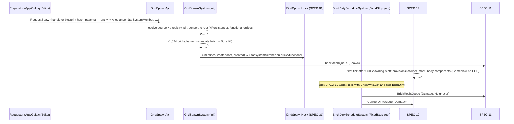

# SPEC-10 — Voxel data model and spawning

| | |
|---|---|
| **Status** | Draft |
| **Area code** | VOX (task IDs are `VOX-001`, `VOX-002`, …) |
| **Module(s)** | `Game.Voxel` (folders `Assets/Game/Voxel/Model/` and `Assets/Game/Voxel/Grid/`); definitions in `Game.Data` (`Assets/Game/Data/Definitions/Voxel/`) |
| **Depends on specs** | SPEC-02 (`ContentId`, `ContentHash`, `PersistentId`, `StableHash`, `GameLog`, `GameplayActive`); SPEC-04 (`BlockDef`, `BlockDefsBlob`, `OrientationTablesBlob`, `BlockPlacementMath`, `ContentCatalog`, `ContentService.CreateForTests`); SPEC-05 (VOXS byte layout); SPEC-11 and SPEC-12 (their contract types, added to entities and singletons at spawn); SPEC-71 (`EcsTestWorld`, perf harness) |
| **Depended on by** | SPEC-11, SPEC-12, SPEC-13 (cell write helpers, ECS layout, prototypes), SPEC-20/21/22 (functional entities, `FunctionalComponentRegistration`), SPEC-05 (codec), SPEC-01 (creates the registry and config singletons), SPEC-31 (spawn/despawn, `IGridSpawnHook`, write-back), SPEC-51 (`VoxelStructure` editing, `GridEditRequest`), SPEC-72 (blueprint encoding), SPEC-70 (benchmark structures) |
| **Milestone** | M1 (VOX-001 in M0; VOX-020 in M3) |

> Read [01-architecture.md](../01-architecture.md) (especially §5.1 and §11), [02-conventions.md](../02-conventions.md), [03-glossary.md](../03-glossary.md) and [07-implementation-traps.md](../07-implementation-traps.md) before this spec. This spec may not contradict them.

## 1. Purpose

This spec defines how voxel data is stored and how a stored structure becomes live ECS entities. A grid's cells live in sparse 16³ bricks of 4-byte cells; the same layout exists outside ECS as `VoxelStructure` (editor, saves, tests, spawn source) and inside ECS as one root entity, one entity per non-empty brick and one entity per functional block. It defines the brick coordinate maths, the solid mask, the dirty/revision bookkeeping that drives incremental remeshing (SPEC-11) and collider rebuilds (SPEC-12), the structure registry and blueprint loading, despawn with damage write-back, deferred disposal of meshes and blobs, and the memory model for the 1M-cell reference station. The old prototype made every voxel an entity (~300 B and O(voxels) per frame, 01 §5), ignored multi-cell footprints at runtime (01-B1), never persisted damage (04-B3) and keyed baked data on unstable hashes (01-B8/B9). This spec makes those impossible by construction.

## 2. Scope

**In scope:**
- `Cell`, `CellFlags`, `PaletteEntry`, `BlockInstance`, `GridKind` and every other §6.3 type owned by the voxel data model.
- Brick maths (cell ↔ brick ↔ local index), the solid-mask bit layout and bit operations.
- `VoxelStructure` (managed owner) and `VoxelStructureData` (native storage): sparse paged bricks, uniform-brick compression, cell get/set, block place/remove with footprint and orientation, compaction, clone, diff, revision, mass accumulation, content hash.
- `VoxelStructureRegistry` (handles used by `GridSpawnRequest`), `BlueprintLibrary`, `ShipBlueprintDefinition`, VOXS codec (conversion between `VoxelStructure` and the SPEC-05 VOXS payload).
- Grid-space DDA raycast over a structure and over a live grid.
- ECS layout: `VoxelGrid`, `BrickSlot`, `Brick`, `BrickCells`, `BrickSparseCells`, `BrickSolidMask`, `BrickDirty`, `FunctionalBlock`, spawn/rebuild/despawn/edit requests.
- `GridSpawnSystem` (incl. the `StarSystemMember` tagging hook and `PersistentId` copy), `BrickDirtyScheduleSystem`, `DeferredDisposalSystem`; write-back API; cell write helpers.
- Memory model, benchmark structures and the integrated voxel perf-gate suite.

**Out of scope (and who owns it instead):**
- Block definitions, orientation tables, placement maths: SPEC-04.
- VOXS byte layout and the chunk container, IDPL, Missing reporting: SPEC-05 (this spec implements the encoder/decoder against it).
- Meshing, materials, LOD, the `Dormant` tag, prop rendering: SPEC-11. Colliders, mass, physics body components, `PhysicsLayers`: SPEC-12.
- Damage resolution, integrity, splitting (including creating hulk grids through the GameplayEnd ECB), ship death: SPEC-13 (uses this spec's write helpers and prototypes).
- Edit sessions, undo/redo, BOM, validation rules: SPEC-51. Star-system streaming, deltas and the `StarSystemMember` value: SPEC-31. `PersistentId` allocation: SPEC-01 (`GameSession`).

## 3. Decisions (binding)

1. **Cells are 4 bytes: `ushort Ref`, `byte Hp`, `byte Flags`; air is `default(Cell)` (all zero).** Reason: architecture §6.3; memory at 1M cells.
2. **`Ref` bit 15 = 0 → palette index 1..32767; bit 15 = 1 → instance index 0..32767; `Ref == 0` → air. Palette index 0 is reserved and never referenced.** Reason: architecture §6.3; one compare tests air.
3. **A solid cell always has `Hp ≥ 1`; `Hp == 255` is full health.** The resolver turns a cell to air instead of writing `Hp = 0`. Reason: `Hp` is never ambiguous with "destroyed".
4. **Palette ⇔ `!BlockDef.RequiresInstance`; instance ⇔ `RequiresInstance`** (SPEC-04 decision 13). Single-cell Structural and single-cell Prop blocks use the palette; Functional and multi-cell blocks use a `BlockInstance`, and every footprint cell points at it. Reason: 01-B1 by construction.
5. **Bricks are 16³ and stored in linear order `index = x | y << 4 | z << 8` (x fastest).** Morton order is not used. Reason: a mask row (16 x-cells) is one `ushort`; meshing, greedy boxes and downsampling work on rows with shifts; structure ↔ ECS copies are one `memcpy`.
6. **Brick coordinate = `cell >> 4`, local = `cell & 15`** (arithmetic shift, correct for negative cells). Grid space: cell `c` occupies `[c, c+1) × CellSize` metres from the grid origin; the grid origin is the root entity's `LocalTransform`.
7. **Sparse fallback is active (accepted ADR-0023).** Both ECS cell buffers exist: dense means BrickCells has 4,096 entries and BrickSparseCells is empty; sparse means BrickCells is empty and BrickSparseCells has at most 1,024 sorted solid entries. Inserting solid cell 1,025 densifies and releases sparse heap storage; dense damage writes do not automatically repack. VoxelStructure also supports uniform full bricks (Page == -1). Empty bricks are destroyed by their owner. Cell values, masks and persisted VOXS bytes are unchanged.
8. **`BrickCells`, `BrickSparseCells` and `BrickSolidMask` have `[InternalBufferCapacity(0)]`**. Dense cells use 16,384 bytes; sparse entries use six bytes each plus actual allocation slack; the mask always uses 512 bytes (architecture §6.3, §11.5).
9. **ECS refers to structures only by `int StructureHandle`** into the managed `VoxelStructureRegistry`, and to blueprints by `ContentHash`. The registry is a runtime `ScriptableObject` reached from ECS through the singleton `VoxelStructureRegistryRef { UnityObjectRef<VoxelStructureRegistry> }`; only `GridSpawnSystem` (main thread) dereferences it inside ECS. No managed type appears in any component; per-entity components never hold native containers (only module singletons such as `DeferredDisposalQueue` do, and jobs receive those containers as job fields). Reason: architecture §6.3, conventions §2.14, §3.3 "ECS never reads managed statics".
10. **A spawn request entity becomes the grid root.** Components the requester puts on it (`Allegiance`, `StarSystemMember`, `PlayerShip`, AI state) stay on the root. `GridSpawnSystem` adds `PersistentId` from `GridSpawnRequest.PersistentId`. Reason: Voxel cannot reference Simulation/Galaxy types.
11. **`StarSystemMember` tagging hook:** after creating brick or functional entities for a root, `GridSpawnSystem` calls every registered `IGridSpawnHook.OnEntitiesCreated(em, root, created)`. SPEC-31 registers the hook that batch-adds the root's `StarSystemMember` (if any) to `created`. Reason: architecture §6.5 puts `StarSystemMember` on roots, bricks and functional entities; `Game.Voxel` cannot name the type.
12. **The root's `LinkedEntityGroup` (`[InternalBufferCapacity(0)]`, Unity's type) contains the root, every brick and every functional entity.** Destroying the root destroys the grid. Stale entries of bricks destroyed earlier are harmless (destroy skips them; versions differ). SPEC-13 removes bricks it moves into another grid from the old root's group.
13. **Structural changes:** only `GridSpawnSystem` uses `EntityManager` directly, always with batch APIs (`Instantiate(prefab, NativeArray)`, `AddComponent(NativeArray, type)`, `DestroyEntity(NativeArray)`). It also creates and disposes every `Game.Voxel` runtime singleton (VOX, REN and PHY types, through their contract `Create()`/`Dispose()` methods) in its `OnCreate`/`OnDestroy`. Every other system in this spec records into an ECB from an allowed ECB system. Reason: conventions §2.5.
14. **Revision bookkeeping:** `VoxelGrid.Revision` increments once per tick per grid that changed; every brick changed in that tick gets `Brick.ChangedRevision = VoxelGrid.Revision`. Write-back copies bricks with `ChangedRevision > GridSource.SyncedRevision`. Reason: save capture and despawn copy only changed bricks (O(changed bricks), not O(grid)).
15. **Rebuild work is incremental and per brick (architecture §11.1).** Fixed-step writers set `BrickDirty`; `BrickDirtyScheduleSystem` moves dirty bricks (and face neighbours for meshing) into the SPEC-11 mesh queue and SPEC-12 collider queue; spawn, rebuild and edit enqueue directly. Nothing rebuilds a whole grid's meshes or colliders because one cell changed.
16. **Spawn is time-sliced (architecture §11.2):** at most `VoxelConfig.SpawnBricksPerFrame` (1,024) brick entities are created per frame across all requests, oldest request first; the grid carries `GridSpawning` (enabled) until complete. SPEC-13 and SPEC-12 skip spawning grids.
17. **Folder/namespace layout of `Game.Voxel`:** four specs share the module, so each owns an area folder: `Model/` + `Grid/` (SPEC-10, namespaces `Game.Voxel.Model`, `Game.Voxel.Grid`), `Rendering/` (SPEC-11), `PhysicsBody/` (SPEC-12), `Damage/` (SPEC-13, recommended). Files sit directly in the area folder (one namespace per area). Reason: conventions §1 sub-folder rule; no file collisions between parallel specs.
18. **Reference station for the memory gate** is `HollowStation1M` (§5.11): a hollow box 256×128×256 cells with 4-cell (2 m) walls, one structural block, one colour. The thin-shell variant (1-cell walls) is a reported stress case, not a gate (§8.2). Reason: 06 does not define the geometry; 2 faces per cell make any 1M-cell 1-cell shell exceed 40 MB at LOD0.
19. **Profiler markers** are `static readonly ProfilerMarker` fields named `<SystemName>.<Step>` (e.g. `GridSpawnSystem.CreateBricks`).

## 4. Data model

All types below are **public contract** unless marked *internal*. Each file holds one type and starts with `/// <summary>Implements SPEC-10 §4.x.</summary>`.

### 4.1 Cells, palette, instances (`Assets/Game/Voxel/Model/`, namespace `Game.Voxel.Model`)

```csharp
[StructLayout(LayoutKind.Sequential)]
public struct Cell : IEquatable<Cell>                      // 4 bytes (architecture §6.3)
{
    public ushort Ref;     // 0 = air; bit15=0: palette index 1..32767; bit15=1: instance index (Ref & 0x7FFF)
    public byte Hp;        // 1..255 for solid cells (255 = full = BlockDef.CellHp); 0 only for air
    public byte Flags;     // CellFlags
    public const ushort InstanceBit = 0x8000;
    public const ushort MaxPaletteIndex = 0x7FFF;          // 32767
    public const int MaxInstanceIndex = 0x7FFF;            // 32767
    public bool IsAir => Ref == 0;
    public bool IsInstance => (Ref & InstanceBit) != 0;
    public int InstanceIndex => Ref & 0x7FFF;              // valid only if IsInstance
    public ushort PaletteIndex => Ref;                     // valid only if !IsInstance && !IsAir
    public static Cell Palette(ushort paletteIndex, byte hp = 255, byte flags = 0) => new Cell { Ref = paletteIndex, Hp = hp, Flags = flags };
    public static Cell Instance(int instanceIndex, byte hp = 255, byte flags = 0) => new Cell { Ref = (ushort)(InstanceBit | instanceIndex), Hp = hp, Flags = flags };
    public bool Equals(Cell o) => Ref == o.Ref && Hp == o.Hp && Flags == o.Flags;
    public override int GetHashCode() => Ref | (Hp << 16) | (Flags << 24);   // in-memory only, never persisted
}

[Flags] public enum CellFlags : byte
{
    None = 0,
    InstanceRoot = 1,      // this cell is footprint cell (0,0,0) of its BlockInstance
    Scorched = 2,          // cosmetic burn mark; written by SPEC-13; SPEC-11 darkens the face
    // bits 2..7 reserved; claim through SPEC-10 open questions
}

public struct PaletteEntry : IBufferElementData             // 4 bytes; per grid; buffer element on the grid root
{
    public ushort Block;   // BlockIndex (SPEC-04); 0 only in entry 0 (reserved) or an unused entry
    public byte Orient;    // 0..23
    public byte Color;     // paint palette index (SPEC-11 VoxelPaletteDefinition)
}

[Flags] public enum BlockInstanceFlags : byte { None = 0, Destroyed = 1 }   // Destroyed: function lost (SPEC-13); cells may remain

[InternalBufferCapacity(0)]
public struct BlockInstance : IBufferElementData             // 32 bytes; buffer element on the grid root
{
    public ushort Block;          // BlockIndex; 0 = free slot (tombstone)
    public byte Orient;           // 0..23
    public byte Color;
    public int3 Origin;           // grid cell of footprint cell (0,0,0)
    public float FunctionHp;      // absolute HP, starts at BlockDef.FunctionHp; runtime writer: DamageResolveSystem only
    public Entity Functional;     // functional entity, or Entity.Null (Structural/Prop kinds, or outside ECS)
    public ushort CellsAlive;     // footprint cells still solid; starts at BlockDef.Cells.Length
    public BlockInstanceFlags Flags;
    public byte Reserved;
}

public enum GridKind : byte { Ship = 0, Station = 1, Asteroid = 2, Hulk = 3 }       // binding (architecture §6.3)
public enum GridMotion : byte { Dynamic = 0, Kinematic = 1, Static = 2 }
[Flags] public enum GridSpawnFlags : ushort
{
    None = 0,
    WriteBack = 1,        // the source structure is owned by this grid: despawn and save write damage back into it
    PlanarInertia = 2,    // SPEC-12 locks rotation to the Y axis (ADR-0003); set together with SPEC-20's PlanarConstraint. GridSpawnSystem ORs it in for
                          // the flying profiles PlayerShip, NpcShip, SmallCraft and Dummy (§5.13), so requesters need not remember it
    NoRender = 4,         // create bricks without render components (headless tools and tests)
    EditorPreview = 8,    // grid edited through GridEditRequest; SPEC-13 never damages it
    Transient = 16,       // never saved (ADR-0015): PersistentId may be 0 without a warning; no save path captures it
}

/// <summary>Which gameplay root components a grid gets at conversion (ADR-0015). Add values at the end only.</summary>
public enum GridProfile : byte { None = 0, PlayerShip = 1, NpcShip = 2, Station = 3, SmallCraft = 4, Dummy = 5 }

public struct BlockPlacement : IEquatable<BlockPlacement>  // a placed block (palette cell or instance); Equals compares all four fields
{ public ushort Block; public int3 Origin; public byte Orient; public byte Color; }

public enum PlaceResult : byte { Ok = 0, Occupied = 1, InvalidBlock = 2, OrientationNotAllowed = 3, PaletteFull = 4, InstancesFull = 5, OutOfRange = 6, ReadOnly = 7 }

public struct VoxelContent                                   // the two SPEC-04 blobs, passed together
{ public BlobAssetReference<BlockDefsBlob> Blocks; public BlobAssetReference<OrientationTablesBlob> Orientations; }
```

### 4.2 Brick maths and masks (`Model/`)

```csharp
public static class BrickMath                                // Burst-compatible, no allocation
{
    public const int Size = 16, Shift = 4, Mask = 15, CellsPerBrick = 4096, MaskWords = 64;
    public static int3 BrickOf(int3 cell) => cell >> Shift;
    public static int3 LocalOf(int3 cell) => cell & Mask;
    public static int LocalIndex(int3 local) => local.x | (local.y << 4) | (local.z << 8);
    public static int LocalIndex(int x, int y, int z) => x | (y << 4) | (z << 8);
    public static int3 LocalFromIndex(int i) => new int3(i & 15, (i >> 4) & 15, i >> 8);
    public static int3 CellOf(int3 brick, int localIndex) => (brick << Shift) + LocalFromIndex(localIndex);
    public static int SlotIndex(int3 brick, int3 brickMin, int3 brickDims);   // -1 if outside; else d.x + dims.x*(d.y + dims.y*d.z), d = brick - brickMin
    public static float3 CellMinCorner(int3 cell, float cellSize) => (float3)cell * cellSize;
    public static float3 CellCenter(int3 cell, float cellSize) => ((float3)cell + 0.5f) * cellSize;
    public static int3 CellAt(float3 gridLocalPoint, float cellSize) => (int3)math.floor(gridLocalPoint / cellSize);
    public static BlockFaceMask BorderFaces(int localIndex); // brick faces the cell touches: x==0 → NegX, x==15 → PosX, y==0 → NegY, ...
    public static int3 FaceDirection(BlockFace f);           // PosX→(1,0,0), NegX→(-1,0,0), PosY, NegY, PosZ, NegZ (SPEC-04 order)
}

/// 4096-bit solid mask as a value (structure storage, snapshots, collider batches).
/// Bit i = cell with local index i is solid (Ref != 0). Word w = i >> 6, bit b = i & 63.
/// With i = x + 16y + 256z: w = (y >> 2) + 4z, b = x + 16*(y & 3).
/// Row (y, z) — the 16 x-cells — is (ushort)(Words[(y>>2) + 4z] >> (16*(y&3))).
public unsafe struct BrickMaskBits                           // 512 bytes
{
    public fixed ulong Words[64];
    public bool Get(int i);
    public void Set(int i, bool solid);
    public ushort Row(int y, int z);
    public void SetRow(int y, int z, ushort bits);
    public int CountSolid();                                 // math.countbits over 64 words
    public bool IsEmpty();
    public bool IsFull();
    public bool TryGetBounds(out int3 min, out int3 max);    // inclusive local bounds; false if empty
    public static BrickMaskBits Full();
    public void CopyFrom(DynamicBuffer<BrickSolidMask> buffer);   // buffer.Length must be 64
    public void CopyTo(DynamicBuffer<BrickSolidMask> buffer);     // resizes to 64
}

/// ECS form of the mask (architecture §6.3: 512 B per brick, capacity 0).
[InternalBufferCapacity(0)] public struct BrickSolidMask : IBufferElementData { public ulong Bits; }   // exactly 64 elements
```

### 4.3 Structure storage (`Model/`)

```csharp
public struct StructureMassData                              // accumulators; double so 1M-cell sums do not drift
{
    public double Mass;            // Σ m (kg)
    public double3 FirstMoment;    // Σ m·p (p = cell centre, grid-local metres)
    public double3 SecondDiag;     // Σ m·(px², py², pz²)
    public double3 SecondOff;      // Σ m·(px·py, py·pz, pz·px)
    public double CellInertia;     // Σ m·s²/6 (each cell's own cube inertia about its centre, s = CellSize)
    public uint CellCount;
}

public struct StructureHeader
{
    public float CellSize;         // metres; default 0.5
    public uint Revision;          // +1 on every mutating call
    public int3 CellMin, CellMax;  // inclusive solid bounds; valid when BoundsValid == 1
    public byte BoundsValid;       // 0 after any mutation; recomputed lazily
    public byte ReadOnly;          // 1 for blueprint structures: mutators refuse
    public int PinCount;           // > 0 while a spawn or rebuild reads it: mutators throw
    public uint MassRevision;      // Revision at which Mass was computed; 0 = never
    public StructureMassData Mass;
}

public struct BrickRecord                                    // 28 bytes (Q13)
{
    public int3 Coord;             // brick coordinate
    public int Page;               // >=0 dense page; -1 uniform; <=-2 sparse page index = -2-Page (ADR-0023)
    public Cell Uniform;           // valid when Page == -1
    public ushort SolidCount;      // 1..4096
    public ushort Reserved;
    public uint ChangedRevision;   // Header.Revision of the last change to this brick
}

public struct VoxelStructureData                             // copy = same storage. Only VoxelStructure disposes.
{
    public NativeReference<StructureHeader> Header;
    public NativeList<PaletteEntry> Palette;                 // [0] reserved (Block 0)
    public NativeList<BlockInstance> Instances;
    public NativeList<int> FreeInstances;                    // tombstoned instance indices, LIFO reuse
    public NativeList<BrickRecord> Bricks;                   // unordered; SortedBrickOrder gives canonical order
    public NativeList<BrickMaskBits> Masks;                  // parallel to Bricks
    public NativeHashMap<int3, int> BrickIndex;              // coord → index into Bricks (lookup only, never iterated)
    public NativeList<Cell> CellPages;                       // dense pages of 4096 cells, local linear order
    public NativeList<int> FreePages;                        // free dense page numbers, LIFO reuse
    public NativeList<BrickSparseCells> SparsePages;          // flat 1024-entry pages; live length is record.SolidCount
    public NativeList<int> FreeSparsePages;                  // sparse page indices, LIFO reuse
    public bool IsCreated => Header.IsCreated;
}

public struct StructureBlock { public BlockPlacement Placement; public int InstanceIndex; /* -1 = palette cell */ }

public struct StructureDiff : IDisposable
{ public NativeList<BlockPlacement> Removed; public NativeList<BlockPlacement> Added; public void Dispose(); }

public sealed class VoxelStructure : IDisposable             // behaviour in §5.1–§5.4
{
    public VoxelStructure(float cellSize = 0.5f);            // Allocator.Persistent; Palette gets entry 0
    public VoxelStructureData Data { get; }
    public float CellSize { get; }
    public uint Revision { get; }
    public bool IsReadOnly { get; }
    public bool IsPinned { get; }
    public int BrickCount { get; }
    public int SolidCellCount { get; }                       // Σ SolidCount, O(bricks)
    public bool TryGetCellBounds(out int3 min, out int3 max);
    public Cell GetCell(int3 cell);
    public void SetCell(int3 cell, Cell value);              // raw write (codec, editor internals, tests)
    public PlaceResult TryPlaceBlock(in BlockPlacement p, in VoxelContent content);
    public bool TryRemoveBlockAt(int3 cell, in VoxelContent content, out BlockPlacement removed);
    public bool TryGetBlockAt(int3 cell, out BlockPlacement block, out int instanceIndex);
    public ushort FindOrAddPalette(PaletteEntry e);          // returns 0 if full (32767 entries used)
    public void SetBrickDense(int3 coord, NativeArray<Cell> cells4096);   // replaces/creates a brick; deletes it if all air
    public void SetBrickUniform(int3 coord, Cell value);     // value must be solid
    public bool RemoveBrick(int3 coord);
    public void OptimizeStorage();                           // full identical dense bricks → uniform; frees pages
    public void Compact();                                   // §5.3
    public void SetReadOnly();                               // irreversible
    public void Pin(); public void Unpin();                  // PinCount ±1 (Unpin below 0 throws)
    public NativeArray<int> SortedBrickOrder(Allocator a);   // indices into Bricks sorted by (z, y, x)
    public void GetBlocks(NativeList<StructureBlock> output);// §5.4 canonical order
    public VoxelStructure Clone();                           // deep copy; not pinned, not read-only
    public static StructureDiff Diff(VoxelStructure from, VoxelStructure to, Allocator a);
    public StructureMassData GetMass(in VoxelContent content);   // cached by Revision
    public ulong ComputeContentHash(Game.Voxel.Data.VoxsBlockNames names);   // StableHash of the VOXS payload (§5.4)
    public long NativeBytes { get; }                         // Σ capacities × element sizes of all containers
    public void Clear();
    public void Dispose();                                   // throws InvalidOperationException if pinned; second call is a no-op
}
```

### 4.4 Registry, hooks and requests (`Model/` types, `Grid/` services)

```csharp
// Grid/ (namespace Game.Voxel.Grid)
public interface IGridSpawnHook
{   /// Called by GridSpawnSystem on the main thread, inside its structural update, after it created
    /// brick or functional entities for `root` (root already carries every requester component).
    /// May make batch structural changes on `created` only.
    void OnEntitiesCreated(EntityManager em, Entity root, NativeArray<Entity> created);
}

public sealed class VoxelStructureRegistry : ScriptableObject, Game.Core.Flow.ISceneExiting, IDisposable // runtime instance only; ADR-0024
{
    public static VoxelStructureRegistry CreateRuntime(BlueprintLibrary blueprints);
    public int Register(VoxelStructure structure);           // handle ≥ 0; a handle is never reused in a session
    public void Release(int handle);                          // forgets the structure; does NOT dispose it (owner disposes)
    public VoxelStructure Get(int handle);                    // null if released or out of range
    public bool TryGetBlueprint(ContentHash blueprint, out VoxelStructure structure);   // via BlueprintLibrary
    public void AddSpawnHook(IGridSpawnHook hook);
    public void RemoveSpawnHook(IGridSpawnHook hook);
    public IReadOnlyList<IGridSpawnHook> SpawnHooks { get; }
    public void CancelSpawnReads(); // teardown only, after completing tracked jobs; idempotent (ADR-0024)
    public int SceneExitOrder { get; }
    public void OnSceneExiting(in Game.Core.Flow.SceneExitContext context); // cancels owned spawn reads before scene destruction
    public void Dispose(); // cancels owned pins; never disposes registered structures (ADR-0024)
}

public sealed class BlueprintLibrary : IDisposable            // owned by SPEC-01's composition root
{
    public BlueprintLibrary(ContentCatalog catalog, VoxelContent content);   // decodes with VoxelStructureCodec.TryDecode(payload, catalog, …)
    public bool TryGet(ContentHash blueprint, out VoxelStructure structure);   // decodes on first use; read-only; cached
    public void ReleaseUnpinnedLarge();                       // disposes cached structures with > 65,536 cells and PinCount == 0
    public int CachedCount { get; }
    public void Dispose();                                    // disposes every cached structure
}

// Model/ — ECS components
public struct VoxelStructureRegistryRef : IComponentData { public UnityObjectRef<VoxelStructureRegistry> Value; }  // singleton, created by SPEC-01

public struct GridSpawnRequest : IComponentData              // architecture §6.3; the entity becomes the root
{
    public ContentHash Blueprint;          // non-zero: spawn from this blueprint (read-only source, WriteBack forbidden)
    public int StructureHandle;            // ≥ 0: spawn from this registered structure; -1 = none. Exactly one source is set
    public ulong PersistentId;             // copied to the root's PersistentId; 0 only for EditorPreview grids and tests
    public RigidTransform Pose;            // local frame; position of the grid origin (cell (0,0,0) min corner)
    public float3 LinearVelocity;          // m/s, world; Dynamic only
    public float3 AngularVelocity;         // rad/s, world; Dynamic only
    public GridKind Kind;
    public GridMotion Motion;
    public GridSpawnFlags Flags;
    public GridProfile Profile;            // root component set from RootComponentRegistration (ADR-0015); None for asteroids, hulk bodies, previews
}
public struct GridRebuildRequest : IComponentData { public int StructureHandle; public GridSpawnFlags Flags; }   // on an existing root
public struct GridDespawnRequest : IComponentData, IEnableableComponent { }      // on every root, disabled; enable to despawn
public struct GridSpawning : IComponentData, IEnableableComponent { public int NextBrick; }   // enabled until every brick exists
public struct GridRebuilt : IComponentData, IEnableableComponent { }              // enabled by GridSpawnSystem; SPEC-12 consumes
public struct GridBodyInit : IComponentData, IEnableableComponent                 // enabled at spawn; SPEC-12 consumes and disables
{ public GridMotion Motion; public float3 LinearVelocity; public float3 AngularVelocity; }
public struct GridSource : IComponentData                    // on the root
{ public int StructureHandle; /* -1 for blueprint spawns */ public ContentHash Blueprint; public uint SyncedRevision; public GridSpawnFlags Flags; }
[InternalBufferCapacity(0)] public struct GridEditedBrick : IBufferElementData { public int3 Coord; }   // M3, on the root
public struct GridEditRequest : IComponentData, IEnableableComponent { }         // M3: enable after filling GridEditedBrick
```

### 4.5 Grid and brick components (`Model/`)

```csharp
public struct VoxelGrid : IComponentData                     // on the root (architecture §6.3)
{
    public int3 BrickMin, BrickDims;   // BrickSlot table bounds; BrickDims product ≤ 262,144
    public float CellSize;
    public uint Revision;              // writers: DamageResolveSystem, SplitSystem, GridSpawnSystem
    public int AnchorInstance;         // core instance index or -1 (largest island anchors); written at spawn, afterwards by SPEC-13
    public GridKind Kind;              // written at spawn, afterwards by ShipDeathSystem (SPEC-13)
    public uint Serial;                // session-unique creation number ≥ 1; deterministic ordering and SPEC-12 cache key
    public int3 CellMin, CellMax;      // inclusive solid bounds at spawn/rebuild; never shrunk at runtime (conservative)
}

[InternalBufferCapacity(0)] public struct BrickSlot : IBufferElementData { public Entity Brick; }  // dense table on the root

public struct Brick : IComponentData                         // 28 bytes
{
    public Entity Grid;
    public int3 Coord;
    public ushort SolidCount;          // 1..4096 while the entity lives; a writer that reaches 0 destroys the brick (SPEC-13, via ECB)
    public ushort Reserved;
    public uint ChangedRevision;
}

[InternalBufferCapacity(0)] public struct BrickCells : IBufferElementData { public Cell Value; }   // 4096 when dense, zero when sparse
[StructLayout(LayoutKind.Sequential, Pack = 2)]
[InternalBufferCapacity(0)] public struct BrickSparseCells : IBufferElementData { public ushort Local; public Cell Value; } // 6 bytes, sorted and solid

[Flags] public enum BrickDirtyFlags : byte { None = 0, Mesh = 1, Collider = 2 }

public struct BrickDirty : IComponentData, IEnableableComponent
{
    public BrickDirtyFlags Flags;
    public BlockFaceMask BorderMask;   // brick faces whose border layer changed → face neighbours need remeshing (SPEC-04 mask)
}

public struct FunctionalBlock : IComponentData { public Entity Grid; public int InstanceIndex; }   // architecture §6.3

public struct FunctionalComponentRegistration : IBufferElementData { public BlockModuleId Module; public ComponentType Type; }  // singleton buffer (ADR-0013); Module = None → every functional entity (ADR-0016)
public struct RootComponentRegistration : IBufferElementData { public GridProfile Profile; public ComponentType Type; }         // singleton buffer (ADR-0015)

public struct GridPrototypes : IComponentData                // singleton; internal to GridSpawnSystem, read by SPEC-13
{ public Entity Brick; public NativeHashMap<ulong, Entity> FunctionalByMask, FunctionalByMaskNoRender; /* key = BlockDef.ModuleMask; prototypes created on first use */ public uint NextSerial; public int RegistrationCount; }

public struct RetiredBlob { public BlobAssetReference<Collider> Blob; public uint DueFrame; public uint DueTick; }
public struct RetiredMesh { public UnityObjectRef<Mesh> Mesh; public BatchMeshID Id; public uint DueFrame; }
public struct DeferredDisposalQueue : IComponentData         // singleton; appended on the main thread only
{
    public NativeList<RetiredBlob> Blobs; public NativeList<RetiredMesh> Meshes; public uint Frame;
    public uint Tick;          // SimClock.Tick mirrored by DeferredDisposalSystem each frame (0 when no SimClock)
    public byte HasClock;      // 1 while a SimClock singleton exists
}

public struct VoxelConfig : IComponentData                   // singleton, created by SPEC-01 from VoxelConfigDefinition
{ public int SpawnBricksPerFrame; public byte RequireRenderer; public float DefaultCellSize; }
```

**Root archetype after conversion:** `VoxelGrid, BrickSlot[], PaletteEntry[], BlockInstance[], LocalTransform, LocalToWorld, LinkedEntityGroup[], PersistentId, GridSource, GridSpawning, GridDespawnRequest(off), GridRebuilt(off), GridBodyInit, GridEditRequest(off), GridEditedBrick[]` + SPEC-12 `GridMass, GridMassRecompute, GridColliderState` + SPEC-11 `Dormant(off)` + every requester component. SPEC-12 adds the Unity Physics components later (through the GameplayEnd ECB).
**Brick archetype:** `Brick, BrickCells[], BrickSparseCells[], BrickSolidMask[64], BrickDirty(off), LocalTransform, LocalToWorld, Parent` + SPEC-11 `BrickLodDesired, BrickPropInstance[]` + `BrickRenderState` and Entities Graphics components only when rendering (Q33) + `StarSystemMember` via the hook. `LocalTransform = { Position = Coord·16·CellSize, Rotation = identity, Scale = CellSize }`: brick meshes are in cell units.
**Functional archetype:** `FunctionalBlock, LocalTransform, LocalToWorld, Parent` + registered types + Entities Graphics components + `StarSystemMember` via the hook. `LocalTransform = { Position = (Origin + 0.5)·CellSize, Rotation = OrientationTablesBlob.Rotations[Orient], Scale = CellSize }` (prop meshes are pivoted at the root cell centre, 1 unit = 1 cell).

### 4.6 Helpers (`Grid/`)

```csharp
public struct GridSpawnParams
{ public RigidTransform Pose; public float3 LinearVelocity, AngularVelocity; public GridKind Kind; public GridMotion Motion; public GridSpawnFlags Flags; public GridProfile Profile; public ulong PersistentId; }

public static class GridSpawnApi                             // managed callers (App, Galaxy, ShipEditor, tests)
{
    public static Entity RequestSpawn(EntityManager em, VoxelStructureRegistry registry, int structureHandle, in GridSpawnParams p);
    public static Entity RequestSpawn(EntityCommandBuffer ecb, VoxelStructureRegistry registry, int structureHandle, in GridSpawnParams p); // BeginInitialization ECB
    public static Entity RequestSpawnBlueprint(EntityManager em, ContentHash blueprint, in GridSpawnParams p);     // WriteBack is cleared
    public static Entity RequestSpawnBlueprint(EntityCommandBuffer ecb, ContentHash blueprint, in GridSpawnParams p);
    public static void RequestRebuild(EntityManager em, VoxelStructureRegistry registry, Entity root, int structureHandle, GridSpawnFlags flags);
    public static void RequestDespawn(EntityManager em, Entity root);          // enables GridDespawnRequest
    public static void RequestEdit(EntityManager em, Entity root, NativeArray<int3> changedBrickCoords);   // M3
}

/// <summary>Tick-exact entry and exit of pre-spawned grids (ADR-0015, §5.13). Fixed-step callers record into the GameplayEnd ECB.</summary>
public static class GridStowApi
{
    /// Disables the root and its LinkedEntityGroup (ecb.SetEnabled(root, false)). Precondition: GridSpawning and GridBodyInit are disabled.
    public static void Stow(EntityCommandBuffer.ParallelWriter ecb, int sortKey, Entity root);
    /// Re-enables the group and sets LocalTransform {pose, scale 1}, PhysicsVelocity {linear, angular} and ensures and resets
    /// PhysicsGraphicalInterpolationBuffer {PreviousTransform = pose, PreviousVelocity = velocity} (no smoothing streak).
    /// graceOther != Entity.Null also adds SPEC-13 SplitGrace { Other = graceOther, UntilTick = graceUntilTick } (launch from a
    /// carrier without contacts until the craft is clear; ADR-0017).
    public static void Unstow(EntityCommandBuffer.ParallelWriter ecb, int sortKey, Entity root, in RigidTransform pose, float3 linear, float3 angular,
                              Entity graceOther = default, uint graceUntilTick = 0);
}

public static class GridStructureSync                        // main thread, outside ECS system updates, or inside GridSpawnSystem
{
    public static int WriteBack(EntityManager em, Entity root, VoxelStructureRegistry registry);      // into the source; returns bricks copied
    public static int CaptureChanges(EntityManager em, Entity root, VoxelStructure changedBricks, NativeList<int3> removedBricks); // since spawn
    public static void WriteBackAll(EntityManager em, EntityQuery roots, VoxelStructureRegistry registry);  // SPEC-31 calls before unloading
}

public static class BrickWrite                               // Burst; the cell write path for SPEC-13 and GridEditRequest
{
    public static Cell Get(DynamicBuffer<BrickCells> cells, DynamicBuffer<BrickSparseCells> sparse, int localIndex);
    /// Writes one cell; maintains mask, SolidCount, ChangedRevision and dirty flags. Returns true if anything changed.
    public static bool Set(ref Brick brick, DynamicBuffer<BrickCells> cells, DynamicBuffer<BrickSparseCells> sparse, DynamicBuffer<BrickSolidMask> mask, ref BrickDirty dirty,
                           int localIndex, Cell value, uint revision);
}

public struct GridCellReader                                 // read-only job helper; every lookup is [ReadOnly]
{
    [ReadOnly] public ComponentLookup<VoxelGrid> Grids; [ReadOnly] public BufferLookup<BrickSlot> Slots;
    [ReadOnly] public BufferLookup<BrickCells> Cells; [ReadOnly] public BufferLookup<BrickSparseCells> Sparse; [ReadOnly] public BufferLookup<BrickSolidMask> Masks;
    public static GridCellReader Create(ref SystemState state);   // call in OnCreate
    public void Update(ref SystemState state);                    // call first thing in OnUpdate
    public Entity GetBrick(Entity grid, int3 brickCoord);         // Entity.Null if outside or absent
    public bool TryGetCell(Entity grid, int3 cell, out Cell value);   // false and air if absent or air
    public bool IsSolid(Entity grid, int3 cell);                  // mask bit test
}
```

`VoxelRaycast`, `ICellSolidQuery`, `VoxelRayHit` (§5.5), `VoxelStructureCodec`, `VoxsSourceBuffers` (§5.6), `MassAccumulator` (§5.4), `BenchmarkStructures` (§5.11) and `DeferredDisposal` (§5.10) are specified with their algorithms.

### 4.7 Definitions (`Assets/Game/Data/Definitions/Voxel/`, namespace `Game.Data.Definitions`)

```csharp
[ContentIdPrefix("ship_")]
[CreateAssetMenu(menuName = "Game/Content/Ship Blueprint", fileName = "ship_new")]
public sealed class ShipBlueprintDefinition : ContentDefinition
{
    [SerializeField] private string displayName;
    [SerializeField] private float cellSize = 0.5f;          // > 0
    [SerializeField] private int payloadVersion = 1;         // VOXS payload layout version
    [SerializeField, HideInInspector] private byte[] payload; // VOXS bytes (SPEC-05 VoxsCodec, VoxsEncodeOptions.ForAsset); written by SPEC-72 and SPEC-51 export
    [SerializeField] private int cellCount;                  // cached summary for UI and validation
    [SerializeField] private Vector3Int boundsMin, boundsMax;
    public string DisplayName => displayName; public float CellSize => cellSize; public int PayloadVersion => payloadVersion;
    public ReadOnlySpan<byte> Payload => payload; public int CellCount => cellCount;
    public Vector3Int BoundsMin => boundsMin; public Vector3Int BoundsMax => boundsMax;
    public override void Validate(ValidationScope scope, ContentValidationContext context);  // VOX-E001..E003 (§7)
#if UNITY_EDITOR
    public void EditorSetPayload(byte[] bytes, int cells, Vector3Int min, Vector3Int max);
#endif
}

[ContentIdPrefix("config_")]
public sealed class VoxelConfigDefinition : ContentDefinition      // single instance: config_voxel
{
    [SerializeField, Min(64)] private int spawnBricksPerFrame = 1024;
    [SerializeField, Min(0.05f)] private float defaultCellSize = 0.5f;
    public int SpawnBricksPerFrame => spawnBricksPerFrame; public float DefaultCellSize => defaultCellSize;
}
```

`VoxelConfigFactory.Create(VoxelConfigDefinition def) → VoxelConfig` (`Grid/`) copies the values and sets `RequireRenderer = 1`.

## 5. Systems, services and flow

### 5.1 Structure storage algorithms (`VoxelStructure`)

`GetCell(c)`: `b = BrickOf(c)`; `BrickIndex.TryGetValue(b)` → none: air. Record `r`: Page == -1 returns Uniform; Page >= 0 indexes CellPages; Page <= -2 binary-searches the first SolidCount entries of sparse page (-2-Page). Dense/uniform O(1), sparse O(log 1024), zero allocations.

`SetCell(c, v)` (throws if pinned or read-only): absent air and identical writes are no-ops. A new brick takes a sparse page and starts empty. Sorted sparse entries are inserted/removed/updated; inserting solid cell 1,025 takes a dense page and copies entries, returning the sparse page to its free pool. Editing a uniform brick expands it to dense first. Dense writes retain dense storage. Every actual write maintains mask/count/revision/bounds; reaching zero returns the owning page to the appropriate free pool and swap-removes the brick and map entry.

Source sparse pages reserve 1,024 six-byte entries in flat SparsePages; FreeSparsePages stores reusable page indices. BrickRecord.Page <= -2 encodes the page index as -2-Page. Dense pages still have 4,096 cells; -1 remains uniform. No nested native containers. SetBrickDense accepts a full logical brick but stores at most 1,024 solids sparsely. NativeBytes counts allocated capacities, including unused source sparse slots.

`OptimizeStorage()` repacks dense bricks with at most 1,024 solids into sparse pages; full identical dense bricks become uniform. It does not change Revision. Compact rebuilds only live pages and trims capacities. Write-back calls the same optimization for copied bricks only. ECS dense damage writes do not repack automatically.

Bounds (`TryGetCellBounds`): if `BoundsValid == 0`, recompute from every record's `Masks[i].TryGetBounds` + `Coord*16`; O(bricks × 64 words).

`NativeBytes`: Σ over containers of `Capacity × UnsafeUtility.SizeOf<T>()` (+ `BrickIndex.Capacity × 20`).

### 5.2 Block placement and removal

`TryPlaceBlock(p, content)` (checks in this order; no partial writes on failure):
1. Read-only → `ReadOnly`. `p.Block == 0` or `p.Block ≥ Blocks.Length` → `InvalidBlock`. `def.AllowedOrientations` lacks `p.Orient` → `OrientationNotAllowed`.
2. Footprint: `BlockPlacementMath.GetCells(ref def, ref ot, p.Orient, p.Origin, temp)` (`Allocator.Temp`). Any cell component outside `[-1,048,576, 1,048,575]` → `OutOfRange`. Any footprint cell not air → `Occupied`.
3. `!def.RequiresInstance`: `idx = FindOrAddPalette({p.Block, p.Orient, p.Color})`; `idx == 0` → `PaletteFull`; `SetCell(origin, Cell.Palette(idx))`.
4. Else: slot = pop `FreeInstances`, or append (an append that would create index 32,768 → `InstancesFull`); write `BlockInstance{Block, Orient, Color, Origin, FunctionHp = def.FunctionHp, Functional = Null, CellsAlive = def.Cells.Length, Flags 0}`; for footprint cell k (SPEC-04 order, root first): `SetCell(cell_k, Cell.Instance(slot, 255, k == 0 ? InstanceRoot : 0))`.
5. Return `Ok`.

`FindOrAddPalette(e)`: linear search of entries 1..Count−1 for an equal entry (palettes stay below ~2,000 entries; O(P)); else append while `Count ≤ 32767`; else return 0.

`TryRemoveBlockAt(cell)`: air → false. Palette cell → `removed = {entry.Block, cell, entry.Orient, entry.Color}`; `SetCell(cell, air)`. Instance → recompute the footprint from the instance; set every footprint cell that still references this instance to air; `Instances[i] = default` (tombstone); push `i` to `FreeInstances`.

`TryGetBlockAt(cell)`: palette → placement with origin = cell, `instanceIndex = -1`; instance → its placement and index.

### 5.3 Compaction (`Compact()`)

Deterministic; used before encoding blueprints and by the editor before save. Must be called on a non-pinned, non-read-only structure.
1. `order = SortedBrickOrder`. Scan cells of all bricks in `order` (uniform: one check) and mark used palette entries. Palette remap: entry 0 stays 0; used entries get new indices 1..U in order of first use.
2. Instance remap: live instances (`Block != 0`) get new indices 0..L−1 in ascending old index.
3. Rewrite every cell `Ref` through the maps; rebuild `Palette`, `Instances`; clear `FreeInstances`.
4. Repack: new `CellPages` holds the dense bricks in `order`; uniform bricks keep `Page = -1`; clear `FreePages`; reorder `Bricks`/`Masks` to `order`; rebuild `BrickIndex`; trim every capacity to its length (`NativeList.TrimExcess()`, not its power-of-two-rounding capacity setter; `NativeHashMap.TrimExcess()` for its native layout).
5. `Revision++`; every record's `ChangedRevision = Revision`.
Complexity O(cells).

### 5.4 Clone, diff, blocks, mass, hash

- `Clone()`: allocate containers with exact capacities; `CopyFrom` each list and the map; new header with `PinCount 0`, `ReadOnly 0`.
- `GetBlocks(out)`: for bricks in `SortedBrickOrder`, local index 0..4,095 (uniform: the same cell 4,096 times): each palette cell → `StructureBlock{placement, -1}`. Then each live instance in index order → `StructureBlock{placement, index}`.
- `Diff(from, to)`: `StructureDiffJob` (Burst, `IJob`). (a) Palette blocks: for every brick coord present in either structure (union, sorted (z,y,x)), compare cell by cell the resolved `(Block, Orient, Color)` of palette cells (instance cells and air count as "none"); differences go to `Removed` (from's block) and `Added` (to's block). Dense pages are first compared with `UnsafeUtility.MemCmp`; equal pages with element-wise equal palettes are skipped. (b) Instances: multiset difference keyed by `(Block, Origin, Orient, Color)` (sort both lists, then merge). Output sorted by `(Origin.z, Origin.y, Origin.x, Block, Orient, Color)`. HP and flags are ignored. O(cells of both).
- `MassAccumulator` (static, Burst): `AddCell(ref StructureMassData d, int3 cell, float cellSize, float mass)` adds `m`, `m·p`, `m·p²` per axis, `m·(px·py, py·pz, pz·px)` and `m·s²/6` with `p = CellCenter(cell)` in double; `RemoveCell` subtracts the same terms; `Add(ref a, in b)` sums two accumulators. `GetMass(content)`: if `MassRevision == Revision` return the cache; else `StructureMassJob : IJobParallelFor` over bricks writes one `StructureMassData` per brick, then a serial sum in `SortedBrickOrder` (bit-identical across runs). Cell mass = `def.CellMass` of the cell's block.
- `ComputeContentHash(names)`: `StableHash.Hash64` of the bytes from `VoxelStructureCodec.Encode(this, names, VoxsEncodeOptions.ForSaveChunk)` (no compaction, no deflate).

### 5.5 Grid-space DDA (`VoxelRaycast`, `Model/`)

```csharp
public interface ICellSolidQuery { bool IsSolid(int3 cell); bool BrickExists(int3 brick); }
public struct VoxelRayHit { public int3 Cell; public byte EnteredFace; /* BlockFace, 255 = started inside */ public float DistanceCells; }
public static class VoxelRaycast
{   // originCells and dir in grid cell units (grid-local metres / CellSize); dir need not be normalized
    public static bool Cast<T>(ref T query, float3 originCells, float3 dir, float maxCells, out VoxelRayHit hit) where T : struct, ICellSolidQuery;
}
public struct StructureCellQuery : ICellSolidQuery { public VoxelStructureData Data; }          // read-only use
public struct GridCellQuery : ICellSolidQuery { public GridCellReader Reader; public Entity Grid; }
```
Algorithm (Amanatides–Woo):
1. Normalize `dir`; a zero vector returns false.
2. `cell = floor(origin)`; if solid → hit at distance 0, `EnteredFace = 255`.
3. Per axis: `step = sign(dir)`, `tDelta = |1/dir|`, `tMax` = distance to the first boundary.
4. Loop while `t ≤ maxCells`: if `!BrickExists(BrickOf(cell))`, keep stepping without solid tests until the brick changes (empty-brick skip); else step one cell (smallest `tMax`; ties step X before Y before Z) and test `IsSolid`. On a hit, `EnteredFace` is the face opposite to the step (stepping +X enters through `NegX`).
5. `t > maxCells` → false.
Complexity ≤ `3·maxCells` steps; 0 allocations.

### 5.6 VOXS adapter (`VoxelStructureCodec`, `Model/`)

The VOXS byte format and its only codec are SPEC-05's `VoxsCodec` (`Game.Voxel.Data`, SPEC-05 §4.7 and §5.7). This module has **no byte layout of its own**; `VoxelStructureCodec` only converts between `VoxelStructure` and SPEC-05's `VoxsSource`/`VoxsDecoded`.

```csharp
/// <summary>Owns the arrays a VoxsSource built from a VoxelStructure needs (uniform bricks expanded). Dispose after encoding.</summary>
public sealed class VoxsSourceBuffers : IDisposable
{
    public Game.Voxel.Data.VoxsSource Source;     // Palette/Instances are views over the structure's lists (valid while it is unchanged)
    public void Dispose();                        // frees BrickCoords and Cells; idempotent
}
public static class VoxelStructureCodec
{
    public static VoxsSourceBuffers ToSource(VoxelStructure s, Allocator allocator);
    public static byte[] Encode(VoxelStructure s, Game.Voxel.Data.VoxsBlockNames names, Game.Voxel.Data.VoxsEncodeOptions options);
    public static bool TryDecode(ReadOnlySpan<byte> data, ContentCatalog catalog, out VoxelStructure result, out string error);
    public static VoxelStructure FromDecoded(Game.Voxel.Data.VoxsDecoded d);   // copies; the caller still disposes d
}
```

- `ToSource(s, a)`: `CellSize = s.CellSize`; `AnchorInstance = -1` (structures store no anchor; `GridSpawnSystem` recomputes it at conversion); `Palette = s.Palette.AsArray()`, `Instances = s.Instances.AsArray()` (views); `order = s.SortedBrickOrder(TempJob)`; `BrickCoords` (length K) and `Cells` (K × 4,096) allocated with `a`; brick `order[k]` → coords[k], and its cells copied with `UnsafeUtility.MemCpy` (dense page) or uniform replication or sparse expansion into `Cells[k × 4096 …]`. The cell order inside a brick is SPEC-10's local index, which equals `VoxsCodec.CellIndex` (asserted once in a test). `Partial = false`. O(cells), one copy.
- `Encode(s, names, o)`: `using var b = ToSource(s, Allocator.TempJob); return VoxsCodec.Encode(b.Source, names, o);`. Safe on a worker thread only when `s` is not mutated meanwhile; savers use SPEC-05's `VoxsSnapshotBlock.Capture(b.Source, names)` on the main thread instead.
- `TryDecode(data, catalog, out r, out e)`: `VoxsCodec.TryDecode(data, catalog, Allocator.TempJob, out d, out e)`; on success `r = FromDecoded(d)`; `d.Dispose()`. Failure → `r = null`, `e` from SPEC-05 (never an exception; unknown IDs map to the Missing block inside `VoxsCodec`, ADR-0007).
- `FromDecoded(d)`: new structure with `d.CellSize`; palette and instances copied as stored (tombstones included, so structure encode → decode → encode is byte-identical); a raw empty payload with zero palette entries gets the structure-required reserved entry 0. Rebuild `FreeInstances` from block-zero slots in ascending index order (LIFO reuses the highest first); per brick `SetBrickDense(coord, slice)` (rebuilds the mask, `SolidCount` and `BrickIndex`); then `OptimizeStorage()` (uniform bricks become uniform pages). `d.AnchorInstance` is ignored. `d.Partial == true` is rejected here (`InvalidOperationException`): partial payloads are applied by their owners (SPEC-30 deltas).

### 5.7 `GridSpawnSystem` (`Grid/`)

- **Group:** `GameInitGroup`, `PlayerInputSampleSystem` declares `[UpdateBefore(typeof(GridSpawnSystem))]` from Presentation (no reverse Voxel→Presentation reference; Q30). **The module's only structural system; main thread.** `OnUpdate` is not Burst-compiled (it dereferences `UnityObjectRef` and calls `RenderMeshUtility`); all per-brick work runs in Burst jobs completed inside the system (allowed: init group, not fixed step).
- **Requires:** `GameplayActive`, `VoxelConfig`, `BlockDefsRef`, `OrientationTablesRef`, `VoxelStructureRegistryRef`.
- **Spawn read ownership:** [ADR-0024](../decisions/ADR-0024-spawn-read-pin-lifetime.md). Request APIs acquire one registry-owned read token immediately; conversion adopts it. Direct/blueprint requests acquire one during conversion. Internal SpawnReadToken follows the request/root until completion; active reads retain their source even if its public handle is released. Reconcile destroyed bound entities before processing; scene exit and registry/system disposal cancel outstanding reads.
- **Singletons (`OnCreate`):** `VoxelSingletons.CreateAll(EntityManager)` creates one entity holding `GridPrototypes{NextSerial = 1}` (both prototype maps capacity 32, `Allocator.Persistent`; disposed in `DisposeAll`), `DeferredDisposalQueue` (lists of capacity 1,024, `Allocator.Persistent`), the `FunctionalComponentRegistration` buffer, the `RootComponentRegistration` buffer, and the REN/PHY singletons through `BrickMeshQueue.Create()`, `BrickMeshBatch.Create()`, `VoxelRenderRuntime.Create()`, `VoxelViewer` (default value), `ColliderDirtyQueue.Create()`, `ColliderBuildCache.Create()`, `ColliderBatchQueue.Create()` (SPEC-11/12 contract methods whose exact bodies those specs give). `OnDestroy`: `state.CompleteDependency()`, dispose every remaining `DeferredDisposalQueue` blob, then `VoxelSingletons.DisposeAll`.
- **Reads:** requests, `VoxelConfig`, block blobs, `FunctionalComponentRegistration`, SPEC-11 `VoxelRenderRuntime`. **Writes:** everything it creates; `VoxelGrid.Revision` at spawn/rebuild/edit; appends to SPEC-11 `BrickMeshQueue` (spawn, rebuild, edit) and SPEC-12 `ColliderDirtyQueue` (edit only; spawn/rebuild collider work is enqueued by SPEC-12's body init).

Per frame (`budget = VoxelConfig.SpawnBricksPerFrame`; markers `GridSpawnSystem.<Step>`):
1. **Prototypes** (`Prototypes`): if `RequireRenderer == 1` and `VoxelRenderRuntime.IsReady == 0` → return (requests wait). If prototypes are missing or `RegistrationCount` changed: brick prototype = `CreateEntity(brickBaseArchetype)` (Brick, BrickCells, BrickSparseCells, BrickSolidMask, BrickDirty, LocalTransform, LocalToWorld, Parent, BrickLodDesired, BrickPropInstance, Prefab) → `RenderMeshUtility.AddComponents(e, em, new RenderMeshDescription(ShadowCastingMode.On, receiveShadows: true), new MaterialMeshInfo(runtime.BrickMaterial, runtime.PlaceholderMesh))` (one shared `RenderMeshArray`-free registration; never a per-brick array) → disable `MaterialMeshInfo`, disable `BrickDirty`. If `RegistrationCount` changed, destroy every cached functional prototype and clear both maps. Functional prototypes are created on first use in step 5c, one per distinct `BlockDef.ModuleMask`: base functional types + the types registered with `Module = None` + the union of the types registered for every module id in the mask (each type once) + render components with `runtime.PropMaterial`; `NoRender` grids use the render-free map (ADR-0013).
2. **Despawns** (`Despawn`; roots with `GridDespawnRequest` enabled, including Disabled roots, sorted by `VoxelGrid.Serial`): `EntityManager.CompleteAllTrackedJobs()` once if any; per root: release pending rebuild/current spawn read tokens, then if `GridSource.Flags & WriteBack` → terminal `GridStructureSync` write-back (ADR-0026, only already-created baseline coordinates count as removals); then `DestroyEntity(NativeArray roots)` in one batch (LEG cascade). Not budgeted.
3. **Rebuilds** (`Rebuild`; roots with `GridRebuildRequest`, sorted by Serial): `DestroyEntity` (batch) of all brick entities from `BrickSlot` and all `BlockInstance.Functional`; LEG := `[root]`; pin the new source, unpin the old; set `GridSource`; recompute `BrickMin/Dims/CellMin/CellMax/AnchorInstance`; resize and zero `BrickSlot`; copy palette and instances; `Revision++`; enable `GridSpawning{0}` and `GridRebuilt`; create functional entities (step 5c); `RemoveComponent<GridRebuildRequest>` (batch). Bricks follow in step 4.
4. **Continue spawning** (`CreateBricks`; roots with `GridSpawning` enabled, sorted by Serial) while `budget > 0`: `n = min(budget, source.Bricks.Length − NextBrick)`:
   a. `Instantiate(brickPrototype, n, Allocator.Temp)`, then `AddComponent<BrickRenderState>(entities)` when rendering (Instantiate strips cleanup types). Headless batches create the same brick base without Prefab or rendering/cleanup components.
   b. `BrickFillJob : IJobParallelFor` (inner batch 8) over the n records: `Brick{Grid, Coord, SolidCount, ChangedRevision 0}`; at most 1,024 solids → resize/fill BrickSparseCells and leave BrickCells empty; otherwise resize BrickCells to 4,096, copying a dense page or replicating a uniform cell, with sparse storage empty; `BrickSolidMask` 64 words from `Masks[i]`; `LocalTransform`; `Parent = root`. Complete it (init group, bounded by the budget).
   c. Write `BrickSlot[SlotIndex(coord)] = entity`; append the entities to the LEG; enqueue `BrickMeshQueue` requests with priority `Spawn` for rendered bricks (Q33). The owner calls `CompleteAccess()` once per update before the first enqueue (SPEC-12 §5.1); a serial Burst job borrows only the native queue containers for the batch.
   d. Call every `IGridSpawnHook.OnEntitiesCreated(em, root, entities)`.
   e. `NextBrick += n; budget -= n`. When `NextBrick == source.Bricks.Length`: disable `GridSpawning`, unpin the source; if the source came from a blueprint, call `BlueprintLibrary.ReleaseUnpinnedLarge()`.
5. **Start new requests** (`Convert`; entities with `GridSpawnRequest`, sorted by `Entity.Index` then `Version`): the first request of the frame is always converted (so large grids cannot starve), later ones only while `budget > 0`:
   a. Resolve the source: `StructureHandle ≥ 0` → `registry.Get`; else `registry.TryGetBlueprint(Blueprint)`. Validate: exactly one source set; structure found, not disposed, ≥ 1 brick; brick dims product ≤ 262,144; `CellSize > 0`; `Blueprint` source with `WriteBack` → the flag is cleared with one warning. Failure → `GameLog.Error("Voxel", "spawn rejected: <reason>")`, `DestroyEntity(request)`, continue. `PersistentId == 0` without `EditorPreview` or `Transient` → `GameLog.WarnOnce` (grid is not saveable) and continue. Adopt the API read token, or acquire one for a direct/blueprint request (never pin twice; ADR-0024).
   b. `ConvertToRoot`: `AddComponent(entity, ComponentTypeSet)` for the root archetype of §4.5 in at most 3 sets; set `VoxelGrid{BrickMin, BrickDims, CellSize, Revision = 1, AnchorInstance = lowest live instance with def.IsCore else -1, Kind, Serial = NextSerial++, CellMin, CellMax}`, `LocalTransform{Pose.pos, Pose.rot, 1}`, `PersistentId{request.PersistentId}`, `GridSource{handle or -1, Blueprint, SyncedRevision = 1, Flags}`, `GridBodyInit{Motion, velocities}` (enabled), `GridSpawning{0}` (enabled), palette and instance buffers (`AddRange`), `BrickSlot` resized to the dims product and zeroed, LEG = `[root]`; then, if `Profile != None`, `AddComponent(entity, set)` for the profile's registered types (types the requester already added keep their values; others start zeroed; sets of at most 15 types, built once per profile and rebuilt when `RootComponentRegistration` changes); remove `GridSpawnRequest`.
   c. Functional entities (`CreateFunctional`): for each live instance with `def.Kind == Functional`, grouped by `def.ModuleMask` (groups ordered by mask value, instances in index order inside a group): get or create the prototype for the mask (step 1), `Instantiate(prototype, count)`; `FunctionalFillJob` sets `FunctionalBlock{root, index}`, `LocalTransform` (§4.5), `Parent = root`, and when rendering `MaterialMeshInfo(PropMaterial, PropMeshIds[def.PropMeshIndex])` (enabled) and `RenderBounds = PropMeshBounds[def.PropMeshIndex]`; write `Instances[index].Functional`; append to the LEG; call the hooks. Prop blocks get no entity.
   d. Continue with step 4 for this root in the same frame.
6. **Edits** (M3, VOX-020): roots with `GridEditRequest` enabled → §5.9.

Complexity per frame: O(created bricks) memory copy (≤ 16.8 MB at 1,024 bricks) + O(functional blocks of converted requests). Exceptions are not caught; invalid requests are destroyed with one error log.

Lifecycle details follow [ADR-0026](../decisions/ADR-0026-grid-lifecycle-baseline.md). Spawn/rebuild also fill internal `GridSpawnBrick[]` with original occupied coordinates in source-record order. `CaptureChanges` replaces its output containers, copies palette/instance metadata without ECS references, captures bricks with ChangedRevision > 0, and reports sorted missing baseline coordinates. Never-spawned coordinates are excluded while GridSpawning is enabled. Ordinary write-back defers unfinished spawns; terminal despawn releases its read before writing only the created portion. Rebuild has a separate pending read token; it preserves root serial/pose/identity/unrelated components, increments Revision and sets SyncedRevision to the new baseline. Invalid rebuilds leave the old grid intact. Metadata write-back invalidates cached mass and rebuilds free instance indices; copied bricks alone are optimized.

### 5.8 `BrickDirtyScheduleSystem` (`Grid/`)

- **Group:** `GameplayPostPhysicsGroup`, `[UpdateBefore(typeof(GameplayEndCommandBufferSystem))]`. PHY-013 declares `[UpdateBefore(typeof(BrickDirtyScheduleSystem))]` on GridMassUpdateSystem, preserving mass-before-dirty ordering without a forward dependency on an absent system (Q38). Burst `ISystem`. Requires `GameplayActive`.
- **Reads:** `Brick`, `BrickSlot`, `VoxelGrid`. **Writes:** `BrickDirty` (consumer: clears and disables), appends to `BrickMeshQueue` (SPEC-11) and `ColliderDirtyQueue` (SPEC-12).
- Per tick:
  1. If the structural brick query is `IsEmptyIgnoreFilter`, return without synchronizing. Otherwise schedule the enabled-mask query: all-disabled chunks are skipped by the job iterator. Do not use `IsEmpty` here: installed Entities calls SyncFilterTypes/SyncEnableableTypes and waits for dirty writers (Q39).
  2. Schedule `BrickDirtyDrainJob : IJobChunk` with **`Schedule` (one worker)** over bricks with `BrickDirty` enabled, chained to `state.Dependency`, so chunk order — and therefore queue order — is deterministic.
  3. Per brick: `grid = Brick.Grid`, `serial = VoxelGrid[grid].Serial`.
     - `Flags & Collider` → `ColliderDirtyQueue.Enqueue(serial, grid, brick, coord, ColliderPriority.Damage)` (requests are deduplicated by ColliderSnapshotSystem, SPEC-12 §5.5).
     - `Flags & Mesh` and `SolidCount > 0` → `BrickMeshQueue.Enqueue(brick, grid, MeshPriority.Damage)`.
     - For each face `f` set in `BorderMask`: `n = BrickSlot[SlotIndex(coord + FaceDirection(f))]`; if `n != Null` → `BrickMeshQueue.Enqueue(n, grid, MeshPriority.Neighbour)`.
     - `Flags = None`, `BorderMask = None`, disable `BrickDirty`.
  4. Queue singletons follow SPEC-12 §5.1 (job access): `var mq = SystemAPI.GetSingleton<BrickMeshQueue>(); var cq = SystemAPI.GetSingleton<ColliderDirtyQueue>(); dep = mq.Acquire(cq.Acquire(state.Dependency))`; schedule the job on `dep` with only queue native containers as fields, constructing local queue views inside Execute; Access guards are main-thread-only (SPEC-02 §4.12); `mq.Release(h); cq.Release(h); state.Dependency = h`. Never `GetSingletonRW` on them in the fixed step (it would complete other systems' jobs).
- Complexity O(dirty bricks); 0 B GC.

### 5.9 Grid edits (M3, `GridEditRequest`)

For `EditorPreview` grids only (SPEC-51 is the single cell writer for them; SPEC-13 skips them). The editor mutates its draft `VoxelStructure` (registered in the registry), appends the changed brick coords to `GridEditedBrick`, and enables `GridEditRequest` via `GridSpawnApi.RequestEdit`. `GridSpawnSystem` step 6:
1. If the source's cell bounds left `BrickMin..BrickMin+BrickDims-1` → reallocate `BrickSlot` with the new min/dims and move every entry to its new slot index.
2. Copy palette and instance buffers from the source when their lengths differ or a `MemCmp` finds a difference.
3. For each edited coord (deduplicated, sorted (z,y,x)): source has the brick, slot empty → create one brick (step 4 path, n = edited count batch); source has it, slot set → copy cells, mask and `SolidCount` into the entity; source lacks it, slot set → collect for batch destroy and clear the slot. Enqueue meshes (`Damage` priority) for the brick and its 6 face neighbours and collider work (`Damage`).
4. Functional entities: instantiate for new functional instances, batch-destroy for instances that became tombstones.
5. `VoxelGrid.Revision++`; clear `GridEditedBrick`; disable `GridEditRequest`.
Cost: O(edited bricks); one place/remove touches 1–8 bricks.

### 5.10 `DeferredDisposalSystem` (`Grid/`)

- **Group:** `[UpdateInGroup(typeof(PresentationSystemGroup), OrderLast = true)]`. `ISystem`; `OnUpdate` is not Burst-compiled (it calls `EntitiesGraphicsSystem.UnregisterMesh` and `Object.Destroy`). Requires `DeferredDisposalQueue`.
- Per frame (marker `DeferredDisposalSystem.Free`):
  1. `q.Frame++`; `q.HasClock = SimClock exists ? 1 : 0`; `q.Tick = HasClock ? SimClock.Tick : 0`.
  2. Every `RetiredBlob` with `DueFrame ≤ Frame` **and** (`HasClock == 0` or `Tick ≥ DueTick`): `Blob.Dispose()`; swap-back remove. Reason: while the fixed step is paused (pause menu, SPEC-32 jump transit) no physics step replaces the `PhysicsWorld`, which still references blobs retired before the pause, and per-frame queries (interaction, camera occlusion) read it; a frame count alone would free them under it.
  3. Every `RetiredMesh` with `DueFrame ≤ Frame`: `entitiesGraphics.UnregisterMesh(Id)` (skip when `Id == BatchMeshID.Null` or the system is absent), `Object.Destroy(Mesh.Value)`; swap-back remove.
- Producers call the static helpers `DeferredDisposal.RetireBlob(ref DeferredDisposalQueue q, BlobAssetReference<Collider> b)` and `DeferredDisposal.RetireMesh(ref q, UnityObjectRef<Mesh> mesh, BatchMeshID id)` on the main thread; both set `DueFrame = q.Frame + 3` (architecture §11.3, §11.8: at least 3 frames); `RetireBlob` also sets `DueTick = q.Tick + 2` (two fixed steps, so at least one `PhysicsWorld` rebuild happened after retirement). Meshes are not referenced by the physics world and are frame-gated only.
- **No `RequireForUpdate<GameplayActive>`** (SPEC-01 decision 5: cleanup must also run between scenes).
- Complexity O(retired items). Teardown: `GridSpawnSystem.OnDestroy` disposes remaining blobs; meshes are destroyed with the scene.

### 5.11 Benchmark structures (`BenchmarkStructures`, `Model/`)

All take the `BlockIndex` of a single-cell Structural Cube block and colour 0; deterministic, no RNG; built with `SetBrickDense`/`SetBrickUniform` per brick, then `OptimizeStorage`.

| Name | Definition | Cells | Bricks |
|---|---|---|---|
| `HollowStation1M` (reference) | box x∈[0,256), y∈[0,128), z∈[0,256) minus x∈[4,252), y∈[4,124), z∈[4,252) | 1,008,128 | 872 |
| `ThinShellStation1M` (stress) | box [0,512)×[0,256)×[0,512) minus [1,511)×[1,255)×[1,511) | 1,043,464 | 3,784 |
| `SolidAsteroid1M` | cells whose centre lies within 62.0 cells of (64,64,64) | 998,592 (brute-force verified) | 408 |
| `Ship20k` | solid box 80×10×25 at the origin | 20,000 | 10 |
| `Lattice2500` | one cell at local (0,0,0) of each brick bx∈[0,25), by∈[0,4), bz∈[0,25) | 2,500 | 2,500 |

### 5.13 Profiles, stowed and transient grids (ADR-0015)

- **Profiles.** For the flying profiles (PlayerShip, NpcShip, SmallCraft, Dummy) step 5b ORs `PlanarInertia` into the request flags before writing `GridSource`. Every spec that owns ship-level root components registers them in its `[CreateAfter(typeof(GridSpawnSystem))]` system's `OnCreate`: one `RootComponentRegistration { Profile, ComponentType }` per (profile, type). The conversion (§5.7 step 5b) adds them. Owners initialise zeroed components on their first update (their `Initialized`/`Bound`/`SourceRevision` flags); per-spawn values come from components the requester added before conversion (`Allegiance`, `AiBrain.ProfileIndex`, `StarSystemMember`, `OwnedBy`).
- **Stow.** `GridStowApi.Stow` disables the root and its `LinkedEntityGroup` (bricks, functional entities). Disabled entities are excluded from every default query, so physics, rendering, the spatial hash, AI, damage, LOD, `OriginRebaseSystem` and `GridSpawnSystem` skip them; their `LocalTransform` goes stale and is replaced on unstow.
- **Unstow** from the fixed step: `GridStowApi.Unstow` into the GameplayEnd ECB. At playback (end of tick N) the grid is enabled with the given pose and velocities and joins the physics world of tick N+1, at any frame rate. This is body initialisation (architecture §8 exemption).
- **Transient.** `GridSpawnFlags.Transient` grids carry `PersistentId == 0` (or an id the owner does not save); no save participant captures them; the owner recreates them from its own saved state.

### 5.12 Flows



## 6. Public API

| Call | Pre | Post / errors |
|---|---|---|
| `registry.Register(structure)` | Structure not disposed | Handle ≥ 0; the owner keeps ownership and must `Release` before disposing |
| `GridSpawnApi.RequestSpawn(em, registry, handle, p)` | Main thread outside system updates; handle valid | Returns the request entity (future root); source `Pin()`; caller may add components before the next frame. Mutating the source before `GridSpawning` turns off throws |
| `RequestSpawn(ecb, registry, handle, p)` | Inside a system: ecb from `BeginInitializationEntityCommandBufferSystem` | Same; the entity exists after the next playback |
| `RequestSpawnBlueprint(em/ecb, hash, p)` | — | Unknown hash → spawn rejected with an error log in `GridSpawnSystem`; `WriteBack` is cleared |
| `GridStowApi.Stow/Unstow(ecb, key, root, …)` | Fixed step: GameplayEnd ECB; root fully spawned | Disabled / enabled with pose and velocities at playback (§5.13) |
| `RequestDespawn(em, root)` | Root alive | Despawned in the next `GridSpawnSystem` update; write-back first when `WriteBack` |
| `GridStructureSync.WriteBack(em, root, registry)` | Main thread, not during another system's update | Changed bricks copied into the source; bricks destroyed at runtime removed from it; instance `FunctionHp/Flags/CellsAlive` copied; `SyncedRevision = Revision`; returns bricks copied; returns 0 without `WriteBack` |
| `BrickWrite.Set(...)` | Caller is a cell writer (architecture §8) with RW access to the brick | Maintains mask, `SolidCount`, `ChangedRevision`; sets `Mesh` on any change, `Collider` on a solidity change, and `BorderMask |= BorderFaces(i)` on a solidity change or an Hp-tier change (tier = `Hp >> 6`); caller enables `BrickDirty`, bumps `VoxelGrid.Revision` once per tick, and destroys the brick through the GameplayEnd ECB when `SolidCount` reaches 0 |
| `VoxelRaycast.Cast` | `maxCells ≥ 0` | Deterministic first solid cell; false if none |
| `VoxelStructureCodec.TryDecode` | Main thread (SPEC-05 `VoxsCodec.TryDecode` records unresolved IDs) | Never rejects unknown IDs; returns false with an error on truncated or invalid data; never throws for bad data |

Registration of functional component types (SPEC-20/21/22): a system with `[CreateAfter(typeof(GridSpawnSystem))]` appends `FunctionalComponentRegistration{Module, ComponentType.ReadWrite<T>()}` (one entry per module id that needs the type) to the singleton buffer in its `OnCreate` (a buffer append, not a structural change). Registered components start zero-initialised; the registering spec fills them in its own `GameInitGroup` system ordered after `GridSpawnSystem`.

## 7. Edge cases and failure behaviour

| Situation | Required behaviour |
|---|---|
| Spawn request with an empty, disposed, unknown or released source and no existing read token | One `GameLog.Error("Voxel", "spawn rejected: <reason>")`, request entity destroyed, source unpinned if pinned |
| Both or neither of `Blueprint`/`StructureHandle` set | Rejected as above (reason `source`) |
| Grid larger than 262,144 brick slots | Rejected as above (reason `too large`) |
| Structure mutated while pinned | `InvalidOperationException` from the mutator |
| Blueprint structure mutated | Mutators return `PlaceResult.ReadOnly`; raw writes throw |
| `registry.Release` of a structure still used by a live grid's `GridSource` | Allowed; an existing spawn read finishes through its token (ADR-0024), while later write-back logs `GameLog.Warn` and skips |
| Despawn while `GridSpawning` | Release read tokens; write changed created bricks and remove only destroyed already-created baseline bricks; preserve uncreated source bricks, then destroy (ADR-0026) |
| Brick reaches `SolidCount == 0` in a fixed tick | The writer destroys it through the GameplayEnd ECB; `BrickDirtyScheduleSystem` still enqueues collider work and neighbour remeshes and skips its own mesh |
| Footprint crosses brick borders | `SetCell` creates bricks as needed |
| Instance count would exceed 32,768 | `PlaceResult.InstancesFull`; decode of such data fails (SPEC-05 decoder limits) |
| Palette full (32,767) | `PlaceResult.PaletteFull`; callers may `Compact()` and retry |
| Decode meets an unknown block ID | Missing block (SPEC-05 `VoxsCodec`); one warning per ID |
| `GridCellReader` asked for a cell outside `BrickDims` | Air, no exception |
| Ray origin inside a solid cell | Hit at distance 0, `EnteredFace = 255` |
| No registrations for a module id | Base functional archetype for that module; no error |
| `Profile != None` with no registrations for it | Root gets only the base archetype; no error (M0/M1 worlds before SPEC-20+ exist) |
| `Stow` on a grid still spawning or before its body exists | Caller asserts the precondition through its own lookups (ADR-0025). The ECB-only helper cannot inspect state; it records the disable. GridSpawnSystem skips disabled roots. |
| Stowed grids and destroy-by-query cleanups | Every cleanup that destroys by query (SPEC-31 unload) uses `EntityQueryOptions.IncludeDisabledEntities`; nothing else needs to see stowed grids |
| Block with several modules | One entity carrying the union of their registered types (a type registered by two modules is added once) |
| `RequireRenderer == 1` and no ready renderer for 300 consecutive frames | `GameLog.WarnOnce("Voxel", "spawn waiting for renderer")`; keep waiting |
| Hook throws | Exception propagates (bug); hooks must not throw |
| Second Play with domain reload disabled | All state is in world singletons and the runtime registry instance; nothing static |
| `ShipBlueprintDefinition` invalid | `VOX-E001` payload missing/empty, `VOX-E002` `cellSize ≤ 0`, `VOX-E003` `payloadVersion > LayoutVersion` |

## 8. Performance budget and memory model

### 8.1 Gates owned (06)

| Gate | Target | Test (task) |
|---|---|---|
| 1M-cell station idle, all voxel systems | ≤ 2 ms main thread | `VoxelGatePerfTests.IdleStation1M_VoxelMainThreadUnder2ms` (SPEC-71 TST-004) |
| Memory, reference station (cells + masks + meshes + colliders) | ≤ 40 MB | `VoxelGatePerfTests.HollowStation1M_MemoryUnder40MB` (SPEC-71 TST-004) |
| Spawn a 1M-cell grid | no frame > 8 ms voxel work; meshed and collidable ≤ 30 frames | `VoxelGatePerfTests.SpawnStation1M_NoFrameOver8ms_ReadyWithin30Frames` (SPEC-71 TST-004) |
| Moving 2,500 bricks / remesh / collider per brick | 0.5 ms / 60 µs / 150 µs | SPEC-11 / SPEC-11 / SPEC-12 |

Own budgets: `GridSpawnSystem` ≤ 6 ms main thread in a frame creating 1,024 bricks (`GridSpawnPerfTests.Create1024Bricks_Under6ms`); `BrickDirtyScheduleSystem` ≤ 0.05 ms for 64 dirty bricks; `VoxelStructure.GetCell` ≤ 20 ns; `Diff` of two 100k-cell structures ≤ 10 ms; `Decode` of `HollowStation1M` ≤ 150 ms; `WriteBack` of an unchanged 1M grid ≤ 0.2 ms (O(bricks) scan).

### 8.2 Memory model (architecture §11.10)

VOX-002 measured on 2026-10-11, Unity 6000.6.5f1 / Apple M5 Pro. **MB below is decimal (1,000,000 B)**; exact bytes are retained so the result does not depend on rounding. Both explicit tests passed headlessly. Evidence: `Logs/tools/vox002-{reference,thin-shell}.txt`, `vox002-results.xml`, `vox002-headless.log`; the temporary spike was removed after recording its results.

| Item | Measured bytes | Method / scope |
|---|---|---|
| Cell | 4 | `UnsafeUtility.SizeOf<Cell>()` |
| ECS dense brick, heap | 16,384 cells + 512 mask = **16,896** | Actual dynamic-buffer capacities, both internal capacities zero |
| ECS brick, chunk data | **275** entity/component bytes before per-type alignment; **58 entities/chunk** | Includes Entity, BrickRenderState (24), three buffer headers (48), transforms, bounds and MaterialMeshInfo. Chunk components are 64 + 24 B per chunk; shared membership/filter occupy no per-entity bytes. Actual full chunk allocation counted below, including meta chunks |
| Structure dense brick | 16,384 page + 512 mask + **28 record** + map share = **16,956.95** reference / **16,954.33** thin-shell | Type sizes plus installed map allocation formula at measured capacities; excludes native-list spare capacity/control blocks |
| Structure uniform brick | 512 mask + 28 record + map share = **572.95** / **570.33** | Same scope; source structure is released after spawn, so excluded from steady/peak grid totals |
| Structure coordinate map | **28,736** reference / **114,752** thin-shell | NativeHashMap capacity 1,024/4,096, buckets 2,048/8,192; package allocation formula yields data 28,672/114,688 plus measured 64-byte helper |
| Brick mesh vertex | **8** | PackedBrickVertex size; GPU payload and retained CPU payload |
| Brick mesh index | **2 or 4** | UInt16 when vertices ≤ 65,536, otherwise UInt32 (ADR-0030); reference cube station remains 2 |
| Exposed face, welded uniform geometry | **21.0520** reference / **21.0338** thin-shell | Slice-weld count, per brick/direction/slice, identical attributes; includes vertices and six indices per quad |
| Collider box blob | **492** | `BoxCollider.MemorySize` |
| Compound child entry / aggregate overhead | **40** entry; **89.5** per child total overhead in 64-box sample | 64 distinct box blobs produce a 37,216-byte compound: `(37,216 − 64×492)/64`; residual 49.5 includes BVH, header and alignment, not just BVH |

Measured station geometry and allocation totals:

| Part | HollowStation1M (reference) | ThinShellStation1M (stress) |
|---|---:|---:|
| Solid cells / bricks | 1,008,128 / 872 | 1,043,464 / 3,784 |
| Exposed faces / welded vertices / indices | 504,192 / 570,496 / 3,025,152 | 2,086,936 / 2,356,632 / 12,521,616 |
| ECS cells + masks | 14,733,312 B | 63,934,464 B |
| Brick chunks + meta chunks (16 KiB each) | 16 + 1 = 278,528 B | 66 + 1 = 1,097,728 B |
| Mesh GPU payload | 10,614,272 B | 43,896,288 B |
| Retained mesh CPU payload | 10,614,272 B | 43,896,288 B |
| Exact greedy cover: boxes | 1,024 | 4,096 |
| Cached brick collider blobs | 586,016 B | 2,188,320 B |
| One grid compound | 667,296 B | 2,531,232 B |
| Collider steady (cache + installed) | 1,253,312 B | 4,719,552 B |
| Collider peak (cache + installed + pending + retired) | 2,587,904 B | 9,782,016 B |
| Source structure after spawn | 0 B | 0 B |
| **Total peak, CPU mesh copies retained** | **38,828,288 B (38.828 MB)** | **162,606,784 B (162.607 MB)** |
| Total peak, CPU mesh copies released | 28,214,016 B | 118,710,496 B |

**Decision: no-go for dense storage.** Reference retained-copy peak exceeds the **36 MB** headroom gate (also exceeds 36 MiB). VOX-003 follows this no-go; ADR-0023 now accepts the sparse-contract change after VOX-014 foundations. No gate was relaxed. The installed package's RenderMeshUtility component set was measured with its one shared RenderMeshArray removed to match the runtime-ID path; BrickRenderState was added after Instantiate (cleanup components are not cloned). A test-only low-cardinality shared membership stood in for the not-yet-implemented galaxy hook. This is the specified memory-model spike, not a finished-renderer GPU residency or whole-process memory measurement: root/queue/framework allocations, Mesh object overhead, allocator bookkeeping and future runtime peaks remain for the integration gate.

**Fallback estimates, not measurements:** reference has 728 eligible bricks (745,472 cells at ≤1,024 solid cells/brick). Six-byte sparse entries reduce cells/masks to 7,278,592 B, projecting **31,373,568 B** retained-copy peak before extra buffer headers, capacity slack and chunk changes. VOX-003 measures its implementation in §8.3. Thin shell has 3,784 eligible bricks, projecting 8,198,192 B cells/masks and **106,870,512 B** retained-copy LOD0 peak. Combining sparse storage, CPU-copy release and a *hypothetical* quarter of LOD0 mesh bytes yields about **30,052,008 B** thin-shell peak; the LOD1 triangle-ratio gate alone does not prove that byte ratio. Thin shells remain a reported stress case, not a new owner gate (Q17).

### 8.3 VOX-003 measured sparse fallback (2026-10-11)

Accepted ADR-0023 is implemented. The same independent geometry/mesh/collider model was rerun with **actual GridSpawnSystem ECS buffers**, capacity-zero sparse entries (verified six bytes), and the installed renderer component set. Reference spawning has 728 sparse / 144 dense bricks; thin shell has 3,784 sparse bricks. Dense buffers on sparse bricks have zero heap capacity. Chunk capacity is 53 bricks; counts below include all world chunks and meta chunks, including root/prototype/singleton overhead. Root heap includes ADR-0026 removal provenance, slots, linked entities, palette and instances.

| Actual capacity / retained payload | Reference station | Thin shell (stress only) |
|---|---:|---:|
| Dense cell heap | 2,359,296 B | 0 B |
| Sparse cell heap | 4,472,832 B | 6,260,784 B |
| Mask heap | 446,464 B | 1,937,408 B |
| Root buffer heap (baseline subset) | 35,168 B (10,464 B) | 209,376 B (45,408 B) |
| All ECS chunks including meta | 409,600 B (25 chunks) | 1,310,720 B (80 chunks) |
| Mesh GPU payload | 10,614,272 B | 43,896,288 B |
| Retained mesh CPU payload | 10,614,272 B | 43,896,288 B |
| Collider replacement peak | 2,587,904 B | 9,782,016 B |
| **Total retained-copy peak** | **31,539,808 B (31.540 MB)** | **107,292,880 B (107.293 MB)** |
| Total with mesh CPU copies released | 20,925,536 B | 63,396,592 B |

**Go:** reference is below 36,000,000 B with 4,460,192 B headroom. The source's pre-spawn NativeBytes is 11,059,664 B reference / 27,460,112 B thin shell, including actual flat-page capacity and slack; the measured post-spawn model releases that source (0 B afterward), consistently with VOX-002's blueprint-eviction boundary. The source sparse pool reserves 1,024 entries/page and is not modeled as six bytes per occupied source cell. These are actual ECS capacities plus independently counted mesh payloads and measured collider blobs, not GPU residency or whole-process memory. Queue internals, Mesh object/allocator bookkeeping and full renderer integration remain TST-004's gate. Thin shells remain a stress case under Q17; sparse storage alone does not meet 40 MB for that geometry.

Evidence retained locally in ignored `Logs/tools/vox003-{reference,thin-shell}.txt`, `vox003-SparseMemorySpike.cs`, `vox003-memory-results.xml` (2/2 passed) and `vox003-memory.log`. Temporary measurement scripts were deleted after the run, per tools §3.

## 9. Tasks

### VOX-001 — Public contract types
- **Milestone:** M0
- **Tier:** standard — transcribes the exact code in §4
- **Depends on:** `CORE-001`, `DATA-001`
- **Do:** Create every type of §4.1–§4.7 with the exact fields, enums and signatures; method bodies `throw new System.NotImplementedException()` except one-line properties and `Cell` helpers. Create folders `Assets/Game/Voxel/Model/`, `Assets/Game/Voxel/Grid/`, `Assets/Game/Data/Definitions/Voxel/`. Add the `[ContentIdPrefix]` attributes shown.
- **Files:** `Assets/Game/Voxel/Model/{Cell,CellFlags,PaletteEntry,BlockInstance,BlockInstanceFlags,GridKind,GridMotion,GridSpawnFlags,BlockPlacement,PlaceResult,VoxelContent,BrickMath,BrickMaskBits,BrickSolidMask,StructureMassData,StructureHeader,BrickRecord,VoxelStructureData,StructureBlock,StructureDiff,VoxelStructure,VoxelStructureRegistryRef,GridSpawnRequest,GridRebuildRequest,GridDespawnRequest,GridSpawning,GridRebuilt,GridBodyInit,GridSource,GridEditedBrick,GridEditRequest,VoxelGrid,BrickSlot,Brick,BrickCells,BrickDirtyFlags,BrickDirty,FunctionalBlock,FunctionalComponentRegistration,GridPrototypes,RetiredBlob,RetiredMesh,DeferredDisposalQueue,VoxelConfig,ICellSolidQuery,VoxelRayHit,VoxelRaycast,StructureCellQuery,GridCellQuery,VoxelStructureCodec,VoxsSourceBuffers,MassAccumulator,BenchmarkStructures}.cs`; `Assets/Game/Voxel/Grid/{IGridSpawnHook,VoxelStructureRegistry,BlueprintLibrary,GridSpawnParams,GridSpawnApi,GridStructureSync,BrickWrite,GridCellReader,VoxelConfigFactory,DeferredDisposal}.cs`; `Assets/Game/Data/Definitions/Voxel/{ShipBlueprintDefinition,VoxelConfigDefinition}.cs`
- **Acceptance criteria:**
  - [ ] `tools/compile.sh` passes with zero warnings in `Game.Voxel` and `Game.Data`.
  - [ ] `UnsafeUtility.SizeOf<Cell>() == 4`, `<PaletteEntry>() == 4`, `<BlockInstance>() == 32`, `<Brick>() == 28`, `<BrickMaskBits>() == 512`, `<BrickRecord>() == 32`.
  - [ ] `GridKind` has exactly `Ship=0, Station=1, Asteroid=2, Hulk=3`; `BrickCells`, `BrickSolidMask`, `BlockInstance`, `BrickSlot`, `GridEditedBrick` carry `[InternalBufferCapacity(0)]`.
  - [ ] No `Game.Voxel` type references `Game.Simulation`, `Game.Galaxy` or a higher module; no component or buffer element contains a managed type; only the singletons `DeferredDisposalQueue` and the SPEC-11/12 queue/cache singletons contain native containers (reflection test with an explicit allow-list).
- **Tests:** `VoxelContractTests.StructSizes_MatchSpec`, `.GridKind_HasBindingValues`, `.Buffers_HaveCapacityZero`, `.Components_AreUnmanagedWithoutContainers` (`Tests/EditMode/Voxel/`).

### VOX-002 — SPIKE: memory model for the reference and thin-shell stations
- **Milestone:** M1
- **Tier:** frontier — F6: measurement and go/no-go decision for the 40 MB gate
- **Depends on:** `VOX-001`
- **Do:** Time-box 2 days. Throwaway code under `Assets/Game/Tests/PlayMode/Voxel/Spikes/` (deleted after the log entry). (1) Build `HollowStation1M` and `ThinShellStation1M` with a minimal structure (plain `NativeHashMap<int3, NativeArray<Cell>>` is acceptable). (2) Create matching ECS bricks with the §4.5 archetype plus Entities Graphics components and read chunk usage via `ArchetypeChunk.Capacity` and `TypeManager.GetTypeInfo<T>().SizeInChunk`. (3) Count exposed faces and welded vertices with a slice-weld counter (per axis direction and slice, a 17×17 table: count distinct corner positions per uniform-colour region). (4) Create one `BoxCollider` blob and a 64-child compound; record `MemorySize`. (5) Fill the §8.2 tables with measured values for both stations; write them to the ledger *Measurements*.
- **Files:** `Assets/Game/Tests/PlayMode/Voxel/Spikes/MemoryModelSpike.cs` (temporary); `docs/specs/SPEC-10-voxel-data-model.md` §8.2 (update numbers); `docs/LEDGER.md`
- **Acceptance criteria:**
  - [ ] Measured per-item bytes recorded for every row of §8.2.
  - [ ] **Go** if the reference station totals ≤ 36 MB assuming CPU mesh copies are kept (10% headroom). **No-go** otherwise: mark VOX-003 `todo` (sparse-brick fallback) and raise an ADR draft for the `BrickCells` contract.
  - [ ] Thin-shell totals recorded with the fallback estimate; owner notified in the ledger *Open questions*.
- **Tests:** `MemoryModelSpike.ReferenceStation_Report`, `.ThinShell_Report` (manual-run `[Explicit]` tests).

### VOX-003 — Sparse-brick fallback (only if VOX-002 is no-go)
- **Milestone:** M1
- **Tier:** frontier — F1/F3: changes the brick storage contract
- **Depends on:** `VOX-002`, `VOX-014`
- **Do:** If VOX-002 records **go**, set this task `dropped` with the measurement reference. If **no-go**: after the ADR is accepted, implement `BrickSparseCells` per §8.2 in `VoxelStructure`, ECS spawn, `BrickWrite`, `GridCellReader` and the codec; update §4 and §5 of this spec in the same commit.
- **Files:** `Assets/Game/Voxel/Model/BrickSparseCells.cs`; changes to `VoxelStructure.cs`, `BrickWrite.cs`, `GridCellReader.cs`, `GridSpawnSystem.cs`, `VoxelStructureCodec.cs`; `Assets/Game/Tests/EditMode/Voxel/SparseBrickTests.cs`
- **Acceptance criteria:**
  - [x] Every VOX test passes with sparse storage enabled.
  - [x] Reference station memory ≤ 36 MB measured.
- **Tests:** `SparseBrickTests.SparseDense_Equivalent_Fuzz`, `.DensifyAtThreshold`.

### VOX-004 — Brick maths and mask operations
- **Milestone:** M1
- **Tier:** frontier — F1/F3: every voxel system indexes cells through these functions
- **Depends on:** `VOX-001`
- **Do:** Implement `BrickMath` and `BrickMaskBits` exactly per §4.2 (word/bit layout, rows, `math.countbits`, bounds by word scans, `BorderFaces`, `FaceDirection` in SPEC-04 `BlockFace` order, buffer copy helpers). Implement the `Cell` helpers.
- **Files:** `Assets/Game/Voxel/Model/{BrickMath,BrickMaskBits,Cell}.cs`; `Assets/Game/Tests/EditMode/Voxel/{BrickMathTests,BrickMaskBitsTests}.cs`
- **Acceptance criteria:**
  - [ ] `CellOf(BrickOf(c), LocalIndex(LocalOf(c))) == c` for 10,000 seeded cells in `[-5000, 5000]³`, including negatives.
  - [ ] `Row(y,z)` equals the 16 `Get` bits for every row of 64 random masks; `CopyTo`/`CopyFrom` round-trip.
  - [ ] `TryGetBounds` and `CountSolid` equal a brute-force scan for 1,000 random masks; the empty mask returns false.
  - [ ] `BorderFaces(LocalIndex(0,15,7)) == NegX | PosY`.
- **Tests:** `BrickMathTests.CellBrickLocal_RoundTrip_Negatives`, `.SlotIndex_OutsideReturnsMinusOne`, `.BorderFaces_Corners`; `BrickMaskBitsTests.Row_MatchesBits`, `.Bounds_MatchBruteForce`, `.Count_MatchesBruteForce`, `.FullAndEmpty`, `.BufferRoundTrip`.

### VOX-005 — VoxelStructure storage core
- **Milestone:** M1
- **Tier:** frontier — F1/F2: paged native storage living across frames, uniform bricks
- **Depends on:** `VOX-004`
- **Do:** Implement the constructor, `Data`, header properties, `GetCell`, `SetCell` (§5.1 steps 1–5), `SetBrickDense`, `SetBrickUniform`, `RemoveBrick`, `OptimizeStorage`, bounds, `SortedBrickOrder`, `SetReadOnly`, `Pin/Unpin`, `NativeBytes`, `Clear`, `Dispose` (all `Allocator.Persistent`; `Dispose` throws when pinned; a second `Dispose` is a no-op).
- **Files:** `Assets/Game/Voxel/Model/{VoxelStructure,VoxelStructureData,StructureHeader,BrickRecord}.cs`; `Assets/Game/Tests/EditMode/Voxel/VoxelStructureStorageTests.cs`
- **Acceptance criteria:**
  - [ ] A seeded fuzz of 100,000 `SetCell` calls agrees with a `Dictionary<int3, Cell>` reference on every `GetCell`, `SolidCellCount` and bounds.
  - [ ] Deleting the last solid cell of a brick removes the brick and recycles its page (`CellPages.Length` constant over a fill/clear cycle).
  - [ ] `OptimizeStorage` makes a full identical brick uniform; writing one different cell densifies it with the other 4,095 cells unchanged.
  - [ ] Leak detection (`EnabledWithStackTrace`) reports nothing after `Dispose`; `Dispose` while pinned throws.
- **Tests:** `VoxelStructureStorageTests.SetGet_FuzzMatchesDictionary`, `.EmptyBrick_IsRemovedAndPageReused`, `.Uniform_RoundTripAndDensify`, `.SortedOrder_IsZYX`, `.Pinned_MutatorsThrow`, `.ReadOnly_MutatorsReject`, `.Dispose_NoLeaks`.

### VOX-006 — Block placement, removal and compaction
- **Milestone:** M1
- **Tier:** frontier — F1/F3: the footprint/instance mapping is the 01-B1 fix
- **Depends on:** `VOX-005`, `SPEC-04`
- **Do:** Implement `TryPlaceBlock`, `TryRemoveBlockAt`, `TryGetBlockAt`, `FindOrAddPalette` (§5.2) and `Compact` (§5.3) with `BlockPlacementMath.GetCells`. Bring forward `GetBlocks` (§5.4) from VOX-007 to verify this task’s required resolved-block equivalence. Test catalog: SPEC-04's `ContentService.CreateForTests` + `TestContentFactory` with `block_hull`, `block_hull_angled`, `block_thruster_medium` (10 cells), `block_core_cross` (7 cells), `block_capacitor_small` from SPEC-04 §4.10.
- **Files:** `Assets/Game/Voxel/Model/VoxelStructure.cs`; `Assets/Game/Tests/EditMode/Voxel/{VoxelTestContent,BlockPlacementTests,CompactTests}.cs`
- **Acceptance criteria:**
  - [ ] Placing `block_thruster_medium` at origin (3,4,5) in each of its 16 allowed orientations makes exactly its 10 rotated cells reference one instance with the root flagged `InstanceRoot`; removing via any of its cells clears all 10 (regression 01-B1).
  - [ ] Placement onto an occupied cell returns `Occupied` and leaves the structure byte-identical.
  - [ ] Two hull blocks with the same orient and colour share one palette entry.
  - [ ] `Compact` after 5,000 seeded place/remove operations (seed 7) leaves no unused palette entries and no tombstones and the same `GetBlocks` set.
- **Tests:** `BlockPlacementTests.MultiCell_AllOrientations_FootprintMatches`, `.RemoveFromAnyCell_ClearsFootprint`, `.Occupied_NoChange`, `.PaletteDedup`, `.InstanceSlotReuse`; `CompactTests.Compact_PreservesBlocks_RemovesGarbage`, `.Compact_IsDeterministic`.

### VOX-007 — Clone, diff, block enumeration and mass
- **Milestone:** M1
- **Tier:** frontier — F3: the diff feeds the BOM; mass feeds physics
- **Depends on:** `VOX-006`
- **Do:** Implement `Clone`, `Diff` with `StructureDiffJob` (retain `GetBlocks`, brought forward to VOX-006) (§5.4), `MassAccumulator`, `GetMass` with `StructureMassJob` and the ordered serial sum.
- **Files:** `Assets/Game/Voxel/Model/{VoxelStructure,StructureDiff,StructureDiffJob,MassAccumulator,StructureMassJob}.cs`; `Assets/Game/Tests/EditMode/Voxel/{StructureDiffTests,StructureMassTests}.cs`
- **Acceptance criteria:**
  - [ ] `Diff(a, a.Clone())` is empty; applying `Removed`/`Added` of `Diff(a, b)` to a clone of `a` yields `GetBlocks` equal to `b`'s (1,000-op seeded edits).
  - [ ] `GetMass` equals a brute-force double sum within 1e-9 relative and is bit-identical across 3 runs.
  - [ ] `Diff` of two 100k-cell structures differing by 10 blocks ≤ 10 ms (Burst on).
- **Tests:** `StructureDiffTests.CloneDiff_IsEmpty`, `.Diff_ApplyReproducesTarget`, `.Diff_IgnoresHp`, `.Diff_Perf100k` (`Performance`); `StructureMassTests.Mass_MatchesBruteForce`, `.Mass_IsDeterministic`.

### VOX-008 — Grid-space DDA raycast
- **Milestone:** M1
- **Tier:** frontier — F3/F4: hit resolution for projectiles and editor picking
- **Depends on:** `VOX-005`
- **Do:** Implement `VoxelRaycast.Cast` (§5.5) with empty-brick skipping, `StructureCellQuery`, `GridCellReader` and `GridCellQuery`.
- **Files:** `Assets/Game/Voxel/Model/{VoxelRaycast,StructureCellQuery,GridCellQuery}.cs`; `Assets/Game/Voxel/Grid/GridCellReader.cs`; `Assets/Game/Tests/EditMode/Voxel/VoxelRaycastTests.cs`
- **Acceptance criteria:**
  - [x] 10,000 seeded rays against a random 64³ structure match a brute-force fine-step reference (step 0.001 cells) in hit cell and entered face.
  - [x] Rays along cell boundaries obey the X-before-Y-before-Z tie rule.
  - [x] A ray through 100 empty bricks performs ≤ 3 steps per brick (counted by a test query).
  - [x] ECS and structure queries return identical hits for the same data.
- **Tests:** `VoxelRaycastTests.Random_MatchesBruteForce`, `.StartInsideSolid_DistanceZero`, `.TieBreak_XYZ`, `.EmptyBricks_Skipped`, `.EcsAndStructure_Agree`.

### VOX-009 — VOXS codec
- **Milestone:** M1
- **Tier:** frontier — F3: binary encoding
- **Depends on:** `VOX-007`, `VOX-017`, `SPEC-05`
- **Do:** Preserve unreferenced block-zero tombstones in the existing SPEC-05 repair pass (Q24), then implement the adapter of §5.6 (`VoxsSourceBuffers`, `VoxelStructureCodec.ToSource/Encode/TryDecode/FromDecoded`) over SPEC-05's `VoxsCodec`, and `ComputeContentHash`. Write no byte-level code: every byte is SPEC-05's.
- **Files:** `Assets/Game/Voxel/Model/{VoxelStructureCodec,VoxsSourceBuffers,VoxelStructure}.cs`; `Assets/Game/Tests/EditMode/Voxel/VoxelCodecTests.cs`
- **Acceptance criteria:**
  - [ ] Encode → TryDecode → Encode is byte-identical for an empty structure, `Ship20k`, `HollowStation1M`, `SolidAsteroid1M` and a 5,000-op edited structure with tombstones and damage.
  - [ ] Decoded structures equal the originals cell by cell and instance by instance, and uniform bricks are uniform pages again.
  - [ ] `VoxsCodec.CellIndex(local) == BrickMath.LocalIndex(local)` for all 4,096 locals.
  - [ ] An unknown block ID decodes to the Missing block and is reported once.
  - [ ] `HollowStation1M`: `ToSource` + encode ≤ 60 ms; decode + `FromDecoded` ≤ 150 ms.
- **Tests:** `VoxelCodecTests.RoundTrip_ByteIdentical`, `.Decode_EqualsOriginal`, `.CellIndex_MatchesLocalIndex`, `.UnknownId_MapsToMissing`, `.HollowStation_EncodeDecodeTime` (`Performance`).

### VOX-010 — Voxel definitions and config factory
- **Milestone:** M1
- **Tier:** standard — definitions listed field by field
- **Depends on:** `VOX-001`
- **Do:** Implement `ShipBlueprintDefinition` (`Validate` is brought forward to MIG-008 for the M0 gate; retain its verification here, plus `EditorSetPayload`), `VoxelConfigDefinition`, `VoxelConfigFactory.Create`. Create `Assets/Game/Content/Config/config_voxel.asset` with the defaults.
- **Files:** `Assets/Game/Data/Definitions/Voxel/{ShipBlueprintDefinition,VoxelConfigDefinition}.cs`; `Assets/Game/Voxel/Grid/VoxelConfigFactory.cs`; `Assets/Game/Content/Config/config_voxel.asset`; `Assets/Game/Tests/EditMode/Voxel/VoxelDefinitionTests.cs`
- **Acceptance criteria:**
  - [ ] Each of `VOX-E001`, `VOX-E002`, `VOX-E003` has a failing and a passing fixture.
  - [ ] `VoxelConfigFactory.Create` copies values and sets `RequireRenderer = 1`.
- **Tests:** `VoxelDefinitionTests.Blueprint_ValidationCodes`, `.ConfigFactory_CopiesValues`.

### VOX-011 — Structure registry and BlueprintLibrary
- **Milestone:** M1
- **Tier:** frontier — F2: cached native structures live for the session; handles cross the managed/ECS boundary
- **Depends on:** `VOX-009`, `VOX-010`
- **Do:** Implement `VoxelStructureRegistry` (list of structures, never-reused handles, hooks), `BlueprintLibrary` (hash → definition map built from `catalog.All<ShipBlueprintDefinition>()`; decode with `VoxelStructureCodec.TryDecode(def.Payload, catalog, …)`; a failed decode logs one error and the blueprint is treated as unknown; `SetReadOnly`; cache by hash; `ReleaseUnpinnedLarge`).
- **Files:** `Assets/Game/Voxel/Grid/{VoxelStructureRegistry,BlueprintLibrary}.cs`; `Assets/Game/Tests/EditMode/Voxel/{StructureRegistryTests,BlueprintLibraryTests}.cs`
- **Acceptance criteria:**
  - [x] Handles are unique and never reused after `Release`; `Get` of a released handle returns null.
  - [x] A second `TryGet` of a blueprint returns the same instance without decoding (decode counter); it rejects mutation.
  - [x] `ReleaseUnpinnedLarge` disposes only unpinned structures above 65,536 cells.
  - [x] `Dispose` leaves no native leaks.
- **Tests:** `StructureRegistryTests.Handles_UniqueNeverReused`, `.Hooks_AddRemove`; `BlueprintLibraryTests.TryGet_CachesAndIsReadOnly`, `.UnknownHash_ReturnsFalse`, `.ReleaseUnpinnedLarge_KeepsPinned`, `.Dispose_NoLeaks`.

### VOX-012 — ECS cell write and read helpers
- **Milestone:** M1
- **Tier:** frontier — F1: the runtime cell write path used by SPEC-13
- **Depends on:** `VOX-004`
- **Do:** Implement `BrickWrite.Get/Set` and `GridCellReader` per §4.6 and §6.
- **Files:** `Assets/Game/Voxel/Grid/{BrickWrite,GridCellReader}.cs`; `Assets/Game/Tests/EditMode/Voxel/BrickWriteTests.cs`
- **Acceptance criteria:**
  - [ ] Mask words, `SolidCount`, `ChangedRevision`, `Flags` and `BorderMask` match expectations for solid→air, air→solid, Hp-only (same tier and tier change) and no-op writes; no-op returns false and changes nothing.
  - [ ] A Burst-compiled test job calling `Set` compiles and runs with safety checks on.
- **Tests:** `BrickWriteTests.Flags_PerWriteKind`, `.BorderMask_OnEdgeCells`, `.NoOp_ReturnsFalse`, `.BurstJob_Runs`.

### VOX-013 — GridSpawnSystem: spawn path and singletons
- **Milestone:** M1
- **Tier:** frontier — F1/F5: builds every grid; ordering with SPEC-11/12/13/31
- **Depends on:** `VOX-006`, `VOX-011`, `VOX-012`, `REN-001`, `VOX-021`, `PHY-001`, `DMG-001`, `TST-001`
- **Do:** Implement `VoxelSingletons`, `GridSpawnApi` spawn overloads, `GridSpawnSystem` §5.7 steps 1, 4 and 5 with `BrickFillJob` and `FunctionalFillJob`, hooks, `PersistentId` copy, profile types from `RootComponentRegistration` and `GridStowApi` (§5.13), profiler markers. In step 5b also set `GridMass { Data = source.GetMass(content) }` (cached by revision, SPEC-12 Q3) and disable `GridMassRecompute`, so no O(cells) recompute runs after a spawn.
- **Files:** `Assets/Game/Voxel/Grid/{GridSpawnSystem,GridSpawnApi,GridStowApi,VoxelSingletons,BrickFillJob,FunctionalFillJob}.cs`; `Assets/Game/Tests/EditMode/Voxel/GridSpawnSystemTests.cs`; `Assets/Game/Tests/PlayMode/Voxel/GridSpawnPerfTests.cs`
- **Acceptance criteria:**
  - [x] Spawning `Ship20k` with 3 functional blocks yields 1 root, 10 bricks, 3 functional entities; every brick's cells and mask equal the structure's; `BrickSlot` maps every coord; the LEG has 14 entries; `Instances[i].Functional` points at the entity; the root has `PersistentId` equal to the request's.
  - [x] Components added by the requester before the spawn frame remain on the root; a test hook receives every created brick and functional entity exactly once.
  - [x] `Lattice2500` with `SpawnBricksPerFrame = 1024` takes exactly 3 updates; `GridSpawning` is disabled after the third; the source is unpinned then.
  - [x] A uniform structure brick spawns as 4,096 identical cells.
  - [x] Invalid requests (empty structure, both sources, unknown hash) are destroyed with one error log each.
  - [x] A type registered in `RootComponentRegistration` for `GridProfile.NpcShip` is on the root of an `NpcShip` request and absent on a `None` request; a value the requester added before conversion is kept.
  - [x] A component type registered for `BlockModuleId.Thruster` is present on spawned thruster entities; a block with modules {PowerSource, Explosive} gets the union of both modules' types, each once; two blocks with the same module mask share one prototype.
  - [x] Creating 1,024 dense bricks ≤ 6 ms main thread (median of 20).
  - [x] After spawning `Ship20k`, `GridMass.Data` equals `structure.GetMass(content)` exactly and `GridMassRecompute` is disabled.
- **Tests:** `GridSpawnSystemTests.Spawn_PrefillsMass`, `GridSpawnSystemTests.Spawn_Ship20k_CreatesExpectedEntities`, `.RequesterComponents_Preserved`, `.Hook_ReceivesAllCreated`, `.Budget_SpreadsAcrossFrames`, `.UniformBrick_Expanded`, `.InvalidRequests_Destroyed`, `.FunctionalRegistration_Applied`, `.ProfileRegistration_Applied`, `.Stow_Unstow_TickExact`, `.Headless_NoRenderComponents`; `GridSpawnPerfTests.Create1024Bricks_Under6ms`.

### VOX-014 — Rebuild, despawn and write-back
- **Milestone:** M1
- **Tier:** frontier — F3/F5: damage persistence (04-B3) across systems
- **Depends on:** `VOX-013`
- **Do:** Implement `GridSpawnSystem` steps 2–3, `GridSpawnApi.RequestRebuild/RequestDespawn`, `GridStructureSync.WriteBack/CaptureChanges/WriteBackAll` (bricks with `ChangedRevision > SyncedRevision`; bricks absent from `BrickSlot` removed from the source; `OptimizeStorage` on written bricks).
- **Files:** `Assets/Game/Voxel/Grid/{GridSpawnSystem,GridSpawnApi,GridStructureSync}.cs`; `Assets/Game/Tests/EditMode/Voxel/GridLifecycleTests.cs`
- **Acceptance criteria:**
  - [x] Damage through `BrickWrite.Set` to 3 bricks, then `WriteBack`, copies exactly 3 bricks; a second `WriteBack` copies 0.
  - [x] Despawn with `WriteBack` → respawn from the same structure reproduces the damaged cells (regression 04-B3).
  - [x] A brick destroyed at runtime is removed from the source by write-back.
  - [x] Rebuild replaces bricks and functional entities, keeps the root and its non-voxel components, and enables `GridRebuilt`.
  - [x] Despawn destroys root, bricks and functional entities (entity count returns to baseline).
- **Tests:** `GridLifecycleTests.WriteBack_CopiesOnlyChanged`, `.DespawnRespawn_KeepsDamage`, `.WriteBack_RemovesDestroyedBricks`, `.Rebuild_KeepsRoot`, `.Despawn_DestroysAll`, `.CaptureChanges_SinceSpawn`.

### VOX-015 — BrickDirtyScheduleSystem
- **Milestone:** M1
- **Tier:** frontier — F2/F3: deterministic queue order feeds deterministic colliders
- **Depends on:** `VOX-012`, `REN-001`, `VOX-021`, `PHY-001`
- **Do:** Implement §5.8 with `BrickDirtyDrainJob` (single-worker `IJobChunk`) using the queue `Enqueue` methods from REN-001/PHY-001.
- **Files:** `Assets/Game/Voxel/Grid/{BrickDirtyScheduleSystem,BrickDirtyDrainJob}.cs`; `Assets/Game/Tests/EditMode/Voxel/BrickDirtyScheduleTests.cs`
- **Acceptance criteria:**
  - [x] A brick dirtied with `Mesh|Collider` and `BorderMask = PosX` yields one collider entry, one own mesh entry and one neighbour entry for the +X brick; `BrickDirty` is disabled with zero flags.
  - [x] Queue contents are identical across 10 runs with the same entity history and with 1 and max worker threads.
  - [x] A brick with `SolidCount == 0` gets a collider entry and neighbour entries but no own mesh entry.
  - [x] 0 B GC allocation per update.
- **Tests:** `BrickDirtyScheduleTests.Drain_EnqueuesExpected`, `.Order_IsDeterministic`, `.EmptyBrick_SkipsOwnMesh`, `.NoDirty_EarlyOut`, `.NoGcAlloc`.

### VOX-016 — DeferredDisposalSystem
- **Milestone:** M1
- **Tier:** frontier — F2: deferred disposal of native blobs and GPU meshes
- **Depends on:** `VOX-013`
- **Do:** Implement §5.10 and the `DeferredDisposal` helpers.
- **Files:** `Assets/Game/Voxel/Grid/{DeferredDisposalSystem,DeferredDisposal}.cs`; `Assets/Game/Tests/EditMode/Voxel/DeferredDisposalTests.cs`; `Assets/Game/Tests/PlayMode/Voxel/DeferredDisposalTests.cs`
- **Acceptance criteria:**
  - [x] A retired blob is valid after 2 updates and disposed after the 3rd (no `SimClock`, or the clock advancing ≥ 1 tick per frame).
  - [x] With a `SimClock` that does not advance (paused), a retired blob survives 100 updates; it is disposed in the first update after `Tick` reaches `DueTick`.
  - [x] A retired mesh is unregistered and destroyed after the 3rd update (Entities Graphics present: PlayMode test).
  - [x] World disposal with pending blobs leaks nothing.
- **Tests:** `DeferredDisposalTests.Blob_WaitsForTicksWhilePaused`, `DeferredDisposalTests.Blob_DisposedAfterThreeFrames`, `.Mesh_UnregisteredAfterThreeFrames`, `.WorldDispose_NoLeaks`.

### VOX-017 — Benchmark structures
- **Milestone:** M1
- **Tier:** standard — generators fully defined in §5.11
- **Depends on:** `VOX-005`, `VOX-006`
- **Do:** Implement `BenchmarkStructures.HollowStation1M/ThinShellStation1M/SolidAsteroid1M/Ship20k/Lattice2500(ushort block)` returning new `VoxelStructure`s.
- **Files:** `Assets/Game/Voxel/Model/BenchmarkStructures.cs`; `Assets/Game/Tests/EditMode/Voxel/BenchmarkStructuresTests.cs`
- **Acceptance criteria:**
  - [ ] Cell and brick counts equal §5.11 (asteroid: equals the brute-force count).
  - [ ] `HollowStation1M` builds in ≤ 300 ms.
- **Tests:** `BenchmarkStructuresTests.Counts_MatchSpec`, `.HollowStation_BuildTime` (`Performance`).

### VOX-019 — Damage persistence scenario
- **Milestone:** M1
- **Tier:** standard — scenario test of behaviour specified in VOX-014
- **Depends on:** `VOX-014`
- **Do:** PlayMode scenario: register a fleet-owned structure, spawn it with `WriteBack`, damage 50 cells through `BrickWrite.Set` from a test system in the fixed step (bumping `VoxelGrid.Revision`), despawn, respawn from the same handle, compare cell-state hashes; repeat with `WriteBack` called at "save" time instead of despawn.
- **Files:** `Assets/Game/Tests/PlayMode/Voxel/DamagePersistenceScenarioTests.cs`
- **Acceptance criteria:**
  - [x] The cell-state hash after respawn equals the hash before despawn.
  - [x] Zero exceptions and zero leaks in the run.
- **Tests:** `DamagePersistenceScenarioTests.DespawnRespawn_KeepsDamage_04B3`, `.SaveWriteBack_KeepsDamage`.

### VOX-020 — Incremental grid edits for the editor preview
- **Milestone:** M3
- **Tier:** frontier — F1/F5: second cell-write path with structural bounds growth
- **Depends on:** `VOX-014`
- **Do:** Implement `GridSpawnSystem` step 6 (§5.9) and `GridSpawnApi.RequestEdit`.
- **Files:** `Assets/Game/Voxel/Grid/{GridSpawnSystem,GridSpawnApi}.cs`; `Assets/Game/Tests/EditMode/Voxel/GridEditTests.cs`; `Assets/Game/Tests/PlayMode/Voxel/GridEditPerfTests.cs`
- **Acceptance criteria:**
  - [ ] After 1,000 seeded place/remove operations mirrored through edit requests, every brick entity equals the draft structure.
  - [ ] Placing a block outside the current bounds grows `BrickDims` and keeps existing slots valid.
  - [ ] One place + edit request costs ≤ 2 ms main thread on a 100k-block ship (06 editor gate share).
- **Tests:** `GridEditTests.MirroredEdits_MatchDraft`, `.BoundsGrowth_RemapsSlots`, `.FunctionalAddRemove`; `GridEditPerfTests.PlaceRemove_Under2ms`.

### VOX-021 — Mesh rebuild priority queue
- **Milestone:** M1
- **Tier:** frontier — F2: native producer/consumer ownership across jobs and main-thread draining
- **Depends on:** `REN-001`
- **Do:** Implement the existing `BrickMeshQueue.Enqueue/TryDequeue/Count` contract in SPEC-11 §4.2. Moved from REN-010 to resolve the SPEC-10 spawning dependency cycle (SPEC-11 Q14, this spec Q28). Keep Acquire/Release/CompleteAccess and container ownership unchanged.
- **Files:** `Assets/Game/Voxel/Rendering/BrickMeshQueue.cs`; `Assets/Game/Tests/EditMode/Voxel/Rendering/BrickMeshQueueTests.cs`
- **Acceptance criteria:**
  - [x] Dequeue order is Damage, Neighbour, Spawn, Lod, FIFO within each; a brick queued at Spawn then at Damage is built once, from the Damage list.
  - [x] Equal/worse priorities do not duplicate pending bricks; obsolete entries are skipped; Count is the number of pending bricks.
  - [x] A Burst job producer followed by a main-thread consumer uses Acquire/Release/CompleteAccess without job safety errors; guard handles are never passed into the job.
- **Tests:** `BrickMeshQueueTests.PriorityOrder`, `.UpgradeDedup`, `.StaleSkipped`, `.JobProducer_MainThreadConsumer_NoSafetyErrors` (with Burst safety checks on).

## 10. Open questions

| # | Question | Default if unanswered | Decider | Answer |
|---|---|---|---|---|
| 1 | Does `GameplayActive` exist in the BlueprintLab scene (VOX systems require it)? | Yes; SPEC-01 creates it in World and BlueprintLab | SPEC-01 / SPEC-51 | |
| 2 | Who creates `VoxelConfig`, `VoxelStructureRegistryRef`, `BlueprintLibrary` and the registry? | SPEC-01's composition root right after `ContentService.CreateSingletons`: `BlueprintLibrary`, then `VoxelStructureRegistry.CreateRuntime(library)`, then the two singletons; disposes in reverse order at shutdown | SPEC-01 | |
| 3 | SPEC-04 prefix registry lacks `config_` | `config_` for `VoxelConfigDefinition`, `VoxelRenderConfigDefinition`, `PhysicsVoxelConfigDefinition`, `VoxelPaletteDefinition`; SPEC-04 adds the row | SPEC-04 | |
| 4 | VOXS byte layout | **Answered:** SPEC-05 §4.7/§5.7 (`VoxsCodec`) is the only layout; §5.6 is an adapter | SPEC-05 | |
| 5 | Must SPEC-13 maintain `BlockInstance.CellsAlive`? | Yes, decrement when an instance cell becomes air | SPEC-13 | |
| 6 | Hulk grids created by `SplitSystem` (GameplayEnd ECB) | SPEC-13 records `Instantiate(GridPrototypes.Brick)` / moves existing bricks with the ECB, gives the hulk a full root archetype (§4.5) with `GridSource.StructureHandle = -1`, a new `Serial` taken from `GridPrototypes.NextSerial` inside its job (single writer: SplitSystem's playback order), `GridSpawning` disabled, `GridBodyInit` enabled; updates both roots' `BrickSlot` and LEG | SPEC-13 | |
| 7 | `StarSystemMember` and `PersistentId` for hulks created by `SplitSystem` | SPEC-31 adds a `WorldGroup` system that batch-adds the parent's `StarSystemMember` to entities with `Brick`, `FunctionalBlock` or `VoxelGrid` that lack it and whose grid root is not the player ship; `PersistentId` for hulks comes from a `PersistentIdAllocator` singleton maintained by SPEC-01 | SPEC-31 / SPEC-01 | |
| 8 | Which `CellFlags` bits does SPEC-13 need beyond `Scorched`? | None; claim bits 2..7 here | SPEC-13 | |
| 9 | Should SPEC-31 unload call write-back? | Yes: `GridStructureSync.WriteBackAll(em, query, registry)` before the shared-filter destroy; stations from blueprints use `CaptureChanges` for deltas | SPEC-31 | |
| 10 | Prop meshes are authored at 1 unit = 1 cell | Yes (functional `LocalTransform.Scale = CellSize`); REN-002 checks `hull_1x1` bounds ≈ 1 unit | SPEC-11 / SPEC-81 | |
| 11 | Should damage persist for AI ships spawned from blueprints? | No; they are transient (no write-back) | Owner | |
| 12 | Is the 4-cell-wall `HollowStation1M` the 06 reference station? | Yes (decision 18); thin shells reported only | Owner | |
| 13 | `BrickRecord` (§4.3) is commented "32 bytes" and VOX-001 checks `SizeOf<BrickRecord>() == 32`, but its fields (int3, int, Cell, ushort, ushort, uint) total 28 bytes with 4-byte alignment. Pad to 32 or correct the number? | The fields as written: 28 bytes. The VOX-001 test checks 28; the §8.2 structure-brick total is 4 bytes smaller (16,944) | Tech lead | |
| 14 | `VoxelStructure.ComputeContentHash` (§4.3), `VoxsSourceBuffers.Source` and `VoxelStructureCodec.ToSource/Encode/FromDecoded` (§5.6) take SPEC-05 types (`VoxsBlockNames`, `VoxsSource`, `VoxsDecoded`, `VoxsEncodeOptions`) that PERS-001 creates, and PERS-001 depends on VOX-001 | VOX-001 creates those files with only the members whose types exist (`VoxsSourceBuffers.Dispose`, `VoxelStructureCodec.TryDecode`); VOX-009, which depends on SPEC-05, adds the rest | Tech lead | |
| 15 | M0 migration needs blueprint validation before VOX-010 | **Answer (resolved in MIG-008):** bring the existing Validate body and migration integration fixtures forward (SPEC-72 Q16). Keep EditorSetPayload, config factory and the VOX-010 acceptance suite in M1. Game.Data validates its v1 asset contract without a forbidden Game.Voxel dependency. | Tech lead | |
| 16 | Measured reference retained-copy peak is 38,828,288 B, above VOX-002's 36 MB headroom gate | Follow the no-go path; propose sparse storage | Tech lead | Resolved 2026-10-11: no-go recorded; VOX-003 todo and ADR-0023 proposed. No binding storage change yet. |
| 17 | Thin-shell retained-copy peak is 162,606,784 B; should it become a hard gate? | Keep it a stress report; sparse plus later LOD/copy-release options require measurement | Owner | Reported 2026-10-11. Existing default retained; no new owner decision assumed. |

| 18 | VOX-003 requires storage, codec, spawn and write-back implementations that are still absent | Build and verify the dense foundations first, then apply the fallback across them | Tech lead | Resolved 2026-10-11: add VOX-014 as a dependency (transitively VOX-005/009/012/013); return VOX-003 to todo. ADR-0023 stays proposed until the complete representation change. No memory gate waived. |

| 19 | Does GridCellReader.TryGetCell return true for air inside an existing brick? | False for air, missing brick or outside grid; true only for a solid cell | Tech lead | Resolved 2026-10-11: the return value denotes a present solid cell, consistent with IsSolid. The Burst reader test covers existing-brick air, empty slot and out-of-grid lookup. |

| 20 | SPEC-01 boot table passes a catalog to the definition-taking VoxelConfigFactory | Resolve config_voxel from the catalog at boot, then call the specified factory | Tech lead | Resolved 2026-10-11: corrected SPEC-01 call site and wired the BootSingleton-tagged config in table order; verified by ConfigFactory_CopiesValues. |

| 21 | VOX-006 compaction acceptance requires GetBlocks, but that method belongs to dependent VOX-007 | Bring only the specified GetBlocks implementation forward to VOX-006 | Tech lead | Resolved 2026-10-11: required placement-set preservation is checked through the real API; clone/diff/mass remain VOX-007. |

| 22 | §5.11 lists 245 asteroid bricks and 18 Ship20k bricks, inconsistent with its geometry | Preserve geometry, correct the derived counts | Tech lead | Resolved 2026-10-11: independent enumeration gives asteroid 998,592 cells / 408 bricks; ceil(80/16) × ceil(10/16) × ceil(25/16) gives Ship20k 10 bricks. |
| 23 | Benchmark generators use VOX-006 palette insertion; codec acceptance requires these generators | Make both existing implementation dependencies explicit | Tech lead | Resolved 2026-10-11: add VOX-006 to VOX-017 and VOX-017 to VOX-009. VOX-006 was already done at claim time. |

| 24 | SPEC-05 repair treats block-zero tombstones as missing definitions and compacts valid instance indices | Preserve unreferenced tombstones; reserve D3 conversion for actual invalid/drifted references | Tech lead | Resolved 2026-10-11: the three-slot regression reproduced a collapse to one slot. Repair now retains block-zero entries with no referencing cells; no wire-format change. SPEC-05 Q26 records the shared rule. |
| 25 | FromDecoded lacks free-instance pool reconstruction and raw VOXS allows an empty palette | Rebuild free indices ascending; reserve palette entry zero for raw empty payloads | Tech lead | Resolved 2026-10-11: restored tombstones are immediately reusable in deterministic LIFO order; structure-generated payloads remain byte-identical. |
| 26 | ToSource uses Temp for sorted order but Encode is documented safe on a managed worker | Use TempJob for the immediately disposed order array | Tech lead | Resolved 2026-10-11: follows trap T2.10; managed-worker encoding is tested against main-thread bytes. |

| 27 | GridStowApi.Unstow needs SplitGrace from DMG-001, which VOX-013 does not list | Make the existing contract dependency explicit | Tech lead | Resolved 2026-10-11: VOX-013 depends on DMG-001; implement that ready M1 contract task before spawning. |

| 28 | Spawn/dirty scheduling call queue methods deferred to REN-010, which depends on SPEC-10 | Consume the extracted VOX-021 queue task | Tech lead | Resolved 2026-10-11: explicit dependency breaks the cycle; SPEC-11 Q14 preserves the queue contract and moves its tests. |

| 29 | API submission and conversion both pin; released handles and scene exit can lose unfinished read ownership | Registry-owned read tokens, adopted on conversion and cancelled at completion/teardown | Tech lead | Resolved 2026-10-11 by accepted ADR-0024; public spawn payload/signatures remain unchanged. |

| 30 | UpdateAfter(PlayerInputSampleSystem) would require forbidden Voxel→Presentation reference; “last” would conflict with later init consumers | Declare the ordering on the Presentation input system | Tech lead | Resolved 2026-10-11: SPEC-03 §5.2 owns UpdateBefore(GridSpawnSystem); GridSpawnSystem stays in the normal GameInitGroup ordering bucket. |
| 31 | An ECB-only stow API cannot inspect enable bits or optional interpolation presence | Caller checks fully initialized precondition; Unstow ensures and resets interpolation | Tech lead | Resolved 2026-10-11 by ADR-0025; signatures unchanged, Playback tests cover Disabled group and pose/velocity/interpolation/grace. |
| 32 | VOX-013 still requires 18 Ship20k bricks after Q22 corrected its geometry to 10 | Correct derived entity counts; put test functionals in existing brick bounds | Tech lead | Resolved 2026-10-11: core (5,11,5), thrusters (15,11,5)/(25,11,5) stay within the ten brick slots, giving 14 LEG entries. |
| 33 | Headless bricks get GPU cleanup components although no renderer owns their cleanup | Omit BrickRenderState when rendering is disabled | Tech lead | Resolved 2026-10-11: preserve brick data/LOD/prop buffers, but no Entities Graphics or GPU cleanup component; destruction then releases headless entities immediately. |

| 34 | CaptureChanges lacks source access and cannot distinguish destroyed bricks from empty slots | Store original occupied coordinates per grid | Tech lead | Resolved 2026-10-11 by ADR-0026: 12 bytes per source brick plus buffer overhead, included in the pending VOX-003 measurement; capture remains relative to initialization after saves. |
| 35 | Partial spawn write-back would mutate pinned storage and delete uncreated bricks; rebuild needs an independent pending read | Define terminal partial write-back and rebuild token transfer | Tech lead | Resolved 2026-10-11 by ADR-0026: ordinary saves defer partial spawns; terminal despawn releases owned reads and preserves uncreated coordinates; rebuild preserves identity and resets its revision baseline. |
| 36 | OptimizeStorage scans all full bricks; copied runtime metadata can leave cached mass stale | Optimize only copied bricks and invalidate metadata revisions | Tech lead | Resolved 2026-10-11: internal structure helpers share existing optimization logic, clear ECS references and reconstruct free indices without changing the public API. |

| 37 | VOX-003 needs exact sparse invariants, source ownership and caller migration | Accept ADR-0023 after dense lifecycle foundations | Tech lead | Resolved 2026-10-11: six-byte sorted ECS entries, flat 1024-entry source page pool, preserved uniform/dense records, densification at 1025, and shared reads across every adapter; actual capacities are measured. |

| 38 | Dirty scheduling orders after the not-yet-implemented mass system | Put the equivalent UpdateBefore annotation on PHY-013 | Tech lead | Resolved 2026-10-11: SPEC-12 requires GridMassUpdateSystem before BrickDirtyScheduleSystem. No empty production stub or extra task dependency is needed. |
| 39 | Enableable-query IsEmpty synchronizes dirty writers in installed Entities | Use IsEmptyIgnoreFilter as structural early-out, filter enabled chunks in the scheduled job | Tech lead | Resolved 2026-10-11 from EntityQueryImpl.IsEmpty/SyncFilterTypes: preserve the fixed-step no-sync rule; an all-disabled world may schedule an empty job. |
| 40 | Approved painted slope bricks exceed UInt16 addressing | Conditional UInt16/UInt32 GPU indices, uint scratch | Tech lead | Resolved by ADR-0030 / SPEC-11 Q19. Cube benchmark memory values remain unchanged; larger slope meshes report actual four-byte index storage. |

## 11. References

- Audit: `00-synthesis.md` §6b, §6e, §8 phase 2; `01-voxel-core.md` §5, §6.1–§6.6, §6.9, B1, B3, B5, B6, B8, B9; `04-persistence-data.md` B3, §6.4; LEDGER R22–R26.
- Binding: architecture §5.1 (snapshots, deterministic events), §6.3, §8, §11; conventions §2; [07-implementation-traps.md](../07-implementation-traps.md) T1.1–T1.7, T2.1–T2.10.
- Unity: Entities `LinkedEntityGroup`, `ICleanupComponentData`, `[CreateAfter]`, `UnityObjectRef<T>`, `DynamicBuffer.ResizeUninitialized`, `UnsafeUtility.MemCpyReplicate`; Entities Graphics `RenderMeshUtility.AddComponents`, `MaterialMeshInfo` (enableable).
