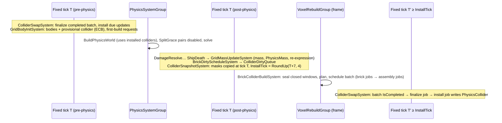

# SPEC-12 — Voxel physics, colliders and mass

| | |
|---|---|
| **Status** | Draft |
| **Area code** | PHY (task IDs are `PHY-001`, `PHY-002`, …) |
| **Module(s)** | `Game.Voxel` (folder `Assets/Game/Voxel/PhysicsBody/`, namespace `Game.Voxel.PhysicsBody`); definitions in `Game.Data` (`Assets/Game/Data/Definitions/Voxel/`) |
| **Depends on specs** | SPEC-02 (`SimClock`, `GameplayActive`, groups, `GameplayEndCommandBufferSystem`, `GameLog.Burst`); SPEC-04 (`BlockDefsRef`, `BlockDef.CellMass`, `ContentDefinition`, `ContentCatalog`); SPEC-10 (`VoxelGrid`, `Brick`, `BrickSlot`, `BrickCells`, `BrickSparseCells`, `BrickSolidMask`, `BrickMaskBits`, `PaletteEntry`, `BlockInstance`, `GridBodyInit`, `GridRebuilt`, `GridSpawning`, `GridSource`, `GridMotion`, `GridSpawnFlags`, `StructureMassData`, `MassAccumulator`, `DeferredDisposalQueue`, `DeferredDisposal`, `VoxelSingletons`); SPEC-13 contract types (`CellRemoved`, `CellRemovedReason`, `DamageStreams`, `SplitGrace`); SPEC-71 (`EcsTestWorld`, perf harness) |
| **Depended on by** | SPEC-10 (queue/cache singletons, `GridMass`, `GridMassRecompute`, `GridColliderState` on roots); SPEC-13 (`PhysicsLayers.ChunkBody`/`ChunkMaterial`, `GridBodyFactory` for hulks, mass from `CellRemoved`, `SplitGrace` honoured); SPEC-20 (body components, planar inertia, damping); SPEC-21 (query filters, conservative-collider contract); SPEC-22 (`PhysicsMass` for `ShipStats`); SPEC-31 (`Celestial`/`Sensor` filters and materials, `InteractionQuery`, `SpawnClearanceQuery`); SPEC-62 (`CameraOcclusionQuery`); SPEC-70 (stats, collider overlay); SPEC-71 (voxel gate suite); SPEC-01 (`PhysicsVoxelConfig` and `PhysicsStep` boot singletons) |
| **Milestone** | M1 (PHY-014 in M2, PHY-021 in M4) |

> Read [01-architecture.md](../01-architecture.md) (§5, §5.1, §8, §11), [02-conventions.md](../02-conventions.md) (§2.5, §2.12, §2.15–§2.19), [03-glossary.md](../03-glossary.md), [07-implementation-traps.md](../07-implementation-traps.md) §2 and §4, and [SPEC-10](SPEC-10-voxel-data-model.md) before this spec. This spec may not contradict them.

## 1. Purpose

This spec makes voxel grids physical bodies in Unity Physics. Every grid root carries one rigid body whose collider is a **two-level compound**: one cached collider blob per brick (merged boxes over the brick's solid mask) and a grid compound assembled from those cached blobs. When cells change, only the dirty bricks are rebuilt and the grid compound is re-assembled from cached children by budgeted Burst jobs that never touch live ECS memory. Mass, centre of mass and inertia come from the cells (exact per-block cell masses), are updated incrementally from `CellRemoved` events, and keep the body's motion continuous when its centre of mass moves. Collider installation happens at deterministic ticks, so the same inputs give the same physics at 30, 60 and 144 FPS. This spec also owns `PhysicsLayers`, the only place collision filters and grid materials are defined, the `PhysicsStep` settings (zero gravity) and contact suppression between freshly split pieces. The old prototype rebuilt a full-ship compound on every change (0.5–1.5 s per rebuild, 01 §5.3), sized hitboxes from meshes and lost momentum on splits (02-C11); none of that is possible here.

## 2. Scope

**In scope:**
- `PhysicsLayers`: category bits, body filters, query filters, physics materials.
- Grid body creation (`GridBodyInitSystem`): provisional collider, body components for Dynamic/Kinematic/Static grids, first full collider build; `GridBodyFactory` for other creators (SPEC-13 hulks).
- Brick collider build: greedy box merging with conservative coarsening, brick blobs, grid compound assembly, the collider request queue, snapshots, batching, deterministic install ticks, `ColliderSwapSystem`, cleanup and deferred disposal of every blob this spec creates.
- Mass: `GridMass` accumulators, full recompute, incremental removal from `CellRemoved`, `PhysicsMass` (centre of mass, principal inertia, planar inertia), velocity re-expression when the centre of mass or inertia frame moves (`GridMassUpdateSystem`).
- `SplitGrace` contact suppression (`SplitGraceContactSystem`).
- `PhysicsVoxelConfig` + definition, the `PhysicsStep` singleton values.
- Statistics, debug box extraction for the harness overlay, physics scenario tests, determinism and performance tests for this spec's gates.

**Out of scope (and who owns it instead):**
- Which cells exist and when they change: SPEC-10 (spawn, edit, rebuild) and SPEC-13 (damage, splits). Chunk-body colliders: SPEC-13 (uses `PhysicsLayers.ChunkBody` and `ChunkMaterial`).
- Thrust, flight assist, `PlanarConstraint` and its system: SPEC-20. Ram damage from collision events: SPEC-13 (`ImpactEventSystem`). Projectile, beam and explosion queries: SPEC-21.
- Colliders of celestial bodies, stations on rails and sensor volumes: SPEC-31 (with this spec's filters and materials).
- Render meshes and `Dormant`: SPEC-11. The camera's occlusion cast: SPEC-62.
- Integrated voxel memory/spawn gates across SPEC-10/11/12: the gate suite task (SPEC-71); this spec reports its own numbers into it.

## 3. Decisions (binding)

1. **One rigid body per grid, on the root entity.** Bricks and functional entities have no physics components. The root's `LocalTransform` (scale 1) is the body transform; collider geometry is in grid-local metres. Reason: architecture §6.3; Unity Physics bodies cannot be children.
2. **Colliders are two-level compounds (architecture §11.8).** A brick blob is either one `BoxCollider` or a `CompoundCollider` of `BoxCollider`s in brick-local metres. The grid collider is a `CompoundCollider` whose children are the cached brick blobs, each placed at `Coord·16·CellSize`. A changed brick rebuilds only its own blob; the grid compound is re-assembled from cached children. Nothing rebuilds every brick of a grid because one cell changed. Reason: 06 gate "rebuild one brick collider ≤ 150 µs".
3. **Colliders are conservative.** Every solid cell is inside the collider; wedges and every non-air cell (functional, prop) count as full cubes (SPEC-04 allows it). A brick whose exact box cover exceeds `MaxBoxesPerBrick` (64) is covered with 2-cell, then 4-cell super-cells, then its solid bounding box (§5.2): the collider may include air, never exclude a solid cell. Reason: bounded memory; projectile and query consumers confirm hits against cells (decision 4).
4. **Colliders may lag cells; cells are the truth.** Between a cell change and the matching collider install there are `InstallDelayTicks..InstallDelayTicks + InstallBucketTicks − 1` ticks (7–10 by default) in which the collider still contains removed cells. Any simulation code that needs exact cells (projectiles, beams, explosions, interaction) uses colliders only as a conservative broad phase and confirms against cells with `VoxelRaycast`/`GridCellReader` (SPEC-10), continuing past "false hits" on air. Reason: determinism (decision 6) and budgets (decision 7).
5. **Jobs that build colliders read only snapshots and immutable blobs.** The brick solid mask (512 B) is copied at the request tick by `ColliderSnapshotSystem`; batch jobs read batch-owned copies of masks and child lists and the immutable cached blobs. They never touch ECS memory and are never completed inside the fixed step except through `JobHandle.IsCompleted == true` (architecture §5.1, traps T2.2/T2.3).
6. **Collider install ticks are deterministic for simulation-driven changes.** A request caused by damage or a split at tick `T` installs at exactly `InstallTick = RoundUp(T + InstallDelayTicks, InstallBucketTicks)`, together with every other request of the same grid that maps to the same `InstallTick`, using mask snapshots taken at their own request ticks. If the build is not ready by then it installs as soon as it is ready and counts one `LateInstalls` (the determinism test asserts zero). Spawn, rebuild and edit requests (already frame-driven in SPEC-10) install as soon as they are built (`InstallTick = 0`). Reason: the 06 determinism gate (30/60/144 FPS) would otherwise depend on job timing; `InstallDelayTicks = 7` exceeds the 6-tick catch-up cap (architecture §5.1), so a frame boundary always separates request and install.
7. **Budgets.** At most one collider batch is in flight. Urgent work (priority `Damage` and `Split`) is never deferred by the item budget; other work (`Edit`, `Spawn`) is limited to `MaxBricksPerBatch` (256) bricks and `MaxAssembliesPerBatch` (32) grid assemblies per batch, oldest first. A batch older than `MaxBatchAgeFrames` (2) frames is completed by the next non-fixed-step system that sees it. Reason: architecture §11.2.
8. **Per-grid order.** A grid's updates are built and installed strictly in creation order. A newer update is never built before every older update of the same grid is built, and installing an update discards every older built update of that grid. Reason: each update's compound must contain the bricks of all older updates.
9. **Blob ownership.** `ColliderBuildCache` owns every collider blob this spec creates (brick blobs, assembled compounds, provisional boxes, and provisional boxes adopted from `GridBodyFactory` callers) until it hands the blob to `DeferredDisposalQueue` through `DeferredDisposal.RetireBlob` (release ≥ 3 frames later). `PhysicsCollider` never owns a blob. Nothing calls `Dispose()` on a collider blob directly except `ColliderBuildCache.Dispose()` at world teardown. Reason: traps T4.2.
10. **Single writers.** `PhysicsCollider` of a grid root: `ColliderSwapSystem` (creation of the component with a provisional collider by `GridBodyInitSystem` or a `GridBodyFactory` caller is not a write). `PhysicsMass`: `GridMassUpdateSystem` (creation as above). `PhysicsVelocity`: as architecture §8, plus `GridMassUpdateSystem` for the exact re-expression of decision 12 only. `GridMass`: `GridMassUpdateSystem` (plus an optional prefill by `GridSpawnSystem` at conversion). `GridColliderState`: `GridBodyInitSystem` at body creation, the install job of `ColliderSwapSystem` afterwards. Reason: architecture §8; open question 2 records the §8 row update.
11. **Mass is exact and incremental.** `GridMass` holds double-precision accumulators (`StructureMassData`, SPEC-10 §4.3) of the cells currently in the grid. Removal subtracts each removed cell's exact contribution (O(removed cells)); a full recompute (O(cells), parallel over bricks) runs only when `GridMassRecompute` is enabled (body creation without prefill, rebuild, hulk creation). Cell mass = `BlockDef.CellMass` of the cell's block. Reason: architecture §11.1; deterministic, no drift from floats.
12. **Mass changes keep the body's motion.** When `PhysicsMass` changes, `PhysicsVelocity` is re-expressed so every point of the body keeps its world velocity: `Linear += ω × Δc` and `Angular` is rotated from the old inertia frame to the new one (`PhysicsVelocity.Angular` is expressed in the inertia frame in Unity Physics). No momentum is added or removed. Reason: a ship that loses a wing must not jump or change spin (02-C11).
13. **Planar grids lock rotation in the mass, not with joints.** Grids spawned with `GridSpawnFlags.PlanarInertia` get `InertiaOrientation = identity` and `InverseInertia = (0, 1/Iyy, 0)`; SPEC-20's `PlanarConstraintSystem` keeps `Y = 0`. Reason: ADR-0003; one component can remove the lock later.
14. **Zero gravity, one physics world.** `PhysicsStep.Gravity = 0`; every body is in world index 0 (`PhysicsWorldIndex(0)`, a shared component with one value, allowed by architecture §11.4). `SynchronizeCollisionWorld = 1` so post-physics queries see end-of-step positions. Reason: space; queries in `GameplayPostPhysicsGroup` hit where things are drawn.
15. **Provisional colliders do not push.** The provisional collider (one box over the grid's cell bounds) uses `ProvisionalMaterial` (`CollisionResponsePolicy.None`): queries hit it, contacts ignore it. Reason: a large hollow station loading around a docked player must not shove it out.
16. **Grid collision events are on.** `GridMaterial` is `CollideRaiseCollisionEvents` so SPEC-13's `ImpactEventSystem` receives rams (traps T4.4).
17. **Handle-guarded singletons.** The three pipeline singletons (`ColliderDirtyQueue`, `ColliderBuildCache`, `ColliderBatchQueue`) are read with `SystemAPI.GetSingleton<T>()` (read-only) and their struct is never written after `Create()`; all mutable state is inside native containers, ordered by the stored `Access` handle (§5.1), never by ECS component dependencies. Reason: `GetSingletonRW` from a fixed-step system would complete other systems' jobs (a sync point, traps T2.2).
18. **Folder and namespace:** every type of this spec is in `Assets/Game/Voxel/PhysicsBody/` (namespace `Game.Voxel.PhysicsBody`), jobs in `PhysicsBody/Jobs/` (same namespace), the definition in `Assets/Game/Data/Definitions/Voxel/` (`Game.Data.Definitions`). Reason: SPEC-10 decision 17.
19. **Profiler markers** `<SystemName>.<Step>` on every main-thread step named in bold in §5; jobs are profiled by name.

## 4. Data model

All types are **public contract** unless marked *internal*. Each file holds one type and starts with `/// <summary>Implements SPEC-12 §4.x.</summary>`.

### 4.1 Folders

| Folder | Namespace | Contents |
|---|---|---|
| `Assets/Game/Voxel/PhysicsBody/` | `Game.Voxel.PhysicsBody` | §4.2–§4.7 types, systems |
| `Assets/Game/Voxel/PhysicsBody/Jobs/` | `Game.Voxel.PhysicsBody` | Burst jobs (*internal*) |
| `Assets/Game/Data/Definitions/Voxel/` | `Game.Data.Definitions` | `PhysicsVoxelConfigDefinition` |
| `Assets/Game/Tests/EditMode/Voxel/Physics/` | `Game.Tests.EditMode.Voxel.Physics` | EditMode tests |
| `Assets/Game/Tests/PlayMode/Voxel/Physics/` | `Game.Tests.PlayMode.Voxel.Physics` | scenarios, determinism, performance |

### 4.2 `PhysicsLayers` (exact code)

```csharp
namespace Game.Voxel.PhysicsBody
{
    using Unity.Physics;

    /// <summary>The only place collision filters and grid physics materials are defined (architecture §6.3, traps T4.5).
    /// Every member is a constant or an expression-bodied property (Burst-compatible, no static state). Implements SPEC-12 §4.2.</summary>
    public static class PhysicsLayers
    {
        // ---- Category bits (BelongsTo). Never renumber. New bits only through SPEC-12 open questions (bits 5..30 free). ----
        public const uint GridBit          = 1u << 0;   // every voxel grid: ship, station, asteroid, hulk
        public const uint ChunkBodyBit     = 1u << 1;   // pooled chunk bodies (SPEC-13)
        public const uint CelestialBit     = 1u << 2;   // non-voxel bodies with colliders: stars, planets, moons, gates (SPEC-31)
        public const uint SensorBit        = 1u << 3;   // trigger volumes: interaction and docking zones (SPEC-31)
        public const uint EditorPreviewBit = 1u << 4;   // grids spawned with GridSpawnFlags.EditorPreview: queries only, no contacts
        public const uint QueryBit         = 1u << 31;  // BelongsTo of every query filter
        public const uint AllBodyBits      = GridBit | ChunkBodyBit | CelestialBit | SensorBit | EditorPreviewBit;

        // ---- Body filters (on colliders) ----
        public static CollisionFilter Grid          => Make(GridBit,          GridBit | ChunkBodyBit | CelestialBit | SensorBit | QueryBit);
        public static CollisionFilter ChunkBody     => Make(ChunkBodyBit,     GridBit | ChunkBodyBit | CelestialBit | QueryBit);
        public static CollisionFilter Celestial     => Make(CelestialBit,     GridBit | ChunkBodyBit | QueryBit);
        public static CollisionFilter Sensor        => Make(SensorBit,        GridBit | QueryBit);
        public static CollisionFilter EditorPreview => Make(EditorPreviewBit, QueryBit);

        // ---- Query filters (CastRay, CastCollider, OverlapAabb, CalculateDistance) ----
        public static CollisionFilter ProjectileQuery      => Make(QueryBit, GridBit | CelestialBit);
        public static CollisionFilter BeamQuery            => Make(QueryBit, GridBit | CelestialBit);
        public static CollisionFilter ExplosionQuery       => Make(QueryBit, GridBit);
        public static CollisionFilter CameraOcclusionQuery => Make(QueryBit, GridBit);
        public static CollisionFilter PickingQuery         => Make(QueryBit, GridBit | CelestialBit);
        public static CollisionFilter InteractionQuery     => Make(QueryBit, GridBit | CelestialBit | SensorBit);
        public static CollisionFilter SpawnClearanceQuery  => Make(QueryBit, GridBit | ChunkBodyBit | CelestialBit);
        public static CollisionFilter EditorPickQuery      => Make(QueryBit, GridBit | EditorPreviewBit);
        public static CollisionFilter DebugAllQuery        => Make(QueryBit, AllBodyBits);

        // ---- Materials ----
        public static Material GridMaterial          => MakeMaterial(0.4f, 0.1f, CollisionResponsePolicy.CollideRaiseCollisionEvents);
        public static Material ProvisionalMaterial   => MakeMaterial(0.4f, 0.1f, CollisionResponsePolicy.None);
        public static Material ChunkMaterial         => MakeMaterial(0.3f, 0.1f, CollisionResponsePolicy.CollideRaiseCollisionEvents);
        public static Material CelestialMaterial     => MakeMaterial(0.5f, 0.0f, CollisionResponsePolicy.CollideRaiseCollisionEvents);
        public static Material SensorMaterial        => MakeMaterial(0.0f, 0.0f, CollisionResponsePolicy.RaiseTriggerEvents);
        public static Material EditorPreviewMaterial => MakeMaterial(0.4f, 0.1f, CollisionResponsePolicy.None);

        /// <summary>Tests and debug only.</summary>
        public static bool CanCollide(in CollisionFilter a, in CollisionFilter b) => CollisionFilter.IsCollisionEnabled(a, b);

        static CollisionFilter Make(uint belongsTo, uint collidesWith) =>
            new CollisionFilter { BelongsTo = belongsTo, CollidesWith = collidesWith, GroupIndex = 0 };

        static Material MakeMaterial(float friction, float restitution, CollisionResponsePolicy response)
        {
            var m = Material.Default;
            m.Friction = friction;
            m.Restitution = restitution;
            m.FrictionCombinePolicy = Material.CombinePolicy.GeometricMean;
            m.RestitutionCombinePolicy = Material.CombinePolicy.Maximum;
            m.CollisionResponse = response;
            return m;
        }
    }
}
```

Interaction matrix (✓ = contacts or trigger events; derived from the filters, asserted by PHY-001's test):

| | Grid | ChunkBody | Celestial | Sensor | EditorPreview |
|---|---|---|---|---|---|
| **Grid** | ✓ | ✓ | ✓ | ✓ (trigger) | — |
| **ChunkBody** | ✓ | ✓ | ✓ | — | — |
| **Celestial** | ✓ | ✓ | — | — | — |
| **Sensor** | ✓ | — | — | — | — |
| **EditorPreview** | — | — | — | — | — |

Query hits: Projectile/Beam → Grid, Celestial. Explosion, CameraOcclusion → Grid. Picking → Grid, Celestial. Interaction → Grid, Celestial, Sensor. SpawnClearance → Grid, ChunkBody, Celestial. EditorPick → Grid, EditorPreview. No gameplay query filter hits ChunkBody except SpawnClearance (chunks are not damageable, SPEC-13 open question 13). DebugAllQuery deliberately hits every body category, including chunks (Q10).

### 4.3 Components on grid roots (`PhysicsBody/`)

SPEC-10 adds `GridMass`, `GridMassRecompute` (enabled) and `GridColliderState` to every root archetype at conversion; SPEC-13 includes them in `GridArchetypes.Root`.

```csharp
namespace Game.Voxel.PhysicsBody
{
    using Unity.Entities;
    using Game.Voxel.Model;

    /// <summary>Exact mass accumulators of the cells currently in the grid, grid-local metres (SPEC-10 §4.3).
    /// Data.CellCount == 0 means "not known yet". Writers: GridSpawnSystem (optional prefill at conversion), then GridMassUpdateSystem.</summary>
    public struct GridMass : IComponentData
    {
        public StructureMassData Data;
        public uint Version;          // +1 on every change of Data
    }

    /// <summary>Enabled: GridMassUpdateSystem recomputes GridMass from cells in this tick (O(cells), parallel over bricks).
    /// Enabled when added. Disabled by GridMassUpdateSystem after the recompute, or by GridSpawnSystem after a prefill.</summary>
    public struct GridMassRecompute : IComponentData, IEnableableComponent { }

    public enum GridColliderPhase : byte
    {
        None = 0,          // no body yet (spawning, or body creation waiting for mass)
        Provisional = 1,   // body exists; provisional box installed (or the previous compound during a rebuild); first full build pending
        Ready = 2,         // a full compound built from the bricks is installed
    }

    /// <summary>Body/collider status of a grid. Writers: GridBodyInitSystem (Phase None → Provisional, Motion, IsEditorPreview),
    /// then ColliderSwapSystem's install job (Phase → Ready, InstalledTick, ChildCount, BoxCount).</summary>
    public struct GridColliderState : IComponentData
    {
        public GridColliderPhase Phase;
        public GridMotion Motion;        // SPEC-10 GridMotion, copied from GridBodyInit at body creation
        public byte IsEditorPreview;     // 1 if GridSource.Flags has EditorPreview
        public byte Reserved;
        public uint InstalledTick;       // SimClock.Tick of the last install (body creation counts)
        public int ChildCount;           // bricks in the installed compound; 0 while Provisional
        public int BoxCount;             // boxes in the installed collider; 1 while the provisional box is installed
    }
}
```

### 4.4 Pipeline singletons (`PhysicsBody/`)

`VoxelSingletons.CreateAll` (SPEC-10, inside `GridSpawnSystem.OnCreate`) adds the three singletons below to its singleton entity with `Create()`; `VoxelSingletons.DisposeAll` calls `Dispose()` in the order batch, cache, queue.

```csharp
namespace Game.Voxel.PhysicsBody
{
    using Unity.Collections; using Unity.Entities; using Unity.Jobs; using Unity.Mathematics;

    public enum ColliderPriority : byte
    {
        Damage = 0,   // cell changes from SPEC-13 (BrickDirtyScheduleSystem). Urgent; deterministic install tick
        Split = 1,    // first build of a grid created by SplitSystem (body existed before GridBodyInitSystem saw it). Urgent; deterministic
        Edit = 2,     // EditorPreview grid edits (SPEC-10 §5.9). Budgeted; install when built
        Spawn = 3,    // first build after spawn or rebuild. Budgeted; install when built
    }

    public struct ColliderRequest                      // 36 bytes
    {
        public Entity Grid;
        public Entity Brick;                           // may be destroyed by the time it is processed (→ "removed")
        public int3 Coord;                             // brick coordinate
        public uint Serial;                            // VoxelGrid.Serial of Grid
        public ColliderPriority Priority;
    }

    /// <summary>Singleton. Producers append; ColliderSnapshotSystem drains every tick. Access rules: §5.1. Implements SPEC-12 §4.4.</summary>
    public struct ColliderDirtyQueue : IComponentData
    {
        public NativeList<ColliderRequest> Requests;
        public Game.Data.Streams.GuardedHandles Access;   // main thread only; never passed to a job (SPEC-02 §4.12)

        public static ColliderDirtyQueue Create();     // Requests capacity 1,024; Access = GuardedHandles.Create(); Allocator.Persistent
        public void Dispose();                         // Access.Dispose() (completes), then dispose the list
        public JobHandle Acquire(JobHandle dependsOn) => Access.Acquire(dependsOn);
        public void Release(JobHandle lastJob) => Access.Release(lastJob);   // lastJob must depend on the handle returned by Acquire
        public void CompleteAccess() => Access.CompleteAccess();             // never inside FixedStepSimulationSystemGroup
        /// <summary>Appends one request. Inside a job scheduled with Acquire/Release, or on the main thread after CompleteAccess.</summary>
        public void Enqueue(uint serial, Entity grid, Entity brick, int3 coord, ColliderPriority priority)
            => Requests.Add(new ColliderRequest { Serial = serial, Grid = grid, Brick = brick, Coord = coord, Priority = priority });
    }

    /// <summary>Singleton owning grid records, pending updates, mask snapshots and every collider blob of this spec (decision 9).</summary>
    public struct ColliderBuildCache : IComponentData
    {
        public Game.Data.Streams.GuardedHandles Access;   // main thread only (SPEC-02 §4.12)
        internal ColliderCacheContainers C;            // §4.7 (internal)
        public static ColliderBuildCache Create();     // capacities in §4.7; Access = GuardedHandles.Create()
        public void Dispose();                         // Access.Dispose() (completes); disposes every owned blob (installed, children, pending, retired) and container
        public JobHandle Acquire(JobHandle dependsOn) => Access.Acquire(dependsOn);
        public void Release(JobHandle lastJob) => Access.Release(lastJob);
        public void CompleteAccess() => Access.CompleteAccess();
    }

    /// <summary>Singleton holding the one in-flight build batch (§5.8). Main-thread state + batch-owned job memory.</summary>
    public struct ColliderBatchQueue : IComponentData
    {
        internal NativeReference<ColliderBatchState> State;   // main thread only
        internal ColliderBatchContainers B;                   // §4.7 (internal)
        public static ColliderBatchQueue Create();             // capacities in §4.7
        public void Dispose();                                 // completes State.Value.Handle; disposes result blobs not yet handed over; disposes containers
    }
}
```

### 4.5 Configuration

```csharp
namespace Game.Voxel.PhysicsBody
{
    /// <summary>Singleton created at boot by SPEC-01 (BootSingletons) from config_physics. Implements SPEC-12 §4.5.</summary>
    public struct PhysicsVoxelConfig : Unity.Entities.IComponentData
    {
        public int InstallDelayTicks;      // 7; must be > 6 (catch-up cap, architecture §5.1)
        public int InstallBucketTicks;     // 4; 1..8
        public int MaxBricksPerBatch;      // 256; non-urgent bricks per batch
        public int MaxAssembliesPerBatch;  // 32; non-urgent grid compounds per batch
        public int MaxBoxesPerBrick;       // 64; 1..4096
        public int MaxBatchAgeFrames;      // 2; 1..2 (must stay below DeferredDisposal's 3-frame delay)
        public float BevelFraction;        // 0.05; box bevel radius = BevelFraction × CellSize; 0..0.25
        public float GridLinearDamping;    // 0.0
        public float GridAngularDamping;   // 0.05
        public static PhysicsVoxelConfig Default => new PhysicsVoxelConfig {
            InstallDelayTicks = 7, InstallBucketTicks = 4, MaxBricksPerBatch = 256, MaxAssembliesPerBatch = 32,
            MaxBoxesPerBrick = 64, MaxBatchAgeFrames = 2, BevelFraction = 0.05f, GridLinearDamping = 0f, GridAngularDamping = 0.05f };
    }

    public static class PhysicsVoxelConfigFactory
    {
        public static PhysicsVoxelConfig Create(Game.Data.Definitions.PhysicsVoxelConfigDefinition def);   // copies the fields
        public static Unity.Physics.PhysicsStep CreatePhysicsStep(Game.Data.Definitions.PhysicsVoxelConfigDefinition def); // §5.13
    }
}

namespace Game.Data.Definitions
{
    [ContentIdPrefix("config_")]
    [UnityEngine.CreateAssetMenu(menuName = "Game/Content/Physics Config", fileName = "config_physics")]
    public sealed class PhysicsVoxelConfigDefinition : ContentDefinition      // single instance: config_physics
    {
        [UnityEngine.SerializeField, UnityEngine.Range(7, 30)] private int installDelayTicks = 7;
        [UnityEngine.SerializeField, UnityEngine.Range(1, 8)] private int installBucketTicks = 4;
        [UnityEngine.SerializeField, UnityEngine.Range(16, 4096)] private int maxBricksPerBatch = 256;
        [UnityEngine.SerializeField, UnityEngine.Range(1, 256)] private int maxAssembliesPerBatch = 32;
        [UnityEngine.SerializeField, UnityEngine.Range(1, 4096)] private int maxBoxesPerBrick = 64;
        [UnityEngine.SerializeField, UnityEngine.Range(1, 2)] private int maxBatchAgeFrames = 2;
        [UnityEngine.SerializeField, UnityEngine.Range(0f, 0.25f)] private float bevelFraction = 0.05f;
        [UnityEngine.SerializeField, UnityEngine.Min(0f)] private float gridLinearDamping = 0f;
        [UnityEngine.SerializeField, UnityEngine.Min(0f)] private float gridAngularDamping = 0.05f;
        [UnityEngine.SerializeField, UnityEngine.Range(2, 8)] private int solverIterations = 4;
        // public getters with the same names in PascalCase
        public override void Validate(ValidationScope scope, ContentValidationContext context);   // PHY-E001..E002 (§7)
    }
}
```

### 4.6 Helpers (public contract, Burst-compatible unless stated)

```csharp
namespace Game.Voxel.PhysicsBody
{
    using Unity.Collections; using Unity.Entities; using Unity.Mathematics; using Unity.Physics;
    using Game.Voxel.Model;

    /// <summary>One box of a brick cover, inclusive brick-local cell coordinates 0..15.</summary>
    public struct BrickBox { public byte MinX, MinY, MinZ, MaxX, MaxY, MaxZ; }

    /// <summary>Box covers of a brick solid mask. Implements SPEC-12 §5.2.</summary>
    public static class BrickBoxMerger
    {
        /// Exact, disjoint cover of the solid cells. Output cleared first. Returns the box count.
        public static int MergeExact(in BrickMaskBits mask, ref NativeList<BrickBox> output);
        /// Conservative cover on super-cells of edge superCell ∈ {2, 4}; a super-cell is solid if any of its cells is.
        public static int MergeCoarse(in BrickMaskBits mask, int superCell, ref NativeList<BrickBox> output);
        /// Level 0 exact, 1 = super-cell 2, 2 = super-cell 4, 3 = one box over the solid bounds; the first level with ≤ maxBoxes boxes.
        /// Returns the level used. An empty mask returns 0 with no boxes.
        public static int Merge(in BrickMaskBits mask, int maxBoxes, ref NativeList<BrickBox> output);
    }

    /// <summary>Brick blob construction. Implements SPEC-12 §5.3. Allocates Allocator.Persistent blobs; caller owns the result.</summary>
    public static class BrickColliderBuilder
    {
        /// Null for an empty mask. One box → a BoxCollider blob; more → a CompoundCollider of boxes (child blobs disposed).
        public static BlobAssetReference<Collider> Build(in BrickMaskBits mask, float cellSize, int maxBoxes, float bevelFraction,
                                                         CollisionFilter filter, Material material,
                                                         ref NativeList<BrickBox> scratch, out int boxCount);
    }

    /// <summary>A cached brick blob in a grid record (sorted by Coord in (z, y, x) order).</summary>
    public struct BrickChild { public int3 Coord; public BlobAssetReference<Collider> Blob; public int BoxCount; }

    /// <summary>Grid compound assembly. Implements SPEC-12 §5.4.</summary>
    public static class GridColliderAssembler
    {
        /// children must be sorted by (Coord.z, Coord.y, Coord.x) and non-empty; returns a new Persistent CompoundCollider blob.
        public static BlobAssetReference<Collider> Assemble(NativeArray<BrickChild> children, float cellSize);
        public static int CompareCoords(int3 a, int3 b);   // z, then y, then x; -1/0/1
    }

    /// <summary>Install-tick rule of decision 6. Implements SPEC-12 §5.5.</summary>
    public static class ColliderInstallSchedule
    {
        public static bool IsUrgent(ColliderPriority p) => p <= ColliderPriority.Split;
        /// Urgent: RoundUp(requestTick + delay, bucket); otherwise 0 (= install when built).
        public static uint InstallTick(ColliderPriority p, uint requestTick, int delay, int bucket);
        /// True when no request made at a tick ≥ currentTick can map to installTick (the update may be sealed).
        public static bool IsWindowClosed(uint installTick, uint currentTick, int delay);   // installTick == 0 || currentTick > installTick - delay
        public static uint RoundUp(uint value, uint multiple);                              // ((value + multiple − 1) / multiple) × multiple
    }

    /// <summary>Mass properties from cell accumulators. Implements SPEC-12 §5.11.</summary>
    public static class GridMassMath
    {
        /// False if d.CellCount == 0 or d.Mass <= 0. com in grid-local metres; inertia about com.
        public static bool TryGetMassProperties(in StructureMassData d, bool planar,
                                                out float mass, out float3 centerOfMass, out quaternion inertiaOrientation, out float3 inertiaDiagonal);
        public static PhysicsMass CreateDynamicMass(in StructureMassData d, int3 cellMin, int3 cellMax, float cellSize, bool planar); // requires CellCount > 0
        public static PhysicsMass CreateKinematicMass(in StructureMassData d);   // InverseMass 0, InverseInertia 0; Transform from d, identity if empty
        public static float AngularExpansion(float3 centerOfMass, int3 cellMin, int3 cellMax, float cellSize);
        /// Keeps every body point's world velocity when the mass frame changes (decision 12).
        public static void Reexpress(ref PhysicsVelocity v, in PhysicsMass oldMass, in PhysicsMass newMass, quaternion bodyRotation, bool planar);
        /// Deterministic cyclic Jacobi; values ascending; vectors are the columns, right-handed. §5.11 step 4.
        public static void JacobiEigen(double3x3 symmetric, out double3 values, out double3x3 vectors);
    }

    /// <summary>Body creation helpers for GridBodyInitSystem and other creators of grid roots (SPEC-13 hulks). Implements SPEC-12 §5.6.</summary>
    public static class GridBodyFactory
    {
        public static ComponentTypeSet DynamicBodyTypes();    // PhysicsCollider, PhysicsVelocity, PhysicsMass, PhysicsDamping, PhysicsGraphicalSmoothing, PhysicsGraphicalInterpolationBuffer
        public static ComponentTypeSet KinematicBodyTypes();  // PhysicsCollider, PhysicsVelocity, PhysicsMass, PhysicsGraphicalSmoothing, PhysicsGraphicalInterpolationBuffer
        public static ComponentTypeSet StaticBodyTypes();     // PhysicsCollider
        public static PhysicsWorldIndex WorldIndex() => new PhysicsWorldIndex(0);   // add with AddSharedComponent
        /// One box over cells cellMin..cellMax (inclusive), grid-local metres, BevelRadius 0, ProvisionalMaterial (EditorPreviewMaterial when editorPreview),
        /// filter Grid (EditorPreview when editorPreview). The caller owns the blob until a grid record adopts it (§5.6 step 3).
        public static BlobAssetReference<Collider> CreateProvisionalCollider(int3 cellMin, int3 cellMax, float cellSize, bool editorPreview);
        public static PhysicsDamping DefaultDamping(in PhysicsVoxelConfig c) => new PhysicsDamping { Linear = c.GridLinearDamping, Angular = c.GridAngularDamping };
    }

    /// <summary>Pipeline counters and memory. Implements SPEC-12 §5.14.</summary>
    public struct ColliderPipelineStats
    {
        public int Grids, CachedBricks, CachedBoxes, PendingUpdates, PendingBricks;
        public long CachedBrickBytes, InstalledBytes, PendingCompoundBytes, RetiredPendingBytes;
        public int LastBatchBricks, LastBatchAssemblies, LastBatchUrgentBricks;
        public int Installs, LateInstalls, DroppedRequests, Batches, ForcedBatchCompletes;   // cumulative since the cache was created or ResetCounters
    }

    public static class GridColliderStats
    {
        /// Main thread, outside the fixed step: completes the cache Access handle, returns a copy.
        public static ColliderPipelineStats Gather(EntityManager em);
        public static void ResetCounters(EntityManager em);   // tests and harness
    }

    /// <summary>Grid-local box of the installed collider, for the harness overlay (SPEC-70).</summary>
    public struct ColliderDebugBox { public float3 Min, Max; public byte Provisional; }

    public static class ColliderDebug
    {
        /// Main thread, debug only (unsafe walk of the installed blob). Appends one entry per box leaf; returns the count; 0 if the root has no collider.
        public static int CollectBoxes(EntityManager em, Entity root, NativeList<ColliderDebugBox> output);
    }
}
```

### 4.7 Internal pipeline data (*internal*; names may change, invariants may not)

```csharp
namespace Game.Voxel.PhysicsBody
{
    internal enum UpdateState : byte { Free = 0, Collecting = 1, Pending = 2, Building = 3, Built = 4, Discarded = 5 }

    internal struct UpdateBrick { public int3 Coord; public int MaskSlot; }            // MaskSlot -1 = brick removed

    internal struct ColliderUpdate
    {
        public UpdateState State;
        public ColliderPriority Priority;      // most urgent (lowest value) of its requests
        public byte LateCounted;               // 1 after LateInstalls was incremented for it
        public byte Reserved;
        public uint Serial, Seq, CreateOrder;  // Seq: per grid, creation order; CreateOrder: global creation order
        public uint RequestTick;               // tick of its first request
        public uint InstallTick;               // 0 = install when built
        public UnsafeList<UpdateBrick> Bricks; // one entry per coord (newest snapshot wins)
        public int BricksScheduled;            // prefix of Bricks already handed to batches
        public BlobAssetReference<Collider> Compound;   // valid when Built
        public int ChildCount, BoxCount;
    }

    internal struct GridColliderRecord
    {
        public Entity Root; public uint Serial; public float CellSize;
        public GridMotion Motion; public byte IsEditorPreview;
        public UnsafeList<BrickChild> Children;          // latest built blob per brick, sorted (z, y, x)
        public UnsafeList<int> Updates;                  // indices into Updates, not yet installed, Seq order
        public BlobAssetReference<Collider> Installed;   // what PhysicsCollider currently points at
        public uint NextSeq;
    }

    internal struct ColliderCacheContainers
    {
        public NativeHashMap<uint, int> GridIndex;                 // Serial → index in Grids (capacity 256)
        public NativeList<GridColliderRecord> Grids;               // swap-back removal; GridIndex fixed up
        public NativeList<ColliderUpdate> Updates;                 // pool (capacity 256); State Free = unused
        public NativeList<int> FreeUpdates;
        public NativeHashMap<ulong, int> Collecting;               // (Serial << 32 | InstallTick) → update index while Collecting
        public NativeHashMap<CollectKey, int> CollectingBricks;    // (update index, Coord) → index in that update's Bricks
        public NativeList<BrickMaskBits> Masks;                    // snapshot pool (capacity 256 = 128 KB)
        public NativeList<int> FreeMasks;
        public NativeList<BlobAssetReference<Collider>> Retired;   // blobs for DeferredDisposalQueue (moved on the main thread, §5.10)
        public NativeReference<ColliderPipelineStats> Stats;
        public NativeReference<uint> NextCreateOrder;
    }
    internal struct CollectKey : System.IEquatable<CollectKey> { public int Update; public int3 Coord; /* Equals + GetHashCode (in-memory only) */ }

    internal struct ColliderBatchState { public Unity.Jobs.JobHandle Handle; public byte InFlight; public uint ScheduledFrame; }

    internal struct BrickBuildItem { public int Update; public uint Serial; public int3 Coord; public float CellSize; public byte Removed; public byte EditorPreview; }
    internal struct BrickBuildResult { public BlobAssetReference<Collider> Blob; public int BoxCount; public byte Removed; }
    internal struct AssemblyItem { public int Update; public uint Serial; public float CellSize; public int ChildStart, ChildCount; public int ApplyStart, ApplyCount; }
    internal struct AssemblyResult { public BlobAssetReference<Collider> Compound; public int ChildCount, BoxCount; }

    internal struct ColliderBatchContainers
    {
        public NativeList<BrickBuildItem> Bricks;           // capacity 512
        public NativeList<BrickMaskBits> Masks;             // parallel to Bricks
        public NativeList<BrickBuildResult> Results;        // parallel to Bricks
        public NativeList<AssemblyItem> Assemblies;         // capacity 64
        public NativeList<BrickChild> AssemblyChildren;     // copies of record children at schedule time
        public NativeList<int> AssemblyApply;               // indices into Bricks applied, in order, on top of the copied children
        public NativeList<AssemblyResult> AssemblyResults;  // parallel to Assemblies
    }
}
```

**Invariants** (asserted by `ColliderPipelineInvariants.Check(in cache, in batch)` in debug builds and in tests):
1. Each record's `Updates` holds indices of updates with that record's Serial in strictly increasing `Seq`, and the Built updates form a prefix of that list (decision 8: no update is Built while an older one of the same grid is not).
2. An update referenced by the in-flight batch is in state Building, Built-in-batch, or Discarded after its record disappears, and is never freed before finalize (Q13).
3. Every blob is referenced by exactly one owner: a record's `Installed`, a record's `Children`, an update's `Compound`, a batch result, or `Retired`.
4. `Collecting` and `CollectingBricks` contain only updates in state Collecting.

Initial capacities not annotated above use **256** for cache lists/maps, **512** for batch brick/mask/result/child/apply lists, and **64** for batch assembly/result lists; native references start cleared (Q11). Lists/maps can grow. Internal per-record children/update-index lists start at **32/8**; each pooled update’s brick list starts at **32**, retains capacity when recycled and is disposed with the cache. `PendingBricks` counts unscheduled update entries (including removals); scheduling consumes one, while `PendingUpdates` includes built updates still waiting for installation (Q14).

### 4.8 Memory model (architecture §11.10)

| Item | Bytes (Unity Physics 6.6.0; PHY-002) | Notes |
|---|---|---|
| `BoxCollider` blob, standalone | 492 | measured MemorySize |
| Box as a compound child | 492 + 40 (child entry) + 49.5 / 47.36 (BVH/header/alignment share) | copied inline; aggregate overhead 89.5 B/child at 64, 87.36 B/child at 1,000 |
| Brick blob, 1 box | 492 | standalone box; most hull bricks: a slab is one box |
| Brick blob, 64 boxes (cap) | 37,216 | 1,000-box measurement: 579,360 B |
| Grid compound | Σ child blob sizes + measured aggregate overhead | topology-dependent BVH/header/alignment; measure actual geometry, not a fixed per-child constant |
| Mask snapshot | 512 | freed when the batch copies it |
| Grid record | ≈ 96 + children 32 per brick | managed by the cache |
| `GridMass` + `GridColliderState` per root | 88 + 20 | chunk data |

VOX-002 measured the reference station's actual 1,024-box geometry: cached brick blobs **586,016 B**, installed compound **667,296 B**, steady **1,253,312 B** and cache + installed + pending + retired peak **2,587,904 B**. Thin-shell actual 4,096-box geometry: cached **2,188,320 B**, installed **2,531,232 B**, steady **4,719,552 B**, peak **9,782,016 B**. SPEC-10 §8.2 carries the exact model and exclusions. PHY-019 must still measure the implemented live pipeline. PHY-002 confirms nested compounds, copied ownership and standalone/compound sizes; Q12 records the estimate/API correction.

## 5. Systems, services and flow

### 5.0 Overview and placement

| System | Group and order | Burst | Requires | Role |
|---|---|---|---|---|
| `ColliderSwapSystem` | `GameplayPrePhysicsGroup`, `[UpdateAfter(typeof(AbilityActivationGroup))]` (SPEC-02 §5.8) | yes (see §5.9 note) | `GameplayActive`, `SimClock`, the three pipeline singletons | finalize a completed batch, install due compounds |
| `GridBodyInitSystem` | `GameplayPrePhysicsGroup`, `[UpdateAfter(typeof(ColliderSwapSystem))]` | yes | `GameplayActive`, `SimClock`, `PhysicsVoxelConfig`, `BlockDefsRef`, `GameplayEndCommandBufferSystem.Singleton`, pipeline singletons | create bodies, provisional colliders, enqueue first builds |
| `SplitGraceContactSystem` (M2) | `PhysicsSimulationGroup` (Unity Physics, inside `PhysicsSystemGroup`), `[UpdateAfter(typeof(PhysicsCreateBodyPairsGroup))]`, `[UpdateBefore(typeof(PhysicsCreateContactsGroup))]` | yes | `GameplayActive`, `SimClock`, `SimulationSingleton`, `PhysicsWorldSingleton` | disable contacts of split pieces with their parent |
| `GridMassUpdateSystem` | `GameplayPostPhysicsGroup`; SPEC-13's `ShipDeathSystem` declares `[UpdateBefore]` it; declares `[UpdateBefore(typeof(BrickDirtyScheduleSystem))]` (SPEC-10 Q38) | yes | `GameplayActive`, `BlockDefsRef` | mass removal, recompute, `PhysicsMass` + velocity re-expression |
| `ColliderSnapshotSystem` | `GameplayPostPhysicsGroup`, `[UpdateAfter(typeof(BrickDirtyScheduleSystem))]` (last before `GameplayEndCommandBufferSystem`, which is `OrderLast`) | yes | `GameplayActive`, `SimClock`, `PhysicsVoxelConfig`, pipeline singletons | drain requests, copy masks, collect updates |
| `BrickColliderBuildSystem` | `VoxelRebuildGroup`; REN-010 declares `[UpdateBefore(typeof(BrickColliderBuildSystem))]` on its mesh system (Q17) | yes (main-thread code is Burst-compatible) | `GameplayActive`, `SimClock`, `PhysicsVoxelConfig`, `DeferredDisposalQueue`, pipeline singletons | seal, plan and schedule batches |
| `GridColliderCleanupSystem` | `PresentationSystemGroup`, `[UpdateBefore(typeof(DeferredDisposalSystem))]` | yes | pipeline singletons, `DeferredDisposalQueue` — **not** `GameplayActive` (SPEC-01 decision 5) | retire blobs of destroyed grids, hand `Retired` to deferred disposal, teardown |

Unity Physics placement: `PhysicsSystemGroup` is inside `FixedStepSimulationSystemGroup` between `GameplayPrePhysicsGroup` and `GameplayPostPhysicsGroup` (SPEC-02). Placing `SplitGraceContactSystem` in Unity's `PhysicsSimulationGroup` uses an existing group; it does not create one.



### 5.1 Handle-guarded singleton access (all pipeline users)

The guard itself is SPEC-02's `GuardedHandles` (§4.12 there), embedded as `Access` in every guarded singleton of every spec; this section is the binding usage pattern for all of them. Every user follows exactly one of these two patterns. Any other access is a defect.

**In a fixed-step system (job access):**
```csharp
var queue = SystemAPI.GetSingleton<ColliderDirtyQueue>();          // read-only: no sync point
var cache = SystemAPI.GetSingleton<ColliderBuildCache>();
var dep = cache.Acquire(queue.Acquire(state.Dependency));
var handle = new SomeJob { Requests = queue.Requests, /* cache containers */ }.Schedule(dep);
queue.Release(handle);
cache.Release(handle);
state.Dependency = handle;                                         // ECS orders component lookups used by the job
```
**On the main thread outside `FixedStepSimulationSystemGroup`** (init group, `VoxelRebuildGroup`, presentation, tests, harness): call `CompleteAccess()` on each singleton, then read or write the containers directly; do not schedule a job that uses them without `Acquire`/`Release`.

Never call `SystemAPI.GetSingletonRW` on these three types, never write their struct fields after `Create()`, never pass `Access` into a job. `ColliderBatchQueue.State` is touched only on the main thread (by `ColliderSwapSystem`, `BrickColliderBuildSystem`, `GridColliderCleanupSystem`); batch job memory (`B`) is touched by batch jobs only between schedule and completion, and by the finalize step after completion. Cleanup and body-reset may read the immutable `Bricks`/`Assemblies` descriptors to identify referenced update slots while construction is running (Q23). Body-reset jobs hold cache access, which orders descriptor reads before finalization or planning can clear/resize the lists; they never read batch results or masks.

### 5.2 Box merging (`BrickBoxMerger`)

`MergeExact(mask, output)`:
1. `w = mask` (copy, 512 B, stack). `output.Clear()`.
2. For `z = 0..15`, for `y = 0..15`: `row = w.Row(y, z)` (16 bits, x = bit index).
3. While `row != 0`:
   1. `x0 = tzcnt(row)`; `len = min(16 − x0, tzcnt(~(row >> x0)))`; `run = ((1 << len) − 1) << x0` (as `uint`, masked to 16 bits).
   2. `y1 = y`; while `y1 < 15` and `(w.Row(y1 + 1, z) & run) == run`: `y1++`.
   3. `z1 = z`; while `z1 < 15` and for every `yy ∈ [y, y1]`: `(w.Row(yy, z1 + 1) & run) == run`: `z1++`.
   4. For `zz ∈ [z, z1]`, `yy ∈ [y, y1]`: `w.SetRow(yy, zz, w.Row(yy, zz) & ~run)`.
   5. Append `BrickBox { x0, y, z, x0 + len − 1, y1, z1 }`; `row = w.Row(y, z)`.
4. Return `output.Length`.

Properties (tested): boxes are pairwise disjoint; their union equals the mask; the result depends only on the mask; complexity O(256 + boxes × 256) word operations.

`MergeCoarse(mask, s)` (s ∈ {2, 4}, `n = 16 / s`):
1. Super mask `S` (n³ bits, rows of n bits): super-cell `(X, Y, Z)` is solid if `(row(y, z) >> (X·s)) & ((1 << s) − 1) != 0` for any `y ∈ [Y·s, Y·s + s)`, `z ∈ [Z·s, Z·s + s)`.
2. Run the step-3 greedy on `S` (rows of n bits, n rows per slice).
3. Emit each super box as cells `(X0·s, Y0·s, Z0·s) .. (X1·s + s − 1, Y1·s + s − 1, Z1·s + s − 1)`.

`Merge(mask, maxBoxes, output)`: empty mask → 0 boxes, level 0. Level 0 = `MergeExact`; if `count ≤ maxBoxes` return 0. Level 1 = `MergeCoarse(2)`; Level 2 = `MergeCoarse(4)`; same test. Level 3: one box `mask.TryGetBounds(out min, out max)`. Return the level.

### 5.3 Brick blob (`BrickColliderBuilder.Build`)

1. Mask empty → return `BlobAssetReference<Collider>.Null`, `boxCount = 0`.
2. `Merge(mask, maxBoxes, ref scratch)`.
3. `bevel = bevelFraction × cellSize` (≤ 0.25 × cellSize, so ≤ half of the smallest box edge).
4. For each box `b`: `BoxCollider.Create(new BoxGeometry { Center = (new float3(b.Min) + new float3(b.Max) + 1f) × 0.5f × cellSize, Size = (new float3(b.Max) − new float3(b.Min) + 1f) × cellSize, Orientation = quaternion.identity, BevelRadius = bevel }, filter, material)` (brick-local metres; `new float3(b.Min)` means `(MinX, MinY, MinZ)`).
5. One box → return it. Otherwise build `NativeArray<CompoundCollider.ColliderBlobInstance>(count, Allocator.Temp)` with `CompoundFromChild = RigidTransform.identity`, `CompoundCollider.Create(children)`, then `Dispose()` every box blob (the compound holds copies) and return the compound.
6. `boxCount = count`.

Filter and material per grid: `Grid`/`GridMaterial`, or `EditorPreview`/`EditorPreviewMaterial` when the record's `IsEditorPreview == 1`.

### 5.4 Grid compound (`GridColliderAssembler.Assemble`)

1. `children` non-empty, sorted by `(z, y, x)` (the record keeps them sorted; inserts use binary search with `CompareCoords`).
2. `instances[i] = { Collider = children[i].Blob, CompoundFromChild = new RigidTransform(quaternion.identity, (float3)(children[i].Coord × 16) × cellSize) }` (`Allocator.Temp`).
3. `CompoundCollider.Create(instances)` → return. Child blobs stay owned by the record (they are copied).

`ColliderKey` budget: the grid compound needs `ceil(log2(children))` bits (≤ 18 for 262,144 slots), a brick compound ≤ 12 bits (≤ 6 with the 64-box cap): ≤ 24 of 32 bits.

### 5.5 Install ticks and updates (decision 6)

- `InstallTick(p, T, D, B)`: urgent → `RoundUp(T + D, B)`; else 0. With `D = 7, B = 4`: request ticks 1→8, 2→12, 3→12, 4→12, 5→12, 6→16 (latency 7–10 ticks); the map is non-decreasing in `T`.
- **Update** = the set of requests of one grid with one `InstallTick`, collected while its window is open. Collecting update for `(Serial, InstallTick)` absent → create one with `Seq = record.NextSeq++`, `CreateOrder = NextCreateOrder++`, `RequestTick = T`, `Priority = p`. Later requests lower `Priority` to `min(Priority, p)` and overwrite the mask of a coord already present (newest snapshot wins).
- **Seal** (`Collecting → Pending`): in `BrickColliderBuildSystem`, when `IsWindowClosed(InstallTick, SimClock.Tick, D)`. Sealed updates are removed from `Collecting`/`CollectingBricks`. A request arriving later for the same `(Serial, InstallTick)` creates a new update with the same `InstallTick` (possible when a window spans a frame boundary); at install time the newer one wins (decision 8).
- **Due** at tick `t`: `InstallTick == 0` (as soon as Built) or `InstallTick ≤ t`.
- **Late**: at tick `t`, the first not-yet-installed update of a grid has `InstallTick != 0`, `InstallTick ≤ t` and is not Built → `LateInstalls++` once for that update (`LateCounted = 1`). It installs when built.

### 5.6 `GridBodyInitSystem`

**Queries:** `init` = roots with `GridBodyInit` **enabled** and `GridSpawning` **disabled**; `rebuild` = roots with `GridRebuilt` enabled and `GridSpawning` disabled. If both are structurally empty (`IsEmptyIgnoreFilter`), return. Enableable filtering is performed by the asynchronous gather: `IsEmpty` would synchronize enableable writers on the main thread (Q22).

**Per tick** (marker `GridBodyInitSystem.Init`):
1. `roots = initQuery ∪ rebuildQuery` collected with `ToEntityListAsync(state.WorldUpdateAllocator, …)` (no sync); one single-threaded `GridBodyInitJob : IJob` (Burst) chained after both list handles, `queue.Acquire`, `cache.Acquire` and `state.Dependency`. The job sorts roots by `VoxelGrid.Serial` and processes them in that order. ECB: `GameplayEndCommandBufferSystem.Singleton.CreateCommandBuffer` (non-parallel, single job: no sort keys).
2. **Rebuild root** (`GridRebuilt` enabled): find the record (by Serial); retire every `Children` blob and every pending update (compounds, masks); updates referenced by the current batch are detached from the record and marked Discarded until finalization owns their results, so their slots cannot be recycled early (Q23); clear `Children`; keep `Installed`; `GridColliderState.Phase = Provisional` (the old compound stays installed); enable `GridMassRecompute`; enqueue every brick (step 6) with priority `Spawn`; disable `GridRebuilt`. No body component changes. Next root.
3. **Init root** (`GridBodyInit` enabled). Read `GridBodyInit init`, `VoxelGrid g`, `GridSource src`, `GridMass gm`, `LocalTransform t`. `planar = (src.Flags & PlanarInertia) != 0`; `preview = (src.Flags & EditorPreview) != 0`; `hasBody` = root already has `PhysicsCollider` (created by a `GridBodyFactory` caller, i.e. SPEC-13).
   - **Mass gate:** `init.Motion == Dynamic`, `!hasBody`, `gm.Data.CellCount == 0` → enable `GridMassRecompute` and skip this root (it stays enabled; `GridMassUpdateSystem` fills `GridMass` post-physics; the body is created next tick).
   - **Record:** create `GridColliderRecord { Root, Serial = g.Serial, CellSize = g.CellSize, Motion = init.Motion, IsEditorPreview = preview }` (if a record with this Serial exists, reuse it after retiring its contents).
   - **Collider:** `hasBody` → `record.Installed = PhysicsCollider.Value` of the root (adoption: the cache now owns that blob). Else `blob = GridBodyFactory.CreateProvisionalCollider(g.CellMin, g.CellMax, g.CellSize, preview)`, `record.Installed = blob`.
   - **Components** (only when `!hasBody`; one `ecb.AddComponent(root, set)` then `SetComponent` for each type in the set, then `ecb.AddSharedComponent(root, GridBodyFactory.WorldIndex())`):
     - `Static`: set `StaticBodyTypes()`; `PhysicsCollider { Value = blob }`.
     - `Kinematic`: set `KinematicBodyTypes()`; `PhysicsMass = CreateKinematicMass(gm.Data)`; `PhysicsVelocity { Linear = init.LinearVelocity, Angular = math.rotate(math.inverse(math.mul(t.Rotation, mass.InertiaOrientation)), init.AngularVelocity) }`; `PhysicsGraphicalSmoothing { ApplySmoothing = 1 }`; `PhysicsGraphicalInterpolationBuffer { PreviousTransform = new RigidTransform(t.Rotation, t.Position), PreviousVelocity = velocity }`.
     - `Dynamic`: set `DynamicBodyTypes()`; `PhysicsMass = CreateDynamicMass(gm.Data, g.CellMin, g.CellMax, g.CellSize, planar)`; velocity as Kinematic (planar → `Angular.x = Angular.z = 0` after the rotation); `PhysicsDamping = DefaultDamping(config)` unless the root already has `PhysicsDamping` (SPEC-20 may add its own before spawn; then it is not in the set); smoothing and interpolation buffer as Kinematic.
   - **State:** `GridColliderState { Phase = Provisional, Motion = init.Motion, IsEditorPreview = preview, InstalledTick = Tick, ChildCount = 0, BoxCount = 1 }` (direct write through the lookup).
   - **First build:** enqueue every brick (step 6) with priority `Split` if `hasBody`, else `Spawn` (or `Edit` when `preview`).
   - Disable `GridBodyInit`.
4. Grid with zero bricks in `BrickSlot` (should not happen; SPEC-10 rejects empty sources): body as above, no requests, `GameLog.Burst.Warn("PHY: grid without bricks")` once per root.
5. `queue.Release`, `cache.Release`, `state.Dependency = handle`.
6. **Enqueue all bricks:** for `slot = 0..BrickSlot.Length−1` (slot order = (z, y, x)): brick `b != Entity.Null` → `queue.Enqueue(g.Serial, root, b, Brick[b].Coord, priority)`.

The new body takes part in physics from tick `T+1` (ECB playback at the end of tick `T`).

**`GridBodyFactory` for other creators (SPEC-13 `SplitSystem`, hulk roots):** record `AddComponent(root, DynamicBodyTypes())`, set `PhysicsCollider { Value = CreateProvisionalCollider(...) }` (its own island cell bounds), `PhysicsVelocity`, `PhysicsMass` (exact island mass; `CreateDynamicMass` may be used with island accumulators), `PhysicsDamping` (copy the parent's or `DefaultDamping`), smoothing and interpolation buffer at the hulk pose; `AddSharedComponent(root, WorldIndex())`; leave `GridBodyInit` enabled and `GridMassRecompute` enabled. `GridBodyInitSystem` adopts the provisional blob next tick (step 3, `hasBody`) and queues the first build as `Split` (deterministic install).

### 5.7 `ColliderSnapshotSystem`

Per tick (marker `ColliderSnapshotSystem.Collect`): schedule `ColliderCollectJob : IJob` (Burst, single-threaded) with `queue.Acquire`, `cache.Acquire`, `state.Dependency`; lookups `[ReadOnly] BufferLookup<BrickSolidMask>`, `[ReadOnly] ComponentLookup<Brick>`, `EntityStorageInfoLookup`; `Tick = SimClock.Tick`; config `D`, `B`. For each request `r` in `Requests` order:
1. `GridIndex.TryGetValue(r.Serial)` fails → `DroppedRequests++`, continue (the grid has no body yet; its first build enqueues every brick).
2. Mask: the brick exists, has `Brick`, `Brick.Grid == r.Grid`, its `BrickSolidMask` has length 64 → copy into a mask (pool slot); else removed. An all-zero mask also counts as removed (and its slot is freed).
3. `it = InstallTick(r.Priority, Tick, D, B)`. Find or create the Collecting update for `(r.Serial, it)` (§5.5). Append the record's update index to `record.Updates` when creating.
4. `CollectingBricks[(update, r.Coord)]` exists → free the old mask slot, store the new one. Else append `UpdateBrick { r.Coord, slot }`.
5. After the loop: `Requests.Clear()`.

Cost: O(requests); 512 B copy per request. Idle: the job runs and returns (< 2 µs).

### 5.8 `BrickColliderBuildSystem`

Per frame (markers `BrickColliderBuildSystem.<Step>`), main thread:
1. **Access**: `cache.CompleteAccess()`; `frame = DeferredDisposalQueue.Frame`; `st = batch.State.Value`.
2. **Finalize**: if `st.InFlight == 1`: if `!st.Handle.IsCompleted` and `frame − st.ScheduledFrame < MaxBatchAgeFrames` → return. Else `st.Handle.Complete()` (count `ForcedBatchCompletes` if it was not completed), run `ColliderPipeline.Finalize(ref cache, ref batch)` (below).
3. **Seal**: every Collecting update whose window is closed → Pending.
4. **Plan**: candidates = updates in state Pending or Building, ordered by `(IsUrgent(Priority) ? 0 : 1, CreateOrder)`. Walk them; skip an update if an older update of the same grid (earlier in `record.Updates`) is neither Built nor selected with its complete assembly in this batch (partial selection does not satisfy the prerequisite, Q18). Counters `bricks = 0`, `assemblies = 0` for non-urgent work. For a selected update `u`:
   - remaining bricks `k = u.Bricks.Length − u.BricksScheduled`; urgent → take all `k`; non-urgent → take `min(k, MaxBricksPerBatch − bricks)` and stop the walk when it reaches 0.
   - if after this batch all bricks of `u` are scheduled → `u` gets an assembly item (non-urgent assemblies count against `MaxAssembliesPerBatch`; at the limit, take no more bricks of non-urgent updates that would need an assembly).
   - `u.State = Building`. Revisit skipped candidates after older updates become fully selected; priority never allows a partial predecessor to be overtaken (Q18).
5. **Copy**: for each taken brick: append `BrickBuildItem` (with `Removed = MaskSlot < 0`) and its mask to `B.Masks` (free the cache slot); `u.BricksScheduled += taken`. For each assembly of update `u` of record `R`: copy `R.Children` into `B.AssemblyChildren`; `AssemblyApply` = indices of this batch's brick items of every update of `R` selected in this batch up to and including `u`, in item order.
6. **Schedule** (only if any item): `BrickColliderJob : IJobParallelFor` over `B.Bricks` (inner batch 1) → `B.Results[i] = Build(...)` (`Removed` items produce Null); then `GridAssembleJob : IJobParallelFor` over `B.Assemblies` (inner batch 1), depending on the brick job: start from the copied children, apply each `AssemblyApply` item in order (replace by coord, insert in sorted position, or remove when the result is removed), then `Assemble` unless empty (empty → Null result, `ChildCount = 0`). **Not** chained to `state.Dependency`. `st.Handle = handle; st.InFlight = 1; st.ScheduledFrame = frame`; `Batches++`; stats `LastBatch*`.

**`ColliderPipeline.Finalize(ref cache, ref batch)`** (Burst static, callable from a job or the main thread; after the batch handle completed):
1. For each brick item `i` in order: update `u`; if `u.State == Discarded` or its record is gone → retire `Results[i].Blob`; else apply to `R.Children` (removed → remove the coord and retire its blob; else replace (retire the old blob) or insert sorted).
2. For each assembly `a`: `u.Compound = Result.Compound`, `u.ChildCount/BoxCount`, `u.State = Built`; discarded → retire the compound. After consuming all brick and assembly results, free discarded updates referenced by this completed batch, including partial updates with no assembly (Q13).
3. Clear every batch list. `st.InFlight = 0` is set by the caller (main thread).

### 5.9 `ColliderSwapSystem`

Per tick (marker `ColliderSwapSystem.Install`):
1. `st = batch.State.Value`. If `st.InFlight == 1` and `st.Handle.IsCompleted` → schedule `ColliderFinalizeJob : IJob` (calls `Finalize`) on `cache.Acquire(JobHandle.CombineDependencies(state.Dependency, st.Handle))`; set `st.InFlight = 0`, retain `st.Handle = finalizeHandle` until handover completes (batch-memory ownership also covers teardown); `cache.Release(finalizeHandle)`.
2. Schedule `ColliderInstallJob : IJob` (Burst, single-threaded) on `cache.Acquire(state.Dependency)` with `ComponentLookup<PhysicsCollider>` (RW), `ComponentLookup<GridColliderState>` (RW), `EntityStorageInfoLookup`, `t = SimClock.Tick`. For each record `R` (any order; records are independent):
   1. Walk `R.Updates` from the oldest: extend the installable prefix while the update is Built and Due (§5.5). Stop at the first other update; if it is Late, count it once.
   2. Prefix empty → next record.
   3. `n` = newest update of the prefix. Root missing (`!Exists`) or without `PhysicsCollider` → mark the prefix Discarded (retire compounds), next record.
   4. `n.Compound` is Null (all bricks gone) → keep the current collider and its installed ownership, set `GridColliderState.ChildCount = 0`, leave its installed tick/phase/box count unchanged, then free the prefix (retiring any older pending compounds, Q19).
   5. Else: `PhysicsCollider[root] = new PhysicsCollider { Value = n.Compound }`; retire `R.Installed`; `R.Installed = n.Compound`; retire the compounds of the other prefix updates; `GridColliderState`: `Phase = Ready`, `InstalledTick = t`, `ChildCount`, `BoxCount`; `Installs++`.
   6. Remove the prefix from `R.Updates` and free those updates.
3. `cache.Release(installHandle)`; `state.Dependency = installHandle`.

Note: `JobHandle.IsCompleted` is read in `OnUpdate`. If the installed Burst version cannot compile it, `OnUpdate` drops `[BurstCompile]` (the jobs stay Burst); PHY-002 records which.

### 5.10 `GridColliderCleanupSystem`

Per frame (markers `Sweep`, `Retire`), main thread, also when `GameplayActive` is absent:
1. `cache.CompleteAccess()`. `active = SystemAPI.HasSingleton<GameplayActive>()`.
2. If the batch is in flight and (`!active` or `frame − ScheduledFrame ≥ MaxBatchAgeFrames`): complete (count `ForcedBatchCompletes` if unfinished), `Finalize`, `InFlight = 0`. Use the configured maximum when present, otherwise the default two frames: cleanup must not depend on a surviving config singleton (Q20).
3. **Sweep**: for each record (reverse order, swap-back removal): `!EntityStorageInfoLookup.Exists(Root)` or (`!active`) → retire `Installed`, every `Children` blob, every pending update (compound, masks); mark updates referenced by nothing as Free; remove the record and its `GridIndex` entry.
4. If `!active`: `queue.CompleteAccess()`, `queue.Requests.Clear()`.
5. **Retire**: move every `Retired` blob to `DeferredDisposalQueue` with `DeferredDisposal.RetireBlob` (`DueFrame = Frame + 3`), clear `Retired`. Before the calls, stamp the local queue copy's `Tick` from the current `SimClock` when present (Q21); its containers still belong to the singleton, and `DeferredDisposalSystem` remains the writer of singleton clock fields. This makes `DueTick = currentTick + 2` even after catch-up ticks.

Why not a cleanup component: the record already knows its root; a per-frame existence sweep over ≤ a few hundred records costs < 10 µs and has no structural changes.

### 5.11 `GridMassUpdateSystem` and the mass maths

Per tick (markers `Remove`, `Recompute`, `Apply`):
1. **Remove** (only if `SystemAPI.TryGetSingleton<DamageStreams>(out var streams)`): `view = streams.BeginRemovedRead(ref state)`; `GridMassRemoveJob : IJob` (single-threaded; O(removed cells)) over `view.Grids` in order: for each range of grid `G` with `GridMass`: for each `CellRemoved c` with `Reason ∈ {Destroyed, DetachedParticle, DetachedBody}` (not `Dissolved`): `MassAccumulator.RemoveCell(ref gm.Data, c.Cell, cellSize, Blocks[c.Block].CellMass)` (block out of range → mass 0); `gm.Version++` once per grid; append `G` to `changed`. `streams.EndRemovedRead(handle)`.
1b. **AddRestored** (ADR-0016; same condition): `rview = streams.BeginRestoredRead(ref state)`; `GridMassAddJob : IJob` (chained after step 1) over `rview.Grids` in order: for each `CellRestored c` of a grid with `GridMass`: `MassAccumulator.AddCell(ref gm.Data, c.Cell, cellSize, Blocks[c.Block].CellMass)`; `gm.Version++` once per grid; append to `changed`. `streams.EndRestoredRead(handle)`.
2. **Recompute** (roots with `GridMassRecompute` enabled and `GridSpawning` disabled): (a) `RecomputeListJob : IJob` builds `NativeList<RecomputeBrick { int Root; Entity Brick; int3 Coord; }>` in root (`Serial`) order, then slot order; (b) `BrickMassJob : IJobParallelForDefer` (inner batch 4) computes one `StructureMassData` per brick: iterate the 64 mask words with `tzcnt`, resolve each solid cell's block (palette entry or instance), `MassAccumulator.AddCell(ref acc, cell, s, CellMass)`; (c) `RecomputeSumJob : IJob` sums per root in list order with `MassAccumulator.Add`, writes `GridMass { Data, Version + 1 }`, disables `GridMassRecompute`, appends to `changed`. Cost O(cells of those grids) spread over workers.
3. **Apply** (`PhysicsMassApplyJob : IJob` over `changed`, deduplicated): skip roots without `PhysicsMass` or with `GridColliderState.Motion != Dynamic`; `CellCount == 0` → skip (keep the last mass; SPEC-13 deals with empty grids). Else `newMass = CreateDynamicMass(...)`; if it differs from the current `PhysicsMass` (any field): `Reexpress(ref velocity, old, new, t.Rotation, planar)` when the root has `PhysicsVelocity`; write `PhysicsMass`.

Cell reads use GridCellReader/BrickWrite.Get across dense and sparse buffers (ADR-0023); mask-only collider work is unchanged. Jobs 1–3 chain on `state.Dependency`; lookups: `GridMass` (RW), `GridMassRecompute` (RW enable bit), `PhysicsMass` (RW), `PhysicsVelocity` (RW), `[ReadOnly]` `VoxelGrid`, `BrickSlot`, `Brick`, `BrickCells`, `BrickSparseCells`, `BrickSolidMask`, `PaletteEntry`, `BlockInstance`, `LocalTransform`, `GridSource`, `GridColliderState`.

**`GridMassMath.TryGetMassProperties(d, planar, …)`** (all in `double` until the final cast):
1. `d.CellCount == 0` or `d.Mass ≤ 0` → false.
2. `M = d.Mass`; `c = d.FirstMoment / M`.
3. Tensor about the grid origin: `Ixx = SecondDiag.y + SecondDiag.z + CellInertia`, `Iyy = SecondDiag.x + SecondDiag.z + CellInertia`, `Izz = SecondDiag.x + SecondDiag.y + CellInertia`, `Ixy = −SecondOff.x`, `Iyz = −SecondOff.y`, `Izx = −SecondOff.z`. To the centre of mass: `Ixx −= M(c.y² + c.z²)`, `Iyy −= M(c.x² + c.z²)`, `Izz −= M(c.x² + c.y²)`, `Ixy += M·c.x·c.y`, `Iyz += M·c.y·c.z`, `Izx += M·c.z·c.x`.
4. Planar → `inertiaOrientation = identity`, `inertiaDiagonal = (0, Iyy, 0)` (only Iyy is used). Otherwise `JacobiEigen`: cyclic sweeps over pairs (0,1), (0,2), (1,2); each rotation zeroes the pair with the classic `θ = 0.5·atan2(2·a_pq, a_qq − a_pp)` update; stop when `Σ off-diagonal² < 1e-24 · trace²` or after 16 sweeps. Sort eigenpairs by value ascending (ties keep index order); flip the sign of column 0 and of column 1 so the component with the largest magnitude is positive (ties: lowest index); column 2 = `cross(col0, col1)`. `inertiaOrientation = normalize(new quaternion(new float3x3((float3)col0, (float3)col1, (float3)col2)))`; `inertiaDiagonal = max((float3)values, 1e-6f × cmax(values))`.
5. `mass = (float)M`, `centerOfMass = (float3)c`.

`CreateDynamicMass`: `PhysicsMass { Transform = new RigidTransform(inertiaOrientation, centerOfMass), InverseMass = 1/mass, InverseInertia = planar ? (0, 1/Iyy, 0) : 1/inertiaDiagonal, AngularExpansionFactor = AngularExpansion(com, cellMin, cellMax, cellSize) }`.
`AngularExpansion`: the largest distance from `com` to the 8 corners of the box `cellMin·s .. (cellMax + 1)·s`.

**`Reexpress(ref v, old, new, rot, planar)`:**
```
ωWorld = math.rotate(math.mul(rot, old.InertiaOrientation), v.Angular);
Δc     = math.rotate(rot, new.CenterOfMass - old.CenterOfMass);
v.Linear += math.cross(ωWorld, Δc);
v.Angular = math.rotate(math.inverse(math.mul(rot, new.InertiaOrientation)), ωWorld);
if (planar) { v.Angular.x = 0; v.Angular.z = 0; }
```
Non-finite results (should not happen) leave `v` unchanged and log `GameLog.Burst.Error` once.

### 5.12 `SplitGraceContactSystem` (M2)

```csharp
[UpdateInGroup(typeof(PhysicsSimulationGroup))]
[UpdateAfter(typeof(PhysicsCreateBodyPairsGroup))]
[UpdateBefore(typeof(PhysicsCreateContactsGroup))]
[BurstCompile]
public partial struct SplitGraceContactSystem : ISystem
{
    ComponentLookup<SplitGrace> grace; EntityQuery graceQuery;
    [BurstCompile] public void OnCreate(ref SystemState state)
    {
        state.RequireForUpdate<GameplayActive>(); state.RequireForUpdate<SimClock>();
        state.RequireForUpdate<SimulationSingleton>(); state.RequireForUpdate<PhysicsWorldSingleton>();
        grace = state.GetComponentLookup<SplitGrace>(true);
        graceQuery = SystemAPI.QueryBuilder().WithAll<SplitGrace>().Build();
    }
    [BurstCompile] public void OnUpdate(ref SystemState state)
    {
        if (graceQuery.IsEmptyIgnoreFilter) return;
        grace.Update(ref state);
        var job = new SplitGraceBodyPairsJob { Grace = grace, Tick = SystemAPI.GetSingleton<SimClock>().Tick };
        state.Dependency = job.Schedule(SystemAPI.GetSingletonRW<SimulationSingleton>().ValueRW,
                                        ref SystemAPI.GetSingletonRW<PhysicsWorldSingleton>().ValueRW.PhysicsWorld, state.Dependency);
    }
}

[BurstCompile]
struct SplitGraceBodyPairsJob : IBodyPairsJob
{
    [ReadOnly] public ComponentLookup<SplitGrace> Grace;
    public uint Tick;
    public void Execute(ref ModifiableBodyPair pair)
    {
        if (Suppressed(pair.EntityA, pair.EntityB) || Suppressed(pair.EntityB, pair.EntityA)) pair.Disable();
    }
    bool Suppressed(Entity x, Entity other) =>
        Grace.HasComponent(x) && Grace[x].Other == other && Tick < Grace[x].UntilTick;
}
```
The `GetSingletonRW` calls here are Unity Physics' documented pattern inside `PhysicsSimulationGroup` and do not add a sync point beyond Unity's own. If the installed Unity Physics version names the schedule method or the groups differently, PHY-002 records the exact API and this section is updated in the same task.

### 5.13 `PhysicsStep` values (`PhysicsVoxelConfigFactory.CreatePhysicsStep`)

Start from `PhysicsStep.Default`, then: `SimulationType = UnityPhysics`, `Gravity = float3.zero`, `SolverIterationCount = def.SolverIterations` (4), `MultiThreaded = 1`, `SynchronizeCollisionWorld = 1`, `CollisionTolerance = 0.1f`, `SolverStabilizationHeuristicSettings.EnableSolverStabilization = false`, `IncrementalDynamicBroadphase = false`, `IncrementalStaticBroadphase = true` (both fields exist in Unity Physics 6.6.0, verified by PHY-002). SPEC-01 `BootSingletons` creates one entity with this `PhysicsStep` and one with `PhysicsVoxelConfig`.

### 5.14 Statistics and debug

- `ColliderPipelineStats` totals are maintained incrementally by the jobs (bytes via `blob.Value.MemorySize` when a blob is created or retired); `Gather` copies them after `CompleteAccess`.
- `ColliderDebug.CollectBoxes`: reads the root's `PhysicsCollider`; walks it recursively: `Box` → its AABB (`Center ± Size/2` transformed by the accumulated child transform); `Compound` → each child with `CompoundFromChild`; other types ignored. `Provisional = 1` when `GridColliderState.Phase != Ready`.
- Harness snapshot fields (SPEC-70): collider `none` (`Phase == None`) / `provisional box` / `compound N children`; `boxes`; `pending updates`; mass from `1/PhysicsMass.InverseMass`.

## 6. Public API

| Call | Pre-conditions | Post-conditions / errors |
|---|---|---|
| `PhysicsLayers.*` | — | Constant filters/materials; the only place filters are defined |
| `ColliderDirtyQueue.Enqueue` | Inside a job scheduled with `Acquire`/`Release`, or main thread after `CompleteAccess` (outside the fixed step) | Request processed by the next `ColliderSnapshotSystem` tick; requests for grids without a body are dropped (counted) |
| `ColliderDirtyQueue/ColliderBuildCache.Acquire/Release/CompleteAccess` | §5.1 | Missing `Release` → the next user races → safety exception (fail loudly) |
| `GridBodyFactory.CreateProvisionalCollider` | `cellMin ≤ cellMax` | New blob; the caller must put it on a root that has `GridBodyInit` enabled (adopted next tick) or dispose it |
| `GridBodyFactory.*BodyTypes()` | — | Component sets for one `AddComponent(entity, set)` |
| `GridMassMath.*` | `CreateDynamicMass` requires `CellCount > 0` | Pure functions; deterministic |
| `BrickBoxMerger.*`, `BrickColliderBuilder.Build`, `GridColliderAssembler.Assemble` | Burst or managed; `Assemble` needs sorted, non-empty children | Caller owns returned blobs |
| `GridColliderStats.Gather/ResetCounters` | Main thread outside the fixed step | Completes cache access |
| `ColliderDebug.CollectBoxes` | Main thread, debug only | Grid-local boxes of the installed collider |
| `PhysicsVoxelConfigFactory.Create/CreatePhysicsStep` | Boot (SPEC-01) | Values of §4.5/§5.13 |

**Contract for physics query consumers** (SPEC-21, SPEC-31, SPEC-62, SPEC-23): use only `PhysicsLayers` query filters; a hit on a grid gives a body and a world point, not a cell — convert to grid-local with the root `LocalTransform` and confirm with `VoxelRaycast`/`GridCellReader`; if no solid cell is found inside that grid along the ray, continue the cast from the grid's exit point ignoring that grid (decision 4). Do not use `ColliderKey` to find cells.

## 7. Edge cases and failure behaviour

| Situation | Required behaviour |
|---|---|
| Request for a brick destroyed before the snapshot | Treated as removed: the coord leaves the grid compound |
| Two requests for one brick in one update window | One entry; the newest mask wins |
| Request for a grid without a record (still spawning or waiting for mass) | Dropped, `DroppedRequests++`; its first build covers every brick |
| Damage on a grid whose first (Spawn) build is still pending | The damage update waits behind it (decision 8); may install late (`LateInstalls`) |
| Batch not completed by an update's `InstallTick` | Installs when built; `LateInstalls++` once; no `Complete()` in the fixed step |
| Batch older than `MaxBatchAgeFrames` | Completed by `BrickColliderBuildSystem` or `GridColliderCleanupSystem` (outside the fixed step), `ForcedBatchCompletes++` |
| Root destroyed (despawn, LEG cascade, star-system unload) with pending updates or an in-flight batch | Next cleanup sweep retires every blob of the record; finalize retires results of discarded updates; no leak, no use-after-free |
| `GameplayActive` destroyed (scene exit) | Cleanup completes the batch, retires everything, clears requests; the cache is empty after one frame |
| Every brick of a grid removed (assembly has 0 children) | Keep the current collider; `GridColliderState.ChildCount = 0`; no warning (SPEC-13 owns empty grids) |
| Brick cover over `MaxBoxesPerBrick` | Coarser level (§5.2); collider stays a superset |
| Grid with `CellCount == 0` mass at Dynamic body creation | Body creation waits one tick for `GridMassRecompute` |
| `GridMass.CellCount` reaches 0 at runtime | `PhysicsMass` not written (no division by zero) |
| Kinematic or Static grid damaged | Collider updates as usual; `GridMass` maintained; `PhysicsMass` untouched |
| `GridRebuilt` (editor commit) | Old compound stays installed until the new first build installs; mass recomputed with velocity re-expression |
| EditorPreview grid | `EditorPreview` filter: queries only, no contacts; edit requests install when built |
| Hulk created by SplitSystem with `GridBodyFactory` | Provisional blob adopted; first build `Split` (deterministic); `SplitGrace` suppresses parent contacts for 60 ticks (SPEC-13) |
| Root already has `PhysicsDamping` at body creation | Kept; not part of the added set |
| Two systems want `PhysicsCollider` changed in one tick | Impossible by construction: only the install job writes it |
| Box bevel larger than half a box edge | Impossible: `bevelFraction ≤ 0.25` (validator PHY-E002) |
| `InstallDelayTicks ≤ 6` in content | Validator error PHY-E001 (would make installs late at 10 FPS) |
| Unity Physics API differs from §5.3/§5.12 names | PHY-002 records the exact API; implementers follow PHY-002's ledger note |
| Second Play with domain reload disabled | All state lives in world singletons created in `OnCreate`; nothing static |
| World disposed with a batch in flight | `ColliderBatchQueue.Dispose` completes the handle and disposes result blobs; `ColliderBuildCache.Dispose` disposes every owned blob; leak detection reports nothing |

## 8. Performance budget

### 8.1 Gates (06)

| Gate | Target | Test |
|---|---|---|
| Rebuild one brick collider (Burst job) | ≤ 150 µs per brick, p95 over 1,000 bricks of 50% random noise (worst case); ≤ 20 µs for a full or slab brick | `BrickColliderPerfTests.RebuildOneBrick_Under150us` (PHY-019) |
| 1M-cell station idle (all voxel systems ≤ 2 ms main thread) | this spec's share ≤ 0.1 ms main thread when nothing changes | `PhysicsIdlePerfTests.Station1M_IdleUnder0_1ms` (PHY-019) |
| Spawn a 1M-cell grid: collidable within 30 frames | full compound installed ≤ 12 frames after `GridSpawning` turns off; no frame > 1 ms main thread in this spec's systems | `ColliderSpawnPerfTests.Station1M_ReadyWithin12Frames` (PHY-019) |
| One explosive hit (r = 3 cells) on a 1M-cell grid: ≤ 1 ms total job time incl. remesh and collider (SPEC-13 owns the gate) | this spec's share ≤ 0.5 ms job time (≤ 8 bricks + one 872-child assembly) | `ColliderPipelinePerfTests.Hit1M_ColliderJobsUnder0_5ms` (PHY-019) |
| Memory | collider share of the 40 MB station gate ≤ 2.5 MB peak (§4.8) | `ColliderMemoryTests.HollowStation1M_Under2_5MB` (PHY-019) |
| Determinism | same install ticks and collider hashes at 30/60/144 FPS; `LateInstalls == 0` | `ColliderDeterminismTests.*` (PHY-018) |

### 8.2 Own budgets

| Step | Budget |
|---|---|
| `ColliderSwapSystem` main thread per tick | ≤ 15 µs (two job schedules) |
| `ColliderSnapshotSystem` main thread / job | ≤ 10 µs / ≤ 1 µs per request |
| `GridBodyInitSystem` main thread | ≤ 20 µs when a root is initialised; ≤ 2 µs when idle |
| `GridMassUpdateSystem` main thread / job | ≤ 20 µs / ≤ 15 ns per removed cell; recompute ≤ 3 ns per cell of worker time |
| `BrickColliderBuildSystem` main thread | ≤ 0.3 ms with a full batch (256 masks = 128 KB copied, ≤ 32 child lists); ≤ 10 µs idle |
| `GridColliderCleanupSystem` | ≤ 10 µs for 500 records |
| Grid assembly job | ≤ 0.25 ms for 872 children; ≤ 1.2 ms for 3,784 children |

### 8.3 Scale notes

- **Complexity per change:** one changed brick costs O(boxes of that brick) to rebuild plus O(bricks of its grid) to re-assemble (BVH over children + a copy of every child blob's bytes). Nothing is O(cells of the grid) except the explicit mass recompute (body creation, rebuild, hulk creation).
- **Coalescing:** updates are per grid per 4-tick bucket, so a grid under continuous fire is re-assembled at most 15 times per second. 30 ships under fire ≈ 450 assemblies/s × ≈ 20 bricks ≈ 0.6 ms of worker time per frame.
- **Urgent work is unbounded by design** (decision 7): it is bounded upstream by SPEC-13's per-tick budgets (≤ 16,384 split cells, damage events). PHY-019 measures a 30-ship skirmish; if urgent bricks per batch exceed 512, record it in the ledger and raise open question 6.
- **Memory:** ≈ 530 B per box. Box counts follow exposed area, not volume; the 64-box cap bounds a brick at ≈ 39 KB. A 20k-cell ship ≈ 18–60 boxes ≈ 32 KB.
- **Physics engine:** `BuildPhysicsWorld` copies blob pointers, not data; a static station with `IncrementalStaticBroadphase` costs nothing per tick unless its collider changes. Composite-vs-composite narrowphase traverses both BVHs; brick-level children keep each traversal shallow.
- **Records:** per-tick install job O(records); fine below 2,000 grids. If profiling shows otherwise, keep a list of records with pending updates (no contract change).
- **Allocation:** collider blobs use `Allocator.Persistent` (Unity Physics API); everything else is pooled (`Masks`, update pool, batch lists) and reaches zero allocations per frame after warm-up, except blob creation itself.
- **Wrong approaches to reject in review:** rebuilding a grid compound from boxes directly (O(boxes) hull builds per change); `GetSingletonRW` on the pipeline singletons in the fixed step; completing the batch in `ColliderSwapSystem`; assigning `PhysicsVelocity` instead of re-expressing it; creating a `PhysicsCollider` per brick entity.

## 9. Tasks

### PHY-001 — Public contract types
- **Milestone:** M1
- **Tier:** standard — transcribes the exact code of §4.2–§4.6 (method bodies throw `NotImplementedException`, except `PhysicsLayers`, `PhysicsVoxelConfig.Default`, the queue/cache `Acquire`/`Release`/`CompleteAccess`/`Enqueue` one-liners and `ColliderInstallSchedule.IsUrgent`)
- **Depends on:** `CORE-001`, `DATA-001`, `VOX-001`
- **Do:** Create every public type of §4.2–§4.6 with exact names, fields, comments and signatures; `PhysicsLayers` complete (it is data). `Create()`/`Dispose()` of the three singletons allocate and dispose the containers of §4.7 with the listed capacities (`Allocator.Persistent`), so SPEC-10's `VoxelSingletons` can call them. Create the folders of §4.1. Write the filter-matrix test.
- **Files:** `Assets/Game/Voxel/PhysicsBody/{PhysicsLayers,GridMass,GridMassRecompute,GridColliderPhase,GridColliderState,ColliderPriority,ColliderRequest,ColliderDirtyQueue,ColliderBuildCache,ColliderBatchQueue,PhysicsVoxelConfig,PhysicsVoxelConfigFactory,BrickBox,BrickBoxMerger,BrickColliderBuilder,BrickChild,GridColliderAssembler,ColliderInstallSchedule,GridMassMath,GridBodyFactory,ColliderPipelineStats,GridColliderStats,ColliderDebugBox,ColliderDebug,ColliderPipelineTypes}.cs` (`ColliderPipelineTypes.cs` holds the internal §4.7 structs); `Assets/Game/Data/Definitions/Voxel/PhysicsVoxelConfigDefinition.cs`; `Assets/Game/Tests/EditMode/Voxel/Physics/PhysicsLayersTests.cs`
- **Acceptance criteria:**
  - [ ] All types compile in `Game.Voxel` / `Game.Data`; no type references `Game.Simulation` or higher; no component contains a managed type.
  - [ ] `PhysicsLayers` matches §4.2 exactly; the interaction matrix and query-hit list of §4.2 hold.
  - [ ] `Create()` then `Dispose()` of each singleton leaks nothing (leak detection on).
- **Tests:** `PhysicsLayersTests.Matrix_MatchesSpecTable` (every pair of the five body filters against the table), `.Queries_HitExactlyListedLayers`, `.NoQueryHitsChunkBodyExceptSpawnClearance`; `PipelineSingletonTests.CreateDispose_NoLeaks`.

### PHY-002 — SPIKE: Unity Physics capabilities for nested voxel compounds
- **Milestone:** M1
- **Tier:** frontier — F6: measurements and API decisions every other PHY task relies on
- **Depends on:** `PHY-001`
- **Do:** Time-box 2 days; throwaway code under `Assets/Game/Tests/PlayMode/Voxel/Physics/Spikes/` (deleted after the ledger note). Verify with the installed Unity Physics version and record the answers in the ledger *Measurements*: (1) `BoxCollider.Create` and `CompoundCollider.Create` run inside Burst `IJobParallelFor` with `Allocator.Persistent` results; (2) `CompoundCollider.Create` copies children (dispose children, then raycast still hits); (3) a compound whose children are compounds (3 levels: grid → brick → box) gives correct raycasts, distance queries, contacts between two such bodies, and collision events with `CollideRaiseCollisionEvents`; (4) `CollisionResponsePolicy.None` colliders are hit by raycasts and produce no contacts; (5) `IBodyPairsJob` + `ModifiableBodyPair.Disable()` in `PhysicsSimulationGroup` between the body-pairs and contacts groups suppresses a pair (exact schedule signature); (6) `MemorySize` of a `BoxCollider` and per-child overhead in a compound of 64 and of 1,000 children; (7) timings: `Build` of a 64-box brick, `Assemble` of 872 and 3,784 children; (8) whether `PhysicsStep.IncrementalStaticBroadphase` exists; (9) whether `JobHandle.IsCompleted` compiles in a Burst `ISystem.OnUpdate`; (10) whether children (bricks) of a body with `PhysicsGraphicalSmoothing` render at the smoothed pose. Decide go/no-go for nested compounds.
- **Files:** spike files (deleted); `docs/LEDGER.md` (Measurements and log)
- **Acceptance criteria:**
  - [ ] All ten answers recorded with numbers; §4.8 estimates confirmed or the deviation written into the ledger *Open questions*.
  - [ ] Go/no-go for nested compounds recorded; on no-go, PHY-020 becomes ready and PHY-005 follows PHY-020.
  - [ ] If (10) fails, an *Open questions* row for SPEC-20/SPEC-11 records the visible symptom and the measured jitter.
- **Tests:** none kept (spike).

### PHY-003 — Physics config definition, factory and PhysicsStep
- **Milestone:** M1
- **Tier:** standard — fields and values are listed in §4.5 and §5.13
- **Depends on:** `PHY-001`, `SPEC-04`
- **Do:** Implement `PhysicsVoxelConfigDefinition` (getters, validation PHY-E001 `installDelayTicks ≤ 6`, PHY-E002 `bevelFraction > 0.25`), `PhysicsVoxelConfigFactory.Create` and `CreatePhysicsStep` (§5.13; skip `IncrementalStaticBroadphase` if PHY-002 found it absent). Create the asset `Assets/Game/Content/Config/config_physics.asset` with defaults. Add the two rows to SPEC-01's `BootSingletons` through the SPEC-01 owner (ledger note) if not already present.
- **Files:** `Assets/Game/Data/Definitions/Voxel/PhysicsVoxelConfigDefinition.cs`, `Assets/Game/Voxel/PhysicsBody/PhysicsVoxelConfigFactory.cs`, `Assets/Game/Content/Config/config_physics.asset`, `Assets/Game/Tests/EditMode/Voxel/Physics/PhysicsConfigTests.cs`
- **Acceptance criteria:**
  - [ ] Factory output equals `PhysicsVoxelConfig.Default` for the default asset; `PhysicsStep.Gravity == float3.zero`, `SynchronizeCollisionWorld == 1`.
  - [ ] Validator reports PHY-E001/E002 with the asset path and field.
- **Tests:** `PhysicsConfigTests.DefaultAsset_EqualsDefault`, `.PhysicsStep_ZeroGravity_SynchronizedWorld`, `.Validate_DelayTooShort_E001`, `.Validate_BevelTooLarge_E002`.

### PHY-004 — Brick box merger
- **Milestone:** M1
- **Tier:** frontier — F3: a wrong cover silently lets projectiles and ships pass through solid cells
- **Depends on:** `PHY-001`
- **Do:** Implement `BrickBoxMerger` exactly as §5.2 (Burst, no allocation besides `output`). Write property tests over random masks (seeded `Unity.Mathematics.Random`, 10,000 masks at densities 1%, 10%, 50%, 90%, 100%, plus structured masks: full, slab, L, checkerboard, single cell, hollow shell).
- **Files:** `Assets/Game/Voxel/PhysicsBody/BrickBoxMerger.cs`, `Assets/Game/Tests/EditMode/Voxel/Physics/BrickBoxMergerTests.cs`
- **Acceptance criteria:**
  - [ ] Exact: boxes pairwise disjoint and union == mask for every test mask.
  - [ ] Coarse levels: union ⊇ mask; level 2 has ≤ 64 boxes for every mask; level 3 is the bounds box.
  - [ ] Full brick → 1 box; 16×16×4 slab → 1 box; checkerboard → 2,048 exact boxes → level 1 or higher with `maxBoxes = 64`.
  - [ ] Same mask → identical output order on repeated runs and under Burst and managed execution.
- **Tests:** `BrickBoxMergerTests.Exact_DisjointAndCoversMask_RandomMasks`, `.Coarse_IsSuperset`, `.Merge_RespectsMaxBoxes`, `.Full_IsOneBox`, `.Slab_IsOneBox`, `.Checkerboard_Coarsens`, `.Deterministic_BurstVsManaged`.

### PHY-005 — Brick blob builder and grid compound assembler
- **Milestone:** M1
- **Tier:** frontier — F4: owns the 150 µs brick-collider gate; F2: Persistent blob allocation inside jobs
- **Depends on:** `PHY-002`, `PHY-004`
- **Do:** Implement `BrickColliderBuilder.Build` (§5.3), `GridColliderAssembler.Assemble`/`CompareCoords` (§5.4). Test geometry by raycasting the built blobs (`Collider.CastRay`) on a 0.25-cell lattice of rays through every test mask: every ray through a solid cell centre must hit; with exact level, rays through air cells' centres that stay inside air must not hit. Measure build time per brick.
- **Files:** `Assets/Game/Voxel/PhysicsBody/{BrickColliderBuilder,GridColliderAssembler}.cs`, `Assets/Game/Tests/EditMode/Voxel/Physics/{BrickColliderBuilderTests,GridColliderAssemblerTests}.cs`
- **Acceptance criteria:**
  - [ ] Single box → `ColliderType.Box`; several → `ColliderType.Compound` with `NumChildren == boxCount`; empty mask → Null.
  - [ ] Raycast coverage property holds for random masks at all levels (superset never misses a solid cell).
  - [ ] Assembled compound: a ray hits a cell of brick (x, y, z) at the right grid-local position for bricks at negative and positive coords; children order is (z, y, x).
  - [ ] No leaks: every child blob disposed after compound creation (leak detection on).
- **Tests:** `BrickColliderBuilderTests.SolidCells_AlwaysHit`, `.Empty_ReturnsNull`, `.OneBox_IsBoxCollider`, `.ChildrenDisposed_NoLeak`; `GridColliderAssemblerTests.ChildOffsets_CellSize`, `.NegativeCoords`, `.SortedOrder`, `.NestedRaycast_HitsExpectedBrick`.

### PHY-006 — Mass maths
- **Milestone:** M1
- **Tier:** frontier — F3: wrong inertia or re-expression silently breaks every ship's handling
- **Depends on:** `PHY-001`
- **Do:** Implement `GridMassMath` exactly as §5.11 (tensor, `JacobiEigen`, canonicalisation, `CreateDynamicMass`, `CreateKinematicMass`, `AngularExpansion`, `Reexpress`).
- **Files:** `Assets/Game/Voxel/PhysicsBody/GridMassMath.cs`, `Assets/Game/Tests/EditMode/Voxel/Physics/GridMassMathTests.cs`
- **Acceptance criteria:**
  - [ ] Solid box a×b×c cells of uniform mass: inertia equals `M(b²+c²)s²/12` etc. within 1e-4 relative; COM at the box centre.
  - [ ] L-shape and random structures: `JacobiEigen` result `V·diag(λ)·Vᵀ` reproduces the tensor within 1e-9 relative; `det(V) = +1`; repeated calls give bit-identical output.
  - [ ] Planar mass: `InverseInertia.x == InverseInertia.z == 0`, orientation identity.
  - [ ] `Reexpress`: for random velocities, rotations and mass changes, the world velocity of 8 sample body points is unchanged within 1e-4 m/s.
- **Tests:** `GridMassMathTests.Box_InertiaMatchesFormula`, `.Jacobi_Reconstructs_Tensor`, `.Jacobi_Deterministic`, `.Planar_LocksXZ`, `.Reexpress_PreservesPointVelocities`, `.Empty_ReturnsFalse`.

### PHY-007 — Pipeline singletons and access discipline
- **Milestone:** M1
- **Tier:** frontier — F2: native containers shared across fixed-step jobs, frames and teardown
- **Depends on:** `PHY-001`, `PHY-005`
- **Do:** Implement the three singletons fully (§4.4, §4.7): container management, update pool, mask pool, record add/remove with `GridIndex` fix-up, `Retired` bookkeeping, byte counters, `ColliderPipeline.Finalize` (§5.8), `ColliderPipelineInvariants.Check`, `Dispose` ownership rules (decision 9). Document the §5.1 pattern in the XML summary of each singleton.
- **Files:** `Assets/Game/Voxel/PhysicsBody/{ColliderDirtyQueue,ColliderBuildCache,ColliderBatchQueue,ColliderPipeline,ColliderPipelineInvariants,ColliderPipelineTypes}.cs`, `Assets/Game/Tests/EditMode/Voxel/Physics/ColliderPipelineDataTests.cs`
- **Acceptance criteria:**
  - [ ] Record add/remove keeps `GridIndex` consistent under 10,000 random operations.
  - [ ] `Finalize` applies results in item order, retires replaced/discarded blobs, and keeps invariants 1–4.
  - [ ] `Dispose` with blobs in every owner (installed, children, pending, batch results, retired) leaks nothing.
- **Tests:** `ColliderPipelineDataTests.Records_RandomOps_IndexConsistent`, `.Finalize_AppliesInOrder`, `.Finalize_DiscardedUpdate_RetiresResults`, `.Dispose_AllOwners_NoLeak`, `.Invariants_HoldAfterRandomPipelineOps`.

### PHY-008 — GridBodyInitSystem
- **Milestone:** M1
- **Tier:** frontier — F5: body creation ordering with SPEC-10 spawn, SPEC-13 splits and the GameplayEnd ECB
- **Depends on:** `PHY-003`, `PHY-006`, `PHY-007`, `SPEC-10`
- **Do:** Implement `GridBodyInitSystem` (§5.6) and `GridBodyFactory`. Use `EcsTestWorld` (SPEC-71) with `GridSpawnSystem` to spawn `Ship20k` (Dynamic, planar), `HollowStation1M` (Static), a Kinematic grid and an EditorPreview grid.
- **Files:** `Assets/Game/Voxel/PhysicsBody/{GridBodyInitSystem,GridBodyFactory}.cs`, `Assets/Game/Voxel/PhysicsBody/Jobs/GridBodyInitJob.cs`, `Assets/Game/Tests/EditMode/Voxel/Physics/GridBodyInitTests.cs`
- **Acceptance criteria:**
  - [x] After spawn completes, the next tick's ECB gives the root exactly the component set of its motion plus `PhysicsWorldIndex(0)`; `GridColliderState.Phase == Provisional`; the provisional box covers the cell bounds and does not push an overlapping dynamic body.
  - [x] Dynamic root with empty `GridMass` waits exactly one tick for the recompute, then gets an exact `PhysicsMass`.
  - [x] Initial velocities from `GridBodyInit` are applied (angular in inertia space); planar grid angular x/z = 0.
  - [x] A root that already has a body (factory caller) keeps its velocity, its provisional blob is adopted (no leak, no double dispose) and its bricks are queued as `Split`.
  - [x] `GridRebuilt` keeps the installed compound, resets cached bricks, re-queues every brick and enables `GridMassRecompute`.
- **Tests:** `GridBodyInitTests.Dynamic_GetsBodyComponents`, `.Static_OnlyCollider`, `.Kinematic_InfiniteMass`, `.EditorPreview_QueryOnlyFilter`, `.EmptyMass_WaitsOneTick`, `.ExistingBody_AdoptsProvisional_KeepsVelocity`, `.Rebuild_KeepsCompound_RequeuesBricks`, `.Provisional_DoesNotPush`.

### PHY-009 — ColliderSnapshotSystem and install schedule
- **Milestone:** M1
- **Tier:** frontier — F2/F3: deterministic collection of snapshots feeding deterministic installs
- **Depends on:** `PHY-007`, `SPEC-10`
- **Do:** Implement `ColliderInstallSchedule` and `ColliderSnapshotSystem` (§5.5, §5.7). Change nothing in SPEC-10; `BrickDirtyScheduleSystem` uses `ColliderDirtyQueue.Acquire/Release` (SPEC-10 integration item; coordinate through the ledger).
- **Files:** `Assets/Game/Voxel/PhysicsBody/{ColliderInstallSchedule,ColliderSnapshotSystem}.cs`, `Assets/Game/Voxel/PhysicsBody/Jobs/ColliderCollectJob.cs`, `Assets/Game/Tests/EditMode/Voxel/Physics/ColliderSnapshotTests.cs`
- **Acceptance criteria:**
  - [x] `InstallTick` table of §5.5 reproduced for ticks 0..20 with D = 7, B = 4; non-decreasing in T.
  - [x] Requests of one grid in one bucket form one update; a second request for a coord replaces the mask; destroyed or empty bricks are recorded as removed.
  - [x] Requests for unknown serials are dropped and counted.
  - [x] The mask copy reflects the cells at the end of the request tick (damage written earlier in the same tick is included).
- **Tests:** `ColliderSnapshotTests.InstallTick_Table`, `.SameBucket_OneUpdate`, `.DuplicateCoord_NewestMaskWins`, `.DestroyedBrick_Removed`, `.UnknownSerial_Dropped`, `.MaskTakenAtRequestTick`.

### PHY-010 — BrickColliderBuildSystem
- **Milestone:** M1
- **Tier:** frontier — F2/F4: cross-frame jobs over owned snapshots, budgets and per-grid ordering
- **Depends on:** `PHY-005`, `PHY-009`
- **Do:** Implement §5.8 (seal, plan, copy, schedule, finalize on completion or age) with `BrickColliderJob` and `GridAssembleJob`.
- **Files:** `Assets/Game/Voxel/PhysicsBody/BrickColliderBuildSystem.cs`, `Assets/Game/Voxel/PhysicsBody/Jobs/{BrickColliderJob,GridAssembleJob,ColliderFinalizeJob}.cs`, `Assets/Game/Tests/EditMode/Voxel/Physics/BrickColliderBuildTests.cs`
- **Acceptance criteria:**
  - [x] Collecting updates are sealed only when their window is closed; ASAP updates the first frame.
  - [x] Non-urgent work never exceeds `MaxBricksPerBatch` bricks or `MaxAssembliesPerBatch` assemblies per batch; urgent updates are always fully taken.
  - [x] A newer update of a grid is never scheduled before older ones are built or in the same batch; same-batch assembly applies older updates' results first.
  - [x] A 1,000-brick initial build completes over ≥ 4 batches and produces one assembly; the result equals a single-shot `Assemble` of all bricks (byte-equal blobs).
  - [x] No job of a batch reads ECS memory (static check: job structs contain no lookups or type handles).
- **Tests:** `BrickColliderBuildTests.Seal_OnlyClosedWindows`, `.Budget_NonUrgentCapped`, `.Urgent_NeverDeferred`, `.PerGridOrder_Respected`, `.PartialBuild_EqualsSingleShot`, `.Jobs_HaveNoEcsAccess`.

### PHY-011 — ColliderSwapSystem
- **Milestone:** M1
- **Tier:** frontier — F2/F5: the only `PhysicsCollider` writer; fixed-step finalize without sync points
- **Depends on:** `PHY-010`
- **Do:** Implement §5.9 (`ColliderFinalizeJob` scheduling when the batch is complete, `ColliderInstallJob` with due/late rules, retirement).
- **Files:** `Assets/Game/Voxel/PhysicsBody/ColliderSwapSystem.cs`, `Assets/Game/Voxel/PhysicsBody/Jobs/ColliderInstallJob.cs`, `Assets/Game/Tests/EditMode/Voxel/Physics/ColliderSwapTests.cs`
- **Acceptance criteria:**
  - [x] An urgent update installs at exactly its `InstallTick` when built in time, and never earlier.
  - [x] When an older and a newer update are both due, only the newer compound is installed; the older is retired.
  - [x] A not-built due update counts one `LateInstalls` and installs when built.
  - [x] `ColliderSwapSystem.OnUpdate` calls no `Complete()`, `CompleteDependency()` or `GetSingletonRW` (code review + a test that runs it with an unfinished batch handle and asserts the main thread is not blocked: a deliberately slow batch job is still running after `OnUpdate` returns).
  - [x] `GridColliderState` is `Ready` with correct counts after the first install.
- **Tests:** `ColliderSwapTests.Urgent_InstallsAtInstallTick`, `.NewerUpdate_Wins`, `.Late_CountedOnce`, `.Swap_DoesNotBlockOnRunningBatch`, `.State_ReadyAfterInstall`, `.RootDestroyed_PrefixDiscarded`.

### PHY-012 — GridColliderCleanupSystem and teardown
- **Milestone:** M1
- **Tier:** frontier — F2: deferred disposal ordering and leak-free teardown
- **Depends on:** `PHY-011`, `SPEC-10`
- **Do:** Implement §5.10 and verify teardown paths: despawn, LEG cascade, batch destroy by query (stand-in for star-system unload), `GameplayActive` removal, world disposal with a batch in flight.
- **Files:** `Assets/Game/Voxel/PhysicsBody/GridColliderCleanupSystem.cs`, `Assets/Game/Tests/EditMode/Voxel/Physics/ColliderCleanupTests.cs`
- **Acceptance criteria:**
  - [x] Every blob of a destroyed grid reaches `DeferredDisposalQueue` within one frame and is disposed ≥ 3 frames later; none is disposed twice.
  - [x] Removing `GameplayActive` with a batch in flight leaves an empty cache after one frame.
  - [x] Disposing the world with a batch in flight leaks nothing (leak detection `EnabledWithStackTrace`).
  - [x] The system runs without `GameplayActive`.
- **Tests:** `ColliderCleanupTests.DestroyedRoot_BlobsRetired`, `.BatchDestroyByQuery_NoLeak`, `.GameplayInactive_CacheEmptied`, `.WorldDispose_BatchInFlight_NoLeak`, `.RunsWithoutGameplayActive`.

### PHY-013 — GridMassUpdateSystem
- **Milestone:** M1
- **Tier:** frontier — F1/F3: the only `PhysicsMass` writer; re-expression keeps every split physically continuous
- **Depends on:** `PHY-006`, `PHY-008`, `DMG-001`
- **Do:** Implement §5.11 (removal from `CellRemoved` when `DamageStreams` exists, two-stage recompute, apply with `Reexpress`). Removal and apply jobs are tested with hand-built `CellRemoved` arrays (the `DamageStreams` glue is exercised end to end by SPEC-13's tests).
- **Files:** `Assets/Game/Voxel/PhysicsBody/GridMassUpdateSystem.cs`, `Assets/Game/Voxel/PhysicsBody/Jobs/{GridMassRemoveJob,RecomputeListJob,BrickMassJob,RecomputeSumJob,PhysicsMassApplyJob}.cs`, `Assets/Game/Tests/EditMode/Voxel/Physics/GridMassUpdateTests.cs`
- **Acceptance criteria:**
  - [x] Removing cells incrementally equals a full recompute of the remaining cells within 1e-9 relative for mass, COM and tensor.
  - [x] Recompute of the same cells is bit-identical across runs and worker counts (1 and max).
  - [x] `Dissolved` removals do not change mass; Kinematic and Static roots never get `PhysicsMass` writes.
  - [x] Removing one end of a spinning ship keeps the world velocity of the remaining cells within 1e-3 m/s.
- **Tests:** `GridMassUpdateTests.Incremental_EqualsRecompute`, `.Recompute_Deterministic_WorkerCounts`, `.Dissolved_Ignored`, `.KinematicStatic_NotWritten`, `.SpinningShip_LosesEnd_PointVelocitiesKept`, `.CellCountZero_NoWrite`.

### PHY-014 — SplitGrace contact suppression
- **Milestone:** M2
- **Tier:** standard — the code is given in §5.12; PHY-002 records the exact Unity Physics API
- **Depends on:** `PHY-002`, `DMG-001`
- **Do:** Implement `SplitGraceContactSystem` and `SplitGraceBodyPairsJob` as §5.12, adjusted only to the API names PHY-002 recorded.
- **Files:** `Assets/Game/Voxel/PhysicsBody/SplitGraceContactSystem.cs`, `Assets/Game/Voxel/PhysicsBody/Jobs/SplitGraceBodyPairsJob.cs`, `Assets/Game/Tests/PlayMode/Voxel/Physics/SplitGraceTests.cs`
- **Acceptance criteria:**
  - [ ] Two overlapping dynamic grids, one with `SplitGrace { Other = the other, UntilTick = 60 }`, do not push each other before tick 60 and separate by contact after it.
  - [ ] Other pairs are unaffected; with no `SplitGrace` in the world the job is not scheduled.
- **Tests:** `SplitGraceTests.Overlapping_NoContactUntilGraceEnds`, `.OtherPairs_Unaffected`, `.NoGrace_JobNotScheduled`.

### PHY-015 — Debug, statistics and harness hooks
- **Milestone:** M1
- **Tier:** standard — read-only helpers specified in §5.14
- **Depends on:** `PHY-011`
- **Do:** Implement `GridColliderStats.Gather/ResetCounters` and `ColliderDebug.CollectBoxes` (§5.14). Provide the harness fields of §5.14 to SPEC-70 through these APIs (no harness code here).
- **Files:** `Assets/Game/Voxel/PhysicsBody/{GridColliderStats,ColliderDebug}.cs`, `Assets/Game/Tests/EditMode/Voxel/Physics/ColliderDebugTests.cs`
- **Acceptance criteria:**
  - [x] `CollectBoxes` on a provisional grid returns one box with `Provisional = 1`; on a ready grid, the union of returned boxes contains every solid cell.
  - [x] Byte counters equal the sum of `MemorySize` of every owned blob (checked by walking the cache in the test).
- **Tests:** `ColliderDebugTests.Provisional_OneBox`, `.Ready_BoxesCoverCells`, `.Stats_BytesMatchBlobs`.

### PHY-016 — GridBodyFactory contract test for split creators
- **Milestone:** M1
- **Tier:** standard — exercises the documented factory sequence of §5.6
- **Depends on:** `PHY-008`
- **Do:** A test that plays SPEC-13's creator role: create a root with `GridArchetypes`-equivalent components through an ECB using `GridBodyFactory` exactly as §5.6 describes, then run the PHY systems for 20 ticks. Publish the exact call sequence in the test's XML summary for SPEC-13 implementers.
- **Files:** `Assets/Game/Tests/EditMode/Voxel/Physics/GridBodyFactoryContractTests.cs`
- **Acceptance criteria:**
  - [ ] The body moves from the tick after creation; its first full compound installs at its deterministic `InstallTick`; the provisional blob is retired once (no leak, no double dispose).
- **Tests:** `GridBodyFactoryContractTests.SplitCreatedRoot_LifecycleToReady`.

### PHY-017 — Physics behaviour scenarios
- **Milestone:** M1
- **Tier:** standard — tests for behaviour already specified
- **Depends on:** `PHY-011`, `PHY-013`, `SPEC-10`
- **Do:** PlayMode scenarios in a test scene with the full voxel pipeline: (1) ram: a 20k-cell ship at 20 m/s hits a resting 20k-cell ship head-on; (2) torque: an impulse applied at an off-centre point of a planar ship produces yaw only; (3) collider follows damage: remove a 4×4×4 block of cells with `BrickWrite` + `BrickDirty` (stand-in for SPEC-13) and fire a ray through the hole after `InstallTick`; (4) spawn a station around a resting ship: no push during `Provisional`; (5) planar ship spawned with angular velocity on X keeps zero X/Z rotation.
- **Files:** `Assets/Game/Tests/PlayMode/Voxel/Physics/PhysicsScenarioTests.cs`
- **Acceptance criteria:**
  - [ ] (1) Both ships move after contact; total linear momentum is conserved within 2%. (2) Yaw rate changes, X/Z angular velocity stays 0. (3) The ray passes the hole after `InstallTick` and hits the wall before it. (4) The resting ship's position changes by < 1 mm while the station is `Provisional`. (5) As stated.
- **Tests:** `PhysicsScenarioTests.Ram_PushesBoth_MomentumConserved`, `.OffCentreImpulse_YawOnly`, `.Hole_ColliderUpdatesAtInstallTick`, `.ProvisionalStation_DoesNotPush`, `.Planar_NoPitchRoll`.

### PHY-018 — Collider and mass determinism across frame rates
- **Milestone:** M1
- **Tier:** frontier — F3/F5: determinism of the collider pipeline under different tick-per-frame patterns
- **Depends on:** `PHY-011`, `PHY-013`
- **Do:** EditMode test world stepping the real fixed-step groups with a driver that runs 1 tick per frame (60 FPS), 2–3 ticks per frame (30 FPS pattern), 0/1 alternating (144 FPS pattern) and 6 ticks per frame (10 FPS). Scripted cell removals at fixed ticks on three grids (one 1M-cell station, two ships). Record, per tick: `(Serial, InstalledTick, hash of installed blob bytes)`, `PhysicsMass`, `PhysicsVelocity`. Run with worker count 1 and max.
- **Files:** `Assets/Game/Tests/EditMode/Voxel/Physics/ColliderDeterminismTests.cs`
- **Acceptance criteria:**
  - [ ] Identical per-tick records for all four frame patterns and both worker counts; `LateInstalls == 0` in every run.
- **Tests:** `ColliderDeterminismTests.InstallTicks_IndependentOfFramePattern`, `.Mass_IndependentOfWorkerCount`.

### PHY-019 — Performance gates and memory
- **Milestone:** M1
- **Tier:** frontier — F4: owns the brick-collider gate and this spec's shares of the station, spawn and hit gates
- **Depends on:** `PHY-012`, `PHY-013`, `PHY-015`, `SPEC-10`, `TST-001`
- **Do:** Performance tests per §8.1 with reference settings (safety checks off, asserted; 60-frame warm-up; 300 measured frames; median and p95). Also measure a 30-ship skirmish stand-in: 30 `Ship20k` grids each losing 20 random cells per tick for 600 ticks (urgent bricks per batch, assemblies per second, worker ms per frame). Record everything in the ledger *Measurements*; update §4.8 numbers in this spec if they differ by more than 20%.
- **Files:** `Assets/Game/Tests/PlayMode/Voxel/Physics/{BrickColliderPerfTests,PhysicsIdlePerfTests,ColliderSpawnPerfTests,ColliderPipelinePerfTests,ColliderMemoryTests}.cs`
- **Acceptance criteria:**
  - [ ] Every §8.1 target met, or a ledger *Open questions* row with the measured numbers and a proposal (PHY-021 if assembly is the problem).
  - [ ] Skirmish stand-in: `LateInstalls == 0`; worker time of collider jobs ≤ 2 ms per frame median.
- **Tests:** the five classes named in §8.1 plus `ColliderPipelinePerfTests.Skirmish30Ships_NoLateInstalls`.

### PHY-020 — Fallback: flat grid compound of boxes (only if PHY-002 is no-go for nested compounds)
- **Milestone:** M1
- **Tier:** frontier — F1/F3: changes the collider representation every query relies on
- **Depends on:** `PHY-002`
- **Do:** Only if PHY-002 recorded "no-go": keep per-brick box lists (`BrickBox` arrays, 6 B per box) and one cached `BoxCollider` blob per box in the record; the grid compound's children are the boxes themselves (`CompoundFromChild` = brick offset). Replace `BrickColliderBuilder` output with "box blobs of the brick" and `Assemble` with a flat compound. Re-run PHY-005's tests against the flat form. If PHY-002 is "go", mark this task `done` with the note "not needed (PHY-002 go)".
- **Files:** `Assets/Game/Voxel/PhysicsBody/{BrickColliderBuilder,GridColliderAssembler}.cs`, tests of PHY-005
- **Acceptance criteria:**
  - [ ] PHY-005's acceptance criteria hold for the flat form; `ColliderKey` bits ≤ 16 + 0 for ≤ 65,536 boxes per grid (coarsen bricks further above that).
- **Tests:** PHY-005's tests, parameterised for the flat form.

### PHY-021 — Region compounds for very large grids (only if PHY-019 shows assembly over budget)
- **Milestone:** M4
- **Tier:** frontier — F4/F3: adds a collider level under a measured budget
- **Depends on:** `PHY-019`
- **Do:** Only if PHY-019 measured assembly over the §8.2 budget: insert a region level (4×4×4 bricks per region) between the grid compound and brick blobs for grids with > 256 bricks, so a change rebuilds one region's BVH and the top-level BVH over ≤ (bricks/64) regions. Keep the cache ownership rules. Otherwise mark `done` with "not needed".
- **Files:** `Assets/Game/Voxel/PhysicsBody/{GridColliderAssembler,ColliderBuildCache}.cs`, `Assets/Game/Tests/EditMode/Voxel/Physics/RegionCompoundTests.cs`
- **Acceptance criteria:**
  - [ ] Assembly after one brick change on `ThinShellStation1M` ≤ 0.3 ms job time; raycast results identical to the two-level form on 10,000 rays.
- **Tests:** `RegionCompoundTests.Raycasts_MatchTwoLevel`, `.OneBrickChange_Under0_3ms`.

### PHY-022 — Mass of restored cells (ADR-0016)
- **Milestone:** M3
- **Tier:** standard — mirror of the removal step with the same accumulator
- **Depends on:** `PHY-013`, `DMG-001`
- **Do:** Implement §5.11 step 1b (`GridMassAddJob` over `BeginRestoredRead`). It goes live with SPEC-13 DMG-019; until then `BeginRestoredRead` returns empty arrays.
- **Files:** `Assets/Game/Voxel/PhysicsBody/{GridMassUpdateSystem,GridMassAddJob}.cs`, `Assets/Game/Tests/EditMode/Voxel/PhysicsBody/GridMassRestoreTests.cs`
- **Acceptance criteria:**
  - [ ] Removing then restoring the same cells returns mass, centre of mass and tensor to their original values within 1e-9 relative.
- **Tests:** `GridMassRestoreTests.RemoveThenRestore_RoundTrips`.

## 10. Open questions

| # | Question | Default if unanswered | Decider | Answer |
|---|---|---|---|---|
| 1 | Is a 7–10 tick (117–167 ms) delay between a cell change and the matching collider acceptable? Projectiles are exact regardless (decision 4); only physical contact with freshly destroyed space lags | Yes | Owner | |
| 2 | Architecture §8 rows: `PhysicsVelocity` adds "`GridMassUpdateSystem` (exact re-expression when the mass frame changes, decision 12)"; `PhysicsCollider`/`PhysicsMass`/`PhysicsVelocity` creation by `GridBodyInitSystem` or a `GridBodyFactory` caller is not a write (SPEC-13 Q14) | **Applied** in architecture §8 (2026-10-09). Apply as written | Tech lead | |
| 3 | SPEC-10 `GridSpawnSystem` prefills `GridMass` from the cached `VoxelStructure.GetMass` at conversion and disables `GridMassRecompute` | **Applied** in SPEC-10 VOX-013 (2026-10-09). Yes (saves an O(cells) recompute per spawn) | SPEC-10 | |
| 4 | SPEC-10 `BrickDirtyScheduleSystem` (and the edit path of `GridSpawnSystem`) access `ColliderDirtyQueue` with `Acquire/Release` / `CompleteAccess` (§5.1) instead of `GetSingletonRW` | Yes | SPEC-10 | |
| 5 | SPEC-13 `SplitSystem` creates hulk bodies with `GridBodyFactory` (provisional collider + `PhysicsWorldIndex`) so the hulk moves from the next tick; chunk colliders use `PhysicsLayers.ChunkMaterial` | Yes | SPEC-13 | |
| 6 | Urgent collider work is not capped (decision 7). If PHY-019's skirmish shows batches over 512 urgent bricks, cap urgent work and accept late installs, or raise the delay? | Raise `InstallDelayTicks` to 10 before capping | Tech lead | |
| 7 | SPEC-31: celestial bodies use `PhysicsLayers.Celestial`/`CelestialMaterial`, sensors `Sensor`/`SensorMaterial`; stations on rails are Kinematic grids moved with velocities, not teleported | Yes | SPEC-31 | |
| 8 | SPEC-13 §4.4: `CellRemovedView` arrays are deferred job arrays usable inside jobs scheduled after `BeginRemovedRead` | **Applied** in SPEC-13 §4.4 (2026-10-09). Yes | SPEC-13 | |
| 9 | Should ships use non-zero linear damping as a gameplay speed limit? | No: SPEC-20 limits speed through propulsion; `GridLinearDamping = 0` | Owner (SPEC-20) | |
| 10 | The prose says only SpawnClearance queries chunks, but DebugAllQuery explicitly includes all bodies | Restrict the prose rule to gameplay queries; preserve DebugAllQuery | Tech lead | Resolved 2026-10-11 in PHY-001: exact filter code retained; tests cover all nine queries and the diagnostic exception. |
| 11 | Several pipeline container capacities are not specified | Cache lists/maps 256; batch brick/child/apply lists 512, assembly lists 64 | Tech lead | Resolved 2026-10-11 in PHY-001: align unspecified initial capacities with their related pools; native references clear; normal growth remains allowed. |
| 12 | Installed Physics API and collider sizes differ from estimates | Use measured MemorySize and installed PhysicsStep members | Tech lead | Resolved 2026-10-11 in PHY-002: §4.8 records measured bytes; §5.13 uses the nested stabilization property; both incremental broadphase flags exist. No package or public game API change. |
| 13 | A discarded partial batch may have no assembly; invariant 2 omitted Discarded although cleanup permits removal during a batch | Keep the slot while referenced; retire every result, then recycle after the whole batch finishes | Tech lead | Resolved 2026-10-11 in PHY-007: §4.7/§5.8 clarified; removal detaches records while retaining in-flight update/mask ownership until finalization. |
| 14 | Per-record/pool list capacities and PendingBricks counting were unspecified | Children 32, record update indices 8, update bricks 32; count unscheduled entries | Tech lead | Resolved 2026-10-11 in PHY-007: retained pool capacity, cleared consumed mask slots and incremental counters; full ownership audits verify counters. |
| 15 | Pipeline sorted insertion/audits reuse CompareCoords implemented by PHY-005, but the task lacked that dependency | Add PHY-005 to PHY-007 dependencies | Tech lead | Resolved 2026-10-11; dependency was already done before the claim, so no in-progress prerequisite was bypassed. |

| 16 | VOX-015 is ready before GridMassUpdateSystem exists | Declare mass-before-dirty ordering on the later mass system | Tech lead | Resolved 2026-10-11: PHY-013 supplies UpdateBefore(BrickDirtyScheduleSystem), equivalent to the previous forward UpdateAfter dependency. |

| 17 | PHY-010 is ready before BrickMeshBuildSystem exists | Declare ordering on the later mesh system | Tech lead | Resolved: REN-010 already specifies UpdateBefore(BrickColliderBuildSystem); this is the same ordering edge, without a nonexistent forward type reference. |
| 18 | The phrase selected in this batch can include a partial older update, contradicting the Built-prefix invariant | Require the older assembly in the batch; revisit candidates after prerequisites become fully selected | Tech lead | Resolved: partial predecessors block later updates; completed selections permit ordered same-batch overlays. Urgent work is uncapped once its per-grid prerequisites are satisfied. |
| 19 | Empty newest updates say retire nothing, but older pending compounds still own memory and the edge table requires ChildCount zero | Preserve installed ownership; retire/free pending prefix; expose zero logical children | Tech lead | Resolved: keep PhysicsCollider and installed tick/phase/box count, set ChildCount=0, and retire any uninstalled prefix compounds through normal pool cleanup. |
| 20 | Cleanup needs MaxBatchAgeFrames but intentionally does not require PhysicsVoxelConfig | Read optional config, otherwise use the default two-frame limit | Tech lead | Resolved: cleanup remains runnable after config/gameplay teardown and always completes inactive batches; unfinished forced completions are counted. |
| 21 | Cleanup precedes the disposal clock mirror, so queue.Tick can lag current physics by catch-up ticks | Stamp the local retirement view from the current SimClock | Tech lead | Resolved: retain the three-frame delay and require two ticks after actual retirement; never shorten the paused PhysicsWorld lifetime using the previous frame tick. No singleton-field writer changes. |
| 22 | The body-init IsEmpty fast path synchronizes enableable writers in Entities 6.6 | Use IsEmptyIgnoreFilter and asynchronous enableable filtering | Tech lead | Resolved: retain the no-fixed-step-sync contract; empty filtered lists do no body work. |
| 23 | Rebuild reset must not recycle updates or apply old results while a batch still references them | Detach referenced updates as Discarded; finalize owns their later retirement | Tech lead | Resolved: body-reset reads only immutable batch descriptors under cache ownership, which orders it before descriptor clearing/reuse. New updates may proceed without reviving stale children. |

## 11. References

- Audit (background only): `docs/reference/audit-2026-10/01-voxel-core.md` §5.3 (full-ship compound rebuilds), `02-combat-destruction.md` C11 (debris ignores ship motion), `00-synthesis.md` §6.
- Unity Physics 1.x: `CompoundCollider.Create` (children are copied into the compound), `BoxCollider.Create`, `ColliderKey`, `PhysicsMass` (`Transform`, `InverseInertia`, `AngularExpansionFactor`), `PhysicsVelocity.Angular` in inertia space, `IBodyPairsJob`, `ModifiableBodyPair`, `PhysicsSimulationGroup` sub-groups, `PhysicsStep`, `CollisionResponsePolicy`, `PhysicsGraphicalSmoothing`.
- Jacobi eigenvalue algorithm (cyclic), e.g. Golub & Van Loan, *Matrix Computations*, §8.5.
