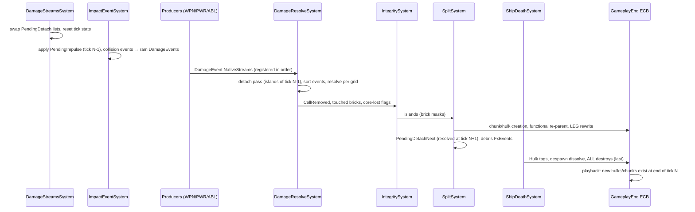

# SPEC-13 — Damage, integrity and destruction

| | |
|---|---|
| **Status** | Draft |
| **Area code** | DMG (task IDs are `DMG-001`, `DMG-002`, …) |
| **Module(s)** | `Game.Voxel` (folder `Assets/Game/Voxel/Damage/`); config definition in `Game.Data` (`Assets/Game/Data/Definitions/Damage/`); harness commands in `Game.DevTools.Editor` |
| **Depends on specs** | SPEC-02 (`StableHash`, `ContentHash`, `PersistentId`, `SimClock`, groups, `GameplayEndCommandBufferSystem`, `FxEvent`/`SfxEvent` queues); SPEC-04 (`BlockDefsBlob`, `OrientationTablesBlob`, `BlockModulesBlob` (`Core`, `Explosive` rows), `ArmorClass`); SPEC-10 (`Cell`, `VoxelGrid`, `Brick`, `BrickCells`, `BrickSolidMask`, `BrickDirty`, `BlockInstance`, `FunctionalBlock`, palette, brick lookup, archetypes, `LinkedEntityGroup`); SPEC-12 (`PhysicsLayers`, `GridMassUpdateSystem`, contact suppression for `SplitGrace`); SPEC-21 (`ExplosionSystem` consumes `ExplosionRequest`); SPEC-01 (`PersistentId` block grants) |
| **Depended on by** | SPEC-12 (reads `CellRemoved` for mass), SPEC-20 (ram physics test), SPEC-21/22/24 (produce `DamageEvent`), SPEC-23 (`Hulk`, `GridDamageStats`), SPEC-31 (adopts `StarSystemMember` for split grids), SPEC-50 (salvage hooks), SPEC-61 (`ShipDestroyed`), SPEC-63/64 (`FxEvent`/`SfxEvent`, chunk render data) |
| **Milestone** | M2 (DMG-001 in M1; DMG-021 in M4) |

> Read [01-architecture.md](../01-architecture.md), [02-conventions.md](../02-conventions.md), [03-glossary.md](../03-glossary.md) and [07-implementation-traps.md](../07-implementation-traps.md) before this spec. This spec may not contradict them.

## 1. Purpose

This spec is the game's first pillar, "destruction you can read". It owns the only code that changes cells at runtime: it turns `DamageEvent`s into removed cells (penetrating rays, blast craters, ram dents), keeps block HP for multi-cell and functional blocks, detects pieces that lost their connection to the ship, and turns them into GPU debris, tumbling chunk bodies or drifting hulk grids that keep their momentum. It turns a ship that loses its core into a hulk (still physical, damageable and salvageable) instead of deleting it, and it chains reactor blasts. Every result is deterministic: the same inputs give the same cell state at 30, 60 and 144 FPS. It prevents the old prototype's failures: parallel lost-update races on HP (02-C08), wrong-cell hits (01-B2), deleting a ship with all its debris (01-B5, 02-C04), ECB exceptions when ships die (R25/R26, 02-C05), severed sections dissolving into single-voxel bodies (02-C12), coreless ships that never split (01-B17), multi-cell blocks ignored by connectivity (01-B1), frame-rate-dependent ram damage (02-C02) and debris that ignores ship motion (02-C11).

## 2. Scope

**In scope:**
- `DamageEvent`, `DamageType` (file in `Game.Data.Combat`, architecture §3.2), `CellRemoved`, `ExplosionRequest`, `Hulk` (architecture §6.3) and the `DamageStreams` singleton: per-tick `NativeStream` registration, producer/consumer job-handle discipline, disposal.
- `DamageResolveSystem`: deterministic ordering, parallel over grids; point damage by 3D DDA with overflow carry; blast rasterization with `(1 − d/r)²` falloff and HP occlusion; armour multipliers; `Cell.Hp` quantization; multi-cell/functional block HP; reactor blasts; island detachment; `CellRemoved` emission with `v + ω×r + kick`; `BrickDirty`; `VoxelGrid.Revision`; knockback impulses (applied next tick by `ImpactEventSystem`).
- `ImpactEventSystem`: Unity Physics collision events → ram `DamageEvent`s; pair aggregation, cooldown, energy threshold; rams bypass shields; applying pending damage impulses.
- `IntegritySystem`: incremental connectivity on touched grids only; brick-level graph first; size-fair flood race with early exit; budgets and deferral.
- `SplitSystem`: debris tier selection, debris `FxEvent`s, pooled chunk bodies, hulk grids created in the same tick through the GameplayEnd ECB, `PersistentId` allocation for hulks.
- `ShipDeathSystem`: core loss → `Hulk`, `ShipDestroyed` source event, core breach blast, despawn-to-debris conversion, the DMG destroy pass.
- `DamageConfigDefinition` + `DamageConfig` singleton; `ArmorClass` meaning.
- Salvage hooks, `CellStateHasher`, harness commands, determinism/perf/regression tests (R25/R26).

**Out of scope (and who owns it instead):**
- Producing projectile/beam/explosion damage, shield tests, `ExplosionSystem`: SPEC-21 / SPEC-22. Abilities that deal damage: SPEC-24.
- Brick storage, palette, spawning, `LinkedEntityGroup` creation, `GridSpawnSystem`: SPEC-10. Meshing: SPEC-11. Brick colliders, `ColliderSwapSystem`, `GridMassUpdateSystem`, `PhysicsLayers`, contact suppression: SPEC-12.
- Rendering debris particles and chunk bodies: SPEC-63. Playing sounds: SPEC-64. Defeat flow after the player's ship dies: SPEC-01/SPEC-61.
- Assigning `StarSystemMember` to entities created here: SPEC-31 (open question 4). Salvage yields and loot: SPEC-50.
- Writing damage back to `VoxelStructure` on save: SPEC-05/SPEC-10.

> **Playable integration staging:** [ADR-0053](../decisions/ADR-0053-playable-firing-range-first.md) permits the bounded FND-020 firing/breakup slice before this spec is complete. It implements portions of the production path in place; tasks below remain open until their full acceptance criteria pass. Follow the ADR's explicit staging exceptions for this checkpoint.

## 3. Decisions (binding)

1. **`DamageResolveSystem` is the only runtime writer of cell contents, `Cell.Hp`, `BlockInstance.FunctionHp`, `BrickSolidMask`, `Brick.SolidCount` and, after spawn, `VoxelGrid.AnchorInstance`.** That includes removing islands from their parent grid (decision 8). Reason: architecture §8; ADR-0010.
2. **Grid-local space is metres in the grid root's `LocalTransform` frame; cell `c` occupies `[c·s, (c+1)·s)` on each axis (`s = VoxelGrid.CellSize`); `cell = (int3)math.floor(p / s)`.** Reason: producers transform world hits with the root transform only; no collider child mapping (01-B2).
3. **Event order is total and independent of threads.** Producers write `NativeStream`s at foreach index = chunk index in their query; the resolver reads registrations in registration order and indices in order, then **stable-sorts** by `(Grid.Index, Source.Index, Producer, Sequence)`; equal keys keep stream order. Reason: architecture §5.1.
4. **Parallel over grids; one worker owns one grid.** One `IJobParallelForDefer` over grid ranges (batch size 1); a range's worker is the only writer of that grid's bricks, instances and DMG components this tick. Reason: no races (02-C08), traps T2.6.
5. **`Cell.Hp` uses deterministic dithered quantization** (§5.3.5) so damage smaller than one HP quantum is neither lost nor amplified on average. Reason: beams deal ~0.2 HP per tick.
6. **A block instance is destroyed as a whole** when its `FunctionHp ≤ 0` (blocks with `BlockDef.FunctionHp > 0`) or when at least half of its footprint cells are gone; all its remaining cells are removed in the same tick and its functional entity is destroyed. Reason: readable "this thruster is gone"; no half-alive functional entities.
7. **Connectivity is face adjacency of solid cells plus instance links** (all remaining cells of one `BlockInstance` are mutually connected). An instance therefore never ends up in two grids. Reason: 01-B1.
8. **Islands are detached one tick after detection.** At tick N `IntegritySystem` finds islands and `SplitSystem` records the new chunk/hulk entities (with copied cells) into the GameplayEnd ECB, so they **exist at the end of tick N**; at tick N+1 the resolver's detach pass clears those cells from the parent before applying new events. Reason: only the resolver writes cells (decision 1) and the resolver runs before integrity; the new body appears in the same tick as the cut, and for one tick both hold identical geometry at the identical pose (no gap, no visible double).
9. **Debris tiers are chosen per island:** 1–8 cells → GPU particles; 9–500 cells, no functional block and a cell AABB within 16×16×16 → pooled chunk body; anything else → new hulk grid. Thresholds live in `DamageConfig`. Reason: glossary, synthesis §6e.
10. **Debris velocity = `v + ω × (p − com)` of the parent at the cell (or island COM) plus a kick.** `CellRemoved.WorldVel` holds the rigid part; `CellRemoved.Kick` the extra. Reason: pieces must keep the ship's momentum (02-C11).
11. **Ship death is a state.** Core lost → `Hulk` tag + `VoxelGrid.Kind = Hulk`; nothing is deleted. Despawning a visible grid dissolves its exposed cells into debris first. Reason: vision pillar 1; 01-B5.
12. **Rams bypass shields** and carry no `WorldImpulse` (the solver already pushed both bodies). Reason: physical ramming is a hull event.
13. **Damage knockback is applied by `ImpactEventSystem` one tick later** from `PendingImpulse`. Reason: `ImpactEventSystem` is a listed `PhysicsVelocity` impulse writer (§8); the resolver is not.
14. **Structural changes happen only through the `GameplayEndCommandBufferSystem` ECB, recorded by single-threaded jobs** in `SplitSystem` (creations, re-parenting) and `ShipDeathSystem` (tags, all destroys). No DMG system calls `EntityManager` structural APIs after `OnCreate`. Reason: architecture §1.3; traps T2.5 (a single-threaded ECB needs no sort key, so playback order equals recording order).
15. **All DMG destroys are recorded last** (in `ShipDeathSystem`'s ECB, created after `SplitSystem`'s), deduplicated and existence-checked at record time. Reason: R25/R26 (commands on destroyed entities).
16. **Integrity runs only on grids with `Destroyed` cells this tick or retained seeds**, seeded from solid neighbours of removed cells, over a hybrid graph whose nodes are whole bricks where a brick is internally connected and single cells elsewhere, with a size-fair race that stops as soon as at most one unresolved component remains. Reason: architecture §11.1; cost O(smaller components), never O(grid).
17. **Every per-tick budget defers deterministically** (integrity per grid, split cells per tick, new bodies per tick, debris particles per tick); deferred work is retried next tick in the same order. Reason: architecture §11.2.
18. **New hulk grids get a `PersistentId` from a pre-granted block** in the `PersistentIdAllocator` singleton; when the block is empty the split is deferred. Reason: `GameSession` remains the only allocator (architecture §8).
19. **Damage types and armour classes are content tables (review X10).** One `DamageTypeDefinition` per `DamageType` value (armour multipliers per class, kick, shield multiplier, shield bypass) and one `ArmorClassDefinition` per armour class index, baked into `DamageTableBlob`. v1 ships the four types and four classes of §4.7 (Standard, Armored, Reinforced, Fragile). An armour class above the table behaves as 0 and is logged once. A new damage type is an enum value plus a definition; a new armour class is a definition. Reason: SPEC-04 open question 7; no code edit per type.

## 4. Data model

### 4.1 Folders and namespaces

| Folder | Namespace | Contents |
|---|---|---|
| `Assets/Game/Voxel/Damage/` | `Game.Voxel.Damage` | contracts, components, config, helpers (§4.2–§4.9) |
| `Assets/Game/Voxel/Damage/Systems/` | `Game.Voxel.Damage.Systems` | the six systems of §5 |
| `Assets/Game/Voxel/Damage/Jobs/` | `Game.Voxel.Damage.Jobs` | Burst jobs (internal) |
| `Assets/Game/Data/Definitions/Damage/` | `Game.Data.Definitions` | `DamageConfigDefinition` |
| `Assets/Game/DevTools/Editor/Damage/` | `Game.DevTools.Editor.Damage` | `gh_dmg_*` commands |

### 4.2 Shared contracts (public contract; architecture §6.3)

```csharp
namespace Game.Voxel.Damage
{
    using Unity.Entities; using Unity.Mathematics; using Game.Data.Combat;

    // DamageType is designed here but lives in Assets/Game/Data/Combat/DamageType.cs (namespace Game.Data.Combat, architecture §3.2)
    // so content definitions use it directly (no mirror enum):
    //   /// <summary>Binding (architecture §6.2). Add values at the end only.</summary>
    //   public enum DamageType : byte { Kinetic = 0, Energy = 1, Explosive = 2, Ram = 3 }

    // Who produced an event (part of the sort key, §3 decision 3) is Game.Data.Combat.ProducerKind (SPEC-02 §4.12), shared by every channel.

    [System.Flags] public enum DamageEventFlags : byte { None = 0, NoImpulse = 1, NoKick = 2 }

    /// <summary>A request to damage cells of one grid, in grid-local metres. Implements SPEC-13 §4.2.</summary>
    public struct DamageEvent
    {
        public Entity Grid;            // VoxelGrid root
        public float3 LocalPoint;      // grid-local metres (§3 decision 2)
        public float3 LocalDir;        // grid-local travel direction into the grid; any length; zero allowed
        public float Amount;           // raw damage before armour multipliers; events with Amount <= 0 are dropped
        public float Radius;           // metres; 0 = point/penetrating path (§5.3.3); > 0 = blast (§5.3.4)
        public float Penetration;      // point path: max solid cells destroyed along the ray; < 1 treated as 1
        public DamageType Type;
        public Entity Source;          // attribution and sort key; Entity.Null allowed
        public float3 WorldImpulse;    // N·s at the hit point, applied next tick (§3 decision 13)
        // ---- SPEC-13 additions ----
        public ProducerKind Producer;
        public uint Sequence;          // unique per (Source, Producer) within a tick; assigned by the producer
        public DamageEventFlags Flags;
        public Entity Instigator;      // who is responsible (review X6): OwnedBy.Owner of the shooter if present, else Source. Not a sort key
    }

    public enum CellRemovedReason : byte { Destroyed = 0, DetachedParticle = 1, DetachedBody = 2, Dissolved = 3 }

    /// <summary>One cell left a grid this tick. Output of the resolver. Implements SPEC-13 §4.2.</summary>
    public struct CellRemoved
    {
        public Entity Grid;
        public int3 Cell;
        public ushort Block;           // BlockIndex
        public byte Color;
        public float3 WorldPos;        // local-frame world position of the cell centre
        public float3 WorldVel;        // parent rigid velocity at WorldPos (v + ω×r)
        public float3 Kick;            // extra debris velocity; debris velocity = WorldVel + Kick
        // ---- SPEC-13 additions ----
        public CellRemovedReason Reason;
        public byte Orient;
        public int InstanceIndex;      // BlockInstance index, -1 for palette cells
    }

    /// <summary>Consumed by ExplosionSystem (SPEC-21). Implements SPEC-13 §4.2.</summary>
    public struct ExplosionRequest
    {
        public float3 WorldPos;        // local-frame world position
        public float Radius;           // metres
        public float Amount;           // raw damage at the centre
        public DamageType Type;
        public Entity Source;
        // ---- SPEC-13 additions ----
        public ProducerKind Producer;   // Explosion for reactor/core breaches written by DMG
        public uint Sequence;
        public Entity Instigator;       // carried into the DamageEvents/ShieldHits the explosion produces (review X6)
    }

    /// <summary>Request to push a body (ADR-0016): tractor beams, launch catapults, gravity wells. Applied by ImpactEventSystem (§5.2 step 1b).</summary>
    [System.Flags] public enum ImpulseRequestFlags : byte { None = 0, AtCenterOfMass = 1 /* WorldPoint ignored: no angular part */ }
    public struct ImpulseRequest
    {
        public Entity Body;            // any root with PhysicsVelocity + PhysicsMass (grid, chunk body)
        public float3 WorldImpulse;    // N·s
        public float3 WorldPoint;      // local-frame world point of application
        public ProducerKind Producer;
        public uint Sequence;          // unique per (Producer, producer's own key) within a tick
        public ImpulseRequestFlags Flags;
    }

    public enum CellRestoreMode : byte { Heal = 0, Place = 1 }   // add at end only

    /// <summary>Request to restore cells (ADR-0016): repair beams, drones, station repair, narrative repair. Consumed by DamageResolveSystem (§5.3.1 step 3b).</summary>
    public struct CellRestoreRequest
    {
        public Entity Grid;
        public CellRestoreMode Mode;
        public int3 CellMin, CellMax;  // Heal: inclusive box in grid cells; Place: CellMin is the cell (CellMax ignored)
        public float HpFraction;       // Heal: fraction of each cell's max HP (and of each touched live instance's FunctionHp) to add, (0, 1]
        public ushort Block;           // Place: BlockIndex of a palette block (single-cell, !RequiresInstance)
        public byte Orient, Color;     // Place
        public ProducerKind Producer;
        public uint Sequence;
    }

    /// <summary>A cell that Place added this tick (published like CellRemoved; SPEC-12 adds its mass).</summary>
    public struct CellRestored { public Entity Grid; public int3 Cell; public ushort Block; public byte Color; }

    /// <summary>Binding tag: dead ship, still physical and damageable; AI, power and propulsion skip it.</summary>
    public struct Hulk : IComponentData { }

    public enum HulkCause : byte { CoreLost = 0, Split = 1 }

    /// <summary>Salvage and narrative hook on every hulk root.</summary>
    public struct HulkInfo : IComponentData
    {
        public HulkCause Cause;
        public uint Tick;              // SimClock.Tick when it became a hulk
        public ulong OriginPersistentId; // CoreLost: own id; Split: the parent's id
        public GridKind FormerKind;    // kind before it became a hulk
    }
}
```

### 4.3 Grid, brick and body components (public contract)

```csharp
namespace Game.Voxel.Damage
{
    using Unity.Entities; using Unity.Mathematics;

    /// <summary>Per-grid counters. Writer: DamageResolveSystem. On every grid root (SPEC-10 adds it via DamageSetup).</summary>
    public struct GridDamageStats : IComponentData
    {
        public uint LastDamageTick;
        public Entity LastDamageSource;   // Source of the last event of the latest damaging tick (resolver order)
        public Entity LastDamageInstigator; // Instigator of that same event (review X6); SPEC-33 provocation and SPEC-21 kill credit read it
        public int CellsDestroyed;     // cumulative, reason Destroyed
        public int CellsDetached;      // cumulative, reasons DetachedParticle/DetachedBody
        public int InstancesDestroyed; // cumulative
        public float DamageTaken;      // cumulative effective damage applied to cells
    }

    /// <summary>Knockback accumulated by the resolver at Tick; applied by ImpactEventSystem at Tick+1. Writer: DamageResolveSystem.</summary>
    public struct PendingImpulse : IComponentData
    {
        public float3 LinearWorld;     // Σ J
        public float3 AngularWorld;    // Σ (p − com) × J, world space
        public uint Tick;
    }

    /// <summary>Writer: IntegritySystem.</summary>
    public struct GridIntegrityState : IComponentData
    {
        public byte ConsecutiveDeferrals;
        public byte Pad0; public ushort Pad1;
    }

    /// <summary>Seeds kept for the next tick when integrity was deferred. Writer: IntegritySystem.</summary>
    [InternalBufferCapacity(0)]
    public struct IntegritySeed : IBufferElementData { public int3 Cell; }

    public enum BrickConnectivity : byte { Unknown = 0, Connected = 1, Split = 2 }

    /// <summary>On every brick. Writer: IntegritySystem (and SplitSystem when it creates bricks: Unknown).</summary>
    public struct BrickIntegrity : IComponentData
    {
        public BrickConnectivity State;   // Connected = all solid cells of the brick form one component (instance links included)
        public byte HasInstanceCells;     // 1 if any cell has Ref bit 15 set
        public ushort SolidCountAtCheck;  // Brick.SolidCount when State was computed; mismatch => treat as Unknown
    }

    /// <summary>On new hulk roots and chunk bodies: contacts with Other are ignored until UntilTick (SPEC-12 honours it).</summary>
    public struct SplitGrace : IComponentData { public Entity Other; public uint UntilTick; }   // set by SplitSystem, and by SPEC-10 GridStowApi.Unstow for launches (ADR-0017)

    /// <summary>On new hulk roots and chunk bodies until SPEC-31 copies the parent's StarSystemMember (open question 4).</summary>
    public struct SplitOrigin : IComponentData { public Entity Parent; }

    public enum GridDissolveMode : byte { Dissolve = 0, Silent = 1 }

    /// <summary>Request entity (one per grid). Consumer: ShipDeathSystem, which destroys the request entity.</summary>
    public struct GridDissolveRequest : IComponentData { public Entity Grid; public GridDissolveMode Mode; }

    /// <summary>Tag: the grid takes no damage (indestructible bodies, SPEC-30 Q15; SPEC-31 adds it for `destructible == false`).
    /// DamageResolveSystem drops events on it in Gather (no cells, no knockback); projectiles and beams still stop on it.</summary>
    public struct DamageImmune : IComponentData { }

    /// <summary>Added to a grid being dissolved. Writer: ShipDeathSystem.</summary>
    public struct GridDissolving : IComponentData { public uint StartTick; public int NextSlot; public int Emitted; public int Stride; }

    /// <summary>Pooled chunk body (not a grid). Writer: SplitSystem.</summary>
    public struct ChunkBody : IComponentData
    {
        public uint SpawnTick, DissolveStartTick, EndTick;
        public float CellSize;
        public float3 LocalOrigin;     // body-local position of cell (0,0,0)'s min corner (COM is the body origin)
        public ushort CellCount;
        public byte Slot;              // pool slot 0..MaxLiveChunks-1
        public byte Live;              // 1 while enabled
    }

    /// <summary>Cells of a chunk body for rendering (SPEC-63). Offsets are 0..15 per axis.</summary>
    [InternalBufferCapacity(0)]
    public struct ChunkCell : IBufferElementData { public byte X, Y, Z, Orient; public ushort Block; public byte Color, Pad; }

    /// <summary>Owned collider of a chunk body; disposed through DeferredDisposalSystem.</summary>
    public struct ChunkColliderBlob : ICleanupComponentData { public BlobAssetReference<Unity.Physics.Collider> Value; }
}
```

### 4.4 `DamageStreams` (public contract)

```csharp
namespace Game.Voxel.Damage
{
    using Unity.Collections; using Unity.Entities; using Unity.Jobs;

    /// <summary>Singleton created by DamageStreamsSystem.OnCreate. All methods: main thread, inside OnUpdate. Implements SPEC-13 §5.1.</summary>
    public unsafe struct DamageStreams : IComponentData
    {
        [Unity.Collections.LowLevel.Unsafe.NativeDisableUnsafePtrRestriction] internal DamageStreamsData* Data;

        // DamageEvent channel (SPEC-02 §4.12). Producers (SPEC-13, 21, 22, 24 and any later spec): Damage.BeginWrite(ref state, ProducerKind, n)
        // → schedule the writer job → Damage.EndWrite(handle). The single consumer is DamageResolveSystem.
        public Game.Data.Streams.SimEventChannel<DamageEvent> Damage;
        // ExplosionRequest channel. Producers: SPEC-13 (reactors, core breaches), 21, 24. The single consumer is SPEC-21 ExplosionSystem,
        // through ScheduleDrainExplosions.
        public Game.Data.Streams.SimEventChannel<ExplosionRequest> Explosions;
        // Request channels for state this module owns (ADR-0016). Consumers: ImpactEventSystem (Impulses), DamageResolveSystem (Restores).
        public Game.Data.Streams.SimEventChannel<ImpulseRequest> Impulses;
        public Game.Data.Streams.SimEventChannel<CellRestoreRequest> Restores;

        // The ExplosionRequest consumer: Explosions.BeginRead, SimEventGather, stable sort by (Source.Index, Producer, Sequence, gather
        // position), Explosions.EndRead. Requests registered after this call are drained next tick.
        public JobHandle ScheduleDrainExplosions(ref SystemState state, NativeList<ExplosionRequest> output);

        // Same-tick CellRemoved readers (run after DamageResolveSystem, before GameplayEndCommandBufferSystem):
        public CellRemovedView BeginRemovedRead(ref SystemState state);  // combines the resolver's write handle
        public void EndRemovedRead(JobHandle readerJob);
        // Same-tick CellRestored readers (SPEC-12 mass): same rules as BeginRemovedRead.
        public CellRestoredView BeginRestoredRead(ref SystemState state);
        public void EndRestoredRead(JobHandle readerJob);

        // SPEC-21 ShipDestroyedBridgeSystem, once per frame (presentation, main thread); completes ShipDeathSystem's last write first.
        public void DrainCoreLost(NativeList<GridCoreLost> output);

        // ChunkColliderCleanupSystem (§5.9), main thread outside the fixed step: completes SplitSystem's last write, then moves
        // the chunk collider blobs SplitSystem replaced (slot reuse) into output and clears its list.
        public void DrainRetiredChunkBlobs(NativeList<BlobAssetReference<Unity.Physics.Collider>> output);

        public DamageTickStats LastTickStats { get; }                  // copied at the start of the next tick
    }

    /// <summary>Read-only view of this tick's CellRemoved list, grouped by grid in resolver order. Both arrays are deferred job
    /// arrays (NativeList.AsDeferredJobArray): use them only inside jobs scheduled on the handle BeginRemovedRead combined into
    /// state.Dependency, never on the main thread (SPEC-12 Q8).</summary>
    public struct CellRemovedView
    {
        [ReadOnly] public NativeArray<CellRemoved> Cells;
        [ReadOnly] public NativeArray<GridRemovedRange> Grids;
    }

    public struct GridRemovedRange { public Entity Grid; public int Start; public int Count; }

    /// <summary>This tick's CellRestored list grouped by grid (deferred job arrays, like CellRemovedView).</summary>
    public struct CellRestoredView { [ReadOnly] public NativeArray<CellRestored> Cells; [ReadOnly] public NativeArray<GridRemovedRange> Grids; }

    /// <summary>Source event for ShipDestroyed (architecture §6.6); enriched with PlayerShip/Allegiance by the bridge.</summary>
    public struct GridCoreLost { public Entity Grid; public ulong PersistentId; public uint Tick; public Unity.Mathematics.float3 WorldPos; }

    public struct DamageTickStats
    {
        public uint Tick;
        public int EventsIn, EventsDropped, GridsResolved, CellsDestroyed, CellsDetached, InstancesDestroyed;
        public int IntegrityGrids, IntegrityDeferred, IntegritySizeDeferred, IslandsFound;
        public int HulksCreated, ChunksCreated, ParticleIslands, SplitsDeferred, DebrisParticles, RamEvents;
        public int ImpulsesApplied, ImpulsesDropped, CellsHealed, CellsPlaced, RestoresDropped, RestoresDeferred;   // ADR-0016 channels
    }
}
```

`DamageStreamsData` (internal, `Allocator.Persistent`, owned by `DamageStreamsSystem`; the four channels hold their own registrations): `NativeList<CellRestored> Restored`, `NativeList<GridRemovedRange> RestoredGrids` (same handles as `Removed`); `NativeList<CellRemoved> Removed`, `NativeList<GridRemovedRange> RemovedGrids`, `JobHandle RemovedWriteHandle`, `UnsafeList<JobHandle> RemovedReaderHandles`; `NativeList<GridCoreLost> CoreLost` + `JobHandle CoreLostWriteHandle`; `DamageTickStats Current, Last`; the DMG-internal per-tick lists of §4.8 and their handles.

### 4.5 Configuration (public contract)

```csharp
namespace Game.Data.Definitions
{
    /// <summary>Tuning for SPEC-13. One asset: Assets/Game/Content/Config/config_damage.asset.</summary>
    [ContentIdPrefix("config_")]
    [UnityEngine.CreateAssetMenu(menuName = "Game/Content/Damage Config", fileName = "config_damage")]
    public sealed class DamageConfigDefinition : ContentDefinition
    {
        // One serialized field per numeric DamageConfig tuning field below, camelCase with the same default.
        // Table is built at boot, not serialized (Game.Data cannot reference Game.Voxel). Cue hashes are derived
        // from four AudioCueDefinition references: ramImpactCue, cellBreakCue, splitCue, coreLostCue (may be null).
    }
}
namespace Game.Voxel.Damage
{
    using Unity.Entities; using Unity.Mathematics;

    /// <summary>Singleton. Created with Default by DamageStreamsSystem.OnCreate; overwritten once at boot by Game.App from the definition.</summary>
    public struct DamageConfig : IComponentData
    {
        // Per-type and per-armour values: the content table (decision 19, §4.7)
        public BlobAssetReference<DamageTableBlob> Table;
        // Point and blast
        public float EntryBacktrackCells;       // 0.5
        public int   MaxDdaCells;               // 256
        public float MaxBlastRadiusCells;       // 12
        public float MaxOcclusionRadiusCells;   // 8 (blasts above this radius skip occlusion)
        public float OcclusionFactor;           // 1.0 (0 disables occlusion)
        public float InstanceDestroyCellFraction; // 0.5
        // Kicks (m/s)
        public float KickDetach;                // 1.5
        public float KickDissolve;              // 2
        public float KickRandomFraction;        // 0.4
        // Rams
        public float MinRamEnergyJ;             // 20000
        public float RamHpPerJoule;             // 0.001
        public float RamRestitutionCorrection;  // 1.21  ((1 + e)², e = 0.1)
        public float RamRadiusBaseCells;        // 0.75
        public float RamRadiusCellsPerSqrtMJ;   // 1.5
        public float RamRadiusMaxCells;         // 4
        public int   RamPairCooldownTicks;      // 6
        // Restores (ADR-0016)
        public int   MaxRestoreCellsPerTick;    // 4096
        // Integrity
        public int IntegrityNodeBudgetPerGrid;  // 131072
        public int MaxFullFloodCells;           // 16384, temporary fallback cap (ADR-0057)
        public int MaxIntegrityGridsPerTick;    // 64
        public int MaxSeedsPerGrid;             // 8192
        public int IntegrityForceAfterDeferrals;// 4
        public int BrickWarmupPerTick;          // 64
        // Split
        public int ParticleMaxCells;            // 8
        public int ChunkMaxCells;               // 500
        public int ChunkMaxExtentCells;         // 16
        public int MaxLiveChunks;               // 64
        public int SplitCellBudgetPerTick;      // 16384
        public int MaxNewHulksPerTick;          // 4
        public int MaxNewChunksPerTick;         // 8
        public int SplitGraceTicks;             // 60
        public int MaxDebrisParticlesPerTick;   // 2000
        public int ChunkMaxBoxes;               // 32
        public float ChunkLifetimeMinSeconds;   // 10
        public float ChunkLifetimeMaxSeconds;   // 30
        public float ChunkDissolveSeconds;      // 1.5
        public float HulkSeparationSpeed;       // 0.75
        public float ChunkSeparationSpeed;      // 1.5
        public float ChunkTumbleMin;            // 0.5 rad/s
        public float ChunkTumbleMax;            // 1.5 rad/s
        // Death and despawn
        public float CoreBreachRadiusCells;     // 3
        public float CoreBreachDamage;          // 150
        public int   DissolveParticlesPerTick;  // 1500
        public int   DissolveParticleCap;       // 12000
        // Audio cues (Game.Core.ContentHash of AudioCueDefinition IDs; default = 0 = no sound)
        public Game.Core.ContentHash CueRamImpact, CueCellBreak, CueSplit, CueCoreLost;

        public static DamageConfig Default { get; }   // exactly the values in the comments above; Table not created (Multiplier → 1, kicks 0) until boot sets it
        public float Multiplier(DamageType type, byte armorClass);  // Table lookup (decision 19); unknown type → 1.0, armour class out of range → class 0
        public static DamageConfig FromDefinition(Game.Data.Definitions.DamageConfigDefinition def); // cue hashes via ContentId.Hash
    }
}
```

### 4.6 Helpers (public contract)

```csharp
namespace Game.Voxel.Damage
{
    using Unity.Entities; using Unity.Mathematics; using Unity.Physics; using Unity.Transforms;

    /// <summary>Components SPEC-10 puts on grid roots and bricks at spawn (open question 1).</summary>
    public static class DamageSetup
    {
        public static ComponentType[] GridRootComponents();  // GridDamageStats, PendingImpulse, GridIntegrityState, IntegritySeed
        public static ComponentType[] BrickComponents();     // BrickIntegrity
    }

    /// <summary>Pure Burst-compatible maths. Implements SPEC-13 §5.3.</summary>
    public static class DamageMath
    {
        public static int3 CellOf(float3 localMetres, float cellSize);                        // floor(p / s)
        public static float HpUnits(byte hp, float cellHp);                                   // hp * cellHp / 255
        public static byte QuantizeHp(float units, float cellHp, float dither01);             // §5.3.5; 0 = destroyed
        public static float Dither01(uint tick, int gridIndex, int3 cell, int eventOrdinal);  // §5.3.5
        public static float BlastFalloff(float d, float r);                                   // (1 − d/r)², 0 when d >= r
        public static float3 VelocityAtPoint(in PhysicsVelocity v, in PhysicsMass m, in LocalTransform t, float3 worldPoint);
        public static float RamEnergy(float impulse, float invMassA, float invMassB, float restitutionCorrection); // §5.2
    }

    /// <summary>Amanatides–Woo 3D DDA over integer cells. Implements SPEC-13 §5.3.3.</summary>
    public struct GridDda
    {
        public bool Init(float3 startCells, float3 dir, int3 aabbMin, int3 aabbMaxExclusive); // false if the ray misses the AABB
        public bool Next(out int3 cell);  // cells in traversal order, starting at the entry cell; false after leaving the AABB
    }

    /// <summary>Deterministic hash of all cell state (tests, harness). Not for hot paths.</summary>
    public static class CellStateHasher
    {
        public static ulong ComputeWorldHash(EntityManager em);   // grids ordered by PersistentId
        public static ulong ComputeGridHash(EntityManager em, Entity grid);
    }
}
```

### 4.7 Damage-type and armour tables (content; decision 19)

```csharp
namespace Game.Data.Definitions
{
    /// <summary>One damage type (decision 19). Exactly one per DamageType value. Implements SPEC-13 §4.7.</summary>
    [ContentIdPrefix("dmg_")]
    public sealed class DamageTypeDefinition : ContentDefinition
    {
        [UnityEngine.SerializeField] private Game.Data.Combat.DamageType type;
        [UnityEngine.SerializeField] private float[] armorMultipliers;   // index = armour class; length = number of ArmorClassDefinitions; each ≥ 0
        [UnityEngine.SerializeField, UnityEngine.Min(0)] private float kickMin;   // m/s debris kick (point hits use kickMin)
        [UnityEngine.SerializeField, UnityEngine.Min(0)] private float kickMax;   // m/s at a blast centre
        [UnityEngine.SerializeField, UnityEngine.Min(0)] private float shieldMultiplier = 1;   // SPEC-22 shields (replaces PowerTuning.ShieldTypeMultiplier)
        [UnityEngine.SerializeField] private bool bypassShields;         // Ram: producers never emit ShieldHit for it
        // Public getters with the same names in PascalCase. Validate: DMG-E001 lengths, DMG-E002 duplicate type, DMG-E003 kickMin > kickMax.
    }

    /// <summary>One armour class (decision 19). Implements SPEC-13 §4.7.</summary>
    [ContentIdPrefix("armor_")]
    public sealed class ArmorClassDefinition : ContentDefinition
    {
        [UnityEngine.SerializeField] private byte index;                 // the value BlockDefinition.armorClass uses; 0..N−1, contiguous (DMG-E004)
        [UnityEngine.SerializeField] private string displayName;
    }
}
namespace Game.Voxel.Damage
{
    public struct DamageTypeRow { public float KickMin, KickMax, ShieldMultiplier; public byte BypassShields; public int ArmorOffset; }
    public struct DamageTableBlob
    {
        public BlobArray<DamageTypeRow> Types;   // index = (int)DamageType
        public BlobArray<float> ArmorMultipliers; // Types[t].ArmorOffset + armorClass
        public int ArmorClassCount;
    }
    public static class DamageContent   // boot (SPEC-01 BootSingletons, with config_damage): builds the blob and sets DamageConfig.Table
    {
        public static BlobAssetReference<DamageTableBlob> BuildTable(Game.Data.Services.ContentCatalog catalog);
    }
}
```

Shipped content (DMG-003 authors it; values are the v1 balance):

| Definition | Standard | Armored | Reinforced | Fragile | Kick min / max (m/s) | Shield × | Bypass shields |
|---|---|---|---|---|---|---|---|
| `dmg_kinetic` | 1.0 | 0.6 | 0.8 | 1.5 | 6 / 6 | 0.8 | no |
| `dmg_energy` | 1.0 | 0.8 | 0.6 | 1.25 | 3 / 3 | 1.25 | no |
| `dmg_explosive` | 1.0 | 0.7 | 0.7 | 2.0 | 4 / 18 | 1.0 | no |
| `dmg_ram` | 1.0 | 0.5 | 0.75 | 2.0 | 3 / 3 | 1.0 | yes |

Armour classes: `armor_standard` (0, all legacy blocks, SPEC-04 §4.10), `armor_armored` (1, armour plates, rams), `armor_reinforced` (2, frames, cores), `armor_fragile` (3, glass, solar, antennae).

### 4.8 Internal per-tick data (`DamageStreamsData`)

| List | Element | Writer → reader (same tick unless noted) |
|---|---|---|
| `GridRanges` | `{ Entity Grid; int EventStart, EventCount; int DetachStart, DetachCount; }` | resolver plan job → resolve job |
| `SortedEvents` | `DamageEvent` | resolver sort job → resolve job |
| `GridResults` | `{ Entity Grid; int TouchedBrickStart, TouchedBrickCount; byte CoreLost; float3 CoreWorldPos; }` | resolve job → Integrity, ShipDeath |
| `TouchedBricks` | `{ Entity Grid; int SlotIndex; Entity Brick; }` | resolve job (NativeStream, index = range) → Integrity |
| `DestroyList` | `Entity` | resolve job (NativeStream) and SplitSystem → ShipDeathSystem destroy pass |
| `Islands` | `IslandRecord { Entity Grid; int MaskStart, MaskCount; int CellCount; int3 CellMin, CellMax; byte HasFunctional; int Ordinal; }` | Integrity → Split |
| `IslandMasks` | `{ int SlotIndex; CellMask Mask; }` (`CellMask` = 4096 bits in 64 inline ulongs (Q21)) | Integrity → Split |
| `PendingDetachNext` / `PendingDetachCurrent` | `{ Entity Grid; int SlotIndex; CellMask Mask; CellRemovedReason Reason; int IslandOrdinal; }` | Split (tick N) → resolver (tick N+1); swapped by `DamageStreamsSystem` |
| `ChunkPool` | `{ Entity Body; uint EndTick; byte Live; }` × `MaxLiveChunks` | SplitSystem only (persistent) |
| `RamPairs` | `NativeHashMap<ulong, uint>` pair key → last ram tick (lookup only, never iterated for ordering) | ImpactEventSystem only (persistent) |

Memory: per-tick lists are bounded by budgets (≤ 16,384 island cells ⇒ ≤ ~200 masks × 516 B ≈ 100 KB). Persistent: chunk pool 64 entries, ram pairs ≤ 4,096 entries (pruned, §5.2). Per-cell memory added by this spec: **0 B** (no per-cell DMG data); per brick: `BrickIntegrity` 4 B (2,500 bricks of the 1M-cell reference station = 10 KB).

### 4.9 Assumed SPEC-10 contract (open question 1 holds the defaults)

| Item | Default this spec relies on |
|---|---|
| Brick of cell `c` | `b = c >> 4` (arithmetic shift); local index `(c.x & 15) + 16·(c.y & 15) + 256·(c.z & 15)` |
| Brick lookup | root buffer `BrickSlot { Entity Brick }`, dense over `BrickDims`, slot `(b.x−Min.x) + Dims.x·((b.y−Min.y) + Dims.y·(b.z−Min.z))`, `Entity.Null` = no brick |
| Palette | root buffer `PaletteElem { PaletteEntry Value }`; cell `Ref` < 0x8000 indexes it |
| Instance cells | `Ref = 0x8000 | instanceIndex`; footprint = `BlockDef.Cells` rotated by `Orient` about `Origin` (SPEC-04 §3 decision 8) |
| `BrickDirty.Flags` | `Mesh = 1, Collider = 2`; this spec adds `Urgent = 0x80` (mesh/collider this frame, ahead of budget order) |
| Brick transform | child of the root, `LocalTransform.Position = Coord·16·CellSize`, identity rotation, `Scale = CellSize` (brick meshes are in cell units, SPEC-10 §4.5) |
| Functional entity | child of the root; `LocalTransform` = instance root cell centre and orientation in grid-local space |
| Archetypes | `GridArchetypes.Root(GridKind)` and `GridArchetypes.Brick` component sets, including `DamageSetup` components |
| `LinkedEntityGroup` | on every root: root, every brick, every functional entity (traps T1.6) |
| Spawned cells | `Hp = 255`, `Flags = 0`; `FunctionHp = BlockDef.FunctionHp` |

## 5. Systems, services and flow

### 5.0 Tick timeline



All six systems: `[BurstCompile]` `ISystem`, `[UpdateInGroup(typeof(GameplayPostPhysicsGroup))]`, `state.RequireForUpdate<GameplayActive>()` and `RequireForUpdate<DamageStreams>()`, `<DamageConfig>`, `<BlockDefsRef>`, `<BlockModulesRef>`, `<OrientationTablesRef>`, `<SimClock>`. Order inside the group (Voxel-side attributes): `DamageStreamsSystem` `[UpdateBefore(typeof(ImpactEventSystem))]`; `ImpactEventSystem` `[UpdateBefore(typeof(DamageResolveSystem))]`; `DamageResolveSystem` → `IntegritySystem` → `SplitSystem` → `ShipDeathSystem` (each `[UpdateAfter]` the previous); `ShipDeathSystem` `[UpdateBefore(typeof(GridMassUpdateSystem))]`. Simulation-side systems name the Voxel ones (Voxel cannot reference Simulation): `SpatialHashBuildSystem` `[UpdateBefore(ImpactEventSystem)]`; `ProjectileStepSystem` `[UpdateAfter(ImpactEventSystem)]`; `ShieldSystem`, `ExplosionSystem`, `BeamStepSystem` `[UpdateBefore(DamageResolveSystem)]` (open question 9). None of these systems skips `Dormant` grids: damage must apply everywhere. Every expensive step is wrapped in `ProfilerMarker("<SystemName>.<Step>")` with the step names given in bold below.

### 5.1 `DamageStreamsSystem`

Owner of all DMG native memory. **Structural only in `OnCreate`** (creates the `DamageStreams` and `DamageConfig` singletons with `EntityManager`; `DamageConfig.Default` unless one exists).

`OnCreate`: create the four channels (`SimEventChannel<DamageEvent>.Create("damage")`, `<ExplosionRequest>("explosions")`, `<ImpulseRequest>("impulses")`, `<CellRestoreRequest>("restores")`); allocate `DamageStreamsData` (Persistent) and every list of §4.4/§4.8 with initial capacities (`Removed` 4,096, ranges 256, masks 64, chunk pool `MaxLiveChunks`, ram pairs 1,024). `OnDestroy`: dispose all four channels (they complete their handles), complete every stored handle, dispose every list, free the struct.

`OnUpdate` (main-thread scheduling, < 10 µs advisory):
1. Schedule a tick-reset job after all previous phase/removed-reader handles: `Last = Current`; `Current = default; Current.Tick = SimClock.Tick`. Later phase writers depend on `TickResetHandle`; the main thread never races a job writing statistics (Q21).
2. `BeginTick(SimClock.Tick)` on `Damage`, `Explosions`, `Impulses` and `Restores` (disposes registrations no consumer read for a whole tick, SPEC-02 §5.13).
3. Swap `PendingDetachCurrent` ↔ `PendingDetachNext`; schedule `ClearListJob` on the new `Next` depending on last tick's resolver handle; store it as `DetachNextWritable` (SplitSystem combines it before writing).

Producer contract (for every producer): in `OnUpdate`, `var streams = SystemAPI.GetSingleton<DamageStreams>(); var w = streams.Damage.BeginWrite(ref state, ProducerKind.X, query.CalculateChunkCountWithoutFiltering());` → schedule an `IJobChunk` that calls `w.BeginForEachIndex(unfilteredChunkIndex)` once per chunk, `w.Write(evt)` per event, `w.EndForEachIndex()` → `state.Dependency = handle; streams.Damage.EndWrite(handle);`. Explosions use `streams.Explosions` the same way. Producers set `Producer` and a per-`(Source, Producer)` unique `Sequence` (for example the projectile's shot counter). A system that writes from a single-threaded job uses `forEachCount = 1`, index 0.

### 5.2 `ImpactEventSystem`

Position: after `SpatialHashBuildSystem`, before `ProjectileStepSystem`. Writes `PhysicsVelocity` by impulses only (architecture §8).

1. **ApplyImpulses** — `IJobEntity` (`ScheduleParallel`) over roots with `PendingImpulse`, `PhysicsVelocity`, `PhysicsMass`, `LocalTransform`, filter `PendingImpulse.Tick == SimClock.Tick − 1`:
   - if the root has `PlanarConstraint` (SPEC-20, `Game.Data.Components`): `LinearWorld.y = 0`, `AngularWorld.x = AngularWorld.z = 0`;
   - `vel.ApplyLinearImpulse(mass, LinearWorld)`;
   - angular: `float3 a = math.rotate(math.inverse(math.mul(t.Rotation, mass.InertiaOrientation)), AngularWorld); vel.Angular += a * mass.InverseInertia;`.
1b. **ApplyRequested** (ADR-0016) — `set = streams.Impulses.BeginRead(ref state)`; `SimEventGather` → stable sort by `(Body.Index, Producer, Sequence, gather position)`; one `IJob` applies them in order to bodies that exist and have `PhysicsVelocity` + `PhysicsMass` (others dropped, counted): linear `ApplyLinearImpulse`; unless `AtCenterOfMass`, angular from `cross(WorldPoint − comWorld, WorldImpulse)` as in step 1; the same planar clamp as step 1. Non-finite requests are dropped. `Impulses.EndRead(handle)`.
2. **Collect** — `ICollisionEventsJob` on `SimulationSingleton` (single-threaded by Unity design): for each event where `EntityA` or `EntityB` has `VoxelGrid`: `details = ev.CalculateDetails(ref physicsWorld)`; write `RamContact { Entity A, B (A.Index < B.Index, swap and negate normal if needed); float3 Point = details.AverageContactPointPosition; float3 Normal (from A to B); float Impulse = details.EstimatedImpulse; int Order }` to a `NativeList` (event order is Unity Physics' deterministic order). Events need `CollideRaiseCollisionEvents` materials (SPEC-12, traps T4.4).
3. **Aggregate** — `IJob`: stable-sort by `(A.Index, B.Index, Order)`; merge runs with equal pair into one: `J = Σ Impulse`, `Point = Σ(Impulse·Point)/J`, `Normal = normalize(Σ Impulse·Normal)` (if J ≤ 0, skip the pair).
4. **Emit** — same `IJob`, per pair in order:
   1. `key = ((ulong)(uint)A.Index << 32) | (uint)B.Index`; if `RamPairs[key]` exists and `Tick − last < RamPairCooldownTicks` → skip.
   2. `invMassX` = `PhysicsMass.InverseMass` if the body has `PhysicsVelocity` and `PhysicsMass`, else 0. `E = RamEnergy(J, invA, invB, RamRestitutionCorrection)` = `J² · (invA + invB) / (2 · RamRestitutionCorrection)`. If `E < MinRamEnergyJ` → skip (no cooldown update).
   3. Hardness per side: if the side is a grid, find the contact cell (point nudged `0.5·CellSize` into that grid along the normal, `CellOf`); `h = CellHp(block) / Multiplier(Ram, ArmorClass)`; no solid cell or not a grid → `h = 100`.
   4. For each side X that is a grid (other side Y): `Amount_X = E · RamHpPerJoule · h_Y / (h_X + h_Y)`; `Radius = clamp(RamRadiusBaseCells + RamRadiusCellsPerSqrtMJ · sqrt(E / 1e6), 0.75, RamRadiusMaxCells) · CellSize_X`; `LocalPoint` = nudged point in X's local space; `LocalDir` = normal pointing into X, X-local; `Type = Ram`, `Source = Y`, `Instigator = OwnedBy[Y].Owner` if `Y` has `Game.Data.Components.OwnedBy` (SPEC-21 §4.3) else `Y`, `Producer = Impact`, `Sequence = pair ordinal × 2 + side`, `Flags = NoImpulse`, `WorldImpulse = 0`. Write to this system's damage stream (`forEachCount = 1`).
   5. `RamPairs[key] = Tick`; `FxEvent { Kind = RamImpact, Pos = Point, Dir = Normal, Vel = 0, Scale = clamp(cbrt(E / 1e5), 0.5, 4) }`; `SfxEvent { Cue = CueRamImpact, Pos = Point, Volume = clamp(0.3 + 0.15·log10(E / 2e4), 0.3, 1) }` (skip when the cue hash is 0); `Current.RamEvents++`.
5. **Prune** — every 60 ticks (`Tick % 60 == 0`): remove `RamPairs` entries older than 600 ticks (collect keys, sort, remove).

Example: 25 t ship and 3 t ship close at 30 m/s → solver impulse ≈ 2.7 t·30·1.1 ≈ 89 kN·s → E ≈ 1.2 MJ → 1,200 HP split by hardness (600 each for hull vs hull), radius ≈ 2.4 cells.

### 5.3 `DamageResolveSystem`

Position: after `ShieldSystem`/`ExplosionSystem`/`BeamStepSystem`; the only writer of the state in §3 decision 1. Steps (all Burst jobs chained on `state.Dependency` combined with every registered producer handle and every `RemovedReaderHandles` of last tick):

1. **Gather** (`IJob`): `rset = streams.Restores.BeginRead(ref state)` gathered and sorted into per-grid restore ranges (§5.3.1 step 3b; ranges also make a grid with only restores a resolve range); `set = streams.Damage.BeginRead(ref state)`; for each registration of `set` in order, for each foreach index ascending, read events; drop events whose `Grid` lacks `VoxelGrid`, whose `Grid` has `DamageImmune`, whose `Amount ≤ 0`, or with any non-finite field (count in `EventsDropped`); append `SortEntry { GridIndex, SourceIndex = Source.Index (−1 for Null), Producer, Sequence, StreamOrder, EventIndex }`. Dispose the streams with the job handle.
2. **Sort** (`IJob`): stable sort `SortEntry` by `(GridIndex, SourceIndex, Producer, Sequence, StreamOrder)` → `SortedEvents`.
3. **Plan** (`IJob`): build `GridRanges` from runs of equal `GridIndex`; merge in grids that have `PendingDetachCurrent` entries but no events (entries are already ordered by grid then island then slot); ranges ordered by `Grid.Index`. Clear `Removed`/`RemovedGrids` (after last tick's readers, step 0).
4. **Resolve** (`IJobParallelForDefer` over `GridRanges`, batch 1): per range, see §5.3.1–§5.3.7. Writes through lookups carrying `[NativeDisableParallelForRestriction]` with the comment "each grid's bricks, instances and DMG components are written only by its own range (SPEC-13 §3 decision 4)". Outputs per range index: `CellRemoved` NativeStream, `TouchedBricks` stream, `DestroyList` stream, explosion stream (registered via `BeginExplosionWrite(forEachCount = rangeCount)`), `GridResults[range]`.
5. **Flatten** (`IJob`): copy the `CellRemoved` stream in index order into `Removed` and fill `RemovedGrids`; the same for `CellRestored` into `Restored`/`RestoredGrids`; enable `BrickDirty` for every touched brick (single-threaded, so enable bits never race); fill tick stats. `RemovedWriteHandle = handle`.

#### 5.3.1 Per-grid job: setup

1. Read `VoxelGrid g`, `LocalTransform t`, optional `PhysicsVelocity v` / `PhysicsMass m` (absent → v = 0, COM = root origin). `s = g.CellSize`, `aabbMin = g.BrickMin·16`, `aabbMax = (g.BrickMin + g.BrickDims)·16`.
2. `coreBefore = g.AnchorInstance`; `ordinal = 0` (event ordinal for dithering).
3. **Detach pass**: for each `PendingDetachCurrent` entry of this grid (in stored order): for each set bit of `Mask` (ascending local index): if the cell is solid → `RemoveCell(cell, entry.Reason)` (§5.3.6, no seeds). Afterwards, for each instance whose cells were all removed by detach: `FunctionHp = 0` **without** destroying its functional entity (it now belongs to the new body); if it was `AnchorInstance` (impossible for anchors; defensive) set `AnchorInstance = −1`.
3b. **Restore pass** (ADR-0016): the grid's `CellRestoreRequest`s (gathered and sorted by `(GridIndex, Producer, Sequence, gather position)` in steps 1–2 alongside the damage events, from `streams.Restores.BeginRead`), while the tick's `MaxRestoreCellsPerTick` budget lasts (shared over grids in range order; the rest waits for the next tick in the same order):
   - `Heal`: for each solid cell in `[CellMin, CellMax] ∩ grid AABB` (z, y, x order): `Hp = min(255, Hp + ceil(HpFraction × 255))` through `BrickWrite.Set`; each live instance (`Flags & Destroyed == 0`) with a cell in the box: `FunctionHp = min(def.FunctionHp, FunctionHp + HpFraction × def.FunctionHp)`. Destroyed instances stay destroyed (the editor replaces them, SPEC-51).
   - `Place`: only if `Block` is a palette block, the cell is air, inside the AABB, and its brick exists (creating bricks is structural): find or append the palette entry `{Block, Orient, Color}`, write the cell at full HP with `BrickWrite.Set`, append `CellRestored`. Anything else is dropped and counted.
4. Apply events in sorted order: `Radius > 0` → §5.3.4, else §5.3.3. Accumulate `PendingImpulse` unless `Flags.NoImpulse`: if `PendingImpulse.Tick != Tick` reset it to zero with `Tick = Tick`; `p = t.TransformPoint(LocalPoint)`; `LinearWorld += WorldImpulse`; `AngularWorld += cross(p − comWorld, WorldImpulse)`.
5. If any cell changed: `g.Revision += 1` (once per tick); `GridDamageStats.LastDamageTick = Tick`, `LastDamageSource` = `Source` and `LastDamageInstigator` = `Instigator` (or `Source` when null) of the last event of this grid's sorted range whose effective damage was > 0 (`Entity.Null` for the detach pass alone).
6. Core loss: if `coreBefore ≥ 0` and the instance was destroyed this tick → `CoreLost = 1`, `CoreWorldPos` = world centre of its root cell, `g.AnchorInstance = −1`.

#### 5.3.2 Cell access

`GridCellAccess` (internal struct per job): caches the last brick entity and both `DynamicBuffer<BrickCells>` / `DynamicBuffer<BrickSparseCells>`; reads/writes use BrickWrite.Get/Set with both buffers (ADR-0023); `TryGetCell(int3 c, out Cell, out Entity brick, out int local)`: outside `[aabbMin, aabbMax)` → false; slot via §4.9; `Entity.Null` → false; `Ref == 0` → false (air). Block of a cell: palette → `PaletteElem[Ref].Value.Block`; instance → `BlockInstance[Ref & 0x7FFF].Block`. `CellHp`, `ArmorClass` from `ref BlockDefsRef.Value.Value.Blocks[block]` (always by `ref`, traps T1.7).

#### 5.3.3 Point damage (DDA with overflow carry)

1. `d = normalize(LocalDir)`; if `lengthsq(LocalDir) < 1e-12`: treat as a single-cell hit at `CellOf(LocalPoint)` (no traversal; if that cell is air the event does nothing).
2. `start = LocalPoint / s − d · EntryBacktrackCells`; `GridDda.Init(start, d, aabbMin, aabbMax)`; a miss → done.
3. `remaining = Amount`, `cellsLeft = max(1, Penetration)`, `steps = 0`.
4. While `Next(out c)` and `steps++ < MaxDdaCells`:
   1. Air → continue (air never consumes penetration; a ray entering through a fresh hole reaches the cells behind it, fixing 02-C07's "can't shoot through your own hole").
   2. `mul = Multiplier(Type, armor)`; if `mul ≤ 0` stop. `hp = HpUnits(cell.Hp, CellHp)`; `eff = remaining · mul`.
   3. If `eff < hp`: `ApplyCellDamage(c, eff)` (§5.3.5); stop.
   4. Else `RemoveCell(c, Destroyed)` with `applied = hp`; `remaining −= hp / mul`; `cellsLeft −= 1`; if `cellsLeft ≤ 0` or `remaining ≤ 1e-3` stop.
5. Complexity O(min(MaxDdaCells, cells crossed)); each step O(1).

#### 5.3.4 Blast damage (rasterization with occlusion)

1. `pc = LocalPoint / s`; `rc = Radius / s`; if `rc > MaxBlastRadiusCells`: `rc = MaxBlastRadiusCells`, `GameLog.WarnOnce`. If `rc < 0.5` → treat as point damage with `Penetration = 1`.
2. Cell box `[floor(pc − rc), floor(pc + rc)]` clipped to the grid AABB.
3. **Pass 1** (read-only, pre-event state): for each cell `c` in the box in `(z, y, x)` ascending order with solid cell and `dist = |c + 0.5 − pc| < rc`: `base = Amount · BlastFalloff(dist, rc)`; if `OcclusionFactor > 0` and `rc ≤ MaxOcclusionRadiusCells`: walk `GridDda` from `pc` towards `c + 0.5`, summing for each solid cell strictly between the cell containing `pc` and `c`: `H += HpUnits(b) / Multiplier(Type, armor_b)`; `raw = max(0, base − OcclusionFactor · H)`. Store `(c, raw)` in a `Temp` list when `raw > 0`.
4. **Pass 2**: in list order, skip cells already removed this event; `eff = raw · mul`; `hp ≥ eff` → `ApplyCellDamage`; else `RemoveCell(c, Destroyed)`.
5. Complexity O(rc³) cells × O(rc) occlusion steps; rc = 3 → ~110 cells, ~350 lookups; rc = 12 without occlusion → ~7,200 cells.

#### 5.3.5 Applying damage and HP quantization

`ApplyCellDamage(c, eff)` (eff already multiplied, `0 < eff < hp`):
1. `units = HpUnits(Hp, CellHp) − eff`; `dither = Dither01(Tick, Grid.Index, c, ordinal++)`.
2. `q = QuantizeHp(units, CellHp, dither)` = `(byte)clamp(floor(units · 255 / CellHp + dither), 0, 255)`.
3. `q == 0` → `RemoveCell(c, Destroyed)`; else write `Hp = q` and mark the brick `Mesh` dirty only when `(oldHp >> 6) != (q >> 6)` (four damage-look steps for SPEC-11).
4. Instance cell: `FunctionHp −= eff` (see §5.3.7); `GridDamageStats.DamageTaken += eff`.

`Dither01` = `Random.CreateFromIndex((uint)StableHash.Combine(StableHash.Combine(tick, (ulong)gridIndex), StableHash.Combine((ulong)(uint)ordinal, packed(c)))).NextFloat()` where `packed(c) = ((ulong)(c.x & 0x1FFFFF) << 42) | ((ulong)(c.y & 0x1FFFFF) << 21) | (ulong)(c.z & 0x1FFFFF)`.

#### 5.3.6 `RemoveCell(c, reason)` — the only cell removal routine

1. Read the cell's block, orientation, colour and instance index (§5.3.2). Write `Cell` default (air), clear the `BrickSolidMask` bit, `Brick.SolidCount −= 1`.
2. Dirty: brick `Flags |= Mesh | Collider` (runtime collider changes already use urgent `ColliderPriority.Damage` through `BrickDirtyScheduleSystem`; Q24); record `(grid, slot, brick)` in `TouchedBricks` once per brick per tick (per-job `Temp` hash set). If the cell lies on a brick face (local coordinate 0 or 15) and the neighbour brick exists → neighbour `Flags |= Mesh` and record it touched.
3. If `SolidCount == 0`: append the brick to `DestroyList`, set its `BrickSlot` entry to `Entity.Null` (the LEG entry stays; destroying a missing LEG member is skipped by Entities).
4. Kinematics: `wp = t.TransformPoint((c + 0.5) · s)`; `WorldVel = VelocityAtPoint(v, m, t, wp)`; `Kick` per reason/type (all directions world space; `u` = random unit vector from `Random.CreateFromIndex(hash(Tick, Grid.Index, packed(c)))`; `k = KickRandomFraction`; `r01` from the same generator):
   | Case | Kick |
   |---|---|
   | Destroyed, point event | `normalize(−dWorld·(1−k) + u·k) · row.KickMin · (0.6 + 0.8·r01)` (`row` = the event type's `DamageTypeRow`; `dWorld` = event direction in world; zero → `u`) |
   | Destroyed, blast event | `normalize((wp − blastCentreWorld)·(1−k) + u·k) · lerp(row.KickMin, row.KickMax, 1 − dist/rc)` |
   | DetachedParticle | `normalize(horizontal(islandCentroidWorld − comWorld)·(1−k) + u·k) · KickDetach` (zero → `u`) |
   | DetachedBody | `0` (the body carries the velocity) |
   | Dissolved | `normalize((wp − comWorld)·(1−k) + u·k) · KickDissolve` |
   | Event has `NoKick` | `0` |
5. Emit `CellRemoved` (with `Reason`, `Orient`, `InstanceIndex`); stats: `CellsDestroyed` or `CellsDetached`.
6. Reason `Destroyed` and the cell had ≥ 2 solid face neighbours (or is an instance cell) → its solid face neighbours become integrity seeds (IntegritySystem reads them from `Removed`; a cell with ≤ 1 solid neighbour cannot split the grid).

#### 5.3.7 Block instances

After damage reaches an instance cell (`ApplyCellDamage` or `RemoveCell` with reason `Destroyed`):
1. `inst.FunctionHp −= applied` (applied = `eff`, or the cell's remaining HP when it was removed).
2. Count remaining solid cells of the instance (footprint ≤ 27 cells; check each cell's `Ref == 0x8000 | index`).
3. Destroy the instance when `(BlockDef.FunctionHp > 0 && inst.FunctionHp ≤ 0)` or `removedCells ≥ ceil(InstanceDestroyCellFraction · footprintCount)` (footprint ≥ 2) or no cell remains:
   1. `RemoveCell` every remaining cell with reason `Destroyed` (they add seeds).
   2. `inst.FunctionHp = 0`; `InstancesDestroyed++`.
   3. If `inst.Functional != Entity.Null` and it exists: append to `DestroyList`.
   4. If the block has an `Explosive` module (`BlockModulesBlob.TryGet(BlockModuleId.Explosive, block, out ExplosiveParams x)`, SPEC-04 §4.6) and `x.BlastDamage > 0`: write `ExplosionRequest { WorldPos = world centre of the instance root cell, Radius = x.BlastRadiusCells · s, Amount = x.BlastDamage, Type = Explosive, Source = Grid, Producer = Explosion, Sequence = instance index, Instigator = GridDamageStats.LastDamageInstigator (or Grid) }`. It is resolved next tick (chain reactions propagate one link per tick).
   5. If the index equals `AnchorInstance` → core lost (§5.3.1 step 6).

### 5.4 `IntegritySystem`

Position: after `DamageResolveSystem`. Reads `Removed`, `TouchedBricks`, `GridResults`; writes `BrickIntegrity`, `GridIntegrityState`, `IntegritySeed`, `Islands`, `IslandMasks`.

1. **Select** (`IJob`): candidate grids = grids with ≥ 1 `Destroyed` cell in `Removed` ∪ grids whose `IntegritySeed` buffer is non-empty, ordered by `Grid.Index`; take the first `MaxIntegrityGridsPerTick`; the rest keep (or receive) their seeds in `IntegritySeed` and `IntegrityDeferred++`.
2. **BrickCheck** (inside the per-grid job, first): for each touched brick of the grid, and then up to `BrickWarmupPerTick` bricks with `State == Unknown` (lowest slot first, global budget split evenly over candidate grids), compute `BrickIntegrity`: `SolidCount == 4096` or `== 1` → Connected; else flood the 4,096-bit mask from its lowest set bit with scanline row fills (16-bit X rows, propagate ±Y, ±Z), then union components that share an instance (when `HasInstanceCells`); one component → Connected, else Split. Set `SolidCountAtCheck`. Cost ≤ 4,096 cells per brick.
3. **Race** (`IJobParallelForDefer` over candidate grids, batch 1, `Temp` allocations):
   1. Seeds: for each `Destroyed` cell of this grid in `Removed` order, its 6 face neighbours (+X, −X, +Y, −Y, +Z, −Z) that are solid, then the retained `IntegritySeed` cells that are still solid; deduplicate keeping first; cap `MaxSeedsPerGrid` (excess → retained). No seeds → done (no split possible).
   2. Nodes: a cell inside a brick with `State == Connected` and `SolidCountAtCheck == SolidCount` is represented by its **brick node** (slot index); otherwise by its **cell node**. Weight = brick `SolidCount` or 1.
   3. Neighbours of a cell node: its solid face neighbours (as their nodes), plus every remaining cell of its instance (instance links). Neighbours of a brick node: for each face direction with an existing neighbour brick whose facing 16×16 layer shares any solid bit with this brick's layer (AND of the two layers) → the neighbour's node(s) (its brick node, or each touching cell node); if `HasInstanceCells`, scan the brick once and add instance links leaving the brick.
   4. One flood set per seed. Per set: FIFO (linked list in a shared node pool), `Weight`, `Pending` count, `Anchored`, union-find parent. Visited map: `NativeHashMap<long, int>` (cell nodes) and `NativeHashMap<int, int>` (brick nodes) → set id.
   5. Anchor rule: a set is anchored when it reaches any cell of `AnchorInstance` (core grids). Coreless grids (`AnchorInstance == −1`, including a core lost this tick) have no anchor cell.
   6. Loop: pick the active set (non-empty FIFO, not anchored, root of its union) with the smallest `Weight`, ties by set id (min-heap, lazy deletion); pop one node; for each neighbour: unvisited → mark with this set, push, `Weight += weight`; visited by another set → union (smaller FIFO appended to the larger in O(1); anchored if either was). Count visits against `IntegrityNodeBudgetPerGrid`.
   7. Stop when: no active set remains; or exactly one active set remains and no set is anchored and every other set is exhausted (the survivor contains the anchor, or is the largest component of a coreless grid). Core grids where the anchor set is found keep running until every other set is exhausted or merged.
   8. Classify: anchored set or survivor = anchor; if every set exhausted and none anchored (coreless): the set with the largest weight is the anchor (ties: lowest set id). All other exhausted sets are **islands**.
   9. Budget exceeded before stop: abandon the race, write all seeds to `IntegritySeed`, `ConsecutiveDeferrals++`; when `ConsecutiveDeferrals ≥ IntegrityForceAfterDeferrals`, the next race of this grid has no budget limit. On completion: clear `IntegritySeed`, `ConsecutiveDeferrals = 0`.
   10. Output per island (ordered by lowest member set id): enumerate its visited nodes into per-brick `CellMask`s (brick node → the brick's `BrickSolidMask`; cell node → one bit), `CellCount` (popcounts), cell AABB, `HasFunctional` (any instance cell whose block `Kind == Functional`).
4. Correctness argument (for reviewers): before this tick's removals the grid was one component plus components covered by retained seeds; every component of the grid after removal contains a solid neighbour of a removed cell, so it contains a seed; therefore the race sees every component.
5. Cost: O((sum of non-largest component weights + anchor path for anchored floods) · log K). A 3-cell crater on a 1M-cell station: seeds reconnect inside one or two bricks → microseconds.

### 5.5 `SplitSystem`

Position: after `IntegritySystem`. Records into the GameplayEnd ECB from one `IJob` (no sort key; deterministic by construction). Reads `PersistentIdAllocator` (SPEC-01, open question 3) and writes its `Next`.

1. **Debris** (`IJob`): for each `CellRemoved` with reason `Destroyed`, `DetachedParticle` or `Dissolved`, in `Removed` order: emit `FxEvent { Kind = CellDebris, Pos = WorldPos, Dir = normalize(Kick) or 0, Vel = WorldVel + Kick, Scale = CellSize, Color = Color | (MaterialLayer << 8) }` (open question 8) up to `MaxDebrisParticlesPerTick`; above it keep every `k`-th cell (`k = ceil(n / budget)`) and multiply `Scale` by `cbrt(k)`. One `SfxEvent { CueCellBreak, Pos = first cell, Volume = clamp(0.2 + 0.1·log2(count), 0.2, 1) }` per grid with ≥ 1 destroyed cell.
2. **Plan** (same `IJob`, islands in `Islands` order, budget counters start at the config values):
   1. Tier: `HasFunctional || CellCount > ChunkMaxCells || extent > ChunkMaxExtentCells` → Hulk; `CellCount ≤ ParticleMaxCells` → Particle; else Chunk.
   2. Budget: island fits if `cellsUsed + CellCount ≤ SplitCellBudgetPerTick` **or** it is the first island of the tick; Hulk also needs `hulks < MaxNewHulksPerTick` and an available `PersistentId` (`Next < End`); Chunk needs `chunks < MaxNewChunksPerTick`. Not fitting → **deferred**: append the island's seed cells (each masked cell's solid face neighbours outside the island, first 64) to the grid's `IntegritySeed` (re-detected next tick), `SplitsDeferred++`.
   3. Accepted island → append its masks to `PendingDetachNext` with reason `DetachedParticle` (Particle) or `DetachedBody` (Chunk/Hulk) and the island ordinal (the resolver clears these cells at tick N+1).
3. **Island kinematics** (Chunk/Hulk): masses from `BlockDef.CellMass` per cell: `M`, `comLocal` (grid-local), inertia about `comLocal` summing per-cell box inertia `m·s²/6·I` plus parallel-axis terms. `comWorld = t.TransformPoint(comLocal)`; `vIsland = VelocityAtPoint(parent, comWorld)`; `ωIsland` = parent ω (world). Separation `dir = normalize(horizontal(comWorld − parentComWorld))` (zero → +X of the parent).
4. **Chunk** (pool):
   1. Slot: first slot with `Live == 0` in ascending order; none → evict the live slot with the smallest `EndTick` (ties lowest slot): emit up to 64 `CellDebris` particles for its cells, then reuse.
   2. Pool entity missing (first use, or destroyed by star-system unload) → `ecb.CreateEntity(chunkArchetype)` once per slot (archetype cached in `OnCreate`: `LocalTransform, LocalToWorld, PhysicsVelocity, PhysicsMass, PhysicsCollider, PhysicsDamping, PhysicsWorldIndex, PhysicsGraphicalSmoothing, PhysicsGraphicalInterpolationBuffer, ChunkBody, ChunkCell, ChunkColliderBlob, SplitGrace, SplitOrigin, Disabled`).
   3. Collider: greedy boxes over the island's cell set re-based to its cell AABB min (`X` runs, then grow in `Y`, then `Z`; at most `ChunkMaxBoxes`; beyond that, one box of the AABB), `BoxCollider.Create` per box with filter `PhysicsLayers.ChunkBody` and material `PhysicsLayers.ChunkMaterial` (SPEC-12 §4.2); combine with `CompoundCollider.Create`; dispose the child blobs. The slot's previous `ChunkColliderBlob` is appended to the `RetiredChunkBlobs` list in `DamageStreamsData` (a job cannot call the main-thread `DeferredDisposal` helpers); `ChunkColliderCleanupSystem` (§5.9) hands it to `DeferredDisposalSystem` (frame- and tick-gated, SPEC-10 §5.10, traps T4.2).
   4. Record: `RemoveComponent<Disabled>`; `LocalTransform { Position = comWorld, Rotation = t.Rotation, Scale = 1 }`; `PhysicsGraphicalInterpolationBuffer` reset to that pose; `PhysicsVelocity { Linear = vIsland + dir·ChunkSeparationSpeed, Angular = ω in the chunk's inertia space + tumble }` where tumble = random unit vector (`Random.CreateFromIndex(hash(Tick, parent.Index, ordinal))`) × `lerp(ChunkTumbleMin, ChunkTumbleMax, r)` (chunks are 3D, ADR-0003); `PhysicsMass.CreateDynamic(collider mass properties scaled to M, M)`; `PhysicsDamping { Linear = 0.02, Angular = 0.05 }`; `PhysicsCollider`; `ChunkBody { SpawnTick = Tick, EndTick = Tick + 60·lerp(ChunkLifetimeMinSeconds, ChunkLifetimeMaxSeconds, (n − 9)/(ChunkMaxCells − 9)), DissolveStartTick = EndTick − 60·ChunkDissolveSeconds, CellSize = s, LocalOrigin = minCorner − comLocal, CellCount = n, Slot, Live = 1 }`; `ChunkCell` buffer; `SplitGrace { parent, Tick + SplitGraceTicks }`; `SplitOrigin { parent }`.
5. **Hulk** (same tick, ECB on deferred entities; chosen over a `GridSpawnRequest` because that would leave a one-frame gap and the ECB copy is bounded by `SplitCellBudgetPerTick`: ≤ ~70 bricks × 16 KB ≈ 1.1 MB ECB memory per tick worst case):
   1. `id = PersistentIdAllocator.Next++`.
   2. Root `h = ecb.CreateEntity(GridArchetypes.Root(kind))` with `kind = parent.Kind == Asteroid ? Asteroid : Hulk`; `VoxelGrid { BrickMin/BrickDims` of the island's bricks, `CellSize = s, Revision = 1, AnchorInstance = −1, Kind = kind }`; `LocalTransform` = parent's (identical pose, identical cell coordinates, so functional local transforms stay valid); `PersistentId { id }`. **Body through SPEC-12's `GridBodyFactory`** (§5.6 of SPEC-12, "for other creators"): `ecb.AddComponent(h, GridBodyFactory.DynamicBodyTypes())`; `ecb.AddSharedComponent(h, GridBodyFactory.WorldIndex())`; `PhysicsCollider { Value = GridBodyFactory.CreateProvisionalCollider(islandCellMin, islandCellMax, s, false) }` (created in this job; `GridBodyInitSystem` adopts it next tick); `PhysicsVelocity { Linear = vIsland + dir·HulkSeparationSpeed, Angular = ω in the hulk's inertia space }`; `PhysicsMass` from step 3 (if the parent has `PlanarConstraint`: `InertiaOrientation = identity`, `InverseInertia = (0, 1/I_yy, 0)`, and add `PlanarConstraint`); `PhysicsDamping` = the parent's, else `GridBodyFactory.DefaultDamping(config)`; `PhysicsGraphicalInterpolationBuffer` at the pose; `GridBodyInit` and `GridMassRecompute` left enabled (creation is initialisation, not a write: architecture §8); `PaletteElem` buffer = copy of the parent's; `BlockInstance` buffer = the island's instances in ascending old index (old → new map); `SplitGrace`, `SplitOrigin`; `Hulk` + `HulkInfo { Split, Tick, parent PersistentId, parent.Kind }` when `kind == Hulk`.
   3. Per island brick mask: `b = ecb.CreateEntity(GridArchetypes.Brick)`; `Brick { Grid = h, Coord, SolidCount = popcount }`; both cell buffers predeclared: at most 1,024 masked solids → sorted BrickSparseCells entries; otherwise BrickCells resized to 4,096 with masked cells copied and others air (instance Ref remapped in either case; ADR-0023); `BrickSolidMask = mask`; `BrickDirty` enabled `Mesh | Collider` (the existing collider scheduler assigns urgent damage/split priority; Q24); `BrickIntegrity` Unknown; `Parent { h }`; brick `LocalTransform` (§4.9).
   4. `BrickSlot` buffer on `h` (dense, `Entity.Null` default, new bricks at their slots); `LinkedEntityGroup` on `h` = `h`, its bricks, moved functional entities (ECB remaps deferred entities).
   5. Each moved instance's functional entity: `SetComponent(FunctionalBlock { Grid = h, InstanceIndex = new })`, `SetComponent(Parent { h })`.
   6. Parent `LinkedEntityGroup`: rewritten once per parent per tick with `SetBuffer` = old entries minus moved functional entities (and minus entries that no longer exist).
6. **Chunk lifetime** (`IJobEntity` over live `ChunkBody`, scheduled single-threaded with `Schedule()` before the plan job and recording into the same non-parallel ECB): `Tick ≥ DissolveStartTick` → `LocalTransform.Scale = max(0.05, (EndTick − Tick) / (EndTick − DissolveStartTick))`; `Tick ≥ EndTick` → record `AddComponent<Disabled>`, `Live = 0`, one `FxEvent ChunkDissolve` at the body position with `Scale = cbrt(CellCount)·CellSize`.
7. Stats: `HulksCreated`, `ChunksCreated`, `ParticleIslands`.

### 5.6 `ShipDeathSystem`

Position: after `SplitSystem`, before `GridMassUpdateSystem`. One `IJob` with one ECB, created **after** `SplitSystem`'s.

1. **Core loss**: for each `GridResults` entry with `CoreLost` (in order) whose root has no `Hulk`: record `AddComponent<Hulk>`, `AddComponent(HulkInfo { CoreLost, Tick, own PersistentId, Kind })`; write `VoxelGrid.Kind = Hulk` directly (this job is the only writer after spawn; open question 6); write `ExplosionRequest { CoreWorldPos, CoreBreachRadiusCells·s, CoreBreachDamage, Explosive, Grid, Explosion, Sequence = 0 }`; append `GridCoreLost` to `CoreLost`; `SfxEvent CueCoreLost`. AI, power, shields and propulsion stop because their queries exclude `Hulk` (open question 10).
2. **Despawn requests** (`GridDissolveRequest` entities, ordered by request entity index): always destroy the request entity. Grid missing → nothing. `Silent` → append the root to the destroy list. `Dissolve` → `AddComponent(GridDissolving { StartTick = Tick, NextSlot = 0, Emitted = 0, Stride = max(1, ceil(exposedEstimate / DissolveParticleCap)) })` where `exposedEstimate = Σ over bricks of min(SolidCount, 1536)`.
3. **Dissolve progress** (grids with `GridDissolving`): from `NextSlot` in slot order, for exposed solid cells (≥ 1 air face neighbour), every `Stride`-th one, emit `FxEvent CellDebris` with `Vel = VelocityAtPoint + Dissolved kick`, up to `DissolveParticlesPerTick` per tick; when all slots are processed or `Emitted ≥ DissolveParticleCap`, append the root to the destroy list. The grid stays physical and damageable while dissolving (cells are not modified; interior cells are never visible).
4. **Destroy pass**: merge `DestroyList` (resolver) with this system's list; sort by `(Index, Version)`; drop duplicates and entities that no longer exist (`EntityStorageInfoLookup.Exists`); drop entities whose grid root is also in the list when they are in that root's `LinkedEntityGroup`; record `DestroyEntity` for the rest. Grid roots are destroyed through their `LinkedEntityGroup` (traps T1.6).

### 5.7 ECB discipline (R25/R26)

| Rule | Where enforced |
|---|---|
| Only `SplitSystem` and `ShipDeathSystem` record DMG structural commands, each from one single-threaded job into the GameplayEnd ECB | §5.5, §5.6 |
| Destroys only in `ShipDeathSystem`, whose ECB is created after every other DMG ECB of the tick | §5.6 step 4 |
| Every recorded target exists at record time (`Exists` check) or is a deferred entity of the same ECB | §5.5, §5.6 |
| No `DestroyEntity` twice for one entity in one tick | §5.6 step 4 dedupe |
| Systems after `ShipDeathSystem` in the tick (`GridMassUpdateSystem`, `BrickDirtyScheduleSystem`) record no commands on bricks, functional entities or roots | open question 7 |
| Pooled chunks are disabled, not destroyed | §5.5 step 6 |

### 5.8 Determinism

- Inputs to every per-grid computation are ordered: sorted events (§3 decision 3), pending detaches in island/slot order, seeds in removal order, fixed neighbour order, heap ties by set id.
- Randomness only through `Random.CreateFromIndex(StableHash...)` of `(Tick, Grid.Index, cell, ordinal)`; never thread or time based.
- Budgets count items, never time.
- `CellStateHasher.ComputeWorldHash`: grids ordered by `PersistentId.Value`; for each: `Combine(id, Kind, BrickMin, BrickDims)`; for each slot in order with a brick: `Combine(slot, Hash64(4,096 logical cells expanded in local-index order, regardless of dense/sparse storage))`; for each instance: `Combine(Block, asuint(FunctionHp))`. Chunk bodies contribute `Combine(liveCount, Σ CellCount)`.

### 5.9 `ChunkColliderCleanupSystem`

`PresentationSystemGroup`, `[UpdateBefore(typeof(DeferredDisposalSystem))]`, `ISystem` (main thread; not Burst: it calls the managed-free `DeferredDisposal` helpers only, so Burst is optional). Requires `DamageStreams` and `DeferredDisposalQueue` — **not** `GameplayActive` (SPEC-01 decision 5: chunk entities destroyed by a star-system unload or scene teardown must still release their blobs). Per frame:
1. `streams.DrainRetiredChunkBlobs(tmp)`; each → `DeferredDisposal.RetireBlob(ref q, blob)`.
2. Query `WithAll<ChunkColliderBlob>().WithNone<ChunkBody>()` (chunk entities that were destroyed; the cleanup component keeps them alive): each `Value` → `RetireBlob`; then `EntityManager.RemoveComponent<ChunkColliderBlob>(query)` (one batch call; allowed: presentation group, outside the fixed step).
Cost O(retired blobs); 0 B GC (`tmp` is a persistent list cleared each frame).

## 6. Public API

| API | Pre-conditions | Post-conditions / errors |
|---|---|---|
| `DamageStreams.Damage.BeginWrite/EndWrite` (SPEC-02 §4.12) | main thread, in `OnUpdate`, `forEachCount ≥ 1`; `End` exactly once per `Begin` | Events are resolved this tick if registered before `DamageResolveSystem`, else next tick. Missing `End` → the stream is resolved without a dependency → safety exception (fail loudly) |
| `DamageStreams.Explosions.BeginWrite/EndWrite`, `ScheduleDrainExplosions(ref state, output)` | as above; one drain per tick (SPEC-21) | Drain output sorted (§4.4); streams disposed |
| `BeginRemovedRead/EndRemovedRead`, `BeginRestoredRead/EndRestoredRead` | caller runs after `DamageResolveSystem` and before `GameplayEndCommandBufferSystem` | View valid until the reader job completes; next tick's resolver waits for it |
| `DamageStreams.Impulses` / `Restores` `.BeginWrite/EndWrite` / `PostFromMainThread` (ADR-0016) | any producer, SPEC-02 §4.12 rules | Impulses applied by `ImpactEventSystem` this tick if registered before it, else next tick; restores applied by the resolver under `MaxRestoreCellsPerTick`, in sorted order |
| `DrainCoreLost` | presentation, main thread | Completes `CoreLostWriteHandle`; moves all accumulated events (across ticks) into `output` |
| `GridDissolveRequest` entity | created via any ECB; one per grid per tick | Consumed by `ShipDeathSystem` (§5.6) |
| `DamageConfig.FromDefinition` | managed, at boot (`Game.App`) | Copies every field; cue hashes = `def.cue.Id.Hash` or 0 |
| `CellStateHasher.*` | main thread, outside jobs (tests, harness) | Completes dependencies; deterministic per §5.8 |
| `DamageSetup.*` | SPEC-10 archetype construction | Component lists only |

Salvage hooks (SPEC-50): same-tick ECS readers use `BeginRemovedRead` (each `CellRemoved` carries `Block`, `Reason`, `InstanceIndex`); hulks carry `Hulk`, `HulkInfo` and their full `BlockInstance` buffer (surviving functional blocks are salvageable); `GridDamageStats` gives cumulative loss per grid.

## 7. Edge cases and failure behaviour

| Situation | Required behaviour |
|---|---|
| Event for a destroyed or non-grid entity (chunk body, projectile) | Dropped in Gather; `EventsDropped++`; no log |
| `Amount ≤ 0` or NaN/∞ in any field | Dropped; `GameLog.WarnOnce("Damage", "bad-event")` for NaN/∞ only |
| Ray misses the grid AABB or crosses only air | No change |
| Point hit on stale collider over a fresh hole | DDA continues through air to the next solid cell (§5.3.3) |
| `Radius` larger than `MaxBlastRadiusCells` | Clamped, `WarnOnce`; explosions this large must be split by SPEC-21 |
| Two events destroy the same cell in one tick | Second sees air; point events continue along the ray, blast cells skip it |
| Damage to a hulk, station or asteroid | Applied normally |
| Event targets a grid with a pending detach | Detach first, then events: cells already detached are air |
| Instance cells split across bricks | Instance links keep them in one component; whole instance moves with its island |
| Core destroyed and the island cut in the same tick | Core loss → grid treated as coreless in this tick's race; anchor = largest component |
| Ship spawned without a core (`AnchorInstance == −1`) | Never "dies"; anchor = largest island |
| All cells of a grid removed | Bricks destroyed; root stays (empty) until a despawn request; `Kind` unchanged; SPEC-33/31 decide cleanup |
| Explosive block (reactor) destroyed by detach (moved to a hulk) | No explosion (`FunctionHp` set to 0 without the explosive rule) |
| Reactor chain | One link per tick; each explosion goes through `ExplosionSystem` (shields first) |
| Ram between two chunks | Ignored (no grid side) |
| Ram between a ship and a static station (no `PhysicsVelocity`) | `invMass = 0` for the station; both sides take damage if they are grids |
| Pair grinding (continuous contact) | At most one ram per pair per 6 ticks; energy below 20 kJ does nothing |
| Integrity budget exceeded | Deferred with seeds; forced after 4 deferrals |
| More islands than split budget | Deferred islands re-seeded and re-detected next tick |
| `PersistentIdAllocator` block empty | Hulk tier deferred; `GameLog.WarnOnce` |
| Chunk pool full | Oldest-ending chunk dissolves into ≤ 64 particles and its slot is reused |
| Chunk pool entities destroyed by star-system unload | Recreated on next use (§5.5 step 4.2) |
| Split while the parent is the player ship | New grid gets no `StarSystemMember` (open question 4) |
| Functional entity moved to a hulk still listed in the parent's `PowerConsumer` buffer | Consumers must check `FunctionalBlock.Grid == self` (open question 10); one tick of stale power is acceptable |
| Hulk and parent overlap for one tick | Contacts suppressed by `SplitGrace` for 60 ticks (SPEC-12) |
| Two despawn requests for one grid | Second finds the grid already dissolving or destroyed → request entity destroyed, nothing else |
| `DamageConfig` missing at boot | `DamageStreamsSystem.OnCreate` creates `Default` |
| ArmorClass ≥ 4 | Treated as 0, `WarnOnce` |
| Player ship becomes a hulk | `GridCoreLost` → bridge raises `ShipDestroyed` with `IsPlayer`; defeat flow is SPEC-01/61's |

## 8. Performance budget

| Gate (06) | Target | Measured by |
|---|---|---|
| One explosive hit (radius 3 cells) on a 1M-cell grid | ≤ 0.2 ms main thread (all DMG systems); ≤ 1 ms total job time incl. remesh and collider | `DamagePerfTests.ExplosiveHit_On1MCellStation` |
| Cut of 2,000 cells incl. split into a new hulk | ≤ 2 ms amortized; no frame over 8 ms | `DamagePerfTests.Cut2000Cells_SplitsIntoHulk` |
| Debris | ≤ 64 chunk bodies live; ≤ 2,000 debris particles emitted per tick | `DamagePerfTests.ChunkPool_NeverExceedsCap` |
| Skirmish 30 ships × 20k cells | DMG share ≤ 1.5 ms main thread median | `DamagePerfTests.Skirmish30Ships_DamageShare` |
| Determinism | identical `CellStateHasher` hash after 600 ticks at 30/60/144 FPS, worker count 1 and max | `DamageDeterminismTests` |
| Errors | 0 exceptions, 0 ECB errors, 0 leaks in a 10-minute soak | `DamageSoakTests.TenMinuteSoak` |

Internal targets (Burst, safety off, reference machine): point event ≤ 2 µs; radius-3 blast ≤ 20 µs; brick connectivity check ≤ 15 µs; race for a 2,000-cell island ≤ 0.3 ms; hulk ECB recording for 2,000 cells ≤ 0.2 ms; main-thread scheduling of all six systems ≤ 0.05 ms. Profiler markers: `DamageResolveSystem.Gather/Sort/Resolve/Flatten`, `IntegritySystem.BrickCheck/Race`, `SplitSystem.Debris/Plan/Record/ChunkLifetime`, `ShipDeathSystem.Death/Dissolve/Destroy`, `ImpactEventSystem.ApplyImpulses/Collect/Emit`.

## 9. Tasks

### DMG-001 — Public contract types
- **Milestone:** M1
- **Tier:** standard — transcribes the exact code of §4.2–§4.6 (bodies throw `NotImplementedException`)
- **Depends on:** `CORE-001`, `DATA-001`, `VOX-001`
- **Do:** Create every public type of §4.2–§4.6 with the exact fields, enums, comments and signatures; method bodies `throw new System.NotImplementedException()`, except `DamageConfig.Default` (returns the commented values), `DamageConfig.Multiplier` and the exact `DamageSetup` component lists. Bring forward §4.7's `DamageTypeRow`/`DamageTableBlob` value types so the config compiles; `DamageStreamsData` is an internal opaque placeholder until DMG-002. `DamageConfigDefinition` serializes the numeric tuning fields with the same defaults and the four cue references; runtime table/hash fields are derived (Q18–20). Create the folders of §4.1.
- **Files:** `Assets/Game/Data/Combat/DamageType.cs`; `Assets/Game/Voxel/Damage/{DamageEventFlags,DamageEvent,CellRemovedReason,CellRemoved,ExplosionRequest,ImpulseRequestFlags,ImpulseRequest,CellRestoreMode,CellRestoreRequest,CellRestored,Hulk,HulkCause,HulkInfo,DamageImmune,GridDamageStats,PendingImpulse,GridIntegrityState,IntegritySeed,BrickConnectivity,BrickIntegrity,SplitGrace,SplitOrigin,GridDissolveMode,GridDissolveRequest,GridDissolving,ChunkBody,ChunkCell,ChunkColliderBlob,DamageStreams,DamageStreamsData,CellRemovedView,CellRestoredView,GridRemovedRange,GridCoreLost,DamageTickStats,DamageConfig,DamageTypeRow,DamageTableBlob,DamageSetup,DamageMath,GridDda,CellStateHasher}.cs`; `Assets/Game/Data/Definitions/Damage/DamageConfigDefinition.cs`
- **Acceptance criteria:**
  - [x] `tools/compile.sh` passes with zero warnings in `Game.Voxel` and `Game.Data`.
  - [x] `DamageType` has exactly `Kinetic, Energy, Explosive, Ram` (byte) in that order.
  - [x] Every component and buffer is unmanaged (`UnsafeUtility.IsUnmanaged`), and `IntegritySeed`, `ChunkCell` have `[InternalBufferCapacity(0)]`.
  - [x] With the default table (§4.7), `Multiplier(DamageType.Explosive, 3) == 2.0f`; armor class 7 returns the class-0 value; an unknown type returns 1.
- **Tests:** `DamageContractTests.DamageType_HasBindingValues`, `.Components_AreUnmanaged`, `.Buffers_HaveZeroInternalCapacity`, `.Config_DefaultMultipliers` (EditMode, `Tests/EditMode/Voxel/Damage/`).

### DMG-002 — DamageStreams and DamageStreamsSystem
- **Milestone:** M2
- **Tier:** frontier — F1/F2: the damage event pipeline; NativeStreams and job handles chained across systems; Persistent memory
- **Depends on:** `DMG-001`, `SPEC-10`, `SPEC-02`
- **Do:** Implement `DamageStreamsData`, every `DamageStreams` method (§4.4, §6; the four channels are SPEC-02's `SimEventChannel<T>`, not re-implemented) and `DamageStreamsSystem` (§5.1) including the `BeginTick` calls, the pending-detach swap with `ClearListJob`, and `DrainCoreLost`. Add the test helper `TestDamageProducerSystem` (writes a given list of events through the producer contract).
- **Files:** `Assets/Game/Voxel/Damage/DamageStreams.cs`, `Assets/Game/Voxel/Damage/DamageStreamsData.cs`, `Assets/Game/Voxel/Damage/Systems/DamageStreamsSystem.cs`, `Assets/Game/Tests/EditMode/Voxel/Damage/{DamageStreamsTests,TestDamageProducerSystem}.cs`
- **Acceptance criteria:**
  - [x] Two producer systems writing from parallel `IJobChunk`s produce no safety errors with safety checks on; a consumer job sees all their events in registration order then index order.
  - [x] A stream registered with no consumer is disposed next tick (leak detection `EnabledWithStackTrace` reports nothing) and logs once.
  - [x] `OnDestroy` frees everything with handles still pending.
  - [x] `ScheduleDrainExplosions` output is identical for the same requests written by 1 or 8 worker threads.
- **Tests:** `DamageStreamsTests.TwoParallelProducers_NoSafetyErrors`, `.Consumer_ReadsInRegistrationAndIndexOrder`, `.StaleStream_IsDisposedAndLoggedOnce`, `.Destroy_WithPendingHandles_NoLeak`, `.DrainExplosions_IsThreadCountIndependent`.

### DMG-003 — Damage config asset and boot hookup
- **Milestone:** M2
- **Tier:** standard — field-by-field definition and copy
- **Depends on:** `DMG-001`
- **Do:** Implement `DamageConfig.FromDefinition` and `DamageContent.BuildTable` (§4.7); create `Assets/Game/Content/Config/config_damage.asset` with the defaults and the eight table assets of §4.7 (`Assets/Game/Content/Damage/`); implement `DamageTypeDefinition`/`ArmorClassDefinition` validation (DMG-E001..E004); add a `DamageConfigDefinition.Validate` (all budgets ≥ 1, `ParticleMaxCells < ChunkMaxCells`, multipliers ≥ 0, lifetimes `Min ≤ Max`); add the asset to the database; document in the file header that `Game.App` sets the singleton at boot (SPEC-01 open question 11).
- **Files:** `Assets/Game/Voxel/Damage/{DamageConfig,DamageTypeRow,DamageTableBlob,DamageContent}.cs`, `Assets/Game/Data/Definitions/Damage/{DamageConfigDefinition,DamageTypeDefinition,ArmorClassDefinition}.cs`, `Assets/Game/Content/Config/config_damage.asset`, `Assets/Game/Content/Damage/{dmg_kinetic,dmg_energy,dmg_explosive,dmg_ram,armor_standard,armor_armored,armor_reinforced,armor_fragile}.asset`, `Assets/Game/Tests/EditMode/Voxel/Damage/DamageConfigTests.cs`; boot/validation hookup in `Assets/Game/App/Boot/BootSingletons.cs`, `Assets/Game/Data/{Validation/ContentValidationContext,Services/ContentService}.cs`, `Assets/Game/Editor/Content/ContentValidatorRunner.cs` (Q23).
- **Acceptance criteria:**
  - [x] `FromDefinition(asset)` equals `Default` field by field for the shipped asset; the built table reproduces every value of §4.7.
  - [x] A test-only fifth damage type (enum value + definition) resolves through `Multiplier` without code changes.
  - [x] Each validation rule rejects a bad fixture with a `ValidationReport` error naming the field.
- **Tests:** `DamageConfigTests.FromDefinition_MatchesDefault`, `.Validate_RejectsBadBudgets`, `.Validate_RejectsInvertedLifetimes`.

### DMG-004 — Cell access, quantization and RemoveCell
- **Milestone:** M2
- **Tier:** frontier — F1/F3: the cell write path; dirty marking and brick emptiness errors corrupt grids silently
- **Depends on:** `DMG-002`
- **Do:** Implement `DamageMath` (all methods, §5.3.5, §5.2), `GridDda` (§5.3.3), the internal `GridCellAccess` (§5.3.2), `ApplyCellDamage` and `RemoveCell` (§5.3.5–§5.3.6) including kicks, touched-brick recording, neighbour mesh dirtying, empty-brick handling and `CellRemoved` emission, as internal Burst structs usable from a test job. Add `TestGridFactory` (EditMode helper that builds grids through SPEC-10's `GridSpawnSystem` from a `VoxelStructure`: solid boxes, hollow boxes, two boxes joined by a 1-cell bridge, a ship with one core and one reactor).
- **Files:** `Assets/Game/Voxel/Damage/{DamageMath,GridDda}.cs`, `Assets/Game/Voxel/Damage/Jobs/{GridCellAccess,CellWriter}.cs`, `Assets/Game/Tests/EditMode/Voxel/Damage/{DamageMathTests,GridDdaTests,CellWriterTests,TestGridFactory}.cs`
- **Acceptance criteria:**
  - [x] `GridDda` visits exactly the cells a reference brute-force sampler (10,000 samples per ray) visits, for 500 seeded rays including axis-aligned and negative directions and negative cell coordinates.
  - [x] Over 10,000 seeded applications of 0.17 HP to a 100 HP cell, the mean HP loss is within 1% of 0.17 per application.
  - [x] Removing a cell on a brick face marks the neighbour brick `Mesh` dirty; removing the last cell of a brick puts it in `DestroyList` and nulls its slot.
  - [x] `CellRemoved.WorldVel` equals `v + ω×(p − com)` within 1e-4 for a spinning, moving test grid.
- **Tests:** `DamageMathTests.Quantize_IsUnbiased`, `.BlastFalloff_Endpoints`, `.VelocityAtPoint_MatchesRigidMotion`, `.RamEnergy_MatchesFormula`; `GridDdaTests.MatchesBruteForce_SeededRays`, `.MissesAabb_ReturnsFalse`; `CellWriterTests.RemoveCell_UpdatesMaskCountAndDirty`, `.RemoveCell_FaceCell_DirtiesNeighbour`, `.RemoveCell_LastCell_QueuesBrickDestroy`, `.Kick_DirectionsPerReason`.

### DMG-005 — Point and blast damage
- **Milestone:** M2
- **Tier:** frontier — F3/F4: crater shapes and penetration on the combat hot path
- **Depends on:** `DMG-004`
- **Do:** Implement §5.3.3 (DDA with overflow carry and penetration) and §5.3.4 (two-pass blast with occlusion) as internal functions on `CellWriter`, plus §5.3.7 instance rules (FunctionHp, collapse fraction, functional destroy, reactor `ExplosionRequest`, core-lost flag).
- **Files:** `Assets/Game/Voxel/Damage/Jobs/{PointDamage,BlastDamage,InstanceDamage}.cs`, `Assets/Game/Tests/EditMode/Voxel/Damage/{PointDamageTests,BlastDamageTests,InstanceDamageTests}.cs`
- **Acceptance criteria:**
  - [ ] A 250-damage kinetic hit with penetration 3 on a row of 100 HP hull cells removes exactly 2 cells and leaves the third at 50 HP (±1 quantum).
  - [ ] A ray entering through an air hole damages the first solid cell behind it.
  - [ ] A radius-3-cell, 400-damage blast at the centre of a solid 16³ box removes a crater that is symmetric under the 48 cube symmetries when occlusion is off, and smaller (fewer cells) with occlusion on.
  - [ ] Destroying 5 of the 10 cells of `block_thruster_medium` destroys the whole instance and queues its functional entity.
  - [ ] Destroying a `block_reactor_small` instance writes one `ExplosionRequest` with radius `4·CellSize` and amount 400.
- **Tests:** `PointDamageTests.Penetration_OverflowCarries`, `.EntersThroughHole`, `.ZeroDirection_HitsSingleCell`; `BlastDamageTests.Crater_IsSymmetric_NoOcclusion`, `.Occlusion_ShieldsInterior`, `.RadiusClamp_Warns`; `InstanceDamageTests.HalfFootprintLost_DestroysInstance`, `.FunctionHpZero_DestroysInstance`, `.Reactor_WritesExplosionRequest`, `.CoreDestroyed_SetsCoreLost`.

### DMG-006 — DamageResolveSystem pipeline
- **Milestone:** M2
- **Tier:** frontier — F1/F2/F3: deterministic ordering, parallel-over-grids writes, cross-system handles
- **Depends on:** `DMG-005`
- **Do:** Implement `DamageResolveSystem` steps 1–5 of §5.3 (Gather, stable Sort, Plan with pending-detach merge, Resolve per range with the detach pass, Flatten with single-threaded `BrickDirty` enabling), `PendingImpulse` accumulation, `GridDamageStats`, `Revision`, profiler markers.
- **Files:** `Assets/Game/Voxel/Damage/Systems/DamageResolveSystem.cs`, `Assets/Game/Voxel/Damage/Jobs/{GatherDamageJob,SortDamageJob,PlanGridRangesJob,ResolveGridJob,FlattenRemovedJob}.cs`, `Assets/Game/Tests/EditMode/Voxel/Damage/DamageResolveSystemTests.cs`
- **Acceptance criteria:**
  - [ ] The same 2,000 events on 10 grids, fed in 3 different stream orders and with worker counts 1 and max, yield an identical `CellStateHasher` hash and identical `Removed` lists.
  - [ ] Pending detach entries are applied before the tick's events.
  - [ ] Each grid's `Revision` increases by exactly 1 in a tick with changes and 0 otherwise.
  - [ ] No `Complete()` call in the system (code review + `ConventionsGuardTests`).
  - [ ] Events on a grid with `DamageImmune` change no cell, add no `PendingImpulse` and count in `EventsDropped`.
  - [ ] After a tick in which grid G took damage from sources A then B (resolver order), `LastDamageSource == B` and `LastDamageTick == Tick`.
- **Tests:** `DamageResolveSystemTests.DamageImmune_NoCellChange`, `.LastDamageSource_IsLastApplied`, `DamageResolveSystemTests.Results_IndependentOfStreamOrderAndWorkers`, `.DetachPass_RunsBeforeEvents`, `.Revision_BumpsOncePerTick`, `.DroppedEvents_AreCounted`, `.PendingImpulse_AccumulatesWithTick`.

### DMG-007 — ImpactEventSystem (rams and knockback)
- **Milestone:** M2
- **Tier:** frontier — F2/F5: physics events, pair aggregation, impulses ordered against the physics step
- **Depends on:** `DMG-006`, `PHY-001`
- **Do:** Implement §5.2 steps 1–5 (`ApplyImpulses`, `Collect`, `Aggregate`, `Emit`, `Prune`), `FxEvent`/`SfxEvent` emission through the SPEC-02 queues.
- **Files:** `Assets/Game/Voxel/Damage/Systems/ImpactEventSystem.cs`, `Assets/Game/Voxel/Damage/Jobs/{ApplyPendingImpulseJob,CollectRamContactsJob,EmitRamDamageJob}.cs`, `Assets/Game/Tests/EditMode/Voxel/Damage/ImpactEventSystemTests.cs`
- **Acceptance criteria:**
  - [ ] Two 20k-kg grids colliding head-on at 20 m/s produce exactly one ram `DamageEvent` per grid in the first contact tick, and none in the next 5 ticks.
  - [ ] Two grids resting in contact with thrust pressing them together produce no ram damage.
  - [ ] Ram damage on a hull-vs-Armored-plate contact gives the hull side the larger `Amount` (hardness split).
  - [ ] Pending impulse of tick N changes velocity in tick N+1 only; for a `PlanarConstraint` grid the Y component and X/Z angular components are removed.
  - [ ] Ram damage totals are identical at 30, 60 and 144 FPS for a scripted collision (fixed-step consumption, 02-C02).
- **Tests:** `ImpactEventSystemTests.HeadOn_OneEventPerSide`, `.RestingContact_NoDamage`, `.HardnessSplit_FavoursArmour`, `.PendingImpulse_AppliedNextTick`, `.Planar_ImpulseProjected`, `.RamDamage_FrameRateIndependent`.

### DMG-008 — Brick connectivity summaries
- **Milestone:** M2
- **Tier:** frontier — F3: a wrong summary makes integrity miss or invent islands
- **Depends on:** `DMG-004`
- **Do:** Implement the brick connectivity check of §5.4 step 2 (scanline bitmask flood, instance unions, `SolidCountAtCheck`) as a Burst function plus the warm-up selection.
- **Files:** `Assets/Game/Voxel/Damage/Jobs/BrickConnectivityCheck.cs`, `Assets/Game/Tests/EditMode/Voxel/Damage/BrickConnectivityTests.cs`
- **Acceptance criteria:**
  - [ ] For 1,000 seeded random masks (densities 10–90%) the result equals a reference BFS.
  - [ ] Two cell groups joined only by one instance (non-face-adjacent footprint cells) are Connected.
  - [ ] A full brick and a single-cell brick are Connected without flooding.
- **Tests:** `BrickConnectivityTests.MatchesReferenceBfs_RandomMasks`, `.InstanceLink_Connects`, `.TrivialBricks_ShortCircuit`.

### DMG-009 — IntegritySystem (race on the hybrid graph)
- **Milestone:** M2
- **Tier:** frontier — F3/F4: connectivity is the canonical silent-corruption algorithm and owns the split cost
- **Depends on:** `DMG-006`, `DMG-008`
- **Do:** Implement §5.4 steps 1, 3 (seeds, nodes, neighbour rules, size-fair heap race, union-find with O(1) FIFO concat, anchor rules, stop rules, budget/deferral, island output as brick masks) and the system wiring.
- **Files:** `Assets/Game/Voxel/Damage/Systems/IntegritySystem.cs`, `Assets/Game/Voxel/Damage/Jobs/{SelectIntegrityGridsJob,IntegrityRaceJob}.cs`, `Assets/Game/Tests/EditMode/Voxel/Damage/IntegrityTests.cs`
- **Acceptance criteria:**
  - [ ] Property test: 300 seeded random structures (≤ 40³) with random removals; islands found equal the components of a reference full-grid BFS minus the anchor component (core grids: the core's component; coreless: the largest).
  - [ ] Cutting the 1-cell bridge between two boxes yields one island (the smaller box) on a coreless grid, and the core-less box on a core grid even when it is larger.
  - [ ] A radius-3 crater in a 1M-cell solid station visits ≤ 2,000 nodes.
  - [ ] With `IntegrityNodeBudgetPerGrid = 100`, a large cut defers for 4 ticks and completes on the 5th with the same islands as without a budget.
  - [ ] A partially destroyed `block_thruster_medium` whose remaining cells are not face-connected stays in one component.
- **Tests:** `IntegrityTests.MatchesReferenceBfs_RandomStructures`, `.Bridge_CorelessAnchorIsLargest`, `.Bridge_CoreAnchorWinsOverSize`, `.Crater_On1MStation_VisitsFewNodes`, `.Budget_DefersThenForces`, `.InstanceLinks_KeepBlockTogether`.

### DMG-010 — SplitSystem: plan, particle tier, deferred detach and debris FX
- **Milestone:** M2
- **Tier:** frontier — F3/F5: tier selection and the two-tick detach handshake with the resolver
- **Depends on:** `DMG-009`, `VFX-001`, `AUD-001`
- **Do:** Implement §5.5 steps 1–2 (debris `FxEvent`s with per-tick budget and stride, cell-break `SfxEvent`, tier selection, budgets, deferral with re-seeding, `PendingDetachNext` writes) for the particle tier; Chunk and Hulk islands are planned but recorded by DMG-011/012 (until then they are deferred).
- **Files:** `Assets/Game/Voxel/Damage/Systems/SplitSystem.cs`, `Assets/Game/Voxel/Damage/Jobs/{EmitDebrisJob,PlanSplitJob}.cs`, `Assets/Game/Tests/EditMode/Voxel/Damage/SplitPlanTests.cs`
- **Acceptance criteria:**
  - [ ] A 5-cell island is removed from the parent exactly one tick after detection, with reason `DetachedParticle`, and emits 5 `CellDebris` FxEvents whose velocity includes the parent's motion.
  - [ ] Tier boundaries: 8 → particle, 9 → chunk, 500 → chunk, 501 → hulk, 3 cells with a functional block → hulk, 300 cells spanning 17 cells → hulk.
  - [ ] 5,000 destroyed cells in one tick emit ≤ 2,000 FxEvents with scaled size.
  - [ ] Islands beyond `SplitCellBudgetPerTick` are re-detected and split on a later tick; the order of processing is the same for worker counts 1 and max.
- **Tests:** `SplitPlanTests.ParticleIsland_DetachedNextTick`, `.TierBoundaries`, `.DebrisBudget_Subsamples`, `.SplitBudget_DefersDeterministically`.

### DMG-011 — Chunk bodies (pool, collider, lifetime)
- **Milestone:** M2
- **Tier:** frontier — F2: collider blobs living across frames, deferred disposal, pooled entities
- **Depends on:** `DMG-010`, `SPEC-12`
- **Do:** Implement §5.5 steps 3–4 and 6: island kinematics, pool slots and eviction, greedy box collider (`ChunkMaxBoxes` cap, `PhysicsLayers.ChunkBody`/`ChunkMaterial`), ECB recording, lifetime shrink and disable, `ChunkDissolve` FX; the `RetiredChunkBlobs` list with `DrainRetiredChunkBlobs`, and `ChunkColliderCleanupSystem` (§5.9).
- **Files:** `Assets/Game/Voxel/Damage/Jobs/{IslandKinematics,ChunkBoxBuilder,RecordChunkJob,ChunkLifetimeJob}.cs`, `Assets/Game/Voxel/Damage/Systems/ChunkColliderCleanupSystem.cs`, `Assets/Game/Tests/EditMode/Voxel/Damage/ChunkBodyTests.cs`
- **Acceptance criteria:**
  - [ ] A 100-cell island becomes one enabled chunk at the end of the detection tick with `PhysicsVelocity.Linear` within 0.01 m/s of `v + ω×r + separation` and mass equal to the summed `CellMass`.
  - [ ] Greedy boxes cover exactly the island's cells (volume equality) for 200 seeded islands, or fall back to one AABB box above 32 boxes.
  - [ ] 80 chunk-tier islands over several ticks never produce more than 64 live chunks; evicted chunks emit particles.
  - [ ] A chunk disables itself at `EndTick`; its old collider blob is released through `DeferredDisposalSystem` no earlier than 3 frames later; leak detection reports nothing.
  - [ ] Destroying all `ChunkBody` entities (unload) with no `GameplayActive` singleton: every blob is retired and disposed within 5 frames; no leak.
- **Tests:** `ChunkBodyTests.Unload_ReleasesBlobsWithoutGameplay`, `ChunkBodyTests.Chunk_InheritsMomentum`, `.GreedyBoxes_VolumeEqualsCells`, `.Pool_CapsAt64_AndEvicts`, `.Lifetime_DisablesAndReleasesBlob`.

### DMG-012 — Hulk grids from splits
- **Milestone:** M2
- **Tier:** frontier — F3/F5: structure copy with instance remap, functional re-parenting, LEG rewrite, same-tick creation
- **Depends on:** `DMG-011`, `FND-001`, `SPEC-12`
- **Do:** Implement §5.5 step 5: `PersistentId` from the allocator block, root/brick creation on deferred entities with copied cells and remapped instance refs, palette copy, `BrickSlot`, LEGs of both grids, functional entity re-parenting, the body through `GridBodyFactory` (provisional collider, mass/inertia with the planar lock when the parent is planar, velocity, damping), `SplitGrace`, `SplitOrigin`, `HulkInfo`.
- **Files:** `Assets/Game/Voxel/Damage/Jobs/RecordHulkJob.cs`, `Assets/Game/Tests/EditMode/Voxel/Damage/HulkSplitTests.cs`
- **Acceptance criteria:**
  - [ ] Cutting a 2,000-cell section with two thrusters off a ship: at the end of the tick a hulk exists whose cells (by `CellStateHasher.ComputeGridHash` over the cells) equal the island; at the end of the next tick the parent no longer contains them; total solid cells are conserved.
  - [ ] Both thruster entities now have `FunctionalBlock.Grid == hulk`, `Parent == hulk`, unchanged world positions, and are in the hulk's LEG and not in the parent's.
  - [ ] Destroying the parent root afterwards does not destroy the hulk or its thrusters.
  - [ ] The hulk's `PersistentId` is unique and `PersistentIdAllocator.Next` advanced by 1; with an empty block the split is deferred.
  - [ ] Hulk linear velocity equals the parent's velocity at the island COM plus 0.75 m/s separation (±0.01).
  - [ ] The hulk root has `PhysicsWorldIndex(0)`, a provisional box collider over the island's cell bounds, and enabled `GridBodyInit`/`GridMassRecompute`; two ticks later SPEC-12 has adopted it (`GridColliderState.Phase != None`).
  - [ ] Hulk bricks have `LocalTransform.Scale == CellSize`.
- **Tests:** `HulkSplitTests.Body_ViaGridBodyFactory`, `.BrickScale_IsCellSize`, `HulkSplitTests.Hulk_ExistsSameTick_CellsConserved`, `.Functional_ReparentedAndInLeg`, `.ParentDestroy_LeavesHulk`, `.PersistentId_FromBlock_DefersWhenEmpty`, `.Velocity_IsRigidPlusSeparation`.

### DMG-013 — ShipDeathSystem, despawn dissolve and the destroy pass
- **Milestone:** M2
- **Tier:** frontier — F5: cross-system ECB ordering is exactly where R25/R26 came from
- **Depends on:** `DMG-012`
- **Do:** Implement §5.6 (core loss → Hulk/HulkInfo/Kind/core breach explosion/`GridCoreLost`/SFX, despawn requests, dissolve progress, destroy pass with dedupe and existence checks) and the §5.7 rules.
- **Files:** `Assets/Game/Voxel/Damage/Systems/ShipDeathSystem.cs`, `Assets/Game/Voxel/Damage/Jobs/{ShipDeathJob,DissolveJob}.cs`, `Assets/Game/Tests/EditMode/Voxel/Damage/ShipDeathTests.cs`
- **Acceptance criteria:**
  - [ ] Destroying the core makes the grid a `Hulk` with `Kind == Hulk`; the grid, its bricks and its other functional entities still exist; one `GridCoreLost` and one core-breach `ExplosionRequest` are produced.
  - [ ] A `Dissolve` despawn of a 20k-cell grid emits ≤ 12,000 particles over ≤ 8 ticks and then destroys the root and every LEG member.
  - [ ] Recording a destroy for an entity that a resolver destroy-list entry and a despawn both name produces one `DestroyEntity` and no ECB error.
- **Tests:** `ShipDeathTests.CoreLost_BecomesHulk_NothingDeleted`, `.Dissolve_EmitsThenDestroys`, `.DestroyPass_DedupesAndChecksExistence`.

### DMG-014 — Determinism hash and frame-rate determinism tests
- **Milestone:** M2
- **Tier:** frontier — F1/F3: the gate that proves sorted single-writer resolution
- **Depends on:** `DMG-013`, `TST-001`
- **Do:** Implement `CellStateHasher` (§5.8); add the scripted skirmish fixture (4 ships with weapons via SPEC-21 test producers, rams, one core kill, one split) run for 600 ticks at simulated 30, 60 and 144 FPS and with worker counts 1 and max; compare hashes.
- **Files:** `Assets/Game/Voxel/Damage/CellStateHasher.cs`, `Assets/Game/Tests/PlayMode/Combat/DamageDeterminismTests.cs`
- **Acceptance criteria:**
  - [ ] Hash identical across the 6 runs (3 frame rates × 2 worker counts).
  - [ ] Changing one cell's HP by one quantum changes the hash.
- **Tests:** `DamageDeterminismTests.Hash_IdenticalAt30_60_144Fps`, `.Hash_IdenticalAcrossWorkerCounts`, `.Hash_SensitiveToOneQuantum`.

### DMG-015 — Regression scenarios R25/R26 and soak
- **Milestone:** M2
- **Tier:** standard — scenario tests of behaviour specified in §5.6–§5.7
- **Depends on:** `DMG-014`
- **Do:** PlayMode scenarios: (a) R25 — 63 ships of ~400 cells spawned overlapping, simulate 600 ticks; (b) R26 — 12 hostile ships destroyed by scripted damage while firing; (c) 10-minute soak of the skirmish fixture with random (seeded) despawns. Assert with `LogAssert.NoUnexpectedReceived()` and leak detection.
- **Files:** `Assets/Game/Tests/PlayMode/Combat/{ShipDeathRegressionTests,DamageSoakTests}.cs`
- **Acceptance criteria:**
  - [ ] R25 and R26 scenarios finish with zero exceptions and zero ECB errors; at least 10 ships became hulks in R25.
  - [ ] Soak: zero exceptions, zero leaks, live chunk count never above 64.
- **Tests:** `ShipDeathRegressionTests.R25_MassRamming_NoEcbErrors`, `.R26_TwelveShipDeaths_NoEcbErrors`; `DamageSoakTests.TenMinuteSoak` (`[Category("Scenario")]`).

### DMG-016 — Performance gates
- **Milestone:** M2
- **Tier:** frontier — F4/F6: measurement of the combat gates owned here
- **Depends on:** `DMG-014`
- **Do:** Performance tests per §8 with the reference settings of 06 (safety off asserted), 60 warm-up frames, ≥ 300 measured frames, median and p95; record results in the ledger *Measurements*.
- **Files:** `Assets/Game/Tests/PlayMode/Combat/DamagePerfTests.cs`
- **Acceptance criteria:**
  - [ ] Every §8 gate passes on the reference machine and is logged.
- **Tests:** `DamagePerfTests.ExplosiveHit_On1MCellStation`, `.Cut2000Cells_SplitsIntoHulk`, `.ChunkPool_NeverExceedsCap`, `.Skirmish30Ships_DamageShare` (`[Category("Performance")]`).

### DMG-017 — Harness commands
- **Milestone:** M2
- **Tier:** standard — harness commands over existing APIs
- **Depends on:** `DMG-014`, `DEV-001`
- **Do:** Add `gh_dmg_hash` (prints `ComputeWorldHash`), `gh_dmg_stats` (prints `LastTickStats` and per-grid `GridDamageStats`), `gh_dmg_hit <x> <y> <z> <amount> <radius>` (writes one `DamageEvent` on the grid under a world point through `TestDamageProducerSystem`), `gh_dmg_kill_core <persistentId>`.
- **Files:** `Assets/Game/DevTools/Editor/Damage/DamageCommands.cs`
- **Acceptance criteria:**
  - [ ] Each command runs in a playing Editor through `tools/playtest/g.sh` and prints one JSON line.
- **Tests:** `DamageCommandsTests.Hash_PrintsJson`, `.Hit_RemovesCells` (EditMode, `Tests/EditMode/DevTools/`).

### DMG-019 — Impulse and restore channels (ADR-0016)
- **Milestone:** M3
- **Tier:** frontier — F1/F3: a second path that writes cells inside the resolver's per-grid job, and a second impulse input to the only impulse writer
- **Depends on:** `DMG-006`, `DMG-007`, `SPEC-02`
- **Do:** Add the `Impulses`/`Restores` channels to `DamageStreams` and `DamageStreamsSystem`; `ImpactEventSystem` step 1b; resolver restore gathering (step 1) and pass (§5.3.1 step 3b); `CellRestored` flatten and `BeginRestoredRead/EndRestoredRead`; config field and stats counters.
- **Files:** `Assets/Game/Voxel/Damage/{ImpulseRequest,ImpulseRequestFlags,CellRestoreMode,CellRestoreRequest,CellRestored,CellRestoredView,DamageStreams,DamageStreamsData,DamageConfig}.cs`, `Assets/Game/Voxel/Damage/Systems/{DamageStreamsSystem,ImpactEventSystem,DamageResolveSystem}.cs`, `Assets/Game/Tests/EditMode/Voxel/Damage/RequestChannelTests.cs`
- **Acceptance criteria:**
  - [ ] An `ImpulseRequest` of 1,000 N·s at the centre of mass of a 1,000 kg grid changes its linear velocity by 1 m/s in the tick it is applied; a planar grid gets no vertical or pitch/roll change; requests in two orders give identical results.
  - [ ] `Heal` with `HpFraction = 0.5` on a box raises every damaged cell by 128 HP quanta (capped at 255) and live instances' `FunctionHp` by half their maximum; destroyed instances stay destroyed; no cell outside the box changes.
  - [ ] `Place` of `block_hull` into an air cell of an existing brick adds the cell at full HP, marks the brick for mesh and collider rebuild and publishes one `CellRestored`; into a solid cell, a missing brick or with an instance block it is dropped and counted.
  - [ ] More restore cells than `MaxRestoreCellsPerTick` continue the next tick in the same order; results identical with 1 and 8 workers.
- **Tests:** `RequestChannelTests.Impulse_ChangesVelocity`, `.Impulse_PlanarClamp`, `.Impulse_OrderIndependent`, `.Heal_Box`, `.Heal_DestroyedInstanceStays`, `.Place_AddsCell`, `.Place_InvalidDropped`, `.Restore_BudgetDefers`, `.Restore_DeterministicAcrossWorkers`.

### DMG-018 — M4: per-brick component labels for >1M-cell stations
- **Milestone:** M4
- **Tier:** frontier — F3/F4: caching connectivity labels; stale labels corrupt splits
- **Depends on:** `DMG-016`
- **Do:** Extend `BrickIntegrity` for `Split` bricks with up to 8 cached component labels (per-component 6-face masks, 8 × 6 × 32 B), recomputed only for touched bricks, so split bricks are graph nodes per component; keep the cell-node fallback above 8 components. Measure the 1M-cell station gate again.
- **Files:** `Assets/Game/Voxel/Damage/BrickIntegrity.cs`, `Assets/Game/Voxel/Damage/Jobs/{BrickConnectivityCheck,IntegrityRaceJob}.cs`, `Assets/Game/Tests/EditMode/Voxel/Damage/BrickLabelTests.cs`
- **Acceptance criteria:**
  - [ ] `IntegrityTests.MatchesReferenceBfs_RandomStructures` still passes.
  - [ ] A planar cut through a 1M-cell station visits ≤ 5,000 nodes.
- **Tests:** `BrickLabelTests.Labels_MatchReference`, `IntegrityTests.Cut_On1MStation_VisitsFewNodes`.

## 10. Open questions

| # | Question | Default if unanswered | Decider | Answer |
|---|---|---|---|---|
| 1 | SPEC-10 internals this spec relies on (§4.9) | Exactly the §4.9 table; SPEC-10 includes `DamageSetup.GridRootComponents()`/`BrickComponents()` in its archetypes | SPEC-10 | |
| 2 | Contact suppression for `SplitGrace` | SPEC-12 runs a contacts job in `PhysicsSimulationGroup` that disables contacts between a body with `SplitGrace` and `SplitGrace.Other` while `Tick < UntilTick` | SPEC-12 | |
| 3 | `PersistentId` for hulks in Burst | Core type `PersistentIdAllocator : IComponentData { ulong Next; ulong End; }` singleton; `GameSession` grants blocks of 4,096 IDs (refill when `End − Next < 1,024`, checked once per frame by a SPEC-01 bridge); only `SplitSystem` advances `Next`; unused IDs of a block are never reused | SPEC-01, SPEC-02 | |
| 4 | `StarSystemMember` for split grids and chunks (Voxel cannot name the Galaxy type) | **Answered by SPEC-31 §5.12 (adoption):** split grids and chunks adopt the parent's `StarSystemMember`; pieces of the player ship adopt the loaded star system (so they are unloaded with it). Chunk bodies are destroyed at unload; their blobs are released by `ChunkColliderCleanupSystem` (§5.9) | SPEC-31 | |
| 5 | Should hulks broken off the player ship really have no `StarSystemMember`? They would survive a jump | **Answered by SPEC-31 §5.12:** they adopt the loaded star system and stay behind as wrecks | Owner | |
| 6 | Writer of `VoxelGrid.Kind` after spawn | **Answered:** `ShipDeathSystem` only (architecture §8 row `VoxelGrid.Kind`) | Tech lead | |
| 7 | May `GridMassUpdateSystem`/`BrickDirtyScheduleSystem` record ECB commands? | No; they record none on roots, bricks or functional entities | SPEC-12, SPEC-10 | |
| 8 | `FxEvent.Color` for cell debris | `Color = paletteColorByte | (MaterialLayer << 8)`; bit 31 = 0; SPEC-63 resolves through the ship palette texture. New `FxKind` values: `CellDebris`, `RamImpact`, `ChunkDissolve` | SPEC-63 | |
| 9 | Cross-module ordering attributes | **Applied** in SPEC-23 §5.0 (2026-10-09). `SpatialHashBuildSystem` is `OrderFirst` in `GameplayPostPhysicsGroup` (SPEC-23 §5.0), so it needs no attribute against `ImpactEventSystem`; `ProjectileStepSystem [UpdateAfter(ImpactEventSystem)]`; `ExplosionSystem`, `ShieldSystem`, `BeamStepSystem [UpdateBefore(DamageResolveSystem)]` | SPEC-21, 22, 23 | |
| 10 | How consumers stop on hulks and moved blocks | AI/power/shield/propulsion queries use `WithNone<Hulk>`; power consumer buffers ignore entities whose `FunctionalBlock.Grid` differs from the ship and rebuild when `VoxelGrid.Revision` changes | SPEC-20, 22, 23 | |
| 11 | Who creates the configured `DamageConfig` | `Game.App` at boot: `SetSingleton(DamageConfig.FromDefinition(db.Get<DamageConfigDefinition>("config_damage")))`; prefix `config_` added to SPEC-04's prefix table | SPEC-01, SPEC-04 | |
| 12 | Chunk body rendering | SPEC-63 draws each `ChunkCell` as an instanced unit cube (`RenderMeshInstanced`, ≤ 32,000 instances) with the chunk's smoothed `LocalToWorld`, `LocalOrigin` and `CellSize`; colour as question 8 | SPEC-63 | |
| 13 | `PhysicsLayers` names used here | `PhysicsLayers.ChunkBody`: chunk bodies collide with grids, other chunks and static bodies; projectile and explosion queries do not hit chunks (chunks are not damageable) | SPEC-12 | |
| 17 | Provisional collider of a hulk created by `SplitSystem` | SPEC-12 treats it like a freshly spawned grid: provisional box over `BrickMin/BrickDims` until its first compound is swapped in | SPEC-12 | |
| 14 | Mass/velocity initialisation of new bodies vs. single writers | `SplitSystem` sets initial `PhysicsMass` and `PhysicsVelocity` of bodies it creates (creation, not assignment); `GridMassUpdateSystem` owns `PhysicsMass` afterwards and must initialise its incremental state for grids it has never seen. **Answered:** architecture §8 `PhysicsVelocity` row (creation is initialisation) | Tech lead | |
| 15 | Should damaged functional blocks work at reduced strength? | No: full function while the instance lives | Owner | |
| 16 | Grids spawned by `GridSpawnSystem` mid-session start at a frame boundary, not a tick | Determinism tests spawn everything before tick 0 | SPEC-10, SPEC-71 | |

| 18 | DamageConfig requires DamageTableBlob before DMG-003; DamageStreams names an absent internal owner | Bring forward the two blob value types; declare an opaque internal owner placeholder | Tech lead | Resolved 2026-10-11: DMG-001 includes DamageTypeRow/ DamageTableBlob and an empty DamageStreamsData. DMG-002 still owns its allocation and implementation; DMG-003 owns table assets/building. |
| 19 | One serialized field per DamageConfig includes a Voxel blob and derived ContentHash fields that Game.Data cannot author | Serialize 43 numeric tuning fields and four AudioCueDefinition references only | Tech lead | Resolved 2026-10-11: preserve module boundaries; Table and cue hashes are runtime projections. Definition numeric defaults match DamageConfig.Default. |
| 20 | DamageSetup has specified component lists but no task implementing its stub before spawning needs it | Implement the exact pure lists in DMG-001 | Tech lead | Resolved 2026-10-11: root stats/impulse/integrity/seed and brick integrity lists are usable without implementing any damage system. |

| 21 | Main-thread tick statistics race pending job writes; internal handle and mask representation details were unspecified | Ordered reset job and explicit internal phase fences | Tech lead | Resolved DMG-002: schedule Current→Last/reset after prior phase and removed/restored reader handles, retain TickResetHandle and chain later writers after it. Capture containers by value in jobs, so main-thread detach-list swaps cannot redirect pending work. Internal resolver/integrity/split/death/impact handles own pending jobs through teardown. LastTickStats is a main-thread read outside fixed simulation and completes its publication handle. Drain methods replace output; callers dispose previously drained blob ownership before reuse. CellMask uses 64 inline ulongs because installed Collections has no public FixedBytes512 type. The first gameplay tick sizes the chunk pool from the configured boot value, which is supplied after automatic OnCreate. |

| 22 | First Burst-compiled damage owner exposes a managed-string conversion in the shared channel stale warning | Preserve the warning with unmanaged character appends | Tech lead | Resolved DMG-002: SimEventChannel.BeginTick constructs the same fixed-string warning without System.String conversion. Full-suite Burst compilation exposed BC1016 after the focused managed-fallback tests passed. No channel API or stale-stream behavior changes. |

| 23 | Cross-definition validation needs the current catalog; config error codes, table extent and boot lifetime were unspecified | Share the catalog internally with validation; boot owns the blob and replaces the fallback singleton | Tech lead | Resolved DMG-003: the internal ContentValidationContext carries the current catalog in both editor and runtime passes. DMG-E001 covers multiplier shape/nonnegative finite values, E002 unique contiguous damage indices covering all declared enum values, E003 kick range, E004 unique contiguous armor indices; config E005 covers positive integer budgets, finite nonnegative numbers and particle/chunk ordering, E006 inverted lifetime/tumble ranges. Table extent comes from definitions, not a four-type switch; tests use a fifth numeric enum value without changing the production enum. Boot writes the owner's existing DamageConfig (or creates it in isolated worlds), owns the table alongside render config, completes jobs before disposal and restores Default on the surviving singleton. Cue references remain empty as specified by Default; AUD-007 supplies cue content. |

| 24 | Cell-writer internal outputs, nonexistent Urgent dirty bit, and finite ray sampling | Reuse existing dirty/priority contracts; per-grid native scratch outputs; stratified reference samples | Tech lead | Resolved DMG-004: CellWriter owns disposable per-grid lists and a touched hash set, later flattened by the resolver; only Flatten enables dirty bits. BrickDirtyFlags has Mesh/Collider only; the existing scheduler already maps runtime writes to urgent ColliderPriority.Damage, so no new flag/API is needed. HP changes within one visual bin preserve prior dirty flags while updating ChangedRevision. DDA uses half-open positive-length ray intervals, crossing tied axes together; the 10,000-sample reference stratifies across analytically computed plane intervals so arbitrarily thin cells cannot disappear between uniform samples (observed seeded ray 296). Instance collapse remains DMG-005. |

| 26 | Bound the staged whole-grid integrity flood before DMG-008/009 | MaxFullFloodCells = 16384; retain deferred seeds and warn once per grid | Tech lead | Resolved FND-020 review / ADR-0057, citing architecture §11.1: preflight occupied counts before flooding, count IntegritySizeDeferred, and keep work queued until under cap or replaced by the hybrid implementation. Single-pass label/slot buckets preserve canonical masks. |

## 11. References

- Audit (background only): `docs/reference/audit-2026-10/02-combat-destruction.md` §1.4, §2 (C01–C12, C21, C24, C28), §4.2, §5.2–§5.8, §5.13; `01-voxel-core.md` B1, B2, B5, B7, B12–B15, B17, §6.4–§6.5; `00-synthesis.md` §6e; `LEDGER.md` R20–R26.
- Unity Physics: `ICollisionEventsJob`, `CollisionEvent.CalculateDetails` (`EstimatedImpulse`, `AverageContactPointPosition`), `PhysicsComponentExtensions.ApplyLinearImpulse`, `PhysicsMass.InertiaOrientation`, `BoxCollider.Create`, `CompoundCollider.Create`. Entities: `NativeStream`, `IJobParallelForDefer`, `EntityCommandBuffer.SetBuffer` on deferred entities.
- J. Amanatides, A. Woo, "A Fast Voxel Traversal Algorithm for Ray Tracing" (1987).

| 25 | A scene restart can retain prior-session explosions or delayed detach state | Drain pending channels and clear scratch lists when gameplay stops | Tech lead | Resolved FND-020 / ADR-0055: owner stop lifecycle completes dependent jobs, drains all four channels and clears pending detaches/events/stats while preserving channel pointer identity. Serial allocation uses SPEC-10 Q41 / ADR-0054. |
