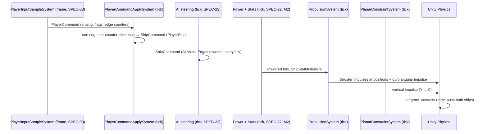

# SPEC-20 — Flight and propulsion

| | |
|---|---|
| **Status** | Draft |
| **Area code** | FLT (task IDs are `FLT-001`, `FLT-002`, …) |
| **Module(s)** | `Game.Simulation` (folders `Assets/Game/Simulation/Commands/`, `Assets/Game/Simulation/Flight/`, `Assets/Game/Simulation/Common/`); `Game.Data` (`Assets/Game/Data/Components/PlanarConstraint.cs`, `Assets/Game/Data/Definitions/Flight/`) |
| **Depends on specs** | SPEC-02 (`SimTime`, `SimClock`, `ShipCommandGroup`, `GameplayPrePhysicsGroup`, `GameInitGroup`, `GameLog.Burst`, `Planar`); SPEC-03 (writes `PlayerCommand`); SPEC-04 (`BlockDefsRef`, `OrientationTablesRef`, `BlockModuleId`, `ThrusterParams`, `BlockModulesRef`, block frame convention); SPEC-10 (`VoxelGrid`, `BlockInstance`, `FunctionalBlock`, `FunctionalComponentRegistration`, `GridSpawnSystem`, `GridSpawning`, `GridSpawnFlags.PlanarInertia`); SPEC-12 (body components, `PhysicsMass` with planar inertia); SPEC-13 contract (`Hulk`); SPEC-22 contract, M2 only (`ShipStats` multipliers, `Powered`) |
| **Depended on by** | SPEC-03 (`PlayerCommand`, `ShipCommandFlags`, `PlayerEdgeCounters`); SPEC-01 (`FlightConfig` boot singleton); SPEC-13 (`PlanarConstraint`); SPEC-21 (`ShipCommand.FireGroups/AimWorld/Edges`, `GridSpaceMath`); SPEC-22 (`ShipCommand`, `FlightMath.GyroYawTorque`, `GridSpaceMath`); SPEC-23 (writes AI `ShipCommand`, reads `FlightState`); SPEC-24 (ability edges); SPEC-31 (`PlayerShip`, interact edge counter); SPEC-61 (`PlayerShip`, `FlightState`, boost flag); SPEC-62 (`PlayerShip`, smoothing); SPEC-63/64 (`ThrusterState`, `ThrusterVisual`) |
| **Milestone** | M1 (FLT-012 in M2) |

> Read [01-architecture.md](../01-architecture.md) (§5, §5.1, §6.4, §8, §11), [02-conventions.md](../02-conventions.md), [03-glossary.md](../03-glossary.md), [07-implementation-traps.md](../07-implementation-traps.md) §2 and §4, [ADR-0003](../decisions/ADR-0003-planar-flight.md), and [SPEC-12](SPEC-12-voxel-physics.md) before this spec. This spec may not contradict them.

## 1. Purpose

This spec turns "who controls the ship" into physical motion. A ship is flown through one component, `ShipCommand`, written either from the player's input (`PlayerCommandApplySystem`) or by the AI (SPEC-23). `PropulsionSystem` converts the command into **impulses from the ship's actual thrusters at their actual positions**, plus a modest reaction torque from the core, so ships with lost or off-centre thrusters really fly differently, rams push ships through Unity Physics, and nothing ever overwrites velocity. A flight assist chooses thruster throttles (a small bounded least-squares allocation) so that the commanded velocities are reached when the ship's thrusters allow it. `PlanarConstraintSystem` keeps ships on the flight plane (ADR-0003). The old prototype overwrote `PhysicsVelocity` every frame (rams had no physical response, 01-B13), used frame-rate-dependent drag, ran movement in the variable-rate group, ignored mass (speed = thrust) and never updated the centre of mass (01-B14). Each of those is impossible here by construction.

## 2. Scope

**In scope:**
- `ShipCommand`, `ShipCommandFlags`, `ShipCommandEdges`, `PlayerCommand`, `PlayerEdgeCounters`, `PlayerEdgeConsumed`, `PlayerShip` (architecture §6.4).
- `PlayerCommandApplySystem`: player command → the player ship's `ShipCommand`, including edge consumption.
- Thruster functional components (`ThrusterState`, `ThrusterVisual`) and their registration/initialisation.
- `FlightConfig` (+ definition), `FlightState`, `FlightThruster` buffer, `FlightSetup` (profile registration, ADR-0015), `PlanarConstraint`, `GridSpaceMath`, `FlightMath`, `ThrustAllocator`.
- `PropulsionSystem` (flight assist, allocation, impulses, thruster intensities) and `PlanarConstraintSystem`.
- Flight tuning against legacy blueprints, flight scenarios, determinism and performance tests.

**Out of scope (and who owns it instead):**
- Sampling the keyboard and mouse into `PlayerCommand`: SPEC-03. Camera: SPEC-62.
- AI decisions and steering that write AI ships' `ShipCommand`: SPEC-23.
- Power allocation, `Powered` bits, `ShipStats` and stat multipliers: SPEC-22. Abilities that boost speed: SPEC-24.
- Body components, mass, inertia and colliders: SPEC-12. Ram damage: SPEC-13.
- Thruster plumes and engine sound: SPEC-63/SPEC-64 (read `ThrusterState`/`ThrusterVisual`).
- Supercruise and lane jumps: SPEC-32. Weapons aiming and firing: SPEC-21 (read `ShipCommand`).

## 3. Decisions (binding)

1. **`ShipCommand` is the only control interface.** Player and AI write the same component; flight, power and weapons read it. Reason: architecture §6.4.
2. **Thrusters push, they never set velocity.** `PropulsionSystem` applies one impulse per firing thruster at the thruster's position (`ApplyImpulse` with `PhysicsMass`), plus one angular impulse from the core gyro. `PlanarConstraintSystem` applies vertical impulses only. Reason: architecture §8, traps T4.1, M1 exit gate (off-centre thrust turns the ship; rams push).
3. **Flight assist is always on in v1** and is part of propulsion, not of the input: the command is a target (strafe velocity, forward velocity or coast, yaw rate), and the allocator chooses throttles that reach it within the thrusters' limits. `Brake` targets zero velocity and zero yaw rate. Reason: controllable ships with physical thrusters; one model for player and AI.
4. **Forward coasting.** With `Thrust.y == 0` the forward target is the current forward speed clamped to the caps, so the ship coasts; lateral drift and yaw rate are always driven to their targets (0 with no input). Reason: readable combat on a plane; no ice-skating.
5. **Thruster geometry comes from the block frame** (SPEC-04 decision 9): force direction = block-local −Z rotated by the instance orientation; application point = the instance's footprint centre; both grid-local. Only the horizontal (XZ) part of the direction is used; a thruster with less than 1% horizontal component contributes nothing. Reason: planar flight; vertical thrust would fight the plane constraint.
6. **The core provides a reaction torque** about Y: `GyroTorque = min(Iyy × CoreYawAccel, CoreMaxYawTorque)` for every live ship (not a hulk). Small ships turn on their core alone; large ships need thrusters to turn quickly. Reason: legacy ships have aft-only thrusters and must still turn in place; building lateral thrusters pays off on big ships (pillar 2).
7. **Throttle allocation is deterministic** projected Gauss–Seidel on a weighted least-squares problem with box bounds, a fixed number of sweeps, actuators in a fixed order, warm-started from last tick's throttles (§5.4). Reason: same inputs → same throttles at any frame rate.
8. **Edges are consumed one per tick.** `PlayerCommandApplySystem` turns each `PlayerEdgeCounters` counter difference into one `ShipCommandEdges` bit for one tick and advances its consumed copy by one. `ShipCommand.Edges` is valid only during the tick it was written; every `ShipCommand` writer rewrites `Edges` every tick (0 when nothing happened). Variable-rate consumers (SPEC-31 interaction) read `PlayerCommand` counters with their own consumed copy instead. Reason: SPEC-03 decision 4; a 6-tick frame fires an edge once and a 0-tick frame loses nothing.
9. **Planar constraint by impulses and inertia.** SPEC-12 locks X/Z rotation in `PhysicsMass`; `PlanarConstraintSystem` removes vertical velocity and pulls `Position.y` back to 0 with a velocity bias (`PlaneCorrection` per tick). It never writes `LocalTransform`. Reason: architecture §8 (only `OriginRebaseSystem` shifts transforms; Unity Physics integrates).
10. **The thruster list is rebuilt per ship when `VoxelGrid.Revision` changes** (O(block instances) per changed ship, carrying throttles over by instance index), never per tick. Reason: architecture §11.1; no dependency on SPEC-22 in M1.
11. **M1 runs without SPEC-22.** In M1 every thruster is treated as powered and every multiplier is 1. FLT-012 (M2) reads `ShipStatMultipliers` and `Powered` when present, makes thrusters power consumers (ADR-0014: `PowerRequest` element, `ThrusterPowerDemandSystem`) and owns `PropulsionStats`. Reason: M1 exit gate "fly a ship built from blocks" precedes power (M2).
12. **Turn sign:** `Turn = +1` turns right: yaw increases, +Z rotates toward +X, `Angular.y > 0` (SPEC-02 `Planar`, SPEC-03 bindings). Ship forward = grid +Z, up = +Y.
13. **Folders and namespaces:** `Assets/Game/Simulation/Commands/` → `Game.Simulation.Commands`; `Assets/Game/Simulation/Flight/` → `Game.Simulation.Flight` (jobs in `Flight/Jobs/`, same namespace); `Assets/Game/Simulation/Common/` → `Game.Simulation.Common`; `PlanarConstraint` in `Assets/Game/Data/Components/` → `Game.Data.Components` (Voxel code reads it, SPEC-13).
14. **Profiler markers** `<SystemName>.<Step>` on main-thread steps; jobs are profiled by name.

## 4. Data model

All types are **public contract** unless marked *internal*.

### 4.1 Commands (`Simulation/Commands/`, namespace `Game.Simulation.Commands`)

```csharp
namespace Game.Simulation.Commands
{
    using Unity.Entities; using Unity.Mathematics;

    [System.Flags] public enum ShipCommandFlags : byte { None = 0, Boost = 1, Brake = 2 }   // add at the end only

    /// <summary>One-tick action requests (decision 8). Add at the end only.</summary>
    [System.Flags] public enum ShipCommandEdges : ushort
    {
        None = 0, Interact = 1, Ability1 = 2, Ability2 = 4, Ability3 = 8, Ability4 = 16,
        TargetNext = 32, TargetUnderCursor = 64, TargetClear = 128, AutofireToggle = 256,
    }

    /// <summary>Per-ship control input (architecture §6.4). On every ship root (FlightSetup).
    /// Writers: PlayerCommandApplySystem for the PlayerShip; SPEC-23 AI steering for AI ships. Implements SPEC-20 §4.1.</summary>
    public struct ShipCommand : IComponentData
    {
        public float2 Thrust;            // x = strafe (+ right), y = forward (+) / reverse (−); each −1..1
        public float Turn;               // −1..1; + = turn right (decision 12)
        public float3 AimWorld;          // local-frame aim point for weapons (SPEC-21)
        public byte AimValid;            // 1 if AimWorld is meaningful this tick
        public ShipCommandFlags Flags;
        public ShipCommandEdges Edges;   // valid only during the tick it was written (decision 8)
        public uint FireGroups;          // bit g = fire group g held
    }

    /// <summary>Press counters (SPEC-03 decision 4). Wrap at 255; only differences matter.</summary>
    public struct PlayerEdgeCounters
    {
        public byte Interact, Ability1, Ability2, Ability3, Ability4, TargetNext, TargetUnderCursor, TargetClear, AutofireToggle;
        public byte Cruise;              // SPEC-03 Flight/Cruise; not a ship edge: consumed only by SPEC-32 TravelService (M4) as a
                                         // variable-rate edge. Present from M0 so the struct (and SPEC-71 replays) never change size
    }

    /// <summary>Singleton written once per frame by PlayerInputSampleSystem (SPEC-03) only. Implements SPEC-20 §4.1.</summary>
    public struct PlayerCommand : IComponentData
    {
        public float2 Thrust;
        public float Turn;
        public float3 AimWorld;
        public byte AimValid;
        public ShipCommandFlags Flags;
        public uint FireGroups;
        public PlayerEdgeCounters Edges;
        public uint FrameIndex;          // UnityEngine.Time.frameCount of the sample (diagnostics, replay)
    }

    /// <summary>Singleton: counters already turned into ShipCommandEdges. Only writer: PlayerCommandApplySystem (created in its OnCreate).</summary>
    public struct PlayerEdgeConsumed : IComponentData { public PlayerEdgeCounters Value; }

    /// <summary>Tag on the player's current ship root (architecture §6.4). Added by the PlayerShip grid profile (ADR-0015).</summary>
    public struct PlayerShip : IComponentData { }
}
```

### 4.2 Planar constraint (`Game.Data`)

```csharp
namespace Game.Data.Components
{
    /// <summary>Tag: the root stays on the flight plane Y = 0 and rotates about Y only (ADR-0003). Read by SPEC-13; enforced by
    /// PlanarConstraintSystem (SPEC-20) and SPEC-12's planar inertia. Implements SPEC-20 §4.2.</summary>
    public struct PlanarConstraint : Unity.Entities.IComponentData { }
}
```

### 4.3 Flight components (`Simulation/Flight/`, namespace `Game.Simulation.Flight`)

```csharp
namespace Game.Simulation.Flight
{
    using Unity.Entities; using Unity.Mathematics;

    [System.Flags] public enum FlightFlags : byte { None = 0, Initialized = 1, Firing = 2, HulkIdled = 4 }

    /// <summary>Per-ship flight state on the root. Only writer: PropulsionSystem. Implements SPEC-20 §4.3.</summary>
    public struct FlightState : IComponentData
    {
        public uint SourceRevision;      // VoxelGrid.Revision the FlightThruster buffer was built from
        public float Gyro;               // last gyro throttle −1..1 (warm start)
        public float GyroTorque;         // N·m available this tick
        public float2 LocalVelocity;     // m/s: x = strafe (+ right), y = forward
        public float YawRate;            // rad/s, + = turning right
        public float ForwardCap, ReverseCap, StrafeCap;   // m/s this tick, after multipliers and boost
        public float YawRateCap;         // rad/s this tick
        public float2 TargetLocalVelocity; // the assist target this tick (x strafe, y forward)
        public float TargetYawRate;
        public FlightFlags Flags;
    }

    /// <summary>One usable thruster of the ship, grid-local. Rebuilt when VoxelGrid.Revision changes. Only writer: PropulsionSystem.</summary>
    [InternalBufferCapacity(0)]
    public struct FlightThruster : IBufferElementData   // 44 bytes (Q9)
    {
        public Entity Thruster;          // functional entity
        public int InstanceIndex;        // BlockInstance index
        public float3 PositionLocal;     // grid-local metres: footprint centre (GridSpaceMath.InstanceCenter)
        public float3 ForceDirLocal;     // grid-local unit vector, Y = 0 (decision 5)
        public float MaxForce;           // N = ThrusterParams.ThrustNewtons
        public float Throttle;           // last solved throttle 0..BoostThrottle (warm start)
    }

    /// <summary>On every thruster functional entity (registered for BlockModuleId.Thruster). Only writer: PropulsionSystem.
    /// Read by SPEC-63 (plumes) and SPEC-64 (engine loop).</summary>
    public struct ThrusterState : IComponentData { public float Intensity; }   // 0..1, smoothed

    /// <summary>Static nozzle geometry, grid space. Only writer: ThrusterInitSystem (once per new or re-parented thruster).</summary>
    public struct ThrusterVisual : IComponentData
    {
        public float3 NozzleLocal;       // grid-local metres: centre of the exhaust face
        public float3 ExhaustDirLocal;   // grid-local unit vector (= −force direction, full 3D)
        public float NozzleRadius;       // metres
    }

    /// <summary>Singleton, created at boot by SPEC-01 BootSingletons from config_flight. Implements SPEC-20 §4.3.</summary>
    public struct FlightConfig : IComponentData
    {
        public float MaxForwardSpeed;      // 120 m/s
        public float ReverseSpeedFraction; // 0.5 of MaxForwardSpeed
        public float StrafeSpeedFraction;  // 0.6 of MaxForwardSpeed
        public float BoostSpeedMultiplier; // 1.5 (forward cap only)
        public float BoostThrottle;        // 1.25 (max thruster throttle while boosting)
        public float MaxYawRateDeg;        // 120 deg/s
        public float LinearAssistGain;     // 0.5: fraction of the velocity error corrected per tick before saturation
        public float AngularAssistGain;    // 0.5
        public float TorqueWeight;         // 2.0: allocation weight of yaw relative to linear force
        public int AllocationSweeps;       // 6
        public float CoreYawAccelDeg;      // 60 deg/s²: gyro torque = Iyy × this, capped
        public float CoreMaxYawTorque;     // 2.0e6 N·m
        public float ThrottleEpsilon;      // 0.001: smaller throttles are 0
        public float PlaneCorrection;      // 0.2: fraction of the Y offset removed per tick
        public float IntensityRise;        // 0.35: ThrusterState.Intensity EMA factor when rising
        public float IntensityFall;        // 0.15: EMA factor when falling
        public static FlightConfig Default => new FlightConfig {
            MaxForwardSpeed = 120f, ReverseSpeedFraction = 0.5f, StrafeSpeedFraction = 0.6f, BoostSpeedMultiplier = 1.5f,
            BoostThrottle = 1.25f, MaxYawRateDeg = 120f, LinearAssistGain = 0.5f, AngularAssistGain = 0.5f, TorqueWeight = 2f,
            AllocationSweeps = 6, CoreYawAccelDeg = 60f, CoreMaxYawTorque = 2.0e6f, ThrottleEpsilon = 0.001f,
            PlaneCorrection = 0.2f, IntensityRise = 0.35f, IntensityFall = 0.15f };
    }
}
```

### 4.4 Definition (`Assets/Game/Data/Definitions/Flight/`, namespace `Game.Data.Definitions`)

```csharp
[ContentIdPrefix("config_")]
[UnityEngine.CreateAssetMenu(menuName = "Game/Content/Flight Config", fileName = "config_flight")]
public sealed class FlightConfigDefinition : ContentDefinition      // single instance: config_flight
{
    // One [SerializeField] per FlightConfig field, camelCase, same defaults, with these attributes:
    // maxForwardSpeed [Min(1)], reverseSpeedFraction [Range(0,1)], strafeSpeedFraction [Range(0,1)],
    // boostSpeedMultiplier [Range(1,3)], boostThrottle [Range(1,2)], maxYawRateDeg [Range(5,720)],
    // linearAssistGain [Range(0.05,1)], angularAssistGain [Range(0.05,1)], torqueWeight [Range(0.1,10)],
    // allocationSweeps [Range(1,16)], coreYawAccelDeg [Range(0,720)], coreMaxYawTorque [Min(0)],
    // throttleEpsilon [Range(0,0.05)], planeCorrection [Range(0.01,1)], intensityRise [Range(0.01,1)], intensityFall [Range(0.01,1)]
    // Public getters with the same names in PascalCase.
    public override void Validate(ValidationScope scope, ContentValidationContext context);   // FLT-E001 (§7)
}
```

`FlightConfigFactory.Create(FlightConfigDefinition def) → FlightConfig` (`Simulation/Flight/`) copies every field.

### 4.5 Helpers (public contract, Burst-compatible)

```csharp
namespace Game.Simulation.Common
{
    using Unity.Mathematics; using Unity.Transforms; using Game.Data.Blocks;

    /// <summary>Grid-space geometry of block instances (SPEC-04 decisions 8–9). Used by SPEC-20/21/22. Implements SPEC-20 §4.5.</summary>
    public static class GridSpaceMath
    {
        public static float3 CellCenter(int3 cell, float cellSize) => ((float3)cell + 0.5f) * cellSize;
        /// Centre of the rotated footprint bounding box: (origin + 0.5 + R(o)·((BoundsMin + BoundsMax) / 2)) × cellSize.
        public static float3 InstanceCenter(ref BlockDef def, ref OrientationTablesBlob ot, byte orient, int3 origin, float cellSize);
        /// Block-local point in cells relative to the root cell centre → grid-local metres: (origin + 0.5 + R(o)·p) × cellSize.
        public static float3 BlockPointToGrid(float3 blockLocalCells, ref OrientationTablesBlob ot, byte orient, int3 origin, float cellSize);
        /// Block-local direction → grid-local direction (R(o)·d; length preserved).
        public static float3 BlockDirToGrid(float3 dir, ref OrientationTablesBlob ot, byte orient);
        public static float3 GridToWorldPoint(in LocalTransform root, float3 gridLocal) => root.TransformPoint(gridLocal);
        public static float3 GridToWorldDir(in LocalTransform root, float3 gridDir) => math.rotate(root.Rotation, gridDir);
        public static float3 WorldToGridPoint(in LocalTransform root, float3 world) => root.InverseTransformPoint(world);
        public static float3 WorldToGridDir(in LocalTransform root, float3 worldDir) => math.rotate(math.inverse(root.Rotation), worldDir);
    }
}

namespace Game.Simulation.Flight
{
    using Unity.Mathematics;

    /// <summary>Flight formulas shared with SPEC-22 (stats), SPEC-23 (AI) and SPEC-61 (HUD). Implements SPEC-20 §5.3.</summary>
    public static class FlightMath
    {
        /// N·m of core reaction torque: min(Iyy × radians(CoreYawAccelDeg), CoreMaxYawTorque); 0 if inverseInertiaY ≤ 0.
        public static float GyroYawTorque(in FlightConfig c, float inverseInertiaY);
        /// Caps after multipliers. Boost raises the forward cap only.
        public static void SpeedCaps(in FlightConfig c, float maxSpeedMultiplier, bool boost, out float forward, out float reverse, out float strafe);
        public static float YawRateCap(in FlightConfig c, float turnRateMultiplier) => math.radians(c.MaxYawRateDeg) * turnRateMultiplier;
        /// World velocity → (strafe, forward) in the ship's frame.
        public static float2 ToLocalPlanar(float3 worldVelocity, quaternion rotation);
        /// Assist targets of §5.3 step 4 for one ship.
        public static void Targets(in FlightConfig c, float2 thrust, float turn, Commands.ShipCommandFlags flags, float2 localVelocity,
                                   float forwardCap, float reverseCap, float strafeCap, float yawRateCap,
                                   out float2 targetVelocity, out float targetYawRate);
    }

    /// <summary>One allocation problem (§5.4). Actuator columns are (Fx, Fz, τy) per unit throttle in the ship frame.</summary>
    public struct ThrustProblem
    {
        public float3 Target;            // desired (Fx N, Fz N, τy N·m)
        public float3 Weights;           // per-row weights (wx, wz, wτ)
        public int Sweeps;
    }

    public struct ThrustActuator { public float3 Column; public float Min, Max; }

    public static class ThrustAllocator
    {
        /// Projected Gauss–Seidel (§5.4). u holds the warm start on entry and the result on exit (same length as actuators).
        /// Returns the final weighted residual norm². No allocation.
        public static float Solve(in ThrustProblem p, Unity.Collections.NativeArray<ThrustActuator> actuators, Unity.Collections.NativeArray<float> u);
    }

    /// <summary>Root composition of flying grids (ADR-0015). Registered once; GridSpawnSystem adds the types at conversion.</summary>
    public static class FlightSetup
    {
        /// ShipCommand, FlightState, FlightThruster buffer, PropulsionStats, Game.Data.Components.PlanarConstraint (all zero/empty).
        public static Unity.Entities.ComponentTypeSet RootTypes { get; }
        /// Appends RootTypes for GridProfile PlayerShip, NpcShip, SmallCraft, Dummy, and PlayerShip (tag) for GridProfile.PlayerShip,
        /// to the RootComponentRegistration buffer (SPEC-10 §5.13). Called by ThrusterInitSystem.OnCreate.
        public static void Register(Unity.Entities.DynamicBuffer<Game.Voxel.Model.RootComponentRegistration> registrations);
    }

    /// <summary>Feature stats of propulsion (ADR-0014). On every ship root (FlightSetup). Only writer: PropulsionStatsSystem (M2).</summary>
    public struct PropulsionStats : Unity.Entities.IComponentData
    {
        // Functional part: recomputed when ShipStats.FunctionalRevision != SourceRevision
        public float ForwardThrust, ReverseThrust, StrafeThrust;  // N (strafe = min of left and right)
        public float YawTorque;         // N·m = min(Σ positive yaw torques, Σ |negative yaw torques|) of the thrusters
        public float ThrusterDraw;      // E/s at full throttle
        public int AliveThrusterCount;
        public uint SourceRevision;
        // Mass part: recomputed when the functional part, PhysicsMass or ShipStatMultipliers changed
        public float GyroYawTorque;     // N·m = FlightMath.GyroYawTorque(FlightConfig, InverseInertia.y)
        public float ForwardAccel;      // m/s² = ForwardThrust × Thrust multiplier / ShipStats.Mass
        public float ReverseAccel;      // m/s²
        public float StrafeAccel;       // m/s²
        public float YawAccelDeg;       // deg/s² = degrees((YawTorque × Thrust mult + GyroYawTorque) × TurnRate mult × InverseInertia.y)
        public float TurnRateDeg;       // deg/s: 90 / t90 with t90 = 2·sqrt((π/2) / yawAccelRad); 0 if yawAccel = 0
    }

}
```

### 4.6 Ownership summary

| State | Only writer |
|---|---|
| `PlayerCommand` | `PlayerInputSampleSystem` (SPEC-03) |
| `PlayerEdgeConsumed` | `PlayerCommandApplySystem` |
| `ShipCommand` of the `PlayerShip` | `PlayerCommandApplySystem` |
| `ShipCommand` of AI ships | SPEC-23 steering (queries `WithNone<PlayerShip>`) |
| `FlightState`, `FlightThruster`, `ThrusterState` | `PropulsionSystem` |
| `ThrusterVisual`; the `Thruster` element's `Draw`/`Priority` in `PowerRequest` (M2) | `ThrusterInitSystem` |
| The `Thruster` element's `Requesting` (M2) | `ThrusterPowerDemandSystem` |
| `PropulsionStats` (M2) | `PropulsionStatsSystem` |
| `PhysicsVelocity` | as architecture §8; this spec adds impulses from `PropulsionSystem` and `PlanarConstraintSystem` only |

Memory: per ship root `ShipCommand` 40 B + `FlightState` 64 B + buffer header; `FlightThruster` 44 B per thruster outside the chunk; per thruster entity `ThrusterState` 4 B + `ThrusterVisual` 28 B. 50 ships × 20 thrusters ≈ 80 KB.

## 5. Systems, services and flow

### 5.0 Placement

| System | Group and order | Burst | Requires |
|---|---|---|---|
| `PlayerCommandApplySystem` | `ShipCommandGroup`, `OrderFirst = true` | yes | `GameplayActive`, `PlayerCommand` |
| `ThrusterInitSystem` | `GameInitGroup`, `[UpdateAfter(typeof(GridSpawnSystem))]`; M2 (FLT-012) also `[UpdateBefore(typeof(PowerInitSystem))]` | yes | `GameplayActive`, `BlockDefsRef`, `BlockModulesRef`, `OrientationTablesRef` |
| `ThrusterPowerDemandSystem` (M2) | `PowerDemandGroup` (SPEC-22) | yes | `GameplayActive` |
| `PropulsionStatsSystem` (M2) | `GameplayPrePhysicsGroup`, `[UpdateAfter(typeof(ShipStatsAggregateSystem))]`, `[UpdateBefore(typeof(PropulsionSystem))]` | yes | `GameplayActive`, `FlightConfig`, `BlockModulesRef` |
| `PropulsionSystem` | `GameplayPrePhysicsGroup`; M1: no ordering attribute (first after `ShipCommandGroup`); M2 (FLT-012): `[UpdateAfter(typeof(PropulsionStatsSystem))]` | yes | `GameplayActive`, `FlightConfig`, `BlockDefsRef`, `OrientationTablesRef` |
| `PlanarConstraintSystem` | `GameplayPrePhysicsGroup`, `[UpdateAfter(typeof(PropulsionSystem))]` | yes | `GameplayActive`, `FlightConfig` |

Order inside the tick (architecture §5): `ShipCommandGroup` (player apply, AI) → `PowerDemandGroup` → `PowerAllocationSystem` → `ShipStatsAggregateSystem` → `PropulsionStatsSystem` → `PropulsionSystem` → `PlanarConstraintSystem` → `WeaponAimSystem` (SPEC-21 declares `[UpdateAfter(typeof(PlanarConstraintSystem))]`) → … → physics.

### 5.1 `PlayerCommandApplySystem`

`OnCreate`: `RequireForUpdate<GameplayActive>`, `RequireForUpdate<PlayerCommand>`; create the `PlayerEdgeConsumed` singleton (`EntityManager.CreateEntity` in `OnCreate` is allowed) with `Value = default`; build `playerQuery = WithAll<PlayerShip, ShipCommand>().WithNone<Hulk>()` and `anyPlayerQuery = WithAll<PlayerShip>()`. From M3 (added by SPEC-32 TRV-007) it also creates the `PlayerControlLock` singleton (`Game.Simulation.Commands`, SPEC-32 §4.2) with `Flags = None`.

Per tick (marker `PlayerCommandApplySystem.Apply`), main thread then one job:
1. `pc = SystemAPI.GetSingleton<PlayerCommand>()` (written on the main thread by a managed system: no job to complete). `ref consumed = ref SystemAPI.GetSingletonRW<PlayerEdgeConsumed>().ValueRW.Value` (only this system touches it; no jobs).
2. If `playerQuery.IsEmptyIgnoreFilter` (no live player ship): `consumed = pc.Edges` (drop pending presses); return.
3. Edges: for each of the 9 ship counters in declaration order (`Interact` … `AutofireToggle`; `Cruise` is skipped, it is not a ship edge): `if (pc.Edges.X != consumed.X) { edges |= ShipCommandEdges.X; consumed.X = (byte)(consumed.X + 1); }` — one per tick (decision 8).
4. `cmd = new ShipCommand { Thrust = clamp(pc.Thrust, −1, 1), Turn = clamp(pc.Turn, −1, 1), AimWorld = pc.AimWorld, AimValid = pc.AimValid, Flags = pc.Flags, Edges = edges, FireGroups = pc.FireGroups }`; non-finite floats → 0 (`AimWorld` non-finite → `AimValid = 0`).
4b. **Control lock** (M3, TRV-007): `lockFlags = SystemAPI.GetSingleton<PlayerControlLock>().Flags` (written on the main thread by `TravelService`; no job to complete). If `Movement`: `Thrust = 0`, `Turn = 0`, `Flags = (Flags & ~Boost) | Brake`. If `Actions`: `FireGroups = 0`, `Edges = None` (the counters were still consumed in step 3, so presses made while locked never fire later). `AimWorld`/`AimValid` are unchanged.
5. `state.Dependency = new PlayerCommandWriteJob { Command = cmd }.Schedule(playerQuery, state.Dependency)` (`IJobEntity`, single-threaded `Schedule`; writes `ShipCommand` of every matching entity; with two player ships both get it, and SPEC-62/61 warn).

Hulk player ship: excluded by `WithNone<Hulk>` → step 2 drops edges; its `ShipCommand` keeps the last value but `PropulsionSystem` skips hulks.

### 5.2 `ThrusterInitSystem`

`OnCreate` (`[CreateAfter(typeof(GridSpawnSystem))]`): `FlightSetup.Register(rootRegistrations)` (ADR-0015); append to the `FunctionalComponentRegistration` singleton buffer `{ BlockModuleId.Thruster, ComponentType.ReadWrite<ThrusterState>() }` and `{ BlockModuleId.Thruster, ComponentType.ReadWrite<ThrusterVisual>() }` (SPEC-10 §6; a buffer append, not a structural change).

Per frame: `ThrusterVisualInitJob : IJobEntity` (`ScheduleParallel`) over entities with `FunctionalBlock`, `ThrusterVisual`, **`WithChangeFilter<FunctionalBlock>`** (new entities from `FunctionalFillJob` and entities re-parented by SPEC-13 change it). For each: `g = FunctionalBlock.Grid` (lookup `VoxelGrid`, `BlockInstance`); missing → skip. `inst = BlockInstance[g][InstanceIndex]`; `def = Blocks[inst.Block]`; `!def.HasModule(BlockModuleId.Thruster)` → skip. Then:
- `size = def.BoundsMax − def.BoundsMin + 1`; `c = (def.BoundsMin + def.BoundsMax) / 2f`;
- `NozzleLocal = BlockPointToGrid(new float3(c.x, c.y, def.BoundsMax.z + 0.5f), ot, inst.Orient, inst.Origin, s)`;
- `ExhaustDirLocal = BlockDirToGrid(new float3(0, 0, 1), ot, inst.Orient)`;
- `NozzleRadius = 0.5f × min(size.x, size.y) × s`.
Writes `ThrusterVisual` only (each entity by its own chunk worker). Cost O(new thrusters).

### 5.3 `PropulsionSystem`

Query: roots with `ShipCommand`, `FlightState`, `FlightThruster`, `VoxelGrid`, `BlockInstance`, `LocalTransform`, `PhysicsVelocity`, `PhysicsMass`; `WithNone<Hulk>`; skip entities whose `GridSpawning` is enabled (lookup). Job `PropulsionJob : IJobEntity`, `ScheduleParallel` (one root per execute; each root's thrusters are written only by that execute).

Lookups: `[ReadOnly]` `BlockDefsRef` blob, `OrientationTablesRef` blob, `EntityStorageInfoLookup`, `ComponentLookup<GridSpawning>`; `[NativeDisableParallelForRestriction] ComponentLookup<ThrusterState>` (RW) with the comment "each thruster entity belongs to exactly one ship root and is written only by that root's execute (SPEC-20 §5.3)". M2 adds `[ReadOnly] ComponentLookup<ShipStats>` and `[ReadOnly] ComponentLookup<Powered>` (FLT-012).

Per ship (`dt = SimTime.FixedTimestep`, `c = FlightConfig`):
1. **Body:** `InverseMass ≤ 0` → skip (kinematic/static). `M = 1 / InverseMass`; `invIyy = PhysicsMass.InverseInertia.y`; `Iyy = invIyy > 0 ? 1 / invIyy : 0`; `com = PhysicsMass.CenterOfMass`; `rot = LocalTransform.Rotation`.
2. **Thruster list** (marker none; inside job): if `(Flags & Initialized) == 0` or `SourceRevision != VoxelGrid.Revision`: build a new list in a `FixedList4096Bytes<FlightThruster>`-sized scratch or a `NativeList` (`Allocator.Temp`) by walking `BlockInstance` in index order: instance `i` with `Block != 0`, `(Flags & Destroyed) == 0`, `def.HasModule(BlockModuleId.Thruster)`, `Functional != Entity.Null` and existing: `d = BlockDirToGrid((0,0,−1), ot, Orient)`; `h = (d.x, 0, d.z)`; `|h| < 0.01` → skip; `ForceDirLocal = normalize(h)`; `PositionLocal = InstanceCenter(...)`; `MaxForce` = `ThrustNewtons` of the block's `ThrusterParams` row (`BlockModulesBlob.TryGet`, SPEC-04 §4.6); `Throttle` = the old entry's throttle with the same `InstanceIndex` (merge walk; both lists are in index order), else 0. Replace the buffer contents; `SourceRevision = Revision`; set `Initialized`.
3. **Kinematics:** `v = PhysicsVelocity.Linear`; `local = FlightMath.ToLocalPlanar(v, rot)`; `ωy = math.rotate(math.mul(rot, PhysicsMass.InertiaOrientation), PhysicsVelocity.Angular).y`.
4. **Targets:** multipliers `ms = mt = mr = 1` (M2: `ShipStatMultipliers.Get(StatId.MaxSpeed / Thrust / TurnRate)` if the root has `ShipStatMultipliers`). `boost = (cmd.Flags & Boost) != 0 && (cmd.Flags & Brake) == 0`. `SpeedCaps(c, ms, boost, …)`, `yawCap = YawRateCap(c, mr)`. `Targets(...)`:
   - `Brake` → target velocity `(0, 0)`, target yaw rate 0.
   - Else `tx = clamp(Thrust.x, −1, 1) × strafeCap`; `tz = Thrust.y > 0 ? Thrust.y × forwardCap : Thrust.y < 0 ? Thrust.y × reverseCap : clamp(local.y, −reverseCap, forwardCap)`; `tω = clamp(Turn, −1, 1) × yawCap`.
   - Sanitise: any non-finite command field is treated as 0.
5. **Required generalized force** (ship frame): `Fx = M × (tx − local.x) × LinearAssistGain / dt`; `Fz = M × (tz − local.y) × LinearAssistGain / dt`; `τ = Iyy × (tω − ωy) × AngularAssistGain / dt`.
6. **Actuators** (`Allocator.Temp` arrays, thrusters in buffer order, then the gyro):
   - thruster `k`: usable = entity exists (and M2: `Powered` enabled if the entity has `Powered`); `r = PositionLocal − com`; `τk = cross(r, ForceDirLocal).y`; `Column = MaxForce × mt × (ForceDirLocal.x, ForceDirLocal.z, τk)`; `Min = 0`; `Max = usable ? (boost ? BoostThrottle : 1) : 0`; warm start `u = clamp(Throttle, Min, Max)`.
   - gyro: `GyroTorque = FlightMath.GyroYawTorque(c, invIyy) × mr`; `Column = (0, 0, GyroTorque)`; `Min = −1`, `Max = 1`; warm start `FlightState.Gyro`.
7. **Solve:** `Weights = (1/sF, 1/sF, TorqueWeight/sT)` with `sF = max(1, M × 10)` and `sT = max(1, Iyy × 1)`; `ThrustAllocator.Solve` with `AllocationSweeps`. Throttles `< ThrottleEpsilon` (absolute value for the gyro) → 0.
8. **Impulses:** for each thruster with `u > 0`: `F = math.rotate(rot, ForceDirLocal) × (MaxForce × mt × u)`; `p = LocalTransform.TransformPoint(PositionLocal)`; `PhysicsVelocity.ApplyImpulse(PhysicsMass, LocalTransform.Position, rot, F × dt, p)`. Gyro: `L = (0, Gyro × GyroTorque × dt, 0)` world → `PhysicsVelocity.ApplyAngularImpulse(PhysicsMass, math.rotate(math.inverse(math.mul(rot, PhysicsMass.InertiaOrientation)), L))`.
9. **Write back:** throttles into `FlightThruster.Throttle`, `FlightState.Gyro`, `GyroTorque`, `LocalVelocity`, `YawRate = ωy`, caps, targets; `Firing` flag = any thruster `u > 0`. `ThrusterState.Intensity` per thruster: `target = saturate(u)`; `a = target > I ? IntensityRise : IntensityFall`; `I = I + (target − I) × a`; `I < 0.005` → 0.

**Hulk idle** (second, tiny job `ThrusterIdleJob : IJobEntity`, `Schedule` single-threaded, over roots with `Hulk`, `FlightState`, `FlightThruster`, where `(Flags & HulkIdled) == 0`): set every listed thruster's `ThrusterState.Intensity = 0` (if it exists), set `HulkIdled`. Runs once per ship death.

Complexity: O(thrusters × sweeps) per ship per tick, O(instances) per ship whose `VoxelGrid.Revision` changed. 0 allocations outside `Allocator.Temp`.

### 5.4 `ThrustAllocator.Solve` (projected Gauss–Seidel)

Minimise `Σ_i w_i² (Σ_k A_ik u_k − b_i)²` subject to `Min_k ≤ u_k ≤ Max_k`, rows `i ∈ {Fx, Fz, τ}`.
0. Clamp the warm start to the current actuator bounds before forming the residual (Q11).
1. `r = Σ_k Column_k × u_k − Target` (float3).
2. Repeat `Sweeps` times; for `k = 0..K−1` in order:
   1. `wa = Weights × Column_k` (component-wise); `den = dot(wa, wa)`; `den < 1e-12` → continue.
   2. `Δ = −dot(wa, Weights × r) / den`.
   3. `uNew = clamp(u_k + Δ, Min_k, Max_k)`; `r += Column_k × (uNew − u_k)`; `u_k = uNew`.
3. Return `dot(Weights × r, Weights × r)`. All three-component dot products accumulate float inputs as double products/sums, then round once to float (Q12); vectors, residuals and throttles remain float.
Properties (tested): the residual never increases; the result is a deterministic function of inputs and warm start; with a single forward thruster at the centre line and the gyro, a forward command yields `u = min(required/MaxForce, 1)` and zero gyro.

### 5.5 `PlanarConstraintSystem`

`PlanarImpulseJob : IJobEntity` (`ScheduleParallel`) over roots with `PlanarConstraint`, `PhysicsVelocity`, `PhysicsMass`, `LocalTransform` (hulks included; SPEC-13 gives planar hulks the tag):
1. `InverseMass ≤ 0` → skip.
2. `y = LocalTransform.Position.y`; `vyTarget = −PlaneCorrection × y / dt`; `J = (vyTarget − PhysicsVelocity.Linear.y) / InverseMass`; `PhysicsVelocity.ApplyLinearImpulse(PhysicsMass, new float3(0, J, 0))`.
3. Diagnostics only: if `abs(Rotation.value.x) + abs(Rotation.value.z) > 1e-3` or `|Angular.x| + |Angular.z| > 1e-4` (planar inertia makes both impossible) → `GameLog.Burst.Warn("FLT: planar body tilted")` once per entity index (a `NativeParallelHashSet` is not needed: use a per-job flag and log once per job run). No correction (decision 9).

### 5.6 Flow




### 5.7 Power demand and propulsion stats (M2, FLT-012; ADR-0014)

**`ThrusterPowerDemandSystem`** (`PowerDemandGroup`, Burst `IJobEntity`, `ScheduleParallel` over thruster entities with `PowerRequest`, `FunctionalBlock`, `ThrusterState`): `cmd = ShipCommand[FunctionalBlock.Grid]` (absent → zero); `moving = any(cmd.Thrust ≠ 0) || cmd.Turn ≠ 0`; `PowerRegistration.SetRequesting(requests, Thruster, moving)`. The only writer of the thruster elements' `Requesting`.

**`PropulsionStatsSystem`** (Burst `IJobEntity`, `ScheduleParallel` over roots with `PropulsionStats`, `ShipStats`, `BlockInstance`, `VoxelGrid`; `WithNone<Hulk>`, so hulks keep their last values and are never read for flight; skip `GridSpawning` and `Dormant`):
1. **Functional part**, if `SourceRevision != ShipStats.FunctionalRevision`: zero it; for each alive instance with a `Thruster` row: `F = row.ThrustNewtons`; `d = Orientations.Rotate(new float3(0,0,−1), inst.Orient)` (force direction on the ship, SPEC-04 decision 9); `ForwardThrust += F·max(0, d.z)`, `ReverseThrust += F·max(0, −d.z)`, `right += F·max(0, d.x)`, `left += F·max(0, −d.x)`; `r = GridSpaceMath.InstanceCenter(...) − com` (com = `PhysicsMass.CenterOfMass`, or `ShipStats.BoundsCenter` without mass); `τ = cross(r, F·d).y`; `τ > 0 ? posYaw += τ : negYaw += −τ`; `ThrusterDraw += row.PowerDraw`; `AliveThrusterCount++`. Then `StrafeThrust = min(left, right)`, `YawTorque = min(posYaw, negYaw)`, `SourceRevision = FunctionalRevision`.
2. **Mass part**, if step 1 ran or the chunk's `ShipStats` or `ShipStatMultipliers` changed (`DidChange`): with `m = ShipStats.Mass > 0`, `mt = Get(Thrust)`, `mr = Get(TurnRate)`: `ForwardAccel = ForwardThrust × mt / Mass` (same for reverse and strafe); `GyroYawTorque = FlightMath.GyroYawTorque(FlightConfig, InverseInertia.y)`; `yawAccelRad = (YawTorque × mt + GyroYawTorque) × mr × InverseInertia.y`; `YawAccelDeg = degrees(yawAccelRad)`; `TurnRateDeg = yawAccelRad > 0 ? 90 / (2·sqrt((π/2) / yawAccelRad)) : 0`. Without mass: all accelerations 0.
Complexity: O(1) per untouched ship, O(instances) when the revision changed.
## 6. Public API

| Call / type | Pre-conditions | Post-conditions / errors |
|---|---|---|
| `ShipCommand` (component) | On every flying ship root (`FlightSetup.RootTypes`, ADR-0015) | Read by PWR/WPN/ABL; written only by the writers of §4.6; `Edges` rewritten every tick by its writer |
| `PlayerCommand` (singleton) | Created by `PlayerInputSampleSystem.OnCreate` (SPEC-03) | Read only by `PlayerCommandApplySystem` and variable-rate edge consumers |
| `PlayerControlLock` (singleton, M3) | Created by `PlayerCommandApplySystem.OnCreate` | Only writer: SPEC-32 `TravelService` (main thread, outside the fixed step); read by step 4b |
| `FlightSetup.Register(buffer)` | Once, from `ThrusterInitSystem.OnCreate` | Grids converted with a flying profile (PlayerShip, NpcShip, SmallCraft, Dummy) carry `ShipCommand`, `FlightState`, `FlightThruster`, `PropulsionStats`, `PlanarConstraint`; PlayerShip also `PlayerShip`. SPEC-10 sets `PlanarInertia` for those profiles |
| `GridSpaceMath.*` | Valid blob refs (`ref` access, traps T1.7) | Pure |
| `FlightMath.*`, `ThrustAllocator.Solve` | Arrays of equal length | Pure, deterministic |
| `FlightConfigFactory.Create` | Boot (SPEC-01) | Copies fields |

**Variable-rate edge consumers** (SPEC-31 interaction, SPEC-32 `Cruise`, any presentation code): keep a private `PlayerEdgeCounters lastSeen`; each frame, for counter `X`, `while (lastSeen.X != PlayerCommand.Edges.X) { lastSeen.X++; handle one press; }`. They never read `ShipCommand.Edges`.

**AI writers** (SPEC-23): write `Thrust`, `Turn`, `AimWorld/AimValid`, `FireGroups`, `Flags` as needed and **always** write `Edges` (0 unless an ability or target change is requested this tick). Use `FlightState.LocalVelocity/YawRate` and the caps for steering.

## 7. Edge cases and failure behaviour

| Situation | Required behaviour |
|---|---|
| No thrusters (or all destroyed) | Gyro only: the ship can turn, not translate; no error |
| Thruster mounted vertically (no horizontal component) | Skipped by the thruster list (decision 5) |
| Asymmetric thrusters (one side lost) | The allocator trades forward thrust against unwanted torque; the gyro compensates up to its capacity; beyond that the ship yaws (pillar 1) |
| Boost and Brake held together | Brake wins; boost ignored |
| Velocity above cap after an explosion or ram | Coast target is clamped to the cap, so assist decelerates within thruster limits; never assigns velocity |
| `ShipCommand` with NaN/∞ | Treated as 0 for that field |
| Ship without `PhysicsMass`/`PhysicsVelocity` yet (spawning, body pending) | Skipped by the query |
| Kinematic or static grid with `ShipCommand` | Skipped (`InverseMass ≤ 0`) |
| Player ship becomes a hulk | `PlayerCommandApplySystem` stops writing it and drops edges; thruster intensities go to 0 once |
| Two `PlayerShip` entities | Both receive the command; SPEC-61/62 warn |
| Frame with 0 ticks | Counters accumulate; consumed one per tick later |
| Frame with 6 ticks | Each edge fires on the first tick only (one per counter step) |
| Grid revision changes every tick under fire | Thruster list rebuilt each tick: O(instances) ≤ ~1 µs per 200 instances |
| Thruster destroyed this tick (entity destroyed at the end of the tick) | Next tick the instance is `Destroyed` and the entity is gone → removed from the list |
| `Iyy == 0` (non-planar inertia without Y rotation; should not happen) | Torque row has weight but no actuator can change it; yaw is ignored, linear still works |
| Content: `reverseSpeedFraction` or `strafeSpeedFraction` = 0 | Allowed (no reverse/strafe); FLT-E001 rejects `maxForwardSpeed ≤ 0` |
| Ship far away (`Dormant`, SPEC-11) | Propulsion still runs (architecture §11.9: physics stays on); AI thinks less often |

## 8. Performance budget

| Item | Budget | Test |
|---|---|---|
| `PropulsionSystem` main thread | ≤ 0.03 ms per tick (two job schedules) | `FlightPerfTests.Propulsion_MainThread` (FLT-011) |
| `PropulsionSystem` worker time, 50 ships × 20 thrusters | ≤ 0.15 ms per tick total | `FlightPerfTests.Propulsion50Ships_Under0_15ms` (FLT-011) |
| Thruster list rebuild | ≤ 2 µs per ship with 200 instances | `FlightPerfTests.ThrusterListRebuild` (FLT-011) |
| `PlayerCommandApplySystem` | ≤ 0.01 ms per tick | FLT-011 |
| `PlanarConstraintSystem` | ≤ 0.02 ms per tick for 100 bodies (worker) | FLT-011 |
| GC | 0 B per tick | FLT-011 |

**Scale notes:**
- Per ship per tick: O(T × S) with T thrusters (typically 4–40) and S = 6 sweeps: ≈ 1,000 flops. 50 ships ≈ 50 k flops.
- The thruster list is the only per-ship cache; it is rebuilt from `BlockInstance` (O(instances)) only when `VoxelGrid.Revision` changes; nothing scans cells.
- `ThrusterState` writes touch one 4-byte component per thruster per tick; chunks of thruster entities are shared across ships, so writes from `ScheduleParallel` are race-free only because each entity has one owner (documented on the lookup).
- `ThrusterInitSystem` uses a change filter: idle cost is a chunk-version scan (< 10 µs for 10,000 functional entities).
- Rejected approaches: setting `PhysicsVelocity`; per-thruster jobs; recomputing the thruster list per tick; storing thruster geometry on the thruster entity and reading it through lookups every tick (random access); frame-time-based assist.

## 9. Tasks

### FLT-001 — Public contract types
- **Milestone:** M1
- **Tier:** standard — transcribes the exact code of §4 (bodies throw `NotImplementedException`, except `FlightConfig.Default`, `FlightMath.YawRateCap`, the `GridSpaceMath` one-liners)
- **Depends on:** `CORE-001`, `DATA-001`, `VOX-001`
- **Do:** Create every type of §4.1–§4.5 in the listed folders and namespaces, with exact fields and comments. Create the folders of decision 13.
- **Files:** `Assets/Game/Simulation/Commands/{ShipCommandFlags,ShipCommandEdges,ShipCommand,PlayerEdgeCounters,PlayerCommand,PlayerEdgeConsumed,PlayerShip}.cs`; `Assets/Game/Data/Components/PlanarConstraint.cs`; `Assets/Game/Simulation/Flight/{FlightFlags,FlightState,FlightThruster,ThrusterState,ThrusterVisual,FlightConfig,FlightConfigFactory,FlightMath,ThrustProblem,ThrustActuator,ThrustAllocator,FlightSetup,PropulsionStats}.cs`; `Assets/Game/Simulation/Common/GridSpaceMath.cs`; `Assets/Game/Data/Definitions/Flight/FlightConfigDefinition.cs`
- **Acceptance criteria:**
  - [x] Compiles; no component holds a managed type; `PlanarConstraint` is in `Game.Data.Components`.
  - [x] SPEC-03's `PlayerInputSampleSystem` field list (SPEC-03 §4.4) matches `PlayerCommand` exactly.
- **Tests:** `FlightContractTests.PlayerCommand_HasSpec03Fields` (reflection), `.Components_AreUnmanaged`.

### FLT-002 — Grid-space and flight maths
- **Milestone:** M1
- **Tier:** standard — closed-form formulas given in §4.5 and §5.3
- **Depends on:** `FLT-001`, `SPEC-04`
- **Do:** Implement `GridSpaceMath` and `FlightMath` (`GyroYawTorque`, `SpeedCaps`, `ToLocalPlanar`, `Targets`).
- **Files:** `Assets/Game/Simulation/Common/GridSpaceMath.cs`, `Assets/Game/Simulation/Flight/FlightMath.cs`, `Assets/Game/Tests/EditMode/Simulation/Flight/{GridSpaceMathTests,FlightMathTests}.cs`
- **Acceptance criteria:**
  - [x] `InstanceCenter` of `block_thruster_small` (cells (0,0,0),(0,0,1)) at origin (4,0,7), orientation 0, cell 0.5 m = (2.25, 0.25, 4.0); at the 180° yaw orientation (index 8, SPEC-04 §5.3) = (2.25, 0.25, 3.5).
  - [x] Force direction of a thruster at orientation 8 is grid +Z (it pushes the ship forward), matching SPEC-22's formula.
  - [x] `Targets`: coasting keeps forward speed inside caps; Brake gives zero targets; boost raises only the forward cap.
- **Tests:** `GridSpaceMathTests.InstanceCenter_Examples`, `.BlockDirToGrid_AllOrientations_Orthonormal`, `.WorldGrid_RoundTrip`; `FlightMathTests.Gyro_Capped`, `.Caps_Boost`, `.Targets_Coast`, `.Targets_Brake`, `.ToLocalPlanar_Yaw90`.

### FLT-003 — Flight config definition and factory
- **Milestone:** M1
- **Tier:** standard — fields listed in §4.3–§4.4
- **Depends on:** `FLT-001`, `SPEC-04`
- **Do:** Implement `FlightConfigDefinition` (fields, getters, validation FLT-E001: `maxForwardSpeed ≤ 0` or `allocationSweeps < 1`), `FlightConfigFactory.Create`, and the asset `Assets/Game/Content/Config/config_flight.asset` with defaults. Ledger note to SPEC-01 for its `BootSingletons` row (`FlightConfig`).
- **Files:** `Assets/Game/Data/Definitions/Flight/FlightConfigDefinition.cs`, `Assets/Game/Simulation/Flight/FlightConfigFactory.cs`, `Assets/Game/Content/Config/config_flight.asset`, `Assets/Game/Tests/EditMode/Simulation/Flight/FlightConfigTests.cs`
- **Acceptance criteria:**
  - [x] Default asset → `FlightConfig.Default` exactly; FLT-E001 reported with asset path and field.
- **Tests:** `FlightConfigTests.DefaultAsset_EqualsDefault`, `.Validate_E001`.

### FLT-004 — Thrust allocator
- **Milestone:** M1
- **Tier:** frontier — F3/F4: a silent allocation bug makes every ship mishandle; it runs for every ship every tick
- **Depends on:** `FLT-001`
- **Do:** Implement `ThrustAllocator.Solve` exactly as §5.4 (Burst-compatible, no allocation).
- **Files:** `Assets/Game/Simulation/Flight/ThrustAllocator.cs`, `Assets/Game/Tests/EditMode/Simulation/Flight/ThrustAllocatorTests.cs`
- **Acceptance criteria:**
  - [x] Residual is non-increasing per update (checked after every update in a debug test build).
  - [x] Bounds always respected; unusable actuators (`Max = 0`) stay 0.
  - [x] Weighted-orthogonal symmetric twin aft thrusters + gyro, pure forward target: equal throttles, gyro 0. General redundant layouts obey the residual objective, not a symmetric-throttle tie-break (Q10).
  - [x] One off-centre aft thruster, gyro capacity 0, forward target: the thruster fires and the residual torque is non-zero (the ship will yaw).
  - [x] Same inputs and warm start → bit-identical outputs (Burst and managed).
- **Tests:** `ThrustAllocatorTests.Residual_NonIncreasing`, `.Bounds_Respected`, `.Symmetric_EqualThrottles`, `.OffCentre_NoGyro_LeavesTorque`, `.Saturation_ScalesDown`, `.Deterministic`.

### FLT-005 — PlayerCommandApplySystem
- **Milestone:** M1
- **Tier:** frontier — F1/F3: the input → simulation boundary; edge latching decides frame-rate independence (SPEC-03 INP-007)
- **Depends on:** `FLT-001`, `DMG-001`
- **Do:** Implement §5.1 with `PlayerCommandWriteJob`. Test with a hand-written `PlayerCommand` singleton (no SPEC-03 code needed).
- **Files:** `Assets/Game/Simulation/Commands/{PlayerCommandApplySystem,PlayerCommandWriteJob}.cs`, `Assets/Game/Tests/EditMode/Simulation/Flight/PlayerCommandApplyTests.cs`
- **Acceptance criteria:**
  - [ ] A counter that advanced by 2 produces the edge on two consecutive ticks, then none.
  - [ ] Ticks after the consuming tick have `Edges = 0` while analog fields keep following `PlayerCommand`.
  - [ ] No player ship (or a hulk): consumed = counters; no edge later when a ship appears.
  - [ ] `OnUpdate` has no `Complete()`, no `CompleteDependency()`, and only `GetSingletonRW<PlayerEdgeConsumed>` (code review).
  - [ ] A `Cruise` counter change produces no `ShipCommandEdges` bit and leaves `PlayerEdgeConsumed.Value.Cruise` untouched.
- **Tests:** `PlayerCommandApplyTests.Cruise_NotAShipEdge`, `PlayerCommandApplyTests.Edge_OncePerCounterStep`, `.Edge_ClearedNextTick`, `.NoShip_DropsEdges`, `.Hulk_DropsEdges`, `.NonFinite_Sanitised`.

### FLT-006 — Thruster registration and ThrusterInitSystem
- **Milestone:** M1
- **Tier:** standard — formulas and placement given in §5.2
- **Depends on:** `FLT-002`, `SPEC-10`
- **Do:** Implement §5.2. Use `EcsTestWorld` with `GridSpawnSystem` and a test blueprint containing four thrusters in different orientations.
- **Files:** `Assets/Game/Simulation/Flight/{FlightSetup,ThrusterInitSystem,ThrusterVisualInitJob}.cs`, `Assets/Game/Tests/EditMode/Simulation/Flight/ThrusterInitTests.cs`
- **Acceptance criteria:**
  - [x] Every spawned thruster entity has `ThrusterState` and an initialised `ThrusterVisual`; `ExhaustDirLocal` is opposite to the force direction of `GridSpaceMath`.
  - [x] A second frame without new entities does no work (change filter).
- **Tests:** `ThrusterInitTests.Registered_ComponentsPresent`, `.Visual_MatchesOrientation`, `.ChangeFilter_IdleFrameSkips`.

### FLT-007 — PropulsionSystem
- **Milestone:** M1
- **Tier:** frontier — F1/F4: the only thrust writer of `PhysicsVelocity`, runs for every ship every tick
- **Depends on:** `FLT-002`, `FLT-004`, `FLT-006`, `DMG-001`, `SPEC-12`
- **Do:** Implement §5.3 (`PropulsionJob`, `ThrusterIdleJob`) for M1 (multipliers 1, all thrusters usable).
- **Files:** `Assets/Game/Simulation/Flight/{PropulsionSystem,PropulsionJob,ThrusterIdleJob}.cs`, `Assets/Game/Tests/EditMode/Simulation/Flight/PropulsionTests.cs`
- **Acceptance criteria:**
  - [ ] Thruster list rebuilt only when `VoxelGrid.Revision` changes; throttles carried over by instance index.
  - [ ] Forward command on a symmetric test ship reaches `MaxForwardSpeed` (± 1%) and holds it; releasing W coasts (speed change < 0.5% over 120 ticks); Brake stops within the time predicted by `M × v / ΣF` (± 2 ticks).
  - [ ] Strafe drift is removed with no input; yaw rate returns to 0 with no turn input.
  - [ ] No code path assigns `PhysicsVelocity.Linear/Angular` (code review + test: a resting ship hit by a test impulse keeps the impulse's velocity minus what thrusters can remove in one tick).
  - [ ] Hulk: thruster intensities reach 0 once and the ship receives no impulses.
- **Tests:** `PropulsionTests.ThrusterList_RebuildOnRevision`, `.Forward_ReachesCap`, `.Coast_KeepsSpeed`, `.Brake_Stops`, `.Assist_KillsDrift`, `.Assist_StopsSpin`, `.NoVelocityAssignment`, `.Hulk_IdlesThrusters`.

### FLT-008 — PlanarConstraintSystem
- **Milestone:** M1
- **Tier:** standard — the impulse formula is given in §5.5
- **Depends on:** `FLT-001`, `SPEC-12`
- **Do:** Implement §5.5.
- **Files:** `Assets/Game/Simulation/Flight/{PlanarConstraintSystem,PlanarImpulseJob}.cs`, `Assets/Game/Tests/EditMode/Simulation/Flight/PlanarConstraintTests.cs`
- **Acceptance criteria:**
  - [ ] A planar body started at y = 1 m with vertical velocity 5 m/s ends within 1 mm of y = 0 after 60 ticks; X/Z rotation stays exactly 0.
  - [ ] Non-planar bodies are untouched.
- **Tests:** `PlanarConstraintTests.ReturnsToPlane`, `.NoTilt`, `.NonPlanar_Untouched`.

### FLT-009 — Flight behaviour scenarios
- **Milestone:** M1
- **Tier:** standard — PlayMode tests of behaviour specified in §3 and §5
- **Depends on:** `FLT-005`, `FLT-007`, `FLT-008`, `SPEC-10`
- **Do:** PlayMode scenes with the full M1 pipeline (spawn, body, flight). Scenarios: (1) **off-centre torque** (M1 exit gate): a ship whose only thruster is 3 m right of the centre line, gyro set to 0 in a test `FlightConfig`, holds W → yaw rate becomes negative-or-positive as predicted by `cross(r, F).y`; (2) **ram** (M1 exit gate): ship A at 30 m/s into resting ship B → B moves, A slows, momentum conserved within 3%; (3) **lost thruster**: remove one of two aft thrusters with `BrickWrite` → forward command now yaws less than gyro capacity allows or holds heading using the gyro, as `ThrustAllocator` predicts; (4) **turn in place** with aft-only thrusters (gyro) reaches `YawRateCap` or the gyro limit; (5) **edges** at 30/60/144 FPS: the same number of ability edges reach `ShipCommand`.
- **Files:** `Assets/Game/Tests/PlayMode/Simulation/Flight/FlightScenarioTests.cs`
- **Acceptance criteria:**
  - [ ] Each scenario's assertion as stated, measured over fixed tick counts.
- **Tests:** `FlightScenarioTests.OffCentreThruster_Yaws`, `.Ram_PushesShips`, `.LostThruster_ChangesHandling`, `.AftOnly_TurnsInPlace`, `.Edges_FrameRateIndependent`.

### FLT-010 — Flight tuning against legacy blueprints
- **Milestone:** M1
- **Tier:** frontier — F6: produces tuning values and an owner decision, not code against a spec
- **Depends on:** `FLT-009`, `SPEC-72`
- **Do:** For every migrated legacy ship blueprint, spawn it in a test scene and record mass, Iyy, forward acceleration (full W), time to `MaxForwardSpeed`, turn-in-place rate and time to 90°. Propose `FlightConfig` values and, if needed, new `ThrustNewtons` values for the SPEC-04 §4.10 thruster rows so that: small ships (< 3,000 cells) accelerate at 8–20 m/s² and turn 90° in ≤ 1.2 s; medium (3,000–30,000) 3–8 m/s², 90° in ≤ 3 s; large (> 30,000) 0.8–3 m/s², 90° in ≤ 8 s. Write the table and the proposal to the ledger *Measurements* and an *Open questions* row for owner sign-off; apply the `FlightConfig` values to the asset; content value changes go to SPEC-04/SPEC-72 owners.
- **Files:** `Assets/Game/Tests/PlayMode/Simulation/Flight/FlightTuningReport.cs` (a test that prints the table), `Assets/Game/Content/Config/config_flight.asset`, `docs/LEDGER.md`
- **Acceptance criteria:**
  - [ ] Table for every legacy blueprint recorded; proposal recorded; owner sign-off requested.
- **Tests:** `FlightTuningReport.PrintTable` (no assertion beyond "every blueprint spawned and measured").

### FLT-011 — Flight performance and determinism
- **Milestone:** M1
- **Tier:** frontier — F3/F4: determinism of the flight path and the per-tick budget
- **Depends on:** `FLT-007`, `FLT-008`, `TST-001`
- **Do:** Performance tests of §8 (50 `Ship20k`-sized ships, 20 thrusters each, all with changing commands); determinism test: 3 ships flying a scripted `ShipCommand` sequence for 600 ticks at frame patterns 1, 2, 0/1 and 6 ticks per frame and worker counts 1 and max → identical `LocalTransform` and `PhysicsVelocity` bits per tick.
- **Files:** `Assets/Game/Tests/PlayMode/Simulation/Flight/{FlightPerfTests,FlightDeterminismTests}.cs`
- **Acceptance criteria:**
  - [ ] §8 budgets met (record numbers in the ledger *Measurements*); determinism records identical.
- **Tests:** `FlightPerfTests.Propulsion50Ships_Under0_15ms`, `.Propulsion_MainThread`, `.ThrusterListRebuild`; `FlightDeterminismTests.ScriptedFlight_IdenticalAcrossFramePatterns`.

### FLT-012 — Power and stat integration (M2)
- **Milestone:** M2
- **Tier:** frontier — F5: ordering with SPEC-22's systems and power gating of a velocity writer
- **Depends on:** `FLT-007`, `PWR-001`
- **Do:** (1) `ThrusterInitSystem`: `PowerRegistration.RegisterConsumer(Thruster)` in `OnCreate`; for new thruster entities `SetConsumer(requests, Thruster, row.PowerDraw, PowerTuning.PriorityThruster)`; add `[UpdateBefore(typeof(PowerInitSystem))]`. (2) `ThrusterPowerDemandSystem` (§5.7). (3) `PropulsionStats` in `FlightSetup.Add` and `PropulsionStatsSystem` (§5.7). (4) `PropulsionSystem`: `[UpdateAfter(typeof(PropulsionStatsSystem))]`, multipliers from `ShipStatMultipliers`, a thruster with `Powered` disabled is unusable (§5.3 steps 4 and 6).
- **Files:** `Assets/Game/Simulation/Flight/{PropulsionSystem,PropulsionJob,ThrusterInitSystem,ThrusterPowerDemandSystem,PropulsionStatsSystem,PropulsionStats,FlightSetup}.cs`, `Assets/Game/Tests/EditMode/Simulation/Flight/{PropulsionPowerTests,PropulsionStatsTests}.cs`
- **Acceptance criteria:**
  - [ ] Thrust multiplier 2 doubles forward acceleration; max-speed multiplier 1.5 raises the cap; an unpowered thruster never fires.
  - [ ] A moving ship's thrusters have `Requesting == 1` in the same tick the command starts; an idle ship's are 0.
  - [ ] `PropulsionStats` after spawn: `ForwardThrust > 0`, `AliveThrusterCount` equals the thruster count, `SourceRevision == ShipStats.FunctionalRevision`; destroying a thruster recomputes it once.
  - [ ] A ship with no side-facing thrusters has `YawTorque == 0`, `GyroYawTorque > 0` and `TurnRateDeg > 0`; hulks are not updated; a thrust multiplier of 3 triples `ForwardAccel` without a functional recompute.
- **Tests:** `PropulsionPowerTests.ThrustMultiplier_Applies`, `.MaxSpeedMultiplier_Applies`, `.Unpowered_DoesNotFire`, `.Demand_SameTick`; `PropulsionStatsTests.Spawn_Totals`, `.ThrusterDestroyed_Recomputes`, `.Gyro_TurnsWithoutSideThrusters`, `.Multiplier_CheapUpdate`.

## 10. Open questions

| # | Question | Default if unanswered | Decider | Answer |
|---|---|---|---|---|
| 1 | Flight assist always on, or a player toggle (full Newtonian)? | Always on in v1; a toggle needs an action in SPEC-03 | Owner |  |
| 2 | Core gyro (decision 6) acceptable as the source of turning for aft-only ships? | Yes; values set by FLT-010 | Owner |  |
| 3 | Is boost unlimited, or does it cost energy/heat? | Unlimited in v1; SPEC-24 abilities give stronger boosts | Owner |  |
| 4 | One global speed cap, or per-class caps (fighters faster)? | Global cap; heavier ships reach it slower | Owner |  |
| 5 | SPEC-22: `ShipStats.YawTorque` adds `FlightMath.GyroYawTorque(config, InverseInertia.y)` for non-hulk ships, recomputed with the mass part (§5.4 step 4 there); **superseded by ADR-0014:** this spec owns `PropulsionStats` (§5.7) including the gyro term; `PWR-006` takes `GridSpaceMath` from FLT-001 instead of WPN-001 | Yes | SPEC-22 |  |
| 6 | SPEC-01 §5.7 step 4: `ShipSpawnService` calls `FlightSetup.Add(em, root)` next to `PlanarConstraintSetup.Add` | **Superseded by ADR-0015:** flight types come from the grid profile (`FlightSetup.Register`); the helpers are removed | SPEC-01 |  |
| 7 | Architecture §8 `PhysicsVelocity` row: add `PlanarConstraintSystem` (vertical impulses only) | Yes | Tech lead |  |
| 8 | If contacts push planar ships off the plane by > 0.1 m (FLT-009), replace the impulse correction with a Unity Physics LimitedDOF joint (linear Y, angular X/Z locked) per ship | Keep impulses unless measured | Tech lead |  |
| 9 | Contract comments/file list drifted from the declared fields and ADR-0015 | Preserve declared fields and profile ownership | Tech lead | Resolved FLT-001: FlightThruster fields occupy 44 bytes, not the old 48-byte comment; no padding is invented. Include PropulsionStats from §4.5 in the task file list. PlayerShip is added by profile registration, not a per-spawn helper. FLT-006 also lists FlightSetup, whose registration is explicitly required by §5.2, and aligns the remaining memory-summary comment to 44 bytes. |

| 10 | Fixed-order PGS does not guarantee equal throttles for every symmetric layout with a redundant gyro | Preserve Decision 7 and §5.4, narrow the symmetry fixture to the analytic orthogonal case | Tech lead | Resolved FLT-004: columns (0,1,-1), (0,1,1), (0,0,1), target (0,1,0), weights (1,1,1) yield (0.5,0.5,0). With torque weight 2 and six sweeps from zero, the specified algorithm yields approximately (0.3799113,0.6078581,-0.2279468), residual 0.00014959. Both are tested. No extra symmetry/energy objective or changed update order is introduced. Floating-point descent checks independently recompute each update's residual in double precision with a 1e-5 relative/absolute tolerance. |
| 11 | A stale warm start can violate newly reduced bounds, especially when a zero column skips every update | Clamp all warm-start values before computing the residual | Tech lead | Resolved FLT-004: finite inputs, valid Min ≤ Max, equal array lengths; a Max=Min=0 actuator remains zero even with a degenerate column. This matches §5.3's caller clamp and makes standalone use safe after actuator loss. No allocation or API/type change. |

| 12 | Native float dot reductions differ by one ULP between managed and strict Burst on the reference machine | Accumulate three dot-product terms in double, cast once to float | Tech lead | Resolved FLT-004: the initial failing seeded case had identical coordinate traces but residual bits 1172050705 vs 1172050704. Explicit scalar float grouping also differed. Double product/sum accumulation with one final cast passes all six tests, including 100 problems × 127 intermediate states and two independently scheduled Burst solves against managed outputs. Public fields, fixed coordinate order and solver objective are unchanged; FLT-011 still owns whole-flight cost gates. |

## 11. References

- Audit (background only): `docs/reference/audit-2026-10/01-voxel-core.md` B13 (velocity overwrite, frame-rate drag, speed = thrust), B14 (mass never updated); `00-synthesis.md` row 25.
- ADR-0003 planar flight. SPEC-04 decision 9 (block frame). SPEC-22 §5.4 (stats from thrusters).
- Unity Physics: `PhysicsComponentExtensions.ApplyImpulse/ApplyLinearImpulse/ApplyAngularImpulse`, `PhysicsVelocity.Angular` in inertia space, `PhysicsMass.InertiaOrientation`.
- Control allocation by projected Gauss–Seidel / bounded least squares (e.g. Johansen & Fossen, "Control allocation — A survey", Automatica 2013), background only.
