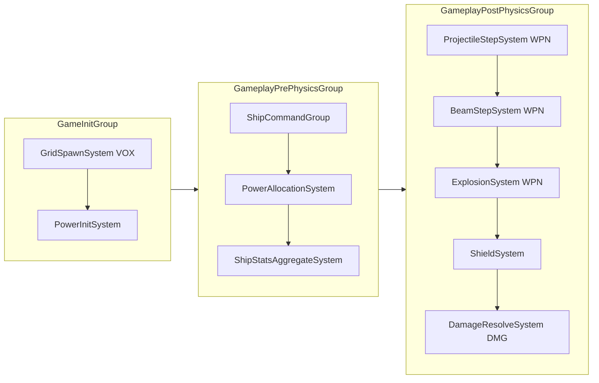

# SPEC-22 — Power, shields and ship stats

| | |
|---|---|
| **Status** | Draft |
| **Area code** | PWR (task IDs are `PWR-001`, `PWR-002`, …) |
| **Module(s)** | `Game.Simulation` (folder `Assets/Game/Simulation/Power/`, namespace `Game.Simulation.Power`); tuning definition in `Game.Data` (`Assets/Game/Data/Definitions/Power/`) |
| **Depends on specs** | SPEC-02 (`SimClock`, `ContentHash`, groups, `GameplayEndCommandBufferSystem`, `GameLog`); SPEC-04 (`BlockDefsBlob`, `FunctionParams`: `CoreParams`, `ReactorParams`, `CapacitorParams`, `ThrusterParams`, `ShieldEmitterParams`); SPEC-10 (`VoxelGrid`, `BlockInstance`, `FunctionalBlock`, `FunctionalComponentRegistration`, `GridSpawning`, `VoxelRaycast`, `GridCellReader`); SPEC-12 (`PhysicsMass` writer); SPEC-13 (`DamageEvent`, `DamageStreams`, `Hulk`, `DamageType`); SPEC-20 (`ShipCommand`); SPEC-21 (`WeaponDefsBlob` draw and fire groups, `GridSpaceMath`); SPEC-24 (`AbilitySlot`, `ShipStatModifier` writer); SPEC-63 (`FxEventQueue`, `FxEvents`) |
| **Depended on by** | SPEC-20 (`ShipStats` accelerations and multipliers, `Powered` on thrusters), SPEC-21 (`PowerConsumer` grants, `ShieldState`, `ShieldHit`, `ShieldHitStreams`, `ShieldMath`, `ShipStats` multipliers), SPEC-23 (`ShipStats`, `ShieldState`), SPEC-24 (`ShipPower.AbilityGrantMask`, `ShieldControl`, `ShipStatModifier`), SPEC-61 (HUD reads `ShipPower`, `ShieldState`, `ShipStats`), SPEC-63 (`ShieldState`, `ShieldRipple`), SPEC-51 (stat names shown in the editor) |
| **Milestone** | M2 |

> Read [01-architecture.md](../01-architecture.md), [02-conventions.md](../02-conventions.md), [03-glossary.md](../03-glossary.md) and [07-implementation-traps.md](../07-implementation-traps.md) before this spec. This spec may not contradict them.

## 1. Purpose

Every ship has an energy budget, an analytic shield and a set of aggregated stats. Reactors and the core generate energy, capacitors and the core store it, and weapons, shield emitters and thrusters consume it. One system allocates energy per ship per tick by priority and sets `Powered` enable bits; nobody else writes energy. One system aggregates stats (mass, thrust, turn rate, power, DPS, shield capacity) and recomputes the expensive part only when the ship's set of working functional blocks changes. One system owns shield HP: it regenerates, resolves `ShieldHit`s and converts overflow into hull `DamageEvent`s. The old prototype wrote shared energy from parallel jobs (02-C08), used the enable bit of its energy component to mean "shields on" (02-C33), could never create or enable shields (02-C14) and drained all energy in about 10 s of autofire (LEDGER R21). This spec fixes all four by construction and by the energy balance table in §4.9.

## 2. Scope

**In scope:**
- `ShipPower`, `PowerConsumer`, `Powered`, `PowerLink`, `ShipStats`, `ShipStatModifier`, `ShieldState`, `ShieldRipple`, `ShieldControl`, `ShieldHit`, `ShieldHitStreams`, `ShieldMath`, `PowerTuning`, `PowerTuningDefinition`, `PowerGridSetup`.
- Reactors, cores and capacitors as energy sources; weapons, shield emitters and thrusters as consumers.
- `PowerInitSystem`, `PowerAllocationSystem` (priorities, brownout), `ShipStatsAggregateSystem` (dirty-only), `ShieldSystem` (fit, regen, hits, overflow).
- Hulk handling (no power, no shield), the shield toggle state (`ShieldControl`), the energy balance rules and the blueprint power-budget validator.

**Out of scope (and who owns it instead):**
- Which blocks exist and their raw parameters: SPEC-04 (`FunctionParams`). This spec retunes the shield emitter values (§4.9, open question 1).
- Thruster impulses and the speed cap: SPEC-20 (reads `ShipStats` multipliers and `Powered`).
- Weapon fire, beams, projectile casts, explosions and the analytic shield test inside them: SPEC-21 (uses `ShieldMath`, writes `ShieldHitStreams`).
- Ability activation and the shield toggle ability: SPEC-24 (writes `ShieldControl` and `ShipStatModifier`, reads `ShipPower.AbilityGrantMask`).
- Cell damage, `Hulk` tagging, `DamageStreams`: SPEC-13. Shield and tracer drawing: SPEC-63. HUD: SPEC-61.
- Saving energy or shield HP: not saved (Decision 12).

## 3. Decisions (binding)

1. **Files sit directly in `Assets/Game/Simulation/Power/` with namespace `Game.Simulation.Power`.** Reason: five specs share `Game.Simulation`; one area folder per spec (same rule as SPEC-10 Decision 15) prevents file collisions.
2. **Energy is a per-ship scalar pool.** `ShipPower.Stored` (E) is refilled by `Generation` (E/s) and capped by `Capacity` (E). There is no per-block energy. Reason: simple, deterministic, readable on the HUD.
3. **Consumers are all-or-nothing per tick.** A requesting consumer either gets its full `Draw × dt` or nothing. Reason: no fractional weapon states; easy to test.
4. **Allocation order is fixed: priority descending, then `InstanceIndex` ascending.** Priorities (from `PowerTuning`): shield emitters 200, thrusters 150, ability one-shot costs 120, weapons 100. Reason: shields and engines stay up longest; weapons brown out first; order is deterministic.
5. **A denied consumer stays off for `BrownoutHoldTicks` (30 ticks = 0.5 s).** Reason: no flicker at the budget edge.
6. **Demand is derived inside `PowerAllocationSystem` from this tick's inputs** (`ShipCommand.FireGroups`, thrust/turn, `ShieldControl`, `AbilitySlot` state). No other system writes a demand. Reason: same-tick response to the trigger and single writer of `PowerConsumer` (architecture §8).
7. **Weapons draw while their fire group is held, not per shot.** Reason: the draw table in §4.9 is per second and sustainable; the old per-shot drain plus per-second beam drain double-charged (02-C22).
8. **Ability energy is a one-shot cost granted with one tick of latency** through `ShipPower.AbilityGrantMask` (§5.3 step 7). Reason: only `PowerAllocationSystem` writes `ShipPower`.
9. **Stats are split into cheap and expensive parts.** Mass-derived values update when `PhysicsMass` changes; thrust, power, DPS and shield totals recompute only when the alive functional set changes (signature check, §5.4). Reason: architecture §11.1 (incremental, never global).
10. **One shield per ship: an analytic ellipsoid in grid space** fitted to the grid's spawn bounds (`VoxelGrid.CellMin/CellMax`) plus padding, refitted only when the alive functional set changes. All powered alive emitters add their capacity and regen to it. Reason: architecture §6.4; cheap segment tests.
11. **Shield HP changes only in `ShieldSystem`.** Producers (SPEC-21) test shields analytically against last tick's `ShieldState` and emit `ShieldHit`; `ShieldSystem` applies hits in a stable order and converts overflow into `DamageEvent`s. Reason: architecture §8.
12. **Energy and shield HP are not saved.** A loaded or newly spawned ship starts with `Stored = Capacity` and full shields. Reason: saves happen outside combat (00-vision M3 scope); no extra save chunk.
13. **Combat root components are added by the spawner, not by a system.** The spawner calls `PowerGridSetup.AddComponents` on the spawn request entity before `GridSpawnSystem` converts it (SPEC-10 Decision 9). Functional-entity components are registered through SPEC-10's `FunctionalComponentRegistration`. Values are initialised by `PowerInitSystem` in `GameInitGroup`. Reason: no structural changes in Simulation systems; spawn-frame initialisation is independent of frame rate.
14. **Hulks have no power and no shield.** Reason: glossary *Hulk*.
15. **Dormant grids skip the stats recompute** (architecture §11.9) but keep power allocation and shield regen (both O(consumers), cheap).
16. **Grids with `GridSpawning` enabled are skipped by every per-tick system here.** Reason: their physics body and bricks are not ready (SPEC-10 Decision 14).

## 4. Data model

All types are **public contract** unless marked *internal*. Each file holds one type and starts with `/// <summary>Implements SPEC-22 §4.x.</summary>`. Units: energy E, power E/s, HP abstract, lengths metres in grid space (SPEC-10 Decision 6: cell `c` occupies `[c, c+1) × CellSize` from the grid origin, the root's `LocalTransform`).

### 4.1 Power (`Assets/Game/Simulation/Power/`)

```csharp
namespace Game.Simulation.Power
{
    [System.Flags] public enum ShipPowerFlags : byte { None = 0, Initialized = 1, Brownout = 2, Dead = 4 }

    /// <summary>Per-ship energy state on the grid root. Only writer: PowerAllocationSystem (and PowerInitSystem at init).</summary>
    public struct ShipPower : IComponentData
    {
        public float Stored;            // E, 0..Capacity
        public float Capacity;          // E = Σ alive core.PowerStorage + capacitor.PowerStorage
        public float Generation;        // E/s = Σ alive core.PowerGeneration + reactor.PowerGeneration; 0 on hulks
        public float DemandPerSecond;   // E/s requested this tick (HUD)
        public float GrantedPerSecond;  // E/s granted this tick (HUD)
        public uint AbilityGrantMask;   // bit i = AbilitySlot i's pending one-shot cost was granted this tick
        public uint AbilityGrantTick;   // SimClock.Tick the mask belongs to
        public ShipPowerFlags Flags;
    }

    public enum PowerConsumerKind : byte { Weapon = 0, ShieldEmitter = 1, Thruster = 2 }

    [System.Flags] public enum PowerConsumerFlags : byte { None = 0, Granted = 1, Requesting = 2, Alive = 4, BrownedOut = 8 }

    /// <summary>One energy consumer of the ship, sorted by (Priority desc, InstanceIndex asc). Built by PowerInitSystem;
    /// per-tick fields written only by PowerAllocationSystem.</summary>
    [InternalBufferCapacity(0)]
    public struct PowerConsumer : IBufferElementData
    {
        public Entity Functional;       // the block's functional entity
        public int InstanceIndex;       // index into the grid's BlockInstance buffer
        public PowerConsumerKind Kind;
        public byte Priority;           // from PowerTuning by kind
        public byte FireGroups;         // weapons: WeaponDef.DefaultFireGroups (bit g = group g+1); others 0
        public PowerConsumerFlags Flags;
        public float Draw;              // E/s while requesting
        public uint DeniedUntilTick;    // brownout hold: no request is granted while SimClock.Tick < this
    }

    /// <summary>Enable bit on functional entities: the block has power this tick. Only writer: PowerAllocationSystem.</summary>
    public struct Powered : IComponentData, IEnableableComponent { }

    /// <summary>On every functional entity of kinds Core, Reactor, Capacitor, Thruster, Weapon, ShieldEmitter (registered
    /// with FunctionalComponentRegistration, so it starts zeroed). Only writer: PowerInitSystem.</summary>
    public struct PowerLink : IComponentData
    {
        public short ConsumerIndex;     // index in the grid's PowerConsumer buffer; -1 = not a consumer
        public byte Bound;              // 0 = new entity (spawn, rebuild or edit), 1 = bound by PowerInitSystem
        public byte Reserved;
    }
}
```

### 4.2 Stats

```csharp
namespace Game.Simulation.Power
{
    using Game.Data.Combat;   // StatId

    [System.Flags] public enum ShipStatsFlags : byte { None = 0, Initialized = 1, HasMass = 2 }

    // StatId is designed here but lives in Assets/Game/Data/Combat/StatId.cs (namespace Game.Data.Combat, architecture §3.2) so ability
    // content uses it directly:  public enum StatId : byte { Thrust = 0, MaxSpeed = 1, FireRate = 2, WeaponDamage = 3, ShieldRegen = 4, TurnRate = 5 }  // add at end only

    /// <summary>Aggregated ship stats on the grid root (architecture §6.4). Only writer: ShipStatsAggregateSystem.</summary>
    public struct ShipStats : IComponentData
    {
        // Cheap part: recomputed when PhysicsMass changed or after a full recompute
        public float Mass;              // kg = 1 / PhysicsMass.InverseMass; 0 until the body exists
        public float InitialMass;       // kg, first non-zero Mass seen; never changes afterwards
        public float MassFraction;      // Mass / InitialMass (1 at spawn), hull-health proxy for AI and HUD
        public float ForwardAccel;      // m/s² = ForwardThrust × ThrustMultiplier / Mass
        public float ReverseAccel;      // m/s²
        public float StrafeAccel;       // m/s²
        public float YawAccelDeg;       // deg/s² = degrees((YawTorque × ThrustMultiplier + GyroYawTorque) × InverseInertia.y)
        public float TurnRateDeg;       // deg/s: 90 / t90 with t90 = 2·sqrt((π/2) / yawAccelRad); 0 if yawAccel = 0
        // Expensive part: recomputed when the alive functional set changed
        public float ForwardThrust, ReverseThrust, StrafeThrust;  // N (strafe = min of left and right)
        public float YawTorque;         // N·m = min(Σ positive yaw torques, Σ |negative yaw torques|) of the thrusters
        public float GyroYawTorque;     // N·m = FlightMath.GyroYawTorque(FlightConfig, InverseInertia.y) (SPEC-20); 0 for hulks or without FlightConfig; mass part
        public float PowerGeneration;   // E/s
        public float PowerCapacity;     // E
        public float WeaponDraw, ShieldDraw, ThrusterDraw;        // E/s at full demand
        public float SustainedDps;      // Σ WeaponDef.SustainedDps of alive weapons (before multipliers)
        public float MaxWeaponRange;    // m, max WeaponDef.Range of alive weapons; 0 if none
        public float ShieldCapacity, ShieldRegen, ShieldRechargeDelay;   // Σ capacity, Σ regen, min delay (s) of alive emitters
        public int AliveFunctionalCount, AliveWeaponCount, AliveThrusterCount, AliveShieldEmitterCount, AlivePowerSourceCount;
        public int InitialWeaponCount;  // AliveWeaponCount at the first full recompute
        public float3 BoundsMin, BoundsMax;   // grid space, from VoxelGrid.CellMin/CellMax: CellMin·CellSize .. (CellMax+1)·CellSize
        public float3 BoundsCenter;     // (BoundsMin + BoundsMax) / 2
        public float BoundingRadius;    // length(BoundsMax - BoundsCenter)
        // Modifier part: recomputed when ShipStatModifier changed (product of active modifiers, 1 if none)
        public float ThrustMultiplier, MaxSpeedMultiplier, FireRateMultiplier, DamageMultiplier, ShieldRegenMultiplier, TurnRateMultiplier;
        // Bookkeeping
        public ulong FunctionalSignature;     // §5.4 step 2
        public uint FunctionalRevision;       // +1 every time FunctionalSignature changes (SPEC-24 resyncs abilities on change)
        public ShipStatsFlags Flags;
    }

    /// <summary>Active stat modifier on the grid root. Only writer: AbilityModifierSyncSystem (SPEC-24).</summary>
    [InternalBufferCapacity(4)]
    public struct ShipStatModifier : IBufferElementData
    {
        public StatId Stat;
        public byte SourceSlot;         // AbilitySlot index that produced it
        public float Multiplier;        // > 0
    }
}
```

### 4.3 Shields

```csharp
namespace Game.Simulation.Power
{
    [System.Flags] public enum ShieldFlags : byte { None = 0, Initialized = 1, Collapsed = 2, FillOnNextUpdate = 4 }

    /// <summary>Analytic ellipsoid shield on the grid root (architecture §6.4). Only writer: ShieldSystem (PowerInitSystem sets
    /// FillOnNextUpdate at init).</summary>
    public struct ShieldState : IComponentData
    {
        public float Hp, MaxHp;         // MaxHp = Σ Capacity of alive, powered emitters
        public float RegenPerSecond;    // Σ RegenPerSecond of alive, powered emitters × ShieldRegenMultiplier
        public uint RegenResumeTick;    // regen allowed when SimClock.Tick ≥ this
        public float3 Center;           // grid space metres
        public float3 Radii;            // semi-axes, metres, each ≥ ShieldMinRadiusMetres
        public float BoundingRadius;    // cmax(Radii)
        public uint ShapeRevision;      // ShipStats.FunctionalRevision used for the last fit
        public byte Active;             // 1 = shield is up and blocks hits (SPEC-63 reads this name)
        public byte RippleHead;         // next ShieldRipple slot to overwrite, 0..7
        public ShieldFlags Flags;
    }

    /// <summary>Ring buffer of the last 8 shield impacts for the shell shader (SPEC-63). Only writer: ShieldSystem.</summary>
    [InternalBufferCapacity(8)]
    public struct ShieldRipple : IBufferElementData
    {
        public float3 LocalPoint;       // grid space, on the ellipsoid
        public uint StartTick;          // SimClock.Tick of the hit; 0 = unused
        public float Strength;          // 0..1 = min(1, absorbed / 100)
    }

    /// <summary>Requested shield state. Only writer: ShieldToggleEffectSystem (SPEC-24). Spawned as RequestedOn = 1.</summary>
    public struct ShieldControl : IComponentData { public byte RequestedOn; }

    [System.Flags] public enum ShieldHitFlags : byte { None = 0, Blast = 1 }

    /// <summary>Shield impact event (architecture §6.4 binding fields first). Producers: SPEC-21.</summary>
    public struct ShieldHit
    {
        public Entity Grid;             // binding: the shielded grid root
        public float3 LocalPoint;       // binding: grid space, on the ellipsoid surface (blast: blast centre in grid space)
        public float Amount;            // binding: raw damage before shield type multiplier
        public Game.Data.Combat.DamageType Type;    // binding (designed by SPEC-13, architecture §3.2)
        public Entity Source;           // binding: attacking grid root or Entity.Null
        public float3 LocalDir;         // unit direction of travel in grid space (blast: zero)
        public float Penetration;       // cells, copied to the overflow DamageEvent
        public float Radius;            // blast radius in metres (0 for point hits)
        public float3 WorldImpulse;     // copied to the overflow DamageEvent
        public ShieldHitFlags Flags;
        public Game.Data.Combat.ProducerKind Producer;   // SPEC-02 §4.12: Projectile, Beam, Explosion, Ability…
        public uint Sequence;           // producer sequence for the stable sort key
    }

    /// <summary>Singleton holding the ShieldHit channel (SPEC-02 §4.12). Created by ShieldSystem.OnCreate (SimEventChannel<ShieldHit>.Create("shield_hits"))
    /// and disposed in its OnDestroy. Taken with SystemAPI.GetSingleton (read-only) by producers and the consumer: no sync points.
    /// Producers (SPEC-21 projectiles, beams, explosions, and any later spec): Hits.BeginWrite(ref state, ProducerKind.X, n) → writer job →
    /// Hits.EndWrite(handle). The single consumer is ShieldSystem (Hits.BeginTick, BeginRead, EndRead).</summary>
    public struct ShieldHitStreams : IComponentData
    {
        public Game.Data.Streams.SimEventChannel<ShieldHit> Hits;
    }
}
```

`ShieldHit` fields after the binding five are additions owned by this spec. `DamageType` is `Game.Data.Combat.DamageType` (designed by SPEC-13, architecture §3.2).

### 4.4 `ShieldMath` (public, static, Burst-compatible, no allocations)

```csharp
namespace Game.Simulation.Power
{
    public static class ShieldMath
    {
        /// Segment p0→p1 (grid space) against the ellipsoid. True if the segment starts outside and enters it;
        /// t = entry fraction in [0,1]. Starting inside never hits (shots fired from inside pass out).
        public static bool SegmentEnters(float3 p0, float3 p1, float3 center, float3 radii, out float t);
        /// True if p (grid space) is inside or on the ellipsoid.
        public static bool Contains(float3 p, float3 center, float3 radii);
        /// Conservative sphere test: true if a sphere (centre c, radius r, grid space) may overlap the ellipsoid.
        public static bool SphereOverlaps(float3 c, float r, float3 center, float3 radii);
        /// Closest point on the ellipsoid surface along the ray from the centre towards p (p ≠ center).
        public static float3 SurfacePointToward(float3 p, float3 center, float3 radii);
        /// Outward unit normal at a surface point.
        public static float3 Normal(float3 surfacePoint, float3 center, float3 radii);
    }
}
```

Algorithms (all in grid space, `inv = 1 / radii`):
- `SegmentEnters`: `a = (p0 − center) * inv`, `b = (p1 − center) * inv`, `d = b − a`. If `dot(a,a) ≤ 1` → false. Solve `|a + t·d|² = 1`: `A = dot(d,d)`, `B = 2·dot(a,d)`, `C = dot(a,a) − 1`. If `A < 1e-12` → false. `disc = B² − 4AC`; `disc < 0` → false. `t = (−B − sqrt(disc)) / (2A)`; return `0 ≤ t ≤ 1`.
- `Contains`: `dot(q,q) ≤ 1` with `q = (p − center) * inv`.
- `SphereOverlaps`: `q = (c − center) * inv`; true if `length(q) ≤ 1 + r / cmin(radii)`.
- `SurfacePointToward`: `q = (p − center) * inv`; `center + (q / length(q)) * radii`.
- `Normal`: `normalize((surfacePoint − center) * inv * inv)`.

### 4.5 Tuning

```csharp
namespace Game.Data.Definitions
{
    /// <summary>Power and shield tunables. Exactly one asset (`tuning_power`) in the database. Implements SPEC-22 §4.5.</summary>
    [ContentIdPrefix("tuning_")]
    [UnityEngine.CreateAssetMenu(menuName = "Game/Content/Tuning/Power", fileName = "tuning_power")]
    public sealed class PowerTuningDefinition : ContentDefinition
    {
        [UnityEngine.SerializeField] private byte priorityShieldEmitter = 200;
        [UnityEngine.SerializeField] private byte priorityThruster = 150;
        [UnityEngine.SerializeField] private byte priorityAbility = 120;
        [UnityEngine.SerializeField] private byte priorityWeapon = 100;
        [UnityEngine.SerializeField, UnityEngine.Min(1)] private int brownoutHoldTicks = 30;
        [UnityEngine.SerializeField, UnityEngine.Min(1f)] private float shieldPaddingScale = 1.2f;     // × half extents
        [UnityEngine.SerializeField, UnityEngine.Min(0f)] private float shieldPaddingMetres = 2f;      // + per axis
        [UnityEngine.SerializeField, UnityEngine.Min(0.5f)] private float shieldMinRadiusMetres = 3f;
        [UnityEngine.SerializeField, UnityEngine.Range(0f, 1f)] private float shieldRestartFraction = 0.25f;
        [UnityEngine.SerializeField] private float shieldMultKinetic = 0.8f, shieldMultEnergy = 1.25f, shieldMultExplosive = 1f, shieldMultRam = 1f;
        [UnityEngine.SerializeField, UnityEngine.Min(1f)] private float sustainWarningSeconds = 30f;
        // getters with the same names in PascalCase
    }
}

namespace Game.Simulation.Power
{
    /// <summary>ECS singleton baked from PowerTuningDefinition by PowerContent. Read-only at runtime.</summary>
    public struct PowerTuning : IComponentData
    {
        public byte PriorityShieldEmitter, PriorityThruster, PriorityAbility, PriorityWeapon;
        public int BrownoutHoldTicks;
        public float ShieldPaddingScale, ShieldPaddingMetres, ShieldMinRadiusMetres, ShieldRestartFraction;
        public float4 ShieldTypeMultiplier;   // x Kinetic, y Energy, z Explosive, w Ram (index = (int)DamageType)
        public float SustainWarningSeconds;
        public static PowerTuning Defaults => new PowerTuning { PriorityShieldEmitter = 200, PriorityThruster = 150, PriorityAbility = 120,
            PriorityWeapon = 100, BrownoutHoldTicks = 30, ShieldPaddingScale = 1.2f, ShieldPaddingMetres = 2f, ShieldMinRadiusMetres = 3f,
            ShieldRestartFraction = 0.25f, ShieldTypeMultiplier = new float4(0.8f, 1.25f, 1f, 1f), SustainWarningSeconds = 30f };
    }

    /// <summary>Managed baker (SPEC-01 calls it at boot after ContentService.CreateSingletons).</summary>
    public sealed class PowerContent
    {
        public PowerContent(Game.Data.Services.ContentCatalog catalog);   // reads the single PowerTuningDefinition; throws
                                                                          // ContentValidationException if 0 or >1 exist
        public PowerTuning Tuning { get; }
        public void CreateSingletons(EntityManager em);                    // idempotent; one entity "PowerSingletons" with PowerTuning
                                                                          // (ShieldHitStreams is created by ShieldSystem.OnCreate)
        public void DestroySingletons(EntityManager em);
    }
}
```

### 4.6 Spawn-time setup helper

```csharp
namespace Game.Simulation.Power
{
    public static class PowerGridSetup
    {
        /// Adds the PWR root components to a spawn request entity (future grid root) with initial values:
        /// ShipPower (zeroed, Flags None), PowerConsumer (empty), ShipStats (zeroed), ShipStatModifier (empty),
        /// ShieldState (zeroed), ShieldRipple (8 elements, all zero), ShieldControl { RequestedOn = 1 }.
        /// Call on the main thread outside system updates, only for GridKind Ship or Station. One AddComponent(ComponentTypeSet).
        public static void AddComponents(EntityManager em, Entity requestEntity);
        public static ComponentTypeSet RootTypes { get; }   // the 7 types above
    }
}
```

### 4.7 Ownership summary

| State | Only writer |
|---|---|
| `ShipPower`, `PowerConsumer` per-tick fields, `Powered` | `PowerAllocationSystem` (init values: `PowerInitSystem`) |
| `PowerLink`, `PowerConsumer` table layout | `PowerInitSystem` |
| `ShipStats` | `ShipStatsAggregateSystem` |
| `ShieldState`, `ShieldRipple` | `ShieldSystem` (`PowerInitSystem` only sets `Flags = FillOnNextUpdate` at init) |
| `ShieldControl` | `ShieldToggleEffectSystem` (SPEC-24) |
| `ShipStatModifier` | `AbilityModifierSyncSystem` (SPEC-24) |
| `ShieldHitStreams.Hits` registrations | Any producer through `Hits.BeginWrite`/`EndWrite` (SPEC-21 today: `ProjectileStepSystem`, `BeamStepSystem`, `ExplosionSystem`); channel owned and read by `ShieldSystem` |

### 4.8 Memory

Per combat grid root: `ShipPower` 28 B, `ShipStats` ≈ 220 B, `ShieldState` 64 B, `ShieldRipple` 8 × 20 B in chunk, `PowerConsumer` 24 B per consumer outside the chunk, `ShipStatModifier` 4 × 8 B. Per functional entity: `PowerLink` 4 B + `Powered` 0 B (enable bit). A 1M-cell station with 2,000 functional blocks costs ≈ 56 KB. Asteroids and hulks split from ships get none of these (Decision 13).

### 4.9 Energy and shield balance (initial values)

Energy sources and consumers come from SPEC-04 `FunctionParams` (cores, reactors, capacitors, thrusters) and from SPEC-21 `WeaponDefinition.powerDraw`. **This spec retunes `block_shield_small`** (SPEC-04 open question 11): capacity 300 → **3,000**, regen 15/s → **120/s**, delay 3 s → **4 s**, draw 10 → **8 E/s**. Reason: SPEC-21 weapons remove ~1 hull cell (100 HP) per hit, so a 300 HP shield would vanish in one burst.

**Rules (checked by `PowerBudgetValidator`, §5.6, and by `PowerBalanceTests`):**
- R1 Sustain: from full storage, a ship holding every fire group with shields up sustains ≥ 30 s before its first brownout: `Capacity / max(0, WeaponDraw + ShieldDraw + ThrusterDraw − Generation) ≥ 30` (infinite if the denominator is 0).
- R2 Recharge: with weapons idle and shields up, `Capacity / (Generation − ShieldDraw) ≤ 10 s`.
- R3 Shield break time: with the SPEC-21 reference loadout of the same class firing at 60 % hit rate, the shield breaks in 15–50 % of the hull time-to-kill (SPEC-21 §4.9).

Reference ships (legacy blueprints as converted by SPEC-72; weapon draws from SPEC-21 §4.9; core = gen 40, storage 200):

| Ship | Sources | Gen E/s | Cap E | Weapons (count × draw) | WeaponDraw | Shields | Sustain (R1) | Recharge (R2) |
|---|---|---|---|---|---|---|---|---|
| `ship_frigate` | core | 40 | 200 | 4 plasma fixed × 1.5 | 6 | 0 | ∞ | 5 s |
| `ship_fighter` | core | 40 | 200 | 8 plasma fixed × 1.5, 2 plasma medium × 4, 4 beam small × 4 | 36 | 0 | ∞ | 5 s |
| `ship_vestari` | core + 3 capacitors | 40 | 320 | 8 beam small × 4, 1 railgun × 8 | 40 | 0 | ∞ | 8 s |
| `ship_butterfly` | core | 40 | 200 | 2 flak × 5, 6 beam small × 4, 2 missile × 2, 2 plasma medium × 4 | 46 | 0 | 33 s | 5 s |
| `ship_crescent` | core | 40 | 200 | 6 beam small × 4, 14 plasma small × 1.5 | 45 | 0 | 40 s | 5 s |
| fighter + 1 `block_shield_small` | core | 40 | 200 | as fighter | 36 | 8 | 50 s | 6.3 s |

The old prototype's "energy 200 → 1 in ~10 s of autofire" is impossible with these numbers: the worst legacy ship (butterfly) browns out after 33 s, then keeps the weapons the remaining generation can pay for (40 of 46 E/s: about 87 % of its DPS).

## 5. Systems, services and flow



Every system: `[BurstCompile]` `ISystem`, `RequireForUpdate<GameplayActive>()`, `RequireForUpdate<PowerTuning>()`, `RequireForUpdate<BlockDefsRef>()`; lookups created in `OnCreate` and `.Update(ref state)` first in `OnUpdate`; `ProfilerMarker`s named `<System>.<Step>`; no `Complete()`.

### 5.1 Registration (`PowerRegistrationSystem`)

`[UpdateInGroup(typeof(GameInitGroup))] [CreateAfter(typeof(GridSpawnSystem))]`, `OnCreate` only (then `state.Enabled = false`): append to the `FunctionalComponentRegistration` singleton buffer, for each kind in {Core, Reactor, Capacitor, Thruster, Weapon, ShieldEmitter}: `{Kind, ComponentType.ReadWrite<PowerLink>()}` and `{Kind, ComponentType.ReadWrite<Powered>()}`. New functional entities therefore carry `PowerLink { Bound = 0 }` and an enabled `Powered`.

### 5.2 `PowerInitSystem`

`[UpdateInGroup(typeof(GameInitGroup))] [UpdateAfter(typeof(GridSpawnSystem))]`. Reads `BlockDefsRef`, `WeaponDefsRef` (SPEC-21), `PowerTuning`, `VoxelGrid`, `BlockInstance`. Writes `PowerLink`, `PowerConsumer`, `ShipPower`, `ShieldState.Flags`, `ShipStats.Flags`. No structural changes.

1. **Job `PowerRebindDetectJob`** (`IJobEntity`, `.Schedule()` single-threaded, `[WithChangeFilter(typeof(PowerLink))]`): for each functional entity with `PowerLink.Bound == 0`, clear `ShipPowerFlags.Initialized` on `FunctionalBlock.Grid` through a `ComponentLookup<ShipPower>` (skip if the grid has no `ShipPower`). Single-threaded because two entities may share a grid.
2. **Job `PowerInitJob`** (`IJobEntity`, `ScheduleParallel`, roots with `ShipPower`, `WithNone<GridSpawnRequest>`): skip if `Initialized` is set. Else:
   1. Build a `NativeList<PowerConsumer>(Allocator.Temp)`: for instance `i` in index order with `Block != 0`, `def = Blocks[Block]`, `def.Kind == Functional`: kind `Weapon` → `Draw = WeaponDefs[def.Function.Weapon.WeaponIndex].PowerDraw`, `FireGroups = …DefaultFireGroups`, `Priority = PriorityWeapon`; `ShieldEmitter` → `Draw = def.Function.Shield.PowerDraw`, `Priority = PriorityShieldEmitter`; `Thruster` → `Draw = def.Function.Thruster.PowerDraw`, `Priority = PriorityThruster`. `Functional = inst.Functional`, `InstanceIndex = i`, `Flags = None`, `DeniedUntilTick = 0`. A weapon with `WeaponIndex == 0` gets `Draw = 0, FireGroups = 0`.
   2. Sort with `NativeSortExtension.Sort` by `(Priority desc, InstanceIndex asc)`; copy into the `PowerConsumer` buffer (clear first).
   3. For every live instance with `Functional != Entity.Null` that has `PowerLink`: write `PowerLink { ConsumerIndex = position in the sorted list or −1, Bound = 1 }`. *Parallel write through a lookup: each functional entity belongs to exactly one grid and each grid is processed by one worker, so writes are disjoint (comment required above `[NativeDisableParallelForRestriction]`).*
   4. `Capacity = Σ` over alive (`Block != 0 && (Flags & Destroyed) == 0`) instances of `Core.PowerStorage` (kind Core) and `Capacitor.PowerStorage`; `Generation = Σ Core.PowerGeneration + Reactor.PowerGeneration`. `ShipPower = { Stored = Capacity, Capacity, Generation, Flags = Initialized }`.
   5. `ShieldState.Flags = FillOnNextUpdate` (all other fields left; `ShieldSystem` fits and fills). `ShipStats.Flags &= ~Initialized` (forces a full recompute next tick).
3. Complexity: O(instances of new grids · log). Zero work for existing grids except the change-filtered chunk scan.

### 5.3 `PowerAllocationSystem`

`[UpdateInGroup(typeof(GameplayPrePhysicsGroup))]` with no ordering attribute: it is the first normal-bucket member, and `ShipCommandGroup` (OrderFirst) always runs before it (SPEC-02 §5.8, Decision 13). Reads `ShipCommand` (SPEC-20), `ShipStats` (last tick's generation and capacity), `BlockInstance`, `ShieldControl`, `AbilitySlot` (SPEC-24, optional `BufferLookup`), `Hulk`, `GridSpawning`, `SimClock`. Writes `ShipPower`, `PowerConsumer`, `Powered`.

**Job A `PowerAllocateJob`** (`IJobEntity`, `ScheduleParallel` over roots with `ShipPower`, `PowerConsumer`, `ShipStats`; one worker per root):
1. If `!Initialized` or `GridSpawning` enabled → return.
2. If the root has `Hulk`: `Stored = 0, Generation = 0, Capacity = 0`, every consumer `Flags = None` (keep `Alive` bit computed as below), `AbilityGrantMask = 0`, `Flags |= Dead`; return.
3. `tick = SimClock.Tick`, `dt = 1/60`. If `ShipStats.Flags` has `Initialized`: `Generation = ShipStats.PowerGeneration`, `Capacity = ShipStats.PowerCapacity`, `Stored = min(Stored, Capacity)`.
4. `budget = Stored + Generation × dt`. `demand = 0`, `granted = 0`, `brownout = false`.
5. `cmd = ShipCommand` (zero if absent). `moving = any(cmd.Thrust ≠ 0) || cmd.Turn ≠ 0`.
6. For each consumer `c` in buffer order (already sorted), process in two passes split at `PriorityAbility`: pass 1 all consumers with `Priority > PriorityAbility`, then step 7, then pass 2 the rest. Per consumer:
   - `alive = inst.Block != 0 && (inst.Flags & Destroyed) == 0` for `inst = BlockInstance[c.InstanceIndex]`.
   - `requesting = alive && (Weapon: (cmd.FireGroups & c.FireGroups) ≠ 0 || autofire; ShieldEmitter: ShieldControl.RequestedOn == 1; Thruster: moving)`, where `autofire = WeaponControl.Autofire == 1 && ShipTarget.Value != Entity.Null` (SPEC-21 root components, read through lookups; absent → false; SPEC-23 Q2).
   - If `requesting`: `demand += c.Draw`. If `tick < c.DeniedUntilTick` → not granted. Else `need = c.Draw × dt`; if `need ≤ budget` → granted, `budget −= need`, `granted += c.Draw`; else not granted, `c.DeniedUntilTick = tick + BrownoutHoldTicks`, `brownout = true`.
   - `c.Flags = (alive ? Alive : 0) | (requesting ? Requesting : 0) | (granted ? Granted : 0) | (tick < c.DeniedUntilTick ? BrownedOut : 0)`.
7. Abilities: `mask = 0`. If the root has an `AbilitySlot` buffer: for slot `s` in index order (`s < 32`) with `State == PendingPower`: `need = slot.PendingCost`; if `need ≤ budget` → `budget −= need`, `mask |= 1u << s`. `AbilityGrantMask = mask`, `AbilityGrantTick = tick`.
8. `Stored = clamp(budget, 0, Capacity)`; `DemandPerSecond = demand`; `GrantedPerSecond = granted`; `Flags` = `Initialized | (brownout ? Brownout : 0)`.

**Job B `PoweredApplyJob`** (`IJobChunk`, `ScheduleParallel` over functional entities with `FunctionalBlock`, `PowerLink`, `Powered`; depends on A): for entity `k`: `g = FunctionalBlock.Grid`; if `g` has no `ShipPower` → enabled = true (non-combat grid, nothing to gate). Else `p = ShipPower[g]`: if `p.Flags` has `Dead` or not `Initialized` → false; else if `ConsumerIndex < 0` → `alive(instance)`; else `c = PowerConsumer[g][ConsumerIndex]` → `(c.Flags & Alive) ≠ 0 && (c.Flags & BrownedOut) == 0`. Write with `chunk.SetComponentEnabled(ref poweredHandle, k, value)` — each chunk belongs to one worker, so enable-bit writes are race-free (traps T2.6).

Complexity: O(consumers + ability slots) per ship, O(functional entities) for job B. Budget §8.

### 5.4 `ShipStatsAggregateSystem`

`[UpdateInGroup(typeof(GameplayPrePhysicsGroup))] [UpdateAfter(typeof(PowerAllocationSystem))]`. Reads `BlockInstance`, `BlockDefsRef`, `WeaponDefsRef`, `OrientationTablesRef`, `VoxelGrid`, `PhysicsMass`, `ShipStatModifier`, `Dormant` (SPEC-11), `Hulk`, `GridSpawning`. Writes `ShipStats`.

**Job `ShipStatsJob`** (`IJobChunk`, `ScheduleParallel` over roots with `ShipStats`, `BlockInstance`, `VoxelGrid`; `WithNone<Hulk>`). Per chunk: `instChanged = chunk.DidChange(ref blockInstanceHandle, LastSystemVersion)`, `massChanged = chunk.DidChange(ref physicsMassHandle, …)`, `modChanged = chunk.DidChange(ref modifierHandle, …)`. Per entity:
1. Skip if `GridSpawning` enabled or `Dormant` enabled.
2. `full = !Initialized`. If `!full && instChanged`: compute `sig` over alive functional instances in index order: `count++`, `h = StableHash.Combine(h, (ulong)i)` starting from `h = 0x9E3779B97F4A7C15`; `sig = StableHash.Combine(h, count)`. If `sig ≠ FunctionalSignature` → `full = true`.
3. If `full`: zero the expensive part, then for each alive instance `i` (`def = Blocks[Block]`, `def.Kind == Functional`): `AliveFunctionalCount++`, and by `def.Function.Kind`:
   - Core: `PowerGeneration += Core.PowerGeneration`, `PowerCapacity += Core.PowerStorage`, `AlivePowerSourceCount++`.
   - Reactor: `PowerGeneration += Reactor.PowerGeneration`, `AlivePowerSourceCount++`. Capacitor: `PowerCapacity += Capacitor.PowerStorage`, `AlivePowerSourceCount++`.
   - Thruster: `F = Thruster.ThrustNewtons`; `d = Orientations.Rotate(new float3(0,0,−1), inst.Orient)` (force direction on the ship, SPEC-04 Decision 9); `ForwardThrust += F·max(0, d.z)`, `ReverseThrust += F·max(0, −d.z)`, `right += F·max(0, d.x)`, `left += F·max(0, −d.x)`; `r = GridSpaceMath.InstanceCenter(...) − com` (com = `PhysicsMass.CenterOfMass`, or `BoundsCenter` if no mass); `τ = cross(r, F·d).y`; `τ > 0 ? posYaw += τ : negYaw += −τ`; `ThrusterDraw += Thruster.PowerDraw`; `AliveThrusterCount++`.
   - Weapon: `w = WeaponDefs[WeaponIndex]` (skip if index 0); `SustainedDps += w.SustainedDps`; `MaxWeaponRange = max(MaxWeaponRange, w.Range)`; `WeaponDraw += w.PowerDraw`; `AliveWeaponCount++`.
   - ShieldEmitter: `ShieldCapacity += Shield.Capacity`; `ShieldRegen += Shield.RegenPerSecond`; `ShieldRechargeDelay = AliveShieldEmitterCount == 0 ? delay : min(…, delay)`; `ShieldDraw += Shield.PowerDraw`; `AliveShieldEmitterCount++`.
   Then `StrafeThrust = min(left, right)`, `YawTorque = min(posYaw, negYaw)`; bounds from `VoxelGrid.CellMin/CellMax` and `CellSize` (§4.2); `FunctionalSignature = sig` (recomputed if step 2 was skipped); `FunctionalRevision++`; if `!Initialized` → `InitialWeaponCount = AliveWeaponCount`; set `Initialized`.
4. If `full || massChanged`: if the root has `PhysicsMass` with `InverseMass > 0`: `Mass = 1 / InverseMass`, `HasMass`; if `InitialMass == 0` → `InitialMass = Mass`; `MassFraction = Mass / InitialMass`. Accelerations: `ForwardAccel = ForwardThrust × ThrustMultiplier / Mass` (same for reverse and strafe); `GyroYawTorque = Hulk || !HasSingleton<FlightConfig> ? 0 : FlightMath.GyroYawTorque(flightConfig, InverseInertia.y)` (the gyro of SPEC-20 decision 11 turns even ships without side thrusters); `yawAccelRad = (YawTorque × ThrustMultiplier + GyroYawTorque) × TurnRateMultiplier × InverseInertia.y`; `YawAccelDeg = degrees(yawAccelRad)`; `TurnRateDeg = yawAccelRad > 0 ? 90 / (2·sqrt((π/2) / yawAccelRad)) : 0`. Without mass: all accelerations 0, `MassFraction = 1`.
5. If `full || modChanged`: each multiplier = product of `Multiplier` over modifier elements with that `StatId` (1 if none); `Thrust`→`ThrustMultiplier`, `MaxSpeed`→`MaxSpeedMultiplier`, `FireRate`→`FireRateMultiplier`, `WeaponDamage`→`DamageMultiplier`, `ShieldRegen`→`ShieldRegenMultiplier`, `TurnRate`→`TurnRateMultiplier`. Then redo step 4's acceleration lines.

Complexity: O(1) per untouched ship; O(instances) for ships whose `BlockInstance` chunk changed (signature) and again for a full recompute. Stats are read by others one tick later at worst.

### 5.5 `ShieldSystem`

`[UpdateInGroup(typeof(GameplayPostPhysicsGroup))] [UpdateAfter(typeof(ExplosionSystem))]` (the next system, `DamageResolveSystem`, declares `UpdateAfter(ShieldSystem)`). Reads `ShieldHitStreams`, `PowerConsumer`, `ShipStats`, `ShieldControl`, `LocalTransform`, `PhysicsVelocity`, `Hulk`, `GridSpawning`, `SimClock`, `PowerTuning`, `GridCellReader` (SPEC-10). Writes `ShieldState`, `ShieldRipple`, its own `DamageStreams` producer slot (`ShieldOverflow`, SPEC-13), `FxEventQueue`.

**Job 1 `ShieldHitGatherJob`** (`IJob`): on the main thread `streams.Hits.BeginTick(SimClock.Tick)`, then `set = streams.Hits.BeginRead(ref state)`. `SimEventGather` reads every registration in order, foreach index ascending, into `NativeList<ShieldHit> hits` (`Allocator.TempJob`). Sort by `(Grid.Index, Source.Index, Producer, Sequence, gather position)` (architecture §5.1). After job 2 is scheduled: `streams.Hits.EndRead(job2Handle)`. Build `NativeParallelHashMap<Entity, int2> ranges` (start, count) per grid in one linear pass. Hash map is used for lookup only (traps T1.5).

**Job 2 `ShieldUpdateJob`** (`IJobChunk`, `ScheduleParallel` over roots with `ShieldState`, `ShieldRipple`, `ShipStats`, `PowerConsumer`; depends on job 1). Writes overflow through `DamageStreams.Damage.BeginWrite(ref state, ProducerKind.ShieldOverflow, chunkCount)` at foreach index = `unfilteredChunkIndex`. Per entity, with `tick`, `dt = 1/60`, `T = PowerTuning`:
1. If `GridSpawning` enabled → skip (hits on it are dropped). If `Hulk`: `Hp = 0, MaxHp = 0, Active = 0`; every hit in range → full overflow (step 6 overflow rule with `absorbed = 0`); continue.
2. **Capacity and regen:** iterate consumers of kind `ShieldEmitter`: `on = (Flags & Alive) && (Flags & Granted)`; `cap += on ? Shield.Capacity : 0` (from `Blocks[BlockInstance[c.InstanceIndex].Block].Function.Shield`), `regen += on ? Shield.RegenPerSecond : 0`, `delay = min delay of alive emitters` (default 4 s if none). `MaxHp = cap`; `RegenPerSecond = regen × ShipStats.ShieldRegenMultiplier`; `Hp = min(Hp, MaxHp)`.
3. **Shape:** if `ShapeRevision ≠ ShipStats.FunctionalRevision` or `!Initialized`: `half = (BoundsMax − BoundsMin) / 2`; `Radii = max(half × ShieldPaddingScale + ShieldPaddingMetres, ShieldMinRadiusMetres)`; `Center = BoundsCenter`; `BoundingRadius = cmax(Radii)`; `ShapeRevision = FunctionalRevision`; set `Initialized`.
4. **Fill:** if `FillOnNextUpdate`: `Hp = MaxHp`, clear the flag and `Collapsed`.
5. **Up/down:** `requested = ShieldControl.RequestedOn == 1`. If `!requested || MaxHp ≤ 0` → `Active = 0`. Else if `Collapsed` → `Active = Hp ≥ ShieldRestartFraction × MaxHp ? 1 : 0` (clear `Collapsed` when it becomes 1). Else `Active = Hp > 0 ? 1 : 0`.
6. **Hits** (if `ranges` has the grid): for each hit in sorted order: `mult = ShieldTypeMultiplier[(int)Type]`; `eff = Amount × mult`.
   - If `Active == 1`: `absorbed = min(eff, Hp)`; `Hp −= absorbed`; `RegenResumeTick = tick + round(delay × 60)`; write ripple `RippleHead` = `{ LocalPoint, StartTick = max(tick, 1), Strength = min(1, absorbed / 100) }`, `RippleHead = (RippleHead + 1) & 7`; enqueue `FxEvents.ShieldRipple(worldPoint, worldNormal, PhysicsVelocity.Linear, min(1, absorbed / 100))` (world = root `LocalTransform` applied to `LocalPoint` / `ShieldMath.Normal`). If `Hp ≤ 0`: `Hp = 0`, `Active = 0`, set `Collapsed`.
   - Else `absorbed = 0`.
   - Overflow: `rest = (eff − absorbed) / mult` (raw units). If `rest > 0.001`: point hit (`(Flags & Blast) == 0`): `o = LocalPoint / CellSize`, `VoxelRaycast.Cast(ref GridCellQuery{Reader, Grid}, o, LocalDir, maxCells = 2 × BoundingRadius / CellSize, out hit)`; if hit → write `DamageEvent { Grid, LocalPoint = (o + normalize(LocalDir) × (hit.DistanceCells + 0.05)) × CellSize, LocalDir, Amount = rest, Radius = 0, Penetration, Type, Source, WorldImpulse × rest / Amount }`; if no hit → dropped (the shot would have missed the hull). Blast hit: `DamageEvent { Grid, LocalPoint, LocalDir = 0, Amount = rest, Radius, Penetration = 0, Type, Source, WorldImpulse × rest / Amount }`.
7. **Regen:** if `Active == 1 || Collapsed`, `requested`, `tick ≥ RegenResumeTick`: `Hp = min(MaxHp, Hp + RegenPerSecond × dt)`. Then re-run step 5's collapsed check.

Job 2 also disposes nothing: the hits list and map are disposed with `.Dispose(state.Dependency)` after job 2. Complexity: O(H log H) gather with H hits per tick (≤ 4,096 expected), O(emitters) per shielded ship.

### 5.6 `PowerBudgetValidator` (editor and boot)

`IContentDatabaseValidator` (SPEC-04 §4.8), `Order = 220`. For every `ShipBlueprintDefinition` (SPEC-10): decode the structure through `BlueprintLibrary`, sum Generation, Capacity, WeaponDraw, ShieldDraw, ThrusterDraw over its functional blocks with the formulas of §5.4, and emit **warning** `PWR-W001` "`<id>`: sustain `<s>` s < 30 s (rule R1)" when R1 fails and `PWR-W002` when R2 fails. Never an error: content may intentionally break the rule (for example a glass-cannon boss).

### 5.7 Hulk transition

When SPEC-13 adds `Hulk`: next `PowerAllocationSystem` tick empties power and clears every `Powered` bit (job B), the next `ShieldSystem` run drops the shield to 0 and converts any remaining hits into hull damage, and `ShipStatsAggregateSystem` stops updating the root (its last stats stay readable). No component is removed.

## 6. Public API

| API | Pre-conditions | Post-conditions / errors |
|---|---|---|
| `PowerGridSetup.AddComponents(em, request)` | Main thread, outside system updates; `request` has `GridSpawnRequest`; grid kind Ship or Station | Adds the 7 root types (§4.6) in one call. Calling twice throws `InvalidOperationException` |
| `PowerContent(catalog)` / `CreateSingletons(em)` | Exactly one `PowerTuningDefinition` | Creates the `PowerSingletons` entity once; second call is a no-op; zero or two tuning assets → `ContentValidationException` with code `PWR-E001` |
| `ShieldMath.*` | Radii all > 0 | Pure; never NaN for finite inputs; `SegmentEnters` false for zero-length segments |
| Readers (HUD, AI, WPN) | — | Read `ShipPower`, `ShipStats`, `ShieldState` fields as documented; values are from the current tick after the writer ran, else from the previous tick |
| `ShieldHitStreams.Hits` producers | `GetSingleton<ShieldHitStreams>()` (read-only); `w = Hits.BeginWrite(ref state, ProducerKind.X, forEachCount)`; schedule the writer job; `Hits.EndWrite(handle)`. Never `GetSingletonRW`, never write fields | Read by `ShieldSystem` this tick if registered before it, else next tick (SPEC-02 §5.13) |

## 7. Edge cases and failure behaviour

| Situation | Required behaviour |
|---|---|
| Grid has no core, reactor or capacitor | `Generation = Capacity = 0`; consumers with `Draw = 0` (thrusters) are granted; everything else browns out; shield stays down |
| Legacy coreless blueprints (`ship_striker`, `ship_red_elite`, `ship_icarus`, `ship_bastion`, `ship_freighter`) | Same as above: they cannot fire. Open question 3 |
| Consumer's block destroyed (`Flags & Destroyed`) | `Alive` bit clear, never requests, `Powered` disabled next tick, stats drop at next signature check |
| All shield emitters destroyed | `MaxHp = 0`, `Active = 0`, shield shell hidden; incoming hits go to the hull (producers see `Active = 0` next tick; same-tick hits overflow fully) |
| Shield emitter browned out | It contributes no capacity; `Hp` clamps to the new `MaxHp` |
| `ShieldControl.RequestedOn = 0` | `Active = 0`, no draw, no regen; `Hp` kept; on again → up immediately if `Hp ≥ 25 %` of `MaxHp`, else waits for regen |
| Hits on a grid that has no `ShieldState` | Cannot happen (producers only emit `ShieldHit` for grids with `Active == 1`); if it does, ignored |
| A producer did not run this tick | Nothing registered, nothing read. A registration nobody read for a whole tick is disposed at the next `BeginTick` with one warning (SPEC-02 §5.13) |
| `ShipCommand` missing on a combat grid | Treated as zero (no weapon demand, no thrust demand) |
| `PhysicsMass` missing or `InverseMass == 0` (kinematic, static, or not yet created) | `Mass = 0`, accelerations 0, `MassFraction = 1`; stats recompute when it appears (change filter) |
| Rebuild or edit replaces functional entities | `PowerLink.Bound == 0` on the new entities triggers a re-init of that grid in the same frame (§5.2 step 1) |
| More than 32 ability slots | Slots ≥ 32 never get energy (SPEC-24 caps slots at 8) |
| `Stored` would go negative | Impossible: grants only happen when `need ≤ budget`; `Stored` is clamped to `[0, Capacity]` |
| Grid becomes `Hulk` mid-tick | Handled at the next tick per §5.7; the current tick's grants stand |
| Dormant grid | Power and shields update; stats do not |

## 8. Performance budget

| Measure | Budget | How |
|---|---|---|
| `PowerAllocationSystem` (jobs A+B), 30 ships × 60 consumers + 2,000 functional entities | ≤ 0.10 ms total job time, ≤ 0.02 ms main thread | `PowerPerfTests.Allocation_30Ships` |
| `ShipStatsAggregateSystem`, 30 ships under fire (every `BlockInstance` chunk changed, 500 instances each, 1 full recompute per tick) | ≤ 0.10 ms total job time | `PowerPerfTests.StatsAggregate_30ShipsUnderFire` |
| `ShieldSystem`, 30 shielded ships, 2,000 hits per tick | ≤ 0.15 ms total job time | `PowerPerfTests.Shield_2000Hits` |
| GC allocations | 0 B per tick | all perf tests assert `GC.Alloc` count 0 |

These are this spec's share of the skirmish gate (30 ships × 20k cells, main thread ≤ 10 ms median) in [06-performance-budgets.md](../06-performance-budgets.md). Measured with Burst on, safety checks off, 300 measured ticks after 60 warm-up ticks, median and p95 recorded in the ledger log.

## 9. Tasks

### PWR-001 — Public contract types
- **Milestone:** M2
- **Tier:** standard — transcribes the types in §4.1–§4.6 exactly
- **Depends on:** `CORE-001`, `DATA-001`, `VOX-001`, `DMG-001`
- **Do:** Create every type of §4.1–§4.6 with the exact fields, flags and comments; `ShieldMath`, `PowerGridSetup.AddComponents` and `PowerContent` bodies throw `NotImplementedException("PWR-0xx")` naming the implementing task; `PowerTuning.Defaults` is real. `StatId` goes to `Assets/Game/Data/Combat/StatId.cs` (namespace `Game.Data.Combat`).
- **Files:** `Assets/Game/Simulation/Power/{ShipPowerFlags,ShipPower,PowerConsumerKind,PowerConsumerFlags,PowerConsumer,Powered,PowerLink,ShipStatsFlags,ShipStats,ShipStatModifier,ShieldFlags,ShieldState,ShieldRipple,ShieldControl,ShieldHitFlags,ShieldHit,ShieldHitStreams,ShieldMath,PowerTuning,PowerContent,PowerGridSetup}.cs`; `Assets/Game/Data/Definitions/Power/PowerTuningDefinition.cs`; `Assets/Game/Data/Combat/StatId.cs`
- **Acceptance criteria:**
  - [ ] All files compile in `Game.Simulation` / `Game.Data` with no new assembly reference.
  - [ ] `UnsafeUtility.SizeOf<PowerConsumer>() == 24`, `SizeOf<PowerLink>() == 4`, `SizeOf<ShieldRipple>() == 20`.
  - [ ] `PowerTuning.Defaults` equals the `PowerTuningDefinition` field defaults.
- **Tests:** `Assets/Game/Tests/EditMode/Simulation/Power/PowerContractTests.cs`: `Sizes_MatchSpec`, `TuningDefaults_MatchDefinitionDefaults`, `StatId_ValuesAreStable`.

### PWR-002 — Shield maths
- **Milestone:** M2
- **Tier:** standard — exact formulas in §4.4
- **Depends on:** `PWR-001`
- **Do:** Implement `ShieldMath` exactly as §4.4 (Burst-compatible, `math` only).
- **Files:** `Assets/Game/Simulation/Power/ShieldMath.cs`
- **Acceptance criteria:**
  - [ ] Segment from (−10,0,0) to (10,0,0) against a unit sphere at origin enters at `t = 0.45`.
  - [ ] Segment starting inside never enters; zero-length segment never enters.
  - [ ] Ellipsoid radii (4,1,2): `Contains((3.9,0,0))` true, `Contains((0,1.1,0))` false.
  - [ ] 10,000 seeded random segments (`RngStreams.For(1, RngPurpose.Test, 0)`) agree with a brute-force 1,000-step march within 1e-3 in `t`.
- **Tests:** `Assets/Game/Tests/EditMode/Simulation/Power/ShieldMathTests.cs`: `SegmentEnters_UnitSphere`, `SegmentEnters_FromInside_False`, `Contains_Ellipsoid`, `SphereOverlaps_Conservative`, `SegmentEnters_MatchesBruteForce`.

### PWR-003 — Tuning definition, baker and spawn helper
- **Milestone:** M2
- **Tier:** standard — field-by-field definition plus a small baker
- **Depends on:** `PWR-001`, `SPEC-04`
- **Do:** Implement `PowerTuningDefinition` getters and `Validate` (all fields within their attribute ranges; `PWR-E002` otherwise), `PowerContent` (§4.5, §6), `PowerGridSetup.AddComponents` (§4.6: one `AddComponent(entity, RootTypes)` then set `ShieldControl{1}` and resize `ShieldRipple` to 8 zeroed elements). Author the asset `Assets/Game/Content/Tuning/tuning_power.asset` with the defaults and add it to the database through the SPEC-04 builder.
- **Files:** `Assets/Game/Data/Definitions/Power/PowerTuningDefinition.cs`; `Assets/Game/Simulation/Power/{PowerContent,PowerGridSetup}.cs`; `Assets/Game/Content/Tuning/tuning_power.asset`
- **Acceptance criteria:**
  - [ ] `PowerContent` with zero or two tuning assets throws `ContentValidationException` containing `PWR-E001`.
  - [ ] `CreateSingletons` twice creates one entity holding `PowerTuning`.
  - [ ] After `AddComponents`, the request entity has the 7 types, `ShieldControl.RequestedOn == 1` and 8 ripple elements; a second call throws.
- **Tests:** `Assets/Game/Tests/EditMode/Simulation/Power/PowerContentTests.cs`: `NoTuning_Throws`, `TwoTunings_Throws`, `CreateSingletons_Idempotent`, `GridSetup_AddsRootTypes`, `GridSetup_Twice_Throws`.

### PWR-004 — Registration and `PowerInitSystem`
- **Milestone:** M2
- **Tier:** frontier — F1 foundation of every combat grid; F2 parallel lookup writes
- **Depends on:** `PWR-003`, `WPN-001`, `VOX-001`, `SPEC-10`
- **Do:** Implement `PowerRegistrationSystem` (§5.1) and `PowerInitSystem` (§5.2) with both jobs.
- **Files:** `Assets/Game/Simulation/Power/{PowerRegistrationSystem,PowerInitSystem,PowerRebindDetectJob,PowerInitJob}.cs`
- **Acceptance criteria:**
  - [ ] Spawning `ship_fighter` (EcsTestWorld + `GridSpawnSystem`) yields 14 weapon, 14 thruster and 0 shield consumers sorted by (priority desc, instance asc); every functional entity has `PowerLink.Bound == 1`; `Stored == Capacity == 200`, `Generation == 40`.
  - [ ] A `GridRebuildRequest` with a structure that adds one shield emitter re-initialises the grid in the same frame (15 consumers, shield first).
  - [ ] Grids without `ShipPower` are ignored; non-consumer functional entities get `ConsumerIndex == -1`.
  - [ ] No structural change outside `OnCreate`; leak detection clean.
- **Tests:** `Assets/Game/Tests/EditMode/Simulation/Power/PowerInitSystemTests.cs`: `Spawn_BuildsSortedConsumers`, `Spawn_SetsFullStorage`, `Rebuild_Reinitialises`, `NoShipPower_Ignored`, `NonConsumer_IndexMinusOne`.

### PWR-005 — `PowerAllocationSystem`
- **Milestone:** M2
- **Tier:** frontier — F2 enable bits from parallel jobs; F4 budgeted hot path
- **Depends on:** `PWR-004`, `FLT-001`, `ABL-001`, `WPN-001`
- **Do:** Implement jobs A and B exactly as §5.3, including the two-pass split for ability costs and the hulk branch.
- **Files:** `Assets/Game/Simulation/Power/{PowerAllocationSystem,PowerAllocateJob,PoweredApplyJob}.cs`
- **Acceptance criteria:**
  - [ ] Gen 40, cap 200, one weapon group held with draw 46 E/s: first brownout at tick 1,980 ± 1 (33 s); afterwards the lowest-priority, highest-index weapons stay off for ≥ 30 ticks at a time.
  - [ ] Shield emitters keep `Granted` while weapons brown out.
  - [ ] An ability slot in `PendingPower` with cost 20 and `Stored ≥ 20` sets its bit in `AbilityGrantMask` with `AbilityGrantTick == Tick`; with `Stored = 10` and generation 0 the bit stays 0.
  - [ ] `Hulk` → `Stored = 0`, every `Powered` bit disabled the same tick.
  - [ ] Results identical when the same scenario runs with 1 and with 8 worker threads (`JobsUtility.JobWorkerCount`).
- **Tests:** `Assets/Game/Tests/EditMode/Simulation/Power/PowerAllocationSystemTests.cs`: `Brownout_AfterSustainTime`, `Brownout_HoldsThirtyTicks`, `Shields_OutlastWeapons`, `AbilityCost_GrantedOrDenied`, `Hulk_ClearsPower`, `Deterministic_AcrossWorkerCounts`.

### PWR-006 — `ShipStatsAggregateSystem`
- **Milestone:** M2
- **Tier:** frontier — F3 change-filter/signature logic silently goes stale if wrong; F4 hot path
- **Depends on:** `PWR-004`, `FLT-001`, `WPN-001`, `SPEC-12`
- **Do:** Implement §5.4 (`IJobChunk` with `DidChange` filters, signature, full/cheap/modifier parts, `GyroYawTorque`). Thruster positions use `GridSpaceMath.InstanceCenter` from SPEC-20 (FLT-001); weapon values come from SPEC-21's blob (WPN-001).
- **Files:** `Assets/Game/Simulation/Power/{ShipStatsAggregateSystem,ShipStatsJob}.cs`
- **Acceptance criteria:**
  - [ ] `ship_fighter` after spawn: `AliveWeaponCount == 14`, `SustainedDps` equals the sum from SPEC-21 §4.9, `PowerGeneration == 40`, `ForwardThrust > 0`, `FunctionalRevision == 1`.
  - [ ] Destroying one weapon (set `BlockInstance.Flags |= Destroyed` in the test) increments `FunctionalRevision` once and lowers `SustainedDps`; damaging hull cells only (no functional change) does not increment it.
  - [ ] Changing `PhysicsMass` updates `Mass` and accelerations without a full recompute (`FunctionalRevision` unchanged).
  - [ ] A `ShipStatModifier { Thrust, 3 }` makes `ThrustMultiplier == 3` and triples `ForwardAccel`.
  - [ ] A ship with no side-facing thrusters has `YawTorque == 0`, `GyroYawTorque > 0` and `TurnRateDeg > 0`; a hulk has `GyroYawTorque == 0`.
  - [ ] Dormant ships are not updated; hulks are not updated.
- **Tests:** `Assets/Game/Tests/EditMode/Simulation/Power/ShipStatsAggregateSystemTests.cs`: `Gyro_TurnsWithoutSideThrusters`, `Spawn_FullRecompute`, `WeaponDestroyed_IncrementsRevision`, `HullDamageOnly_NoRecompute`, `MassChange_CheapUpdateOnly`, `Modifier_AppliesMultiplier`, `Dormant_Skipped`, `Hulk_Skipped`.

### PWR-007 — `ShieldSystem`
- **Milestone:** M2
- **Tier:** frontier — F2 NativeStream consumer and sorted per-grid parallel apply; F3 ordering
- **Depends on:** `PWR-005`, `PWR-006`, `PWR-002`, `DMG-001`, `VFX-001`, `SPEC-02`
- **Do:** Create the `ShieldHitStreams` singleton with its `SimEventChannel<ShieldHit>` (SPEC-02, not re-implemented) in `ShieldSystem.OnCreate` and dispose it in `OnDestroy`; implement §5.5 jobs 1 and 2, ripple ring, FX events, overflow `DamageEvent`s through SPEC-13's `ShieldOverflow` producer slot, hulk branch.
- **Files:** `Assets/Game/Simulation/Power/{ShieldSystem,ShieldHitGatherJob,ShieldUpdateJob}.cs`
- **Acceptance criteria:**
  - [ ] Fresh ship with one emitter: `MaxHp == 3000`, `Hp == 3000`, `Active == 1` after the first update; radii ≥ 3 m and contain every bound corner.
  - [ ] 10 Energy hits of 300: shield absorbs `10 × 375 = 3750` → collapses on the 8th hit; overflow of the 8th and the full 9th/10th hits become `DamageEvent`s whose `LocalPoint` lies inside a solid cell's bounds (± 0.05 cell).
  - [ ] Regen starts exactly 240 ticks after the last hit at 120 HP/s; shield re-activates at 750 HP.
  - [ ] Ripple ring wraps after 8 hits; `StartTick` never 0 for a written slot.
  - [ ] Same hit set fed in shuffled stream order produces bit-identical `ShieldState` and identical `DamageEvent` sequences.
  - [ ] Hulk: any hit becomes full overflow; `Active == 0`.
- **Tests:** `Assets/Game/Tests/EditMode/Simulation/Power/ShieldSystemTests.cs`: `Init_FillsAndFits`, `Hits_CollapseAndOverflow`, `Overflow_HitsHullCell`, `Regen_AfterDelay`, `Restart_AtQuarter`, `RippleRing_Wraps`, `Order_IndependentOfStreamOrder`, `Hulk_AllOverflow`, `ToggleOff_NoDrawNoBlock`.

### PWR-008 — Power budget validator and balance tests
- **Milestone:** M2
- **Tier:** standard — rules and numbers are given in §4.9 and §5.6
- **Depends on:** `PWR-006`, `SPEC-72`, `WPN-001`
- **Do:** Implement `PowerBudgetValidator` (§5.6). Update `block_shield_small` values per §4.9 (through SPEC-04/SPEC-72's value table owner; see open question 1). Write `PowerBalanceTests` computing R1/R2 for the reference ships of §4.9 from the converted blueprints and asserting the table values (± 1 s).
- **Files:** `Assets/Game/Editor/Content/PowerBudgetValidator.cs`; `Assets/Game/Tests/EditMode/Simulation/Power/PowerBalanceTests.cs`
- **Acceptance criteria:**
  - [ ] Validator warns `PWR-W001` for a test blueprint with draw 100 E/s and gen 40; no warning for `ship_fighter`.
  - [ ] Every row of the §4.9 table is reproduced within ± 1 s.
- **Tests:** `PowerBudgetValidatorTests.HighDraw_Warns`, `.Fighter_NoWarning`; `PowerBalanceTests.ReferenceShips_MatchTable`.

### PWR-009 — Performance tests
- **Milestone:** M2
- **Tier:** frontier — F4 owns perf gates
- **Depends on:** `PWR-005`, `PWR-006`, `PWR-007`
- **Do:** Implement the three perf tests of §8 in `Game.Tests.PlayMode` (category `Performance`) with seeded content (`BenchmarkStructures` from SPEC-10 plus SPEC-21 weapons); record medians and p95 in the ledger log.
- **Files:** `Assets/Game/Tests/PlayMode/Combat/PowerPerfTests.cs`
- **Acceptance criteria:**
  - [ ] All three budgets in §8 met; 0 GC allocations per tick.
- **Tests:** `PowerPerfTests.Allocation_30Ships`, `.StatsAggregate_30ShipsUnderFire`, `.Shield_2000Hits`.

## 10. Open questions

| # | Question | Default if unanswered | Decider |
|---|---|---|---|
| 1 | Retune `block_shield_small` (SPEC-04 §4.10 row) to capacity 3,000, regen 120/s, delay 4 s, draw 8 E/s | Yes; SPEC-04 updates its value table and SPEC-72 writes these values | SPEC-04 / owner |
| 2 | Who calls `PowerGridSetup.AddComponents` (and SPEC-21's `WeaponGridSetup`, SPEC-24's `AbilityGridSetup`) | The ship/station spawn helper (`ShipSpawnService`, SPEC-01/31/33) calls `CombatGridSetup.AddAll(em, request)` (SPEC-21 §4.8) for every Ship and Station request; Blueprint Lab and asteroid spawns do not | SPEC-01 / SPEC-31 |
| 3 | Legacy coreless blueprints have no power | Keep: they cannot fire; encounter content must not use them as combatants until SPEC-72 or the owner adds a core | Owner / SPEC-72 |
| 4 | Thruster power draw (SPEC-04 OQ 4) | 0 E/s; thrusters are still consumers (always granted) so a later non-zero draw works without code changes | SPEC-20 |
| 5 | Does SPEC-20's `PropulsionSystem` read `ShipStats.ThrustMultiplier`, `MaxSpeedMultiplier`, `TurnRateMultiplier` and skip thrusters whose `Powered` bit is off | Yes (needed for the speed boost ability and brownouts) | SPEC-20 |
| 6 | SPEC-13 `DamageStreams` producer slot for shield overflow | SPEC-13 provides a producer kind `ShieldOverflow` with a per-tick `NativeStream` owned by `ShieldSystem` (same owner-allocates pattern as `ShieldHitStreams`) | SPEC-13 |
| 7 | Should energy and shield HP be saved | No (Decision 12) | Owner |
| 8 | Should a ship's `InitialMass` survive save/load so `MassFraction` stays meaningful after loading a damaged ship | No for M3: after load `InitialMass` = loaded mass; revisit when SPEC-05 saves ship damage | SPEC-05 |
| 9 | `ShipStats.MassFraction` as the AI/HUD hull-health measure | Yes (cheap, maintained incrementally by SPEC-12) | SPEC-23 / SPEC-61 |

## 11. References

- Audit: `docs/reference/audit-2026-10/02-combat-destruction.md` C08 (parallel energy races), C14 (shields never exist), C22 (beam double drain), C33 (enable bit overloading), §5.10 (beams, shields, energy); `LEDGER.md` R21 (energy 200 → 1 in ~10 s).
- `00-synthesis.md` §6f (power, shields).
- Unity: `IJobChunk` with `DidChange`, `ArchetypeChunk.SetComponentEnabled`, `NativeStream`, Unity Physics `PhysicsMass`.
