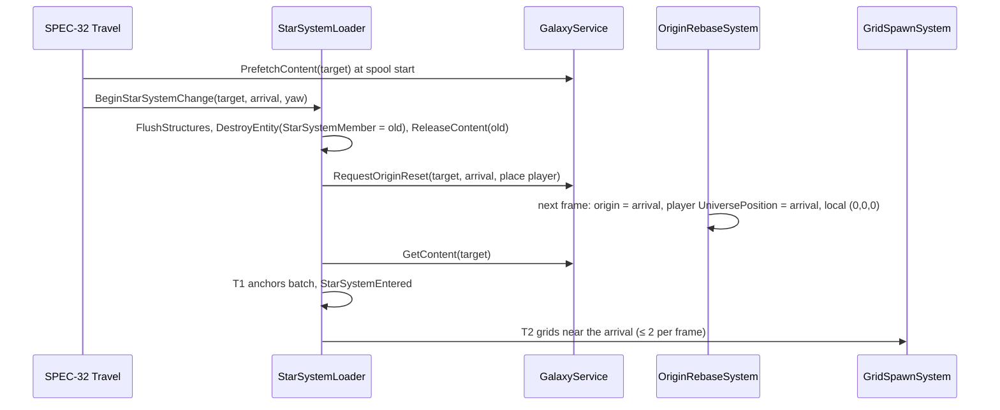

# SPEC-31 — Star-system streaming, bodies and interaction

| | |
|---|---|
| **Status** | Draft |
| **Area code** | SYS (task IDs are `SYS-001`, `SYS-002`, …) |
| **Module(s)** | `Game.Galaxy` (folders `Assets/Game/Galaxy/Streaming/`, `Assets/Game/Galaxy/Bodies/`, `Assets/Game/Galaxy/Interaction/`); `Game.Presentation` (`Assets/Game/Presentation/World/` for celestial visuals); `Game.Core` (event payloads in `Assets/Game/Core/Events/`) |
| **Depends on specs** | SPEC-30 (`GalaxyService`, `StarSystemContent`, `BodySpec`, `OrbitMath`, `StarSystemDelta`, `GalaxyState`, `FrameOrigin`, `OriginRebaseRequest`, `UniversePosition`, `UniversePositionIsAnalytic`, `StarSystemMember`, body/visual definitions, `IGalaxyLiveDeltaSink`, `GalaxyFrameTicker`); SPEC-01 (`ISceneReady`/`ISceneExiting` hooks, `IPersistentIdAllocator`, `WorldSceneActive`, `ShipSpawnService` implements `IShipSpawner`); SPEC-02 (`ManagedEventQueue<T>`, events bridge, `SimClock`, `StableHash`, `RngPurpose`); SPEC-05 (`ISaveParticipant`, `PLOC` chunk); SPEC-10 (`GridSpawnApi`, `VoxelStructureRegistry`, `BlueprintLibrary`, `IGridSpawnHook`, `GridStructureSync`, `VoxelStructure`, `GridSpawnFlags`); SPEC-12 (`PhysicsLayers.Celestial/InteractionQuery`, materials); SPEC-13 (`SplitOrigin`, `ChunkBody`, `Hulk`, `DamageStreams.DrainCoreLost`); SPEC-20 (`PlayerShip`, `PlayerCommand.Edges.Interact`); SPEC-21 (`Allegiance`, `CombatGridSetup`); SPEC-23 (`SpatialBody`, `AiSetup`); SPEC-33 (`IStarSystemOwnership` for station factions) |
| **Depended on by** | SPEC-01 (`StarSystemLoader` scene hook, `IShipSpawner`); SPEC-32 (`StarSystemLoader.BeginStarSystemChange`, lane gate bodies); SPEC-33 (`IShipSpawner`, loaded-star-system queries); SPEC-40/42 (`BodyInteracted`, `StarSystemEntered`, `BodyDestroyed`, story spawns appear); SPEC-50 (salvage interaction on hulks, docking for merchants); SPEC-51 (docked state for in-world editing, M4); SPEC-61 (`InteractionTarget`, `CurrentStarSystemInfo`, dock screen); SPEC-05 (`PLOC`) |
| **Milestone** | M3 |

> Read [01-architecture.md](../01-architecture.md) (§4.3, §5, §7.3–§7.4, §9, §11), [02-conventions.md](../02-conventions.md), [SPEC-30](SPEC-30-galaxy-generation.md) (§3, §4.3–§4.8, §5.10) and [SPEC-10](SPEC-10-voxel-data-model.md) (§4.4, §5.7, §6) before this spec. This spec may not contradict them.

## 1. Purpose

SPEC-30 says *what* is in a star system; this spec makes it exist around the player. When the World scene opens, after a load or a jump, `StarSystemLoader` turns the star system's `BodySpec` list into entities in three tiers: every body gets a light anchor entity (T1) with its analytic orbit, visual and celestial collider; voxel bodies (stations, derelicts, lane gates) get real grids only within a load distance (T2); asteroid belts are filled sector by sector only inside a bubble around the player (T3). Everything it creates carries `StarSystemMember`, so unloading a star system is one batch destroy. Interaction (dock, inspect, hail, salvage, lane gate) is measured from the player's hull to the target's surface, which fixes the old "300 m station you cannot dock with" bug (R10). It owns the `PLOC` save chunk (where the player is), damage persistence of small voxel bodies, and the managed events `StarSystemEntered`, `BodyInteracted`, `BodyDestroyed`. The old prototype generated every star system twice (R9), loaded saves at the wrong place (R28) and measured interaction radius from body centres (R10); each has a regression test here.

## 2. Scope

**In scope:**
- `StarSystemLoader` (managed; the architecture's structural `StarSystemStreamingSystem`): load, unload, tiers T1–T3 with hysteresis, time slicing, the `StarSystemMember` spawn hook, adoption of split pieces, `IGalaxyLiveDeltaSink`.
- Body entities: anchors, orbits (`BodyOnRailsSystem`), celestial colliders and `SpatialBody`, celestial visuals and far-distance compression (`CelestialVisualSystem`).
- Voxel bodies: spawning from blueprint, procedural shape or saved structure; small-body damage persistence; destroyed bodies.
- Asteroid belts: sectors, deterministic asteroid generation jobs, streaming.
- Interaction: `Interactable`, `InteractionQuerySystem`, `InteractionTarget`, `BodyInteracted`; docking state (`DockingService`).
- `PLOC` participant; `IShipSpawner` interface (implemented by SPEC-01); `CurrentStarSystemInfo` singleton.
- Regression scenarios R9 (PlayMode), R10, R28.

**Out of scope (and who owns it instead):**
- Galaxy layout, content generation, deltas model, origin rebasing: SPEC-30.
- Jump decision, warp transition, lane access, arrival point: SPEC-32 (calls `BeginStarSystemChange`).
- Encounters, faction territory, station ownership: SPEC-33. Merchants and salvage yields: SPEC-50. Dock screen UI: SPEC-61.
- Brick-level diffs for large bodies: SPEC-30 GAL-016 (M4).

## 3. Decisions (binding)

1. **`StarSystemLoader` is the only Galaxy code that makes structural changes with `EntityManager` directly** (architecture §5 "StarSystemStreamingSystem — structural"). It runs on the main thread inside `GalaxyFrameTicker` (`TickOrder` 100), which SPEC-30's `GalaxyServicesBridgeSystem` calls from `WorldGroup` (`OrderFirst`). It uses batch APIs only (conventions §2.5): `CreateEntity(archetype, NativeArray)`, `DestroyEntity(query)` with a shared-component filter, `AddSharedComponent(NativeArray, value)`.
2. **Exactly one star system is loaded at a time.** A change unloads the current one completely before the next one's entities are created. Content of the target may be prefetched (SPEC-30 `PrefetchContent`) during the warp. Reason: architecture §7.4; simplest correct streaming; the "≤ 2 star systems" cardinality of `StarSystemMember` covers the prefetch overlap.
3. **Tiers:** T1 every body of the loaded star system (anchor, orbit, visual, celestial collider). T2 a body's voxel grid exists while the player is within `t2LoadDistanceM` of the body's bounding sphere (unload beyond `× T2UnloadFactor` = 1.25). T3 asteroid sectors exist while the sector centre is within `BubbleRadiusM` (900 m) of the player (unload beyond `× 1.25`). Reason: hysteresis prevents load/unload flicker.
4. **Everything this spec creates carries `StarSystemMember` = the loaded star system** (anchors, visuals, body grids and, through the spawn hook, their bricks and functional entities). The player ship and its children never do. Split pieces of any grid (`SplitOrigin`, SPEC-13) adopt the loaded star system, including pieces of the player ship. Reason: architecture §4.3; one batch destroy unloads everything; player debris stays behind when jumping.
5. **Orbits are applied in the fixed step.** `BodyOnRailsSystem` sets `UniversePosition` and `LocalTransform` of bodies with orbits every tick from `SimClock.UniversalTime`, so contacts and hits against moving bodies are frame-rate independent. Reason: determinism (06); architecture §5 lists it under `WorldGroup` — moved by §10 Q1.
6. **Voxel bodies in this spec are Static grids** (SPEC-30: stations, points of interest and belts are `Fixed`; lane gates sit on the lane ring). Asteroids are Dynamic grids (they can be pushed). Reason: no rails for grids; asteroids react to rams.
7. **Interaction distance is surface to surface** (R10): from the player ship's bounding sphere to the target's collider surface, using a Unity Physics point-distance query with `PhysicsLayers.InteractionQuery`, compared with `Interactable.DistanceM` (`BodyTemplateDefinition.interactionDistanceM`).
8. **The interact key is consumed as a variable-rate edge** from `PlayerCommand.Edges.Interact` with this spec's own last-seen counter (SPEC-20 §6). Reason: `InteractionQuerySystem` runs in `WorldGroup`.
9. **Damage persistence in M3:** destructible voxel bodies whose source has ≤ 65,536 cells spawn from an owned clone with `GridSpawnFlags.WriteBack`; after damage the clone becomes the delta's `StructureDiffRecord` (ownership moves to `StarSystemDelta`). Larger bodies spawn from the read-only blueprint and their damage is not persisted until GAL-016 (M4). Reason: SPEC-10 §8.2 memory gate (no source copy of a 1M-cell station); SPEC-30 decision 13.
10. **Destroyed bodies:** a voxel body whose core is lost becomes a hulk in place and is marked `Destroyed` in the delta (`BodyDestroyed` event); on later loads it spawns from its persisted structure as a hulk if one exists, otherwise nothing spawns. A destroyed asteroid (fewer than 10% of its cells left, or despawned while empty) is marked destroyed and never respawns. Reason: SPEC-30 Q3; pillar 1 (wrecks stay).
11. **Body grids get a fresh `PersistentId` per spawn** (never saved; SPEC-30 decision 13) from `IPersistentIdAllocator`.
12. **Events** (payloads in `Game.Core.Events`, SPEC-02 §5.6): `StarSystemEntered`, `BodyInteracted`, `BodyDestroyed`, published by managed code with `EventBus<T>.Publish`, or enqueued by ECS systems into `ManagedEventQueue<T>`.
13. **Folders and namespaces:** `Assets/Game/Galaxy/Streaming/` → `Game.Galaxy.Streaming`; `Bodies/` → `Game.Galaxy.Bodies`; `Interaction/` → `Game.Galaxy.Interaction`; jobs in `<area>/Jobs/` with the area namespace; services implementing SPEC-30/SPEC-01 interfaces in `Assets/Game/Galaxy/Services/` → `Game.Galaxy.Services`.

## 4. Data model

All types are **public contract** unless marked *internal*.

### 4.1 Event payloads (`Assets/Game/Core/Events/`, namespace `Game.Core.Events`)

```csharp
namespace Game.Core.Events
{
    public enum StarSystemEntryReason : byte { NewGame = 0, Load = 1, Jump = 2, ReturnFromEditor = 3, DevSandbox = 4 }

    public readonly struct StarSystemEntered
    { public readonly uint StarSystemValue; public readonly StarSystemEntryReason Reason; public readonly uint VisitCount;
      public StarSystemEntered(uint s, StarSystemEntryReason r, uint visits) { StarSystemValue = s; Reason = r; VisitCount = visits; } }

    public readonly struct BodyInteracted
    { public readonly uint StarSystemValue; public readonly ulong BodyKey; public readonly byte Kind; public readonly ulong GridPersistentId;
      public BodyInteracted(uint s, ulong key, byte kind, ulong grid) { StarSystemValue = s; BodyKey = key; Kind = kind; GridPersistentId = grid; } }
      // BodyKey = BodyId.LocalKey, 0 for non-body targets (hulks); Kind = (byte)InteractionKind

    public readonly struct BodyDestroyed
    { public readonly uint StarSystemValue; public readonly ulong BodyKey;
      public BodyDestroyed(uint s, ulong key) { StarSystemValue = s; BodyKey = key; } }
}
```

`Game.Galaxy/AssemblyInfo.cs` registers `ManagedEventQueue<BodyInteracted>` (the only one enqueued from ECS) and `ManagedEventChannels.RegisterAll` gets `RegisterChannel<BodyInteracted>()`. `BodyDestroyed` remains managed-only; the existing bridge test exclusion list records that actual publisher (Q7).

### 4.2 Body components (`Game.Galaxy.Bodies`)

```csharp
namespace Game.Galaxy.Bodies
{
    using Unity.Entities; using Game.Galaxy.Data; using Game.Data.Definitions;

    public enum BodyTier : byte { T1 = 1, T2 = 2, T3 = 3 }
    [System.Flags] public enum BodyFlags : byte { None = 0, HasGrid = 1, GridPending = 2, Destroyed = 4, HasCollider = 8, OnRails = 16, Asteroid = 32 }

    /// <summary>On every body anchor (T1). Only writer: StarSystemLoader.</summary>
    public struct StarSystemBody : IComponentData
    {
        public BodyId Id;
        public ushort TemplateIndex;          // GalaxyDef.BodyTemplates
        public BodyFlags Flags;
        public byte Reserved;
        public float RadiusM;                 // BodySpec.RadiusM (celestial radius or voxel bounding radius)
        public Entity Grid;                   // T2/T3 grid root or Entity.Null
        public Entity Visual;                 // child render entity or Entity.Null
    }

    /// <summary>On anchors of bodies with Circular/Elliptic orbits (UniversePositionIsAnalytic is also added). Only writer: StarSystemLoader (creation).</summary>
    public struct BodyOrbit : IComponentData
    {
        public OrbitElements Orbit;
        public OrbitElements ParentOrbit;     // Mode Fixed + Radius 0 when the parent is the star
    }

    /// <summary>On grid roots spawned for a body (stations, gates, POIs, asteroids). Only writer: StarSystemLoader (creation).</summary>
    public struct BodyGridOwner : IComponentData
    {
        public BodyId Body;
        public Entity Anchor;
        public uint CapturedRevision;         // VoxelGrid.Revision last written into the delta (0 = never)
        public byte PersistDamage;            // decision 9
        public byte Reserved0; public ushort Reserved1;
    }

    /// <summary>Singleton for ECS and UI readers. Only writer: StarSystemLoader.</summary>
    public struct CurrentStarSystemInfo : IComponentData
    {
        public StarSystemId Id;               // None while nothing is loaded
        public byte Loaded;                   // 1 when T1 is complete
        public byte Changing;                 // 1 during BeginStarSystemChange
        public ushort BodyCount;
    }

    /// <summary>Singleton from config_streaming (§4.6). Created by SPEC-01 BootSingletons.</summary>
    public struct StreamingConfig : IComponentData
    {
        public float T2UnloadFactor;          // 1.25
        public float BubbleRadiusM;           // 900
        public float BubbleUnloadFactor;      // 1.25
        public int MaxGridSpawnsPerFrame;     // 2
        public int MaxAsteroidJobsInFlight;   // 4
        public int MaxAsteroidsPerSector;     // 8 (SPEC-30 caps content at 8)
        public float MaxRenderDistanceM;      // 25000: celestial visuals farther than this are distance-compressed
        public float InteractionQueryRadiusM; // 600: max of all interaction distances + player radius margin
        public int PersistDamageMaxCells;     // 65536 (decision 9)
    }
}
```

Every anchor also carries `LocalTransform`, `LocalToWorld`, `UniversePosition`, `StarSystemMember` and, by template: `UniversePositionIsAnalytic` + `BodyOrbit` (orbiting bodies), `PhysicsCollider` + `PhysicsWorldIndex(0)` + `SpatialBody` (`hasCollider`, celestial roles), `Interactable` (interaction ≠ None and no grid; bodies with grids put it on the grid root).

### 4.3 Interaction (`Game.Galaxy.Interaction`)

```csharp
namespace Game.Galaxy.Interaction
{
    using Unity.Entities; using Game.Galaxy.Data; using Game.Data.Definitions;

    /// <summary>Makes an entity a possible interaction target. Added by StarSystemLoader (bodies, body grids), SPEC-33 (hailable encounter
    /// leaders, Kind Hail) and SPEC-50's SalvageMarkSystem (non-body, non-player hulks, Kind Salvage; one batch per frame in WorldGroup).
    /// InteractionQuerySystem treats all of them alike; nothing else in the query changes.</summary>
    public struct Interactable : IComponentData
    {
        public InteractionKind Kind;
        public byte Reserved0; public ushort TemplateIndex;   // prompt text source (BodyTemplateDefinition.interactPrompt); 0xFFFF = none
        public float DistanceM;                               // surface-to-surface range (decision 7)
        public BodyId Body;                                   // default for non-body targets
    }

    /// <summary>Singleton: the current best target. Only writer: InteractionQuerySystem. Read by SPEC-61 (prompt) and SPEC-70.</summary>
    public struct InteractionTarget : IComponentData
    {
        public Entity Target;            // Entity.Null = none
        public BodyId Body;
        public InteractionKind Kind;
        public byte InRange;             // 1 if DistanceM ≤ Interactable.DistanceM
        public ushort TemplateIndex;
        public float DistanceM;          // surface distance
        public ulong GridPersistentId;   // PersistentId of Target if it is a grid, else 0
    }

    /// <summary>Singleton state of InteractionQuerySystem (its consumed interact counter).</summary>
    public struct InteractionInputState : IComponentData { public byte LastInteractCounter; public byte Initialized; }
}
```

### 4.4 Services (`Game.Galaxy.Services`)

```csharp
namespace Game.Galaxy.Services
{
    using Unity.Mathematics; using Game.Core; using Game.Galaxy.Data;

    /// <summary>Spawns ships for Galaxy services (SPEC-33 encounters). Implemented by SPEC-01 ShipSpawnService.</summary>
    public interface IShipSpawner
    {
        PersistentIdValue Spawn(in GalaxyShipSpawnArgs args);   // returns the PersistentId; the ship carries StarSystemMember = args.StarSystem
        bool TryGetRoot(ulong persistentId, out Unity.Entities.Entity root);
        bool Despawn(ulong persistentId);
    }
    public readonly struct PersistentIdValue { public readonly ulong Value; public PersistentIdValue(ulong v) { Value = v; } }

    public struct GalaxyShipSpawnArgs
    {
        public ContentId Blueprint;
        public float3 Position;                  // local frame
        public quaternion Rotation;              // yaw only
        public float3 LinearVelocity;
        public Game.Simulation.Allegiance Allegiance;
        public bool WithAi;
        public ContentId AiProfile;              // None = default
        public StarSystemId StarSystem;          // the loaded star system (required)
        public ContentHash Encounter;            // SPEC-33 tag; 0 = none
    }

    public enum LoaderState : byte { Idle = 0, Unloading = 1, Loading = 2, Ready = 3 }

    /// <summary>Owner of the loaded star system. Implements SPEC-31 §5.1–§5.8.</summary>
    /// ITravelLoader (SPEC-32 §4, Game.Galaxy.Travel) is added to the base list by SPEC-32 TRV-006 together with its two members below.
    public sealed class StarSystemLoader : IGalaxyFrameTick, IGalaxyLiveDeltaSink, /* ITravelLoader added by TRV-006 (Q6) */ Game.Core.Flow.ISceneReady, Game.Core.Flow.ISceneExiting, System.IDisposable
    {
        public StarSystemLoader(GalaxyService galaxy, Unity.Entities.World world, Game.Voxel.Grid.VoxelStructureRegistry registry,
                                Game.Voxel.Grid.BlueprintLibrary blueprints, IPersistentIdAllocator ids, Game.Data.Services.ContentCatalog catalog);
        public int TickOrder => 100;
        public int SceneReadyOrder => Game.Core.Flow.SceneHookOrder.Galaxy;   // 100
        public LoaderState State { get; }
        public StarSystemId Loaded { get; }
        public bool IsReady => State == LoaderState.Ready;
        /// SPEC-32: unloads the current star system and loads `target` with the player placed at `arrival` (star-system frame).
        public bool BeginStarSystemChange(StarSystemId target, double3 arrivalPositionM, float arrivalYawRad, StarSystemEntryReason reason);
        // SPEC-32 ITravelLoader (Game.Galaxy.Travel), bodies written by TRV-006:
        public bool IsArrivalReady { get; }             // IsReady && Loaded == last BeginStarSystemChange target && IsAreaReady(its arrival)
        public bool IsAreaReady(double3 positionM);     // §5.1 scene-ready T2 rule for any star-system-frame point
        public void Tick(in GalaxyFrameContext ctx);
        public void OnBodyDeltaChanged(BodyId body);    // IGalaxyLiveDeltaSink
        public void FlushStructures();                  // IGalaxyLiveDeltaSink: capture damaged persistent bodies now (before save)
        // ISceneReady / ISceneExiting members per SPEC-02 (OnSceneReady, IsSceneReadyComplete, OnSceneExiting)
        public void Dispose();
    }

    /// <summary>Docked state. Only writer: InteractionQuerySystem (Dock) via Dock(), and SPEC-61's dock screen via Undock().</summary>
    public sealed class DockingService
    {
        public bool IsDocked { get; }
        public BodyId DockedBody { get; }
        public void Dock(BodyId body);           // publishes DockStateChanged(true); the dock screen (SPEC-61) listens
        public void Undock();                    // publishes DockStateChanged(false)
        public void RestoreDocked(BodyId body);  // PLOC restore: docked without an event until the World scene is ready
    }

    /// <summary>PLOC (SPEC-05 order 90, version 1). Implements SPEC-31 §5.10.</summary>
    public sealed class PlayerLocationSaveParticipant : Game.Core.Save.ISaveParticipant
    {
        public PlayerLocationSaveParticipant(GalaxyState state, DockingService docking);
    }
}
namespace Game.Core.Events
{
    public readonly struct DockStateChanged { public readonly bool Docked; public readonly uint StarSystemValue; public readonly ulong BodyKey;
        public DockStateChanged(bool d, uint s, ulong k) { Docked = d; StarSystemValue = s; BodyKey = k; } }
}
```

### 4.5 Internal streaming data

```csharp
namespace Game.Galaxy.Streaming
{
    internal struct LoadedBody          // one per BodySpec of the loaded star system, same order as StarSystemContent.Bodies
    {
        public Unity.Entities.Entity Anchor;
        public Unity.Entities.Entity Grid;            // T2 grid or Null
        public ulong GridPersistentId;
        public int StructureHandle;                   // registry handle of an owned clone (decision 9) or −1
        public byte WantsGrid;                        // template has a structure and the body is not destroyed without a persisted structure
        public byte GridRequested;
    }
    internal struct BeltSector { public ulong BodyKey; public int Sector; public float3 CentreLocal; public byte Loaded; public byte JobPending; }
    internal struct AsteroidSlot { public Unity.Entities.Entity Grid; public BodyId Id; public int StructureHandle; }
}
```

### 4.6 Definition

`[ContentIdPrefix("config_")] StreamingConfigDefinition : ContentDefinition` (`config_streaming`, `Assets/Game/Data/Definitions/World/`): one serialized field per `StreamingConfig` field, same defaults; validation `SYS-E001` (`T2UnloadFactor < 1.05` or `BubbleUnloadFactor < 1.05`), `SYS-E002` (`BubbleRadiusM < 200`). SYS-E003 checks belt sector identity capacity through the pass catalog (Q9); SYS-E004 checks the remaining config distances/work budgets (Q10).

## 5. Systems, services and flow

### 5.0 Placement

| Part | Where | Notes |
|---|---|---|
| `StarSystemLoader.Tick` | main thread, `WorldGroup` (through `GalaxyServicesBridgeSystem`, OrderFirst), `TickOrder` 100 | structural (decision 1); requires `WorldSceneActive` (returns otherwise) |
| `BodyOnRailsSystem` | `GameplayPrePhysicsGroup`, `[UpdateBefore(typeof(PowerAllocationSystem))]`, Burst | requires `GameplayActive`, `WorldSceneActive`, `FrameOrigin`, `SimClock` |
| `InteractionQuerySystem` | `WorldGroup`, `[UpdateAfter(typeof(GalaxyServicesBridgeSystem))]`, Burst | requires `GameplayActive`, `WorldSceneActive`, `PlayerCommand`, `PhysicsWorldSingleton` |
| `BodyGridWatchSystem` | `WorldGroup`, `[UpdateAfter(typeof(InteractionQuerySystem))]`, Burst | core-lost and empty-asteroid detection (§5.6) |
| `CelestialVisualSystem` | `PresentationBridgeGroup` (`Game.Presentation`), after `CameraTargetSyncSystem` | distance compression (§5.9) |

### 5.1 World entry (`ISceneReady`, order 100)

`OnSceneReady(ctx)` (World only; Lab: complete immediately):
1. If `galaxy.Galaxy == null` (dev sandbox, SPEC-01 §5.4.4) → `State = Ready`, nothing loaded; complete.
2. `id = State.CurrentStarSystem`; if invalid or `!galaxy.Galaxy.TryGetIndex(id)` → `GameLog.Error` (SPEC-30 §7 row) and use `Galaxy.StartStarSystem`, `HasPlayerLocation = false`.
3. If `!State.HasPlayerLocation` → `State.PlayerLocation = galaxy.GetStartLocation()`, `HasPlayerLocation = true`.
4. Start a load (§5.2) with `reason` = `NewGame` (session flag from SPEC-01), `Load`, or `ReturnFromEditor` (scene entry reason), arrival = `PlayerLocation`.
`IsSceneReadyComplete`: `State == Ready` **and** `IsAreaReady(arrival)`: every body whose T2 sphere (bounding radius + `T2LoadDistanceM`) contains the point has its grid root and `GridSpawning` disabled (the player never spawns inside an unloaded station). SPEC-32 uses the same `IsAreaReady` for jump arrivals (`IsArrivalReady`) and cruise hops.

### 5.2 Load (state machine, one step per `Tick` unless stated)

1. **Unload** (only if something is loaded): §5.3. `State = Unloading` → continue the same frame.
2. **Origin:** `requestSerial = reason == Jump ? galaxy.RequestOriginReset(id, arrival.PositionM, new PlayerPlacement { PositionM = arrival.PositionM, YawRad = arrival.YawRad }) : galaxy.RequestOriginReset(id, arrival.PositionM)` (SPEC-30 §4.8; on world entry the player ship does not exist yet and is spawned at the arrival by SPEC-01). `State = Loading`. Wait until `FrameOrigin.StarSystem == id && FrameOrigin.AppliedRequestSerial ≥ requestSerial` (next frame's init group applies it).
3. **Content:** `content = galaxy.GetContent(id)` (completes a prefetch; R9: exactly one generation per load).
4. **T1 anchors** (one frame, marker `StarSystemLoader.CreateAnchors`): build per-archetype groups (celestial with collider, celestial without, orbiting variants, voxel-body anchors, belts); `em.CreateEntity(archetype, entities)` per group; fill components in a Burst `IJobParallelFor` through lookups and complete it (outside the fixed step): `StarSystemBody`, `BodyOrbit`, `UniversePosition = OrbitMath.Position(spec, UniversalTime)`, `LocalTransform = (UniversePosition − FrameOrigin, yaw rotation, scale 1)`; colliders: `SphereCollider.Create(new SphereGeometry { Radius = RadiusM }, PhysicsLayers.Celestial, PhysicsLayers.CelestialMaterial)` created once per distinct radius in this star system (cached, disposed at unload through `DeferredDisposal`); `SpatialBody { Radius }`; `Interactable` for bodies without a structure. `em.AddSharedComponent(allEntities, new StarSystemMember { Id = id })` once. Visual child entities (§5.9) in the same batch. Destroyed celestial bodies (SPEC-30 state) get no visual and no collider.
5. **Entry bookkeeping:** `delta = State.GetOrCreateDelta(id)`; `delta.IncrementVisit()`; `galaxy.MarkVisited(id)`; `State.CurrentStarSystem = id`; `CurrentStarSystemInfo { id, Loaded = 1, BodyCount }`; `EventBus<StarSystemEntered>.Publish(...)`.
6. `State = Ready`. T2/T3 streaming (§5.4–§5.5) starts the same frame.

Time budget: a 512-body star system creates ≤ 1,100 entities in step 4 (≤ 3 ms main thread); the rest is time-sliced (§5.4).

### 5.3 Unload

1. `FlushStructures()` (§5.7).
2. Release registry handles of owned clones that did not move to deltas; dispose them.
3. `em.CompleteAllTrackedJobs()` (allowed: `WorldGroup`, once per star-system change).
4. `query = WithAll<StarSystemMember>` with `EntityQueryOptions.IncludeDisabledEntities` (stowed grids, SPEC-10 §5.13) and shared filter `{ Id = Loaded }` → `em.DestroyEntity(query)` (chunk batch; LEGs cascade); then `em.DestroyEntity(WithAll<ChunkBody>)` (SPEC-13 pooled chunks; recreated on demand).
5. Celestial collider blobs → `DeferredDisposal.RetireBlob`. `galaxy.ReleaseContent(Loaded)`. `CurrentStarSystemInfo { None, 0 }`. Clear `LoadedBody` lists and belt state.
Projectiles are cleared by SPEC-21 when the origin record reports a star-system change.

### 5.4 T2: voxel bodies

Per frame (marker `StarSystemLoader.T2`), with the player root position `p` (read with `EntityManager.GetComponentData<LocalTransform>`; allowed outside the fixed step, one sync per frame; no player → T2 uses the requested arrival while entry waits for readiness; T3 remains skipped (Q16)):
1. For each `LoadedBody b` with `WantsGrid` (in body order): `d = max(0, |p − anchorPos| − RadiusM)`; load if `Grid == Null && !GridRequested && d < t2LoadDistanceM`; unload if `Grid != Null && d > t2LoadDistanceM × T2UnloadFactor`.
2. Loads, at most `MaxGridSpawnsPerFrame` per frame in body order:
   1. Source: delta has a structure for this body → that structure (registered; `WriteBack` if `PersistDamage`); else template `structureSource`: `Blueprint` → `blueprints.TryGet`; `ProceduralShape` → `ProceduralShapeBuilder.Build(shape, seed)` (§5.8). If `destructible` and the source has ≤ `PersistDamageMaxCells` cells and it is not already owned → `clone = source.Clone()`, register it, `WriteBack`, `PersistDamage = 1`; else spawn from the blueprint hash / registered procedural structure without `WriteBack`.
   2. `GridSpawnApi.RequestSpawn(...)` with pose = anchor pose, `Kind = Station` (stations, POIs, gates) or `Hulk` (destroyed body with persisted structure), `Motion = Static`, `PersistentId = ids.Allocate()`, flags as above. Before the next frame add on the request entity: `StarSystemMember`, `UniversePosition`, `BodyGridOwner { Body, Anchor, PersistDamage }`, `Interactable` (if the template has an interaction), `Allegiance` (`IStarSystemOwnership.GetOwnerFaction` if registered, else `Allegiance.None`); if the structure has a block with a `WeaponMount` module: request `Profile = GridProfile.Station` and add `AiBrain { ProfileIndex = AiSetup.ProfileIndexOf(catalog, ai_turret) }` (ADR-0015; otherwise `Profile = None`); if `!destructible`: SPEC-13 `DamageImmune` (SPEC-30 Q15). Destroyed bodies with a persisted structure also get `Hulk` + `HulkInfo`.
   3. `b.Grid = root; GridRequested = 1; anchor StarSystemBody.Grid = root, Flags |= HasGrid`; the anchor's visual is hidden when `hideWhenGridPresent` (§5.9).
3. Unloads: capture (§5.7) then `GridSpawnApi.RequestDespawn(em, b.Grid)`; `b.Grid = Null`; `GridRequested = 0`.

### 5.5 T3: asteroid belts

1. Sectors: a belt (inner `BeltInnerRadiusM`, outer `BeltOuterRadiusM` around the star) is divided into rings of width `sectorSizeM` and, per ring `r`, `nr = ceil(2π × ringMidRadius / sectorSizeM)` angular sectors. `Sector = ring × 4096 + angularIndex`. Sector centre in the star-system frame: `(cos θ, 0, sin θ) × ringMidRadius`, `θ = (angularIndex + 0.5) × 2π / nr`.
2. Per frame (marker `StarSystemLoader.T3`): sectors whose centre is within `BubbleRadiusM` of the player (computed by stepping only the rings and angles that intersect the bubble's XZ square) are wanted; loaded sectors beyond `BubbleRadiusM × BubbleUnloadFactor` are released.
3. A wanted sector schedules `AsteroidSectorJob` (Burst, `IJob`; at most `MaxAsteroidJobsInFlight`): `rng = RngStreams.For(beltSeed, RngPurpose.AsteroidShape, Sector)`; count = `rng.NextInt(min, max + 1)` (≤ 8); for `k` in `0..count−1` (always draw all values even for destroyed asteroids, SPEC-30 decision 5): position inside the sector (uniform in the sector's ring/angle cell, `y = rng.NextFloat(−0.25, 0.25) × beltWidth × 0.1`), radius `lerp(min, max, rng.NextFloat()^2)`, yaw, noise seed. `BodyId = (star system, Asteroid, belt slot, Sector × 8 + k)` — the `SubSlot` is `ushort`, so `Sector × 8 + k < 65536` (validator `SYS-E003` on templates where the belt would exceed it).
4. When the job completes (checked with `IsCompleted` next frames): for each asteroid not `Destroyed` in the delta: build its structure with `AsteroidBuilder` (§5.8, Burst job per asteroid, completed next frame), spawn `Kind = Asteroid`, `Motion = Dynamic`, flags `None` (asteroid damage is not persisted; decision 10), `StarSystemMember`, `UniversePosition`, `BodyGridOwner`. At most `MaxGridSpawnsPerFrame` spawns per frame shared with T2.
5. Release: despawn the sector's asteroids (no capture); dispose their structures after `GridSpawning` finished (registry release).

### 5.6 `BodyGridWatchSystem` (WorldGroup, Burst) and body destruction

Per frame over roots with `BodyGridOwner` (single `IJob`, results into a `NativeQueue<BodyGridEvent>` the loader drains on its next `Tick`):
- (a) the root has `Hulk` and its body is not yet destroyed → event `CoreLost(body, root)`;
- (b) asteroid grids (`StarSystemBody.Flags & Asteroid` on the anchor): `GridMass.Data.CellCount < 0.1 × BodyGridInitialCells.Cells` → event `AsteroidDestroyed(body, root)`.
The loader then calls `galaxy.MarkBodyDestroyed(body)` and publishes `BodyDestroyed`; for asteroids it also requests a despawn. Stations remain as hulks (decision 10).

`BodyGridInitialCells : IComponentData { public uint Cells; }` (added at spawn by the loader with the source's solid cell count) and `BodyGridEvent { BodyId Body; Entity Grid; byte Kind; }` are part of the public types (`Game.Galaxy.Bodies`).

### 5.7 Damage capture (`FlushStructures`, unload)

For each loaded body grid with `PersistDamage == 1` and `VoxelGrid.Revision != CapturedRevision`:
1. `GridStructureSync.WriteBack(em, root, registry)` (updates the owned clone in place; SPEC-10 §6).
2. If the delta does not own this structure yet: `delta.SetStructure(bodyKey, revision, clone)` (ownership moves; the loader forgets its own ownership but keeps the registry handle while the grid lives).
3. `CapturedRevision = Revision` (written by the loader on the main thread; `BodyGridOwner` has no other writer).
Cost: O(changed bricks) per body (SPEC-10 `WriteBack`), main thread, inside `SaveService`'s capture budget for typical saves (≤ 1 ms for 50 changed bricks).

### 5.8 Structure builders (Burst, `Game.Galaxy.Bodies`)

- `ProceduralShapeBuilder.Build(in ProceduralShapeParams p, ulong seed) → VoxelStructure`: fills cells per `ShapeKind` (Ring, Cylinder, Box, Sphere) with `wallThicknessCells` shell (0 = solid) using `hullBlock`, places one `coreBlock` instance at the geometric centre's nearest solid cell (lowest `(z,y,x)` on ties), colour `colorIndex`; deterministic; Burst job writing dense bricks, then `SetBrickDense`/`OptimizeStorage` on the main thread.
- `AsteroidBuilder.Build(radiusM, cellSize, block, noiseAmplitude, noiseFrequency, seed) → VoxelStructure`: cell solid iff `|c − centre| ≤ R × (1 + A × noise(c × f))` with `noise` = `Unity.Mathematics.noise.snoise` on the cell centre offset by the seed (Burst, per brick parallel), no core (asteroids have none).
Both are cached per `(template, seed)` for the lifetime of the loaded star system.

### 5.9 Celestial visuals (`CelestialVisualSystem`, Presentation)

- Each celestial anchor with a `BodyVisualDefinition` gets one child render entity: `Parent = anchor`, scale `RadiusM / meshRadius`, `MaterialMeshInfo` from IDs registered once per visual definition (`RegisterMesh`/`RegisterMaterial`, architecture §11.3), `URPMaterialPropertyBaseColor`/`URPMaterialPropertyEmissionColor` from the definition, shadows per `castShadows`. Created in the T1 batch.
- Per frame: for each visual whose anchor is farther than `MaxRenderDistanceM` from the camera (`MainCameraState`, SPEC-62): `k = MaxRenderDistanceM / distance`; set the child's `LocalTransform` so that it renders at `camera + (anchor − camera) × k` with scale `× k` (same angular size); nearer ones get identity offset. Only writer of the visual child's `LocalTransform`. Nothing in the simulation reads it.
- Voxel bodies with `hideWhenGridPresent`: the visual's `MaterialMeshInfo` is disabled while the anchor has `HasGrid`.

### 5.10 `PLOC` participant (order 90, version 1)

Capture (main thread): `galaxy.CapturePlayerLocation()` was already called by SPEC-01's `FleetWriteback`; write: `CurrentStarSystem.Value` (u32), `HasPlayerLocation` (u8), `PlayerLocation.StarSystem` (u32), `PositionM` (3 × f64 raw bits), `YawRad` (f32), `docked` (u8), `DockedBody.System` (u32), `DockedBody.LocalKey` (u64). Restore: read the same into `GalaxyState` and `docking.RestoreDocked(body)` when docked. Unknown future fields are skipped by the container (SPEC-05 block rules). Round trip byte-identical.

### 5.11 `InteractionQuerySystem`

Per frame (markers `Query`, `Edge`), Burst `ISystem`, one `IJob`:
1. No player root → `InteractionTarget = default`; still consume the interact counter (`LastInteractCounter = PlayerCommand.Edges.Interact`) so no press fires later; return.
2. Player centre `c` = `SpatialHash` proxy centre if present, else root position; player radius `r` = proxy `HullRadius` (or 10 m).
3. `CollisionWorld.CalculateDistance(new PointDistanceInput { Position = c, MaxDistance = InteractionQueryRadiusM + r, Filter = PhysicsLayers.InteractionQuery }, ref AllHitsCollector<DistanceHit>)`; ignore hits on the player's own grid.
4. For each hit: resolve the interactable entity: the hit entity if it has `Interactable`; else, if it has `BodyGridOwner`, its root's `Interactable`. Surface distance `s = max(0, hit.Distance − r)`. Candidate if `s ≤ Interactable.DistanceM`; keep the smallest `s` (ties: lower `Entity.Index`). If no candidate is in range, keep the nearest interactable within `2 × DistanceM` as an out-of-range target (prompt shows "too far").
5. Write `InteractionTarget`.
6. **Edge:** `while (LastInteractCounter != PlayerCommand.Edges.Interact) { LastInteractCounter++; if (InRange) enqueue BodyInteracted(...) into ManagedEventQueue<BodyInteracted>; }` (at most one interaction per counter step; out-of-range presses are dropped).
Managed handler (in `StarSystemLoader`, subscribed to `EventBus<BodyInteracted>`): `galaxy.MarkBodyInteracted(body)` for body targets; `Kind == Dock` → `docking.Dock(body)`. Other kinds are handled by their owners (SPEC-32 lane gate, SPEC-41 hail, SPEC-42 inspect, SPEC-50 salvage).

### 5.12 Spawn hook and adoption (inside `Tick`)

- **Hook:** at construction the loader registers an `IGridSpawnHook` with the registry: `OnEntitiesCreated(em, root, created)`: if `root` has `StarSystemMember` → `em.AddSharedComponent(created, member)` (SPEC-10 decision 11).
- **Adoption** (every frame, before T2): `query = WithAll<SplitOrigin>`; for each root (sorted by `Entity.Index`): member = parent's `StarSystemMember` if the parent still exists and has one, else the loaded star system; collect the root and its `LinkedEntityGroup` members; `em.AddSharedComponent(entities, member)` in one batch per member value; `em.RemoveComponent<SplitOrigin>(query)`. Chunk bodies from SPEC-13 also carry `SplitOrigin` and are adopted the same way.

### 5.13 `BodyOnRailsSystem`

`IJobEntity` (`ScheduleParallel`) over analytic anchors and their T2 grid roots with `BodyOrbit`, `UniversePosition`, `LocalTransform`, `UniversePositionIsAnalytic`: `UniversePosition = OrbitMath.Position(orbit, parentOrbit, SimClock.UniversalTime)`; `LocalTransform.Position = (float3)(UniversePosition − FrameOrigin.OriginInStarSystem)`. Rotation unchanged. Only writer of these values for analytic roots besides `OriginRebaseSystem`'s rebase (SPEC-30 decision 9 keeps sync off for analytic roots).

### 5.14 Jump (`BeginStarSystemChange`)

Called by SPEC-32 when the warp spool completes: returns false unless `State == Ready`. `CurrentStarSystemInfo.Changing = 1`; `galaxy.PrefetchContent(target)` was called by SPEC-32 at spool start. Then the load state machine (§5.2) with `reason = Jump` and `arrival = (target, arrivalPositionM, yaw)`; the origin request places the player ship (§10 Q2). `Changing = 0` when `Ready`. The whole change must hide behind SPEC-32's ≤ 1.5 s transition with no frame over 33 ms (06 world gate).



## 6. Public API

| Call | Pre-conditions | Post-conditions / errors |
|---|---|---|
| `StarSystemLoader.BeginStarSystemChange` | `State == Ready`; `target` exists | false otherwise; true → unload, load, `StarSystemEntered(Jump)` |
| `IGalaxyLiveDeltaSink.FlushStructures` | Main thread, outside system updates (SPEC-01 `RunWritebacks`) | Damaged persistent bodies captured into deltas |
| `IShipSpawner.Spawn` | Loaded star system; main thread, outside the fixed step, no `SystemAPI`/`Entities` iteration in progress (`GalaxyFrameTicker` callbacks qualify) | Ship with `StarSystemMember = args.StarSystem` and the setup components of SPEC-01 §5.7 |
| `DockingService.Dock/Undock` | Main thread | `DockStateChanged` published once per change |
| `Interactable` (component) | Added before or after spawn | Considered by the next `InteractionQuerySystem` run |
| `InteractionTarget`, `CurrentStarSystemInfo` | Read-only for others | Values of this frame |

## 7. Edge cases and failure behaviour

| Situation | Required behaviour |
|---|---|
| Save points at a removed star system | Start star system, start location, `GameLog.Error` (SPEC-30 §7) |
| Player spawn point inside a body's T2 sphere | Scene-ready waits until that grid has finished spawning |
| Load from the pause menu (R28) | Same star system, player within 0.01 m of the saved `UniversePosition`, same body count, one content generation |
| Station 300 m long, player at its hull (R10) | `InteractionTarget.InRange == 1` when the hull gap ≤ `interactionDistanceM`, regardless of the station's size |
| Interact pressed with nothing in range | Press consumed and dropped |
| Interact pressed during a 0-tick frame | Handled by the next `InteractionQuerySystem` run (variable rate) — exactly once |
| Body grid destroyed by a despawn bug (entity missing, no hulk) | Loader sees `Grid` dead at the next T2 step: clears `Grid`, `GridRequested = 0`; it respawns from the delta/template |
| Station core destroyed | Hulk stays; body `Destroyed`; later loads spawn the persisted hulk (small bodies) or nothing (large bodies) |
| Asteroid reduced below 10% | Marked destroyed, despawned, never respawns |
| Split hulk of the player ship | Adopts the loaded star system; left behind on jump |
| Two jumps requested quickly | Second call returns false until `Ready` |
| Content belt too large for `SubSlot` | Validator `SYS-E003`; at runtime sectors beyond 8191 are skipped with `WarnOnce` |
| Dev sandbox (no galaxy) | Loader idle; interaction query still runs on spawned interactables |
| Scene exit | `OnSceneExiting`: flush structures, forget all handles (SceneFlow destroys entities), state `Idle` |

## 8. Performance budget

| Gate / item | Target | Test (task) |
|---|---|---|
| Star-system load during a jump (06) | hidden behind ≤ 1.5 s; no frame over 33 ms | `StreamingPerfTests.Jump_NoFrameOver33ms` (SYS-014) |
| 50-jump soak (06) | entity count and native memory back to baseline ±1% | `StreamingSoakTests.FiftyJumps_NoGrowth` (SYS-014) |
| `StarSystemLoader.Tick` steady state | ≤ 0.2 ms main thread (T2/T3 distance checks for ≤ 512 bodies and ≤ 200 sectors) | SYS-014 |
| `BodyOnRailsSystem` | ≤ 0.02 ms for 100 orbiting bodies | SYS-014 |
| `InteractionQuerySystem` | ≤ 0.1 ms | SYS-014 |
| Asteroid generation | ≤ 2 ms worker per asteroid of radius 18 m; never on the main thread | SYS-014 |

**Scale notes:** anchors O(bodies) once per load; T2/T3 checks O(bodies + sectors in the bubble's bounding rings) per frame; all grid creation goes through SPEC-10's 1,024-bricks-per-frame budget; unload is one chunk-level destroy. Rejected: per-entity `AddSharedComponent` loops; generating asteroids on the main thread; distance checks against every cell; polling all star systems.

## 9. Tasks

### SYS-001 — Public contract types
- **Milestone:** M3
- **Tier:** standard — transcribes the exact code of §4 (bodies throw `NotImplementedException`)
- **Depends on:** `CORE-001`, `DATA-001`, `GAL-001`, `WPN-001`
- **Do:** Create every type of §4 (including the internal §4.5 carriers, `BodyGridInitialCells`/`BodyGridEvent` from §5.6 and `StreamingConfigDefinition`) in the folders of decision 13.
- **Files:** `Assets/Game/Core/Events/{StarSystemEntryReason,StarSystemEntered,BodyInteracted,BodyDestroyed,DockStateChanged}.cs`; `Assets/Game/Galaxy/Bodies/{BodyTier,BodyFlags,StarSystemBody,BodyOrbit,BodyGridOwner,BodyGridInitialCells,CurrentStarSystemInfo,StreamingConfig}.cs`; `Assets/Game/Galaxy/Interaction/{Interactable,InteractionTarget,InteractionInputState}.cs`; `Assets/Game/Galaxy/Services/{IShipSpawner,PersistentIdValue,GalaxyShipSpawnArgs,LoaderState,StarSystemLoader,DockingService,PlayerLocationSaveParticipant}.cs`; `Assets/Game/Data/Definitions/World/StreamingConfigDefinition.cs`; §4.5 streaming carriers, `BodyGridEvent`, the two required tests and the explicit §4.1 event bridge registration (Q7–8)
- **Acceptance criteria:**
  - [ ] Compiles; components unmanaged; event payloads use only Core-visible types.
- **Tests:** `StreamingContractTests.Components_AreUnmanaged`, `.Events_CoreOnly`.

### SYS-002 — Streaming config and boot singleton
- **Milestone:** M3
- **Tier:** standard — fields listed in §4.2/§4.6
- **Depends on:** `SYS-001`, `SPEC-04`
- **Do:** Definition getters and validation (SYS-E001..E003), factory, `config_streaming.asset`; ledger note to SPEC-01 for the BootSingletons row.
- **Files:** `Assets/Game/Data/Definitions/World/StreamingConfigDefinition.cs`, `Assets/Game/Galaxy/Bodies/StreamingConfigFactory.cs`, `Assets/Game/Content/Config/config_streaming.asset`, tests
- **Acceptance criteria:**
  - [ ] Defaults match §4.2; validation codes reported.
- **Tests:** `StreamingConfigTests.Defaults`, `.Validation`.

### SYS-003 — Structure builders
- **Milestone:** M3
- **Tier:** standard — closed-form shapes in §5.8
- **Depends on:** `SYS-001`, `SPEC-10`
- **Do:** `ProceduralShapeBuilder` and `AsteroidBuilder` (§5.8) as Burst jobs plus main-thread assembly.
- **Files:** `Assets/Game/Galaxy/Bodies/{ProceduralShapeBuilder,AsteroidBuilder}.cs`, `Assets/Game/Galaxy/Bodies/Jobs/{ShapeFillJob,AsteroidFillJob}.cs`, tests
- **Acceptance criteria:**
  - [x] Same inputs → identical `ComputeContentHash`; ring/cylinder/box/sphere cell counts match closed-form references within 2%; exactly one core instance in procedural stations.
- **Tests:** `StructureBuilderTests.Deterministic`, `.ShapeCounts`, `.OneCore`, `.Asteroid_RadiusAndNoise`.

### SYS-004 — Load and unload (T1)
- **Milestone:** M3
- **Tier:** frontier — F5: structural owner coordinating SPEC-30 content, origin requests, SPEC-10 hooks and scene flow
- **Depends on:** `SYS-002`, `GAL-008`, `GAL-009`, `SPEC-10`, `PHY-001`, `PHY-012`
- **Do:** `StarSystemLoader` §5.1–§5.3, §5.12 (hook, adoption), `CurrentStarSystemInfo`, `StarSystemEntered`, `ISceneReady`/`ISceneExiting`.
- **Files:** `Assets/Game/Galaxy/Services/StarSystemLoader.cs`, `Assets/Game/Galaxy/Streaming/{AnchorBuilder,AnchorFillJob,SplitAdoption,StarSystemSpawnHook}.cs`, `Assets/Game/Tests/PlayMode/Galaxy/StarSystemLoadTests.cs`
- **Acceptance criteria:**
  - [ ] Loading creates one anchor per non-destroyed body with the §4.2 components and `StarSystemMember`; unloading leaves no entity with that member and no `ChunkBody`; native memory back to baseline.
  - [ ] Split pieces adopt the loaded star system (player-ship pieces included); bricks of spawned body grids carry the member through the hook.
  - [ ] `StarSystemEntered` published once per entry; `VisitCount` increments.
- **Tests:** `StarSystemLoadTests.Load_CreatesAnchors`, `.Unload_DestroysAll`, `.Adoption_SplitPieces`, `.Hook_TagsBricks`, `.EnteredOnce`.

### SYS-005 — BodyOnRailsSystem
- **Milestone:** M3
- **Tier:** standard — formula given in §5.13
- **Depends on:** `SYS-004`
- **Do:** Implement §5.13.
- **Files:** `Assets/Game/Galaxy/Bodies/BodyOnRailsSystem.cs`, tests
- **Acceptance criteria:**
  - [ ] Positions equal `OrbitMath.Position` at each tick's `UniversalTime` (± 1 mm after the float conversion); identical at 30/60/144 FPS.
- **Tests:** `BodyOnRailsTests.MatchesOrbitMath`, `.FrameRateIndependent`.

### SYS-006 — T2 voxel bodies and damage persistence
- **Milestone:** M3
- **Tier:** frontier — F5/F1: ownership transfer of structures between the loader, the registry and deltas; save correctness
- **Depends on:** `SYS-003`, `SYS-004`, `DMG-014`, `WPN-012`, `AI-010`
- **Do:** §5.4, §5.6 (station part), §5.7. Install the actual loader in GameComposition with its scene hooks/ticker and T2 arrival readiness (Q14).
- **Files:** `Assets/Game/Galaxy/Streaming/{T2Streamer,BodyGridSpawner,DamageCapture}.cs`, `Assets/Game/Galaxy/Bodies/BodyGridWatchSystem.cs`, `Assets/Game/Tests/PlayMode/Galaxy/T2StreamingTests.cs`
- **Acceptance criteria:**
  - [ ] Grids load inside `t2LoadDistanceM` and unload beyond × 1.25 with no flicker at the boundary.
  - [ ] Damage a small station, fly away (unload), come back: same cells; save/load: same cells; large stations reset (decision 9).
  - [ ] A station losing its core stays as a hulk, is marked destroyed, and later loads spawn its hulk.
  - [ ] No leaked structures or registry handles after 20 load/unload cycles.
- **Tests:** `T2StreamingTests.LoadUnload_Hysteresis`, `.Damage_PersistsSmallStation`, `.Damage_LargeStationResets`, `.CoreLost_HulkPersists`, `.NoLeaks_TwentyCycles`.

### SYS-007 — T3 asteroid belts
- **Milestone:** M3
- **Tier:** frontier — F4/F2: background generation jobs feeding time-sliced spawns
- **Depends on:** `SYS-006`
- **Do:** §5.5 and §5.6 (asteroid part).
- **Files:** `Assets/Game/Galaxy/Streaming/{BeltStreamer,AsteroidSectorJob}.cs`, `Assets/Game/Tests/PlayMode/Galaxy/BeltStreamingTests.cs`
- **Acceptance criteria:**
  - [ ] The same sector always produces the same asteroids (positions, radii, structure hashes); destroyed asteroids never return.
  - [ ] Flying along a belt keeps ≤ `BubbleRadiusM × 1.25` worth of sectors loaded and never generates on the main thread.
- **Tests:** `BeltStreamingTests.SectorDeterministic`, `.DestroyedNeverReturns`, `.BubbleBound`, `.NoMainThreadGeneration`.

### SYS-008 — InteractionQuerySystem, docking and BodyInteracted
- **Milestone:** M3
- **Tier:** frontier — F3: the R10 fix and variable-rate edge consumption
- **Depends on:** `SYS-006`, `INP-005`, `AI-004`, `CORE-006`
- **Do:** §5.11, `DockingService`, the managed `BodyInteracted` handler.
- **Files:** `Assets/Game/Galaxy/Interaction/{InteractionQuerySystem,InteractionQueryJob}.cs`, `Assets/Game/Galaxy/Services/DockingService.cs`, `Assets/Game/Tests/PlayMode/Galaxy/InteractionTests.cs`
- **Acceptance criteria:**
  - [ ] R10: at the hull of a 300 m station with `interactionDistanceM = 150`, `InRange == 1` at a 100 m gap and 0 at a 200 m gap, independent of the station size.
  - [ ] One press → exactly one `BodyInteracted` at 30/60/144 FPS; presses out of range are dropped.
  - [ ] Dock interaction sets `DockingService.IsDocked` and publishes `DockStateChanged`.
- **Tests:** `InteractionTests.R10_SurfaceDistance`, `.OnePressOneEvent_FrameRates`, `.OutOfRange_Dropped`, `.Dock_SetsState`.

### SYS-009 — PLOC participant
- **Milestone:** M3
- **Tier:** frontier — F3: binary save format
- **Depends on:** `SYS-008`, `PERS-001`
- **Do:** §5.10 and registration with SPEC-05.
- **Files:** `Assets/Game/Galaxy/Services/PlayerLocationSaveParticipant.cs`, tests
- **Acceptance criteria:**
  - [ ] Round trip byte-identical; doubles bit-exact; docked state restored.
- **Tests:** `PlocTests.RoundTrip_ByteIdentical`, `.Docked_Restored`, `.MissingChunk_Defaults`.

### SYS-010 — IShipSpawner contract for Galaxy services
- **Milestone:** M3
- **Tier:** standard — interface and argument mapping
- **Depends on:** `SYS-001`, `FND-001`
- **Do:** Ledger note to SPEC-01 FND-012 to implement `IShipSpawner` (`GalaxyShipSpawnArgs` → `ShipSpawnArgs`, `StarSystemMember = args.StarSystem`); write the contract test with a fake spawner.
- **Files:** `Assets/Game/Tests/EditMode/Galaxy/ShipSpawnerContractTests.cs`
- **Acceptance criteria:**
  - [ ] The contract test documents the mapping and passes against SPEC-01's implementation once it exists.
- **Tests:** `ShipSpawnerContractTests.Spawn_MapsArgs`, `.StarSystemMember_Set`.

### SYS-011 — Celestial visuals and distance compression
- **Milestone:** M3
- **Tier:** standard — rendering through registered IDs per §5.9
- **Depends on:** `SYS-004`, `CAM-004`, `CAM-005`
- **Do:** §5.9.
- **Files:** `Assets/Game/Presentation/World/CelestialVisualSystem.cs`, tests
- **Acceptance criteria:**
  - [ ] Each visual definition registers one mesh/material pair; a planet 200 km away renders at 25 km with the same angular size; voxel-body impostors hide while the grid exists.
- **Tests:** `CelestialVisualTests.RegisteredOnce`, `.FarBody_SameAngularSize`, `.Impostor_HiddenWithGrid`.

### SYS-012 — Regression scenarios R9, R28
- **Milestone:** M3
- **Tier:** standard — PlayMode tests of specified behaviour
- **Depends on:** `SYS-006`, `SYS-009`, `FND-001`
- **Do:** R9: load the start star system → `ContentGenerationCount == 1`; jump away and back → 2 (one per load). R28 (streaming side; SPEC-01 FND-011 owns the full load-flow test): restore a `GalaxyState`/`PLOC` pair pointing at star system S and position P through the loader's scene-ready hook → in S within 0.01 m of P with the same body count.
- **Files:** `Assets/Game/Tests/PlayMode/Galaxy/RegressionTests.cs`
- **Acceptance criteria:**
  - [ ] Both scenarios pass.
- **Tests:** `RegressionTests.R9_GeneratedOncePerLoad`, `.R28_PauseLoad_KeepsPosition`.

### SYS-013 — Jump integration hooks
- **Milestone:** M3
- **Tier:** frontier — F5: unload/load sequence across travel, origin rebase and streaming
- **Depends on:** `SYS-006`, `SYS-008`
- **Do:** §5.14 (`BeginStarSystemChange`) with a test driver standing in for SPEC-32.
- **Files:** `Assets/Game/Galaxy/Services/StarSystemLoader.cs`, `Assets/Game/Tests/PlayMode/Galaxy/StarSystemChangeTests.cs`
- **Acceptance criteria:**
  - [ ] After a change the player is at the arrival point (local origin), nothing of the old star system remains, the new one is entered once, and player hulks from the old system stayed behind.
- **Tests:** `StarSystemChangeTests.Change_PlacesPlayer`, `.Change_UnloadsOld`, `.Change_EnteredOnce`.

### SYS-014 — World gates: streaming performance and soak
- **Milestone:** M3
- **Tier:** frontier — F4: owns two 06 world gates
- **Depends on:** `SYS-007`, `SYS-013`, `TST-001`
- **Do:** Tests of §8; 50-jump soak between two content star systems with stations and a belt; record in the ledger *Measurements*.
- **Files:** `Assets/Game/Tests/PlayMode/Galaxy/{StreamingPerfTests,StreamingSoakTests}.cs`
- **Acceptance criteria:**
  - [ ] §8 targets met or an *Open questions* row with numbers.
- **Tests:** `StreamingPerfTests.Jump_NoFrameOver33ms`, `.TickSteadyState`, `StreamingSoakTests.FiftyJumps_NoGrowth`.

## 10. Open questions

| # | Question | Default if unanswered | Decider |
|---|---|---|---|
| 1 | Architecture §5 lists `BodyOnRailsSystem` in `WorldGroup`; decision 5 moves it to `GameplayPrePhysicsGroup` so moving colliders are tick-exact | **Applied** in architecture §5 (2026-10-09) | Tech lead |
| 2 | SPEC-30 `OriginRebaseRequest` needs player placement for jumps: `byte PlacePlayer; double3 PlayerPosition; quaternion PlayerRotation`; `ShiftJob` then sets the `PlayerShip` root's `UniversePosition`, `LocalTransform` and graphical-smoothing history, keeping its velocity | **Answered:** SPEC-30 §4.7 `OriginRebaseRequest.PlacePlayer` + `PlayerPlacement { PositionM, YawRad }` and the placement overload of `RequestOriginReset`; `PlaceJob` keeps the speed in ship-local terms | SPEC-30 |
| 3 | Persist damage of large bodies (> 65,536 cells) in M3? | No; GAL-016 brick diffs in M4 | Owner |
| 4 | Asteroid damage persistence | Only "destroyed" is persisted | Owner |
| 5 | Station allegiance before SPEC-33 exists | `Allegiance.None` (neutral, never targeted by `TargetNext`) | SPEC-33 |
| 6 | The loader base list names ITravelLoader although its immediately preceding comment defers that interface to TRV-006 and the type does not yet exist | Follow the explicit staging comment: retain loader/arrival member shells, add the SPEC-32-owned interface when TRV-006 integrates it. Preserve the existing ADR-0060 StarSystemEntered/StarSystemEntryReason files and identities unchanged. No new travel interface or assembly reference. | Tech lead |
| 7 | The existing bridge test assumes every new architecture event has an ECS queue, while §4.1/§5.6 specify BodyDestroyed is published by the managed loader | Register BodyInteracted in Galaxy's generic component metadata and the existing drain list; classify BodyDestroyed as managed-only in the existing test exclusion list. Keep all prior channels, payloads and test methods. | Tech lead |
| 8 | SYS-001's file list omits §4.5 carriers/BodyGridEvent, definition getter shapes and the scene-exit hook order | Include all stated carriers/events with their exact fields; use trivial PascalCase getters over the specified serialized defaults, SceneExitOrder = SceneHookOrder.Galaxy, PLOC Key/Version = PLOC/1. Behaviour/validation/config asset remain in SYS-002/004/008/009/013 and travel integration in TRV-006. | Tech lead |
| 9 | SYS-E003 belongs to belt geometry, not a scalar StreamingConfig field; where is it checked and what does the sparse sector encoding allow? | Check the pass's catalog from StreamingConfigDefinition.Validate in both runtime/editor passes: procedural belt pools at the maximum possible orbit centre (SPEC-30 §5.5), authored belts at their stated centre. Bind errors to config_streaming with the owning system/pool/body field and belt ID in the message. With ring * 4096 + angle and eight reserved subslots per sector, allow one ring with up to 8192 angles, or two rings with up to 4096 angles each; otherwise reject as SYS-E003, including invalid/nonfinite dimensions. Ring midpoints use inner + (ring + 0.5) * sectorSize per §5.5. A null standalone context checks config fields only. GAL-003 retains its own definition validation; no validator is waived or moved. | Tech lead |
| 10 | Nonfinite config values and invalid work budgets have no stated validation code | Reject nonfinite hysteresis/bubble values using their existing SYS-E001/E002 codes. Add SYS-E004 for positive finite render/query distances, work/job budgets >= 1, maxAsteroidsPerSector in 1..8, and persistDamageMaxCells in 1..65536 (decision 9 / SPEC-10 memory gate). No speculative upper bound on frame/job budgets. Use a plain value-copy factory; lead integrates the specified BootSingletons row and generated config asset/catalog before acceptance. | Tech lead |

| 11 | SYS-010's fake adapter needs to document FND-012 mapping while the staged ShipSpawnArgs still lacks Allegiance and the runtime spawner is absent. | Test the existing IShipSpawner with a test-only fake: forward Blueprint/Position/Rotation/LinearVelocity/WithAi/AiProfile unchanged into ShipSpawnArgs; Structure null, IsPlayer false, PersistentId 0. Carry supplied Allegiance as requester data (and fill the canonical field once FND-012 adds it); tag the fake root with StarSystemMember = supplied StarSystem. Encounter stays caller-owned for SPEC-33. No production carrier/interface/spawner or universe-position model changes. Lead ledger note to FND-012: add its reserved Allegiance field, implement the explicit adapter/ulong lookup-despawn forwarding, use the supplied star system override and real grid profiles/hooks, register the service under both types, then run GalaxyArgs_UsesStarSystem plus the other §5.7/FND-012 tests. SYS-010's fake assertions do not close runtime FND-012. | Tech lead — resolved by SYS-010 contract fixture; central mapping note pending. |

| 12 | §5.8 omits the builders' baked-content inputs, cell-centre/shell conventions, core footprint replacement and loaded-system cache ownership. | Construct ProceduralShapeBuilder with ContentCatalog, borrowed VoxelContent and cellSize (default 0.5); construct AsteroidBuilder with the same catalog/content, retaining the stated Build arguments. Builders return fresh caller-owned mutable sources; the loaded-system owner caches them by (template, seed), releases registry/pins and disposes at unload (SYS-004/006/007), with no global/native cache added here. Require identity-oriented single-cell Structural fill blocks and an optional functional Core from that same baked catalog. Shape bounds start at -size/2; centre = min+size/2, with cell centres at cell+0.5. Ring is an XZ annular cylinder (outer/inner diameters x/z, height y), Cylinder uses x/y, Sphere uses diameter x on every axis. Wall0 fills the solid primitive; positive walls subtract its inward-offset interior, including ring inner walls and cylinder/ring end caps. Core candidates are original solid cells, ranked by exact doubled-coordinate squared distance then (z,y,x); replace hull across the complete identity core footprint via TryRemoveBlockAt/TryPlaceBlock, allowing a multi-cell core to extend the original shell. Closed-form count comparisons use core-free fixtures. Asteroids are centred at grid origin, evaluate metres at physical cell centres, and sample snoise(point*frequency+offset) with three fixed RngStreams.For(seed, AsteroidShape, 0) offset draws in [-1024,1024); stage through the R*(1+A) bounding cube. Radius/cellSize must be finite positive; amplitude/frequency finite nonnegative. Reject unrepresentable native staging or voxel coordinates before allocation. Per-brick Burst fills write disjoint initialized 4,096-cell spans; shapes also emit one nearest candidate per brick. Complete jobs before deterministic main-thread SetBrickDense/core placement/OptimizeStorage and dispose temporary arrays or partial sources on failure. Exactly four required tests, zero gameplay ticks/timed waits; maximum fixture staging 64 bricks/262,144 cells per build. No content/art or changes to existing contracts/references; no benchmark/soak or optimization passes. | Tech lead — SYS-003 default; lead focused validation/ledger mirror pending. |

| 13 | SYS-004 whole-spec dependencies include later map/content/performance, M4 diffs and optional region compounds | Use completed direct dependencies SYS-002, GAL-008/009, SPEC-10 and PHY-001/012 for T1 load/unload, origin, grid hook and deferred collider lifetime. Keep all five required cases; actual scene integration follows Q14 with T2; T2/T3, visuals, interaction and travel remain their owning tasks. Later map/diff/performance work does not gate loading. | Tech lead |

| 14 | T1 task cannot install the scene-ready hook before T2 exists, while T2 depends on T1 | Resolved: accept SYS-004 after its five T1 lifecycle cases pass, preserving real IsAreaReady checks (false for missing nearby grids). SYS-006 owns live loader registration with actual T2 construction and arrival readiness. This avoids a circular task gate without pretending streamed stations exist or weakening readiness. | Tech lead — ledger Q357 |

| 15 | T2 whole-spec dependencies include advisory gates, balance and M4 work | Resolved: completed SYS-003/004 and integrated DMG-014, WPN-012, AI-010 provide shape/grid ownership, destruction, weapon and AI runtime. Later tuning, scenarios and M4 extensions do not gate T2. Preserve all five functional cases and real scene composition. | Tech lead — ledger Q358 |

| 16 | Scene readiness requires nearby T2 grids before the player is spawned, but §5.4 originally skipped all streaming without a player | Resolved: during initial entry, T2 measures from the actual requested arrival in star-system coordinates; once present, use the player position. Preserve grid-complete readiness, including persisted hulks. No fabricated player or always-ready fallback; T3 still waits for a player. | Tech lead — ledger Q359 |

| 17 | Unload/failed request cleanup must release abandoned registry pins without cancelling other live spawns | Resolved by ADR-0076: registry reconciles only dead/mismatched bound reads after tracked jobs finish. Cleanup-only roots do not retain source ownership. Spawn failure destroys its request, reconciles pins and releases its clone/handle. | Tech lead — ledger Q360 |
| 18 | Orbiting T2 grids lacked the analytic movement owned by their anchors | Resolved: orbiting T2 roots carry BodyOrbit and UniversePositionIsAnalytic with the same orbit data as their anchors. BodyOnRailsSystem remains the sole analytic position writer; fixed bodies stay unchanged. This keeps physical geometry, streaming distance and interaction position together. | Tech lead — ledger Q361 |
| 19 | T3 descriptors have no T1 anchors; which entity receives asteroid body flags? | Resolved: the dynamic asteroid grid is its own StarSystemBody anchor (BodyGridOwner.Anchor = root), with Asteroid and HasGrid flags, and is registered in the loader body map. Existing destruction watch/event handling applies without a second transform owner; sector retirement removes this map entry before source release. | Tech lead — ledger Q362 |

| 20 | SYS-008 whole-spec dependencies include unrelated later AI/performance work | Use actual accepted owners SYS-006 (composed streamed bodies), INP-005 (Interact counter), AI-004 (spatial proxies/radii), CORE-006 (event delivery). Query, singleton lifecycle, docking and loader handler remain SYS-008 work; downstream dialog/merchant consumers remain separate. | Tech lead — ledger Q384 |

| 21 | Shared docking owner and managed interaction composition missing | ADR-0083 adds compatible optional loader injection; production registers and injects the shared service. Ignore stale/unknown bodies, persist Interacted without rebuilding geometry, dock through the owner, undock on unload. PLOC restore stays SYS-009. | Tech lead — ledger Q386 |

| 22 | PLOC restore needs a silent lifecycle and missing-chunk defaults | Resolved: ADR-0085 completes docking on successful World SceneTransitionFinished after all readiness hooks. Pending docking survives loader teardown, validates the loaded dock anchor, then notifies once or clears with a warning. Missing PLOC clears pose/current-system/docking for the existing start fallback; missing GLXY regeneration preserves independently restored PLOC. Parse the complete v1 record before mutating state; reject inconsistent saved system/dock IDs and malformed/trailing bytes. Preserve position and yaw bits. | Tech lead — ledger Q393 |

| 23 | Celestial visuals wait for whole camera spec although main camera state is implemented | Under ADR-0068 use SYS-004 anchors and CAM-004/005 live camera-state owners. Remaining camera modes and advisory checks do not gate visuals. Preserve actual definition registration, child transform ownership, hiding, and all three functional cases. | Tech lead — ledger Q399 |

| 24 | Galaxy owns visual links but cannot reference render APIs | ADR-0087 adds Galaxy-owned ICelestialVisualFactory implemented by Presentation and injected from App. Loader creates/links children in T1, retains single-writer ownership and explicitly cleans children on refresh/removal/unload; factory owns rendering registration. | Tech lead — ledger Q400 |

| 25 | SYS-011 registered resource lifetime and post-transform compression need concrete defaults | Follow the accepted ADR-0087 scalar factory during the loader's T1 phase, using one render prefab and registered mesh/material pair per definition per World. Rebuild a prefab removed by scene teardown without registering IDs again; borrow authored meshes/materials without cloning or modifying art. Unregister owned IDs when the Presentation system is destroyed, created after EntitiesGraphicsSystem to preserve reverse destruction order. Snapshot anchor transforms/flags into render-only state in one Burst job, then apply child transforms and enablement in another. StreamingConfig.MaxRenderDistanceM supplies the distance limit; explicitly publish the same frame's child LocalToWorld and mark its state with WriteGroup to exclude the default transform writer. Disabled MaterialMeshInfo remains in the query so impostors can reappear. Initial definition emission is copied only at creation; TRV-009 owns later gate writes. Destroyed bodies do not create visuals. Exactly three direct functional cases; registration uses existing authored mesh/material assets and the actual T1 factory bridge, including partial-failure cleanup. The registration case explicitly requires graphics, while the other two arrange render data and exercise the real compression/hide jobs without claiming GPU registration. No Unity run or optimization pass by worker; lead owns graphics acceptance and central mirroring. | Presentation worker — default; lead acceptance pending |


## 11. References

- Audit (background only): `docs/reference/audit-2026-10/03-galaxy-world.md` B1/D3 (R9), R10, R28; `00-synthesis.md` §5.
- SPEC-30 §5.5 (content), §5.6 (deltas), §5.10 (origin rebase).
