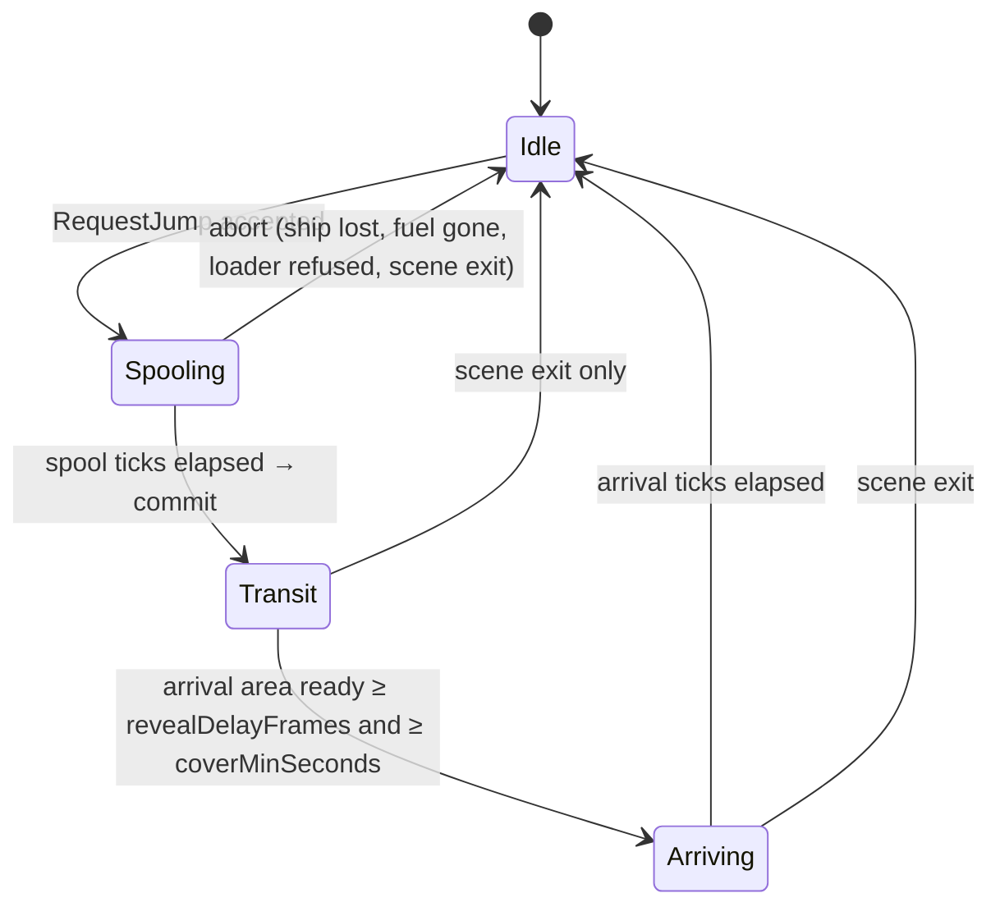
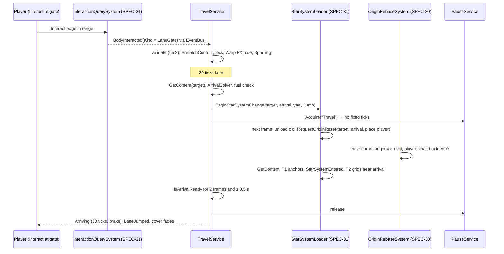

# SPEC-32 — Travel: lanes, jumps, routes and supercruise

| | |
|---|---|
| **Status** | Draft |
| **Area code** | TRV (task IDs are `TRV-001`, `TRV-002`, …) |
| **Module(s)** | `Game.Galaxy` (folders `Assets/Game/Galaxy/Travel/` and `Assets/Game/Galaxy/Services/`); `Game.Core` (event payloads in `Assets/Game/Core/Events/`); `Game.Simulation` (`PlayerControlLock` in `Assets/Game/Simulation/Commands/`); `Game.Data` (`TravelConfigDefinition` in `Assets/Game/Data/Definitions/World/`); `Game.Presentation` (`Assets/Game/Presentation/World/`); `Game.App` (narrative wiring and dev probes) |
| **Depends on specs** | SPEC-30 (`GalaxyDef`, `LaneDef`, `LaneGateSpec`, `StarSystemContent`, `BodySpec`, `OrbitMath`, `GalaxyState.RouteDestination`, `ILaneAccess`, `GalaxyFrameTicker`, `RequestOriginReset`, `FrameOrigin`); SPEC-31 (`StarSystemLoader.BeginStarSystemChange`, `BodyInteracted`, `StarSystemEntered`, `DockingService`, `StarSystemBody`, `CurrentStarSystemInfo`); SPEC-40 (`CompiledCondition`, `LogicWatcher`, `ILogicContext`, `ILogicEconomy`, `LogicUsage.LaneCondition`, `ILogicSourceOwner`, `LogicWorldAdapter`); SPEC-20 (`PlayerCommandApplySystem`, `PlayerShip`); SPEC-02 (`EventBus<T>`, `IPauseService`, `ISaveBlocker`, `ISceneExiting`, `SimClock`, `GameLog`); SPEC-63 (`FxEvents.Warp`, `EnqueueMainThread`); SPEC-64 (`IAudioService`, `cue_warp`); SPEC-60 (`UIRoot.GetLayer`, theme rules); SPEC-13 (`Hulk`); SPEC-23 (`PlayerCombatStatus`, M4) |
| **Depended on by** | SPEC-30 (`ILaneAccess` for `GalaxyMapModel`); SPEC-61 (gate prompt, destination, route, notices); SPEC-40 (`RequestLaneJump`, `LaneJumped`); SPEC-42 (beats wait while travelling); SPEC-63 (`FxKind.Warp` producer); SPEC-70 (`jump` command, `travel.*` probes, R30 scenario); SPEC-81 (gate and jump-transition art plug into §5.8); SPEC-01 (construction, M4 escorts) |
| **Milestone** | M3 (supercruise and escort transfer: M4) |

> Read [01-architecture.md](../01-architecture.md) (§5, §7.4, §8, §9, §11), [02-conventions.md](../02-conventions.md), [SPEC-30](SPEC-30-galaxy-generation.md) (§4.4, §4.6, §4.8, §5.3, §5.5, §5.10, §5.12) and [SPEC-31](SPEC-31-star-system-streaming.md) (§3, §5.2, §5.11, §5.14) before this spec. This spec may not contradict them.

## 1. Purpose

This spec moves the player between star systems and, from M4, across a star system quickly. A **lane jump** starts at a lane gate: the player flies to the gate, presses Interact, the ship spools for half a second with its controls locked, the screen covers, `StarSystemLoader` (SPEC-31) swaps star systems while no simulation time passes, and the ship appears just inside the matching gate of the target star system, facing the star. This spec decides **whether** a jump may happen: whether the lane is open (fact-gated lanes through SPEC-40 conditions), what it costs in fuel, and where the ship arrives. It plans **routes** over known lanes for the galaxy map and HUD, implements SPEC-30's `ILaneAccess`, and owns the jump transition cover. The old prototype flung the ship at 300 u/s for 6 s through the target star, stranding it about 15 km from both star systems with nothing loaded (R30, audit chain C). Here the arrival point is computed analytically inside the target star system before anything loads, velocity is never assigned, and the R30 regression test checks it.

## 2. Scope

**In scope:**
- `TravelService`: jump requests and their validation, the jump timeline (spool, transit, arrival), fuel, the control lock, the save blocker, scene-exit cleanup.
- Lane access (`ILaneAccess`): open/locked state of fact-gated lanes, locked messages, fuel cost per lane.
- Arrival point computation (`ArrivalSolver`).
- Destination and routes (`RoutePlanner`), next hop for the HUD, `GalaxyState.RouteDestination`.
- Gate interaction handling and gate information for the HUD prompt.
- Narrative entry (`ILogicWorld.RequestLaneJump`) and the dev harness entry (`jump` command source, `travel.*` probes, R30 scenario).
- Jump presentation contract: cover element, lane-gate visual state, warp `FxEvent`s and cues.
- `LaneJumped` and `TravelNotice` events; `PlayerControlLock`.
- M4: supercruise (in-system hop) and transfer of escort ships with the player.

**Out of scope (and who owns it instead):**
- Loading and unloading star systems, arrival readiness of streamed grids: SPEC-31 (`BeginStarSystemChange`; this spec adds the `ITravelLoader` seam, §4.5).
- Lane graph, gate bodies and their placement on the lane ring, `GalaxyMapModel`: SPEC-30. Gate templates and M3 lane content: SPEC-30 GAL-012.
- Moving the floating origin and placing the player ship: SPEC-30 `OriginRebaseSystem` (placement fields requested in `_INTEGRATION-TODO` item 48).
- Galaxy map, system map and HUD views: SPEC-61 (they call this spec's API, §6).
- The warp particle effect asset: SPEC-63 VFX-014. Final jump-transition art and gate meshes: SPEC-81 AST-017/AST-020 (they keep the timing contract of §5.8).
- Fuel as an item, inventory and its counts: SPEC-50 (reached through SPEC-40's `ILogicEconomy`).
- Fleet ships and formations: SPEC-23 and SPEC-01 (M4; this spec only calls `IJumpEscorts`).

## 3. Decisions (binding)

1. **`TravelService` is the single owner of travel state**: phase, target, arrival plan, destination and route, the lane-open cache, the `PlayerControlLock` value and the jump pause token. It is a managed service on the main thread, ticked by `GalaxyFrameTicker` with `TickOrder` 200, after `StarSystemLoader` (100). It never makes structural ECS changes. Reason: architecture §8 single writers; SPEC-31 decision 1 owns structural streaming.
2. **A jump starts at a lane gate.** Source `Gate` is used only by the gate interaction handler (§5.5), so the SPEC-31 surface-distance rule decides whether the player is close enough. Sources `Narrative` and `Dev` skip proximity (§5.2). Reason: lanes are places in the world; one physical entry rule.
3. **The jump timeline is fixed** (§5.3):
   - **Spooling**, 30 fixed ticks: controls locked, cover fading in.
   - **Commit**: arrival solved, `BeginStarSystemChange`, fuel taken, pause token acquired.
   - **Transit**: simulation paused, star systems swapped behind the cover, at least 0.5 s real time, until the arrival area is ready.
   - **Arriving**, 30 fixed ticks: controls locked, cover fading out.

   Reason: the design system's 0.5 + 0.5 + 0.5 s transition; no simulation time passes while the screen is covered, so nothing can attack an unrevealed player and the load length never changes gameplay.
4. **The arrival point is computed analytically before the load** (§5.4). It lies on the target's lane ring, `arrivalStandoffM` inside the arrival gate's bounding sphere, facing the star, and it is moved along the ring if an analytic body test finds it obstructed. Velocity is never assigned: the placement keeps the ship's velocity in ship-local terms, and the brake during Arriving slows it. Reason: R30; architecture §8 (`PhysicsVelocity` has no assigning writer).
5. **Fuel is taken at commit, never at request.** Only the `Gate` source pays. Refused requests and aborts during Spooling cost nothing. Reason: no lost fuel on aborts.
6. **Lane open state is event-driven.**
   - Ungated lanes (`LaneDef.GateIndex == 0`) are always open.
   - Each gated lane has one SPEC-40 `LogicWatcher` over its `CompiledCondition`. Watchers are refreshed on star-system entry and every `laneRefreshTicks`.
   - Nothing is evaluated per frame.

   Reason: architecture §11, SPEC-40 §6 (no polling).
7. **Routes are shortest paths by `LengthLy`** over lanes that are visible on the galaxy map and open, between Known star systems, with a deterministic tie-break (§5.6). They are computed in a Burst job only when something they depend on changes. Reason: the map never leaks unknown star systems (SPEC-30 §5.12), and no per-frame cost.
8. **Player controls are restricted only through `PlayerControlLock`**, a singleton consumed by SPEC-20's `PlayerCommandApplySystem`. `Movement` zeroes thrust and turn and holds Brake. `Actions` drops fire groups and edges, while the counters are still consumed. Reason: `ShipCommand` keeps its single writer (architecture §8).
9. **Travel saves nothing of its own.** Saving is blocked while `Phase != Idle` (`SaveBlockReason.Transitioning`). The destination lives in `GalaxyState.RouteDestination`, which SPEC-30 saves in `GLXY`. Reason: a save never captures a half-swapped world.
10. **Determinism scope.**
    - Spool and arrival lengths are counted in fixed ticks, and no ticks run in Transit.
    - The commit happens on the first frame whose tick count reaches the spool end, so at low frame rates up to 5 extra old-star-system ticks may run.
    - Therefore replays are deterministic within one star-system visit. SPEC-71 replay tests never cross a jump.

    Reason: the jump is a frame-granular managed decision; stopping the fixed step mid-frame would need a custom rate manager.
11. **Events.** Both payloads live in `Game.Core.Events` and are published with `EventBus<T>.Publish` from managed code only (SPEC-02 §5.6 rule 4):
    - `LaneJumped`: once per completed lane jump, at the start of Arriving.
    - `TravelNotice`: messages for SPEC-61, which may contain a string.
12. **Supercruise (M4) is an in-system hop.** It uses the same cover, pause and placement mechanism as a jump, with a same-star-system origin request. There is no high-speed flight mode. Reason: the glossary says "fast in-system travel (non-combat)". A hop avoids tunnelling, streaming at 1 km/s, and velocity assignment.
13. **Folders and namespaces:**
    - `Assets/Game/Galaxy/Travel/` → `Game.Galaxy.Travel`: value types, solvers, the planner and internal tables.
    - `Assets/Game/Galaxy/Services/TravelService.cs` → `Game.Galaxy.Services`, as in SPEC-31 decision 13.
    - Presentation: `Assets/Game/Presentation/World/` → `Game.Presentation.World`.

## 4. Data model

All types are **public contract** unless marked *internal*.

### 4.1 Event payloads (`Assets/Game/Core/Events/`, namespace `Game.Core.Events`)

```csharp
namespace Game.Core.Events
{
    public enum JumpSource : byte { Gate = 0, Narrative = 1, Dev = 2 }   // add at end only

    /// <summary>Published once by TravelService when a lane jump completes (start of Arriving). Implements SPEC-32 §5.3.</summary>
    public readonly struct LaneJumped
    {
        public readonly uint FromStarSystemValue;
        public readonly uint ToStarSystemValue;
        public readonly int LaneIndex;          // GalaxyDef.Lanes index; -1 for a narrative jump with no lane between the two
        public readonly JumpSource Source;
        public LaneJumped(uint from, uint to, int lane, JumpSource source)
        { FromStarSystemValue = from; ToStarSystemValue = to; LaneIndex = lane; Source = source; }
    }

    public enum TravelNoticeKind : byte { JumpRefused = 0, JumpAborted = 1, DestinationReached = 2, RouteBlocked = 3, RouteRestored = 4 }  // add at end only

    /// <summary>Player-facing travel message (managed only, may carry text). SPEC-61 shows it as a notification.</summary>
    public readonly struct TravelNotice
    {
        public readonly TravelNoticeKind Kind;
        public readonly uint StarSystemValue;   // the star system the message is about; 0 = none
        public readonly string Text;            // final English text (§5.2 table); never null
        public TravelNotice(TravelNoticeKind kind, uint starSystemValue, string text)
        { Kind = kind; StarSystemValue = starSystemValue; Text = text ?? ""; }
    }
}
```

### 4.2 Player control lock (`Assets/Game/Simulation/Commands/`, namespace `Game.Simulation.Commands`)

```csharp
namespace Game.Simulation.Commands
{
    [System.Flags] public enum PlayerControlLockFlags : byte { None = 0, Movement = 1, Actions = 2 }

    /// <summary>Singleton. Created by PlayerCommandApplySystem.OnCreate with Flags = None (TRV-007).
    /// Only writer: TravelService (SPEC-32), main thread, outside the fixed step. Reader: PlayerCommandApplySystem.</summary>
    public struct PlayerControlLock : Unity.Entities.IComponentData { public PlayerControlLockFlags Flags; }
}
```

### 4.3 Definition (`Assets/Game/Data/Definitions/World/TravelConfigDefinition.cs`, namespace `Game.Data.Definitions`)

Property rule as in SPEC-30 §4.3: every field has a read-only PascalCase property.

```csharp
[ContentIdPrefix("config_")]
[UnityEngine.CreateAssetMenu(menuName = "Game/Content/World/Travel Config", fileName = "config_travel")]
public sealed class TravelConfigDefinition : ContentDefinition
{
    // Timeline. Ticks are fixed 60 Hz ticks; seconds are unscaled real time.
    [SerializeField] private int spoolTicks = 30;              // 0.5 s spool (design system)
    [SerializeField] private int arrivalTicks = 30;            // 0.5 s arrival
    [SerializeField] private float coverMinSeconds = 0.5f;     // the cover stays at least this long in Transit (the load hides here)
    [SerializeField] private int revealDelayFrames = 2;        // frames the arrival area must stay ready before the reveal
    [SerializeField] private float transitTimeoutSeconds = 15f; // error report threshold (§5.3 T3)
    // Arrival (§5.4)
    [SerializeField] private float arrivalStandoffM = 150f;    // gap between the gate's bounding sphere and the arrival point
    [SerializeField] private float arrivalStepM = 50f;         // tangential step when the point is obstructed
    [SerializeField] private int arrivalMaxSteps = 16;
    [SerializeField] private float playerClearanceM = 60f;     // assumed ship radius plus margin for the obstruction test
    // Fuel (§5.1)
    [SerializeField] private ItemDefinition fuelItem;          // resource_fuel
    [SerializeField] private float fuelPerLy = 0.5f;
    [SerializeField] private int fuelMinPerJump = 1;
    [SerializeField] private int ancientGateFuel = 0;
    // Lane conditions (§5.1)
    [SerializeField] private int laneRefreshTicks = 600;       // periodic LogicWatcher.Refresh (time/relation/location dependencies)
    // Feedback (§5.8)
    [SerializeField] private AudioCueDefinition departCue;     // cue_warp
    [SerializeField] private AudioCueDefinition arriveCue;     // cue_warp
    [SerializeField] private float warpFxScale = 10f;          // FxEvent.Warp Scale
    // Supercruise, M4 (§5.10)
    [SerializeField] private int cruiseSpoolTicks = 60;
    [SerializeField] private float cruiseMinDistanceM = 3000f;
    [SerializeField] private float cruiseStandoffM = 300f;
    [SerializeField] private int cruiseDamageCooldownTicks = 300;
    // Escorts, M4 (§5.11)
    [SerializeField] private float escortRadiusM = 2000f;
}
```

Validation codes (reported by `Validate` and `TravelContentValidator`, §5.9):

| Code | Rule |
|---|---|
| TRV-E001 [E] | Exactly one `TravelConfigDefinition`, ID `config_travel` |
| TRV-E002 [E] | `1 ≤ spoolTicks ≤ 600`, `1 ≤ arrivalTicks ≤ 600`, `0 ≤ coverMinSeconds ≤ 5`, `transitTimeoutSeconds ≥ 5`, `0 ≤ revealDelayFrames ≤ 10`, `laneRefreshTicks ≥ 60` |
| TRV-E003 [E] | `fuelItem` set; `fuelPerLy ≥ 0`; `fuelMinPerJump ≥ 0`; `ancientGateFuel ≥ 0` |
| TRV-E004 [E] | `50 ≤ arrivalStandoffM ≤ 2000`; `10 ≤ arrivalStepM ≤ 500`; `0 ≤ arrivalMaxSteps ≤ 64`; `0 ≤ playerClearanceM ≤ arrivalStandoffM` |
| TRV-E005 [E] | Every `BodyTemplateDefinition` with `role == LaneGate` has `interaction == LaneGate`, `destructible == false`, `interactionDistanceM ≥ 50` and a non-empty `interactPrompt` |
| TRV-E006 [E] | For every LaneGate template `G` and every `StarSystemTemplateDefinition` `T`: `G.RadiusMaxM + arrivalStandoffM + playerClearanceM < T.LaneRingMarginM` (the arrival stays outside every inner body) |
| TRV-E007 [E] | LaneGate structures fit their radius. Blueprint source: `cellSize × length(max(abs(BoundsMin), abs(BoundsMax + 1))) ≤ RadiusMinM`. ProceduralShape: `defaultCellSize × length(sizeCells) ≤ RadiusMinM`, where `defaultCellSize` is SPEC-10 `VoxelConfigDefinition.defaultCellSize` |
| TRV-E008 [E] | `departCue` and `arriveCue` set; `warpFxScale > 0`; `cruiseSpoolTicks ≥ 1`; `cruiseMinDistanceM ≥ 500`; `cruiseStandoffM ≥ 50`; `escortRadiusM ≥ 0` |
| TRV-W001 [W] | A gated authored lane whose condition `IsAlwaysTrue` (gate without effect) |

### 4.4 Travel value types (`Assets/Game/Galaxy/Travel/`, namespace `Game.Galaxy.Travel`)

```csharp
namespace Game.Galaxy.Travel
{
    using Unity.Mathematics; using Game.Galaxy.Data;

    public enum TravelPhase : byte { Idle = 0, Spooling = 1, Transit = 2, Arriving = 3 }
    public enum TravelKind : byte { None = 0, LaneJump = 1, Cruise = 2 }
    public enum JumpRefusal : byte { None = 0, NoGalaxy = 1, NotInWorld = 2, Busy = 3, NoPlayerShip = 4, Docked = 5, UnknownTarget = 6,
                                     SameStarSystem = 7, NoLane = 8, LaneLocked = 9, NotEnoughFuel = 10, InCombat = 11, TooClose = 12 }
    public enum RouteStatus : byte { None = 0, Ok = 1, Blocked = 2, Unreachable = 3 }

    public readonly struct JumpRequestResult
    {
        public readonly bool Accepted;
        public readonly JumpRefusal Refusal;    // None when accepted
        public readonly string Reason;          // "" when accepted; otherwise the §5.2 text
        public JumpRequestResult(bool accepted, JumpRefusal refusal, string reason) { Accepted = accepted; Refusal = refusal; Reason = reason ?? ""; }
        public static JumpRequestResult Ok() => new JumpRequestResult(true, JumpRefusal.None, "");
        public static JumpRequestResult Refuse(JumpRefusal r, string reason) => new JumpRequestResult(false, r, reason);
    }

    /// <summary>Where the ship appears. Star-system frame of the target. Ship forward = quaternion.RotateY(YawRad) · (0,0,1) = (sin Yaw, 0, cos Yaw).</summary>
    public struct ArrivalPlan
    {
        public StarSystemId StarSystem;
        public double3 PositionM;
        public float YawRad;
        public ulong GateKey;              // BodyId.LocalKey of the arrival gate; 0 = none (narrative jump without a lane, cruise)
        public double3 GatePositionM;      // centre of the arrival gate or cruise target
        public float GateRadiusM;          // its bounding radius (0 = none)
        public byte Adjusted;              // 1 = moved along the ring to clear an obstruction
        public byte Obstructed;            // 1 = no clear point found; the unadjusted point is used
    }

    /// <summary>What the HUD prompt shows for a gate of the loaded star system (§5.5).</summary>
    public struct GateInfo
    {
        public int LaneIndex;
        public StarSystemId Target;
        public string TargetName;          // "Uncharted" when Target is not Known
        public bool Known, Open, CanAfford, OnRoute;
        public string LockedMessage;       // "" when open
        public int FuelCost;
        public int FuelHeld;               // -1 when no economy is available
    }

    /// <summary>The first lane of the current route (§5.6).</summary>
    public struct NextHop
    {
        public StarSystemId Next;
        public int LaneIndex;
        public ulong GateKey;              // gate in the loaded star system
        public double3 GatePositionM;      // star-system frame
    }

    public struct TravelStats
    {
        public int JumpsCompleted, JumpsAborted, CruisesCompleted, TransitTimeouts, RouteComputations;
        public float LastTransitSeconds, MaxTransitSeconds, LastRouteMs;
    }

    /// <summary>The loader members TravelService uses. Implemented by SPEC-31 StarSystemLoader (TRV-006 adds the interface). Test seam.</summary>
    public interface ITravelLoader
    {
        bool IsReady { get; }
        StarSystemId Loaded { get; }
        /// <summary>State == Ready, Loaded == target of the last BeginStarSystemChange, and IsAreaReady(its arrival) (§5.3 T2).</summary>
        bool IsArrivalReady { get; }
        /// <summary>Every body whose T2 sphere (bounding radius + t2LoadDistanceM) contains the point has its grid spawned
        /// (grid root exists and GridSpawning is disabled). Same rule as SPEC-31 §5.1 IsSceneReadyComplete.</summary>
        bool IsAreaReady(double3 positionM);
        bool BeginStarSystemChange(StarSystemId target, double3 arrivalPositionM, float arrivalYawRad, Game.Core.Events.StarSystemEntryReason reason);
    }

    /// <summary>M4. Moves player-fleet escorts with the player (§5.11). Implemented by SPEC-01 (Game.App). Optional: found with Services.TryGet.</summary>
    public interface IJumpEscorts
    {
        int CaptureEscorts(float radiusM);                                 // write back and despawn escorts within radiusM of the player; returns the count
        void PlaceEscorts(double3 arrivalPositionM, float arrivalYawRad);   // respawn the captured escorts in formation behind the arrival point
        void RestoreEscorts();                                             // the change was refused after capture: respawn them where they were
    }
}
```

### 4.5 `TravelService` (`Assets/Game/Galaxy/Services/TravelService.cs`, namespace `Game.Galaxy.Services`)

```csharp
namespace Game.Galaxy.Services
{
    using Unity.Mathematics; using Game.Galaxy.Data; using Game.Galaxy.Travel; using Game.Core.Events;

    /// <summary>Owner of travel: lane access, jumps, destination and route, supercruise (M4). Implements SPEC-32 §5.</summary>
    public sealed class TravelService : IGalaxyFrameTick, ILaneAccess, Game.Core.Flow.ISaveBlocker, Game.Core.Flow.ISceneExiting, System.IDisposable
    {
        public TravelService(GalaxyService galaxy, ITravelLoader loader, DockingService docking, Unity.Entities.World world,
                             Game.Data.Services.ContentCatalog catalog, Game.Core.IPauseService pause, Game.Core.Audio.IAudioService audio);
        public int TickOrder => 200;
        public int SceneExitOrder => 90;                     // before the loader's scene-exit work

        // State (read by SPEC-61, SPEC-70, tests)
        public TravelPhase Phase { get; }
        public TravelKind Kind { get; }
        public StarSystemId Target { get; }                  // lane-jump target; None when Idle or cruising
        public bool CoverRequested { get; }                  // true in Spooling and Transit (§5.8)
        public ArrivalPlan LastArrival { get; }              // the last committed plan; default before the first commit
        public TravelStats Stats { get; }
        public TravelConfigDefinition Config { get; }        // catalog.Get<TravelConfigDefinition>("config_travel")

        // Jumps (§5.2, §5.3)
        public JumpRequestResult CanJump(StarSystemId target, JumpSource source);      // the same checks, no side effects
        public JumpRequestResult RequestJump(StarSystemId target, JumpSource source);  // main thread
        public bool TryGetGateInfo(ulong gateKey, out GateInfo info);                 // a gate of the loaded star system (§5.5)

        // Destination and route (§5.6)
        public StarSystemId Destination { get; }             // = GalaxyState.RouteDestination
        public RouteStatus RouteStatus { get; }
        public string RouteBlockedReason { get; }            // "" unless Blocked or Unreachable
        public System.Collections.Generic.IReadOnlyList<StarSystemId> Route { get; }  // next star system first, destination last; empty unless Ok
        public int RouteFuelCost { get; }
        public bool CanSetDestination(StarSystemId id, out string reason);
        public bool SetDestination(StarSystemId id, out string reason);
        public void ClearDestination();
        public bool TryGetNextHop(out NextHop hop);

        // ILaneAccess (SPEC-30 §4.8; Revision requested in _INTEGRATION-TODO)
        public bool IsLaneOpen(int laneIndex);
        public string GetLockedMessage(int laneIndex);
        public int GetFuelCost(int laneIndex);
        public uint Revision { get; }                        // +1 whenever any lane's open state changes or the galaxy is rebuilt

        // Supercruise, M4 (§5.10)
        public JumpRequestResult CanCruise(double3 targetPositionM, float targetRadiusM);
        public JumpRequestResult RequestCruise(double3 targetPositionM, float targetRadiusM);

        public void Tick(in GalaxyFrameContext ctx);
        public Game.Core.Save.SaveBlockReason GetSaveBlock();          // Transitioning while Phase != Idle, else None
        public void OnSceneExiting(in Game.Core.Flow.SceneExitContext context);
        public void Dispose();                                        // unsubscribes, disposes watchers and native scratch, releases the pause token
    }
}
```

### 4.6 Solvers and planner (`Game.Galaxy.Travel`)

```csharp
namespace Game.Galaxy.Travel
{
    public static class FuelMath
    {
        /// AncientGate → ancientGateFuel; else max(fuelMinPerJump, (int)ceil((double)LengthLy * fuelPerLy - 1e-6)).
        public static int Cost(in LaneDef lane, float fuelPerLy, int fuelMinPerJump, int ancientGateFuel);
    }

    public static class ArrivalSolver   // pure; main thread or Burst-compatible inputs
    {
        /// Lane jump: arrival at the gate of `laneIndex` in `content`, or (laneIndex < 0) on the ring toward `sourcePositionLy`. §5.4.
        public static ArrivalPlan SolveJump(StarSystemContent content, int laneIndex, double2 targetPositionLy, double2 sourcePositionLy,
                                            double universalTime, in ArrivalParams p);
        /// Cruise (M4): arrival `standoffM` short of the target sphere, facing it. §5.10.
        public static ArrivalPlan SolveCruise(StarSystemContent content, double3 fromM, double3 targetM, float targetRadiusM,
                                              double universalTime, in ArrivalParams p);
    }
    public struct ArrivalParams { public float StandoffM, StepM, ClearanceM; public int MaxSteps; }

    public static class RoutePlanner
    {
        /// Shortest path (§5.6). Returns true and fills `lanesOut` (source → target order) when a path exists.
        public static bool TryFindRoute(GalaxyDef g, RouteScratch scratch, int sourceIndex, int targetIndex, bool ignoreLocks,
                                        System.Collections.Generic.List<int> lanesOut, out double totalLy);
    }

    /// <summary>Reusable native buffers for RoutePlanner (Allocator.Persistent). Owned by TravelService; resized when the galaxy changes.</summary>
    public sealed class RouteScratch : System.IDisposable
    {
        public Unity.Collections.NativeArray<byte> SystemFlags;   // per StarSystems index: bit0 Known, bit1 Visited
        public Unity.Collections.NativeArray<byte> GateOpen;      // per LaneGates index: 1 open
        public void EnsureCapacity(int systems, int gates, int lanes);
        public void Dispose();
    }
}
```

### 4.7 Internal types (`Game.Galaxy.Travel`, *internal*)

```csharp
internal sealed class LaneAccessTable : System.IDisposable      // §5.1
{
    public uint Revision;
    public int BuiltForGeneration = -1;           // GalaxyService.GenerationCount when built
    public bool[] GateOpen;                       // per GalaxyDef.LaneGates index
    public Game.Data.Logic.LogicWatcher[] Watchers; // null entries for always-open or erroneous conditions
    public bool PendingContext;                   // built without ILogicContext; rebuild when it appears
}

internal struct RouteHeapEntry { public double Dist; public int Hops; public uint Id; public int Index; }   // ordered by (Dist, Hops, Id)

[Unity.Burst.BurstCompile]
internal struct RouteSearchJob : Unity.Jobs.IJob                  // §5.6
{
    [ReadOnly] public NativeArray<StarSystemDef> Systems;
    [ReadOnly] public NativeArray<LaneDef> Lanes;
    [ReadOnly] public NativeArray<int> Adjacency;
    [ReadOnly] public NativeArray<byte> SystemFlags, GateOpen;
    public int Source, Target; public byte IgnoreLocks;
    public NativeArray<double> Dist; public NativeArray<int> Hops, PrevLane, PrevSystem; public NativeArray<byte> Settled;
    public NativeList<RouteHeapEntry> Heap;
    public NativeList<int> PathLanes;             // output, source → target
    public NativeReference<double> TotalLy;       // output
    public NativeReference<byte> Found;           // output
    public void Execute();
}
```

`RouteScratch` also owns `Dist`, `Hops`, `PrevLane`, `PrevSystem`, `Settled`, `Heap`, `PathLanes`, `TotalLy`, `Found` (*internal* fields). Their capacity is reused across computations.

## 5. Systems, services and flow

### 5.0 Placement

| Part | Where | Notes |
|---|---|---|
| `TravelService.Tick` | main thread, `WorldGroup` via `GalaxyServicesBridgeSystem` (SPEC-30 §5.8), `TickOrder` 200 | after `StarSystemLoader.Tick` (100); returns at once when `WorldSceneActive` is absent |
| `TravelService` event handlers | main thread, inside `EventHub.DrainAll` (`ManagedEventDrainSystem`, `PresentationBridgeGroup`) | `BodyInteracted`, `StarSystemEntered` |
| `PlayerControlLock` consumption | SPEC-20 `PlayerCommandApplySystem` (fixed step, `ShipCommandGroup`, OrderFirst) | TRV-007 edits that system |
| `TravelPresentationSystem` | `PresentationBridgeGroup`, `[UpdateAfter(typeof(ManagedEventDrainSystem))]`, managed `SystemBase` | cover class and gate visual state (§5.8); `RequireForUpdate<WorldSceneActive>` |

Every `TravelService` member is main-thread only. Reading ECS data uses cached `EntityQuery`s on the service's `World.EntityManager`; all reads happen outside the fixed step:
- the player root: `WithAll<PlayerShip, LocalTransform>().WithNone<Parent>()`;
- `SimClock`;
- `FrameOrigin`;
- `WorldSceneActive`;
- `PlayerCombatStatus` (M4), read after `CompleteDependencyBeforeRO`.

### 5.1 Lane access (`ILaneAccess`, `LaneAccessTable`)

**`EnsureLaneState()`** runs at the start of every `ILaneAccess` member, `CanJump`, `RequestJump`, `TryGetGateInfo`, `CanSetDestination` and `Tick`:
1. `g = galaxy.Galaxy`. If `g == null`: the table is empty and every lane query returns its default (`IsLaneOpen` false, `GetLockedMessage` "", `GetFuelCost` 0); return.
2. Look up `ctx`: `Services.TryGet<ILogicContext>(out ctx)`.
3. Rebuild when `table.BuiltForGeneration != galaxy.GenerationCount`, or when `table.PendingContext && ctx != null`:
   1. dispose every watcher;
   2. `n = g.LaneGates.Count`, `GateOpen = new bool[n]`, `Watchers = new LogicWatcher[n]`;
   3. for `i` in `0..n−1`, with `c = g.LaneGates[i].Condition` (a `CompiledCondition`):
      - `c == null || c.IsAlwaysTrue` → `GateOpen[i] = true`;
      - `c.HasErrors` → `GateOpen[i] = false` and `GameLog.ErrorOnce("TRV.Lane.ConditionError." + i, …)`;
      - `ctx == null` → `GateOpen[i] = false`, `PendingContext = true` and `GameLog.WarnOnce("TRV.Lane.NoLogicContext", …)`;
      - otherwise `Watchers[i] = new LogicWatcher(c, ctx, open => OnGateChanged(i, open))` and `GateOpen[i] = Watchers[i].Value`.

      Capture `i` in a local copy so each callback keeps its own index.
   4. `BuiltForGeneration = galaxy.GenerationCount`; `Revision++`.

**`OnGateChanged(i, open)`**: if `GateOpen[i] != open`, set it and `Revision++`. Route recompute is triggered by the revision change (§5.6).

**Refresh:**
- In `Tick`, when `ctx.Tick − lastRefreshTick ≥ laneRefreshTicks`, call `Refresh()` on every non-null watcher and set `lastRefreshTick = ctx.Tick`.
- Also call `Refresh()` on every watcher in the `StarSystemEntered` handler.

`LogicWatcher` itself re-evaluates on fact, item and credit changes. `Refresh` covers location, time, quest and relation dependencies.

**Queries** (`lane` outside `0..g.Lanes.Length−1` → false / "" / 0):
- `IsLaneOpen(lane)`: `gi = g.Lanes[lane].GateIndex; return gi == 0 || GateOpen[gi − 1];`
- `GetLockedMessage(lane)`: "" when open; else `g.LaneGates[gi − 1].LockedMessage`, or `"This lane is locked."` when that is empty.
- `GetFuelCost(lane)`: `FuelMath.Cost(g.Lanes[lane], cfg.FuelPerLy, cfg.FuelMinPerJump, cfg.AncientGateFuel)`. The `− 1e-6` keeps exact products from rounding up through float noise (6 ly × 0.5 → 3, not 4).

**Fuel held:**
- `fuelIndex = catalog.IndexOf(cfg.FuelItem)`. 0 means fuel is not in the catalog: treat every cost as payable and `GameLog.WarnOnce`.
- `FuelHeld = ctx?.Economy?.GetItemCount(fuelIndex) ?? -1`. When it is −1 (no economy yet), costs are not enforced; `GameLog.WarnOnce("TRV.Fuel.NoEconomy", …)`.

**Compiling lane conditions:**
- `GalaxyGenerationDefinition` implements `ILogicSourceOwner` (TRV-003).
- `CompileLogic` compiles every `authoredLanes[i].condition` with `new LogicCompileOptions(LogicUsage.LaneCondition, scope.AssetPath, "authoredLanes[" + i + "].condition")` into the report.
- `BindLogic` calls `condition.Bind(binder)` for each.
- SPEC-40's import pipeline (NAR-009) and boot binding (§5.3 step 2) then handle them like every other owner. The field type is `Game.Data.Logic.CompiledCondition` (SPEC-30 Q5).

### 5.2 Request validation (`CanJump`, `RequestJump`)

`CanJump` and `RequestJump` run the same checks **in this order**. The first failing check decides the result:

| # | Check | Refusal | `Reason` text |
|---|---|---|---|
| 1 | `galaxy.Galaxy != null` | `NoGalaxy` | "No galaxy is loaded." |
| 2 | `WorldSceneActive` exists | `NotInWorld` | "You can only travel in space." |
| 3 | `Phase == Idle` and `loader.IsReady` | `Busy` | "Already travelling." |
| 4 | `galaxy.Galaxy.TryGetIndex(target)` | `UnknownTarget` | "Unknown destination." |
| 5 | `target != loader.Loaded` | `SameStarSystem` | "You are already there." |
| 6 | A player root exists and has no `Hulk` | `NoPlayerShip` | "Your ship cannot jump." |
| 7 | `!docking.IsDocked`, except `Narrative`, which calls `docking.Undock()` first | `Docked` | "Undock first." |
| 8 | `Gate`, `Dev`: `TryFindLane(loader.Loaded, target, out lane)`. `Narrative`: `lane` = that lane or −1 | `NoLane` | "No lane leads there from here." |
| 9 | `Gate`, `Dev`: `IsLaneOpen(lane)` | `LaneLocked` | `GetLockedMessage(lane)` |
| 10 | `Gate`: `FuelHeld < 0 \|\| FuelHeld ≥ GetFuelCost(lane)` | `NotEnoughFuel` | "Not enough fuel: {cost} needed, {held} in the hold." |

`Dev` pays no fuel, so harness runs do not depend on the inventory (§10 Q7). `Narrative` ignores locks and fuel (§10 Q3).

**On acceptance, `RequestJump` does, in order:**
1. Store the request: `Kind = LaneJump`, `Target = target`, `jumpLane = lane`, `jumpSource = source`, `jumpFrom = loader.Loaded`, `spoolStartTick = SimClock.Tick`.
2. `galaxy.PrefetchContent(target)`.
3. Write `PlayerControlLock = Movement | Actions` (§5.3 "Lock write").
4. Enqueue the departure effect `FxEvents.Warp(playerLocalPos, dirLocal, playerLinearVelocity, cfg.WarpFxScale)` through `FxEvents.EnqueueMainThread`. Here `dirLocal = normalize(float3(d.x, 0, d.y))` and `d = targetDef.PositionLy − currentDef.PositionLy`.
5. `audio.PlayCue(cfg.DepartCue.Id)`.
6. `Phase = Spooling`; `CoverRequested = true`.
7. Return `Ok()`.

### 5.3 Jump timeline (`Tick`)



**Lock write.**
- `WriteLock(flags)`: if `flags != lastWrittenLock`, call `em.SetComponentData(lockEntity, new PlayerControlLock { Flags = flags })` and set `lastWrittenLock = flags`.
- `lockEntity` comes from a cached query. If the singleton is missing, `GameLog.ErrorOnce` and skip.
- In `Idle`, every `Tick` calls `WriteLock(None)`. This makes the lock self-healing after a scene change.

**S. Spooling** (each `Tick`):
1. If the player root is missing or has `Hulk`: `Abort("Jump aborted: your ship cannot jump.")`.
2. If `ctx.Tick − spoolStartTick < cfg.SpoolTicks`: return.
3. **Commit:**
   1. `content = galaxy.GetContent(Target)`. This completes the prefetch, which is allowed in `WorldGroup`.
   2. `plan = ArrivalSolver.SolveJump(content, jumpLane, targetDef.PositionLy, fromDef.PositionLy, SimClock.UniversalTime, params)`.
   3. **Fuel check:** `Gate` source and `FuelHeld ≥ 0 && FuelHeld < cost` → `Abort("Not enough fuel: …")`. This covers fuel spent or traded away during the spool.
   4. **Escorts (M4):** `escorts = Services.TryGet<IJumpEscorts>()`; `escorts?.CaptureEscorts(cfg.EscortRadiusM)`.
   5. If `!loader.BeginStarSystemChange(Target, plan.PositionM, plan.YawRad, StarSystemEntryReason.Jump)`: call `escorts?.RestoreEscorts()`, then `Abort("Jump aborted: the star system is busy.")`.
   6. **Pay:** `Gate` source with `FuelHeld ≥ 0` → `ctx.Economy.TryTakeItems(fuelIndex, cost)`. A `false` result cannot happen after step 3 on the same frame; if it does, `GameLog.Error` and continue.
   7. `pauseToken = pause.Acquire("Travel")`.
   8. `LastArrival = plan`; `Phase = Transit`; `transitSeconds = 0`; `readyFrames = 0`.

**T. Transit** (each `Tick`):
1. Add `ctx.UnscaledDeltaTime` to `transitSeconds`.
2. Readiness: `ready = loader.IsArrivalReady`. If `ready`, `readyFrames++`; otherwise `readyFrames = 0`.
3. If `readyFrames ≥ cfg.RevealDelayFrames && transitSeconds ≥ cfg.CoverMinSeconds` → **BeginArrival**.
4. If `transitSeconds ≥ cfg.TransitTimeoutSeconds`:
   - once per jump: `GameLog.Error("Travel", "TRV.TransitTimeout: loader " + state + ", loaded " + loaded + ", arrival ready " + ready)` and `Stats.TransitTimeouts++`;
   - from then on, call **BeginArrival** as soon as `loader.IsReady && loader.Loaded == Target`, even if the area is not ready.

   The cover never lifts on a star system that is not loaded.

**BeginArrival:**
1. `escorts?.PlaceEscorts(plan.PositionM, plan.YawRad)` (M4). This happens before the pause is released.
2. Release the pause: `pauseToken.Dispose()`.
3. `Phase = Arriving`; `arrivalStartTick = SimClock.Tick`; `CoverRequested = false`.
4. Arrival effect: `FxEvents.Warp(playerLocalPos, forwardLocal, playerLinearVelocity, cfg.WarpFxScale)`; `audio.PlayCue(cfg.ArriveCue.Id)`.
5. `EventBus<LaneJumped>.Publish(new LaneJumped(jumpFrom.Value, Target.Value, jumpLane, jumpSource))`.
6. Stats:
   - `LastTransitSeconds = transitSeconds`;
   - `MaxTransitSeconds = max(...)`;
   - `JumpsCompleted++`.
7. The destination is updated by the `StarSystemEntered` handler (§5.6), which already ran during Transit.

**A. Arriving** (each `Tick`): when `ctx.Tick − arrivalStartTick ≥ cfg.ArrivalTicks`:
- `WriteLock(None)`;
- `Phase = Idle`, `Kind = None`, `Target = None`.

**Abort(text)**, allowed only in Spooling, or in any phase from `OnSceneExiting`:
1. Release the pause token if held.
2. `WriteLock(None)`.
3. `CoverRequested = false`.
4. If the target's content is cached and the target is not loaded, call `galaxy.ReleaseContent(target)`.
5. `Phase = Idle`, `Kind = None`.
6. `Stats.JumpsAborted++`.
7. Publish `TravelNotice(JumpAborted, target, text)`, except for scene exits.

**`OnSceneExiting`:** `Abort` silently, including from Transit and Arriving. Forget the stored escort capture. The loader runs its own exit handling.

**Pause interplay.**
- While any other pause token is held (pause menu, dialog), no ticks run, so Spooling and Arriving simply wait.
- Transit counts unscaled time, so the reveal can happen under a pause menu. The fade then plays and the arrival lock waits for ticks.



### 5.4 Arrival solver (`ArrivalSolver.SolveJump`)

Inputs:
- `content`: the target star system, generated and with deltas applied;
- `laneIndex`: the lane being jumped, or −1;
- the galaxy positions of the target and the source;
- `t = universalTime`;
- `p`: `StandoffM`, `StepM`, `ClearanceM` and `MaxSteps`, from `TravelConfigDefinition`.

1. **Gate.** If `laneIndex ≥ 0`, find the body with `Id.Role == LaneGate` and `LaneIndex == laneIndex`, by a linear scan over `content.Bodies` (at most 512).
   - **Found:** `gatePos = OrbitMath.Position(body, t)`, `gateR = body.RadiusM`, `GateKey = body.Id.LocalKey`.
   - **Not found, or `laneIndex < 0`:**
     - `d = normalize(sourcePositionLy − targetPositionLy)`; if its length is 0, use `(1, 0)`;
     - `gatePos = double3(d.x, 0, d.y) × content.LaneRingRadiusM`;
     - `gateR = 0`, `GateKey = 0`.
2. **Unadjusted point.** `out = normalize(gatePos.xz)` as a 3D vector with `y = 0` (zero → `(1, 0, 0)`). `pos0 = gatePos − out × (gateR + StandoffM)`. `R = length(pos0.xz)`; `θ0 = atan2(pos0.z, pos0.x)`.
3. **Obstruction test** `Obstructed(pos)` is true if any non-destroyed body `b` of `content` (`(b.State & Destroyed) == 0`) satisfies one of:
   - `b.Id.Role == Belt` and `b.BeltInnerRadiusM − ClearanceM < length(pos.xz) < b.BeltOuterRadiusM + ClearanceM`;
   - any other role, with `pb = OrbitMath.Position(b, t)`: `length((pos − pb).xz) < b.RadiusM + ClearanceM`.
4. **Search.** Try `pos0`. If it is obstructed, try the candidates for `k = 1 … MaxSteps`:
   - `s = (k + 1) / 2` (integer division) multiplied by `+1` for odd `k` and `−1` for even `k`, giving the sequence +1, −1, +2, −2, …;
   - `θ = θ0 + s × StepM / R`;
   - `pos = double3(R cos θ, 0, R sin θ)`.

   The first unobstructed candidate wins, with `Adjusted = 1`. If none is clear, use `pos0` with `Obstructed = 1`; the caller calls `GameLog.WarnOnce("TRV.Arrival.Obstructed." + content.Id, …)`.
5. **Facing.** `f = −normalize(pos.xz)`, i.e. toward the star; `YawRad = (float)atan2(f.x, f.z)`.
6. Fill the `ArrivalPlan`: `StarSystem = content.Id`, `PositionM`, `YawRad`, `GateKey`, `GatePositionM = gatePos`, `GateRadiusM = gateR`, `Adjusted`, `Obstructed`.

The result is deterministic: no RNG, fixed iteration order. For stationary bodies it does not depend on `t`. SPEC-30 places stations, points of interest and gates on `Fixed` orbits. Planets and moons are tested at `t`, which no tick changes during Transit.

**Placement contract.** `_INTEGRATION-TODO` item 48 asks SPEC-30's `ShiftJob` to place the player root:
- `UniversePosition = PositionM` and local position `(PositionM − newOrigin)`, which is `0`;
- `Rotation = quaternion.RotateY(YawRad)`;
- graphical-smoothing history set to the new pose;
- `PhysicsVelocity.Linear` rotated by `q = newRotation · inverse(oldRotation)`, with `Angular` unchanged. The ship keeps its speed in ship-local terms, so forward motion carries it toward the star, never outward.

### 5.5 Gate interaction and gate info

**`OnBodyInteracted(BodyInteracted e)`** is subscribed in the constructor and unsubscribed in `Dispose`:
1. Return unless `e.Kind == (byte)InteractionKind.LaneGate`.
2. Return if `e.StarSystemValue != loader.Loaded.Value` (stale event).
3. `content = galaxy.GetContent(loader.Loaded)`. This returns the cached instance of the loaded star system. Look up `content.TryFind(e.BodyKey, out i)`. If it is not found or `Bodies[i].LaneIndex == NoIndex`, `GameLog.WarnOnce("TRV.Gate.NoLane", …)` and return.
4. `lane = Galaxy.Lanes[LaneIndex]`; `target = GalaxyDef.Neighbour(lane, loader.Loaded)`.
5. `r = RequestJump(target, JumpSource.Gate)`.
6. If `!r.Accepted && r.Refusal != Busy`, publish `TravelNotice(JumpRefused, target.Value, r.Reason)`. Repeated presses during a jump are silent.

**`TryGetGateInfo(gateKey, out info)`** returns false when there is no galaxy or loaded star system, or when the key is not a gate of the loaded content. Otherwise:
- `LaneIndex` and `Target` as in steps 3–4 above;
- `Known = galaxy.State.IsKnown(Target)`;
- `TargetName = Known ? galaxy.GetStarSystemName(Target) : "Uncharted"`;
- `Open = IsLaneOpen`, `LockedMessage = GetLockedMessage`;
- `FuelCost = GetFuelCost`, `FuelHeld` as in §5.1;
- `CanAfford = FuelHeld < 0 || FuelHeld ≥ FuelCost`;
- `OnRoute = TryGetNextHop(out h) && h.LaneIndex == LaneIndex`.

The method allocates nothing when `TargetName` is cached: names are cached by SPEC-30 §5.7.

SPEC-61 builds the gate prompt from `GateInfo`: verb from the template's `interactPrompt`, plus "to {TargetName} · {FuelCost} fuel", or "Locked: {LockedMessage}". It uses `TargetName` instead of the body name, so a hidden star system's name never leaks through "Gate to …".

### 5.6 Destination and route

**Usable lane** for routing, as in the map rule of SPEC-30 §5.12:
- **visible:** `(Known(A) && Known(B) && (Flags & HiddenUntilKnown) == 0) || (Visited(A) && Visited(B))`;
- **open:** `GateIndex == 0 || GateOpen[GateIndex − 1]`, or `ignoreLocks`;
- usable = visible and open.

**`RoutePlanner.TryFindRoute`**:
1. `scratch.EnsureCapacity(g.StarSystems.Length, g.LaneGates.Count, g.Lanes.Length)`.
2. Fill `SystemFlags`:
   - clear the array;
   - for each `id` in `State.Known`: `IndexById[id] → |= 1`;
   - for each `id` in `State.Visited`: `→ |= 2`.

   This is rebuilt only when `GalaxyState.Revision` changed since the last fill.
3. Copy `GateOpen` from the lane table.
4. Run `RouteSearchJob` with `.Run()`: synchronous, Burst, main thread, never in the fixed step. Copy `PathLanes` into `lanesOut` and set `totalLy`.

**`RouteSearchJob.Execute`** is Dijkstra with a binary min-heap ordered by `(Dist, Hops, Id)`:
1. Initialise:
   - `Dist[*] = +∞`, `Hops[*] = int.MaxValue`, `PrevLane[*] = −1`, `PrevSystem[*] = −1`, `Settled[*] = 0`;
   - `Dist[Source] = 0`, `Hops[Source] = 0`;
   - push the source.
2. Pop the minimum entry `u`.
   - Skip it if `Settled[u]` or its `Dist` is stale (`> Dist[u]`).
   - Otherwise set `Settled[u] = 1`; stop if `u == Target`.
3. For each adjacency slot `s` of `u`, in adjacency order:
   1. `lane = Adjacency[First(u) + s]`; skip unusable lanes. `v` = the other end's index; skip if `Settled[v]`.
   2. `nd = Dist[u] + Lanes[lane].LengthLy`, `nh = Hops[u] + 1`.
   3. Update when any of these holds:
      - `nd < Dist[v] − 1e-9`;
      - `|nd − Dist[v]| ≤ 1e-9` and `nh < Hops[v]`;
      - `|nd − Dist[v]| ≤ 1e-9`, `nh == Hops[v]` and `Systems[u].Id.Value < Systems[PrevSystem[v]].Id.Value`.
   4. An update sets `Dist`, `Hops`, `PrevLane = lane` and `PrevSystem = u`, then pushes `v`.
4. `Found = Settled[Target]`. If found, walk `PrevLane` from `Target` back to `Source`, then reverse into `PathLanes`; `TotalLy = Dist[Target]`.

The order is fully defined, so the same galaxy and state always give the same route.

**`CanSetDestination(id, out reason)`**: checks in order; the first failing check returns false with its reason.
1. No galaxy → "No galaxy is loaded."
2. `!galaxy.Galaxy.TryGetIndex(id)` or `!State.IsKnown(id)` → "Uncharted star system."
3. `id == loader.Loaded` → "You are already there."
4. A route with `ignoreLocks = false` exists → true, reason "".
5. A route with `ignoreLocks = true` exists → false. The reason is the `GetLockedMessage` of the first locked lane on that path.
6. Otherwise false with "No known route."

**`SetDestination(id, out reason)`**:
- if `CanSetDestination` fails, return false;
- `State.RouteDestination = id`;
- recompute now;
- return true.

Setting the current destination again is a no-op that returns true.

**`ClearDestination()`**: `State.RouteDestination = None`; `Route` cleared; `RouteStatus = None`.

**Recompute** happens at most once per `Tick`, when a stamp differs:
- `State.RouteDestination`;
- `loader.Loaded`;
- `table.Revision`;
- `State.Revision`;
- `galaxy.GenerationCount`.

The stamps are compared on every `Tick`. `SetDestination` recomputes immediately. Steps:
1. If `Destination` is None, set `RouteStatus = None` and stop.
2. If the destination no longer exists (`!TryGetIndex`), call `ClearDestination()` and stop.
3. If `Destination == loader.Loaded`:
   - publish `TravelNotice(DestinationReached, id, "Arrived at {name}.")`;
   - call `ClearDestination()` and stop.
4. Search with `ignoreLocks = false`.
   - **Found:** `RouteStatus = Ok`. `Route` = the star systems along `PathLanes`, excluding the current one. `RouteFuelCost = Σ GetFuelCost(lane)`.
   - **Not found:** search again with `ignoreLocks = true`.
     - Found → `Blocked`, with `RouteBlockedReason` = the first locked lane's message.
     - Not found → `Unreachable`, with "No known route.".
5. On a transition `Ok → Blocked/Unreachable`, publish `TravelNotice(RouteBlocked, id, RouteBlockedReason)`. On `Blocked/Unreachable → Ok`, publish `TravelNotice(RouteRestored, id, "Route to {name} is open.")`.
6. Cache the next hop:
   - `lane = PathLanes[0]`; find the gate body of `lane` in the loaded content;
   - `NextHop { Next = Route[0], LaneIndex = lane, GateKey, GatePositionM = OrbitMath.Position(gate, UniversalTime) }`.

   Gates are `Fixed`, so the position is constant. `TryGetNextHop` returns the cached value when `RouteStatus == Ok`.

The `StarSystemEntered` handler only refreshes the lane watchers (§5.1). The `loader.Loaded` stamp triggers the recompute on the next `Tick`, which runs during Transit.

### 5.7 Narrative and dev entry points

- **Narrative** (TRV-011 edits SPEC-40's `LogicWorldAdapter`, Game.App). `RequestLaneJump(int starSystemIndex)` does:
  1. `def = catalog.GetByIndex<AuthoredStarSystemDefinition>((ushort)starSystemIndex)`. If null, `GameLog.ErrorOnce` and return.
  2. `galaxy.TryResolveStarSystem(def.Id, out id)`. If it fails, `ErrorOnce` and return.
  3. `r = travel.RequestJump(id, JumpSource.Narrative)`. If refused, `GameLog.Warn("Narrative", "request_lane_jump refused: " + r.Reason)` and publish `TravelNotice(JumpRefused, id.Value, r.Reason)`.

  Then remove `RequestLaneJump` from `LogicWorldAdapter.UnwiredMembers`. SPEC-41 decision 8 guarantees that the dialog has ended before this runs.
- **Dev** (SPEC-70 DEV-018 calls `RequestJump(id, JumpSource.Dev)`). TRV-011 registers scenario probes in `ScenarioProbeRegistry`:

  | Probe | Value |
  |---|---|
  | `travel.phase` | `Phase.ToString()` (string) |
  | `travel.arrival_gap` | if `LastArrival.GateKey != 0` and a player root exists: `length((playerUP − GatePositionM).xz) − GateRadiusM`; else −1 |
  | `travel.inside_ring` | the player exists and `length(playerUP.xz) ≤ GetContent(loaded).LaneRingRadiusM` (bool) |
  | `travel.destination` | `Destination.Value`, or −1 when None |
  | `travel.route_hops` | `Route.Count` |

### 5.8 Presentation contract

**Cover.**
- `TravelPresentationSystem` creates, once, a `VisualElement` named `travel-cover` with class `.travel-cover`. It appends the element as the last child of `UIRoot.GetLayer(UILayer.Hud)`, with `pickingMode = Ignore`.
- Every frame it toggles the class `.travel-cover--covered` to match `TravelService.CoverRequested`, changing it only when the value changed.
- USS in `Assets/Game/UI/Theme/screens/travel.uss` (SPEC-60 decision 12: the stem is `travel`):

  ```css
  .travel-cover { position: absolute; left: 0; top: 0; right: 0; bottom: 0;
                  background-color: var(--color-travel-cover); opacity: 0;
                  transition-property: opacity; transition-duration: var(--duration-travel-fade); }
  .travel-cover--covered { opacity: 1; }
  ```
- New token names go in `tokens.uss`, with placeholder values owned by SPEC-80/81: `--color-travel-cover: #F4F6FA` (direction A white-out) and `--duration-travel-fade: 0.5s`.
- **Timing contract for final art (AST-020):** the cover is fully opaque from the commit until `CoverRequested` becomes false, and fully transparent 0.5 s later. Art may replace the element's look (black-out, colour wipe) but never this timing.

**Gate visual state.**
- When `TravelService.Revision` or `CurrentStarSystemInfo.Id` changes, the system iterates the anchors with `StarSystemBody.Id.Role == LaneGate`, at most 16, on the main thread.
- For each anchor with a non-null `Visual` that has `URPMaterialPropertyEmissionColor`, it sets the emission:
  - the visual definition's `emissionColor` when the gate's lane is open;
  - `(0, 0, 0, 1)` when the lane is locked.

  The lane is found from the slot: `Adjacency[FirstAdjacency + Slot]` of the loaded star system.
- This system is the only writer of lane-gate visual emission after creation. AST-017 uses this property for the gate's dormant and active looks.

**Effects.** `FxKind.Warp` events are emitted at spool start and at BeginArrival (§5.2, §5.3); the asset is SPEC-63 VFX-014. The cues are `departCue` and `arriveCue`. During Transit the world audio is paused with the simulation (SPEC-64 decision 9), so the departure cue's tail resumes at the reveal. This is intended.

### 5.9 Content validation (`TravelContentValidator`, `Assets/Game/Editor/Content/Validators/`)

`IContentDatabaseValidator` reporting TRV-E001…E008 and TRV-W001 (§4.3). `TravelConfigDefinition.Validate` reports the field-local codes E002–E004 and E008. The database validator reports E001, E005–E007 and W001, which need other definitions.

### 5.10 Supercruise (M4)

Entry points:
- the system map's "Cruise here" button, which SPEC-61 enables through `CanCruise` (§10 Q4);
- a Flight action `Cruise` (key J), requested from SPEC-03/20 for M4 as a variable-rate edge read by `TravelService` with its own consumed counter, as in SPEC-31 decision 8. The action cruises to the current waypoint.

**`CanCruise(targetM, targetRadiusM)`** runs checks 1, 2, 3, 6 and 7 of §5.2, then:
- `PlayerCombatStatus.HostilesEngaging > 0`, or `ctx.Tick − LastDamagedTick < cruiseDamageCooldownTicks` → `InCombat`, "Cannot cruise in combat.";
- `length((targetM − playerUP).xz) − targetRadiusM < cruiseMinDistanceM` → `TooClose`, "Too close to cruise.".

**`RequestCruise`**:
- on acceptance, `Kind = Cruise`, lock, departure FX and cue as in §5.2, then Spooling with `cruiseSpoolTicks`;
- at commit, `plan = ArrivalSolver.SolveCruise(...)`:
  - `dir = normalize((targetM − fromM).xz)`;
  - `pos0 = targetM − dir × (targetRadiusM + cruiseStandoffM)`;
  - obstruction search as in §5.4 step 4, but with tangential steps around the target centre;
  - facing the target;
- then:
  1. `escorts?.CaptureEscorts`;
  2. `serial = galaxy.RequestOriginReset(loaded, plan.PositionM, placement { plan.PositionM, plan.YawRad })` (the item 48 overload);
  3. acquire the pause token; `Phase = Transit`.

In Transit, ready means `FrameOrigin.AppliedRequestSerial ≥ serial && loader.IsAreaReady(plan.PositionM)`. Everything else follows §5.3. No `LaneJumped` is published; `Stats.CruisesCompleted++`.

### 5.11 Escort transfer (M4)

If `Services.TryGet<IJumpEscorts>` returns an implementation, `TravelService` calls:
- `CaptureEscorts` at commit;
- `RestoreEscorts` if the change is refused;
- `PlaceEscorts` at BeginArrival, before the pause is released.

SPEC-01 implements the interface:
- **capture** = `FleetWriteback`-style write-back of each escort's structure into its `FleetShipRecord`, then `IShipSpawner.Despawn`;
- **place** = `ShipSpawnService.Spawn` at formation slots behind the arrival point, rotated by the arrival yaw, with SPEC-23 `FleetMember` re-attached to the player.

Escorts never carry `StarSystemMember`, so the unload does not touch them while they are captured.

## 6. Public API

| Call | Pre-conditions | Post-conditions / errors |
|---|---|---|
| `RequestJump(target, source)` | Main thread | §5.2 result. Accepted → `Phase = Spooling`, lock written, prefetch scheduled. Never throws for bad input |
| `CanJump(target, source)` | Main thread | Same result as `RequestJump` would give; no side effects |
| `TryGetGateInfo(key, out info)` | Main thread | false when the key is not a gate of the loaded star system |
| `CanSetDestination` / `SetDestination` / `ClearDestination` | Main thread | §5.6; `GalaxyState.RouteDestination` written only here |
| `TryGetNextHop(out hop)` | — | true only with `RouteStatus == Ok` |
| `ILaneAccess.*`, `Revision` | — | §5.1; O(1); no allocation |
| `CoverRequested`, `Phase`, `LastArrival` | — | Values as of the last `Tick` or request |
| `GetSaveBlock()` | — | `Transitioning` while `Phase != Idle` |
| `RequestCruise` (M4) | Main thread | §5.10 |
| `ArrivalSolver.*`, `RoutePlanner.TryFindRoute`, `FuelMath.Cost` | — | Pure and deterministic; covered by EditMode tests |

## 7. Edge cases and failure behaviour

| Situation | Required behaviour |
|---|---|
| Interact at a locked gate | Refused (`LaneLocked`), `TravelNotice` with the locked message, no fuel taken, no spool |
| Not enough fuel at the gate | Refused with "Not enough fuel: {cost} needed, {held} in the hold." |
| Fuel leaves the hold during the spool | Commit re-checks → abort with the fuel text; nothing taken |
| Player ship lost (hulk or removed) during the spool | Abort, lock cleared, cover drops |
| Interact pressed again during a jump | `Busy`, silent |
| Quick-save or save from the pause menu during a jump | Blocked with `Transitioning` |
| Pause menu or dialog during Spooling / Arriving | No ticks → phase waits; resumes exactly where it was |
| Load, quit to menu, or Lab entry during any phase | `OnSceneExiting`: token released, lock `None`, cover off, `Idle`; the loader handles its own state |
| `BeginStarSystemChange` returns false | Abort "the star system is busy"; escorts restored (M4); no fuel taken |
| Arrival area never becomes ready | After `transitTimeoutSeconds`: one error with the loader state; the reveal happens as soon as the target is loaded and Ready |
| Arrival point obstructed | Moved along the ring in ±50 m steps (up to 16); otherwise original point and one warning |
| Narrative jump to a non-adjacent star system | Arrives on the target's ring toward the source; `LaneJumped.LaneIndex = −1` |
| Narrative jump while docked | Undocks first, then jumps |
| Gate to a hidden star system | Jump allowed; prompt says "Uncharted"; the loader marks it visited on entry |
| Destination's route loses a lane (condition flips false) | `RouteStatus = Blocked`, `TravelNotice(RouteBlocked)`; restored notice when it reopens |
| Destination star system removed from content after a save | Destination cleared at the first recompute |
| No `ILogicContext` (M3 sandbox before narrative) | Gated lanes closed; one warning; rebuilt once the context exists |
| No economy | Fuel not enforced; `FuelHeld = −1`; one warning |
| Dev sandbox (no galaxy) | Every request refused `NoGalaxy`; `Tick` does nothing; lane queries return defaults |
| Two player ships (bug) | Lowest `Entity.Index` used; `GameLog.WarnOnce` |
| Cover hidden because a screen hides the HUD | Allowed: such screens are opaque |

## 8. Performance budget

| Gate / item | Target | Test (task) |
|---|---|---|
| Lane jump end to end (06: "hidden behind ≤ 1.5 s") | ≤ 1.6 s from the spool start to Idle on the M3 content (spool 0.5 + cover 0.5 + arrival 0.5 + ≤ 0.1 s hold); no frame over 33 ms | `TravelIntegrationTests.Jump_WithinBudget` (TRV-012) |
| `TravelService.Tick` steady state (Idle, no recompute) | ≤ 0.02 ms main thread, 0 B | `TravelServiceTests.Tick_Idle_NoAlloc` (TRV-006) |
| Route computation | ≤ 0.5 ms for 1,000 star systems and 2,500 lanes (Burst, `Run`); ≤ 40 ms for 100,000 (rare triggers only) | `RoutePlannerTests.Perf_1000` (TRV-004) |
| `ArrivalSolver.SolveJump` | ≤ 0.1 ms for 512 bodies with 16 steps | `ArrivalSolverTests.Perf_512Bodies` (TRV-005) |
| Lane queries | O(1), 0 B | `LaneAccessTests.Queries_NoAlloc` (TRV-003) |

**Scale notes.**
- Lane state is stored only for gated lanes (`LaneGates`, authored only in v1). Ungated lanes cost nothing.
- Watchers evaluate only on dependency changes, plus a refresh every 600 ticks over the gated lanes.
- Routes are O((V + E) log V) over persistent, reused native arrays, recomputed on state stamps, never per frame. `SystemFlags` is rebuilt in O(V + Known + Visited) only when `GalaxyState.Revision` changes.
- The arrival solve is O(bodies × steps), once per jump.
- Nothing scales with entity count. The jump's heavy work is SPEC-31's, under its own budgets.
- Rejected:
  - polling lane conditions per frame;
  - recomputing routes per frame;
  - physics queries for arrival clearance (colliders of the target do not exist yet);
  - assigning velocity on arrival;
  - running the simulation while the screen is covered.

## 9. Tasks

### TRV-001 — Public contract types
- **Milestone:** M3
- **Tier:** standard — transcribes the exact code of §4 (bodies throw `NotImplementedException`)
- **Depends on:** `CORE-001`, `DATA-001`, `GAL-001`, `SYS-001`, `FLT-001`, `NAR-001`, `AUD-001`
- **Do:** Create every type of §4 in the folders of decision 13 and §4. `TravelService` gets its full public surface with `NotImplementedException` bodies.
- **Files:** `Assets/Game/Core/Events/{JumpSource,LaneJumped,TravelNoticeKind,TravelNotice}.cs`; `Assets/Game/Simulation/Commands/{PlayerControlLockFlags,PlayerControlLock}.cs`; `Assets/Game/Data/Definitions/World/TravelConfigDefinition.cs`; `Assets/Game/Galaxy/Travel/{TravelPhase,TravelKind,JumpRefusal,RouteStatus,JumpRequestResult,ArrivalPlan,ArrivalParams,GateInfo,NextHop,TravelStats,ITravelLoader,IJumpEscorts,FuelMath,ArrivalSolver,RoutePlanner,RouteScratch}.cs`; `Assets/Game/Galaxy/Services/TravelService.cs`
- **Acceptance criteria:**
  - [ ] `tools/compile.sh` clean; every name in §4 exists with the stated namespace.
  - [ ] `PlayerControlLock` is unmanaged; event payloads use only Core-visible types (`TravelNotice` is managed-only and may hold a string).
- **Tests:** `TravelContractTests.Lock_IsUnmanaged`, `.Events_InCoreNamespace`.

### TRV-002 — Travel config definition and validator
- **Milestone:** M3
- **Tier:** standard — fields, defaults and rule table given in §4.3
- **Depends on:** `TRV-001`, `SPEC-04`, `SPEC-72`
- **Do:**
  1. Implement the properties and `Validate` of `TravelConfigDefinition` (E002–E004, E008).
  2. Implement `TravelContentValidator` (E001, E005–E007, W001) and register it like the other `IContentDatabaseValidator`s (SPEC-04).
  3. Create `config_travel.asset` with the §4.3 defaults, `fuelItem = resource_fuel` and both cues set to `cue_warp`.
- **Files:** `Assets/Game/Data/Definitions/World/TravelConfigDefinition.cs`; `Assets/Game/Editor/Content/Validators/TravelContentValidator.cs`; `Assets/Game/Content/Config/config_travel.asset`; `Assets/Game/Tests/EditMode/Galaxy/Travel/TravelConfigTests.cs`
- **Acceptance criteria:**
  - [ ] Each code has one fixture that produces exactly that code and one passing fixture.
  - [ ] The shipped content validates with zero TRV errors. If a GAL-012 gate template violates E005–E007, the task fixes the template and records it in the ledger notes.
- **Tests:** `TravelConfigTests.Defaults`, `.<Code>_Fails`, `.<Code>_Passes` for each code.

### TRV-003 — Lane access: gated lanes, fuel, revision
- **Milestone:** M3
- **Tier:** standard — algorithm and condition wiring given step by step in §5.1
- **Depends on:** `TRV-002`, `GAL-008`, `NAR-003`, `NAR-004`, `NAR-006`, `NAR-020`
- **Do:**
  1. Implement `FuelMath.Cost` and `LaneAccessTable`.
  2. Implement the `ILaneAccess` members, `Revision` and `EnsureLaneState` of `TravelService` (§5.1). The other members stay as stubs until TRV-006.
  3. Make `GalaxyGenerationDefinition` implement `ILogicSourceOwner`, compiling and binding `authoredLanes[i].condition` with `LogicUsage.LaneCondition`.
  4. If SPEC-30's code still declares that field as `ConditionRef`, change it to `Game.Data.Logic.CompiledCondition`, together with `LaneGateSpec.Condition` (SPEC-30 Q5).
- **Files:** `Assets/Game/Galaxy/Travel/{FuelMath,LaneAccessTable}.cs`; `Assets/Game/Galaxy/Services/TravelService.cs`; `Assets/Game/Data/Definitions/World/GalaxyGenerationDefinition.cs`; `Assets/Game/Galaxy/Data/LaneGateSpec.cs`; `Assets/Game/Tests/EditMode/Galaxy/Travel/LaneAccessTests.cs`
- **Acceptance criteria:**
  - [ ] Ungated lanes are open; a lane gated by `fact:x` follows the fact. Each flip increments `Revision` exactly once, and setting the same value again does not.
  - [ ] Without `ILogicContext`, gated lanes are closed with one warning; registering a context rebuilds the table once.
  - [ ] `FuelMath`: 6 ly → 3, 5.2 ly → 3, 0.5 ly → 1 (minimum), AncientGate → 0 with the defaults.
  - [ ] A new `GalaxyService.GenerationCount` rebuilds the table and disposes the old watchers (no `FactChanged` subscriptions leak).
  - [ ] Queries allocate 0 B.
- **Tests:** `LaneAccessTests.Ungated_Open`, `.Gated_FollowsFact`, `.Revision_OncePerFlip`, `.NoContext_ClosedThenRebuilt`, `.FuelMath_Values`, `.Regeneration_DisposesWatchers`, `.Queries_NoAlloc`; `GalaxyGenerationLogicTests.LaneCondition_CompilesWithLaneUsage`.

### TRV-004 — Route planner
- **Milestone:** M3
- **Tier:** standard — Dijkstra with a fully specified tie-break (§5.6)
- **Depends on:** `TRV-001`, `GAL-005`, `GAL-007`
- **Do:** Implement `RouteScratch`, `RouteSearchJob` (Burst) and `RoutePlanner.TryFindRoute`, using the usable-lane rule of §5.6.
- **Files:** `Assets/Game/Galaxy/Travel/{RouteScratch,RouteSearchJob,RoutePlanner}.cs`; `Assets/Game/Tests/EditMode/Galaxy/Travel/RoutePlannerTests.cs`
- **Acceptance criteria:**
  - [ ] Matches a brute-force shortest-path reference on 200 random seeded graphs (`TestGalaxyFixtures.Small` plus random known sets).
  - [ ] Equal-length alternatives resolve by hops, then by the lower predecessor ID, and the result is identical across 10 runs.
  - [ ] Unknown star systems and hidden lanes are never used; with `ignoreLocks = false` locked lanes are skipped.
  - [ ] `Perf_1000` meets §8; scratch memory is reused (no native allocation on the second call) and fully disposed.
- **Tests:** `RoutePlannerTests.MatchesBruteForce`, `.TieBreak_Deterministic`, `.Visibility_Respected`, `.Locks_Respected`, `.Perf_1000`, `.Scratch_ReusedAndDisposed`.

### TRV-005 — Arrival solver
- **Milestone:** M3
- **Tier:** standard — closed-form geometry given in §5.4
- **Depends on:** `TRV-001`, `GAL-002`, `GAL-008`
- **Do:** Implement `ArrivalSolver.SolveJump` (§5.4) and `SolveCruise` (§5.10 geometry).
- **Files:** `Assets/Game/Galaxy/Travel/ArrivalSolver.cs`; `Assets/Game/Tests/EditMode/Galaxy/Travel/ArrivalSolverTests.cs`
- **Acceptance criteria:**
  - [ ] With a gate at ring radius 10,000 m and radius 120 m, the arrival is 270 m from the gate centre, toward the star, with `|pos.xz| < 10,000`, and the yaw faces the star (forward · −normalize(pos) > 0.999).
  - [ ] A station placed exactly on the unadjusted point → `Adjusted = 1`, clear of it by `RadiusM + ClearanceM`, still on the same ring radius.
  - [ ] A fully blocked ring → `Obstructed = 1` and the unadjusted point.
  - [ ] `laneIndex = −1` puts the point on the ring in the direction of the source star system.
  - [ ] The same inputs give bit-identical outputs.
- **Tests:** `ArrivalSolverTests.Gate_PointAndFacing`, `.Obstruction_StepsAlongRing`, `.FullyBlocked_Flagged`, `.NoLane_TowardSource`, `.Deterministic`, `.Perf_512Bodies`.

### TRV-006 — TravelService jump timeline
- **Milestone:** M3
- **Tier:** frontier — F5: coordinates the loader, origin placement, pause tokens, the control lock, fuel and scene flow across frames
- **Depends on:** `TRV-003`, `TRV-005`, `TRV-007`, `GAL-008`, `GAL-009`, `SYS-007`, `SYS-009`, `SYS-013`, `FND-001`
- **Do:**
  1. Implement in `TravelService`: §5.2 (validation and acceptance), §5.3 (Spooling, commit, Transit, BeginArrival, Arriving, Abort, lock writes), `GetSaveBlock` and `OnSceneExiting`.
  2. Implement the `BodyInteracted` subscription skeleton (the handler body is TRV-008).
  3. Make `StarSystemLoader` implement `ITravelLoader`: add `IsAreaReady(double3)` with the SPEC-31 §5.1 scene-ready T2 rule for an arbitrary point, and `IsArrivalReady` for the last `BeginStarSystemChange`. `IsSceneReadyComplete` may call `IsAreaReady`.
  4. Add the SPEC-01 §5.2 row 8.2 line:
     ```csharp
     travel = new TravelService(galaxy, loader, docking, world, content.Catalog, pause, audio);
     ticker.Register(travel);
     session.RegisterSaveBlocker(travel);
     flow.RegisterExiting(travel);
     ```
     Register it as `TravelService` and `ILaneAccess`.
- **Files:** `Assets/Game/Galaxy/Services/{TravelService,StarSystemLoader}.cs`; `Assets/Game/App/Boot/GameComposition.cs` (one line); `Assets/Game/Tests/EditMode/Galaxy/Travel/TravelServiceTests.cs` (fake `ITravelLoader`, fake pause and audio, test ECS world with `PlayerShip`, `SimClock`, `PlayerControlLock`, `WorldSceneActive`)
- **Acceptance criteria:**
  - [ ] Each refusal row of §5.2 is produced by its condition, with exactly the listed text; `CanJump` never changes state.
  - [ ] An accepted gate jump:
    - locks `Movement | Actions`;
    - calls `BeginStarSystemChange` exactly once, on the first `Tick` with `Tick − start ≥ 30`;
    - takes fuel exactly once;
    - holds one pause token from commit to BeginArrival;
    - publishes one `LaneJumped`;
    - returns to `Idle` with the lock `None` 30 ticks after the reveal.
  - [ ] The reveal waits for `IsArrivalReady` on 2 consecutive frames and ≥ 0.5 s; the timeout logs once and reveals only when the target is loaded.
  - [ ] Abort in Spooling (ship lost, loader refuses, fuel gone) takes no fuel, releases everything and publishes one notice. `OnSceneExiting` in each phase leaves `Idle`, no token and lock `None`.
  - [ ] `GetSaveBlock` is `Transitioning` in every non-Idle phase.
  - [ ] `Tick_Idle_NoAlloc` meets §8.
- **Tests:** `TravelServiceTests.Refusals_OrderAndText`, `.CanJump_NoSideEffects`, `.GateJump_FullTimeline`, `.Reveal_WaitsForArea`, `.Timeout_LogsOnce`, `.Abort_NoFuelNoToken`, `.SceneExit_EachPhase`, `.SaveBlock_WhileTravelling`, `.Tick_Idle_NoAlloc`.

### TRV-007 — PlayerControlLock consumption
- **Milestone:** M3
- **Tier:** standard — a small, fully specified change to one SPEC-20 system
- **Depends on:** `TRV-001`, `SPEC-20`
- **Do:** In SPEC-20's `PlayerCommandApplySystem`:
  - `OnCreate`: create the `PlayerControlLock` singleton with `Flags = None` on the same entity as `PlayerEdgeConsumed`.
  - §5.1 step 4, after the command is built: `if (SystemAPI.TryGetSingleton(out PlayerControlLock l))`:
    - `Movement` → `Thrust = 0`, `Turn = 0`, `Flags = ShipCommandFlags.Brake`;
    - `Actions` → `FireGroups = 0`, `Edges = 0`.

    Counters were already consumed in step 3, so presses made during the lock never fire later.
- **Files:** `Assets/Game/Simulation/Commands/PlayerCommandApplySystem.cs`; `Assets/Game/Tests/EditMode/Simulation/Commands/PlayerControlLockTests.cs`
- **Acceptance criteria:**
  - [ ] With `Movement`, the player's `ShipCommand` has zero thrust and turn and only `Brake`; aim is unchanged.
  - [ ] With `Actions`, `FireGroups == 0` and `Edges == 0`; after unlocking, a press made during the lock produces no edge.
  - [ ] `None` leaves the command identical to the unlocked path (bitwise).
- **Tests:** `PlayerControlLockTests.Movement_BrakesOnly`, `.Actions_DropsEdges`, `.NoReplayAfterUnlock`, `.None_Unchanged`.

### TRV-008 — Gate interaction, gate info and notices
- **Milestone:** M3
- **Tier:** standard — handler and query of §5.5
- **Depends on:** `TRV-006`
- **Do:** Implement `OnBodyInteracted` and `TryGetGateInfo` (§5.5), and publish `TravelNotice` for refusals.
- **Files:** `Assets/Game/Galaxy/Services/TravelService.cs`; `Assets/Game/Tests/EditMode/Galaxy/Travel/GateInteractionTests.cs`
- **Acceptance criteria:**
  - [ ] A `LaneGate` interaction requests a jump to the lane's other end; other kinds and stale star systems are ignored.
  - [ ] A locked gate produces one notice with the locked message; a press during a jump produces none.
  - [ ] `TryGetGateInfo` for a hidden neighbour reports `TargetName == "Uncharted"`, and its fuel and route fields match the service.
- **Tests:** `GateInteractionTests.Gate_RequestsNeighbour`, `.OtherKinds_Ignored`, `.Locked_OneNotice`, `.Busy_Silent`, `.GateInfo_Uncharted`, `.GateInfo_Fields`.

### TRV-009 — Travel presentation
- **Milestone:** M3
- **Tier:** standard — UI element, USS and an emission writer, all specified in §5.8
- **Depends on:** `TRV-006`, `SYS-011`, `UI-003`, `UI-007`, `UI-012`, `VFX-014`, `AUD-006`
- **Do:**
  1. Implement `TravelPresentationSystem`: the cover element and class toggle, and the gate emission writer (§5.8).
  2. Add `screens/travel.uss`.
  3. Add the two token names with their placeholder values to `tokens.uss`, with a ledger note to SPEC-80.
- **Files:** `Assets/Game/Presentation/World/TravelPresentationSystem.cs`; `Assets/Game/UI/Theme/screens/travel.uss`; `Assets/Game/UI/Theme/tokens.uss` (two names); `Assets/Game/Tests/PlayMode/Galaxy/TravelPresentationTests.cs`
- **Acceptance criteria:**
  - [ ] The cover is the last child of `layer-hud`, ignores picking, and has `.travel-cover--covered` exactly while `CoverRequested`.
  - [ ] Its resolved opacity is 1 at the commit frame of a test jump and 0 within 0.6 s after the reveal.
  - [ ] Gate visuals of open lanes show the definition emission and locked lanes black; flipping the fact updates it within one frame.
  - [ ] The UI layout audit (SPEC-60) reports no issues with the cover present.
- **Tests:** `TravelPresentationTests.Cover_FollowsPhase`, `.Cover_OpaqueAtCommit`, `.GateEmission_FollowsLane`, `.Layout_NoIssues`.

### TRV-010 — Destination and route service
- **Milestone:** M3
- **Tier:** standard — state rules and triggers given in §5.6
- **Depends on:** `TRV-004`, `TRV-006`
- **Do:** Implement the destination members and recompute triggers of `TravelService`, the next-hop cache and the route notices (§5.6).
- **Files:** `Assets/Game/Galaxy/Services/TravelService.cs`; `Assets/Game/Tests/EditMode/Galaxy/Travel/DestinationTests.cs`
- **Acceptance criteria:**
  - [ ] `CanSetDestination` returns each §5.6 reason for its case.
  - [ ] Arriving at the destination clears it and publishes `DestinationReached` once.
  - [ ] Closing a lane on the route gives `Blocked` plus one `RouteBlocked` notice; reopening gives `Ok` plus one `RouteRestored`.
  - [ ] Recompute runs at most once per `Tick` and never when no stamp changed (counted by `Stats.RouteComputations`).
  - [ ] `TryGetNextHop` returns the gate of the route's first lane with its constant position.
- **Tests:** `DestinationTests.CanSet_Reasons`, `.Arrival_ClearsAndNotifies`, `.LaneClose_BlocksAndRestores`, `.Recompute_OnlyOnStampChange`, `.NextHop_Gate`.

### TRV-011 — Narrative, dev probes and the R30 scenario
- **Milestone:** M3
- **Tier:** standard — wiring of existing APIs per §5.7
- **Depends on:** `TRV-008`, `TRV-010`, `SPEC-40`, `SPEC-70`
- **Do:**
  1. Wire `LogicWorldAdapter.RequestLaneJump` (§5.7) and remove it from `UnwiredMembers`.
  2. Add `TravelScenarioProbes` (§5.7 table) and register them.
  3. Make `TestData/Scenarios/r30_lane_jump_entry.scenario` active:
     1. `newgame`, then wait `player.ready`;
     2. `jump to=<the start star system's neighbour, as DEV-018 accepts it>`;
     3. wait `travel.phase == "Idle" && star_system != <start>`, timeout 30;
     4. `assert travel.arrival_gap >= 0 && travel.arrival_gap <= 200`;
     5. `assert travel.inside_ring`;
     6. `assert logs.exceptions == 0`.
- **Files:** `Assets/Game/App/Services/LogicWorldAdapter.cs`; `Assets/Game/App/DevRuntime/Scenarios/TravelScenarioProbes.cs`; `TestData/Scenarios/r30_lane_jump_entry.scenario`; `Assets/Game/Tests/EditMode/App/LogicWorldAdapterTravelTests.cs`
- **Acceptance criteria:**
  - [ ] `request_lane_jump <authored star system>` from a dialog command results in one `RequestJump(…, Narrative)`; a refusal logs one warning and one notice.
  - [ ] The scenario passes through `gh_scenario`.
- **Tests:** `LogicWorldAdapterTravelTests.RequestLaneJump_Routes`, `.Refused_WarnsAndNotifies`; scenario `r30_lane_jump_entry`.

### TRV-012 — Jump integration, R30 regression and budget
- **Milestone:** M3
- **Tier:** standard — PlayMode tests of specified behaviour with given assertions
- **Depends on:** `TRV-009`, `TRV-011`, `TST-001`
- **Do:** Add the PlayMode suite below on the M3 content (`galaxy_main`, GAL-012), with a new game started through `SceneFlow`. Record the jump time in the ledger *Measurements*.
  - **R30:**
    - interact at the start star system's gate to the neighbour (dev `interact` path or a direct `BodyInteracted` from the real interaction query);
    - after Idle: the loaded star system is the neighbour, `travel.arrival_gap ∈ [0, 200]`, `travel.inside_ring`, player local position length ≤ 1 m at the reveal frame;
    - zero entities with the old `StarSystemMember`, zero logged errors and exceptions.
  - **Budget:** §8 first row.
  - **Soak:** 20 gate jumps back and forth.
    - entity count and native memory back to the post-first-jump baseline ±1%;
    - fuel reduced by exactly 20 × cost;
    - `Stats.JumpsCompleted == 20`.
  - **Save:** `SaveService.CanSaveNow` is false during every phase of a jump and true after.
- **Files:** `Assets/Game/Tests/PlayMode/Galaxy/TravelIntegrationTests.cs`
- **Acceptance criteria:**
  - [ ] All four tests pass on the reference machine.
- **Tests:** `TravelIntegrationTests.R30_ArrivesAtGateInsideTarget`, `.Jump_WithinBudget`, `.TwentyJumps_NoGrowth`, `.Save_BlockedDuringJump`.

### TRV-013 — Supercruise (in-system hop)
- **Milestone:** M4
- **Tier:** frontier — F5: same-star-system origin placement under a pause, with streaming readiness and combat gating
- **Depends on:** `TRV-012`, `SPEC-23`, `SPEC-61`
- **Do:**
  1. Implement §5.10: `CanCruise`, `RequestCruise`, the Cruise branch of the timeline, and the `Cruise` action edge once SPEC-03/20 have added it.
  2. Enable SPEC-61's system-map button through `CanCruise`.
- **Files:** `Assets/Game/Galaxy/Services/TravelService.cs`; `Assets/Game/Tests/PlayMode/Galaxy/CruiseTests.cs`
- **Acceptance criteria:**
  - [ ] A cruise to a station 15 km away ends 300 m ± 60 m from its bounding sphere, facing it, in the same star system, with no `LaneJumped`.
  - [ ] It is refused in combat and within 3 km.
  - [ ] Debris and the camera follow the shift (SPEC-30 same-system request delta, item 48).
- **Tests:** `CruiseTests.Hop_ArrivesAtStandoff`, `.Refused_InCombat`, `.Refused_TooClose`, `.SameStarSystem_NoLaneJumped`.

### TRV-014 — Escort transfer hooks
- **Milestone:** M4
- **Tier:** standard — calls into an interface at fixed points of the timeline (§5.11)
- **Depends on:** `TRV-012`, `AI-001`, `FND-001`
- **Do:**
  1. Call `IJumpEscorts` at commit, on refusal and at BeginArrival (§5.11).
  2. Write the contract test with a fake.
  3. Add a ledger note asking SPEC-01 to implement `IJumpEscorts` (M4 fleet task).
- **Files:** `Assets/Game/Galaxy/Services/TravelService.cs`; `Assets/Game/Tests/EditMode/Galaxy/Travel/EscortHookTests.cs`
- **Acceptance criteria:**
  - [ ] The fake sees `Capture` → `Place` for a jump and `Capture` → `Restore` for a refused change, and `Place` happens while the pause token is still held.
- **Tests:** `EscortHookTests.Jump_CaptureThenPlace`, `.Refused_Restores`, `.Place_BeforeUnpause`.

## 10. Open questions

| # | Question | Default if unanswered | Decider |
|---|---|---|---|
| 1 | May the player jump while hostiles are engaging? | Yes; the 0.5 s spool is the risk. Cruise is refused in combat | Owner |
| 2 | Fuel costs | `max(1, ceil(0.5 × LengthLy))`, ancient gates free; the starting fuel is SPEC-50's | Owner |
| 3 | Narrative jumps ignore lane locks and fuel, and undock automatically | Yes | Owner / narrative lead |
| 4 | Supercruise as an in-system hop rather than a continuous high-speed mode | Hop (decision 12), M4 | Owner |
| 5 | Arrival facing and speed | Facing the star; speed kept in ship-local terms, then braked for 0.5 s | Owner |
| 6 | Cross-frame-rate determinism across a jump | Not guaranteed (decision 10); SPEC-71 replays stay within one star system | Tech lead |
| 7 | Dev jumps pay fuel? | No (harness independence) | Tech lead |
| 8 | Requested changes to other specs (lock creation in SPEC-20, `ITravelLoader` on SPEC-31's loader, SPEC-30 `ILaneAccess.Revision`/`GalaxyState.Revision`/placement, SPEC-10 tick-gated disposal, SPEC-61 hooks, SPEC-80 tokens, SPEC-03 `Cruise` action) | Listed in `_INTEGRATION-TODO.md` items 54–67; applied in the review pass | Tech lead |

| 9 | TRV-001's explicit file list omits §4.7 internals and the existing channel test assumes LaneJumped needs an ECS queue. | Include LaneAccessTable, RouteHeapEntry, RouteSearchJob and the stated RouteScratch internal buffers with exact fields and throwing future-task bodies. LaneJumped/TravelNotice follow decision 11: managed EventBus publication, no ECS queue or new generic channel registration. Add LaneJumped to the existing test's guarded managed-only list without adding/removing test methods. Existing StarSystemEntered/StarSystemEntryReason identities and warp assets/producers stay unchanged; StarSystemLoader attaches ITravelLoader at TRV-006, as SPEC-31 Q6 states. | Tech lead — resolved by TRV-001; central mirror pending. |
| 10 | §4.7 references Game.Data.Logic.LogicWatcher, whose canonical SPEC-40 §6 API is specified but whose file is absent. | Stage only that exact constructor(ICondition, ILogicContext, Action&lt;bool&gt;), Value getter, Refresh and Dispose in the owning Game.Data.Logic namespace with NAR-020 throwing bodies. No watcher algorithm, subscriptions, public contract changes, assembly changes or NAR-020 completion claim. TRV-003/NAR-020 fill the canonical shells when their dependencies are ready. | Tech lead — resolved by TRV-001 type-identity staging; central mirror pending. |
| 11 | Consuming one press per ship counter per tick can leave a multi-press backlog that replays after Actions unlock, contrary to TRV-007's no-replay acceptance | While Actions is locked, discard all pending ship presses by copying the nine incoming ship counters after masking the command; preserve consumed.Cruise for its separate variable-rate owner. Keep ordinary one-per-tick consumption when unlocked or only Movement-locked, and preserve the existing absent/hulk player path. Movement assigns exactly Brake as TRV-007 requires (equivalent to SPEC-20 §5.1's mask for the current Boost/Brake enum). No changes to input sampling, lock ownership, flight physics, fire bindings or staged TravelService. | Tech lead |

| 12 | TRV-002 validation order and geometry dependency defaults | Discover TravelContentValidator through the existing IContentDatabaseValidator TypeCache runner with Order 320. Require finite float inputs; evaluate dependent clearance/E006 geometry only after the relevant arrival inputs pass their local range checks, preserving primary diagnostics. E007 uses double intermediates for inclusive max+1 and norm arithmetic, cached blueprint bounds, and the catalog's single positive finite voxel default cell size for procedural shapes; missing/invalid required geometry inputs produce E007. StructureSource.None has no structure to measure and adds no source requirement beyond the specified rule. W001 follows SPEC-30's nonempty authored Source gate rule and CompiledCondition.IsAlwaysTrue. Shipped-content validation remains in Defaults against the real rebuilt database. GAL-012 owns gate asset corrections; lead rebuilds and validates after integration. | Tech lead — resolved; ledger Q333 |

| 13 | Arrival geometry waits for whole SPEC-30 including later map/performance/M4 work | Use completed TRV-001 contracts and GAL-002 orbit math plus GAL-008 real galaxy/content queries. All five functional cases and the opt-in Perf_512Bodies fixture remain required; no performance measurement gate. Runtime travel/streaming acceptance stays in its owning tasks. | Tech lead |
| 14 | Degenerate pure-solver inputs do not specify cruise direction when source equals target, facing at the search centre, or angular search at radius zero | Use +X for a zero-length planar direction, including the cruise direction and coincident facing. A zero-radius search ring contains only the unadjusted point: skip angular steps and retain its obstruction result. Normal validated gameplay geometry follows §5.4/5.10 unchanged. | Tech lead — resolved; ledger Q345 |

| 15 | Route planner waits for whole SPEC-30 including optional performance and later M4 work | Resolved: completed TRV-001 contracts, GAL-005 indexed lane graph and GAL-007 known/visited state are the direct prerequisites for the pure routing job. All specified geometry, tie-breaks, visibility/lock checks and scratch ownership remain required. TravelService lane-state population remains TRV-003/006. | Tech lead — ledger Q346 |
| 17 | TryFindRoute has no GalaxyState or lane-table argument despite §5.6 population steps; failure and scratch lifetime edges are abbreviated | TravelService calls EnsureCapacity before populating SystemFlags from the current galaxy/state and GateOpen from its lane table, then calls the unchanged pure planner API. EnsureCapacity preserves existing inputs and grows persistent storage; the planner consumes those inputs without clearing them. Require Known for all route vertices, including source==target; a known source==target succeeds with an empty path and total 0. Failure clears output and returns total 0. Dispose is idempotent; EnsureCapacity after disposal throws ObjectDisposedException. | Tech lead — resolved; ledger Q353 |

| 16 | Lane access waits for whole galaxy/narrative milestones while galaxy_main compilation already requires TRV-003 | Resolved: completed TRV-002, GAL-008 and NAR-003/004/006/020 provide config, live generation, compiler/binder and watchers. Implement the existing TravelService constructor/config and disposal only as needed to own lane state; retain explicit TRV-006 stubs for travel execution. Full lane-access acceptance remains; missing runtime ILogicContext follows the specified closed-and-rebuild behavior. | Tech lead — ledger Q349 |

| 18 | TRV-003 lane-only ownership and steady-state defaults before jump execution | Constructor retains canonical dependencies, obtains config/fuel index, and owns only lane watchers, StarSystemEntered subscription and the World-scene query. Tick performs specified lane refresh only while WorldSceneActive exists; execution state/API stubs remain TRV-006/008/010/013. Disposal removes those lane resources without inventing a pause token or lock. Null galaxy clears watchers and returns default queries; revision is preserved and increments on rebuild/actual flips. Generation rebuild resets the periodic-refresh baseline. FuelHeld is internal for the later request validator, with the specified unavailable-economy fallback. Pure fuel cost saturates an otherwise overflowing positive int result. Eight required cases use a two-system/one-lane live galaxy, real FactStore/LogicWatcher, explicitly registered test-only read context, direct drains/ticks and a short warmed allocation check; no production fallback context or extra tests. | Tech lead — resolved, ledger Q354 |

| 19 | Jump timeline waits for whole galaxy/streaming specs including later presentation and advisory measurements | Under ADR-0068 use completed lane/config, arrival, control lock, galaxy/cache/origin, belt/T2 loader, pose/docking and jump-hook owners as direct dependencies. All timeline acceptance remains required. CanJump must not undock or rebuild watchers: evaluate the current compiled lane condition without cache mutation, read economy without emitting warnings, and defer narrative undocking to accepted RequestJump. | Tech lead — resolved; ledger Q396 |

| 21 | Destination cache lifetime, diagnostics and missing-content defaults | Keep one read-only route view and one service-owned RouteScratch, disposed with TravelService. Rebuild input flags on state revision or galaxy generation; copy gate state for each search. RouteComputations and LastRouteMs count actual displayed-path recomputations, excluding validation, empty destinations, removed destinations and arrival clears. An absent galaxy clears the transient cache while retaining saved destination state; no destination touches no loader. Saturate aggregate fuel at int.MaxValue. If generated content has no matching first-lane gate, keep the valid path but return false from TryGetNextHop rather than invent a position. Exactly the five required tests use two/three-system live fixtures, real facts/watchers/planner and direct ticks; no travel execution or performance run. | Tech lead — resolved; ledger Q402. |

| 22 | Travel presentation waits for whole specs including unrelated future work and owner licence sign-off | Under ADR-0068 use completed TRV-006, SYS-011, UI-003/007/012, VFX-014 and AUD-006 as concrete prerequisites. Preserve all cover timing, actual gate emission and layout criteria; future art and audio-licence decisions remain separate owner work. | Tech lead — resolved; ledger Q408 |

| 23 | TRV-009 cover commit guarantee, UI lifetime and refreshed gate visuals need concrete defaults | Keep the existing approved black travel-cover token and 0.5 s fade token. Import travel.uss in Game.tss because the dynamic element has no UXML stylesheet reference. Presentation owns only its element: detach/recreate it when the registered UIRoot changes, never dispose the caller's root, and bring it forward only when another HUD child was appended. Spooling uses the stylesheet fade; Transit temporarily sets zero transition duration and opacity 1 to guarantee opaque commit even if fixed ticks outpace wall time. On reveal/abort clear those inline overrides and let the specified stylesheet fade run. Gate updates follow lane revision/current system plus galaxy generation and StarSystemBody structural-order changes so recreated T1 anchors inherit locks. Burst collects gate bodies, then at most the specified gate count is written on the main thread, mapping each Slot through FirstAdjacency. SYS-011 only supplies initial emission; travel writes no other visual or simulation state. Exactly four required cases use a two-system/one-lane galaxy, real FactStore/watchers/travel/UI, direct ticks and bounded panel frames; only opacity waits for the required fade, capped at 0.6 s. Actual child emission uses the SYS-011 factory and requires graphics; fixture emission color is a transient definition copy with existing mesh/material. No Unity or performance investigation by worker; lead owns acceptance and central mirroring. | Tech lead — resolved; ledger Q414, graphics acceptance complete |

## 11. References

- Audit (background only): `docs/reference/audit-2026-10/00-synthesis.md` chain C and §6 row 3; `LEDGER.md` R29, R30; `03-galaxy-world.md` §5 (lanes, fuel gating).
- Design system: `docs/design/DESIGN-SYSTEM.md` lane jump rows (spool 0.5 s, cover 0.5 s, arrival 0.5 s) for all three directions.
- SPEC-30 §5.3 (lanes), §5.5 step 6 (gates on the lane ring), §5.12 (map visibility); SPEC-31 §5.14 (`BeginStarSystemChange`); SPEC-40 §6 (`LogicWatcher`).
