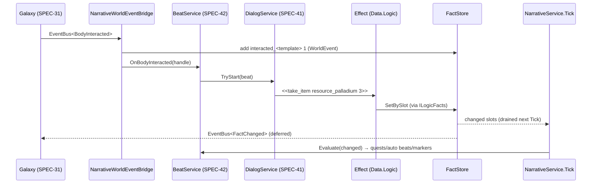

# SPEC-40 — Narrative core: facts, logic vocabulary, validator, legacy conversion

| | |
|---|---|
| **Status** | Draft |
| **Area code** | NAR (task IDs are `NAR-001`, `NAR-002`, …) |
| **Module(s)** | `Game.Data` (logic vocabulary in `Assets/Game/Data/Logic/`, definitions in `Assets/Game/Data/Definitions/Narrative/`); `Game.Narrative` (`Assets/Game/Narrative/`); `Game.App` adapters (`Assets/Game/App/Services/`); `Game.Editor` (`Assets/Game/Editor/Narrative/`, `Assets/Game/Editor/Migration/Narrative/`); `Game.DevTools.Editor` (`Assets/Game/DevTools/Editor/Narrative/`) |
| **Depends on specs** | SPEC-02 (`ContentId`, `StableHash`, `EventBus<T>`, `RngStreams`, `ISaveParticipant`, `SaveWriter/Reader`, `GameLog`); SPEC-04 (`ContentDefinition`, `ContentCatalog`, `ValidationReport`, `IContentDatabaseValidator`, `ContentIdRules`, `ItemDefinition`); SPEC-01 (`GameSession`, `GameRoot` composition, `SessionReset`); SPEC-05 (container, participant order); SPEC-31/32/33 (world events, body/lane/encounter commands); SPEC-41 (dialog format, `DialogService`); SPEC-42 (beat/quest/clue definitions); SPEC-50 (`EconomyService` implements `ILogicEconomy`); SPEC-72 (legacy JSON reader utilities) |
| **Depended on by** | SPEC-41, SPEC-42 (everything); SPEC-32 (lane unlock conditions), SPEC-33 (encounter/spawn conditions), SPEC-50 (`ILogicEconomy`), SPEC-61 (fact-driven UI), SPEC-70 (debug commands), SPEC-72 (narrative hand-off) |
| **Milestone** | M3 (NAR-018 in M4) |

> Read [01-architecture.md](../01-architecture.md), [02-conventions.md](../02-conventions.md) and [03-glossary.md](../03-glossary.md) before this spec. This spec may not contradict them.

## 1. Purpose

This spec defines the single source of narrative truth and the single language that reads and changes it. **Facts** are named integers in one `FactStore`, interned to dense integer slots at boot so that no string is compared or hashed per frame. **Conditions** and **effects** are authored as text in one syntax (a strict subset of Yarn Spinner's expression and command syntax), compiled at import into typed node graphs, bound to integer slots at boot, and evaluated only when one of their dependencies changes. The spec also defines the `ILogicContext` boundary through which logic talks to economy, quests and the world; the bridge that turns world events into narrative counters; a batch-runnable narrative validator; the Narrative Debugger; and the converter that turns all legacy narrative JSON into Yarn sources and definitions without losing a word. It replaces the prototype's four action vocabularies, five condition dialects, fail-open requirement strings (05-B17), 42 write-only flags and save-load side effects (05-B8).

## 2. Scope

**In scope:**
- `FactId`, fact declarations (`FactCatalogDefinition`), generated fact families, `FactCatalog` (name → slot interning), `FactStore`, `FactChanged`, the `FACT` save chunk.
- The logic vocabulary in `Game.Data.Logic`: `ICondition`, `IIntExpr`, `IEffect`, `ILogicContext` and its four facets, typed references, `LogicScope`, dependencies, the text grammar, lexer, parser, type checker, function registry, compiler, binder and diagnostics.
- Condition and effect node implementations for every function in §4.7.
- Import-time compilation of every `ILogicSourceOwner` definition.
- `NarrativeService` host: session lifecycle, per-frame evaluation loop, dependency index, trace log.
- `Game.App` adapters: `LogicContext`, `LogicWorldAdapter`, `NarrativeWorldEventBridge`.
- Narrative validator framework and the fact rules; batch entry point.
- Legacy narrative converter (`Import/Legacy/narrative/*.json` → `.yarn` + definitions), including the complete legacy-flag mapping.
- Narrative Debugger window.

**Out of scope (and who owns it instead):**
- Dialog file format, Yarn adoption, dialog runner and presenter: SPEC-41.
- `StoryBeatDefinition`, `QuestDefinition`, `ClueDefinition`, `RumorDefinition`, `MysteryDefinition`, beat selection, quests, clues, ship log, markers, the `QUST` chunk, quest/beat/mystery validator rules and the opening chapter content: SPEC-42.
- Inventory, wallet, loot, merchants: SPEC-50 (it implements `ILogicEconomy`).
- What a lane, body or encounter *is*: SPEC-30/31/32/33 (they call the compiler for their own condition fields and expose the commands `LogicWorldAdapter` routes to).
- Save container bytes and slot files: SPEC-05. Construction order of services: SPEC-01.

## 3. Decisions (binding)

1. **A fact is an `int`.** `FactKind.Bool` facts store 0 or 1; `FactKind.Int` facts store any `int`. Reason: glossary "Fact = a named integer"; one storage type, trivial saves.
2. **Every fact the content reads or writes is either declared in a `FactCatalogDefinition` or belongs to a generated family (§4.2).** Unknown fact names are compile errors. Reason: typos fail closed at import.
3. **Fact names use the content ID format** (`ContentIdRules.IsValidFormat`: `^[a-z][a-z0-9]*(_[a-z0-9]+)+$`, 3–64 chars). `FactId` wraps a `ContentId`. Reason: one ID rule, stable hashing (`StableHash`).
4. **Facts are interned to dense slots at boot.** `FactCatalog` assigns slot `0..N-1` in ordinal name order; `FactStore` keeps `int[]` arrays indexed by slot. Compiled nodes cache their slot in a `[NonSerialized]` field during binding. No string comparison or hashing happens during evaluation. Reason: scale and zero per-frame allocation.
5. **The text syntax is a strict subset of Yarn Spinner 3 syntax.** Conditions use Yarn expression syntax; effects use Yarn command syntax (`name arg arg`). The same text works in a definition field and inside a `.yarn` file. Reason: one vocabulary for writers; trivial Yarn binding (SPEC-41).
6. **Compile at import, bind at boot, never parse logic text at runtime.** Definitions store the source text and the compiled `[SerializeReference]` node graph in one wrapper (`CompiledCondition`, `CompiledIntExpr`, `CompiledEffectList`). Binding writes only `[NonSerialized]` caches (same precedent as `ContentDefinition`'s cached ID, SPEC-04 §4.3). The only runtime string lookups are Yarn function arguments (SPEC-41 §5.4), which are cached per string.
7. **Fail closed.** Unknown function, unknown fact, unknown reference, wrong argument type or stale compile = error. A condition that failed to compile evaluates to `false` at runtime and logs `GameLog.WarnOnce`. Reason: 05-B17.
8. **Facts change only through effects.** `FactStore.Set/Add` are called only by effect nodes (via `ILogicFacts`), by narrative services applying their own implicit effects (beat counters, clue ordinals), by `NarrativeWorldEventBridge` applying pre-built `AddFactEffect`s, by the Narrative Debugger and by `Restore`. Every write carries a `FactWriteSource`. Reason: architecture §8.
9. **`FactId`, `FactChanged` and the logic interfaces live in `Game.Data.Logic`.** Reason: Galaxy (lane gating), UI and Encounters reference `Game.Data` but not `Game.Narrative` (architecture §3).
10. **Evaluation is event-driven.** Every compiled node reports its `LogicDependency` set at bind time; a static CSR dependency index maps each dependency to its subscribers; `NarrativeService.Tick` re-evaluates only subscribers of changed dependencies. Nothing polls conditions per frame. Reason: scale; 05-B10.
11. **`FactChanged` is published deferred** with `EventBus<FactChanged>.Publish`; subscribers receive it when `ManagedEventDrainSystem` drains the bus (architecture §5, §6.6). The narrative-internal change list is drained synchronously inside `NarrativeService.Tick`, which `NarrativeTickBridgeSystem` calls right after `ManagedEventDrainSystem`. Reason: re-entrancy safety (05-B14) and deterministic order.
17. **World events identify content by `ContentHash` and spawned objects by `PersistentId`/`BodyId`, never by `Entity` or `ContentId`.** The bridge maps hashes to generated fact slots through dictionaries built at boot, so no string is built per event. Reason: architecture §6.1 erratum (ContentId is managed) and zero per-event allocation.
12. **Loading never executes effects.** `FactStore.Restore` raises no events and no effects; systems are marked dirty and evaluate on the first `Tick` after `SetWorldReady(true)`. Reason: 05-B8.
13. **Saves contain fact names and values, never hashes or slots,** sorted by ordinal name, only non-default `Save`-scope values; unknown names are preserved verbatim. Reason: content changes never invalidate saves (04-B1).
14. **World events reach narrative only through `NarrativeWorldEventBridge` in `Game.App`.** Reason: `Game.Narrative` may not reference `Game.Galaxy`, `Game.Simulation` or `Game.Economy`.
15. **All narrative randomness uses `RngStreams.For(campaignSeed, RngPurpose.Narrative, salt)`.** Yarn built-ins `dice`, `random`, `random_range` are forbidden. Reason: determinism (architecture §1.5).
16. **Legacy writing is preserved exactly.** Every legacy page text, option text, quest string and log string appears in a converted file, proven by a generated preservation manifest and a test. Reason: the writing is the most valuable carried-over asset.

## 4. Data model

### 4.1 Folders and namespaces

| Folder | Namespace | Contents |
|---|---|---|
| `Assets/Game/Data/Logic/` | `Game.Data.Logic` | facts, interfaces, scope, dependencies, typed refs, wrappers, registry |
| `Assets/Game/Data/Logic/Compiler/` | `Game.Data.Logic.Compiler` | `LogicLexer`, `LogicToken`, `LogicTokenKind`, `LogicParser`, `LogicAst*`, `LogicTypeChecker`, `LogicCompiler`, `LogicDiagnostics` |
| `Assets/Game/Data/Logic/Nodes/` | `Game.Data.Logic.Nodes` | one class per node (§4.8) |
| `Assets/Game/Data/Definitions/Narrative/` | `Game.Data.Definitions` | `FactCatalogDefinition`, `FactDeclaration`, `NarrativeConfigDefinition` (+ SPEC-41/42 definitions) |
| `Assets/Game/Narrative/Services/` | `Game.Narrative` | `FactStore`, `NarrativeService`, `DependencyIndex`, `LogicTraceLog`, `FactSaveParticipant` |
| `Assets/Game/Narrative/Data/` | `Game.Narrative` | `FactSnapshot`, `FactEntry`, `LogicTraceEntry`, `LogicTraceKind` |
| `Assets/Game/App/Services/` | `Game.App` | `LogicContext`, `LogicWorldAdapter`, `NarrativeWorldEventBridge`, `NarrativeBootstrap` |
| `Assets/Game/Presentation/Systems/` | `Game.Presentation` | `NarrativeTickBridgeSystem` (managed `SystemBase`, PresentationBridgeGroup) |
| `Assets/Game/Editor/Narrative/` | `Game.Editor.Narrative` | `LogicCompilePostprocessor`, `NarrativeValidator`, `NarrativeValidatorCli`, `FactUsageAnalyzer` |
| `Assets/Game/Editor/Migration/Narrative/` | `Game.Editor.Migration.Narrative` | `LegacyNarrativeConverter` and helpers (folder reason: converters are grouped per SPEC-72) |
| `Assets/Game/DevTools/Editor/Narrative/` | `Game.DevTools.Editor.Narrative` | `NarrativeDebuggerWindow` |
| `Assets/Game/Content/Narrative/Facts/` | — | `FactCatalogDefinition` assets (`facts_<area>.asset`) |

`Logic/Compiler/` and `Logic/Nodes/` are new folder names (reason: the compiler and ~60 node classes would otherwise drown the contract types).

### 4.2 Facts (public contract)

```csharp
namespace Game.Data.Logic
{
    /// <summary>Identity of a fact. Implements SPEC-40 §4.2. Name format = content ID format (SPEC-04 §3.1).</summary>
    public readonly struct FactId : System.IEquatable<FactId>
    {
        public readonly Game.Core.ContentId Id;
        public FactId(string name) { Id = new Game.Core.ContentId(name); }   // no format check here; FactCatalog/compiler check
        public string Name => Id.Value;
        public ulong Hash => Id.Hash.Value;                                   // ContentId.Hash is a ContentHash (architecture §6.1)
        public bool IsValid => !string.IsNullOrEmpty(Id.Value);
        public bool Equals(FactId other) => Hash == other.Hash;
        public override bool Equals(object obj) => obj is FactId f && Equals(f);
        public override int GetHashCode() => (int)Hash;                       // in-memory dictionaries only, never persisted
        public override string ToString() => Id.Value;
    }

    public enum FactKind : byte { Int = 0, Bool = 1 }
    public enum FactScope : byte { Save = 0, Session = 1 }                    // Session = never saved, reset on load/new game
    [System.Flags] public enum FactFlags : byte
    {
        None = 0,
        WrittenByCode = 1,   // validator: counts as written (e.g. debug_menus set by the debugger)
        ReadByCode = 2,      // validator: counts as read (a C# reader exists; name it in `note`)
        Journal = 4,         // shown in the Ship Log journal when non-zero (SPEC-42 §4.9); counts as read
        Debug = 8            // debug-only content; excluded from release validation rules NAR-V003/V004
    }
    public enum FactFamily : byte { Authored = 0, Beat = 1, Clue = 2, Mystery = 3, Visited = 4, Interacted = 5, Destroyed = 6, Defeated = 7, Acquired = 8, System = 9 }

    public enum FactWriteSource : byte { Effect = 0, Dialog = 1, Quest = 2, Clue = 3, Beat = 4, WorldEvent = 5, NewGame = 6, Debugger = 7 }

    /// <summary>Raised (deferred) when a fact's value changes. Implements SPEC-40 §4.2.</summary>
    public readonly struct FactChanged
    {
        public readonly FactId Id; public readonly int Slot; public readonly int OldValue; public readonly int NewValue; public readonly FactWriteSource Source;
        public FactChanged(FactId id, int slot, int oldValue, int newValue, FactWriteSource source)
        { Id = id; Slot = slot; OldValue = oldValue; NewValue = newValue; Source = source; }
    }
}

namespace Game.Data.Definitions
{
    /// <summary>One declared fact. Implements SPEC-40 §4.2.</summary>
    [System.Serializable]
    public struct FactDeclaration
    {
        public string Name;                         // content-ID format, unique across all catalogs
        public Game.Data.Logic.FactKind Kind;
        public Game.Data.Logic.FactScope Scope;
        public Game.Data.Logic.FactFlags Flags;
        public int Default;                         // Bool: 0 or 1
        public int Min;                             // Int only; Min == Max == 0 means unbounded
        public int Max;
        public string[] FormerNames;                // renamed facts: values saved under these names load into this fact
        [UnityEngine.TextArea(1, 4)] public string Note;           // designer note; required when Flags has ReadByCode/WrittenByCode
        [UnityEngine.TextArea(1, 4)] public string JournalText;    // required when Flags has Journal; shown in the Ship Log
    }

    /// <summary>A group of declared facts (one asset per area/thread). Implements SPEC-40 §4.2.</summary>
    [ContentIdPrefix("facts_")]
    [UnityEngine.CreateAssetMenu(menuName = "Game/Narrative/Fact Catalog", fileName = "facts_new")]
    public sealed class FactCatalogDefinition : ContentDefinition
    {
        [UnityEngine.SerializeField] private FactDeclaration[] facts = System.Array.Empty<FactDeclaration>();
        public System.Collections.Generic.IReadOnlyList<FactDeclaration> Facts => facts;
    }
}
```

**Generated families.** These facts exist without declaration; their names are derived from content IDs. All are `Int`, `Save` scope, default 0, and **cannot be written by content** (`NAR-E011`); only the listed writer changes them.

| Family | Name | One per | Value | Only writer |
|---|---|---|---|---|
| `Beat` | the beat ID itself (`beat_cryo_vault`) | `StoryBeatDefinition` | times completed | `BeatService` (SPEC-42) |
| `Clue` | the clue ID itself (`clue_ark_mutiny`, `rumor_hidden_cache`) | `ClueDefinition` (incl. `RumorDefinition`) | discovery ordinal (1 = first clue found), 0 = unknown | `ClueService` (SPEC-42) |
| `Mystery` | the mystery ID itself (`mystery_arks`) | `MysteryDefinition` | 1 when solved | `ClueService` (SPEC-42) |
| `Visited` | `visited_<star system id>` | star-system definition (RefKind `StarSystem`) | entries into that star system | `NarrativeWorldEventBridge` |
| `Interacted` | `interacted_<body template id>` | `BodyTemplateDefinition` | interactions | bridge |
| `Destroyed` | `destroyed_<id>` | `EncounterDefinition`, `ShipBlueprintDefinition`, `BodyTemplateDefinition` | destroyed by any cause | bridge |
| `Defeated` | `defeated_<encounter id>` | `EncounterDefinition` | encounter instances fully defeated | bridge |
| `Acquired` | `acquired_<item id>` | `ItemDefinition` (blocks included) | units acquired from loot, rewards, purchases, salvage | bridge |
| `System` | `sys_clue_counter`, `sys_beats_completed`, `sys_star_systems_entered`, `sys_territories_entered` | fixed list | counters | `ClueService`, `BeatService`, bridge |

**Reserved prefixes.** Authored fact names must not start with `beat_`, `clue_`, `rumor_`, `mystery_`, `visited_`, `interacted_`, `destroyed_`, `defeated_`, `acquired_`, `sys_` (`NAR-E020`).

```csharp
namespace Game.Data.Logic
{
    /// <summary>Runtime and editor index of all facts: name → dense slot. Implements SPEC-40 §5.2. Immutable after Build.</summary>
    public sealed class FactCatalog
    {
        public static FactCatalog Build(Game.Data.Services.ContentCatalog content, RefResolverRegistry refs, Game.Data.Validation.ValidationReport report);
        public int Count { get; }
        public int SlotOf(in FactId id);          // O(1) Dictionary<ulong,int>; -1 if unknown
        public int SlotOf(string name);           // compile/editor path; -1 if unknown; also resolves FormerNames to the live slot
        public FactId IdAt(int slot);
        public FactKind KindAt(int slot);
        public FactScope ScopeAt(int slot);
        public FactFlags FlagsAt(int slot);
        public FactFamily FamilyAt(int slot);
        public int DefaultAt(int slot);
        public int MinAt(int slot);
        public int MaxAt(int slot);
        public bool IsWritableByContent(int slot) => FamilyAt(slot) == FactFamily.Authored;
        public string JournalTextAt(int slot);
        public ulong SourceHashAt(int slot);                                   // generated slots: ContentHash.Value of the source definition; 0 otherwise
        public int GeneratedSlot(FactFamily family, ulong sourceHash);         // O(1); -1 if none (used by the world-event bridge, no strings)
    }
}
```

### 4.3 Logic interfaces (public contract)

```csharp
namespace Game.Data.Logic
{
    public enum LogicType : byte { Bool = 0, Int = 1 }

    /// <summary>Where a piece of logic may be used. A function is allowed only in the usages listed in §4.7.</summary>
    [System.Flags] public enum LogicUsage : ushort
    {
        None = 0, BeatCondition = 1, QuestObjective = 2, QuestEffect = 4, DialogCondition = 8, DialogCommand = 16,
        EncounterCondition = 32, SpawnCondition = 64, LaneCondition = 128, MarkerCondition = 256, BeatEffect = 512,
        AnyCondition = BeatCondition | QuestObjective | DialogCondition | EncounterCondition | SpawnCondition | LaneCondition | MarkerCondition,
        AnyEffect = QuestEffect | DialogCommand | BeatEffect
    }

    public enum LogicDependencyKind : byte { Fact = 0, Item = 1, Credits = 2, Quest = 3, Location = 4, Time = 5, Relation = 6 }

    /// <summary>One thing a condition reads. Key: fact slot, item index, quest index, faction index; 0 for Credits/Location/Time.</summary>
    public readonly struct LogicDependency : System.IEquatable<LogicDependency>
    {
        public readonly LogicDependencyKind Kind; public readonly int Key;
        public LogicDependency(LogicDependencyKind kind, int key) { Kind = kind; Key = key; }
        public bool Equals(LogicDependency o) => Kind == o.Kind && Key == o.Key;
        public override int GetHashCode() => ((int)Kind << 24) ^ Key;
    }

    public enum QuestStatus : byte { NotStarted = 0, Active = 1, Completed = 2, Failed = 3, Abandoned = 4 }
    public enum BaselineKind : byte { Accept = 0, Stage = 1 }
    public enum EffectFlow : byte { Immediate = 0, Blocking = 1, Terminal = 2 }   // Blocking/Terminal only legal in dialog (SPEC-41)

    /// <summary>A star-system body as plain data (mirrors Game.Galaxy BodyId without referencing Galaxy). Unmanaged.</summary>
    public readonly struct LogicBodyHandle
    {
        public readonly uint StarSystem; public readonly byte Role; public readonly ushort Slot; public readonly ushort SubSlot;
        public readonly Game.Core.ContentHash Template;                       // hash of the BodyTemplateDefinition ID
        public LogicBodyHandle(uint starSystem, byte role, ushort slot, ushort subSlot, Game.Core.ContentHash template)
        { StarSystem = starSystem; Role = role; Slot = slot; SubSlot = subSlot; Template = template; }
        public ulong Key => Game.Core.StableHash.Combine(Game.Core.StableHash.Combine(StarSystem, Role), ((ulong)Slot << 16) | SubSlot);
    }

    /// <summary>Context of one evaluation. Default = no quest, no beat, no body.</summary>
    public readonly struct LogicScope
    {
        public readonly LogicUsage Usage;
        public readonly int QuestIndex;          // IndexOf<QuestDefinition>, 0 = none
        public readonly int QuestInstance;       // 0-based instance for repeatable quests
        public readonly int BeatIndex;           // IndexOf<StoryBeatDefinition>, 0 = none
        public readonly bool HasBody;
        public readonly LogicBodyHandle Body;
        public LogicScope(LogicUsage usage, int questIndex, int questInstance, int beatIndex, bool hasBody, LogicBodyHandle body)
        { Usage = usage; QuestIndex = questIndex; QuestInstance = questInstance; BeatIndex = beatIndex; HasBody = hasBody; Body = body; }
    }

    public interface ICondition
    {
        bool Evaluate(ILogicContext ctx);
        void Validate(Game.Data.Validation.ValidationReport report);   // reports with AssetPath "" (wrapper remaps, §5.6)
        void Bind(LogicBinder binder);
        void CollectDependencies(System.Collections.Generic.List<LogicDependency> into);
    }

    public interface IIntExpr
    {
        int Evaluate(ILogicContext ctx);
        void Validate(Game.Data.Validation.ValidationReport report);
        void Bind(LogicBinder binder);
        void CollectDependencies(System.Collections.Generic.List<LogicDependency> into);
    }

    public interface IEffect
    {
        void Apply(ILogicContext ctx);
        void Validate(Game.Data.Validation.ValidationReport report);
        void Bind(LogicBinder binder);
        bool CanApply(ILogicContext ctx);                 // pure check of this effect alone
        void AddRequirements(EffectRequirements req);     // costs, for atomic list checks (§5.4)
        EffectFlow Flow { get; }
    }

    /// <summary>Implemented by Game.App (LogicContext). Single-threaded, main thread only.</summary>
    public interface ILogicContext
    {
        ILogicFacts Facts { get; }
        ILogicEconomy Economy { get; }
        ILogicNarrative Narrative { get; }
        ILogicWorld World { get; }
        LogicScope Scope { get; }
        ulong CampaignSeed { get; }
        void PushScope(in LogicScope scope);     // nested scopes allowed, max depth 8 (InvalidOperationException beyond)
        void PopScope();
    }

    public interface ILogicFacts
    {
        int GetBySlot(int slot);
        int Get(in FactId id);                          // slow path: SlotOf + GetBySlot; unknown → 0 + WarnOnce
        void SetBySlot(int slot, int value, FactWriteSource source);
        void AddBySlot(int slot, int delta, FactWriteSource source);
        FactCatalog Catalog { get; }
    }

    public interface ILogicEconomy                     // implemented by Game.Economy.EconomyService (SPEC-50)
    {
        int GetItemCount(int itemIndex);                // itemIndex = ContentCatalog.IndexOf<ItemDefinition>
        long GetCredits();
        void GiveItems(int itemIndex, int count);       // never fails: overflow hold (SPEC-50 §5.3)
        bool TryTakeItems(int itemIndex, int count);    // all-or-nothing
        void GiveCredits(long amount);
        bool TryTakeCredits(long amount);
        void GiveLoot(int lootTableIndex, int picks, ulong salt);   // picks < 0 = table default
        event System.Action<int> ItemCountChanged;      // itemIndex
        event System.Action CreditsChanged;
    }

    public interface ILogicNarrative                   // implemented by Game.Narrative.NarrativeLogicAdapter (SPEC-42)
    {
        QuestStatus GetQuestStatus(int questIndex);     // latest instance
        int GetQuestStage(int questIndex);              // -1 unless Active
        bool IsObjectiveDone(int questIndex, string objectiveId);
        int GetBaseline(in LogicScope scope, int factSlot, BaselineKind kind);
        int GetDialogVisitCount(string node);           // SPEC-41 DialogMemory
        int Roll(int sides);                            // SPEC-41 §5.6, dialog only
        bool StartQuest(int questIndex);
        bool FailQuest(int questIndex);
        bool CompleteQuest(int questIndex);
        void TrackQuest(int questIndex);
        void AddQuestLog(int questIndex, string entryId);
        bool RevealClue(int clueIndex);
        void QueueBeat(int beatIndex);
        void CompleteBeat(int beatIndex);
        void AbortCurrentBeat();
    }

    public interface ILogicWorld                        // implemented by Game.App.LogicWorldAdapter (§5.5)
    {
        int CurrentStarSystemIndex { get; }             // RefKind.StarSystem index, 0 = not an authored star system
        double UniversalTime { get; }
        int GetRelation(int factionIndex);              // -100..100
        void AdjustRelation(int factionIndex, int delta);
        int CurrentStarSystemOwnerFactionIndex { get; } // 0 = unowned
        void GiveShip(int blueprintIndex);
        void SpawnEncounter(int encounterIndex, string anchorTag, int count, in LogicScope scope);
        void StartCombat(int encounterIndex, in LogicScope scope);
        void RemoveBody(in LogicScope scope);
        void ReplaceBody(in LogicScope scope, int bodyTemplateIndex);
        void RequestLaneJump(int starSystemIndex);
        void OpenMerchant(int merchantIndex, in LogicScope scope, System.Action onClosed);
        void OpenShipEditor();
        void RepairPlayerShip(int percent);
        void DamagePlayerShip(int amount, in LogicScope scope);
        void PlaySfx(int audioCueIndex);
        void Notify(string text);
    }
}
```

### 4.4 Typed references (public contract)

Typed references appear **only inside compiled logic nodes** (SPEC-04 §3.3: definitions reference each other by asset). Each is a serializable struct with the source ID and a bound index. All 13 follow this exact template (only the name and `Kind` differ):

```csharp
namespace Game.Data.Logic
{
    [System.Serializable]
    public struct ItemRef
    {
        public string Id;                                  // as written in the source text
        [System.NonSerialized] public int Index;           // bound index (ContentCatalog.IndexOf<T>); 0 = unbound
        public const RefKind Kind = RefKind.Item;
    }
}
```

| Struct | `RefKind` | Resolves against (definition type, owner) | Index |
|---|---|---|---|
| `ItemRef` | `Item` | `ItemDefinition` (SPEC-04/50), blocks included | `IndexOf<ItemDefinition>` |
| `EntityRef` | `Entity` | `BodyTemplateDefinition` (SPEC-30) | `IndexOf<BodyTemplateDefinition>` |
| `StarSystemRef` | `StarSystem` | star-system definition (SPEC-30, open question 1) | family index |
| `QuestRef` | `Quest` | `QuestDefinition` (SPEC-42) | `IndexOf<QuestDefinition>` |
| `ClueRef` | `Clue` | `ClueDefinition` incl. rumors (SPEC-42) | `IndexOf<ClueDefinition>` |
| `BeatRef` | `Beat` | `StoryBeatDefinition` (SPEC-42) | `IndexOf<StoryBeatDefinition>` |
| `FactionRef` | `Faction` | `FactionDefinition` (SPEC-33); literal `owner` = current star system owner | index, `-1` = `owner` |
| `MysteryRef` | `Mystery` | `MysteryDefinition` (SPEC-42) | index |
| `LootTableRef` | `LootTable` | `LootTableDefinition` (SPEC-50) | index |
| `MerchantRef` | `Merchant` | `MerchantDefinition` (SPEC-50) | index |
| `EncounterRef` | `Encounter` | `EncounterDefinition` (SPEC-33) | index |
| `BlueprintRef` | `Blueprint` | `ShipBlueprintDefinition` (SPEC-10) | index |
| `AudioCueRef` | `AudioCue` | `AudioCueDefinition` (SPEC-64) | index |

```csharp
namespace Game.Data.Logic
{
    public enum RefKind : byte { Item = 0, Entity = 1, StarSystem = 2, Quest = 3, Clue = 4, Beat = 5, Faction = 6, Mystery = 7, LootTable = 8, Merchant = 9, Encounter = 10, Blueprint = 11, AudioCue = 12 }  // add at end only

    public interface IRefResolver
    {
        RefKind Kind { get; }
        bool TryResolve(string id, out int index);                      // O(1)
        System.Collections.Generic.IReadOnlyList<string> AllIds { get; } // ordinal order; used for generated facts and suggestions
    }

    /// <summary>Kind → resolver. Implements SPEC-40 §5.2. Kinds without a resolver produce warning NAR-W001, never an error.</summary>
    public sealed class RefResolverRegistry
    {
        public static RefResolverRegistry CreateDefault(Game.Data.Services.ContentCatalog content);  // registers every kind whose definition type exists (§5.2 step 1)
        public void Register(IRefResolver resolver);                    // replaces an existing resolver of the same kind
        public bool TryGet(RefKind kind, out IRefResolver resolver);
    }

    /// <summary>Generic resolver over a ContentCatalog family.</summary>
    public sealed class CatalogRefResolver<T> : IRefResolver where T : Game.Data.Definitions.ContentDefinition
    {
        public CatalogRefResolver(RefKind kind, Game.Data.Services.ContentCatalog content);
    }
}
```

### 4.5 Compiled wrappers, owners, compiler and binder (public contract)

```csharp
namespace Game.Data.Logic
{
    /// <summary>Source text + compiled graph of one condition field. Empty source = always true.</summary>
    [System.Serializable]
    public sealed class CompiledCondition : ICondition
    {
        [UnityEngine.SerializeField, UnityEngine.TextArea(1, 6)] private string source = "";
        [UnityEngine.SerializeField] private ulong sourceHash;            // StableHash.Hash64(source) at last compile
        [UnityEngine.SerializeField] private int compilerVersion;         // LogicCompiler.Version at last compile
        [UnityEngine.SerializeField] private bool hasErrors;
        [UnityEngine.SerializeReference] private ICondition root;         // null when source is empty or hasErrors
        public string Source => source;
        public bool HasErrors => hasErrors;
        public bool IsAlwaysTrue => !hasErrors && root == null;
        public bool IsStale => compilerVersion != Compiler.LogicCompiler.Version || sourceHash != Game.Core.StableHash.Hash64(source ?? "");
        // ICondition: Evaluate → hasErrors ? false (WarnOnce) : root == null ? true : root.Evaluate(ctx)
    }

    /// <summary>Same shape for an Int expression (quest objective progress). Empty source = 0.</summary>
    [System.Serializable] public sealed class CompiledIntExpr : IIntExpr { /* fields as CompiledCondition, root is IIntExpr */ }

    /// <summary>Source lines + compiled effects. One command per line.</summary>
    [System.Serializable]
    public sealed class CompiledEffectList
    {
        [UnityEngine.SerializeField] private string[] source = System.Array.Empty<string>();
        [UnityEngine.SerializeField] private ulong sourceHash;            // hash of lines joined with '\n'
        [UnityEngine.SerializeField] private int compilerVersion;
        [UnityEngine.SerializeField] private bool hasErrors;
        [UnityEngine.SerializeReference] private IEffect[] effects = System.Array.Empty<IEffect>();
        public System.Collections.Generic.IReadOnlyList<string> Source => source;
        public bool HasErrors => hasErrors;
        public bool IsEmpty => effects.Length == 0;
        public bool CanApplyAll(ILogicContext ctx, EffectRequirements scratch);   // §5.4 step 1–3
        public bool ApplyAll(ILogicContext ctx, EffectRequirements scratch);      // §5.4; false = nothing applied
    }

    /// <summary>Aggregated costs of an effect list. Reused scratch object; Clear() before use.</summary>
    public sealed class EffectRequirements
    {
        public void Clear();
        public void AddItemCost(int itemIndex, int count);
        public void AddCreditCost(long amount);
        public bool IsSatisfied(ILogicContext ctx);       // every summed item cost ≤ count held; credit cost ≤ credits
    }

    /// <summary>Implemented by every definition that has logic fields (SPEC-32/33/41/42 definitions too).</summary>
    public interface ILogicSourceOwner
    {
        void CompileLogic(Compiler.LogicCompiler compiler, Game.Data.Validation.ValidationScope scope);  // compile every field
        void BindLogic(LogicBinder binder);                                                             // bind every field
    }

    /// <summary>Resolves names/IDs to slots/indices and records dependencies. Implements SPEC-40 §5.3.</summary>
    public sealed class LogicBinder
    {
        public LogicBinder(FactCatalog facts, RefResolverRegistry refs, Game.Data.Validation.ValidationReport report);
        public int BindFact(string name);                 // slot or -1 (+ NAR-E006 into report)
        public int BindRef(RefKind kind, string id);      // index or 0 (+ NAR-E007, or NAR-W001 when no resolver)
        public int FailedBindings { get; }
    }
}

namespace Game.Data.Logic.Compiler
{
    public readonly struct LogicCompileOptions
    {
        public readonly LogicUsage Usage; public readonly string AssetPath; public readonly string Field;
        public LogicCompileOptions(LogicUsage usage, string assetPath, string field) { Usage = usage; AssetPath = assetPath; Field = field; }
    }

    /// <summary>Text → node graph. Pure; editor and tests. Implements SPEC-40 §5.1.</summary>
    public sealed class LogicCompiler
    {
        public const int Version = 1;                     // bump when node shapes change → every wrapper becomes stale
        public LogicCompiler(FactCatalog facts, RefResolverRegistry refs, LogicFunctionRegistry functions);
        public bool Compile(CompiledCondition target, in LogicCompileOptions options, Game.Data.Validation.ValidationReport report);
        public bool Compile(CompiledIntExpr target, in LogicCompileOptions options, Game.Data.Validation.ValidationReport report);
        public bool Compile(CompiledEffectList target, in LogicCompileOptions options, Game.Data.Validation.ValidationReport report);
        public bool TryCompileCommand(string commandText, in LogicCompileOptions options, Game.Data.Validation.ValidationReport report, out IEffect effect);  // SPEC-41 command table
        public bool TryCompileExpression(string expressionText, in LogicCompileOptions options, Game.Data.Validation.ValidationReport report, out ICondition condition); // SPEC-41 <<if>> validation/fallback
    }
}
```

Every wrapper also implements `Bind` (calls `root.Bind`) and `CollectDependencies`. `CompiledEffectList` exposes `Bind(LogicBinder)` and `CollectDependencies` is not needed.

### 4.6 Text syntax

**Conditions and Int expressions** (EBNF; whitespace and newlines between tokens are ignored; no comments):

```
expression  = orExpr ;
orExpr      = andExpr { ( "or" | "||" ) andExpr } ;
andExpr     = notExpr { ( "and" | "&&" ) notExpr } ;
notExpr     = ( "not" | "!" ) notExpr | compare ;
compare     = additive [ ( "==" | "!=" | "<" | "<=" | ">" | ">=" ) additive ] ;
additive    = unary { ( "+" | "-" ) unary } ;
unary       = "-" unary | primary ;
primary     = INT | "true" | "false" | VARIABLE | call | "(" orExpr ")" ;
call        = NAME "(" [ argument { "," argument } ] ")" ;
argument    = STRING | orExpr ;
VARIABLE    = "$" NAME ;                         (* a fact *)
NAME        = [a-z] [a-z0-9_]* ;                 (* max 64 chars *)
INT         = [0-9]+ ;                           (* ≤ 2147483647 *)
STRING      = '"' { any char except '"' and '\' | '\"' | '\\' } '"' ;
```

**Effects** (one command per line of `CompiledEffectList.source`, or the body of a Yarn `<<...>>` command):

```
command     = NAME { arg } ;
arg         = WORD | SIGNED_INT | "true" | "false" | STRING | VARIABLE ;
WORD        = [a-z0-9_]+ ;                       (* IDs and fact names *)
SIGNED_INT  = [ "-" ] [0-9]+ ;
```

**Typing rules** (checked by `LogicTypeChecker`, errors in §4.9):

| Construct | Operands | Result |
|---|---|---|
| `$name` | — | `Bool` if the fact's kind is `Bool`, else `Int` |
| `INT`, unary `-`, `+`, `-` | `Int` | `Int` (saturating at `int.MinValue/MaxValue`) |
| `true`, `false` | — | `Bool` |
| `and`, `or`, `not` | `Bool` | `Bool` (short-circuit, left to right) |
| `==`, `!=` | both `Int` or both `Bool` | `Bool` |
| `<`, `<=`, `>`, `>=` | `Int` | `Bool` |
| `call` | per §4.7 signature | per §4.7 |
| Root of a condition field | — | must be `Bool` (`NAR-E009`) |
| Root of a progress field | — | must be `Int` |

Argument kinds: `Int` (any Int expression), `Bool` (any Bool expression), `Fact` (STRING literal naming a fact; in commands a WORD or VARIABLE), `Ref(kind)` (STRING literal in conditions, WORD in commands, resolved by `RefResolverRegistry`), `Text` (STRING literal), `Tag` (WORD: a body tag, `here` or `player`).

Examples: `has_item("resource_palladium", 3) and not $gate_ark_start_active` · `since_accept("defeated_encounter_xeno_probe_tutorial") >= 1` · `take_item resource_palladium 3` · `set_fact gate_ark_start_active true` · `notify "Gate online."`.

### 4.7 Function registry (the complete vocabulary)

`LogicFunctionRegistry` (`Game.Data.Logic`) is an immutable table created once in a `static readonly` field (immutable, so no reset is needed). Each `LogicFunctionInfo` has: `Name`, `IsEffect`, `ReturnType` (conditions), `Params` (`LogicParamInfo{Name, ArgKind, RefKind, bool Optional, int DefaultInt}`), `AllowedUsage`, `Flow` (effects), `Milestone`, and two factories: `object CreateNode(ReadOnlySpan<object> boundArgs)` and `LogicValue Invoke(ILogicContext context, ReadOnlySpan<LogicValue> args)` (used by Yarn, SPEC-41 §5.4). `CreateNode` preserves bound `IIntExpr`/`ICondition` nodes, references and literals; it does not prematurely evaluate them into `LogicValue`. The returned node implements the registry-selected `ICondition`, `IIntExpr` or `IEffect`. `LogicValue` is `readonly struct { LogicType Type; int Int; string Text; }`. Both factory bodies remain `TODO(NAR-003)` throwing stubs in NAR-001 (Q12).

**Conditions** (dependencies in brackets; `AC` = `AnyCondition`, `D` = `DialogCondition`, `Q` = `QuestObjective`):

| Function | Params | Returns | Usage | Deps | Semantics | Legacy source |
|---|---|---|---|---|---|---|
| `$name` | — | Bool/Int | AC | Fact | value of the fact | `REQ_VAR`, `world_state` |
| `has_item` | item: Ref(Item), count: Int = 1 | Bool | AC | Item | `GetItemCount ≥ count` | `REQ_ITEM`, `collect_item` |
| `item_count` | item: Ref(Item) | Int | AC | Item | held count (cargo + overflow, SPEC-50) | — |
| `credits` | — | Int | AC | Credits | wallet, clamped to `int.MaxValue` | `REQ_CURRENCY` |
| `quest_not_started` | quest: Ref(Quest) | Bool | AC | Quest | status = NotStarted | `REQ_QUEST_STATE(_, NotAccepted)` |
| `quest_active` | quest | Bool | AC | Quest | status = Active | `REQ_QUEST_ACTIVE` |
| `quest_completed` | quest | Bool | AC | Quest | status = Completed | — |
| `quest_failed` | quest | Bool | AC | Quest | status = Failed | — |
| `quest_stage` | quest | Int | AC | Quest | stage index, −1 unless Active | — |
| `objective_done` | quest, objective: Text | Bool | AC | Quest | latched done flag | `objective_state` |
| `clue_known` | clue: Ref(Clue) | Bool | AC | Fact (clue slot) | clue fact > 0 | — |
| `mystery_solved` | mystery: Ref(Mystery) | Bool | AC | Fact | mystery fact = 1 | — |
| `beat_count` | beat: Ref(Beat) | Int | AC except Q | Fact | beat fact | — |
| `since_accept` | fact: Fact | Int | Q only | Fact | fact − baseline at quest accept | B3 fix |
| `since_stage` | fact: Fact | Int | Q only | Fact | fact − baseline at stage entry | B3 fix |
| `in_star_system` | system: Ref(StarSystem) | Bool | AC | Location | current star system = system | — |
| `relation` | faction: Ref(Faction) | Int | AC | Relation | −100..100; `owner` = current owner (0 if none) | `faction_relation` |
| `star_system_owned` | — | Bool | AC | Location | current star system has an owner | trigger territory |
| `game_hours` | — | Int | AC | Time | `floor(UniversalTime / 3600)` | — |
| `roll` | sides: Int (2..1000) | Int | D only | — | 1..sides, memoized per node visit (SPEC-41 §5.6) | `RANDOM_BRANCH` |
| `visited_count` | node: Text | Int | D only | — | dialog node completions (SPEC-41) | `consume` |

**Effects** (all usage `AnyEffect` unless stated; `CanApply` true unless stated):

| Command | Params | Flow | CanApply / requirement | Semantics | Legacy source |
|---|---|---|---|---|---|
| `set_fact` | fact: Fact, value: Int or Bool | Immediate | fact writable by content | `SetBySlot`; Bool accepts `true/false/0/1` | `SET_VAR`, `state.set` |
| `add_fact` | fact: Fact, delta: Int | Immediate | Int fact, writable | `AddBySlot` (saturating) | `CHANGE_RESEARCH` |
| `give_item` | item, count = 1 (1..100000) | Immediate | — | `GiveItems` | `ADD_ITEM`, positive `CHANGE_FUEL/CREW` |
| `take_item` | item, count = 1 | Immediate | item cost `count` | `TryTakeItems` | `REMOVE_ITEM`, negative `CHANGE_FUEL/CREW` |
| `give_credits` | amount (1..10⁹) | Immediate | — | `GiveCredits` | `CHANGE_CURRENCY(+)` |
| `take_credits` | amount | Immediate | credit cost | `TryTakeCredits` | `CHANGE_CURRENCY(−)` |
| `give_loot` | table: Ref(LootTable), picks: Int = −1 | Immediate | — | `GiveLoot(table, picks, salt)`; salt §5.4 | `GRANT_LOOT` |
| `give_ship` | blueprint: Ref(Blueprint) | Immediate | — | `World.GiveShip` | `ADD_ITEM(ship_*)` |
| `start_quest` | quest | Immediate | — | idempotent (SPEC-42 §5.2) | `quest.accept`, `AcceptQuest`, templates |
| `fail_quest` | quest | Immediate | — | no-op unless Active | `quest.fail` |
| `complete_quest` | quest | Immediate | — | forces completion; validator warning `NAR-W010` | `quest.complete` |
| `track_quest` | quest | Immediate | — | sets the tracked quest | `TrackQuest` |
| `quest_log` | quest, entry: WORD | Immediate | — | appends a log entry (entry ID from the quest definition) | `quest.add_log`, `AddLog` |
| `reveal_clue` | clue: Ref(Clue) | Immediate | — | idempotent | new |
| `queue_beat` | beat: Ref(Beat) | Immediate | — | play after current dialog | `flow.queue_encounter`, `QueueEncounter` |
| `complete_beat` | beat | Immediate | dialog only | counts + onComplete of another beat (nested flows) | `PLAY_NESTED` |
| `abort_beat` | — | Immediate | dialog only | current beat ends not completed | `END(FALSE)` |
| `spawn_encounter` | encounter: Ref(Encounter), anchor: Tag = `here`, count: Int = 1 (1..10) | Immediate | — | `World.SpawnEncounter` | `spawn.entity`, `SpawnEntity` |
| `start_combat` | encounter | Terminal | dialog only | dialog ends, then `World.StartCombat` | `START_COMBAT` |
| `remove_body` | — | Immediate | needs body scope | `World.RemoveBody` | `DESTROY_ENTITY` |
| `replace_body` | template: Ref(Entity) | Immediate | needs body scope | `World.ReplaceBody` (M4) | `world.replace_entity` |
| `request_lane_jump` | system: Ref(StarSystem) | Terminal | dialog only | dialog ends, then `World.RequestLaneJump` | `world.exit_system` |
| `open_merchant` | merchant: Ref(Merchant) | Blocking | dialog only | dialog waits until the merchant screen closes | `TRADE` |
| `open_ship_editor` | — | Terminal | dialog only | dialog ends, then `World.OpenShipEditor` | `OPEN_SHIP_EDITOR` |
| `repair_ship` | percent: Int (1..100) | Immediate | — | `World.RepairPlayerShip` | `REPAIR_ALL_SHIPS`, `CHANGE_HULL(+)` |
| `damage_ship` | amount: Int (1..1000) | Immediate | — | `World.DamagePlayerShip` | `CHANGE_HULL(−)` |
| `adjust_relation` | faction: Ref(Faction), delta: Int (−100..100) | Immediate | — | `World.AdjustRelation` | `AdjustFactionRelation` |
| `play_sfx` | cue: Ref(AudioCue) | Immediate | — | `World.PlaySfx` | `PLAY_AUDIO` |
| `notify` | text: Text (1..200 chars) | Immediate | — | `World.Notify` | — |

Function names are unique across both tables. Out-of-range literal arguments are `NAR-E012`.

### 4.8 Node classes

One `[Serializable]` class per construct in `Game.Data.Logic.Nodes`, each with a parameterless constructor, serialized fields for source data and `[NonSerialized]` fields for bound slots/indices:

`BoolLiteral`, `IntLiteral`, `FactBoolRead`, `FactIntRead`, `AndCondition`, `OrCondition`, `NotCondition`, `CompareIntCondition` (`CompareOp Op`), `CompareBoolCondition`, `AddExpr`, `SubtractExpr`, `NegateExpr`, `BoolFunctionCondition`, `IntFunctionExpr`; one class per effect: `SetFactEffect`, `AddFactEffect`, `GiveItemEffect`, `TakeItemEffect`, `GiveCreditsEffect`, `TakeCreditsEffect`, `GiveLootEffect`, `GiveShipEffect`, `StartQuestEffect`, `FailQuestEffect`, `CompleteQuestEffect`, `TrackQuestEffect`, `QuestLogEffect`, `RevealClueEffect`, `QueueBeatEffect`, `CompleteBeatEffect`, `AbortBeatEffect`, `SpawnEncounterEffect`, `StartCombatEffect`, `RemoveBodyEffect`, `ReplaceBodyEffect`, `RequestLaneJumpEffect`, `OpenMerchantEffect`, `OpenShipEditorEffect`, `RepairShipEffect`, `DamageShipEffect`, `AdjustRelationEffect`, `PlaySfxEffect`, `NotifyEffect`. `BoolFunctionCondition` / `IntFunctionExpr` hold `string function`, `[SerializeReference] IIntExpr[] intArgs`, `ICondition[] boolArgs`, refs and text, and dispatch through a `[NonSerialized] LogicFunctionInfo` bound by name. `SetFactEffect` and `AddFactEffect` have a `[NonSerialized] bool allowReserved` set only by C# constructors used by narrative services and the bridge (never by the compiler).

### 4.9 Diagnostics

Codes are stable. Messages are one English sentence; `{at}` = `line:column` (1-based), placed in the `Field` as `"<field> (L:C)"`.

| Code | Message template |
|---|---|
| NAR-E001 | `Syntax error at {at}: unexpected '{token}', expected {expected}.` |
| NAR-E002 | `Unterminated string at {at}.` |
| NAR-E003 | `Unknown function '{name}' at {at}{; did you mean 'x'?}.` (suggestion = registry name with Levenshtein distance ≤ 2) |
| NAR-E004 | `'{name}' expects {min}..{max} arguments, got {n}.` |
| NAR-E005 | `Argument {i} of '{name}' must be {kind}, got {actual}.` |
| NAR-E006 | `Unknown fact '{name}'{; did you mean 'x'?}.` |
| NAR-E007 | `Unknown {kind} '{id}'{; did you mean 'x'?}.` |
| NAR-E008 | `'{name}' is not allowed in {usage}.` |
| NAR-E009 | `Expression must be {expected}, got {actual}.` |
| NAR-E010 | `Operator '{op}' cannot combine {left} and {right}.` |
| NAR-E011 | `Fact '{name}' is generated by the game and cannot be written.` |
| NAR-E012 | `Value {v} is out of range {min}..{max} for '{name}'.` |
| NAR-E013 | `Empty command line.` |
| NAR-E014 | `Facts '{a}' and '{b}' share a 64-bit hash.` |
| NAR-E015 | `'{x}' is not a valid fact name (content ID format).` |
| NAR-E016 | `Unknown command '{name}'{; did you mean 'x'?}.` |
| NAR-E017 | `Compiled logic is stale; recompile (Game/Narrative/Recompile All Logic).` |
| NAR-E018 | `Fact '{name}' is declared twice ({assetA}, {assetB}).` |
| NAR-E019 | `Bool fact '{name}' assigned a non-bool value.` |
| NAR-E020 | `Authored fact '{name}' uses a reserved prefix '{prefix}'.` |
| NAR-E021 | `Bool fact default must be 0 or 1.` |
| NAR-E022 | `Fact with flags {flags} needs a {Note|JournalText}.` |
| NAR-W001 | `No resolver for {kind}; '{id}' was not checked.` |
| NAR-W010 | `complete_quest bypasses objectives; use only for converted legacy content.` |

Validator rule codes `NAR-V0xx` are in §5.7; SPEC-41 uses `DLG-*`, SPEC-42 `QST-*`.

### 4.10 Runtime facts, snapshot and service (public contract)

```csharp
namespace Game.Narrative
{
    /// <summary>The only owner of fact values. Implements SPEC-40 §5.2. Main thread only.</summary>
    public sealed class FactStore : Game.Data.Logic.ILogicFacts
    {
        public FactStore(Game.Data.Logic.FactCatalog catalog, int changeCapacity = 256);
        public Game.Data.Logic.FactCatalog Catalog { get; }
        public int GetBySlot(int slot);
        public int Get(in Game.Data.Logic.FactId id);
        public void SetBySlot(int slot, int value, Game.Data.Logic.FactWriteSource source);
        public void AddBySlot(int slot, int delta, Game.Data.Logic.FactWriteSource source);
        public int DrainChanged(System.Collections.Generic.List<int> intoSlots);   // dedupe, first-change order; returns count
        public FactSnapshot Capture();                                            // §5.2
        public void Restore(FactSnapshot snapshot);                               // in place, no events
        public void ResetToDefaults();                                            // new game, no events
        public int NonDefaultCount { get; }
        public LogicTraceLog Trace { get; }                                       // null in release builds
    }

    public readonly struct FactEntry { public readonly string Name; public readonly int Value; public FactEntry(string name, int value) { Name = name; Value = value; } }
    public sealed class FactSnapshot { public readonly System.Collections.Generic.List<FactEntry> Entries = new(); }  // sorted ordinal by Name

    /// <summary>A narrative subsystem driven by NarrativeService.Tick (SPEC-42 implements QuestService, ClueService, BeatService).</summary>
    public interface INarrativeSystem
    {
        int Order { get; }                                           // ascending
        void OnNewGame();
        void OnRestored();                                           // after every chunk restored; mark all dirty; MUST NOT apply effects
        void Evaluate(System.Collections.Generic.IReadOnlyList<Game.Data.Logic.LogicDependency> changed, bool fullReevaluate);
        void AfterEvaluation(bool playerFree);                       // queue pumping, marker rebuild
    }

    /// <summary>Host of the narrative runtime. Implements SPEC-40 §5.3.</summary>
    public sealed class NarrativeService
    {
        public const int MaxPassesPerTick = 8;
        public NarrativeService(FactStore facts, Game.Data.Logic.ILogicContext context);
        public FactStore Facts { get; }
        public Game.Data.Logic.ILogicContext Context { get; }
        public void Register(INarrativeSystem system);               // before BeginSession; sorted by Order
        public void BeginNewGame();
        public void OnSessionRestored();
        public void SetWorldReady(bool ready);
        public void SetPlayerFree(bool free);
        public void SetPlayerCanTalk(bool canTalk);          // set each frame by NarrativeTickBridgeSystem (§5.3)
        public bool PlayerCanTalk { get; }                   // read by NarrativeWorldEventBridge for Interact/Hail (§5.6)
        public void NotifyDependency(in Game.Data.Logic.LogicDependency dependency);   // items, credits, quests, location, time, relation
        public void Tick();
        public bool IsWorldReady { get; }
    }

    public enum LogicTraceKind : byte { FactWrite = 0, EffectApplied = 1, EffectRejected = 2, ConditionTrue = 3, BeatSelected = 4, BeatCompleted = 5, BeatAborted = 6, QuestAccepted = 7, StageCompleted = 8, QuestCompleted = 9, QuestFailed = 10, ClueRevealed = 11, MysterySolved = 12, PassLimitHit = 13 }

    /// <summary>Fixed-size trace record; formatted only when displayed (no runtime strings).</summary>
    public struct LogicTraceEntry { public int Frame; public double UniversalTime; public LogicTraceKind Kind; public Game.Data.Logic.FactWriteSource Source; public int Subject; public int OldValue; public int NewValue; public ulong ContextId; }

    /// <summary>Ring buffer, capacity 512. Compiled only with UNITY_EDITOR || DEVELOPMENT_BUILD.</summary>
    public sealed class LogicTraceLog { public const int Capacity = 512; public void Add(in LogicTraceEntry e); public int CopyTo(LogicTraceEntry[] buffer); public int Version { get; } }
}
```

### 4.11 `FACT` chunk content (logical schema, version 1)

Registry key `FACT`, order 20 (SPEC-05 §4.8). SPEC-05 owns the container; this is the exact payload, written with SPEC-05 §4.10 `SaveWriter` primitives:

| # | Call | Meaning |
|---|---|---|
| 1 | `WriteInt32(count)` | number of entries |
| 2 | repeat `count` times: `WriteString(name)`, `WriteInt32(value)` | fact name (ordinal ascending, unique) and non-default value |

Fact names are written with `WriteString`, not `WriteContentId`: facts are not content definitions and must not enter the ID palette. Written: every `Save`-scope slot whose value ≠ default, plus every orphan (§5.2). Not written: `Session` facts, default values.

### 4.12 `NarrativeConfigDefinition` (public contract)

```csharp
namespace Game.Data.Definitions
{
    [ContentIdPrefix("narrative_")]
    [UnityEngine.CreateAssetMenu(menuName = "Game/Narrative/Config", fileName = "narrative_config")]
    public sealed class NarrativeConfigDefinition : ContentDefinition
    {
        [UnityEngine.SerializeField, UnityEngine.Min(1)] private int hullDamagePerPoint = 20;      // damage_ship amount × this = DamageEvent HP
        [UnityEngine.SerializeField] private string[] knownBodyTags = System.Array.Empty<string>(); // extra validator vocabulary; the main source is every BodyTemplateDefinition.storyTag (SPEC-30)
        [UnityEngine.SerializeField] private string[] knownStarSystems = System.Array.Empty<string>(); // fallback IDs until SPEC-30 provides a resolver
        public int HullDamagePerPoint => hullDamagePerPoint;
        public System.Collections.Generic.IReadOnlyList<string> KnownBodyTags => knownBodyTags;
        public System.Collections.Generic.IReadOnlyList<string> KnownStarSystems => knownStarSystems;
    }
}
```

Exactly one asset: `Assets/Game/Content/Narrative/narrative_config.asset` (validator `NAR-V010` if 0 or >1).

### 4.13 External ID assumptions

Converted content and the opening chapter use these IDs from other specs. Each owner confirms or renames through open questions 2–5; the converter's mapping table (§5.8) is the single place to change them.

| Legacy | v2 ID | Owner |
|---|---|---|
| system `ark_start`, `basesolarsystemdata` | `starsys_ark_start`, `starsys_whisper` | SPEC-30 |
| `npc_probe_tutorial`, `npc_story_hunter`, `npc_enemy_1`, `npc_traveling_merchant` | `encounter_xeno_probe_tutorial`, `encounter_whisper_hunter`, `encounter_raiders`, `encounter_traveling_merchant` | SPEC-33 |
| `encounter_combat_01`, `encounter_glass_worm`, `encounter_doppelganger`, `encounter_pirate_boss`, `encounter_jungle_beasts`, `encounter_solar_parasite`, `encounter_extraction` | `encounter_raiders`, `encounter_glass_worms`, `encounter_doppelganger`, `encounter_scavenger_king`, `encounter_jungle_beasts`, `encounter_solar_parasite`, `encounter_extraction_guardians` | SPEC-33 |
| `UI_Success`, `UI_Fail`, `UI_Button_Click`, `UI_View_Open` | `cue_ui_success`, `cue_ui_fail`, `cue_ui_click`, `cue_ui_view_open` | SPEC-64 |
| ships `ship_fighter`, `ship_frigate`, `ship_vestari` | unchanged | SPEC-10/72 |
| loot `BaseLootTable`, `CreativeModeLootTable` | `loot_base`, `loot_creative` | SPEC-50 |
| item `717185106` | `item_strange_matter_container_full` everywhere | SPEC-50 §4.9 |
| item `500` | by context: `event_derelict_salvage/module_found` "Take Module" → `give_loot loot_salvage_module 1`; `event_distress_trap/real_survivors` → `give_item item_research_blueprint 1`; everywhere else (raw materials, survey/material fragments, keycard, lab loot) → `resource_palladium` | SPEC-50 §4.9 |
| `resource_fuel`, `resource_crew` | unchanged | SPEC-50 §4.9 |
| body entity IDs | body **tags** (table in SPEC-42 §4.10) | SPEC-30 |

## 5. Systems, services and flow

No ECS systems. Everything here runs on the main thread, managed, outside the fixed step; it touches simulation only through requests made by `LogicWorldAdapter`.

### 5.1 Compilation (editor; `LogicCompiler`)

For one wrapper with source `s`, options `o`:
1. If `s` is empty or whitespace: conditions → `root = null`, `hasErrors = false` (always true); effect lists → `effects = []`. Go to step 7.
2. **Lex** (`LogicLexer`): single pass, O(len). Tokens: `NAME`, `VARIABLE`, `INT`, `STRING`, `WORD` (commands only), operators, `(`, `)`, `,`, `EOF`. Each token records line and column. An unterminated string → `NAR-E002`, stop.
3. **Parse** (`LogicParser`): recursive descent following §4.6 exactly, producing `LogicAst` nodes (`AstLiteral`, `AstVariable`, `AstUnary`, `AstBinary`, `AstCall`, `AstCommand`). First error → `NAR-E001`, stop (one error per field is enough). Recursion depth > 64 → `NAR-E001` "expression too deep".
4. **Resolve and type-check** (`LogicTypeChecker`), post-order: variables → `FactCatalog.SlotOf(name)` (unknown → `NAR-E006` with suggestion); calls → `LogicFunctionRegistry.TryGet(name)` (unknown → `NAR-E003`/`NAR-E016`), usage check against `o.Usage` (`NAR-E008`), arity (`NAR-E004`), argument kinds (`NAR-E005`), refs via `RefResolverRegistry` (`NAR-E007`; missing resolver → `NAR-W001` and continue), literal ranges (`NAR-E012`); writes to generated facts (`NAR-E011`); Bool fact assigned a non-bool (`NAR-E019`); root type (`NAR-E009`). All errors in the field are reported (up to 10), then stop if any error.
5. **Emit nodes**: map each AST node to the §4.8 class; store IDs/names as strings (bound later).
6. On any error: `hasErrors = true`, `root = null`/`effects = []`.
7. Store `sourceHash = StableHash.Hash64(s)` (effect lists: lines joined by `'\n'`), `compilerVersion = LogicCompiler.Version`. Return `!hasErrors`.

Complexity O(len + depth). Allocation: editor only. Diagnostics go to `report.Error(code, o.AssetPath, o.Field + " (L:C)", message)`.

### 5.2 Fact catalog and store

**`RefResolverRegistry.CreateDefault(content)`**:
1. Register `CatalogRefResolver<T>` for every kind whose definition type exists in `Game.Data.Definitions`: `Item→ItemDefinition`, `Quest→QuestDefinition`, `Clue→ClueDefinition`, `Beat→StoryBeatDefinition`, `Mystery→MysteryDefinition`, `LootTable→LootTableDefinition`, `Merchant→MerchantDefinition`, `StarSystem→AuthoredStarSystemDefinition`, `Faction→FactionDefinition`, `Encounter→EncounterDefinition`, `Blueprint→ShipBlueprintDefinition`, `AudioCue→AudioCueDefinition`. A kind whose definition type does not exist yet (its spec's `-001` task is not done) is skipped with `NAR-W001`.
2. Until `AuthoredStarSystemDefinition` exists (GAL-001), register a `ListRefResolver(RefKind.StarSystem, NarrativeConfigDefinition.KnownStarSystems)` instead.

**`FactCatalog.Build(content, refs, report)`**:
1. Collect declarations from `content.All<FactCatalogDefinition>()` (ordinal ID order). Check each: name format (`NAR-E015`), reserved prefix (`NAR-E020`), duplicate across catalogs (`NAR-E018`), Bool default ∈ {0,1} (`NAR-E021`), flags needing `Note`/`JournalText` (`NAR-E022`), `Min ≤ Max`.
2. Add generated names: for each family in §4.2, enumerate `AllIds` of the family's resolver(s) (families with no resolver contribute nothing; `NAR-W001` once per family) and form the names; add the four `sys_` facts.
3. Sort all names ordinal; slot = position. Build `Dictionary<ulong, int>` from `FactId.Hash` (collision → `NAR-E014`) and `Dictionary<string, int>` for names and former names (former name equal to a live name → `NAR-E018`).
4. Fill parallel arrays `kinds[]`, `scopes[]`, `flags[]`, `families[]`, `defaults[]`, `mins[]`, `maxs[]`, `journal[]`, `ids[]`.

Complexity O(F log F), F ≤ 20,000. Boot cost included in §8.

**`FactStore`** storage: `int[] values` (length `Count`, initialised to defaults), `bool[] changedFlag`, `int[] changedSlots` (grows ×2 when full), `int changedCount`, `Dictionary<string,int> orphans`.

`SetBySlot(slot, value, source)`:
1. `slot < 0 || slot ≥ Count` → `GameLog.Error("Narrative", ...)` once per slot, return.
2. Bool kind: `value = value != 0 ? 1 : 0`. Int kind with `Min < Max`: clamp to `[Min, Max]`.
3. `old = values[slot]`; if `old == value` return (no event).
4. `values[slot] = value`; if `!changedFlag[slot]` push slot.
5. `EventBus<FactChanged>.Publish(new FactChanged(ids[slot], slot, old, value, source))`.
6. If trace enabled: `Trace.Add(FactWrite ...)`.

`AddBySlot`: `SetBySlot(slot, SaturatingAdd(values[slot], delta), source)`; Bool kinds → `NAR` error log once and ignore.

`DrainChanged(into)`: append `changedSlots[0..changedCount)`, clear flags, reset count. O(changes). 0 B when `into` has capacity.

`Capture()`: for slots in ascending order (already ordinal), add `(name, value)` when `scope == Save && value != default`; merge in orphans keeping ordinal order (two sorted lists merged). O(F + orphans).

`Restore(snapshot)`:
1. `values = defaults` (Array.Copy); clear change list; clear orphans.
2. For each entry: `slot = catalog.SlotOf(entry.Name)` (former names resolve); `slot ≥ 0 && scope == Save` → `values[slot] = clamp(entry.Value)`; `slot ≥ 0 && scope == Session` → ignore; `slot < 0` → `orphans[name] = value` and `GameLog.WarnOnce`.
3. Two entries mapping to one slot (old + former name) → the live name wins; log `Warn`.
4. No `FactChanged`, no trace entries, no change list entries.

`ResetToDefaults()`: copy defaults; clear changes and orphans.

**`FactSaveParticipant : ISaveParticipant`**: `Key = "FACT"`, `Version = 1`; `Capture(w)` writes §4.11 from `store.Capture()` (≤ 1 ms for 5,000 facts, SPEC-05 §4.9 rule 3); `Restore(r, fromVersion)`: `fromVersion == 0` → `store.ResetToDefaults()` (SPEC-05 rule 5); `fromVersion == 1` → read §4.11 into a snapshot then `store.Restore`; any other value → throw `SaveFormatException` (SPEC-05 keeps newer chunks itself, §4.8 step c). A negative `count` or a name failing the fact-name format → `SaveFormatException`.

### 5.3 Binding and the narrative tick

**Boot sequence (Game.App, open question 6 places it in SPEC-01's order after `GameSession`):**
1. `refs = RefResolverRegistry.CreateDefault(content.Catalog)`; `factCatalog = FactCatalog.Build(...)`; errors → boot fails with `ContentValidationException` (same as SPEC-04).
2. `binder = new LogicBinder(factCatalog, refs, report)`; for every definition implementing `ILogicSourceOwner` in `content.Catalog` (ordinal ID order): `BindLogic(binder)`. Binding writes only `[NonSerialized]` caches. Errors → boot fails.
3. Construct `FactStore`, `LogicContext` (§5.5), `NarrativeService`, SPEC-42 systems (registered in `Order`), `NarrativeWorldEventBridge`; register `FactSaveParticipant`.

**Dependency index (`DependencyIndex`, Game.Narrative)**: built once per system at boot from `CollectDependencies` of every condition the system owns. CSR layout per dependency kind: `int[] start` (length = keys + 1), `int[] owners`. `Collect(changed, HashSet<int> dirtyOwners)` is O(Σ subscribers of changed keys). No allocation after construction (the `HashSet` is reused).

**`NarrativeTickBridgeSystem`** (`Game.Presentation`, managed `SystemBase`, `[UpdateInGroup(typeof(PresentationBridgeGroup))]`, `[UpdateAfter(typeof(ManagedEventDrainSystem))]`; no `RequireForUpdate` so it also runs in menus): each frame, if `Services.TryGet<NarrativeService>(out n)`:
1. `n.SetWorldReady(SystemAPI.HasSingleton<GameplayActive>() && SystemAPI.HasSingleton<WorldSceneActive>())`;
2. `travelIdle = !Services.TryGet<TravelService>(out t) || t.Phase == TravelPhase.Idle`;
3. `n.SetPlayerCanTalk(navigator has no Modals entry && !dialogService.IsActive && travelIdle)`;
4. `n.SetPlayerFree(navigator has no Screens or Modals entry && !dialogService.IsActive && travelIdle && <a PlayerShip root exists without Hulk> && PlayerCombatStatus.HostilesEngaging == 0)` — `PlayerCombatStatus` read after `EntityManager.CompleteDependencyBeforeRO<PlayerCombatStatus>()`, absent → 0 (SPEC-42 §5.1);
5. `n.Tick()`.

Before SPEC-32/33/23 exist, the missing terms are `true`/0. It reads no other ECS data.

**`NarrativeService.Tick()` (called once per frame by `NarrativeTickBridgeSystem`):**
1. If not world-ready or no session: return.
2. `changed.Clear()`; move queued external dependencies (from `NotifyDependency`, deduplicated by `(Kind, Key)`) into `changed`.
3. `pass = 0`. Loop:
   a. `facts.DrainChanged(slotBuffer)`; append `LogicDependency(Fact, slot)` for each.
   b. Append dependencies queued during the previous pass (quest status changes, item/credit changes raised by effects).
   c. If `changed` is empty: break.
   d. For each registered system in `Order`: `system.Evaluate(changed, fullReevaluate: pendingFull)`; `pendingFull = false`.
   e. `changed.Clear()`; `pass++`; if `pass == MaxPassesPerTick`: trace `PassLimitHit`, `GameLog.WarnOnce("Narrative", "evaluation did not settle in 8 passes")`, keep remaining changes for the next frame, break.
4. For each system: `AfterEvaluation(playerFree)`.

`pendingFull` is set by `OnSessionRestored()` and `BeginNewGame()`, so the first world-ready tick re-evaluates everything once (step 3d also runs when `changed` is empty but `pendingFull` is true). `BeginNewGame()`: `facts.ResetToDefaults()`; each system `OnNewGame()`. `OnSessionRestored()`: each system `OnRestored()`; no effects.

Cost: idle frame = steps 1–3c + 4 = O(systems). One change = O(subscribers × condition size).

### 5.4 Applying an effect list (atomic)

`CompiledEffectList.ApplyAll(ctx, scratch)`:
1. If `hasErrors`: `GameLog.WarnOnce`; return false.
2. `scratch.Clear()`; for each effect: `AddRequirements(scratch)`; if `!CanApply(ctx)` → trace `EffectRejected`, return false.
3. If `!scratch.IsSatisfied(ctx)` (summed item and credit costs) → trace `EffectRejected`, return false.
4. Apply each effect in order. An effect whose flow is `Blocking`/`Terminal` outside dialog usage is impossible (compile-time `NAR-E008`).
5. Return true.

Effects never partially apply a list: costs are checked before the first `Apply`, and gives never fail (overflow hold). `GiveLootEffect` computes its salt as `StableHash.Combine(((ulong)(uint)ctx.Scope.BeatIndex << 32) | (uint)ctx.Scope.QuestIndex, (ulong)(uint)ctx.Facts.GetBySlot(sysBeatsCompletedSlot))`, where `sysBeatsCompletedSlot` is bound at `Bind` time; SPEC-50 combines it with its own roll counter.

### 5.5 `LogicContext` and `LogicWorldAdapter` (Game.App)

`LogicContext : ILogicContext` holds `FactStore`, `ILogicEconomy` (SPEC-50 `EconomyService`), `ILogicNarrative` (SPEC-42 `NarrativeLogicAdapter`), `LogicWorldAdapter`, `CampaignSeed` (from `GameSession`, SPEC-01), and a fixed `LogicScope[8]` stack.

`LogicWorldAdapter : ILogicWorld` routes each member to its owner. Where the owner's API does not exist yet, the member logs `GameLog.Error("Narrative", "<member> not wired: <owner>")` once and does nothing; the validator reports content that uses an unwired member as `NAR-W020` (list kept in `LogicWorldAdapter.UnwiredMembers`, a static readonly string set updated by the wiring tasks).

| Member | Routed to (owner) | Default until the owner provides the API (open question) |
|---|---|---|
| `CurrentStarSystemIndex`, `CurrentStarSystemOwnerFactionIndex` | SPEC-31 current star system + SPEC-30 definition / SPEC-33 `TerritoryService` (catalog index of the owner `FactionDefinition`, wired by ENC-009) | 0 |
| `UniversalTime` | `SimClock` (SPEC-02) | 0 |
| `GetRelation`, `AdjustRelation` | SPEC-33 `FactionService.GetRelation(FactionDefinition)` / `AdjustRelation(FactionDefinition, int)` (concrete service, no interface; wired by ENC-009) | facts `relation_<faction id>` are **not** used; returns 0 / no-op + error once |
| `GiveShip` | fleet owner (SPEC-01 `GameSession.Fleet` / SPEC-51) | error once |
| `SpawnEncounter`, `StartCombat` | SPEC-33 `EncounterDirectorService.SpawnEncounter(def, anchor, count, EncounterSource.Narrative)` / `StartCombat(def, anchor)` (wired by ENC-009; anchor mapping in ENC-009) | error once |
| `RemoveBody`, `ReplaceBody` | SPEC-31 body delta API | error once |
| `RequestLaneJump` | SPEC-32 `TravelService.RequestJump(id, JumpSource.Narrative)` (wired by TRV-011, SPEC-32 §5.7) | error once |
| `OpenMerchant` | SPEC-50 `MerchantLauncher.Open(def, onClosed, member: 0)` (wired by ECO-008; it opens SPEC-61's trade screen) | calls `onClosed` immediately |
| `OpenShipEditor` | SPEC-01 `SceneFlow` → Blueprint Lab / SPEC-51 | error once |
| `RepairPlayerShip` | SPEC-13 `DamageStreams.Restores.PostFromMainThread(new CellRestoreRequest { Grid = player root, Mode = Heal, CellMin/CellMax = the grid's cell bounds, HpFraction = percent / 100, Producer = MainThread })` (ADR-0016); missing blocks are not rebuilt (that is the editor's job, SPEC-51) | no player ship → error once |
| `DamagePlayerShip` | SPEC-13 `DamageEvent` request on the player grid: one event, `Amount = amount × HullDamagePerPoint`, `Radius = 1.5` cells, `Type = Kinetic`, point = seeded random solid surface cell (`RngPurpose.Narrative`, salt = `UniversalTime` bits) | error once |
| `PlaySfx` | SPEC-64 `AudioService` | no-op |
| `Notify` | SPEC-60 `NotificationService` | `GameLog.Info` |

### 5.6 World-event bridge (`NarrativeWorldEventBridge`, Game.App)

Subscribes in its constructor, unsubscribes in `Dispose`. Maps every event's `ContentHash` to a slot with `FactCatalog.GeneratedSlot(family, hash.Value)` (O(1), no strings) and applies a pre-built `AddFactEffect(allowReserved: true)` per touched slot (created lazily, cached in an `int[]` indexed by slot) so no allocation happens per event after warm-up. All writes use `FactWriteSource.WorldEvent`.

| Event (owner) | Payload (as defined by the owner) | Narrative handling |
|---|---|---|
| `BodyInteracted` (SPEC-31 §4.1) | `uint StarSystemValue; ulong BodyKey; byte Kind; ulong GridPersistentId` (`BodyKey = 0` for non-body targets) | **SPEC-42 §5.6 rules first:** `Kind == Salvage` or `BodyKey == 0` (hulks) → ignore (SPEC-50 handles salvage). `Kind == LaneGate` → continue only if `TravelService.Phase == Idle` after SPEC-32's handler (the jump was refused). `Kind == Hail` → `encounters.TryGetInstanceByMember(GridPersistentId, out info)` → `beatService.OnHail(info.Definition.Id.Hash, GridPersistentId, canTalk)`; stop. Otherwise: `template` = `GalaxyService` template hash of `BodyId.FromLocalKey(StarSystemValue, BodyKey)`; `add interacted_<template> 1`; build the `LogicBodyHandle`; `beatService.OnBodyInteracted(handle, canTalk)` (SPEC-42 §5.2); `false` and `Kind == Inspect` → `EventBus<InteractionUnhandled>.Publish` (SPEC-61 shows "Nothing of interest") |
| `StarSystemEntered` (SPEC-31 §4.1) | `uint StarSystemValue; StarSystemEntryReason Reason; uint VisitCount` | `add sys_star_systems_entered 1`; anchor = the authored star system with that `StarSystemValue` (`GalaxyService` lookup built once at boot; none for procedural) → `add visited_<anchor> 1`; `NotifyDependency(Location)`; `beatService.OnStarSystemEntered(StarSystemValue, firstVisit: VisitCount == 1)` |
| `LaneJumped` (SPEC-32 §4.1) | `uint FromStarSystemValue, ToStarSystemValue; int LaneIndex; JumpSource Source` | `NotifyDependency(Location)` |
| `BodyDestroyed` (SPEC-31 §4.1) | `uint StarSystemValue; ulong BodyKey` | `template` from `GalaxyService` as above → `add destroyed_<template> 1` |
| `ShipDestroyed` (SPEC-21 §4.6b) | `ulong PersistentId; ContentHash Blueprint, Encounter; uint EncounterInstance, Tick; byte IsPlayer, Faction, Kind` | `IsPlayer == 1` → nothing. Else `Blueprint` non-zero → `add destroyed_<blueprint> 1`; `Encounter` non-zero → `add destroyed_<encounter> 1` |
| `EncounterDefeated` (SPEC-33 §4.3) | `uint InstanceId; ContentHash Encounter; uint StarSystemValue` | `add defeated_<encounter> 1` |
| `FactionRelationChanged` (SPEC-33 §4.3) | `ContentHash Faction; int OldRelation, NewRelation; byte OldStance, NewStance` | `NotifyDependency(Relation, catalog index of the faction)` (wired by ENC-009) |
| `TerritoryEntered` (SPEC-33, M4) | `ContentHash Faction; uint StarSystemValue` | `add sys_territories_entered 1`; `NotifyDependency(Location)` |
| `ItemAcquired` (SPEC-50 §4.2) | `ContentHash Item; int ItemIndex; int Count; AcquireSource Source` | `add acquired_<item> Count`, slot from `Item` (the hash; `ItemIndex` is the catalog index for logging only) |
| `SessionReset` (SPEC-01) | — | nothing (restore already happened through participants) |

`canTalk` for Interact/Hail is the value `NarrativeTickBridgeSystem` computed last frame (§5.3, SPEC-42 §5.1), stored in `NarrativeService.PlayerCanTalk`.

Unknown hashes (no generated slot) are ignored except one `GameLog.WarnOnce` per hash.

### 5.7 Narrative validator

`NarrativeValidator : IContentDatabaseValidator` (`Order = 100`) runs inside SPEC-04's editor runner, CLI and build gate. Batch entry for narrative-only runs: `-batchmode -executeMethod Game.Editor.Narrative.NarrativeValidatorCli.Run` (exit 1 on errors, report written to `Temp/narrative-validation.txt`). Steps:
1. Build `RefResolverRegistry`, `FactCatalog` (errors reported) and a `LogicCompiler`.
2. For every `ILogicSourceOwner` (ordinal ID order): **recompile into a scratch copy** (never into the asset) with the real asset path; report compile errors; if the stored wrapper differs from the fresh compile (`IsStale`) → `NAR-E017`.
3. Bind every owner with a fresh `LogicBinder`; call `Validate` on every root into a temporary `ValidationReport`, then copy each entry into the main report with the owner's asset path and field.
4. Run `FactUsageAnalyzer` (step below) and the rules table.
5. Run the rule providers of SPEC-41 (`DialogValidatorRules`) and SPEC-42 (`QuestValidatorRules`, `MysteryValidatorRules`) in that order (each implements `INarrativeRuleProvider { int Order; void Run(NarrativeValidationContext ctx, ValidationReport r); }`, discovered via `TypeCache`).

`FactUsageAnalyzer` walks every compiled graph (definitions + the SPEC-41 dialog command table + Yarn `<<if>>`/option expressions + `<<set>>` targets) and records, per slot, `Reads` (fact read nodes, `since_*`, `clue_known`, …) and `Writes` (`set_fact`, `add_fact`, Yarn `<<set>>`, family writers). Generated families are always written by their writer; a `Clue` slot counts as written when some `reveal_clue` names it.

| Code | Severity | Rule |
|---|---|---|
| NAR-V001 | Error | A non-`Debug` authored fact is read (with a comparison that needs a non-default value) but never written and has no `WrittenByCode` flag |
| NAR-V002 | Warning | An authored fact is written but never read, and has no `ReadByCode`/`Journal` flag |
| NAR-V003 | Error | A declared fact is neither read nor written |
| NAR-V004 | Error | A clue is never revealed by any `reveal_clue` (SPEC-42 adds clue-source rules) |
| NAR-V005 | Error | `NarrativeConfigDefinition` missing or duplicated (also `NAR-V010`) |
| NAR-V006 | Warning | Content uses a `LogicWorldAdapter` member in `UnwiredMembers` (`NAR-W020`) |
| NAR-V007 | Error | Compiled logic stale (`NAR-E017`) |
| NAR-V008 | Error | A `Bool` fact is compared with an integer other than 0/1 |

### 5.8 Legacy narrative converter

`LegacyNarrativeConverter` (`Game.Editor.Migration.Narrative`), menu `Game/Migration/Convert Legacy Narrative`, batch `Game.Editor.Migration.Narrative.LegacyNarrativeConverterCli.Run`. Inputs (read-only): `Import/Legacy/narrative/{NarrativeEvents,StoryEvents,QuestDefinitions,QuestTriggers,MissionTemplates}.json`, `Import/Legacy/content/Galaxies/Solar System Entities/**/*.json` (pool placements). JSON read with Newtonsoft (`MissingMemberHandling.Error` using strict DTOs `LegacyEncounterDto`, `LegacyPageDto`, `LegacyOptionDto` with the fields listed in `NarrativeEvents.json`, incl. optional `style`, `repeatable`, `disableInputsMode`). Outputs:

| Output | Path |
|---|---|
| One `.yarn` per legacy encounter (SPEC-41 §4 format) | `Assets/Game/Content/Narrative/Dialog/Legacy/<beat short>.yarn` (`_Debug/` for `demo_*`) |
| One `StoryBeatDefinition` per encounter (SPEC-42 §4.2) | `Assets/Game/Content/Narrative/Beats/<beat id>.asset` |
| Quest definitions (SPEC-42 §4.4) | `Assets/Game/Content/Narrative/Quests/<quest id>.asset` |
| Fact catalog of converted facts | `Assets/Game/Content/Narrative/Facts/facts_legacy.asset` |
| Clue/rumor assets listed in SPEC-42 §4.11 for converted flags | `Assets/Game/Content/Narrative/Clues/<id>.asset` |
| Preservation manifest | `docs/reference/legacy-narrative-manifest.md` (generated, committed) |

Steps:
1. Load and validate all DTOs; any parse error → abort with the JSON path (no partial output).
2. Refuse to overwrite an existing output file unless `--force` (menu asks). Output is deterministic: running twice with `--force` produces byte-identical files.
3. Assign beat IDs: strip `event_`/`story_` prefix, prepend `beat_`; overrides: `story_activate_gate→beat_gate_dormant`, `story_use_active_gate→beat_gate_active`, `demo_station_hub→beat_station_hub`, `bar_shady_man→beat_shady_man`, `demo_*→beat_debug_*`. Beat short = beat ID without `beat_`. Node title = `<beat short>_<page id>`.
4. For every page emit a node (SPEC-41 §4.3): node header `tags:` = legacy page tags; `#portrait:speaker_nora` on lines of pages with image `nora`, `#portrait:speaker_shady_man` for `image_shady_man`, `#illustration:illustration_<x>` for `image_<x>`; page `audio` → `<<play_sfx sfx_…>>` as the first statement; page text split on `\n` into lines, escaped per SPEC-41 §4.4; line IDs `#line:<node title>_<nn>` (nn = two-digit sequence within the node, assigned in emission order).
5. For every option apply the requirement map, then the action map (tables below), in legacy order. Options whose legacy text is one of `Leave`, `Ignore`, `Ignore Signal`, `Leave them`, `Leave Quickly`, `Walk Away`, `Undock`, `Back`, `Back to Ship`, `Run Silent`, `Continue Patrol` also get the tag `#leave` (Esc chooses them, SPEC-41 §5.7). `showReq` wraps the option in `<<if …>>`/`<<endif>>` (hidden); `enableReq` and implicit costs become the inline option condition (greyed). `style: quest` → tag `#quest`. `consume: true` → inline condition `visited_count("<target node>") == 0` AND-ed.
6. An option whose action list has no flow action: `TRADE`/`REPAIR_ALL_SHIPS` → append `<<jump <current node>>>`; otherwise append `<<stop>>`.
7. Encounters referenced by `PLAY_NESTED` are emitted in **nested form**: `END(TRUE)` → `<<complete_beat beat_x>>` + `<<return>>`; `END(FALSE)` → `<<return>>`; their beat trigger is `Manual`.
8. Write beats with **every** `StoryBeatDefinition` field of SPEC-42 §4.1, values from the SPEC-42 §4.10 placement table: `trigger`, `where` (`starSystem`, `bodyTags[]`, `hailEncounter`), `condition`, `salience`, `weight`, `repeat`, `firstVisitOnly`, `yarnNode`, `onStart`, `onComplete` and `debug` (true for beats the table marks debug-only); fields the table leaves empty keep their defaults, quests (step 10), facts (flag table) and clue assets.
9. Write the manifest: one row per legacy string `(source JSON path, text, output file, line ID or quest field)`.
10. Quests: per the quest map below.

**Requirement map:**

| Legacy | Emitted condition |
|---|---|
| `REQ_CURRENCY(n)` | `credits() >= n` |
| `REQ_ITEM(id, n)` | `has_item("<item map(id)>", n)` |
| `REQ_VAR(k, v)` | flag table → `$fact` (`TRUE` → `$f`, other value → `$f`) |
| `REQ_QUEST_ACTIVE(q)` | `quest_active("<quest map(q)>")` |
| `REQ_QUEST_STATE(q, NotAccepted)` | `quest_not_started("<quest map(q)>")` |
| implicit cost of `take_item i n` / `take_credits n` | `has_item("i", n)` / `credits() >= n`, AND-ed into the inline condition |

**Action map** (inside an option; `N(p)` = node title of page `p`):

| Legacy | Emitted |
|---|---|
| `GOTO(p)` | `<<jump N(p)>>` |
| `PUSH_GOTO(p)` | `<<detour N(p)>>` then `<<jump N(current)>>` |
| `RETURN` | `<<return>>` |
| `END(TRUE)` / `END(FALSE)` | `<<stop>>` / `<<abort_beat>>` + `<<stop>>` (nested form: step 7) |
| `RANDOM_BRANCH(w1:p1\|…)` | `<<if roll(100) <= c1>> <<jump N(p1)>> <<elseif roll(100) <= c2>> … <<else>> <<jump N(pk)>> <<endif>>`, `ci` = cumulative weights scaled to 100 (`round(100·Σw/W)`), last branch is `<<else>>` |
| `SET_VAR(k, v)`, `state.set(k, v)` | flag table |
| `ADD_ITEM(id, n)` | `ship_*` → `<<give_ship id>>`; `500` → by context (§4.13); else `<<give_item <item map(id)> n>>` |
| `REMOVE_ITEM(id, n)` | `<<take_item <item map(id)> n>>` |
| `CHANGE_CURRENCY(±n)` | `<<give_credits n>>` / `<<take_credits n>>` |
| `CHANGE_FUEL(±n)` | `<<give_item resource_fuel n>>` / `<<take_item resource_fuel n>>` |
| `CHANGE_CREW(±n)` | `<<give_item resource_crew n>>` / `<<take_item resource_crew n>>` |
| `CHANGE_HULL(−n)` / `(+n)` | `<<damage_ship n>>` / `<<repair_ship n>>` |
| `CHANGE_RESEARCH(n)` | `<<add_fact research_points n>>` |
| `GRANT_LOOT(n)` | `<<give_loot <loot map(encounter.lootTable)> n>>` |
| `DESTROY_ENTITY()` | `<<remove_body>>` |
| `START_COMBAT(e)` | `<<start_combat <encounter map(e)>>>` (nothing emitted after it in that option) |
| `TRADE` | `<<open_merchant merchant_station_market>>` in `demo_station_hub`, `<<open_merchant merchant_shady_trader>>` in `event_merchant_shady` |
| `REPAIR_ALL_SHIPS` | `<<repair_ship 100>>` |
| `OPEN_SHIP_EDITOR` | `<<open_ship_editor>>` |
| `PLAY_AUDIO(c)` | `<<play_sfx <sfx map(c)>>>` |
| `PLAY_NESTED(e)` | `<<detour N(e.start)>>` then `<<jump N(current)>>` |
| `PLAY_FROM_POOL(p)` | the whole option becomes a Yarn comment line `// LEGACY-UNAVAILABLE PLAY_FROM_POOL(p): -> <text>` (no pool ever existed) |
| `quest.accept(q)`, `quest.generate_template(t)` | `<<start_quest <quest map>>>` |
| `quest.complete_objective(q, o)` | `<<set_fact <objective fact(q,o)> true>>` |
| `quest.add_log(q, text)` | `<<quest_log <quest map(q)> <entry id>>>`; `text` added to that quest's log entries with ID `legacy_<n>` |
| `quest.complete(q)` / `quest.fail(q)` | `<<complete_quest …>>` / `<<fail_quest …>>` |
| `spawn.entity(entityId, anchor, count)` | `<<spawn_encounter <encounter map> <tag map(anchor)> count>>` |
| `flow.queue_encounter(id)` | `<<queue_beat <beat id>>>` |
| `world.replace_entity(…exitgate…)` | `<<set_fact gate_ark_start_active true>>` (the only use) |
| `world.exit_system` | `<<request_lane_jump starsys_whisper>>` (the only use) |

**Legacy flag table** (every key the legacy content writes or reads; `→ clue` assets are defined in SPEC-42 §4.11; `→ item` assets in SPEC-50 §4.9):

| Legacy key = value (where) | v2 | Emitted |
|---|---|---|
| `persist.story_waking_up = complete` (waking_up) | fact Bool `intro_awake` | `set_fact intro_awake true` |
| `run.intro_phase = complete` (choose ship) | fact Bool `intro_ship_chosen` | `set_fact intro_ship_chosen true` |
| `story_survey = complete` (survey, quest) | fact Bool `story_survey_complete` | `set_fact story_survey_complete true` |
| `persist.story_gate_activated = complete` | fact Bool `gate_ark_start_active` | `set_fact gate_ark_start_active true` |
| `item_ancient_data_log` (singing storm) | item | `give_item item_ancient_data_log 1` |
| `lore_nanite_storms` (singing storm) | clue | `reveal_clue clue_ark_mission_12` |
| `blueprint_glass_beam` (glass desert) | item + clue | `give_item item_blueprint_glass_beam 1` + `reveal_clue clue_vanguard_spire` |
| `vanguard_charts` (frozen sentinel) | rumor | `reveal_clue rumor_silence_incursions` |
| `trait_existential_dread` (frozen sentinel) | fact Bool Journal + clue | `set_fact trait_existential_dread true` + `reveal_clue clue_seen_the_loop` |
| `poi_satellite_array` (silent city) | rumor | `reveal_clue rumor_satellite_array` |
| `item_seed_bank`, `item_genetic_stimulants` (cryo vault) | items | `give_item item_seed_bank 1` / `give_item item_genetic_stimulants 1` |
| `map_reveal_2` (time echo) | rumor | `reveal_clue rumor_two_sectors_ahead` |
| `item_revival_injector` (quarantine lab) | item | `give_item item_reality_anchor 1` |
| `rep_ark` (quarantine purge) | fact Int Journal `rep_ark` | `add_fact rep_ark 1` |
| `item_research_data` (quarantine) | item | `give_item item_research_data 1` |
| `weapon_scrap_cannon` (scavenger king) | item | `give_item item_scrap_cannon 1` |
| `morale_boost` (mutiny burial) | fact Bool Journal `morale_boost` | `set_fact morale_boost true` |
| `lore_great_panic` (mutiny logs) | clue | `reveal_clue clue_ark_mutiny` |
| `item_terra_seed` (forge) | item | `give_item item_terraforming_seed 1` |
| `blueprint_vanguard_plating` (forge) | item + clue | `give_item item_blueprint_vanguard_plating 1` + `reveal_clue clue_vanguard_forge` |
| `weapon_mining_beam_mk2` (miner) | item | `give_item item_mining_beam_mk2 1` |
| `rep_vanguard_ghosts` (miner) | fact Int Journal `rep_vanguard_ghosts` | `add_fact rep_vanguard_ghosts 1` |
| `trait_solar_charged_engines` (parasite) | fact Bool Journal | `set_fact trait_solar_charged_engines true` |
| `resource_psycho_gas` (sensor ghost) | item | `give_item item_psycho_gas 1` |
| `trait_shaken` (sensor ghost) | fact Bool Journal | `set_fact trait_shaken true` |
| `map_hidden_planet` (hollow moon) | rumor | `reveal_clue rumor_hidden_planet` |
| `item_vanguard_thruster` (hollow moon) | item | `give_item item_vanguard_thruster 1` |
| `upgrade_stealth` (horizon message) | item + clue | `give_item item_stealth_patch 1` + `reveal_clue clue_message_from_self` |
| `lore_fragmented_warning` (horizon) | clue | `reveal_clue clue_fragmented_warning` |
| `signal_found` (mystery signal) | rumor | `reveal_clue rumor_hidden_research_station` |
| `ai_data` (mystery signal) | item | `give_item item_ai_core_data 1` |
| `cache_location = asteroid_belt` (bar) | rumor | `reveal_clue rumor_hidden_cache` |
| `station_shady_truth = revealed` (bar) | fact Bool `station_boarding_trial_decode_tip` | `set_fact station_boarding_trial_decode_tip true` |
| `pirate_bounty = 1` (hub) | fact Bool Journal `pirate_bounty_accepted` | `set_fact pirate_bounty_accepted true` |
| `has_hacking` (read only, demo) | fact Bool Debug+WrittenByCode `has_hacking` | `$has_hacking` |
| `quest.ark_material_turnin.turnedin` | replaced by `story_survey_complete` | — |
| `quest.station_data.submitted`, `quest.relation_watch.report`, `quest.hostile_blackbox.turnin` | facts Bool `station_data_delivery_submitted`, `relation_watch_report_submitted`, `hostile_blackbox_turned_in` | `set_fact … true` |
| `quest.*.complete`, `quest.*.failed`, `story.whisper_chain.complete`, `quest.bounty.last_completed`, `quest.template.signal_relay.completed` | dropped: `quest_completed()`/`quest_failed()` express them | — |
| (new) research | fact Int Journal `research_points` | `add_fact research_points n` |
| (new) debug menus | fact Bool Session Debug WrittenByCode `debug_menus` | the station hub's Mission Control option is wrapped in `<<if $debug_menus>>` |

**Quest map** (legacy objectives → SPEC-42 objective conditions):

In every row, `since_accept` is used for objectives of stage 0 and `since_stage` for objectives of later stages (Whisper Chain stages 2–3).

| Legacy objective | `doneWhen` | Extras |
|---|---|---|
| `collect_item(id, n)` | `has_item("<item>", n)` | `progress = item_count("<item>")`, `target = n`, `latch = false` |
| `custom_condition(world_state k v)` | `$<flag table fact>` | — |
| `complete_encounter(enc, n)` | `since_accept("<beat id>") >= n`; untargeted `since_accept("sys_beats_completed") >= n` | — |
| `reach_system(s)` | `since_accept("visited_<star system>") >= 1`; untargeted `since_accept("sys_star_systems_entered") >= 1` | — |
| `interact_entity(e)` | `since_accept("interacted_<body template>") >= 1` | — |
| `destroy_entity(e, n)` | `since_accept("defeated_<encounter map(e)>") >= n` (legacy `e` is always an NPC fleet = one encounter) | — |
| `visit_faction_territory` | `since_accept("sys_territories_entered") >= 1` | M4 |

Quest IDs: `quest_ark_material_turnin→quest_survey_local_materials`, `quest_trigger_fail_test→quest_debug_fail_sandbox` (kind Debug), `story_chain_signal_1/2/3→quest_whisper_chain` (stages `triangulate`, `intercept`, `debrief`), `tmpl_bounty_probe/signal_relay/material_sweep→contract_bounty_probe/signal_relay/material_sweep` (kind Contract, repeatable); all others keep their legacy ID. `onAccepted/Completed/FailedActions`: `AddLog` → log entry + `quest_log`; `AcceptQuest` → `start_quest`; `TrackQuest` → `track_quest`; `SpawnEntity` → `spawn_encounter … player 1`; `AdjustFactionRelation(n)` → `adjust_relation owner n`; `GenerateMissionFromTemplate` → `start_quest contract_…`; `SetWorldState` → flag table. Entity options → one beat each (`beat_<quest short>_<option id>`, trigger Interact, where = tag of `entityId`, condition = show AND enable, node with the option text plus `-> Leave #leave #line:<node title>_leave` → `<<abort_beat>>` + `<<stop>>`; "Leave" is the only new string and is listed in the manifest as generated). Triggers: `trigger_first_friendly/hostile_territory` → beats `beat_territory_friendly_entry`/`_hostile_entry` with trigger `StarSystemEntered`, `firstVisitOnly`, condition `star_system_owned() and relation("owner") >= 0` / `< 0`, and the trigger's actions as `onStart` effects; `trigger_station_boarding_followup` → dropped (05-B15, its `AcceptQuest` duplicates the quest's own `onCompleted`); `trigger_fail_sandbox_on_relation_drop` → dropped (debug); both drops are listed in the manifest.

### 5.9 Narrative Debugger (`NarrativeDebuggerWindow`, menu `Game/Narrative/Debugger`)

Play mode only; reads `Services.Get<NarrativeService>()`. Refreshes when `LogicTraceLog.Version` or a 0.5 s timer changes (never per frame).
- **M3 (NAR-017):** Facts tab: search box, table (name, family, kind, value, default; non-default first), refresh; Trace tab: last 512 entries formatted on display (frame, game time, kind, subject name, old → new, source); Quests tab (read-only data from SPEC-42 `ShipLogQuery`).
- **M4 (NAR-018):** edit a fact value (writes via `FactStore.SetBySlot(..., FactWriteSource.Debugger)`), set `debug_menus`, show each active quest's baselines, "Play beat" button (calls SPEC-42 `BeatService.DebugPlay(beatIndex)`).



## 6. Public API

| Call | Pre | Post / errors |
|---|---|---|
| `FactStore.GetBySlot(slot)` | slot from `FactCatalog` | value; out of range → 0 + error once |
| `FactStore.SetBySlot/AddBySlot` | caller is an effect, narrative service, bridge, debugger | §5.2; deferred `FactChanged` only on change |
| `FactStore.Capture()/Restore()` | main thread | Restore raises nothing; orphans preserved |
| `LogicCompiler.Compile(...)` | editor/tests | `true` = compiled; diagnostics in report |
| `LogicCompiler.TryCompileCommand/TryCompileExpression` | editor | used by SPEC-41 command table and fallback |
| `ILogicSourceOwner.BindLogic(binder)` | after `FactCatalog.Build` | caches set; failures counted in `binder.FailedBindings` |
| `CompiledCondition.Evaluate(ctx)` | bound | pure; 0 B |
| `CompiledEffectList.ApplyAll(ctx, scratch)` | bound | all or nothing (§5.4) |
| `NarrativeService.Tick()` | once per frame | §5.3 |
| `NarrativeService.NotifyDependency(dep)` | any time | queued for the next pass/tick |
| `LogicFunctionRegistry.TryGet(name, out info)` | — | immutable table |

**`LogicWatcher`** (`Game.Data.Logic`, NAR-020) is the supported way for other modules to react to a condition without polling:

```csharp
namespace Game.Data.Logic
{
    /// <summary>Re-evaluates one bound condition only when one of its dependencies changes. Implements SPEC-40 §6.</summary>
    public sealed class LogicWatcher : System.IDisposable
    {
        public LogicWatcher(ICondition condition, ILogicContext context, System.Action<bool> onChanged); // evaluates once, subscribes
        public bool Value { get; }
        public void Refresh();   // call on location/time changes the owner tracks (e.g. StarSystemEntered)
        public void Dispose();   // unsubscribes; idempotent
    }
}
```

It collects the condition's dependencies once, keeps fact slots in a sorted `int[]` (binary search per `FactChanged`, O(log d)), subscribes to `EventBus<FactChanged>` and to `ILogicEconomy.ItemCountChanged`/`CreditsChanged` only if it has such dependencies, re-evaluates on a matching change and calls `onChanged` only when the result flips. 0 B per event.

Other specs compile their own condition fields by implementing `ILogicSourceOwner` on their definition and choosing a `LogicUsage` (`LaneCondition` for SPEC-32, `EncounterCondition`/`SpawnCondition` for SPEC-33). They evaluate with `condition.Evaluate(Services.Get<ILogicContext>())` **only** when `EventBus<FactChanged>` delivers a change to a slot in the condition's `CollectDependencies` set (or an item/credit/location change they track) — never by polling per frame (architecture §11, traps T6.5).

## 7. Edge cases and failure behaviour

| Situation | Required behaviour |
|---|---|
| Condition text references an undeclared fact | `NAR-E006` at import; wrapper `hasErrors`; runtime evaluates `false` + `WarnOnce` |
| Function exists but not allowed here (e.g. `roll` in a beat) | `NAR-E008` |
| Ref kind has no resolver yet | `NAR-W001`, compile succeeds, bind leaves index 0; runtime effect with index 0 logs error once and does nothing |
| Effect list's `take_item` cannot be paid | whole list rejected, nothing applied, trace `EffectRejected` |
| Two `take_item` of the same item in one list exceed the stock | rejected by summed requirements (§5.4 step 3) |
| `set_fact` on a Bool fact with value 5 | compile error `NAR-E019`; at runtime (debugger) value coerced to 1 |
| Int fact overflow on `add_fact` | saturates at `int.MaxValue`/`int.MinValue` |
| Fact renamed | add old name to `FormerNames`; saves load into the new slot |
| Fact removed from content but in a save | orphan: kept, re-saved verbatim, unreadable, `WarnOnce` |
| Save from a newer FACT version | read same fields, `GameLog.Error` once |
| Evaluation does not settle (effects ping-pong) | stop after 8 passes, carry changes to next frame, trace + `WarnOnce` |
| An event handler throws | `EventBus` isolates it (SPEC-02); narrative state unchanged for that handler |
| Effect needing a body scope used without one | compile can't know; at runtime `RemoveBody` without `HasBody` logs error once, no-op |
| Load while in World | systems marked dirty; no effects until `SetWorldReady(true)` and the next `Tick` |
| New game | defaults restored, `OnNewGame` on every system, GameStart beats fire on the first ready tick (SPEC-42) |
| Domain reload disabled, second Play | all runtime objects rebuilt; `[NonSerialized]` caches re-bound at boot; registry is immutable |
| Converter run twice | refuses without `--force`; with `--force`, byte-identical output |
| Legacy JSON gains an unknown field | Newtonsoft `MissingMemberHandling.Error` → abort with path |
| Legacy item `500`/`717185106` | mapped via §4.13; never emitted as numbers |

## 8. Performance budget

| What | Budget | Measured by |
|---|---|---|
| `NarrativeService.Tick` with no changes | ≤ 0.02 ms, 0 B GC | `NarrativeServicePerfTests.Tick_Idle` |
| One fact change with 50 dependent conditions of ≤ 10 nodes | ≤ 0.2 ms, 0 B GC | `NarrativeServicePerfTests.Tick_OneChange50Dependents` |
| `FactStore.GetBySlot` | ≤ 20 ns, 0 B | `FactStorePerfTests.GetBySlot` |
| `CompiledCondition.Evaluate`, 10 nodes | ≤ 1 µs, 0 B | `LogicPerfTests.Evaluate10Nodes` |
| `FactCatalog.Build` + bind all, 20,000 facts, 2,000 compiled fields | ≤ 30 ms at boot | `FactCatalogPerfTests.Build20k` |
| `FactStore.Capture`, 5,000 non-default facts | ≤ 0.5 ms main thread (save gate ≤ 5 ms total) | `FactStorePerfTests.Capture5k` |
| Compile 2,000 expressions (editor) | ≤ 2 s | `LogicCompilerPerfTests.Compile2000` |
| Full validator on M3 content | ≤ 10 s | manual, recorded in the ledger |

Frame budget context: idle flight allows 0 B/frame; the narrative tick must stay allocation-free (verified with `GC.GetAllocatedBytesForCurrentThread` in the perf tests).

## 9. Tasks

### NAR-001 — Public contract types
- **Milestone:** M3
- **Tier:** standard — transcribes the exact code of §4.2–§4.5, §4.10, §4.12
- **Depends on:** `CORE-001`, `DATA-001`
- **Do:** Create every public type in §4.2, §4.3, §4.4 (13 ref structs from the template), §4.5, §4.10 and §4.12 with the exact names and members; method bodies `throw new System.NotImplementedException()` except trivial getters and `FactId`. Add `[ContentIdPrefix]` as written. Confirm the existing `RngPurpose.Narrative = 12` (SPEC-02 enum, Q8), preserving every value; append only if absent. Add `LogicFunctionRegistry`, `LogicFunctionInfo`, `LogicParamInfo`, `LogicArgKind { Int, Bool, Fact, Ref, Text, Tag }`, `LogicValue` as empty shells with the members named in §4.7.
- **Files:** `Assets/Game/Data/Logic/{FactId,FactKind,FactScope,FactFlags,FactFamily,FactWriteSource,FactChanged,FactCatalog,LogicType,LogicUsage,LogicDependencyKind,LogicDependency,QuestStatus,BaselineKind,EffectFlow,LogicBodyHandle,LogicScope,ICondition,IIntExpr,IEffect,ILogicContext,ILogicFacts,ILogicEconomy,ILogicNarrative,ILogicWorld,RefKind,IRefResolver,RefResolverRegistry,CatalogRefResolver,ItemRef,EntityRef,StarSystemRef,QuestRef,ClueRef,BeatRef,FactionRef,MysteryRef,LootTableRef,MerchantRef,EncounterRef,BlueprintRef,AudioCueRef,CompiledCondition,CompiledIntExpr,CompiledEffectList,EffectRequirements,ILogicSourceOwner,LogicBinder,LogicFunctionRegistry,LogicFunctionInfo,LogicParamInfo,LogicArgKind,LogicValue}.cs`; `Assets/Game/Data/Logic/Compiler/{LogicCompiler,LogicCompileOptions}.cs`; `Assets/Game/Data/Definitions/Narrative/{FactDeclaration,FactCatalogDefinition,NarrativeConfigDefinition}.cs`; `Assets/Game/Narrative/Services/{FactStore,NarrativeService,LogicTraceLog}.cs`; `Assets/Game/Narrative/Data/{FactEntry,FactSnapshot,LogicTraceEntry,LogicTraceKind}.cs`; `Assets/Game/Narrative/Services/INarrativeSystem.cs`; `Assets/Game/Core/…/RngPurpose.cs` (append only)
- **Acceptance criteria:**
  - [x] `tools/compile.sh` passes with zero warnings in `Game.Data` and `Game.Narrative`.
  - [x] Every type exists with the stated namespace, file and member names; `Game.Data` references nothing new.
  - [x] `RngPurpose.Narrative` exists and no earlier value changed.
- **Tests:** `NarrativeContractTests.FactId_EqualityUsesHash`, `NarrativeContractTests.RefStructs_HaveKindConstants` (EditMode, `Tests/EditMode/Data/Logic/`).

### NAR-002 — Lexer and parser
- **Milestone:** M3
- **Tier:** frontier — F1/F6: the grammar every narrative, quest, encounter and lane condition depends on
- **Depends on:** `NAR-001`
- **Do:** Implement `LogicLexer`, `LogicToken`, `LogicTokenKind`, `LogicParser` and the `LogicAst*` classes per §4.6 and §5.1 steps 2–3: line/column tracking, string escapes `\"` and `\\`, depth limit 64, first-error stop with `NAR-E001/E002/E013`. Separate entry points `ParseExpression(string)` and `ParseCommand(string)`.
- **Files:** `Assets/Game/Data/Logic/Compiler/{LogicLexer,LogicToken,LogicTokenKind,LogicParser,LogicAst,LogicAstLiteral,LogicAstVariable,LogicAstUnary,LogicAstBinary,LogicAstCall,LogicAstCommand,LogicDiagnostics}.cs`; `Assets/Game/Tests/EditMode/Data/Logic/LogicParserTests.cs`
- **Acceptance criteria:**
  - [x] Precedence: `not $a and $b or $c` parses as `((not $a) and $b) or $c`; `1 + 2 >= 3` as `(1+2) >= 3`.
  - [x] `||`, `&&`, `!` are accepted as synonyms.
  - [x] Every §4.6 example parses; `has_item("x" 3)` fails with `NAR-E001` at the correct line:column.
  - [x] `notify "say \"hi\""` yields the text `say "hi"`.
  - [x] An expression nested 65 deep fails cleanly (no stack overflow).
- **Tests:** `LogicParserTests.Precedence_MatchesGrammar`, `.Synonyms_Accepted`, `.Examples_Parse`, `.SyntaxError_ReportsLineColumn`, `.StringEscapes`, `.DepthLimit_Enforced`, `.Command_ParsesArgsAndSignedInts`.

### NAR-003 — Type checker, registry, compiler and binder
- **Milestone:** M3
- **Tier:** frontier — F1/F3: wrong typing or binding silently changes game logic
- **Depends on:** `NAR-002`
- **Do:** Implement `LogicTypeChecker`, `LogicFunctionRegistry` (every row of §4.7 with params, usage, flow, ranges), `LogicCompiler` (§5.1 steps 4–7 for all three wrappers plus `TryCompileCommand` and `TryCompileExpression`), `LogicBinder`, the wrappers' `Bind`/`CollectDependencies`/`IsStale`, Levenshtein suggestions (distance ≤ 2), and all `NAR-E*` messages of §4.9.
- **Files:** `Assets/Game/Data/Logic/Compiler/{LogicTypeChecker,LogicCompiler}.cs`; `Assets/Game/Data/Logic/{LogicFunctionRegistry,LogicFunctionInfo,LogicParamInfo,LogicValue,LogicBinder,CompiledCondition,CompiledIntExpr,CompiledEffectList}.cs`; `Assets/Game/Tests/EditMode/Data/Logic/{LogicCompilerTests,LogicTestEnvironment}.cs`
- **Acceptance criteria:**
  - [x] Each `NAR-E001…E022` code has a fixture producing exactly that code.
  - [x] `since_accept` outside `QuestObjective`, `roll` outside dialog and `start_combat` outside `DialogCommand` produce `NAR-E008`.
  - [x] Recompiling unchanged source produces an equal `sourceHash` and `IsStale == false`; editing one character makes it stale.
  - [x] Binding resolves every fact to the slot given by `FactCatalog.SlotOf` and every ref to `IndexOf<T>`.
  - [x] `CollectDependencies` of `has_item("resource_fuel",2) and $intro_awake` returns exactly `{Item(fuel index), Fact(intro_awake slot)}`.
- **Tests:** `LogicCompilerTests.ErrorCodes_EachFixture`, `.UsageRestrictions`, `.Staleness_TracksSource`, `.Binding_ResolvesSlotsAndIndices`, `.Dependencies_Collected`, `.UnknownFunction_SuggestsNearest`.

### NAR-004 — Condition and expression nodes
- **Milestone:** M3
- **Tier:** standard — implements the condition table of §4.7 node by node
- **Depends on:** `NAR-003`
- **Do:** Implement the condition/expression node classes of §4.8 and the condition rows of §4.7 (`Evaluate`, `Validate`, `Bind`, `CollectDependencies`), with saturating arithmetic and short-circuit `and`/`or`. Provide `FakeLogicContext` for tests.
- **Files:** `Assets/Game/Data/Logic/Nodes/*.cs` (conditions/expressions); `Assets/Game/Tests/EditMode/Data/Logic/{ConditionNodeTests,FakeLogicContext}.cs`
- **Acceptance criteria:**
  - [ ] Every condition function of §4.7 has a test with a true and a false case.
  - [ ] `since_accept` returns `fact − baseline` from `ILogicNarrative.GetBaseline` with the current scope.
  - [ ] Evaluating a bound 10-node condition allocates 0 bytes.
  - [ ] `or` does not evaluate its right side when the left is true (verified with a counting fake).
- **Tests:** `ConditionNodeTests.EachFunction_TrueAndFalse`, `.ShortCircuit`, `.SaturatingArithmetic`, `.SinceAccept_UsesScopeBaseline`, `.Evaluate_DoesNotAllocate`.

### NAR-005 — Effect nodes and atomic effect lists
- **Milestone:** M3
- **Tier:** frontier — F3: a partial effect list silently corrupts inventory and facts
- **Depends on:** `NAR-004`
- **Do:** Implement every effect node of §4.7/§4.8 (`Apply`, `CanApply`, `AddRequirements`, `Flow`, `Bind`, `Validate`), `EffectRequirements`, `CompiledEffectList.CanApplyAll/ApplyAll` per §5.4 (including the `give_loot` salt), and the `allowReserved` constructors of `SetFactEffect`/`AddFactEffect`.
- **Files:** `Assets/Game/Data/Logic/Nodes/*Effect.cs`; `Assets/Game/Data/Logic/{EffectRequirements,CompiledEffectList}.cs`; `Assets/Game/Tests/EditMode/Data/Logic/EffectNodeTests.cs`
- **Acceptance criteria:**
  - [ ] `take_item x 2; take_item x 2` with 3 held rejects the list and applies nothing (counts and facts unchanged).
  - [ ] `give_item a 1; take_credits 50` with 40 credits applies nothing.
  - [ ] Every effect row calls the documented `ILogicContext` member exactly once with the bound indices.
  - [ ] `Terminal`/`Blocking` flags match §4.7.
- **Tests:** `EffectNodeTests.List_IsAtomic_SummedCosts`, `.List_RejectsWhenAnyCannotApply`, `.EachEffect_RoutesToContext`, `.FlowFlags_MatchTable`, `.GiveLoot_SaltIsDeterministic`.

### NAR-006 — Fact catalog and reference resolvers
- **Milestone:** M3
- **Tier:** frontier — F1/F3: slot interning and deterministic ordering underpin every fact read and save
- **Depends on:** `NAR-001`
- **Do:** Implement `RefResolverRegistry.CreateDefault`, `CatalogRefResolver<T>`, `ListRefResolver` and `FactCatalog.Build` exactly per §5.2 (declarations, generated families, `sys_` facts, ordinal slots, hash map, former names, validation codes), plus `SourceHashAt` and `GeneratedSlot` (one `Dictionary<ulong,int>` per family).
- **Files:** `Assets/Game/Data/Logic/{FactCatalog,RefResolverRegistry,CatalogRefResolver,ListRefResolver}.cs`; `Assets/Game/Tests/EditMode/Data/Logic/{FactCatalogTests,FactCatalogPerfTests}.cs`
- **Acceptance criteria:**
  - [x] Slots are identical for the same content regardless of asset order.
  - [x] A beat `beat_x` and an item `resource_fuel` yield facts `beat_x` and `acquired_resource_fuel`.
  - [x] `SlotOf(formerName)` returns the live slot.
  - [x] `GeneratedSlot(FactFamily.Acquired, itemHash)` returns the slot of `acquired_<item>`; unknown hash returns −1.
  - [x] Codes `NAR-E014/E015/E018/E020/E021/E022` produced by fixtures.
  - [ ] Build of 20,000 facts ≤ 30 ms including binding of 2,000 fields. Advisory measurement deferred under ADR-0070; fixture authored.
- **Tests:** `FactCatalogTests.Slots_AreOrdinalAndStable`, `.GeneratedFamilies_Present`, `.FormerNames_Resolve`, `.Validation_Codes`; `FactCatalogPerfTests.Build20k` (`[Category("Performance")]`).

### NAR-007 — FactStore
- **Milestone:** M3
- **Tier:** frontier — F1/F4: single owner of narrative truth on the per-frame path
- **Depends on:** `NAR-006`
- **Do:** Implement `FactStore` per §5.2 (dense arrays, clamping, change list, deferred `EventBus<FactChanged>.Publish`, trace, `Capture`, `Restore`, orphans, `ResetToDefaults`) and `LogicTraceLog`.
- **Files:** `Assets/Game/Narrative/Services/{FactStore,LogicTraceLog}.cs`; `Assets/Game/Tests/EditMode/Narrative/{FactStoreTests,FactStorePerfTests}.cs`
- **Acceptance criteria:**
  - [ ] Setting the same value twice publishes one `FactChanged`.
  - [ ] `FactChanged` is not delivered before `EventBus<FactChanged>.Drain()`.
  - [ ] `Restore` publishes nothing and leaves `DrainChanged` empty.
  - [ ] Capture → Restore → Capture yields identical entry lists, including orphans and former-name migration.
  - [ ] Session-scope facts are not captured and reset on restore.
  - [ ] `GetBySlot` and `SetBySlot` allocate 0 bytes; perf budgets of §8 met.
- **Tests:** `FactStoreTests.Set_SameValue_NoEvent`, `.Event_IsDeferred`, `.Restore_RaisesNothing`, `.RoundTrip_PreservesOrphans`, `.FormerName_LoadsIntoLiveSlot`, `.SessionScope_NotSaved`, `.BoolCoercion_AndClamp`; `FactStorePerfTests.GetBySlot`, `.Capture5k`.

### NAR-008 — FACT save participant
- **Milestone:** M3
- **Tier:** frontier — F3: save encoding and version handling
- **Depends on:** `NAR-007`, `PERS-001`
- **Do:** Implement `FactSaveParticipant` (Key `"FACT"`, Version 1) writing §4.11 through `SaveWriter` and reading through `SaveReader` (including `fromVersion == 0` → defaults and `SaveFormatException` on malformed data); confirm the `FACT` row (order 20) in SPEC-05's `SaveChunkRegistry`.
- **Files:** `Assets/Game/Narrative/Services/FactSaveParticipant.cs`; `Assets/Game/Tests/EditMode/Narrative/FactSaveParticipantTests.cs`
- **Acceptance criteria:**
  - [ ] Save → load → save produces byte-identical FACT payloads (with 0, 1 and 5,000 facts and with orphans).
  - [ ] A payload with an unknown fact loads, keeps it and re-saves it unchanged.
  - [ ] Loading performs no effect and raises no `FactChanged`.
  - [ ] `Restore(SaveReader.Empty, 0)` resets every fact to its default; a truncated payload throws `SaveFormatException`.
  - [ ] `Capture` of 5,000 facts takes ≤ 1 ms.
- **Tests:** `FactSaveParticipantTests.RoundTrip_ByteIdentical`, `.UnknownFact_Preserved`, `.Load_RaisesNoEvents`, `.VersionZero_ResetsDefaults`, `.Truncated_Throws`, `.Capture5k_UnderOneMs`.

### NAR-009 — Import-time compile pipeline
- **Milestone:** M3
- **Tier:** standard — editor tooling with explicit steps
- **Depends on:** `NAR-003`, `NAR-006`
- **Do:** Implement `LogicCompilePostprocessor` (`AssetPostprocessor.OnPostprocessAllAssets`): for imported `.asset` files under `Assets/Game/Content/` whose main object implements `ILogicSourceOwner`, compile with a `LogicCompiler` built from the current `ContentDatabase`; save only when a wrapper's `sourceHash`/`compilerVersion` changed (prevents re-import loops); defer while in play mode. Add menu `Game/Narrative/Recompile All Logic` and a property drawer for `CompiledCondition`/`CompiledEffectList` (multi-line text, compile status icon, first error line).
- **Files:** `Assets/Game/Editor/Narrative/{LogicCompilePostprocessor,LogicCompileMenu,CompiledConditionDrawer,CompiledEffectListDrawer}.cs`; `Assets/Game/Tests/EditMode/Editor/Narrative/LogicCompilePostprocessorTests.cs`
- **Acceptance criteria:**
  - [ ] Editing a condition's text and saving the asset updates the compiled graph within one editor update.
  - [ ] Re-importing an unchanged asset does not dirty it.
  - [ ] "Recompile All Logic" leaves zero stale wrappers.
- **Tests:** `LogicCompilePostprocessorTests.EditedSource_Recompiles`, `.UnchangedSource_NotDirtied`, `.RecompileAll_ClearsStale` (temporary assets under `Assets/Game/Content/_Test/`).

### NAR-010 — NarrativeService tick and dependency index
- **Milestone:** M3
- **Tier:** frontier — F4/F5: per-frame evaluation loop ordering several narrative systems
- **Depends on:** `NAR-007`
- **Do:** Implement `NarrativeService` and `DependencyIndex` per §5.3 (pass loop, `MaxPassesPerTick = 8`, `pendingFull`, external dependency queue deduplication, `SetWorldReady`, `SetPlayerFree`, `BeginNewGame`, `OnSessionRestored`).
- **Files:** `Assets/Game/Narrative/Services/{NarrativeService,DependencyIndex}.cs`; `Assets/Game/Tests/EditMode/Narrative/{NarrativeServiceTests,NarrativeServicePerfTests}.cs`
- **Acceptance criteria:**
  - [ ] A test system subscribed to fact A is evaluated once when A changes and not when B changes.
  - [ ] Two systems that keep changing each other stop after 8 passes and resume next tick.
  - [ ] Nothing is evaluated while `IsWorldReady` is false; the first ready tick after restore runs one full evaluation.
  - [ ] Idle tick and one-change tick meet §8 with 0 B allocated.
- **Tests:** `NarrativeServiceTests.OnlyDependentsEvaluated`, `.PassLimit_CarriesOver`, `.NotReady_NoEvaluation`, `.Restored_FullEvaluationOnFirstReadyTick`, `.SystemsRunInOrder`; `NarrativeServicePerfTests.Tick_Idle`, `.Tick_OneChange50Dependents`.

### NAR-011 — LogicContext and LogicWorldAdapter in Game.App
- **Milestone:** M3
- **Tier:** frontier — F5: routes logic to economy, quests, galaxy, encounters, UI and saves
- **Depends on:** `NAR-005`, `NAR-010`, `FND-001`, `ECO-001`, `QST-001`
- **Do:** Implement `LogicContext` (scope stack depth 8) and `LogicWorldAdapter` per the §5.5 table, wiring every member whose owner API exists at implementation time and listing the rest in `UnwiredMembers`. Implement the boot sequence of §5.3 in a `NarrativeBootstrap.Build(...)` static method that SPEC-01's `GameRoot` calls (open question 6); register `ILogicContext`, `NarrativeService`, `FactStore` in `Services`. Implement `NarrativeTickBridgeSystem` (§5.3).
- **Files:** `Assets/Game/App/Services/{LogicContext,LogicWorldAdapter,NarrativeBootstrap}.cs`; `Assets/Game/Presentation/Systems/NarrativeTickBridgeSystem.cs`; `Assets/Game/Tests/EditMode/App/LogicContextTests.cs`
- **Acceptance criteria:**
  - [ ] `PushScope` beyond depth 8 throws `InvalidOperationException`; `Scope` returns the innermost.
  - [ ] Each wired member calls its owner once (verified with fakes); each unwired member logs one error and appears in `UnwiredMembers`.
  - [ ] `NarrativeBootstrap.Build` fails boot with `ContentValidationException` on fact catalog or binding errors.
  - [ ] `NarrativeTickBridgeSystem` runs after `ManagedEventDrainSystem` and calls `Tick` exactly once per frame (test world with both systems).
- **Tests:** `LogicContextTests.ScopeStack_DepthLimit`, `.WorldAdapter_RoutesOrLogsOnce`, `.Bootstrap_FailsOnBindingErrors`, `.TickBridge_RunsAfterDrainOncePerFrame`.

### NAR-012 — World-event bridge
- **Milestone:** M3
- **Tier:** frontier — F5: ordering between galaxy events, counters and beat triggers
- **Depends on:** `NAR-011`, `SYS-001`, `ENC-001`
- **Do:** Implement `NarrativeWorldEventBridge` per §5.6 including the `InteractionUnhandled` event (`Assets/Game/Narrative/Data/InteractionUnhandled.cs`, fields `LogicBodyHandle Body`), cached reserved-write effects and `WarnOnce` for unknown IDs. Subscribe/unsubscribe in constructor/`Dispose`.
- **Files:** `Assets/Game/App/Services/NarrativeWorldEventBridge.cs`; `Assets/Game/Narrative/Data/InteractionUnhandled.cs`; `Assets/Game/Tests/EditMode/App/NarrativeWorldEventBridgeTests.cs`
- **Acceptance criteria:**
  - [ ] `BodyInteracted` increments `interacted_<template>` before calling `OnBodyInteracted`.
  - [ ] `ShipDestroyed` for the player ship changes no fact.
  - [ ] Processing 1,000 events allocates 0 bytes after warm-up.
  - [ ] After `Dispose`, events change nothing.
- **Tests:** `NarrativeWorldEventBridgeTests.Interaction_CountsThenSelects`, `.PlayerShipDestroyed_Ignored`, `.Events_DoNotAllocate`, `.Dispose_Unsubscribes`, `.UnknownId_WarnsOnce`.

### NAR-013 — Narrative validator framework and fact rules
- **Milestone:** M3
- **Tier:** standard — rule table with codes and fixtures
- **Depends on:** `NAR-009`
- **Do:** Implement `NarrativeValidator` (§5.7 steps 1–5), `INarrativeRuleProvider`, `NarrativeValidationContext` (exposes catalogs, compiled graphs, `FactUsageAnalyzer` results), `FactUsageAnalyzer`, rules `NAR-V001…V008` and `NarrativeValidatorCli`.
- **Files:** `Assets/Game/Editor/Narrative/{NarrativeValidator,NarrativeValidatorCli,INarrativeRuleProvider,NarrativeValidationContext,FactUsageAnalyzer}.cs`; `Assets/Game/Tests/EditMode/Editor/Narrative/NarrativeValidatorTests.cs`
- **Acceptance criteria:**
  - [ ] Each rule has a failing and a passing fixture.
  - [ ] A fact read only in a `Debug`-flagged context is exempt from V001.
  - [ ] The CLI's inner `RunAndGetExitCode()` returns 1 with an error and 0 without.
- **Tests:** `NarrativeValidatorTests.V001_ReadNeverWritten`, `.V002_WrittenNeverRead`, `.V003_Unused`, `.V004_ClueNeverRevealed`, `.V007_Stale`, `.V008_BoolComparedToInt`, `.Cli_ExitCode`.

### NAR-014 — Legacy converter: reading, mapping tables and logic translation
- **Milestone:** M3
- **Tier:** standard — converter with explicit field maps (§5.8 tables)
- **Depends on:** `NAR-003`, `MIG-001`
- **Do:** Implement the strict legacy DTOs, the loader (step 1), ID assignment (step 3), and the requirement map, action map, flag table and §4.13 ID maps as `LegacyNarrativeMapping` (static readonly tables), producing an in-memory model `ConvertedEncounter { beat id, nodes { title, tags, statements } }` where each statement is already valid LTS text. Use SPEC-72's JSON utilities for file reading.
- **Files:** `Assets/Game/Editor/Migration/Narrative/{LegacyNarrativeDtos,LegacyNarrativeLoader,LegacyNarrativeMapping,LegacyActionTranslator,ConvertedEncounter}.cs`; `Assets/Game/Tests/EditMode/Editor/Migration/LegacyActionTranslatorTests.cs`
- **Acceptance criteria:**
  - [ ] Every legacy action and requirement in the five JSON files maps to a table row (no "unmapped" result).
  - [ ] Every emitted condition and command compiles with `LogicCompiler` against the converted fact catalog (warnings `NAR-W001` allowed for unresolvable kinds).
  - [ ] `RANDOM_BRANCH(50:a|30:b|20:c)` emits thresholds 50, 80, else.
  - [ ] No numeric item ID (`500`, `717185106`) appears in any output.
- **Tests:** `LegacyActionTranslatorTests.AllLegacyActions_Mapped`, `.EmittedLogic_Compiles`, `.RandomBranch_CumulativeThresholds`, `.ImplicitCosts_BecomeConditions`, `.NumericItemIds_Mapped`.

### NAR-015 — Legacy converter: Yarn emission, beats and preservation manifest
- **Milestone:** M3
- **Tier:** frontier — F3: a flow or escaping mistake silently loses or corrupts the owner's writing
- **Depends on:** `NAR-014`, `DLG-001`, `QST-001`
- **Do:** Implement steps 2, 4–9 of §5.8: `.yarn` emission per SPEC-41 §4.3–§4.5 (escaping, line IDs, nested form, detour/return, show/enable conditions, `#quest`, consume), `StoryBeatDefinition` asset creation using SPEC-42 §4.10 placement, `facts_legacy` catalog, deterministic file writing, `--force` handling, and the manifest generator.
- **Files:** `Assets/Game/Editor/Migration/Narrative/{LegacyNarrativeConverter,LegacyNarrativeConverterCli,YarnEmitter,LegacyBeatWriter,LegacyManifestWriter}.cs`; generated content under `Assets/Game/Content/Narrative/{Dialog/Legacy,Beats,Facts}/`; `docs/reference/legacy-narrative-manifest.md`; `Assets/Game/Tests/EditMode/Editor/Migration/LegacyNarrativeConverterTests.cs`
- **Acceptance criteria:**
  - [ ] All 93 legacy pages and 188 options appear in the manifest with a destination; every text appears verbatim (after unescaping) on the line carrying the listed line ID.
  - [ ] Converting twice with `--force` gives byte-identical files.
  - [ ] Line IDs are unique across all emitted files.
  - [ ] `PLAY_FROM_POOL` options appear only as `// LEGACY-UNAVAILABLE` comments; no runtime option references a pool.
  - [ ] `OPEN_SHIP_EDITOR`, `START_COMBAT` and `request_lane_jump` are the last statement of their option.
- **Tests:** `LegacyNarrativeConverterTests.Manifest_CoversEveryLegacyString`, `.Output_IsDeterministic`, `.LineIds_Unique`, `.PoolOptions_Commented`, `.TerminalCommands_EndTheirOption`, `.NestedEncounter_UsesReturn`.

### NAR-016 — Legacy converter: quests, triggers, templates and flag assets
- **Milestone:** M3
- **Tier:** standard — explicit quest and flag maps (§5.8)
- **Depends on:** `NAR-015`
- **Do:** Implement the quest map, entity-option beats, trigger beats, template contracts, objective facts (`<quest short>_<objective>`), log entries, and creation of the clue/rumor assets named in the flag table (titles and bodies from SPEC-42 §4.11). Record the two dropped triggers in the manifest.
- **Files:** `Assets/Game/Editor/Migration/Narrative/{LegacyQuestConverter,LegacyClueWriter}.cs`; generated `Assets/Game/Content/Narrative/{Quests,Clues}/*.asset`; `Assets/Game/Tests/EditMode/Editor/Migration/LegacyQuestConverterTests.cs`
- **Acceptance criteria:**
  - [ ] 11 legacy quests + 3 templates convert to 9 quests + `quest_whisper_chain` (3 stages) + 3 contracts; all 143 quest/template strings are in the manifest.
  - [ ] No converted objective reads a generated counter without `since_accept`/`since_stage` (QST validator rule passes).
  - [ ] Every clue/rumor named in the flag table exists with the SPEC-42 title and body.
- **Tests:** `LegacyQuestConverterTests.QuestCounts`, `.Strings_InManifest`, `.CounterObjectives_UseBaselines`, `.FlagClues_Created`.

### NAR-017 — Narrative Debugger window (read-only)
- **Milestone:** M3
- **Tier:** standard — editor UI over existing read APIs
- **Depends on:** `NAR-010`
- **Do:** Implement `NarrativeDebuggerWindow` M3 scope of §5.9 (Facts, Trace, Quests tabs; refresh on `Trace.Version` or 0.5 s).
- **Files:** `Assets/Game/DevTools/Editor/Narrative/NarrativeDebuggerWindow.cs`
- **Acceptance criteria:**
  - [ ] In play mode the window lists every non-default fact with its current value within 0.5 s of a change.
  - [ ] Trace shows the last 512 entries newest first; the window allocates nothing while closed.
- **Tests:** `NarrativeDebuggerWindowTests.FormatTraceEntry_IsStable` (EditMode, `Tests/EditMode/DevTools/`).

### NAR-018 — Narrative Debugger editing tools
- **Milestone:** M4
- **Tier:** standard — editor UI calling specified APIs
- **Depends on:** `NAR-017`
- **Do:** Add the M4 scope of §5.9: edit fact values (Debugger source), toggle `debug_menus`, baselines view, "Play beat".
- **Files:** `Assets/Game/DevTools/Editor/Narrative/NarrativeDebuggerWindow.cs`
- **Acceptance criteria:**
  - [ ] Editing a value writes through `SetBySlot(..., Debugger)` and appears in the trace.
  - [ ] "Play beat" starts the selected beat's dialog in play mode.
- **Tests:** `NarrativeDebuggerWindowTests.EditFact_WritesWithDebuggerSource`.

### NAR-019 — Load-safety and determinism tests
- **Milestone:** M3
- **Tier:** standard — tests of already-specified behaviour
- **Depends on:** `NAR-012`
- **Do:** PlayMode tests: (a) save with facts, load from the pause state, assert no `FactChanged` delivered and no trace `EffectApplied` before the first ready tick (05-B8); (b) same seed + same scripted interaction sequence → identical `FactStore.Capture()` twice; (c) loading a save containing an unknown fact keeps it through a re-save.
- **Files:** `Assets/Game/Tests/PlayMode/Narrative/NarrativeLoadSafetyTests.cs`
- **Acceptance criteria:**
  - [ ] All three scenarios pass in `tools/test.sh playmode Narrative`.
- **Tests:** `NarrativeLoadSafetyTests.Load_ExecutesNoEffects`, `.SameSeedSameInputs_SameFacts`, `.UnknownFact_SurvivesResave`.

### NAR-020 — LogicWatcher
- **Milestone:** M3
- **Tier:** standard — small class fully specified in §6
- **Depends on:** `NAR-004`
- **Do:** Implement `LogicWatcher` per §6 (dependency collection, sorted slot array, conditional subscriptions, flip-only callback, idempotent `Dispose`).
- **Files:** `Assets/Game/Data/Logic/LogicWatcher.cs`; `Assets/Game/Tests/EditMode/Data/Logic/LogicWatcherTests.cs`
- **Acceptance criteria:**
  - [ ] A watcher on `$a and has_item("resource_fuel", 1)` calls back only when the result flips, not on unrelated fact changes.
  - [ ] After `Dispose`, no callback is invoked; handling 1,000 unrelated `FactChanged` events allocates 0 bytes.
- **Tests:** `LogicWatcherTests.FlipOnly`, `.IgnoresUnrelatedFacts`, `.Dispose_Unsubscribes`, `.Events_DoNotAllocate`.

## 10. Open questions

| # | Question | Default if unanswered | Decider |
|---|---|---|---|
| 1 | SPEC-30: what definition type identifies an authored star system (for `StarSystemRef`, `visited_*`, `in_star_system`)? | **Answered:** SPEC-30 `AuthoredStarSystemDefinition` (prefix `starsys_`); the `StarSystem` ref kind registers `CatalogRefResolver<AuthoredStarSystemDefinition>` (§5.2 step 1) and the `ListRefResolver` fallback is removed when GAL-001 exists | SPEC-30 |
| 2 | SPEC-31: `BodyInteracted` payload and body tags | **Answered:** SPEC-31 §4.1 payloads (adopted in §5.6); one `storyTag` per body template (SPEC-30), not `tags[]`, with the vocabulary of SPEC-42 §4.10 | SPEC-31 |
| 3 | SPEC-33: encounter IDs of §4.13, `EncounterDefeated` event, spawn/combat request API, faction relation API | **Answered:** IDs as in §4.13; payloads of SPEC-33 §4.3; no `IEncounterCommands`/`IFactionRelations` interfaces — ENC-009 wires §5.5 to the concrete `FactionService`, `TerritoryService` and `EncounterDirectorService` | SPEC-33 |
| 4 | `ShipDestroyed` payload | **Answered:** owned by SPEC-21 §4.6b (WPN-017) and adopted in §5.6 | SPEC-21 |
| 5 | SPEC-64: audio cue IDs for the four legacy UI sounds | **Answered:** `cue_ui_success`, `cue_ui_fail`, `cue_ui_click`, `cue_ui_view_open` (SPEC-64 §6.4) | SPEC-64 |
| 6 | SPEC-01: where narrative boot sits | `GameRoot` calls `NarrativeBootstrap.Build` right after constructing `GameSession` (step 8) and before `UIRoot`; the per-frame `Tick` is driven by `NarrativeTickBridgeSystem` (§5.3) | SPEC-01 |
| 7 | SPEC-02: `SaveWriter`/`SaveReader` names | SPEC-05 §4.10 names (`WriteInt32`, `WriteString`, `ReadInt32`, `ReadString`); if SPEC-02 differs, map 1:1 — the §4.11 call sequence is binding | SPEC-02 |
| 8 | SPEC-02: `RngPurpose` values | **Answered:** `Narrative = 12`, `Loot = 6`, `Merchant = 7`, `Salvage = 25` all exist in SPEC-02 §4.2 | SPEC-02 |
| 9 | SPEC-04: new ID prefixes `facts_`, `narrative_` (and SPEC-41/42/50 prefixes) | **Answered:** SPEC-04 §4.3 registry lists them; `StoryBeatDefinition` (`beat_`) is owned by SPEC-42 | SPEC-04 |
| 10 | Owner: should `damage_ship` (legacy `CHANGE_HULL(−n)`) really damage voxels? | Yes, one `DamageEvent` of `n × 20` HP at a random surface cell; **Answered (2026-10-10, owner, ADR-0016):** `repair_ship` heals through SPEC-13's restore channel (`Heal`, fraction = percent); destroyed blocks still need the editor | Owner |
| 11 | Owner: legacy `CHANGE_RESEARCH` has no system in v2 | Converted to the journal fact `research_points` | Owner |
| 12 | §4.7 names the node factory without declaring its argument and return types | **Resolved (2026-10-13, Tech lead):** stage `object CreateNode(ReadOnlySpan<object> boundArgs)` and `LogicValue Invoke(ILogicContext context, ReadOnlySpan<LogicValue> args)` as `TODO(NAR-003)` throwing stubs. Node construction retains bound expressions, references and literals; runtime invocation uses values. The returned node implements the registry-selected `ICondition`/`IIntExpr`/`IEffect`. These complete missing signatures, without changing an existing API. | Tech lead |

| 13 | NAR-002 precedence example uses bare names, while §4.6 requires variables; internal parser result and failure representation are unspecified | **Resolved (2026-10-13):** follow §4.6: use `not $a and $b or $c` for precedence acceptance. Parser returns internal location-bearing AST nodes and throws the first internal diagnostic with code/line/column; NAR-003 translates it into validation reports. Command signed integers use the Int32 domain, including -2147483648. | Tech lead |

| 14 | Runtime Invoke argument representation and command routing are unspecified | **Resolved:** SPEC-41 §5.4 uses Invoke for expression functions only. LogicValue.Int carries evaluated integers/booleans or resolved ref indices/fact slots; Text retains canonical ref IDs and text (including owner). Invoke checks usage/arity and dispatches through ILogicContext; effect entries reject Invoke so command preflight, atomicity and flow cannot be bypassed. Commands use CreateNode and compiled effect handling. | Tech lead |
| 18 | NAR-004 cannot call the name-based/generated-fact lookup path on every Evaluate, and relation(owner) has no fixed faction dependency | Preserve serialized node fields, constructors and public registry signatures. Bind a private numeric expression code and reusable value buffer once; generated clue/mystery/beat reads use cached fact slots and owner uses the specified -1 sentinel. Public Invoke keeps its existing Yarn argument semantics, while an internal shared dispatch serves bound nodes without name/hash lookup or per-call arrays. Expand relation(owner) dependencies at bind time to Location plus every registered faction's Relation key so owner changes and standing changes cannot leave it stale; no wildcard-key contract is invented. Unknown/unbound reads return false/zero, malformed node shapes report validation errors, compiled-error wrappers warn once and remain false/zero, and staleness stays import/boot validation rather than per-evaluation source hashing. Keep long-intermediate saturation, negative baseline deltas, current quest/instance/Accept-or-Stage scope and delegated dialog roll/visit behavior. Exactly five tests use compiled/bound graphs and a read-only FakeLogicContext, including every vocabulary function, short circuit, arithmetic limits and a 1000-call zero-allocation check of the ten-node graph plus generated/dynamic reads. No effects, public layout/API, compiler version, assembly or package changes. | Tech lead — NAR-004 default; central mirror and lead acceptance pending. |

| 15 | FactStore trace clock and bounded-copy semantics lack a composition hook | Resolved: keep the public constructor unchanged; an internal BindTraceWorld hook accepts ILogicWorld from NarrativeService composition (NAR-010), giving the canonical UniversalTime without ECS dependencies. Before binding, time is0 per the world-facade fallback; ContextId remains0 for unscoped raw writes. CopyTo returns retained entries oldest-first up to buffer length; the debugger reverses its full512-entry copy for newest-first display. NonDefaultCount counts known slots, including Session; orphans are preserved separately. | Tech lead |

| 16 | FACT malformed-input validation and mutation timing | Resolved: reject negative/impossible counts, invalid names, nonunique/nonordinal names, unsupported versions, truncation and trailing bytes with SaveFormatException. Parse into a temporary snapshot before Restore so malformed payloads leave the live store unchanged. Version0 resets defaults without reading. Registry FACT order20 is retained. | Tech lead |

| 17 | NAR-009 has no wrapper enumeration/diagnostic storage API, and some ILogicSourceOwner methods remain task-labelled shells | Enumerate serialized CompiledCondition/CompiledIntExpr/CompiledEffectList wrappers (including nested fields/arrays), compare stored source hashes/compiler versions, and compile stale owners through their existing CompileLogic contract. Rebuild the current ContentDatabase before a coalesced import batch, avoiding the independent database callback's ordering race. Save only changed stored stamps; already-current imports/menu entries remain untouched, including failed graphs stamped by the compiler. Queue imports/moves during Play and flush in Edit Mode. Cache per-asset reports against serialized source/version signatures; after reload, recover the first field error by compiling a disposable asset copy, never by modifying the inspected asset. Owners that throw or leave stale fields report NAR-E017 and do not prevent other owners from compiling; QST-002, DLG-003/007 and TRV-003 retain their owning implementations. No inferred usage or generic replacement of an owner's CompileLogic. The three required tests use owned temporary assets beneath _Test/NAR009, two one-update imports and one synchronous batch, including the real EncounterDefinition owner and all three wrapper shapes; no runtime evaluation or extra tests. Lead owns Unity acceptance per ADR-0070. | Tech lead — NAR-009 implementation default; central mirror pending |

| 19 | NAR-014 in-memory boundary, weighted rounding, log ordering and unsupplied journal labels | **Resolved (2026-10-13, Tech lead):** keep source DTOs/text/style/consume/placement and trigger `event_value` predicates as metadata for NAR-015/016; lower option logic and structured action vocabulary without writing assets or emitting dialog text. Compiler-check vocabulary commands and expressions; validate Yarn control destinations separately because they belong to SPEC-41. Weighted thresholds use decimal arithmetic and midpoint-away-from-zero rounding. Assign `legacy_<n>` log IDs per mapped quest in source traversal order, starting at 1, retaining log text verbatim. Converted fact declarations use canonical fact names as provisional JournalText until NAR-016 authors the catalog; objective facts remove the mapped `quest_` prefix. No runtime or public-contract changes. | Tech lead |

| 20 | NAR-013 defaults for usage analysis and unfinished source owners | **Resolved (2026-10-13):** analyze declared defaults and comparison polarity without executing gameplay; unknown service expressions conservatively require their fact reads. Code/journal flags supply their declared usage, and explicitly debug contexts are exempt from V001. Compile and bind disposable copies; task-labelled owner stubs remain explicit diagnostics until QST-002 and DLG-003/007 implement them. Until NAR-011 supplies its actual UnwiredMembers manifest, report used world members as unavailable rather than pretending they are wired. | Tech lead |

## 11. References

- Audit: `docs/reference/audit-2026-10/05-narrative-quests.md` (B3, B8, B10, B13, B14, B17; §5.3–§5.5, §5.12–§5.13), `00-synthesis.md` §6h.
- ADR-0006 (FactStore truth, Yarn after a spike). SPEC-04 §3–§4 (IDs, validation, catalog).
- Yarn Spinner 3 expression and command syntax (for the subset in §4.6).
- Legacy inputs: `Import/Legacy/narrative/*.json` (34 encounters, 93 pages, 188 options, 11 quests, 4 triggers, 3 templates).
