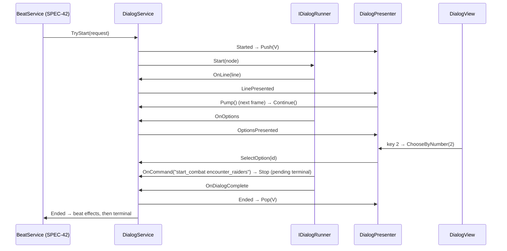

# SPEC-41 — Dialog: format, Yarn spike, runner and presenter

| | |
|---|---|
| **Status** | Draft |
| **Area code** | DLG (task IDs are `DLG-001`, `DLG-002`, …) |
| **Module(s)** | `Game.Narrative` (`Assets/Game/Narrative/Dialog/`); `Game.Data` (`Assets/Game/Data/Definitions/Narrative/`); `Game.UI` (`Assets/Game/UI/{ViewModels,Views,Theme/screens}/`); `Game.Presentation` (`Assets/Game/Presentation/Bridges/`); `Game.Editor` (`Assets/Game/Editor/Narrative/Dialog/`) |
| **Depends on specs** | SPEC-40 (logic syntax, compiler, `ILogicContext`, `FactStore`, validator framework); SPEC-42 (`StoryBeatDefinition.yarnNode`, `BeatService`); SPEC-60 (`UIScreen`, `ViewModelBase`, `UINavigator`, theme classes); SPEC-61 (hosts the screen key in `UIConfig`); SPEC-03 (`Dialog` action map); SPEC-05 (`DLGS` chunk order 50, save blocking); SPEC-02 (`RngStreams`, `StableHash`) |
| **Depended on by** | SPEC-42 (plays beats through `DialogService`), SPEC-40 (converter emits this format), SPEC-61 (dialog screen registration), SPEC-70 (harness dialog commands) |
| **Milestone** | M3 (DLG-013 in M4) |

> Read [01-architecture.md](../01-architecture.md), [02-conventions.md](../02-conventions.md) and [03-glossary.md](../03-glossary.md) before this spec. This spec may not contradict them.

## 1. Purpose

Dialog is how the player meets NORA, reads the mystery and makes choices. This spec defines one dialog **file format** (a strict subset of Yarn Spinner 3 syntax, so the owner's writing is never blocked by a tooling decision), the **compatibility spike and owner gate** that decide whether Yarn Spinner 3 runs it or the in-house runner does, the **runner adapter interface** that hides that choice, the `DialogService` that executes dialog against the fact store and the effect registry, and the **presenter** (view model, UI Toolkit view, number-key shortcuts, portraits). It fixes the prototype's dialog softlocks (05-B4, B5), the stale state after the ship editor (R19), duplicated page audio (B11), consume-on-use that never worked (B6), positional localization keys (B12) and the text box starting mid-paragraph (R6).

## 2. Scope

**In scope:**
- The `.yarn` subset format: grammar, tags, escaping, line IDs, node naming, forbidden features, file layout.
- `DialogScriptParser` (one parser used by validation, the command table generator and the fallback compiler).
- Dialog validator rules (`DLG-*`), the generated command table, `facts.yarn` and `logic.ysls.json`.
- Yarn Spinner 3 compatibility spike, owner GATE task and package ADR.
- `IDialogRunner` / `IDialogRunnerHost` and the production runner: Yarn adapter (`FactVariableStorage`, function and command binding) **or** the fallback (`DialogProgramDefinition` compiler + `GraphDialogRunner`), chosen by the gate.
- `DialogService` (lifecycle, effects, terminal/blocking commands, deterministic `roll`, visit memory), `DialogMemory` and the `DLGS` save chunk.
- `SpeakerDefinition`, `IllustrationDefinition`, `DialogCommandTableDefinition`, `DialogProgramDefinition`.
- `DialogViewModel`, `IDialogCommands`, `DialogView` (screen key `dialog`), `DialogPresenter` bridge, input context `Dialog`, pause behaviour.

**Out of scope (and who owns it instead):**
- Which beat plays where and when, beat completion effects: SPEC-42.
- The logic syntax, function registry and effect semantics: SPEC-40.
- The `Dialog` input action map asset: SPEC-03. The navigator, theme tokens and base controls: SPEC-60. Registering the screen in `UIConfig.Screens`: SPEC-61.
- Localization string tables: M4 (DLG-013 only exports line IDs).

## 3. Decisions (binding)

1. **One format whatever the gate decides.** Dialog is written in the Yarn subset of §4.2 in `.yarn` files. If Yarn Spinner 3 is adopted, its importer and VM run the files; if not, `DialogProgramCompiler` compiles the same files. Content never changes because of the gate. Reason: no blocked or rewritten writing.
2. **Expressions and commands are SPEC-40 logic text.** `<<if …>>` and option conditions are SPEC-40 conditions (usage `DialogCondition`); every other `<<command>>` is a SPEC-40 effect command (usage `DialogCommand`). Reason: one vocabulary.
3. **Commands are compiled at import into `DialogCommandTableDefinition`** keyed by the exact normalized command text; at runtime the text is looked up, never parsed. A missing entry is a fail-closed error. Reason: SPEC-40 decision 6.
4. **No Yarn type outside `Assets/Game/Narrative/Dialog/Yarn/` and `Assets/Game/Editor/Narrative/Dialog/Yarn/`.** Everything else talks to `IDialogRunner`. Reason: the presenter and services don't depend on Yarn; the fallback swap is local.
5. **Every line and option has a unique `#line:` ID**, assigned once and never derived from position or text after assignment. Reason: future localization (05-B12).
6. **Dialog pauses the simulation and owns the `Dialog` input context** through its screen (`PausesSimulation = true`, `Context = Dialog`). Reason: SPEC-60 decision 7/8; no simulation runs under a modal story moment.
7. **A dialog can always be ended by the player.** If an option set has no shown available option, the presenter adds a synthetic "End conversation" option that aborts the beat. Esc picks an available `#leave` option and otherwise does nothing (never pops the screen silently). Reason: 05-B4 softlocks.
8. **Terminal commands end the dialog first, then act** (`start_combat`, `open_ship_editor`, `request_lane_jump`): the dialog screen is popped, the beat outcome is recorded, then `BeatService` runs the command. Reason: R19/05-B5 stale dialog state.
9. **Dialog randomness is deterministic**: `roll(n)` is seeded from the campaign seed, the beat, its completion count, the node and the node-visit index, and memoized per node visit. Yarn's `dice`, `random`, `random_range` are forbidden. Reason: architecture §1.5.
10. **Lines of one "page" are shown together.** Lines arriving between two option sets are accumulated; choosing an option starts a new page (clears the text). Reason: preserves the legacy page reading experience.
11. **Dialog cannot be saved mid-conversation.** While `DialogService.IsActive`, save is blocked (open question 4). Reason: no runner state in saves.

## 4. Data model

### 4.1 Folders

| Folder | Namespace | Contents |
|---|---|---|
| `Assets/Game/Narrative/Dialog/` | `Game.Narrative.Dialog` | `IDialogRunner`, `IDialogRunnerHost`, `DialogLine`, `DialogOption`, `DialogCommandResult`, `DialogRequest`, `DialogEnded`, `DialogOutcome`, `DialogService`, `DialogMemory`, `DialogCommandTable`, `DialogSaveParticipant`, `GraphDialogRunner`, `FakeDialogRunner` (test helper lives in Tests) |
| `Assets/Game/Narrative/Dialog/Yarn/` | `Game.Narrative.Dialog.Yarn` | `YarnDialogRunner`, `FactVariableStorage`, `YarnLogicBindings` (Yarn path only, compiled under `GAME_YARN`) |
| `Assets/Game/Data/Definitions/Narrative/` | `Game.Data.Definitions` | `SpeakerDefinition`, `IllustrationDefinition`, `DialogCommandTableDefinition`, `DialogCommandEntry`, `DialogProgramDefinition`, `DialogNodeRecord`, `DialogInstruction`, `DialogOp` |
| `Assets/Game/Editor/Narrative/Dialog/` | `Game.Editor.Narrative.Dialog` | `DialogScriptParser`, `DialogScriptAst*`, `DialogValidatorRules`, `DialogCommandTableGenerator`, `DialogLineTagger`, `FactsYarnGenerator`, `YslsGenerator`, `DialogProgramCompiler` |
| `Assets/Game/UI/ViewModels/` | `Game.UI.ViewModels` | `DialogViewModel`, `DialogLineViewModel`, `DialogOptionViewModel` |
| `Assets/Game/UI/Views/` | `Game.UI.Views` | `DialogView` (+ `Uxml/DialogView.uxml`), `IDialogCommands` |
| `Assets/Game/UI/Theme/screens/` | — | `dialog.uss` |
| `Assets/Game/Presentation/Bridges/` | `Game.Presentation.Bridges` | `DialogPresenter` (folder reason: managed bridges from Narrative/Economy to view models, architecture §3 Presentation) |
| `Assets/Game/Content/Narrative/Dialog/` | — | all `.yarn` sources; `_Generated/` for generated files |
| `Assets/Game/Content/Narrative/Speakers/` | — | `speaker_*.asset`, `illustration_*.asset` |

### 4.2 Dialog format (the Yarn subset)

A file contains one or more nodes. Indentation is **4 spaces** per level; tab characters are an error. Blank lines are ignored.

```
file        = { node } ;
node        = "title: " NODE NL [ "tags: " WORD { " " WORD } NL ] "---" NL body "===" NL ;
body        = { statement } ;
statement   = line | optionGroup | command | ifBlock | comment ;
line        = INDENT [ SPEAKER ": " ] TEXT { " " hashtag } NL ;
optionGroup = option { option } ;                                   (* consecutive options at the same indent *)
option      = INDENT "-> " TEXT [ " <<if " CONDITION ">>" ] { " " hashtag } NL [ body at INDENT+4 ] ;
command     = INDENT "<<" commandBody ">>" NL ;
commandBody = "jump " NODE | "detour " NODE | "return" | "stop" | "set $" FACT " = " EXPRESSION | EFFECT ;
ifBlock     = INDENT "<<if " CONDITION ">>" NL body { INDENT "<<elseif " CONDITION ">>" NL body } [ INDENT "<<else>>" NL body ] INDENT "<<endif>>" NL ;
comment     = INDENT "//" anything NL ;
hashtag     = "#" TAG ;
NODE        = [a-z][a-z0-9_]* , max 64 chars, unique across all files ;
SPEAKER     = display name of a SpeakerDefinition (e.g. "NORA") ;
CONDITION   = SPEC-40 §4.6 expression (usage DialogCondition) ;
EXPRESSION  = SPEC-40 expression of the fact's type ;
EFFECT      = SPEC-40 §4.6 command (usage DialogCommand), single spaces between tokens ;
```

The only `<<declare …>>` statements allowed are in the generated `_Generated/facts.yarn`.

**Tags:**

| Tag | On | Meaning |
|---|---|---|
| `#line:<id>` | every line and option (required) | `<id>` = `[a-z0-9_]{1,64}`, unique across all files |
| `#portrait:<speaker id>` | line | show that `SpeakerDefinition`'s portrait (and its name unless the line has a `SPEAKER:` prefix) |
| `#speaker:<speaker id>` | line | show that speaker's name without a portrait |
| `#illustration:<illustration id>` | line | show that `IllustrationDefinition`'s image above the text |
| `#quest` | option | quest styling (`dialog__option--quest`) |
| `#hide` | option with a condition | hidden (not greyed) while unavailable |
| `#leave` | option | Esc chooses it when available |
| `#draft` | line, option | new writing awaiting owner review (validator info `DLG-I030`) |

**Forbidden** (each is `DLG-E006` naming the feature): line groups `=>`, `<<once>>`, `when:` headers and node groups, `<<declare>>` outside `_Generated/`, `<<local>>`, `<<enum>>`, inline expressions `{…}` in text, markup `[…]`, `<<wait>>`, `#shadow:`, `dice()`, `random()`, `random_range()`, `jump`/`detour` to an expression.

### 4.3 Node and line-ID naming

- Node titles: `<beat short>_<page>` for converted content (SPEC-40 §5.8); new writing uses `<thread or place>_<what>` (e.g. `nora_gate_open`). The start node of a beat is `StoryBeatDefinition.yarnNode`.
- Line IDs: `<node title>_<nn>` with a two-digit sequence in file order (`waking_up_collapse_00`). New lines get the next free number from `DialogLineTagger` (menu `Game/Narrative/Tag Dialog Lines`), which never renumbers existing IDs. Options added by the converter for "Leave" use `<node title>_leave`.

### 4.4 Text escaping

Inside TEXT the characters below are written escaped; the parser (and Yarn) unescape them. The converter escapes every legacy string with exactly this table, applied left to right:

| Character | Written as | Why |
|---|---|---|
| `\` | `\\` | escape char |
| `#` | `\#` | tag start |
| `{` `}` | `\{` `\}` | expression |
| `[` `]` | `\[` `\]` | markup |
| `<` `>` | `\<` `\>` | command |
| `/` followed by `/` | `\/` | comment |
| `:` | `\:` | speaker separator |

Leading and trailing spaces are trimmed. A legacy `\n` inside one page text splits it into consecutive lines.

### 4.5 Example (converted legacy page with options)

```
title: cryo_vault_vault_enter
tags: ice_giant
---
Inside are thousands of genetic samples—embryos of Earth's extinct animals. A custodian AI wakes up. 'Are you the Gardeners? Is it safe to plant yet?' #line:cryo_vault_vault_enter_00
-> Lie\: 'Yes, it is safe.' #line:cryo_vault_vault_enter_01
    <<give_item item_seed_bank 1>>
    <<stop>>
-> Truth\: 'No, the galaxy is dying.' #line:cryo_vault_vault_enter_02
    <<give_item item_genetic_stimulants 1>>
    <<stop>>
===
```

### 4.6 Runner adapter (public contract)

```csharp
namespace Game.Narrative.Dialog
{
    public enum DialogCommandResult : byte { Continue = 0, Block = 1, Stop = 2 }
    public enum DialogOutcome : byte { Completed = 0, Aborted = 1, Interrupted = 2 }

    /// <summary>One line ready to display. Implements SPEC-41 §4.6.</summary>
    public readonly struct DialogLine
    {
        public readonly string LineId; public readonly string Text;              // unescaped
        public readonly string SpeakerName;                                       // from "NAME:" prefix, "" if none
        public readonly string PortraitId; public readonly string SpeakerId; public readonly string IllustrationId;  // "" if absent
        public readonly string Node; public readonly bool IsDraft;
        public DialogLine(string lineId, string text, string speakerName, string portraitId, string speakerId, string illustrationId, string node, bool isDraft)
        { LineId = lineId; Text = text; SpeakerName = speakerName; PortraitId = portraitId; SpeakerId = speakerId; IllustrationId = illustrationId; Node = node; IsDraft = isDraft; }
    }

    /// <summary>One option of the current option set.</summary>
    public struct DialogOption
    {
        public int Id;                       // pass to SelectOption
        public string LineId; public string Text;
        public bool Available;               // condition result (true when no condition)
        public bool HideWhenUnavailable;     // #hide
        public bool IsQuest;                 // #quest
        public bool IsLeave;                 // #leave
    }

    public interface IDialogRunnerHost
    {
        void OnLine(in DialogLine line);                         // runner waits for Continue()
        void OnOptions(DialogOption[] options, int count);       // runner waits for SelectOption()
        DialogCommandResult OnCommand(string commandText);       // exact normalized text of <<...>> (not jump/detour/return/stop/set/if)
        void OnNodeStarted(string node);
        void OnNodeCompleted(string node);
        void OnDialogComplete();                                 // after stop, end of the top node, or Stop()
    }

    /// <summary>The only dialog engine API. Implemented by YarnDialogRunner or GraphDialogRunner.</summary>
    public interface IDialogRunner
    {
        bool HasNode(string node);
        bool IsRunning { get; }
        void Start(string node, IDialogRunnerHost host);   // runs until the first line, option set, blocking command or end
        void Continue();                                   // after OnLine
        void SelectOption(int optionId);                   // after OnOptions
        void Resume();                                     // after OnCommand returned Block
        void Stop();                                       // immediate; host receives OnDialogComplete
    }
}
```

Runner rules (both implementations): host callbacks never re-enter the runner; the host calls `Continue`/`SelectOption`/`Resume` only from `DialogService.Pump()` (§5.3); `$` reads/writes go through `ILogicFacts`; `visited_count(node)` reads `DialogMemory`; node completion increments `DialogMemory` **before** `OnNodeCompleted`.

### 4.7 Service, memory and events (public contract)

```csharp
namespace Game.Narrative.Dialog
{
    public readonly struct DialogRequest
    {
        public readonly int BeatIndex;                    // IndexOf<StoryBeatDefinition>, 0 = debug/none
        public readonly string StartNode;
        public readonly Game.Data.Logic.LogicScope Scope; // body/quest context of the beat
        public DialogRequest(int beatIndex, string startNode, in Game.Data.Logic.LogicScope scope) { BeatIndex = beatIndex; StartNode = startNode; Scope = scope; }
    }

    public readonly struct DialogEnded
    {
        public readonly int BeatIndex; public readonly DialogOutcome Outcome;
        public readonly Game.Data.Logic.IEffect PendingTerminal;   // null or the terminal effect to run after the screen pops
        public readonly Game.Data.Logic.LogicScope Scope;
        public DialogEnded(int beatIndex, DialogOutcome outcome, Game.Data.Logic.IEffect pendingTerminal, in Game.Data.Logic.LogicScope scope)
        { BeatIndex = beatIndex; Outcome = outcome; PendingTerminal = pendingTerminal; Scope = scope; }
    }

    /// <summary>Node visit counts (Yarn "visited" semantics). Saved in DLGS.</summary>
    public sealed class DialogMemory
    {
        public int GetVisitCount(string node);                 // 0 if never completed
        public void IncrementVisit(string node);
        public int GetRaw(string key);                         // Yarn internal variables ($Yarn.Internal.*), Yarn path
        public void SetRaw(string key, int value);
        public void Clear();
        public void CopySorted(System.Collections.Generic.List<(string key, int value)> into);   // ordinal by key
    }

    /// <summary>Runtime command lookup built at boot from DialogCommandTableDefinition. Implements SPEC-41 §5.5.</summary>
    public sealed class DialogCommandTable
    {
        public DialogCommandTable(Game.Data.Definitions.DialogCommandTableDefinition definition);
        public bool TryGet(string normalizedText, out Game.Data.Logic.IEffect effect);   // Dictionary<string, IEffect>, ordinal
        public int Count { get; }
    }

    /// <summary>Executes one dialog at a time. Implements SPEC-41 §5.3. Main thread.</summary>
    public sealed class DialogService : IDialogRunnerHost
    {
        public const int MaxLinesPerPump = 16;
        public DialogService(IDialogRunner runner, DialogCommandTable commands, Game.Data.Logic.ILogicContext context, DialogMemory memory);
        public bool IsActive { get; }
        public int CurrentBeatIndex { get; }
        public bool TryStart(in DialogRequest request);        // false if active or node unknown (error logged)
        public void Pump();                                     // once per frame by DialogPresenter (§5.3)
        public void SelectOption(int optionId);
        public void AcknowledgeEnd();                           // presenter: "Continue" after the last page
        public void AbortByPlayer();                            // synthetic "End conversation" → outcome Aborted
        public void Interrupt();                                // session reset/load → outcome Interrupted
        public int Roll(int sides);                             // §5.6
        public DialogMemory Memory { get; }

        public event System.Action<DialogRequest> Started;
        public event System.Action<DialogLine> LinePresented;
        public event System.Action<DialogOption[], int> OptionsPresented;   // array reused; copy if kept
        public event System.Action PageCleared;
        public event System.Action WaitingForEndAcknowledge;    // last page shown, dialog finished
        public event System.Action<DialogEnded> Ended;
    }
}
```

### 4.8 Definitions (public contract)

```csharp
namespace Game.Data.Definitions
{
    [ContentIdPrefix("speaker_")]
    [UnityEngine.CreateAssetMenu(menuName = "Game/Narrative/Speaker", fileName = "speaker_new")]
    public sealed class SpeakerDefinition : ContentDefinition
    {
        [UnityEngine.SerializeField] private string displayName;            // "NORA"; unique; used for "NAME:" prefixes
        [UnityEngine.SerializeField] private UnityEngine.Sprite portrait;   // placeholder until SPEC-81; null allowed (no portrait)
        [UnityEngine.SerializeField] private string nameStyleClass;         // optional USS class from the theme, e.g. "speaker--nora"; "" = default
        public string DisplayName => displayName; public UnityEngine.Sprite Portrait => portrait; public string NameStyleClass => nameStyleClass;
    }

    [ContentIdPrefix("illustration_")]
    [UnityEngine.CreateAssetMenu(menuName = "Game/Narrative/Illustration", fileName = "illustration_new")]
    public sealed class IllustrationDefinition : ContentDefinition
    {
        [UnityEngine.SerializeField] private UnityEngine.Sprite image;      // placeholder until SPEC-81
        public UnityEngine.Sprite Image => image;
    }

    [System.Serializable]
    public struct DialogCommandEntry
    {
        public string Text;                                       // normalized command text, e.g. "give_item resource_fuel 3"
        public Game.Data.Logic.CompiledEffectList Effect;         // exactly one source line == Text
    }

    /// <summary>Generated by DialogCommandTableGenerator. Exactly one asset: dialog_command_table.</summary>
    [ContentIdPrefix("dialog_")]
    public sealed class DialogCommandTableDefinition : ContentDefinition, Game.Data.Logic.ILogicSourceOwner
    {
        [UnityEngine.SerializeField] private DialogCommandEntry[] entries = System.Array.Empty<DialogCommandEntry>();  // ordinal by Text
        [UnityEngine.SerializeField] private ulong sourcesHash;  // StableHash over all .yarn file contents (ordinal path order)
        public System.Collections.Generic.IReadOnlyList<DialogCommandEntry> Entries => entries;
        public ulong SourcesHash => sourcesHash;
    }

    public enum DialogOp : byte { Line = 0, Option = 1, ShowOptions = 2, Jump = 3, Detour = 4, Return = 5, Stop = 6, BranchIfFalse = 7, Goto = 8, SetBool = 9, SetInt = 10, Command = 11, EndNode = 12 }

    [System.Serializable] public struct DialogInstruction { public DialogOp Op; public int A; public int B; public int C; }
    [System.Serializable] public struct DialogNodeRecord { public string Title; public int Start; public int Length; }

    /// <summary>Fallback-path compiled dialog (only exists when the gate rejected Yarn). Exactly one asset: dialog_program.</summary>
    [ContentIdPrefix("dialog_")]
    public sealed class DialogProgramDefinition : ContentDefinition, Game.Data.Logic.ILogicSourceOwner
    {
        [UnityEngine.SerializeField] private DialogNodeRecord[] nodes = System.Array.Empty<DialogNodeRecord>();   // ordinal by Title
        [UnityEngine.SerializeField] private DialogInstruction[] code = System.Array.Empty<DialogInstruction>();
        [UnityEngine.SerializeField] private string[] strings = System.Array.Empty<string>();      // texts, line IDs, node titles, tag values
        [UnityEngine.SerializeField] private Game.Data.Logic.CompiledCondition[] conditions = System.Array.Empty<Game.Data.Logic.CompiledCondition>();
        [UnityEngine.SerializeField] private Game.Data.Logic.CompiledIntExpr[] intExprs = System.Array.Empty<Game.Data.Logic.CompiledIntExpr>();
        [UnityEngine.SerializeField] private ulong sourcesHash;
        // read-only accessors with the same names (Nodes, Code, Strings, Conditions, IntExprs, SourcesHash)
    }
}
```

`DialogInstruction` operands (fallback path): `Line A=text string, B=line ID string, C=tag block index` (tag block = 5 consecutive strings: speaker name, portrait, speaker, illustration, flags "d" for draft); `Option A=text, B=line ID, C=option record index` (option record = 4 consecutive ints in `code` after a `Goto` skip: condition index or −1, body start pc, flags bitmask `1 hide, 2 quest, 4 leave`, tag block); `ShowOptions A=first option pc, B=count`; `Jump/Detour A=node title string`; `BranchIfFalse A=condition index, B=target pc`; `Goto A=target pc`; `SetBool/SetInt A=fact name string, B=condition/int-expr index`; `Command A=command text string` (looked up in `DialogCommandTable`); `EndNode` closes the node body.

### 4.9 View model and commands (public contract)

```csharp
namespace Game.UI.ViewModels
{
    public sealed class DialogLineViewModel : ViewModelBase
    {
        [Unity.Properties.CreateProperty] public string Text { get; set; }            // Set(...) pattern of SPEC-60 §4.4
        [Unity.Properties.CreateProperty] public string SpeakerName { get; set; }     // "" hides the name label
        [Unity.Properties.CreateProperty] public string SpeakerStyleClass { get; set; }
        [Unity.Properties.CreateProperty] public bool IsDraft { get; set; }
    }

    public sealed class DialogOptionViewModel : ViewModelBase
    {
        [Unity.Properties.CreateProperty] public string Text { get; set; }
        [Unity.Properties.CreateProperty] public string NumberLabel { get; set; }     // "1".."9" or "" (10th+ option)
        [Unity.Properties.CreateProperty] public bool IsAvailable { get; set; }
        [Unity.Properties.CreateProperty] public bool IsQuest { get; set; }
        public int OptionId;                                                           // DialogOption.Id, or -1 for synthetic options
        public byte Synthetic;                                                         // 0 none, 1 "End conversation", 2 "Continue"
    }

    public sealed class DialogViewModel : ViewModelBase
    {
        [Unity.Properties.CreateProperty] public UnityEngine.Sprite Portrait { get; set; }
        [Unity.Properties.CreateProperty] public bool HasPortrait { get; set; }
        [Unity.Properties.CreateProperty] public UnityEngine.Sprite Illustration { get; set; }
        [Unity.Properties.CreateProperty] public bool HasIllustration { get; set; }
        [Unity.Properties.CreateProperty] public System.Collections.Generic.List<DialogLineViewModel> Lines { get; } = new();     // pooled, max 32 shown
        [Unity.Properties.CreateProperty] public System.Collections.Generic.List<DialogOptionViewModel> Options { get; } = new(); // pooled, max 16
        [Unity.Properties.CreateProperty] public int ScrollToLine { get; set; }      // index of the first line of the current page
        public void NotifyLinesChanged(); public void NotifyOptionsChanged();
    }
}

namespace Game.UI.Views
{
    public interface IDialogCommands
    {
        void ChooseByNumber(int number);     // 1..9 from keys
        void ChooseOption(int listIndex);    // click on Options[listIndex]
        void Continue();                     // Space/Enter: chooses the single "Continue" option when present
        bool Back();                         // Esc; returns true always (consumed)
    }
}
```

All view-model properties use the SPEC-60 `Set(ref field, value, args)` pattern with static `BindablePropertyChangedEventArgs`.

### 4.10 `DLGS` chunk (version 1)

Registry key `DLGS`, order 50 (SPEC-05 §4.8). Payload with SPEC-05 §4.10 primitives: `WriteInt32(count)` then `count × (WriteString(key), WriteInt32(value))` from `DialogMemory.CopySorted` (ordinal by key; keys are node visit keys `visit:<node>` and Yarn internal variable names). `fromVersion == 0` → `Memory.Clear()`. Restore during an active dialog never happens (decision 11).

## 5. Systems, services and flow

### 5.1 Editor pipeline (both paths)

`DialogScriptParser.Parse(string path, string text) → DialogScriptAst` (one pass, line-based, O(lines)):
1. Split into lines (`\n`, strip `\r`). Track line numbers (1-based).
2. Header block until `---`: `title:` required (`DLG-E001` if missing), `tags:` optional, any other header → `DLG-E006`.
3. Body until `===`: compute indent (spaces / 4; non-multiple or tab → `DLG-E011`). Classify by first token: `->` option, `<<` command/if, `//` comment, otherwise line. Build nested statement lists by indent and `<<if>>`/`<<endif>>` pairing (unbalanced → `DLG-E001`).
4. Lines/options: split trailing hashtags (a `#` not preceded by `\`), unescape TEXT per §4.4, detect `NAME: ` prefix only before the first unescaped `:`; option inline `<<if …>>` before the tags.
5. Produce AST: `DialogScriptAst { Path, Nodes[] }`, `DialogNodeAst { Title, Tags[], Line, Body }`, statements `LineStmt`, `OptionGroupStmt { Options[] }`, `OptionStmt { Text, LineId, Condition, Tags, Body }`, `CommandStmt { Text, Line }`, `IfStmt { Branches[(Condition, Body)], Else }`, `JumpStmt`, `DetourStmt`, `ReturnStmt`, `StopStmt`, `SetStmt { Fact, Expression }`, `CommentStmt`.

`DialogCommandTableGenerator.Generate()` (menu `Game/Narrative/Rebuild Dialog Tables`, and run by the validator in check mode):
1. Find all `*.yarn` under `Assets/Game/Content/Narrative/Dialog/` (ordinal path order); parse each.
2. Collect every `CommandStmt` text that is not a flow keyword; require normalized form (single spaces, no leading/trailing space) else `DLG-E012`.
3. Distinct texts, ordinal sort; compile each with `LogicCompiler.TryCompileCommand` (usage `DialogCommand`); errors → `DLG-E007` with file:line.
4. Write `dialog_command_table.asset` (entries + `sourcesHash`); save only if content changed.
5. Write `_Generated/facts.yarn` (Yarn path: `<<declare $name = 0>>` for Int, `= false` for Bool, every authored fact, ordinal) and `_Generated/logic.ysls.json` (every DialogCondition function and DialogCommand command from the SPEC-40 registry with parameter names/types, for the VS Code Yarn extension).

### 5.2 Validator rules (`DialogValidatorRules : INarrativeRuleProvider`, Order 10)

| Code | Severity | Rule |
|---|---|---|
| DLG-E001 | Error | Parse error (file:line, message) |
| DLG-E002 | Error | `jump`/`detour` to an unknown node |
| DLG-E003 | Error | Duplicate node title across files |
| DLG-E004 | Error | Line or option without `#line:` |
| DLG-E005 | Error | Duplicate line ID (both locations) |
| DLG-E006 | Error | Forbidden feature (§4.2) |
| DLG-E007 | Error | Command fails SPEC-40 compilation (code and message forwarded) |
| DLG-E008 | Error | Condition fails SPEC-40 compilation (usage `DialogCondition`) |
| DLG-E009 | Error | `<<set>>` target unknown, generated, or of the wrong type |
| DLG-E010 | Error | Unknown speaker display name, `#portrait`, `#speaker` or `#illustration` ID |
| DLG-E011 | Error | Bad indentation or tab |
| DLG-E012 | Error | Command text not normalized |
| DLG-E013 | Error | Command table or generated files stale (`sourcesHash` differs) |
| DLG-E014 | Error | A statement after a terminal command (`start_combat`, `open_ship_editor`, `request_lane_jump`) in the same block |
| DLG-W020 | Warning | Option group with more than 9 options |
| DLG-W021 | Warning | Option group where every option has a condition (risk of no available option; the presenter's synthetic option covers it) |
| DLG-W022 | Warning | Node not reachable from any beat's `yarnNode` through jump/detour (SPEC-42 adds beat reachability) |
| DLG-I030 | Info | Count of `#draft` lines per file |

### 5.3 `DialogService` lifecycle

State: `active`, `request`, `outcome`, `pendingTerminal`, `awaitingContinue`, `awaitingOption`, `blocked`, `finished`, `pageHasUnacknowledgedLines`, `nodeVisitIndex`, roll memo (8 entries `(sides, value)`), reused `DialogOption[16]` buffer.

`TryStart(req)`:
1. If `active` → `GameLog.Warn`, return false. If `!runner.HasNode(req.StartNode)` → `GameLog.Error("Dialog", "unknown node")`, return false.
2. `active = true`, `outcome = Completed`, `pendingTerminal = null`, flags cleared, `nodeVisitIndex = 0`.
3. `context.PushScope(new LogicScope(LogicUsage.DialogCommand, req.Scope.QuestIndex, req.Scope.QuestInstance, req.BeatIndex, req.Scope.HasBody, req.Scope.Body))`.
4. Raise `Started(req)` (presenter pushes `DialogView`).
5. `runner.Start(req.StartNode, this)`.

Host callbacks (never call back into the runner):
- `OnLine(line)`: raise `LinePresented(line)`; `pageHasUnacknowledgedLines = true`; `awaitingContinue = true`.
- `OnOptions(opts, n)`: raise `OptionsPresented(opts, n)`; `awaitingOption = true`; `pageHasUnacknowledgedLines = false`.
- `OnCommand(text)`:
  1. `commands.TryGet(text, out e)` false → `GameLog.Error("Dialog", "command not in table: " + text)`, `outcome = Interrupted`, return `Stop`.
  2. `e.Flow == Terminal` → `pendingTerminal = e`; return `Stop`.
  3. `e is AbortBeatEffect` → `outcome = Aborted`; return `Continue`.
  4. `!e.CanApply(context)` → trace `EffectRejected`, `GameLog.Warn` once per text; return `Continue` (option conditions should have prevented it).
  5. `e.Flow == Blocking` → `blocked = true`; `e.Apply(context)` (the effect calls `World.OpenMerchant(..., onClosed: OnBlockingCommandDone)`); return `Block`.
  6. Else `e.Apply(context)`; return `Continue`.
- `OnNodeStarted(node)`: `nodeVisitIndex++`; clear roll memo.
- `OnNodeCompleted(node)`: nothing (runner already incremented memory).
- `OnDialogComplete()`: `finished = true`; if `pageHasUnacknowledgedLines && outcome != Interrupted` → raise `WaitingForEndAcknowledge` and wait for `AcknowledgeEnd()`; else `End()`.

`OnBlockingCommandDone()` (from the world adapter callback): `blocked = false`; `resumePending = true` (resumed in `Pump`).

`Pump()` (once per frame by `DialogPresenter`):
1. If not active: return.
2. If `resumePending`: `resumePending = false`; `runner.Resume()`.
3. `i = 0`; while `awaitingContinue && i < MaxLinesPerPump`: `awaitingContinue = false`; `runner.Continue()`; `i++`.

`SelectOption(id)`: only when `awaitingOption`; `awaitingOption = false`; raise `PageCleared`; `runner.SelectOption(id)`.

`End()`: `context.PopScope()`; `active = false`; raise `Ended(new DialogEnded(request.BeatIndex, outcome, pendingTerminal, request.Scope))`. The presenter pops the screen **inside** its `Ended` handler before `BeatService` (subscribed after the presenter) applies beat effects and runs the terminal (SPEC-42 §5.4).

`AbortByPlayer()`: `outcome = Aborted`; `runner.Stop()` (→ `OnDialogComplete` → `End`). `Interrupt()`: `outcome = Interrupted`; `pendingTerminal = null`; `runner.Stop()`; skip the acknowledge wait.

### 5.4 Yarn path (only if DLG-005 approves Yarn)

- Package: Yarn Spinner for Unity 3.x pinned to the exact version measured in the spike; the ADR adds a row to architecture §3.1: "Yarn Spinner — Narrative (`Dialog/Yarn/` only), Editor". `Game.Narrative.asmdef` adds the Yarn runtime assembly references and `versionDefines` `{ "name": "dev.yarnspinner.unity", "expression": "3.0.0", "define": "GAME_YARN" }`.
- `YarnDialogRunner : IDialogRunner` wraps the pure C# `Yarn.Dialogue` (no `DialogueRunner` MonoBehaviour), loading the program from the project's compiled `YarnProject` asset referenced by `DialogRuntimeConfig` (a field on `NarrativeConfigDefinition` added by DLG-007). Line text comes from the project's base string table by line ID; tags come from line metadata and are mapped to `DialogLine` fields.
- `FactVariableStorage` (Yarn variable storage interface of the measured version): `$name` → `FactCatalog.SlotOf(name)` (cached `Dictionary<string,int>`); Bool facts ↔ Yarn bool; Int facts ↔ Yarn number (writes must be integral, else `GameLog.Error` and ignore); names starting with `$Yarn.Internal.` → `DialogMemory.GetRaw/SetRaw`; writes use `FactWriteSource.Dialog`; writes to generated facts are refused (validator prevents them).
- `YarnLogicBindings`: for every SPEC-40 registry function allowed in `DialogCondition` except `visited_count` (Yarn built-in), register a Yarn function whose delegate converts arguments (string ref → index via a per-function `Dictionary<string,int>` filled on first use; number → `int` with integral check) and calls `LogicFunctionInfo.Invoke`. The compile-time declarations come from a generated C# file `YarnLogicBindings.g.cs` produced by `YarnBindingGenerator` from the registry (attribute form measured in the spike); a test asserts the generated file is up to date.
- Commands: one generic handler forwards the normalized text to `IDialogRunnerHost.OnCommand`; `Block` maps to Yarn's "wait for completion" mechanism measured in the spike.

### 5.5 Fallback path (only if DLG-005 rejects Yarn)

`DialogProgramCompiler.Compile()` (editor, run by the same pipeline as the command table): parse all files (§5.1), emit one `DialogProgramDefinition` (`dialog_program.asset`) with nodes sorted by title, `Line`/`Option`/`ShowOptions`/`BranchIfFalse`/`Goto`/`Jump`/`Detour`/`Return`/`Stop`/`Set*`/`Command`/`EndNode` per §4.8; option conditions and `<<if>>` conditions compiled with `LogicCompiler` into `conditions[]`; `<<set>>` right-hand sides into `conditions[]` (Bool facts) or `intExprs[]` (Int facts).

`GraphDialogRunner : IDialogRunner` semantics (the spike must report whether Yarn matches; if Yarn differs, Yarn wins and this table is updated):
1. State: call stack of frames `(nodeIndex, pc)`, max depth 16 (overflow → `GameLog.Error`, `Stop()`).
2. `Start(node)`: push frame; `OnNodeStarted`; run.
3. Run loop executes instructions until it must wait: `Line` → `OnLine`, wait for `Continue`; `Option` records are collected by `ShowOptions` → evaluate each condition (`CompiledCondition.Evaluate`), build `DialogOption[]`, `OnOptions`, wait; `SelectOption(id)` → set `pc` to that option's body start; `Command` → `OnCommand`: `Continue` → next, `Block` → wait for `Resume`, `Stop` → stop.
4. `Jump(node)`: `DialogMemory.IncrementVisit(current)`, `OnNodeCompleted(current)`, replace the top frame with `(node, start)`, `OnNodeStarted(node)`. The return stack below is kept.
5. `Detour(node)`: save the return `pc` in the current frame, push `(node, start)`, `OnNodeStarted`.
6. `Return` or `EndNode`: increment visit + `OnNodeCompleted(current)`; pop; if the stack is empty → `OnDialogComplete()`; else continue at the saved `pc`.
7. `Stop`: increment visit for the top node only, `OnNodeCompleted`, clear stack, `OnDialogComplete()`.
8. `visited_count(node)` = `DialogMemory.GetVisitCount(node)`; `roll(n)` = `DialogService.Roll(n)` through `ILogicNarrative`.

### 5.6 Deterministic `roll`

`DialogService.Roll(sides)`: if the memo (cleared at every `OnNodeStarted`) holds `sides`, return its value. Else `salt = StableHash.Combine(StableHash.Combine((ulong)(uint)request.BeatIndex, (ulong)(uint)beatCount), StableHash.Combine(StableHash.Hash64(currentNode), (ulong)(uint)nodeVisitIndex))` where `beatCount` = the beat's generated fact value; `rng = RngStreams.For(context.CampaignSeed, RngPurpose.Narrative, salt)`; `value = rng.NextInt(1, sides + 1)`; store in the memo; return. Cumulative `<<if roll(100) <= 50>> … <<elseif roll(100) <= 80>>` therefore uses one roll per node visit.

### 5.7 Presenter and view

`DialogPresenter` (Game.Presentation, plain class constructed by Game.App after `UIRoot`; subscribes in its constructor, unsubscribes in `Dispose`; `Tick()` called by `NarrativeTickBridgeSystem` right after `NarrativeService.Tick`):

| `DialogService` event | Presenter action |
|---|---|
| `Started` | reset view model (lines/options cleared, portrait/illustration hidden); `navigator.Push(dialogView)` |
| `LinePresented(line)` | take a pooled `DialogLineViewModel`, fill text/speaker (speaker name: `line.SpeakerName`, else display name of `line.SpeakerId`/`line.PortraitId`); portrait: from `PortraitId` (`SpeakerDefinition.Portrait`); illustration: from `IllustrationId`; the portrait/illustration persist until a later line sets another or the page is cleared; append; `NotifyLinesChanged` |
| `OptionsPresented(opts, n)` | rebuild `Options`: skip unavailable `HideWhenUnavailable` options; number the remaining ones 1..9 in order (`NumberLabel`), 10th+ get `""`; if no shown option is available, append synthetic "End conversation" (`Synthetic = 1`, number = next free) |
| `PageCleared` | clear `Lines` and `Options`; `ScrollToLine = 0` |
| `WaitingForEndAcknowledge` | `Options` = one synthetic "Continue" (`Synthetic = 2`, number 1) |
| `Ended` | `navigator.Pop(dialogView)` if open |

`IDialogCommands` (implemented by the presenter):
- `ChooseByNumber(n)`: find the option with `NumberLabel == n`; not found or `!IsAvailable` → `UISound.Error`; else as `ChooseOption`.
- `ChooseOption(i)`: `Synthetic == 1` → `AbortByPlayer()`; `Synthetic == 2` → `AcknowledgeEnd()`; unavailable → `UISound.Error`; else `SelectOption(OptionId)`.
- `Continue()`: if `Options` is exactly one synthetic "Continue" → `AcknowledgeEnd()`; otherwise nothing.
- `Back()`: if an available option with `IsLeave` is shown → choose the first; always return true.

Display strings "End conversation" and "Continue" come from `DialogView`'s UXML (static labels), not from code.

`DialogView : UIScreen`: `Key = "dialog"`, `Layer = Screens`, `Context = InputContext.Dialog`, `PausesSimulation = true`, `BlocksWorldPointer = true`, `HidesHud = true`, `OnBack() => commands.Back()`. UXML `Views/Uxml/DialogView.uxml` elements (names binding, SPEC-60 §4.7): `dialog-panel` (`.panel .panel--floating`), `dialog-illustration`, `dialog-portrait`, `dialog-lines` (`ListView`, item template: `dialog-line-speaker`, `dialog-line-text`), `dialog-options` (`ListView`, item: `dialog-option-number`, `dialog-option-text` inside a `.btn`), `dialog-end-label`, `dialog-continue-label`. Classes: `dialog__option--quest`, `.is-disabled` for unavailable options, `dialog__line--draft` (only in development builds), `dialog__line--enter` (fade, removed next frame; none under `.reduce-motion`). On `ScrollToLine` change the view scrolls so that line is at the top (R6). Input: the view subscribes in `OnPush`/unsubscribes in `OnPop` to SPEC-03 `Controls.Dialog.Choice1…Choice9` (`performed` → `ChooseByNumber`) and `Controls.Dialog.Continue` (Space, Enter). Mouse click on an option → `ChooseOption(index)`. No per-frame work: the view only reacts to `propertyChanged`.



## 6. Public API

| Call | Pre | Post / errors |
|---|---|---|
| `DialogService.TryStart(req)` | not active | `true` → `Started` raised and runner started; `false` + log otherwise |
| `DialogService.Pump()` | once per frame | advances accumulated lines; resumes after blocking commands |
| `DialogService.SelectOption(id)` | options presented | page cleared; runner continues |
| `DialogService.AbortByPlayer()` / `Interrupt()` | active | `Ended` with `Aborted` / `Interrupted` |
| `DialogService.Roll(n)` | active, 2 ≤ n ≤ 1000 | deterministic, memoized per node visit |
| `IDialogRunner.*` | §4.6 | only called by `DialogService` |
| `DialogCommandTable.TryGet(text, out e)` | boot built | O(len) dictionary lookup, 0 B |
| `DialogScriptParser.Parse(path, text)` | editor | AST + diagnostics |

## 7. Edge cases and failure behaviour

| Situation | Required behaviour |
|---|---|
| Every option of a set is unavailable | Presenter adds "End conversation" → beat `Aborted` (not consumed) |
| Esc pressed | Available `#leave` option chosen; otherwise nothing; screen never popped by Esc |
| Command text missing from the table | `GameLog.Error`, outcome `Interrupted`, dialog stops, beat not completed |
| `take_item` command cannot apply mid-dialog | Logged once, skipped; dialog continues |
| `open_merchant` while the merchant API is unwired | `LogicWorldAdapter` calls `onClosed` immediately; dialog resumes next frame |
| `open_ship_editor` / `start_combat` / `request_lane_jump` | Dialog ends and the screen pops before the action; nothing of the dialog remains active (R19) |
| Statement after a terminal command | `DLG-E014` at import |
| `jump` to a missing node at runtime (stale content) | Runner logs error, `Stop()`, outcome `Interrupted` |
| Detour stack exceeds 16 | Error, `Stop()`, `Interrupted` |
| Load or `SessionReset` while a dialog is open | `Interrupt()`; screen popped; no beat effects (load never executes effects) |
| Save attempted during dialog | Blocked (open question 4) |
| A node's last page has lines and then `<<stop>>` | "Continue" shown; dialog ends after the player acknowledges |
| More than 9 shown options | Options 10+ clickable, no number key; `DLG-W020` |
| Same `roll(100)` called twice in a node | Same value |
| Dialog started while another is active | `TryStart` returns false; caller (`BeatService`) keeps the beat queued |
| Very long page text | `ListView` scrolls; first line of the page at top |
| Yarn package removed after adoption | `GAME_YARN` undefined → compile errors confined to `Dialog/Yarn/` files (excluded by `#if`); boot logs "no dialog runner" and `BeatService` treats every dialog as unavailable |

## 8. Performance budget

| What | Budget | Measured by |
|---|---|---|
| `DialogService.Pump` with no pending work | ≤ 0.01 ms, 0 B | `DialogServicePerfTests.Pump_Idle` |
| Presenting one line or option set (service + presenter + VM) | ≤ 0.5 ms main thread, ≤ 1 KB GC (menus budget, 06) | `DialogPresenterPerfTests.PresentOptions` |
| Dialog screen open, idle | 0 B/frame, ≤ 4 ms main thread whole frame (menus budget) | PlayMode perf test `DialogScreenPerfTests.Idle` |
| Command table lookup | O(len), 0 B | `DialogCommandTableTests.Lookup_DoesNotAllocate` |
| Editor: parse + generate tables for 60 files | ≤ 3 s | `DialogPipelinePerfTests.Generate60Files` |
| Yarn import of all M3 dialog (spike criterion) | ≤ 10 s | spike report |

## 9. Tasks

### DLG-001 — Public contract types
- **Milestone:** M3
- **Tier:** standard — transcribes the exact code of §4.6–§4.9
- **Depends on:** `NAR-001`, `UI-001`
- **Do:** Create every type of §4.6, §4.7, §4.8 and §4.9 with exact names and members; bodies throw `NotImplementedException` except trivial getters and the view-model property pattern. Add the `[ContentIdPrefix]` attributes as written.
- **Files:** `Assets/Game/Narrative/Dialog/{DialogCommandResult,DialogOutcome,DialogLine,DialogOption,IDialogRunnerHost,IDialogRunner,DialogRequest,DialogEnded,DialogMemory,DialogCommandTable,DialogService}.cs`; `Assets/Game/Data/Definitions/Narrative/{SpeakerDefinition,IllustrationDefinition,DialogCommandEntry,DialogCommandTableDefinition,DialogOp,DialogInstruction,DialogNodeRecord,DialogProgramDefinition}.cs`; `Assets/Game/UI/ViewModels/{DialogViewModel,DialogLineViewModel,DialogOptionViewModel}.cs`; `Assets/Game/UI/Views/IDialogCommands.cs`
- **Acceptance criteria:**
  - [ ] `tools/compile.sh` passes with zero warnings in the touched assemblies.
  - [ ] No file outside `Dialog/Yarn/` references a Yarn namespace.
- **Tests:** `DialogContractTests.ViewModels_RaisePropertyChangedOnce` (EditMode, `Tests/EditMode/Narrative/`).

### DLG-002 — Dialog script parser
- **Milestone:** M3
- **Tier:** frontier — F3/F6: the format definition; a parse error silently changes or drops writing
- **Depends on:** `DLG-001`, `NAR-003`, `NAR-016`
- **Do:** Implement `DialogScriptParser` and the AST classes per §4.2–§4.4 and §5.1 (indentation, option groups, if/elseif/else pairing, tag splitting, escape table, speaker prefix, diagnostics with file:line). Parse every converted legacy file in a test.
- **Files:** `Assets/Game/Editor/Narrative/Dialog/{DialogScriptParser,DialogScriptAst,DialogNodeAst,DialogStatementAst}.cs`; `Assets/Game/Tests/EditMode/Editor/Narrative/DialogScriptParserTests.cs`
- **Acceptance criteria:**
  - [ ] The §4.5 example parses into 1 node, 1 line, 1 option group of 2 options with 2 commands each.
  - [ ] Escaping round trip: for 200 strings containing every escaped character, `Unescape(Escape(s)) == s` and parsing `Escape(s) + " #line:x"` yields text `s`.
  - [ ] Every forbidden feature of §4.2 yields `DLG-E006`.
  - [ ] All files produced by SPEC-40's converter parse with zero errors.
- **Tests:** `DialogScriptParserTests.Example_Parses`, `.Escaping_RoundTrip`, `.ForbiddenFeatures_Rejected`, `.Indentation_TabsRejected`, `.IfBlocks_Nest`, `.SpeakerPrefix_OnlyBeforeFirstUnescapedColon`, `.ConvertedLegacyFiles_ParseClean`.

### DLG-003 — Dialog validator rules and generated files
- **Milestone:** M3
- **Tier:** standard — rule table and generators with explicit steps
- **Depends on:** `DLG-002`
- **Do:** Implement `DialogValidatorRules` (§5.2), `DialogCommandTableGenerator`, `FactsYarnGenerator`, `YslsGenerator` (§5.1 steps 1–5) and `DialogLineTagger` (§4.3; never renumbers). Menu items `Game/Narrative/Rebuild Dialog Tables` and `Game/Narrative/Tag Dialog Lines`.
- **Files:** `Assets/Game/Editor/Narrative/Dialog/{DialogValidatorRules,DialogCommandTableGenerator,FactsYarnGenerator,YslsGenerator,DialogLineTagger,DialogMenu}.cs`; `Assets/Game/Content/Narrative/Dialog/_Generated/{dialog_command_table.asset,facts.yarn,logic.ysls.json}`; `Assets/Game/Tests/EditMode/Editor/Narrative/DialogValidatorRulesTests.cs`
- **Acceptance criteria:**
  - [ ] Each `DLG-*` rule has a failing and a passing fixture.
  - [ ] Regenerating with unchanged sources leaves the assets byte-identical (no dirtying).
  - [ ] `DialogLineTagger` on a file with IDs `_00`, `_01` and one untagged line adds `_02` and changes nothing else.
- **Tests:** `DialogValidatorRulesTests.EachRule_Fixture`, `.Generator_IsIdempotent`, `.Tagger_AppendsOnly`, `.CommandTable_ContainsEveryCommand`.

### DLG-004 — Yarn Spinner 3 compatibility spike
- **Milestone:** M3
- **Tier:** frontier — F6: measurement and decision
- **Depends on:** `DLG-002`
- **Do:** On branch `spike/DLG-004-yarn` (never merged): install the latest Yarn Spinner for Unity 3.x; build a throwaway adapter; run the checklist and record pass/fail with evidence in `docs/reference/yarn-spike-report.md`: (1) compiles in 6000.6.5f1 with zero errors and no conflicts with Entities 6.6/Burst/Collections; (2) two consecutive plays with domain reload off produce identical dialog; (3) pure C# `Dialogue` runs without `DialogueRunner`; (4) custom variable storage receives every `$` read/write, internal variables identifiable by prefix; (5) runtime-registered functions with string/number/bool args work in `<<if>>` and option conditions with compile-time declarations (record the declaration mechanism); (6) all commands reach one handler as exact normalized text; a handler can block and resume; (7) `<<detour>>`/`<<return>>` exist; record `<<jump>>`-inside-detour semantics vs §5.5; (8) our `#line:` format accepted; text retrievable by ID without Unity Localization; (9) escape table §4.4 behaves identically; (10) option availability reported (not hidden); (11) all converted files import in ≤ 10 s, compiled project ≤ 5 MB; (12) license: core MIT, no paid dependency; (13) Yarn types confinable to `Dialog/Yarn/` + Editor. Draft `docs/decisions/ADR-NNNN-yarn-spinner-3-package.md` (next free number, status *Proposed*) recommending adopt (all of 1–10 and 12 pass) or reject.
- **Files:** `docs/reference/yarn-spike-report.md`; `docs/decisions/ADR-NNNN-yarn-spinner-3-package.md`
- **Acceptance criteria:**
  - [ ] Every checklist item has a pass/fail and a measured number where applicable.
  - [ ] The ADR states the exact package version and the recommendation.
  - [ ] `main` is unchanged except the two documents.
- **Tests:** none (spike); the report lists the commands used.

### DLG-005 — GATE: Yarn Spinner adoption
- **Milestone:** M3
- **Tier:** standard — records the owner's decision
- **Depends on:** `DLG-004`
- **Do:** Present the spike report and ADR to the owner. Record the decision, date and note in this spec's §10 (row "Gate result") and in `docs/LEDGER.md` *Owner gates*; mark the ADR *Accepted* (adopt) or *Rejected* (fallback).
- **Files:** `docs/specs/SPEC-41-dialog.md`; `docs/LEDGER.md`; `docs/decisions/ADR-NNNN-yarn-spinner-3-package.md`
- **Acceptance criteria:**
  - [ ] The owner's approval or rejection with date is written in both documents.
- **Tests:** none (gate).

### DLG-006 — DialogService, memory and DLGS chunk
- **Milestone:** M3
- **Tier:** frontier — F5: ordering between runner, effects, presenter, beat service and terminal actions
- **Depends on:** `DLG-001`, `DLG-003`, `NAR-011`, `CORE-003`, `CORE-007`
- **Do:** Install and restore the current blocking continuation through ADR-0075 `ILogicEffectHost.BlockingCommandCompleted`; the callback queues resume for Pump, never re-enters the runner. Implement `DialogService` (§5.3), `DialogMemory`, `DialogCommandTable`, deterministic `Roll` (§5.6) and `DialogSaveParticipant` (§4.10; register `DLGS` order 50). Build `FakeDialogRunner` (scripted runner for tests) under Tests.
- **Files:** `Assets/Game/Narrative/Dialog/{DialogService,DialogMemory,DialogCommandTable,DialogSaveParticipant}.cs`; `Assets/Game/Tests/EditMode/Narrative/{DialogServiceTests,FakeDialogRunner,DialogServicePerfTests}.cs`
- **Acceptance criteria:**
  - [ ] Lines are delivered one `Continue` per line from `Pump`, never re-entrantly; max 16 per pump.
  - [ ] A terminal command ends the dialog; `Ended.PendingTerminal` is that effect; nothing after it runs.
  - [ ] `abort_beat` + `stop` yields outcome `Aborted`; `Interrupt()` yields `Interrupted` with no terminal.
  - [ ] Blocking command: runner resumes on the first `Pump` after `onClosed`.
  - [ ] `Roll(100)` twice in a node visit returns the same value; same seed and choices give the same sequence; a different campaign seed changes it.
  - [ ] `DLGS` round trip byte-identical; `fromVersion 0` clears memory.
- **Tests:** `DialogServiceTests.Lines_PumpedNotReentrant`, `.Terminal_EndsThenReturnsEffect`, `.AbortAndInterrupt_Outcomes`, `.Blocking_ResumesAfterClose`, `.Roll_MemoizedAndDeterministic`, `.UnknownCommand_Interrupts`, `.SaveParticipant_RoundTrip`; `DialogServicePerfTests.Pump_Idle`.

### DLG-007 — Production dialog runner (path chosen by DLG-005)
- **Milestone:** M3
- **Tier:** frontier — F1/F3: the engine every dialog runs on; package integration or an interpreter
- **Depends on:** `DLG-005`, `DLG-006`, `DLG-003`
- **Do:** **If Yarn was approved:** add the package at the ADR version, edit `Game.Narrative.asmdef` (references + `GAME_YARN` version define), implement `YarnDialogRunner`, `FactVariableStorage`, `YarnLogicBindings` + `YarnBindingGenerator` (§5.4), add `yarnProject` to `NarrativeConfigDefinition`. **If Yarn was rejected:** implement `DialogProgramCompiler` (editor) and `GraphDialogRunner` (§5.5) and generate `dialog_program.asset`. Either way, extend `NarrativeBootstrap` (SPEC-40) to construct the chosen runner, `DialogCommandTable`, `DialogMemory`, `DialogService` and register `DialogSaveParticipant`.
- **Files:** Yarn: `Assets/Game/Narrative/Dialog/Yarn/{YarnDialogRunner,FactVariableStorage,YarnLogicBindings,YarnLogicBindings.g}.cs`, `Assets/Game/Editor/Narrative/Dialog/Yarn/YarnBindingGenerator.cs`, `Assets/Game/Narrative/Game.Narrative.asmdef`, `Packages/manifest.json`; Fallback: `Assets/Game/Editor/Narrative/Dialog/DialogProgramCompiler.cs`, `Assets/Game/Narrative/Dialog/GraphDialogRunner.cs`, `Assets/Game/Content/Narrative/Dialog/_Generated/dialog_program.asset`; both: `Assets/Game/App/Services/NarrativeBootstrap.cs`, `Assets/Game/Tests/EditMode/Narrative/DialogRunnerConformanceTests.cs`
- **Acceptance criteria:**
  - [ ] `DialogRunnerConformanceTests` (written against `IDialogRunner`, runner-agnostic) pass: lines, options with availability and `#hide`, if/elseif/else, jump, detour/return incl. jump inside a detour (§5.5 step 4), stop, `<<set>>` on Bool and Int facts, `visited_count`, commands Continue/Block/Stop, nested detour depth 16 limit.
  - [ ] Every converted legacy beat start node runs to an option set or the end without errors.
  - [ ] Yarn path only: no Yarn type outside `Dialog/Yarn/`; `YarnLogicBindings.g.cs` up-to-date test passes.
- **Tests:** `DialogRunnerConformanceTests.Lines`, `.Options_AvailabilityAndHide`, `.IfElse`, `.JumpAndDetour`, `.JumpInsideDetour_KeepsReturn`, `.Stop`, `.SetFacts`, `.VisitedCount`, `.CommandResults`, `.DetourDepthLimit`, `.LegacyBeats_RunClean`.

### DLG-008 — Dialog presenter
- **Milestone:** M3
- **Tier:** standard — presenter rules fully specified in §5.7
- **Depends on:** `DLG-006`
- **Do:** Implement `DialogPresenter` (event table and `IDialogCommands` of §5.7, pooled line/option view models, portrait/illustration lookup through `ContentCatalog` dictionaries built once, `Tick` → `DialogService.Pump`). Construct it in Game.App after `UIRoot` (SPEC-01 open question 6 of SPEC-40).
- **Files:** `Assets/Game/Presentation/Bridges/DialogPresenter.cs`; `Assets/Game/Tests/EditMode/Presentation/DialogPresenterTests.cs`
- **Acceptance criteria:**
  - [ ] Hidden-when-unavailable options are absent; greyed ones keep their number; numbering skips hidden options.
  - [ ] All-unavailable option set gets "End conversation"; choosing it aborts the beat.
  - [ ] `Back()` chooses an available `#leave` option, otherwise does nothing; always returns true.
  - [ ] The end-of-dialog "Continue" appears only when the last page had unacknowledged lines.
  - [ ] Presenting an option set allocates ≤ 1 KB after warm-up.
- **Tests:** `DialogPresenterTests.Numbering_SkipsHidden`, `.AllUnavailable_AddsEndConversation`, `.Back_ChoosesLeave`, `.EndAcknowledge_OnlyAfterLines`, `.PortraitPersistsUntilChanged`; `DialogPresenterPerfTests.PresentOptions`.

### DLG-009 — Dialog view screen
- **Milestone:** M3
- **Tier:** standard — UI view bound to an existing view model
- **Depends on:** `DLG-008`, `UI-001`, `INP-001`
- **Do:** Implement `DialogView` (§5.7: screen properties, UXML elements and names, classes, `ListView` pooling, scroll-to-page-top, number keys and Continue via SPEC-03 `Dialog` map) and `screens/dialog.uss` using only theme tokens and catalogue classes. Add the `dialog` entry to `UIConfig.Screens` if SPEC-61 has not.
- **Files:** `Assets/Game/UI/Views/DialogView.cs`; `Assets/Game/UI/Views/Uxml/DialogView.uxml`; `Assets/Game/UI/Theme/screens/dialog.uss`; `Assets/Game/Tests/PlayMode/UI/DialogViewTests.cs`
- **Acceptance criteria:**
  - [ ] Pushing the view sets `InputContext.Dialog`, pauses the simulation and hides the HUD; popping restores both.
  - [ ] Keys 1–9 choose by number; Space/Enter continue; Esc calls `Back()`.
  - [ ] A new page scrolls its first line to the top (R6).
  - [ ] No hard-coded colours, sizes or fonts (conventions §4); `LayoutAudit` reports nothing at 1920×1080 and 1280×720.
  - [ ] 0 B allocated per idle frame with the view open.
- **Tests:** `DialogViewTests.Push_SetsContextAndPause`, `.NumberKeys_Choose`, `.NewPage_ScrollsToTop`, `.Layout_NoIssues`; `DialogScreenPerfTests.Idle` (`[Category("Performance")]`).

### DLG-010 — Speakers and illustrations
- **Milestone:** M3
- **Tier:** standard — content authoring with given values
- **Depends on:** `DLG-001`
- **Do:** Create `speaker_nora` (display "NORA"), `speaker_shady_man` (display "Scarred Man"), `speaker_captain` (display "Captain", no portrait) and `illustration_wreckage`, `illustration_merchant`, `illustration_beacon`, `illustration_portal`, `illustration_station`, each referencing a placeholder sprite from `Assets/Game/Art/_Placeholder/` through the asset field only (no Starsector art).
- **Files:** `Assets/Game/Content/Narrative/Speakers/{speaker_nora,speaker_shady_man,speaker_captain,illustration_wreckage,illustration_merchant,illustration_beacon,illustration_portal,illustration_station}.asset`
- **Acceptance criteria:**
  - [ ] Content validator reports zero errors; every `#portrait`/`#illustration` in converted files resolves.
- **Tests:** covered by `ProjectContentTests.ProjectContent_HasZeroValidationErrors` (SPEC-04) and `DialogValidatorRulesTests`.

### DLG-011 — Dialog PlayMode scenarios
- **Milestone:** M3
- **Tier:** standard — tests of specified behaviour
- **Depends on:** `DLG-007`, `DLG-009`, `QST-001`
- **Do:** PlayMode scenarios in the World scene, starting dialogs directly with `DialogService.TryStart` on converted legacy nodes (no `BeatService` needed) and driving the view with injected keys: (a) `waking_up_start` plays through with keys 1–9 to the three chassis options; (b) `station_hub_hub` → "Visit Hangar Bay" → `Ended` has `PendingTerminal` of type `OpenShipEditorEffect`, the dialog screen is popped, `DialogService.IsActive == false`, the input context is no longer `Dialog` and the pause token is released (R19; the full editor round trip is SPEC-42/51's scenario); (c) a fixture node whose options are all unavailable shows "End conversation" and choosing it gives outcome `Aborted` (05-B4); (d) `Interrupt()` (as on `SessionReset`) pops the screen and releases pause.
- **Files:** `Assets/Game/Tests/PlayMode/Narrative/DialogScenarioTests.cs`; fixture `Assets/Game/Content/_Test/Dialog/dialog_fixtures.yarn` (created and deleted by the test)
- **Acceptance criteria:**
  - [ ] All four scenarios pass in `tools/test.sh playmode Dialog`.
- **Tests:** `DialogScenarioTests.Intro_PlaysWithNumberKeys`, `.ShipEditorOption_EndsDialogCleanly`, `.AllOptionsUnavailable_CanEnd`, `.Interrupt_PopsAndUnpauses`.

### DLG-012 — Harness commands for dialog
- **Milestone:** M3
- **Tier:** standard — harness commands over existing APIs
- **Depends on:** `DLG-008`, `DEV-001`
- **Do:** Add `gh_dialog` (prints active beat, node, current page lines and numbered options as JSON) and `gh_dialog_choose --n <number>` to the CLI harness.
- **Files:** `Assets/Game/DevTools/Editor/Narrative/DialogHarnessCommands.cs`
- **Acceptance criteria:**
  - [ ] `tools/playtest/g.sh dialog` shows the intro's first page during a new game.
- **Tests:** `DialogHarnessCommandsTests.Snapshot_FormatsOptions` (EditMode, fake service).

### DLG-013 — Line-ID export for localization
- **Milestone:** M4
- **Tier:** standard — exporter over the parser
- **Depends on:** `DLG-003`
- **Do:** Menu `Game/Narrative/Export Dialog Strings` writes `Temp/dialog-strings.csv` (`line id, node, file, text`) for every line and option, ordinal by line ID.
- **Files:** `Assets/Game/Editor/Narrative/Dialog/DialogStringExporter.cs`
- **Acceptance criteria:**
  - [ ] Export of unchanged content is byte-identical; row count equals the number of `#line:` tags.
- **Tests:** `DialogStringExporterTests.Export_IsDeterministic`.

## 10. Open questions

| # | Question | Default if unanswered | Decider |
|---|---|---|---|
| 1 | Gate result (DLG-005) | Pending; fallback format and runner are fully specified so work continues | Owner |
| 2 | SPEC-03: `Dialog` action map contents | Actions `Choice1`…`Choice9` (keys 1–9), `Continue` (Space, Enter); Esc stays in Global (`Back`) | SPEC-03 |
| 3 | SPEC-60/61: who builds the dialog screen? SPEC-60 says "DialogViewModel hosted by SPEC-61" | SPEC-41 builds `DialogView`, its UXML and `screens/dialog.uss`; SPEC-61 only registers key `dialog` in `UIConfig.Screens` and must not create a second dialog screen | SPEC-61 |
| 4 | SPEC-05/01: block saving during dialog | `ISaveContext.GetBlockReason()` returns `Transitioning` while `DialogService.IsActive` (SPEC-05 may append `InDialog = 6` to `SaveBlockReason` instead) | SPEC-05 |
| 5 | Owner: auto-advance vs click-per-line | Lines of a page appear together (auto-advance); the player only chooses options | Owner |
| 6 | Owner: speaker name of the scarred man | "Scarred Man" (from "A scarred man in a dark corner") | Owner |
| 7 | SPEC-60: element `ListView` item templates for dialog | Inline templates in `DialogView.uxml` | SPEC-60 |
| 8 | SPEC-61 §4.2 already supplies real `DialogViewModel` / `DialogOptionViewModel` properties, while §4.9 describes the fuller SPEC-41 model. | Extend the existing types in place; retain SPEC-61 properties and `NotifyOptions()`, add every SPEC-41 member, and let `NotifyOptionsChanged()` use the same cached Options notification. The additional scalar properties have their own backing fields. | Tech lead — resolved by DLG-001 staging preservation; central mirror pending. |
| 9 | §4.1 / DLG-001 lists `Views/IDialogCommands.cs`, but the existing canonical `Game.UI.Views.IDialogCommands` is in `Views/Commands/IDialogCommands.cs` with SPEC-61's `Choose(int)` signature. | Keep that file and its meta GUID, retain `Choose(int)` / `Continue()`, and add `ChooseByNumber(int)`, `ChooseOption(int)` and `Back()`. DLG-008's presenter must implement both the staged and canonical signatures; do not duplicate or move the interface. | Tech lead — resolved by DLG-001; central mirror pending. |

| 10 | Dialog provider Order200 conflicts with SPEC-40 dialog-before-quest order and quest/mystery Order20/30 | **Resolved (2026-10-13):** dialog rule provider uses Order10, followed by quest20 and mystery30. Numeric provider sorting remains the sole ordering mechanism. Runtime narrative system ordering is unchanged. | Tech lead |

| 11 | Whole SPEC-40 dependency blocks dialog behind debugger controls that require live dialog | **Resolved:** ADR-0068 uses real prerequisites. DLG-002 requires DLG-001 contracts, NAR-003 grammar and NAR-016 completed converted inputs. DLG-006 requires DLG-001, DLG-003 generated command table, NAR-011 live scoped context, CORE-003 deterministic RNG and CORE-007 save primitives. No parser, production command-table, runtime or test acceptance is removed; the IEffect/CompiledEffectList access gap must be resolved before implementing DLG-006 without runtime reparsing. | Tech lead |

| 12 | Parser AST diagnostics and conditional-body indentation are not fully typed; generated declarations have no normal node headers | **Resolved:** editor AST carries ValidationReport diagnostics with source path and one-based line field, tags without the leading hash and original command spelling for DLG-E012. Parse same-indent conditional bodies used by converted files, and uniformly one-level-indented branch bodies; option bodies always require one level. Retain generated declarations separately only for _Generated/facts.yarn; no runtime reparsing or execution. Unsupported/dangling text escapes diagnose DLG-E001. Cross-file uniqueness, tag semantics and expression/command compilation remain DLG-003. | Tech lead |

| 13 | Converted input has empty tags headers and a conditional option between ordinary menu options | **Resolved:** accept empty tags headers as an empty tag list. Preserve conditional-option AST branches and authored order; DLG-007 must coalesce an adjacent sequence of option groups and option-only conditional branches into one choice set. Use existing BranchIfFalse/Option/ShowOptions control flow so an outer false branch omits its option while an inline false condition retains its original grey/hidden semantics. Do not rewrite authored text, collapse branch visibility into inline availability, or present several consecutive menus. Extend the existing runner Options_AvailabilityAndHide/LegacyBeats_RunClean checks when DLG-007 is implemented. | Tech lead |

| 14 | DLG-003 export enumeration, generated hash and tagging boundaries need explicit authoring defaults | Approved by lead: use an internal registry Snapshot through the existing Editor friend assembly, ordinal and with cloned metadata/parameter arrays; public runtime API and assembly references stay unchanged. Hash ordinal authored paths/content plus the expected generated facts declaration text, avoiding dependence on an older generated facts file; validate generated text by exact UTF-8 bytes and command rows by source/version/error stamps. Only a changed command set replaces compiled graphs; a hash-only change preserves them. Warning analysis may inspect adjacent option groups and option-only visibility branches without rewriting their AST or merging visibility into availability. Report draft counts for files with drafts. Append line IDs after the greatest existing numeric suffix; preserve all old text, IDs, newline style and UTF-8 BOM. If a full node-title suffix exceeds the 64-character ID limit, report DLG-E004 for manual title repair rather than silently truncate. Menus require Edit mode; tagging rebuilds tables only after a successful append. Generator execution/import/readback remain lead-owned. | Tech lead — implementation defaults; central mirror pending. |

| 15 | DLG-010 has no approved/own-work dialog placeholder sprites available in the current project. | Author the eight prescribed content IDs and exact display names; keep Captain’s portrait null by design and nameStyleClass empty (theme default). Leave NORA/Scarred Man portraits and all five illustration image fields null until usable sprites are supplied. Inventory found only the legacy item_icons_sheet as an imported Sprite, with no confirmation in LICENSES; the documented own-work placeholder textures/VFX are not dialog sprites. Do not copy legacy/third-party art, generate replacements, alter provenance or add an owner gate. Rebuild the catalog with Game/Content/Rebuild and Validate after lead integration; dialog conversion/reference coverage remains unverified while no converted .yarn files exist. | Tech lead — concrete sprite dependency reported by DLG-010; seven references remain incomplete. |

| 17 | Runtime command lookup needs a concrete effect from the compiled list | ADR-0084 supplies guarded single-node access; reject stale/malformed/duplicate table rows and never reparse commands at runtime. Memory uses prescribed visit: keys and ordinal raw keys, retains explicit zero values for save round trips, clears CopySorted output and saturates visit count at Int32.MaxValue. | Tech lead — ledger Q390 |

| 18 | Lifecycle pseudocode calls SelectOption immediately despite the runner non-reentrancy rule; explicit abort could wait on an old page | Resolved: SelectOption queues the choice and Pump emits PageCleared then drives selection. Runner completion settles only after its call returns. Explicit player abort clears the page acknowledgement and terminal; abort_beat still permits authored closing lines. Blocking callbacks are scoped to the active dialog generation and restored on end. Beat fact indices are obtained by ordinal traversal of the generated Beat family, matching ContentCatalog one-based ordinal IDs; debug beat zero uses count zero. | Tech lead — ledger Q391 |
| 16 | DLG-013 row-count wording includes the retained #line ID on the LEGACY-UNAVAILABLE option comment | Export all parser LineStmt/OptionStmt text and the specifically marked preserved legacy option writing, reusing the parser to decode its archival option text; ordinary comments and generated declarations are excluded. The archived row remains non-executable. CSV columns are line id, node, file, text; text is the parser’s display body without a separate speaker prefix. Sort IDs ordinally, quote every field with doubled quotes, emit LF UTF-8 without BOM, normalize file separators and make absolute input paths project-relative. Fail before replacing output for parse errors or missing/duplicate IDs. Preserve all source files and IDs; compare output raw bytes before rewriting Temp/dialog-strings.csv. | Tech lead — exporter default; central mirror pending. |

| 19 | DLG-008 presenter construction, pool overflow and staged UI integration need concrete defaults | Use explicit service/catalog/model/navigator/sound dependencies, register the existing DialogView with the presenter commands, and preserve app-lifetime model identity. Prewarm 32 line models and 17 option models (16 authored choices plus the required all-unavailable fallback); retain the newest 32 lines and allow larger authored option sets without truncation, growing only when necessary. Synthetic Text stays empty for DLG-009 to resolve from its UXML labels. Maintain staged Number/Enabled/SpeakerName/LineText/LineVersion/CanContinue/IsWaitingForChoice properties. Copy availability/leave/ID data from the runner's reusable array; canonical and former content IDs resolve through dictionaries built at construction. An absent portrait tag preserves the image; an explicit tag with a null sprite clears it. Presenter owns SessionReset interruption and subscribes before future beat Ended handlers. App composition conditionally installs it only when DLG-007 supplies a real DialogService; NarrativeTickBridgeSystem pumps it after NarrativeService.Tick. The existing view consumes Back through the presenter now; DLG-009 still owns UXML, static labels, property binding and input actions. Exactly five direct functional cases plus one advisory fixture; lead owns Unity validation and the central ledger mirror. | Presentation worker — default; lead acceptance pending |

| 21 | DLG-012 has no current-node accessor or JSON/selection edge contract | Keep CLI-only inspection over the existing service/presenter owners | Tech lead | DLG-012 default: internal read-only DialogService diagnostics expose the live node stack with last-line fallback during end acknowledgement, and whether a choice/acknowledgement is currently accepted. No public runtime API or assembly-reference changes. Snapshot reports available/reason, active, beatIndex and nullable resolved beat ID, node, page lines and presenter-visible options in UI order with real numbers, availability, quest and synthetic flags. Inactive dialogs omit retained old page rows. Missing production service/presenter reports unavailable; never install a substitute runner. Selection accepts UI numbers 1..9 through ChooseByNumber, refuses hidden/absent/unavailable or already-pending choices, and leaves pumping to the existing frame bridge. Synthetic text remains the view's responsibility. Tests invoke explicit public Editor seams by reflection, matching existing harness tests; one required direct case, no extras. Lead owns the central question mirror, Unity validation and DLG-007 intro composition needed for live acceptance. |

## 11. References

- Audit `05-narrative-quests.md` B4, B5, B6, B11, B12, §5.9 (Yarn vs Ink), §5.13 phase 3; `LEDGER.md` R6, R11, R19; legacy UI `Import/Legacy/ui/Pages/NarrativeViewUI.uxml` (layout reference only).
- ADR-0006, ADR-0011. SPEC-40 §4.6–§4.7 (syntax, registry). SPEC-60 §4.3–§4.7, §5.2.
- Yarn Spinner 3 documentation (syntax, variable storage, functions, commands, line IDs, detour).
