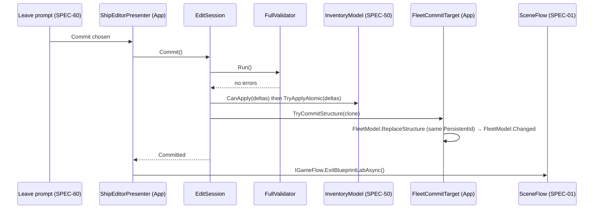

# SPEC-51 — Ship editor

| | |
|---|---|
| **Status** | Draft |
| **Area code** | EDT (task IDs are `EDT-001`, `EDT-002`, …) |
| **Module(s)** | `Game.ShipEditor` (folder `Assets/Game/ShipEditor/`): session, history, validation, tools, picking, rendering. Editor panels and their view models in `Game.UI` (the UI module cannot see `Game.ShipEditor`). Host, input sampling, presenter, launcher and commit targets in `Game.App` folder `Assets/Game/App/EditorHost/` (only `Game.App` references both `Game.ShipEditor` and `Game.UI`/`Game.Input`/`Game.Presentation`) |
| **Depends on specs** | SPEC-10 (`VoxelStructure`, batched write API, read API, serializer), SPEC-11 (brick mesher job, materials, prop meshes), SPEC-04 (`BlockDef`, `OrientationTables`, `ContentService`), SPEC-50 (`InventoryModel` atomic apply, `ItemDefinition`), SPEC-22 (`BlockStatMath`), SPEC-60 (UI framework), SPEC-61 (`ShipEditorView` host, `StatRowViewModel`), SPEC-62 (editor orbit camera), SPEC-03 (Editor map), SPEC-01 (scene flow, session, persistent ids), SPEC-05 (blueprint storage, save dirty), SPEC-41 (dialog ends before launch) |
| **Depended on by** | SPEC-61 (mounts panels via `ShipEditorPanels`), SPEC-01 (`ShipEditorHost.Create`, `ShipEditorLauncher`), SPEC-40 (`open_ship_editor` effect calls the launcher), SPEC-70 (harness element names, `gh_*` editor checks) |
| **Milestone** | M3 (Blueprint Lab, ship edit with commit against inventory), M4 (radial symmetry, in-world edit when docked) |

> Read [01-architecture.md](../01-architecture.md), [02-conventions.md](../02-conventions.md) and [03-glossary.md](../03-glossary.md) before this spec. This spec may not contradict them.

## 1. Purpose

The ship editor is where the player's progression becomes a ship: blocks are placed, removed, painted and transformed on a draft copy of the ship, every stat change is shown before committing, and nothing in the inventory changes until the player commits. It edits the same `VoxelStructure` the runtime spawns from, renders with the same brick mesher, picks cells with a DDA along the mouse ray, and records every change as a compact diff so undo and redo are exact. It first runs in the **Blueprint Lab** scene (a creative session from the main menu, or an economy session for the player's docked ship), then in M4 in the world while docked. It makes the old prototype's item duplication (R15, 06-A1), free blocks from templates (06-A2), free repairs (06-A4), lost refunds (06-A5), wrong symmetry (06-C2/C3), centre-of-screen picking with a 50 m reach (R14, 06-C14), magenta ghost on Metal (R13, 06-C7), O(N²) loading (06-P1) and the softlocking round trip (R16/R19) impossible by construction.

## 2. Scope

**In scope:**
- `EditSession`: Original and Draft `VoxelStructure`, `EditHistory` of `DiffCommand`s (stroke merging, 64 MB budget), undo/redo.
- Bill of materials, commit (validate → afford → apply → swap → mark dirty → save), discard, the leave prompt (Commit / Discard / Keep editing).
- Incremental validation: occupancy, clearance, attach faces, orientation, bounds, budgets; union-find connectivity on add, bounded flood on remove; full validation at commit.
- Running stats diff: mass, blocks, thrust, thrust/weight, power, DPS, shield, cost, centre of mass.
- Picking by DDA along the mouse ray; placement origin rule for multi-cell blocks.
- Tools: place, line, box, fill, remove, replace, paint, eyedropper, select/transform, copy/cut/paste, blueprint save/load.
- Symmetry: up to 3 mirror planes at cell centres or boundaries, chirality through `OrientationTables.Mirror` and `BlockDef.MirrorIndex`, atomic validation, exact-match mirrored removal; radial (M4).
- Rendering: draft brick meshes (dirty-only), instanced prop/functional meshes, instanced overlays (ghost, footprint, clearance, mirrored ghosts, invalid tint, selection, disconnected, damage, planes, grid) without geometry shaders; layer slicing; X-ray.
- Editor UI panels (toolbar, palette, stats, BOM, issues, footer) and the blueprint browser, built on SPEC-60 and hosted by SPEC-61's `ShipEditorView`.
- App glue: host, input sampling, presenter, launcher, commit targets; Lab scene entry/exit; R15 and R16/R19 regression scenarios; editor perf gates.
- M4: in-world edit when docked; radial symmetry.

**Out of scope (and who owns it instead):**
- Cell storage, the write API, serialization → SPEC-10. Brick meshing → SPEC-11. Block footprints, orientation tables, mirror pairs → SPEC-04.
- Inventory and item rules → SPEC-50. Stat formulas per block → SPEC-22.
- Scene loading, player pose capture and restore → SPEC-01. Save files → SPEC-05.
- The editor root screen shell → SPEC-61. Camera rig → SPEC-62.
- Module sockets (§10 Q15), test flight from the Lab (§10 Q16), thumbnails (SPEC-61 §10 Q16), repair as a separate service (repair = replace a damaged block, §5.7).

## 3. Decisions (binding)

1. **One model.** Draft and Original are `VoxelStructure`s (SPEC-10). No GameObject per block, no physics collider per cell, no conversion step.
2. **Every draft change goes through the Voxel write API as one batch** (`VoxelStructure.ApplyEdits`, §4.1). `Game.ShipEditor` never writes cells itself (ADR-0010). Only `EditSession` calls it, from `Apply`, `Undo` and `Redo`.
3. **The real ship changes only in `EditSession.Commit`** (architecture §8), through `IEditCommitTarget`. The target keeps the ship's `PersistentId`.
4. **No inventory change before commit.** Commit applies all item deltas atomically through SPEC-50 or applies none.
5. **BOM counts intact and damaged blocks per type separately** (§5.7). Required = increase of intact count; refund = decrease of intact count; removed damaged blocks give no refund (salvage is §10 Q13). Tools never create damaged blocks; transforms and undo preserve damage. Invariant: draft damaged count ≤ original damaged count per type. This makes dupes and free repairs impossible.
6. **Undo stores compact diffs**, not snapshots: a `DiffCommand` is a list of 24-byte `DiffOp`s plus per-cell HP bytes only for damaged blocks. Strokes merge into one command. History is capped at 64 MB and 4,096 entries (oldest dropped).
7. **Undo/redo restore damage exactly**, so undoing a removal never repairs a block.
8. **Picking is a DDA along the mouse ray** (`Camera.ScreenPointToRay(pointer)`) through the draft, not physics and not the screen centre. Maximum 4,096 cells along the ray.
9. **Missing cells of a damaged multi-cell block are reserved** (placement there fails with `Occupied`) so its undo can always restore it.
10. **Validation is incremental at placement time** and full at commit. Placement errors reject the group; connectivity problems are commit-blocking issues, not placement errors.
11. **Connectivity = glossary "Island"**: solid cells connected face to face (attach faces do not matter), same definition as SPEC-13.
12. **Symmetry groups are atomic.** A block and all its mirror copies are validated and applied together or not at all. A copy whose mirrored footprint does not match the partner block's footprint fails the group (`SymmetryUnsupported`).
13. **Box, line and fill accept only single-cell blocks.** Reason: unambiguous tiling.
14. **Remesh is dirty-only** (architecture §11 rule 1): only bricks touched by an edit plus face neighbours of touched boundary cells are rebuilt, at most 8 synchronously per frame and 64 more asynchronously from 18³ snapshots.
15. **Overlays are instanced procedural draws** (`Graphics.RenderMeshPrimitives` + `StructuredBuffer`) with an HLSL URP shader that has no geometry stage. Reason: R13 magenta ghost on Metal.
16. **Creative is an `EditSessionOptions` flag**, never a global. Creative sessions have no inventory and commit to the blueprint library.
17. **The BlueprintLab scene hosts both session kinds in M3**: creative (from the main menu) and ship edit (player's docked ship, economy on). In-world edit is M4. (Roadmap M3 requires commit against inventory before in-world editing exists.)
18. **Simulation time does not advance during a Lab session**, so the player returns to the exact pose (R16).
19. **Determinism:** editor operations use no randomness; `EditSession.ComputeDraftHash()` is a canonical `StableHash` over block content (palette and instance indices resolved), so undo/redo equality is testable.
20. **New folders** in `Game.ShipEditor`: `Tools/` (one class per tool), `Validation/` (validator, connectivity), `Rendering/` (draft and overlay renderers, shader). In `Game.App`: `EditorHost/`. Reason: three cohesive groups of 5–12 files that are neither ECS nor services.

## 4. Data model

### 4.1 APIs this spec uses from other specs (defaults; final names per §10)

These are **not** created by this spec. All calls go through one adapter class, `DraftWriter`/`DraftReader` (EDT-003), so a different final name changes one file.

```csharp
// SPEC-10, Game.Voxel (default per §10 Q1–Q3)
public enum VoxelEditKind : byte { PlaceBlock = 0, RemoveBlock = 1, SetCellHp = 2, ClearCell = 3, SetFunctionHp = 4 }
public struct VoxelEdit { public VoxelEditKind Kind; public ushort Block; public byte Orient; public byte Color; public int3 Cell; public byte Hp; public float FunctionHp; }
// VoxelStructure members used:
//   bool ApplyEdits(NativeArray<VoxelEdit> edits, ref BlockDefsBlob defs, NativeList<int3> touchedBricks);   // all-or-nothing; appends touched brick coords
//   Cell GetCell(int3 cell);                                                                               // air outside
//   bool TryGetBlockAt(int3 cell, ref BlockDefsBlob defs, out PlacedBlockInfo info);                     // origin, block, orient, color, instanceIndex (-1 = palette)
//   BlockInstance GetInstance(int index);
//   VoxelStructure Clone(Allocator allocator);   float CellSize;   int SolidCellCount;
//   void GetBrickCoords(NativeList<int3> result);   bool TryGetBrickCells(int3 brick, out NativeArray<Cell>.ReadOnly cells);
//   void CopyBrickSnapshot18(int3 brick, NativeArray<Cell> dst18Cubed);                                  // brick + 1-cell border, x fastest
//   PaletteEntry GetPalette(ushort index);
// Serializer: VoxelStructureSerializer.Write(VoxelStructure, SaveWriter) / Read(SaveReader, ContentService) using ContentId palettes.
public struct PlacedBlockInfo { public int3 Origin; public ushort Block; public byte Orient; public byte Color; public int InstanceIndex; }

// SPEC-11, Game.Voxel (default per §10 Q4)
//   JobHandle BrickMesher.Schedule(NativeArray<Cell>.ReadOnly cells18, in BrickMeshContext ctx, Mesh.MeshDataArray output, int index, JobHandle deps);
//   BrickMeshContext { BlobAssetReference<BlockDefsBlob> Defs; NativeArray<PaletteEntry>.ReadOnly Palette; int MaxCellY /* grid-space; int.MaxValue = no slice */; int3 BrickCoord; }
//   PropMeshTable (config SO): Mesh[] Meshes, Material SharedPropMaterial, indexed by BlockDef.PropMeshIndex; mesh pivot = centre of the block's origin cell

// SPEC-04, Game.Data: BlockDefsBlob, OrientationTables (Rotate, Compose, Mirror, Inverse, RotY90/RotX90/RotZ90 constants), ContentService.BlockDefs, ContentService.Orientations,
//   BlockDef.Category (BlockCategory: Structure, Detail, Core, Propulsion, Power, Weapon, Shield, Utility; display only, ADR-0013), BlockDef.IsCore, BlockDefinition.DisplayName, BlockDefinition.Icon (§10 Q5)
// SPEC-04 decision 6 + SPEC-50 §4.3 (Game.Economy, §10 Q6): a BlockDefinition IS its own ItemDefinition (no ItemDefinition.Block link);
//   ItemDefinition.BasePrice; InventoryModel.CountOf(ContentId) (cargo + overflow), InventoryModel.CanApply(ReadOnlySpan<ItemDelta>,
//   List<ItemShortfall> shortfalls, out bool cargoFull), InventoryModel.TryApplyAtomic(ReadOnlySpan<ItemDelta>), event InventoryModel.Changed;
//   ItemDelta { ContentId Item; int Count; /* + add, − remove */ }, ItemShortfall { ContentId Item; int Missing; }
// SPEC-04, Game.Data (§10 Q7, ADR-0013): BlockStatContribution BlockStatMath.Of(BlockDefinition block, byte orient) — Mass from cells, then each module's ContributeStats
//   BlockStatContribution { float Mass; float3 Thrust /* N, grid space */; float PowerGeneration, PowerDraw, PowerStorage; float SustainedDps; float ShieldCapacity, ShieldRegen; float CargoUnits; }
```

### 4.2 Public contract types (`Game.ShipEditor`, EDT-001)

`EditorActions` and `EditorInputFrame` are declared early by INP-006 and reused here (ADR-0048).

```csharp
namespace Game.ShipEditor.Data
{
    public enum ToolId : byte { Place = 1, Line = 2, Box = 3, Fill = 4, Remove = 5, Replace = 6, Paint = 7, Eyedropper = 8, Select = 9, Paste = 10 }
    public enum BoxMode : byte { Solid = 0, Hollow = 1, Frame = 2 }
    public enum DiffOpKind : byte { Add = 1, Remove = 2 }
    public enum AtomicityMode : byte { AllOrNothing = 0, PerGroup = 1 }
    public enum EditTargetKind : byte { NewBlueprint = 0, Blueprint = 1, FleetShip = 2 }
    public enum PlacementError : byte { None = 0, NotFound, NotAvailable, OrientationNotAllowed, OutOfBounds, Occupied, InOtherClearance,
                                        ClearanceBlocked, NoAttachment, CoreLimit, OverBudget, SymmetryOverlap, SymmetryUnsupported, MultiCellNotAllowed }
    public enum CommitStatus : byte { Committed = 0, NothingToCommit, Invalid, MissingItems, CargoFull, TargetRejected }
    public enum EditIssueKind : byte { NoCore = 0, MultipleCores, Disconnected, OutOfBounds, OverCellBudget, DamageInvariant, UnbuildableBlock, // errors
                                       PowerDeficit = 100, NoThrust, NoWeapons }                                                               // warnings (≥ 100)
    public enum EditChangeKind : byte { Applied = 0, Undone, Redone, Committed, Discarded, Opened }

    /// One placed block. 20 bytes. Origin = grid cell of the block-local (0,0,0) after rotation.
    public struct BlockRecord : System.IEquatable<BlockRecord>
    {
        public Unity.Mathematics.int3 Origin;
        public ushort Block;          // BlockIndex
        public byte Orient;           // 0..23
        public byte Color;            // palette colour index
        public int DamageOffset;      // -1 = pristine; else byte offset into the owning DiffCommand/EditBatch Damage list
        public bool Equals(BlockRecord o) => Origin.Equals(o.Origin) && Block == o.Block && Orient == o.Orient && Color == o.Color;  // damage not compared
        public override int GetHashCode() => (int)Game.Core.StableHash.Combine((ulong)Origin.GetHashCode(), ((ulong)Block << 16) | ((ulong)Orient << 8) | Color); // in-memory only
    }

    /// 24 bytes.
    public struct DiffOp { public BlockRecord Record; public DiffOpKind Kind; public byte Pad0; public ushort Pad1; }

    /// Damage layout at DamageOffset: CellCount bytes of Cell.Hp in BlockDef.Cells order (0 = cell missing), then 4 bytes float FunctionHp (NaN = not an instance).

    public struct BatchGroup { public int OpStart; public int OpCount; }

    public struct EditSessionOptions
    {
        public bool Creative;               // true: no inventory, commit saves a blueprint
        public EditTargetKind TargetKind;
        public string Title;                // shown in the toolbar, e.g. "Blueprint Lab — interceptor_mk2"
    }

    public struct SymmetrySettings
    {
        public bool MirrorX, MirrorY, MirrorZ;
        public int PlaneX2, PlaneY2, PlaneZ2;   // plane coordinate × 2 in cell units; odd = through cell centres, even = on a cell boundary
        public byte RadialFold;                 // 0 = off, 2 or 4 (M4); when > 0, MirrorX and MirrorZ are forced off
        public int RadialCenterX2, RadialCenterZ2;
        public int Version;                     // incremented on every change (preview cache key)
    }

    [System.Flags]
    public enum EditorActions : ulong
    {
        None = 0, Undo = 1ul << 0, Redo = 1ul << 1, Copy = 1ul << 2, Cut = 1ul << 3, Paste = 1ul << 4, Delete = 1ul << 5,
        RotateYaw = 1ul << 6, RotatePitch = 1ul << 7, RotateRoll = 1ul << 8,
        ToolPlace = 1ul << 9, ToolLine = 1ul << 10, ToolBox = 1ul << 11, ToolFill = 1ul << 12, ToolRemove = 1ul << 13,
        ToolReplace = 1ul << 14, ToolPaint = 1ul << 15, ToolEyedropper = 1ul << 16, ToolSelect = 1ul << 17,
        MirrorX = 1ul << 18, MirrorY = 1ul << 19, MirrorZ = 1ul << 20, SliceToggle = 1ul << 21, SliceUp = 1ul << 22, SliceDown = 1ul << 23,
        XRayToggle = 1ul << 24, BoxModeCycle = 1ul << 25, MoveLeft = 1ul << 26, MoveRight = 1ul << 27, MoveForward = 1ul << 28,
        MoveBack = 1ul << 29, MoveUp = 1ul << 30, MoveDown = 1ul << 31, MirrorSelection = 1ul << 32, SelectAll = 1ul << 33
    }

    /// Sampled once per frame by the App host from SPEC-03's Editor map.
    public struct EditorInputFrame
    {
        public Unity.Mathematics.float2 PointerScreen;     // pixels, bottom-left origin
        public bool PointerAllowed;                        // UIRoot.IsWorldPointerAllowed(PointerScreen)
        public bool PrimaryPressed, PrimaryHeld, PrimaryReleased;
        public bool SecondaryPressed, SecondaryReleased;
        public bool Shift, Ctrl, Alt;
        public float ToolWheel;                            // scroll notches this frame, + = up
        public EditorActions Actions;                      // edge-triggered this frame
    }

    public struct BomLine
    {
        public ushort Block;
        public Game.Core.ContentId Item;     // default when the block has no item
        public int Required;                 // max(0, draftIntact - originalIntact)
        public int Refunded;                 // max(0, originalIntact - draftIntact)
        public int LostDamaged;              // originalDamaged - draftDamaged (≥ 0)
        public int Available;                // inventory count at last refresh (0 in creative)
        public int Shortfall => Unity.Mathematics.math.max(0, Required - Available);
        public bool HasItem => !string.IsNullOrEmpty(Item.Value);
    }

    public sealed class BillOfMaterials
    {
        public readonly System.Collections.Generic.List<BomLine> Lines = new System.Collections.Generic.List<BomLine>(64); // sorted by Item.Value ordinal, block-only lines last by Block
        public int TotalRequired, TotalRefunded, TotalLostDamaged, TotalShortfall;
        public bool HasUnbuildable;          // some Required > 0 line has no item (non-creative)
    }

    public struct StatTotals
    {
        public double MassKg; public int Blocks; public int Cells;
        public double ForwardThrustN;        // thrust along grid +Z (§10 Q20)
        public double PowerGen, PowerUse, PowerStorage, Dps, ShieldCapacity, ShieldRegen, CargoUnits;   // from BlockStatContribution PowerGeneration, PowerDraw, PowerStorage, SustainedDps, ShieldCapacity, ShieldRegen, CargoUnits
        public long Cost;                    // Σ count × ItemDefinition.BasePrice
        public Unity.Mathematics.double3 CenterOfMassCells;   // grid cell units
        public double ThrustToWeight => MassKg > 0 ? ForwardThrustN / (MassKg * 9.81) : 0;
    }

    public struct EditIssue { public EditIssueKind Kind; public int Count; public Unity.Mathematics.int3 FocusCell; public bool IsError => (byte)Kind < 100; }

    public struct CommitResult
    {
        public CommitStatus Status;
        public string Message;                // human-readable, shown in toast or prompt
        public int ItemsUsed, ItemsRefunded;  // totals applied (0 when not committed)
    }

    public struct EditChange { public EditChangeKind Kind; public int OpsApplied; public int Revision; }

    public struct BlueprintInfo { public string Id; public string DisplayName; public bool ReadOnly; public int BlockCount; public long ModifiedUtcTicks; }

    /// Implements SPEC-51 §4.2. One asset: Assets/Game/ShipEditor/Data/ShipEditorConfig.asset.
    [UnityEngine.CreateAssetMenu(menuName = "Game/Ship Editor/Config")]
    public sealed class ShipEditorConfig : UnityEngine.ScriptableObject
    {
        public int MaxCells = 1_000_000;
        public UnityEngine.Vector3Int MaxExtentCells = new UnityEngine.Vector3Int(256, 128, 256);
        public UnityEngine.Vector3Int BuildLimitMin = new UnityEngine.Vector3Int(-512, -256, -512);
        public UnityEngine.Vector3Int BuildLimitMax = new UnityEngine.Vector3Int(511, 255, 511);
        public long HistoryBudgetBytes = 64L * 1024 * 1024;
        public int HistoryMaxEntries = 4096;
        public int SplitCheckBudgetCells = 8192;
        public int MaxBatchCells = 262_144;
        public int FillMaxCells = 65_536;
        public int LineMaxCells = 256;
        public int SyncRemeshBricksPerFrame = 8;
        public int AsyncRemeshBricksPerFrame = 64;
        public int OverlayMaxInstances = 65_536;
        public int PreviewOutlineThreshold = 4096;
        public float PresenterRefreshSeconds = 0.1f;
        public int MaxPickSteps = 4096;
        public UnityEngine.Material BrickMaterial, BrickXRayMaterial, OverlayMaterial;   // placeholder materials, swapped after SPEC-80
        public UnityEngine.Color ValidColor, InvalidColor, ClearanceColor, MirrorGhostColor, SelectionColor,
                                 DisconnectedColor, DamagedColor, MirrorPlaneColor, GridColor;  // placeholder values
    }
}

namespace Game.ShipEditor.Services
{
    /// Implemented in Game.App: fleet ship (swap structure, keep PersistentId, mark save dirty, request autosave) or blueprint (save to library).
    public interface IEditCommitTarget
    {
        /// Takes ownership of `committed` on success. Must not throw; returns false with an error message on failure.
        bool TryCommitStructure(Game.Voxel.VoxelStructure committed, out string error);
    }

    /// Implemented in Game.App over SPEC-05 profile storage and SPEC-10 serializer; content blueprints are read-only.
    public interface IBlueprintStore
    {
        void List(System.Collections.Generic.List<Game.ShipEditor.Data.BlueprintInfo> result);
        bool TryLoad(string blueprintId, out Game.Voxel.VoxelStructure structure, out string error);   // caller owns and disposes the structure
        bool TrySave(string displayName, Game.Voxel.VoxelStructure structure, out string blueprintId, out string error);
        bool TryDelete(string blueprintId, out string error);
    }

    /// Everything needed to start an editor session. Built by ShipEditorLauncher (App).
    public sealed class ShipEditorEntryArgs
    {
        public Game.ShipEditor.Data.EditSessionOptions Options;
        public Game.Voxel.VoxelStructure Source;      // caller keeps ownership; the session clones it
        public IEditCommitTarget CommitTarget;
        public Game.Economy.InventoryModel Inventory; // null when Creative
        public ulong PersistentId;                    // fleet ship id, 0 for blueprints
    }
}
```

### 4.3 Internal data structures (memory stated per architecture §11 rule 10)

| Structure | Layout | Bytes | Notes |
|---|---|---|---|
| `FootprintCache` | per (block, orient): `NativeArray<int3>` cells (BlockDef.Cells order), rotated clearance cells, AABB min/max, grid-space attach mask (6 bits: +X,−X,+Y,−Y,+Z,−Z) | ~ blocks × 24 × (12 × cells + 32) | Built once per session from `BlockDefsBlob` + `OrientationTables` |
| `BlockItemMap` | `ContentId[]` indexed by BlockIndex; `int[]` price | 16 B × blocks | The block's own `Id` and `BasePrice` (`BlockDefinition : ItemDefinition`, SPEC-04 decision 6); `HasItem(i)` is false only for air (0) and the Missing block |
| Count tables | `int[] originalIntact, originalDamaged, draftIntact, draftDamaged` (by BlockIndex); `NativeHashMap<int,int>` draft count by `block * 24 + orient` | 16 B × blocks + 8 B × used pairs | Exact integers; BOM and stats derive from them |
| `ClearanceIndex` | `NativeHashMap<int3, ushort>` reservation count per cell | ~20 B × reserved cells | Ref-counted; maintained on add/remove |
| `ReservedMissing` | `NativeHashSet<int3>` | ~16 B × missing cells | Missing cells of damaged instances |
| `AxisHistogram` ×3 | `int[1024]` per axis (offset +512) | 12 KB | Exact AABB after removals |
| `ConnectivityTracker` | `NativeHashMap<int3,int>` brick → slot; `NativeList<int>` labels (4,096 per slot, −1 = air); `NativeList<int>` parent, size | 16 KB per non-empty brick + 8 B per label | 100k-block ship (~400 bricks) ≈ 6.6 MB |
| Dirty bricks | `NativeHashSet<int3>` | small | Cleared as remeshed |
| Draft + Original | two `VoxelStructure`s | 2 × 16 KB per brick | 100k-block ship ≈ 13 MB |
| History | `List<DiffCommand>`; each `NativeList<DiffOp>` (24 B/op) + `NativeList<byte>` damage | ≤ 64 MB | Persistent, disposed when dropped |
| Brick render slots | `Dictionary<int3, BrickRenderSlot { Mesh Mesh; Bounds Bounds; bool Empty; }>` | mesh data per brick | Meshes reused, rewritten in place |
| Instanced props | per prop mesh: `NativeList<Matrix4x4>` + `NativeHashMap<int3,int>` origin → index (swap-back removal) | 64 B per prop block | O(1) add/remove |
| Overlay buffers | per category `GraphicsBuffer` (stride 32) | ≤ 65,536 × 32 B per category | Re-uploaded only when that category changes |

Total for the 100k-block reference ship ≈ 25 MB plus meshes. Editing a 1M-cell structure is not an M3 gate (≈ 130 MB).

### 4.4 UI contract (`Game.UI`, EDT-001)

View models follow SPEC-61 §4.2's generation rule (`ViewModelBase`, cached `BindablePropertyChangedEventArgs`). Files `Assets/Game/UI/ViewModels/<Name>.cs`.

```csharp
ShipEditorViewModel     { string Title; bool IsCreative; int ActiveTool /* ToolId value */; bool CanUndo; bool CanRedo; string UndoLabel; string RedoLabel;
                          bool MirrorX; bool MirrorY; bool MirrorZ; int RadialFold; bool SliceEnabled; int SliceLevel; bool XRay; int BoxMode;
                          string OrientationText; string HoverText; string StatusText; int SelectedCount; bool IsDirty;
                          bool CanCommit; string CommitLabel /* "Commit" or "Save blueprint" */; string CommitBlockedReason;
                          EditorPaletteViewModel Palette; EditorStatsViewModel Stats; EditorBomViewModel Bom; EditorIssuesViewModel Issues; }
EditorPaletteViewModel  { List<string> Categories (12); int SelectedCategory; string SearchText; List<EditorPaletteItemViewModel> Items (128);
                          string SelectedBlockId; List<EditorColorViewModel> Colors (16, filled once); int SelectedColor; }
EditorPaletteItemViewModel { string BlockId; string DisplayName; UnityEngine.Sprite Icon; int Available; bool ShowCount; bool IsSelected; bool IsLocked; string LockReason; }
EditorColorViewModel    { int Index; UnityEngine.Color Swatch; bool IsSelected; }   // Swatch is data from SPEC-11's colour table, not a style constant
EditorStatsViewModel    { List<StatRowViewModel> Rows (12) /* SPEC-61 type */; }
EditorBomViewModel      { List<EditorBomRowViewModel> Rows (64); int TotalShortfall; bool HasShortfall; string SummaryText; }
EditorBomRowViewModel   { string ItemId; string Name; int Required; int Refunded; int Available; int Shortfall; int LostDamaged; }
EditorIssuesViewModel   { List<EditorIssueRowViewModel> Rows (16); int ErrorCount; int WarningCount; bool CanRemoveFloating; }
EditorIssueRowViewModel { int Index; string Text; bool IsError; }
BlueprintBrowserViewModel { List<BlueprintRowViewModel> Rows (128); int SelectedIndex = -1; bool CanLoad; bool CanDelete; }
BlueprintRowViewModel   { string BlueprintId; string Name; int BlockCount; bool ReadOnly; bool IsSelected; }
```

```csharp
namespace Game.UI.Views
{
    public interface IShipEditorCommands
    {
        void SelectTool(int toolId); void SelectBlock(string blockId); void SelectColor(int index); void SelectCategory(int index); void SetSearch(string text);
        void Undo(); void Redo(); void ToggleMirror(int axis /* 0 x,1 y,2 z */); void NudgeMirrorPlane(int axis, int halfCells);
        void ToggleSlice(); void StepSlice(int delta); void ToggleXRay(); void CycleBoxMode();
        void FocusIssue(int index); void RemoveFloatingParts(); void RevertAll();
        void SaveBlueprint(); void OpenBlueprintBrowser(); void RequestCommit(); void RequestLeave(); void OpenSettings();
        bool OnBackPressed();    // ShipEditorView.OnBack forwards here; always returns true
    }
    public interface IBlueprintBrowserCommands { void Select(int index); void LoadStamp(); void LoadReplace(); void Delete(); }

    /// Implements SPEC-51 §5.14. Builds the editor panels into SPEC-61's regions. Pure construction, called once from ShipEditorView.OnBuild.
    public static class ShipEditorPanels
    {
        public static void Mount(UnityEngine.UIElements.VisualElement top, UnityEngine.UIElements.VisualElement left,
                                 UnityEngine.UIElements.VisualElement right, UnityEngine.UIElements.VisualElement bottom,
                                 Game.UI.ViewModels.ShipEditorViewModel vm, IShipEditorCommands commands, Game.UI.Services.UIRoot ui);
    }

    /// Modal list of blueprints. Key "blueprint-browser", Layer Modals, Context Menu, PausesSimulation false, BlocksWorldPointer true.
    public sealed class BlueprintBrowserView : UIScreen { public BlueprintBrowserView(Game.UI.ViewModels.BlueprintBrowserViewModel vm, IBlueprintBrowserCommands commands); }
}
```

## 5. Systems, services and flow

There are no ECS systems in M3. Everything runs on the main thread from `ShipEditorHost.Update`/`LateUpdate`, with Burst jobs for bulk work. Profiler markers are listed in §8.

### 5.1 Session open — `new EditSession(ShipEditorEntryArgs args, EditorContext ctx)`

`EditorContext` (internal) holds `ShipEditorConfig`, `BlockDefsBlob` and `OrientationTables` blob references, `FootprintCache`, `BlockItemMap`, colour count.
1. `Original = args.Source.Clone(Persistent)`; `Draft = args.Source.Clone(Persistent)`.
2. Enumerate blocks of `Original` once with `BlockEnumerateJob` (Burst, single job over bricks): every palette cell is one block (origin = cell); every live instance is one block (origin = `BlockInstance.Origin`, counted once from the instance table so missing origin cells are retained; ADR-0082). For each block: count tables (intact vs damaged: damaged when any footprint cell is missing or has `Hp < 255`, or `FunctionHp < BlockDef` max), `ClearanceIndex` (+1 per rotated clearance cell), `ReservedMissing` (missing footprint cells), axis histograms (+1 per solid cell), core count, damaged-cell list for the overlay. Copy counts into the draft tables.
3. `ConnectivityTracker.FullRelabel(Draft)` (Burst flood over the label arrays; §5.5).
4. Stats totals for Original and Draft from count tables (§5.8). BOM (§5.7).
5. Mark every non-empty brick dirty for rendering. `Changed(Opened)`.
6. Cost: O(cells) once, in jobs. Gate: ≤ 300 ms for 100k blocks (§8), behind the scene-transition loading screen.

### 5.2 Apply pipeline — `EditSession.TryApply(EditBatch batch, AtomicityMode mode, int strokeId, ToolId tool, string label, ApplyReport report)`

1. Complete a running relabel job, if any (§5.5).
2. **Validate** (marker `EditSession.Validate`) with `PlacementValidator` (§5.4): per group, accept or reject with a `PlacementError`; `AllOrNothing` stops at the first failure and rejects everything. Report per-group errors in `report`.
3. If nothing accepted, return false.
4. **Build the diff:** for every accepted remove op, read the block's damage from the draft (`DraftReader.CaptureDamage`) into the command's damage list; accepted add ops keep the damage the tool supplied (transforms, paste of nothing: pristine). Create a `DiffCommand` (ops in batch order).
5. **Write** (marker `EditSession.Apply`): `DraftWriter.Apply(command, forward: true)` translates ops into `VoxelEdit`s (§5.3 table) in order and calls `Draft.ApplyEdits` once. A `false` return means the validator and the store disagree: throw `InvalidOperationException("EDT: ApplyEdits rejected a validated batch")` (bug; never expected).
6. **Update indexes incrementally** for each op in order: count tables, `ClearanceIndex`, `ReservedMissing`, histograms, core count, connectivity (`OnAdd`/`OnRemove`, §5.5), damaged-cell list, instanced prop lists.
7. **Dirty bricks:** every touched brick from `ApplyEdits`, plus for every edited cell on a brick face (local coordinate 0 or 15 on an axis) the neighbour brick across that face.
8. **History:** `History.Push(command, strokeId)` (merges when the top command has the same non-zero `strokeId` and `tool`).
9. `Revision++`; mark stats and BOM stale (recomputed lazily on read, O(block types)); `Changed(Applied)`.

Cost: O(cells in the batch × 6) hash operations + the Voxel write; no pass over the whole ship.

### 5.3 Undo, redo and the diff format

Op → `VoxelEdit` translation (`DraftWriter`):

| Op | Forward edits | Notes |
|---|---|---|
| Add pristine | `PlaceBlock(block, orient, color, origin)` | cells get `Hp = 255` |
| Add damaged | `PlaceBlock`, then for footprint cell i: `ClearCell` when `hp[i] == 0`, `SetCellHp(hp[i])` when `0 < hp[i] < 255`; then `SetFunctionHp` when not NaN | exact restore |
| Remove | `RemoveBlock(origin)` | removes the whole block including missing-cell bookkeeping |

`Undo()`: complete relabel job; take `History[cursor - 1]`; build the inverse sequence by walking ops **backwards** and inverting each (Add → Remove of the same record; Remove → Add of the same record with its damage); one `ApplyEdits`; same index updates (§5.2 step 6–7) in that inverse order; `cursor--`; `Changed(Undone)`. `Redo()` re-applies forward; `cursor++`. Undo/redo skip placement validation (the history is consistent by construction).

`EditHistory`:
1. `Push(cmd, strokeId)`: dispose every command above `cursor` (redo branch). If `strokeId != 0` and the top command has the same `StrokeId` and `Tool`, append `cmd`'s ops and damage (rebasing `DamageOffset` by the old damage length), dispose `cmd`, done. Otherwise add, `cursor++`.
2. `TotalBytes = Σ (ops × 24 + damage bytes)`. While `TotalBytes > HistoryBudgetBytes` or `Count > HistoryMaxEntries`, and `Count > 1`: dispose `History[0]`, remove it, `cursor--`, `savedCursor--`. A single command larger than the budget stays as the only entry and `GameLog.Warn("EDT", "undo history trimmed")` once.
3. `IsDirty = cursor != savedCursor`. When trimming pushes `savedCursor` below 0, set it to `int.MinValue` (dirty until commit).
4. `Clear()` disposes everything; `cursor = savedCursor = 0`.

### 5.4 Placement validation (`PlacementValidator`, `Validation/`)

Scratch state per batch (`ValidationScratch`, reused, `Allocator.Persistent`, cleared per call): `pendingRemoved` (cells freed), `pendingOccupied` (cell → group index), `pendingClearanceAdd` (cell → count), `pendingClearanceRemoved` (cell → count), pending core delta, pending cell delta, pending AABB.

For each group in order; record the group's own marks so a failed group can roll them back:

**Remove op** (record R):
1. `DraftReader.TryGetBlockAt(R.Origin)` must return exactly `R.Block`, `R.Orient`, origin `R.Origin`, and the origin must not be in `pendingRemoved` → else `NotFound`.
2. Mark its present footprint cells `pendingRemoved`; its clearance cells `pendingClearanceRemoved += 1`; core delta −1 when `def.IsCore`; cell delta −present cells.

**Add op** (record A, footprint F = `FootprintCache(A.Block, A.Orient)`, cells W = A.Origin + F):
1. `A.Block` in 1..(block count − 1). Non-creative: `BlockItemMap.HasItem(A.Block) || originalIntact[A.Block] + originalDamaged[A.Block] > 0` → else `NotAvailable`.
2. Bit `A.Orient` set in `AllowedOrientations` → else `OrientationNotAllowed`.
3. Every cell of W inside `[BuildLimitMin, BuildLimitMax]`, and the AABB of (current exact AABB ∪ pending AABB ∪ W) has size ≤ `MaxExtentCells` on each axis → else `OutOfBounds`.
4. Every cell c of W: (`Draft.GetCell(c)` is air **or** c ∈ `pendingRemoved`) **and** c ∉ `pendingOccupied` **and** (c ∉ `ReservedMissing` **or** c's owner is pending removal) → else `Occupied`; if the conflicting `pendingOccupied` entry belongs to the same group → `SymmetryOverlap`.
5. Every cell c of W: `ClearanceIndex[c] - pendingClearanceRemoved[c] == 0` and `pendingClearanceAdd[c] == 0` → else `InOtherClearance`.
6. Every rotated clearance cell k (A.Origin + clearance): air or pending-removed, and not in `pendingOccupied` → else `ClearanceBlocked`.
7. Mark W in `pendingOccupied` (value = group index), clearance cells in `pendingClearanceAdd`, core and cell deltas, pending AABB.

**Group checks** after its ops:
1. **Attachment.** Let S = solid draft cells not pending-removed ∪ cells occupied by previously accepted groups. If S is empty (first block of an empty structure), pass. Otherwise build the face-connected components of this group's added cells; each component needs at least one cell p and direction d (6 axes) with q = p + d ∈ S such that the grid-space attach mask of p's block has bit d and the mask of q's block has bit −d. Fail → `NoAttachment`.
2. **Core limit:** cores after pending changes ≤ 1 → else `CoreLimit`.
3. **Budget:** solid cells after pending changes ≤ `MaxCells` → else `OverBudget`.
4. On failure roll back this group's marks; in `AllOrNothing` stop.

Removing blocks is never blocked (disconnections become commit issues). Complexity: O(Σ footprint and clearance cells × 6).

### 5.5 Connectivity (`ConnectivityTracker`, `Validation/`)

State per §4.3. `Find` uses iterative path halving. `IslandCount` = roots with size > 0. `CoreRoot` = root of the core's origin cell (or −1).

**OnAdd(cells C of one block):** for every c ∈ C and 6 neighbours n ∉ C with `label(n) ≥ 0`: collect distinct roots. None → new label L (`parent.Add(L)`, `size.Add(|C|)`), `IslandCount++`. Otherwise root = smallest root; union every other root into it (`parent[r] = root`, `size[root] += size[r]`, `size[r] = 0`, `IslandCount--`); `size[root] += |C|`. Set `label(c) = root` for c ∈ C.

**OnRemove(cells C of one block):** `r = Find(label(C[0]))` (a footprint is face-connected, SPEC-04 rule); set `label(c) = −1`; `size[r] -= |C|`. Collect solid neighbour cells N (outside C, 6-neighbourhood, deduplicated).
1. `|N| == 0`: if `size[r] == 0`, `IslandCount--`. Done.
2. `|N| == 1`: done (removing a leaf cannot split).
3. Otherwise `unresolved = N`. Loop: BFS (marker `ConnectivityTracker.Remove`, Burst `.Run()`) from `unresolved[0]` over solid cells with a visit budget of `SplitCheckBudgetCells` (8,192), removing every reached element of `unresolved`. If `unresolved` becomes empty → no split, stop. If the BFS frontier empties first (component fully explored): relabel the visited cells with a new label L (`size[L] = visited`, `size[r] -= visited`, `IslandCount++`) and continue the loop with the remaining `unresolved`. If the budget is hit → schedule `FullRelabel` (below) and stop.

**FullRelabel:** `IslandRelabelJob` (Burst `IJob`) floods every solid cell of the label arrays into a second label buffer (explicit stack, 6-neighbour), compacts `parent`/`size`, then the buffers swap on completion. `ConnectivityPending = true` until then. Every call that reads or writes connectivity (`OnAdd`, `OnRemove`, `IslandCount`, `Islands`) first calls `CompleteRelabel()`; the host calls it at the start of every frame, so results are at most one frame late and the job never races with writes.

**Disconnected cells** (for overlay and issues): when `IslandCount > 1`, `DisconnectedCellsJob` (Burst) lists cells whose root ≠ `CoreRoot` (or ≠ the largest root when there is no core), capped at `OverlayMaxInstances`; recomputed at most every 0.25 s while edits continue and once when they stop.

### 5.6 Full validation (`FullValidator`, commit time)

1. Complete relabel. 2. Core count: 0 → `NoCore`, > 1 → `MultipleCores`. 3. `IslandCount > 1` → `Disconnected` (Count = disconnected blocks, FocusCell = first cell of the largest non-core island). 4. Exact AABB > `MaxExtentCells` → `OutOfBounds`. 5. Solid cells > `MaxCells` → `OverCellBudget`. 6. Any block type with `draftDamaged > originalDamaged` → `DamageInvariant` (bug guard). 7. Non-creative: any BOM line with `Required > 0` and no item → `UnbuildableBlock`. Warnings: power use > generation → `PowerDeficit`; forward thrust 0 → `NoThrust`; no weapon blocks → `NoWeapons`. Commit is allowed only with zero errors. The issues list (errors first, then warnings) is also refreshed after edits, at most every 0.25 s.

`RemoveFloatingParts()`: one `AllOrNothing` batch removing every block whose origin cell is disconnected (normal BOM rules apply), label "Remove floating parts".

### 5.7 Bill of materials

For every block type b with any non-zero count: `delta = draftIntact[b] - originalIntact[b]`; `Required = max(0, delta)`; `Refunded = max(0, -delta)`; `LostDamaged = originalDamaged[b] - draftDamaged[b]`. `Available = inventory.CountOf(item)` (refreshed on `InventoryModel.Changed` and after edits; 0 in creative). Lines with all of Required, Refunded, LostDamaged zero are omitted. Examples: removing 11 intact hull → Refunded 11; removing 5 damaged hull and placing 5 new → Required 5, LostDamaged 5; moving damaged blocks with select/transform → no line. Recomputed lazily in O(block types).

### 5.8 Stats

`StatTotals` = Σ over (block, orient) pairs with count n of `n × BlockStatMath.Of(catalog.GetBlock(b), orient)` (SPEC-04 §4.6; thrust uses its +Z component for `ForwardThrustN`), `Blocks` = Σ counts, `Cells` = solid cells, `Cost` = Σ n × price. Centre of mass is exact: per block add/remove `±massMilli × center2` into `long3 momentHalfCells` with `massMilli = (long)round(Mass × 1000)` and `center2 = 2 × Origin + FootprintMin + FootprintMax + 1`; `CenterOfMassCells = moment / (2 × Σ massMilli)`. Rows shown (diff = draft − original): Mass (t, 1 decimal), Blocks, Forward thrust (kN), T/W (2 decimals), Acceleration (m/s², 1 decimal), Power net (gen − use), Power storage, DPS, Shield, Cost, CoM offset from the core centre (m). `DeltaSign` is +1 when the change is an improvement (more thrust, T/W, power net, storage, DPS, shield; less mass, cost, CoM offset).

### 5.9 Commit, discard and leave

`EditSession.Commit()` (marker `EditSession.Commit`):
1. `!IsDirty` → `NothingToCommit`.
2. Full validation (§5.6). Errors → `Invalid` with the first error's text.
3. Refresh BOM. Non-creative: deltas = for each line with an item: `Refunded - Required` (skip 0). `inventory.CanApply(deltas, shortfalls, out cargoFull)`: shortfall → `MissingItems` ("Missing 4 Hull"), cargo full → `CargoFull` ("Cargo full: free 3 slots").
4. `committed = Draft.Clone(Persistent)`.
5. Non-creative: `inventory.TryApplyAtomic(deltas)`; false → dispose `committed`, return `MissingItems`/`CargoFull` from a fresh check.
6. `target.TryCommitStructure(committed, out error)`; false → non-creative: `TryApplyAtomic(inverted deltas)` (failure logs `GameLog.Error("EDT", "inventory rollback failed")`); dispose `committed`; return `TargetRejected` with `error`.
7. Success: `Original.Dispose(); Original = Draft.Clone(Persistent)`; copy draft count tables to original; `History.Clear()`; `Changed(Committed)`; return `Committed` with item totals.

`EditSession.Discard()` (button "Revert"): `Draft.Dispose(); Draft = Original.Clone(Persistent)`; rebuild indexes as in §5.1 steps 2–5; `History.Clear()`; `Changed(Discarded)`.

**Leave prompt** (presenter, App): `RequestLeave()`: if not dirty → exit immediately. Otherwise `ConfirmDialog` (SPEC-60): title "Leave the editor?", body = BOM summary ("Uses 12 Hull, refunds 3 Thruster, 2 damaged blocks lost") plus blocking reasons; options `[Commit]` (`confirm-commit`, primary, enabled only when commit is possible; in creative the label is "Save blueprint"), `[Discard]` (`confirm-discard`, danger), `[Keep editing]` (`confirm-keep-editing`, secondary, `CancelIndex`). Commit → `Commit()` (creative: `TextPrompt` for the name first when the target is a new blueprint) → on `Committed` post a toast and exit; on failure show the message and stay. Discard → exit without changes. Keep editing → close the prompt.



### 5.10 Picking (`DraftPicker`)

Input: ray in grid cell units (`origin = worldToGrid.MultiplyPoint(ray.origin) / CellSize`, direction likewise, normalised).
1. Box = exact draft AABB expanded by 1 cell (empty draft: the 32×32×32 box around (0,0,0)). Intersect; miss → step 4.
2. Amanatides–Woo DDA from the entry point, at most `MaxPickSteps` (4,096) cells. For each cell: skip when slicing and `cell.y > SliceLevel`; skip structural cells when X-ray is on (`BlockDef.Kind == Structural`); a solid cell is a hit: `Kind = Block`, `Cell`, `Normal = -step` on the last stepped axis (or the entry face), `Distance`.
3. Hit → done.
4. Working plane: `y = SliceEnabled ? SliceLevel : (draft empty ? 0 : AABB.min.y)`. Intersect the ray with that plane (in front of the camera, at most 4,096 cells away) → `Kind = Plane`, `Cell = floor(hit)` with `y = plane`, `Normal = (0, 1, 0)`.

Placement cell: `Block` hit → `Cell + Normal`; `Plane` hit → `Cell`. Placement origin for a block with rotated footprint AABB [m, M]: per axis i, `Normal_i > 0 → O_i = t_i - m_i`; `Normal_i < 0 → O_i = t_i - M_i`; `Normal_i == 0 → O_i = t_i - m_i` (footprint extends away from the clicked face and its minimum corner sits on the target cell). Marker `DraftPicker.Raycast`.

### 5.11 Tools (`Tools/`, controller `ShipEditorController`)

`ShipEditorController.Tick(in EditorInputFrame input, Ray gridRay)` (marker `ShipEditorController.Tick`): 1. discrete actions (tool keys, undo/redo, rotate, mirror toggles, slice, X-ray, box mode, clipboard, delete, select all); 2. pick when `input.PointerAllowed` (else hover cleared and pointer presses ignored); 3. active tool `Tick`; 4. rebuild the preview only when (hover target, block, orient, colour, symmetry version, draft revision, tool state) changed.

Palette state: `SelectedBlock`, `Orient` (RotateYaw/Pitch/Roll compose `RotY90`/`RotX90`/`RotZ90` in front; Shift composes the inverse; if the result is not allowed, keep rotating the same way up to 3 more times, else keep the old orientation), `Color` (0..15).

| Tool | Gesture | Result (each block = one symmetry group unless stated) | Atomicity | Stroke |
|---|---|---|---|---|
| Place | Primary press: place at placement origin. Held: place again whenever the placement cell changes. Secondary click: remove hovered block (with symmetry). Alt+primary: eyedropper | Block + mirror copies | PerGroup | press→release |
| Line | Press at A, drag to B, release. Axis = dominant axis of B − A (ties X, then Z, then Y); cells A + k·axis, k = 0..min(|Δ|, 255) | One group per cell | PerGroup | one |
| Box | Press at A, drag B on the plane through A perpendicular to the start normal; `ToolWheel` changes height 1..256 along the start normal; release applies. Mode Solid / Hollow (shell) / Frame (12 edges). Max `MaxBatchCells` cells | One group per cell | PerGroup | one |
| Fill | Click a face: 4-neighbour flood over air cells in the plane `Cell + Normal` starting at the placement cell. Abort with "Region not enclosed" if the flood reaches the draft AABB border; abort with "Region too large" beyond `FillMaxCells` | One group per cell in BFS order | PerGroup | one |
| Remove | Click / drag stroke removes the hovered block (exact-match mirror copies). Shift+drag: box (as Box) removes every block having a cell in the box | Block + copies | PerGroup | press→release |
| Replace | Click: if the hovered block is selected, every selected block of the same type; otherwise the hovered block (+ copies). New block keeps origin and orientation (orientation 0 when not allowed; skip when 0 is not allowed either). Single-cell ↔ single-cell only, else footprints must be identical after rotation | Remove old + add new per block | PerGroup | one |
| Paint | Click / drag sets the hovered block's colour (remove + add, damage kept). Shift+click: flood over face-connected blocks of the same type, max 65,536 blocks | Per block | PerGroup | press→release |
| Eyedropper | Click: palette ← hovered block type, orientation, colour | — | — | — |
| Select | Click: select hovered block (Ctrl adds/toggles). Drag: box select (as Box) of blocks whose origin is inside. Arrows / PageUp / PageDown move the selection 1 cell along grid X/Z/Y; R rotates it 90° about Y around its AABB centre; M mirrors it across its X centre plane; Delete removes it; Ctrl+A selects all | Whole selection | AllOrNothing | one per step |
| Paste | Enter with Ctrl+V or blueprint stamp: the clipboard (records relative to its AABB min) follows the placement cell; R rotates it; primary click applies; Esc returns to the previous tool | Whole stamp (+ mirror copies) | AllOrNothing | one |

Selection: `NativeHashSet<int3>` of block origins (max 262,144); transforms rebuild it from the new origins. Copy: records of the selection relative to its AABB min, damage dropped (pasted blocks are new and pristine); Cut = Copy + delete selection (one command). Transform records keep their damage. Rotating a block record by orientation q about a pivot uses `OrientationTables.Compose(q, orient)` for the orientation and the AABB-min alignment of §5.12 step 4 for the origin.

Box preview above `PreviewOutlineThreshold` (4,096) cells draws only the 12 edges and a size label in the footer ("32 × 4 × 16 = 2,048").

Cancel chain (`OnBackPressed`): active gesture → cancel; Paste tool → back to previous tool; non-empty selection → clear; otherwise `RequestLeave()`. Always returns true.

### 5.12 Symmetry (`Validation/SymmetryMapper`)

Mirror of record (b, o, O) across axis a with plane value P (`PlaneA2`):
1. W = O + `FootprintCache(b, o)`.
2. W′ = { w with `w[a] = P - w[a] - 1` } (P odd: plane through cell centres, the centre cell maps to itself; P even: plane on a boundary).
3. b′ = `BlockDef.MirrorIndex` of b; o′ = `OrientationTables.Mirror(o, a)`.
4. F′ = `FootprintCache(b′, o′)`; O′ = `min(W′) - min(F′)` (component-wise minima).
5. If the set O′ + F′ ≠ W′ → this copy is `SymmetryUnsupported` (and the content validator in SPEC-04 should have reported the pair).
6. Colour and damage are copied.

Copies: identity, then each non-empty subset of enabled axes in the order X, Y, Z, XY, XZ, YZ, XYZ (applied sequentially). A copy equal (block, orient, origin) to an earlier copy is dropped. All copies form one group. Mirrored removal removes a copy only when the draft has exactly that block (type, orientation, origin) there; otherwise the copy is skipped (fixes 06-C2).

Plane defaults when an axis is enabled: through the core's footprint centre (`P = min + max + 1` on that axis, so a 1-wide core gives a centre plane and a 2-wide core a boundary plane); without a core, `P = 1`. `NudgeMirrorPlane(axis, ±1)` moves by half a cell. Planes are drawn as quads spanning the draft AABB plus 4 cells.

Radial (M4, EDT-025): fold 2 or 4 about the Y axis through (`RadialCenterX2`, `RadialCenterZ2`), which must have equal parity (both centres or both boundaries), else radial is disabled with a status message. Rotating a cell by k × 90°: `(dx2, dz2) = (2x + 1 - cx2, 2z + 1 - cz2)` → `(dz2, -dx2)` per quarter turn → `x′ = (cx2 + dx2′ - 1) / 2`, `z′` likewise; orientation `Compose(RotY90^k, o)`; same block (rotation keeps chirality); origin by the step-4 alignment.

### 5.13 Rendering (`Rendering/`)

**DraftRenderer** (markers `DraftRenderer.Remesh`, `DraftRenderer.Draw`):
1. Frame start: apply finished async mesh jobs from the previous frame (`Mesh.ApplyAndDisposeWritableMeshData` into the brick's reused `Mesh`, explicit bounds).
2. Take up to `SyncRemeshBricksPerFrame` (8) dirty bricks nearest the camera pivot: copy each 18³ snapshot (`CopyBrickSnapshot18`, `Allocator.TempJob`), schedule SPEC-11's mesher (parallel), `JobHandle.CompleteAll`, apply. Then take up to `AsyncRemeshBricksPerFrame` (64) more: snapshot, schedule, apply next frame. Bricks edited again while their async job runs are re-queued (the job read a snapshot, so no race).
3. Slicing passes `MaxCellY = SliceLevel` to the mesher; changing the slice level marks dirty only bricks whose Y range contains the old or new level; bricks entirely above the slice are skipped when drawing.
4. Draw every non-empty brick with `Graphics.RenderMesh(renderParams, mesh, 0, gridToWorld × translate(brick × 16 × CellSize))`; X-ray uses `BrickXRayMaterial`.
5. Prop and functional blocks: per prop mesh a matrix list maintained incrementally on add/remove (`T(gridToWorld × ((origin + 0.5) × CellSize)) × R(orient)`), drawn with `Graphics.RenderMeshInstanced` in chunks of 1,023.

**OverlayRenderer** (marker `OverlayRenderer.Upload`): categories Ghost, GhostInvalid, Footprint, Clearance, MirrorGhost, Selection, Disconnected, Damaged, MirrorPlane, BoxOutline, Grid. Each category owns a `GraphicsBuffer` (Structured, stride 32: `float3 Min` in cells, `float3 Size` in cells, `uint ColorRGBA8`, `uint Flags`), grown by doubling up to `OverlayMaxInstances`, uploaded only when that category's version changed, and drawn every frame with `Graphics.RenderMeshPrimitives` of a procedural unit cube (24 vertices, UVs carry edge distance) and `_Instances`, `_GridToWorld`, `_CellSize` properties. Shader `Rendering/EditorOverlay.shader`: URP unlit, transparent, `#pragma target 4.5`, `#pragma vertex`/`#pragma fragment` only (no geometry or tessellation stage), edge lines from UVs plus a fill alpha, colour from the instance. Colours come from `ShipEditorConfig`. Ghost of a structural block draws one cube per footprint cell; ghost of a prop/functional block draws its prop mesh with the ghost material plus the footprint cubes.

### 5.14 UI panels (`ShipEditorPanels.Mount`, Game.UI)

| Region | Contents (element names) |
|---|---|
| Top | tool buttons `editor-tool-place`, `-line`, `-box`, `-fill`, `-remove`, `-replace`, `-paint`, `-eyedropper`, `-select`; `editor-undo`, `editor-redo` (tooltips show labels); `editor-mirror-x`, `-y`, `-z` and nudges `editor-mirror-x-minus` / `-plus` (same for y, z); `editor-slice-toggle`, `editor-slice-down`, `editor-slice-up`, `editor-slice-level`; `editor-xray`; `editor-box-mode`; `editor-orientation`; `editor-save-blueprint`, `editor-load-blueprint`, `editor-settings`, `editor-leave` ("Done") |
| Left | `editor-palette-tabs` (TabBar of categories), `editor-palette-search` (TextField), `editor-palette-grid` (ScrollView of 128 pooled `Slot`s named `editor-palette-<blockId>`, count badge = `Available` when `ShowCount`), `editor-colors` (16 pooled swatches `editor-color-<i>`) |
| Right | `editor-stats` (12 pooled rows `editor-stat-<statId>`: label, value, delta with `.editor-delta--better/--worse`), `editor-bom` (ListView rows `editor-bom-<itemId>`: name, required, refunded, available, shortfall highlighted), `editor-bom-summary`, `editor-issues` (ListView rows `editor-issue-<index>`; click → `FocusIssue`), `editor-remove-floating`, `editor-revert`, `editor-commit` (primary; disabled with `CommitBlockedReason` tooltip) |
| Bottom | `editor-hover-info`, `editor-status`, `editor-key-hints` (KeyHint elements for the active tool) |

Palette categories are `BlockCategory` values in enum order (SPEC-04 §4.6, ADR-0013): Structure, Detail, Core, Propulsion, Power, Weapons, Shields, Utility; a new module's blocks appear under the category their asset declares. Creative: every block with index ≥ 1. Ship edit: blocks with `inventory count > 0` or present in Original/Draft; `Available = count - Required + Refunded` for that block; blocks with no item are `IsLocked` with reason "Not obtainable". Search: case-insensitive ordinal `Contains` on display name, applied on text change only. Screen-scoped classes (in `Theme/screens/editor.uss`): `.editor-palette-grid`, `.editor-delta--better`, `.editor-delta--worse`, `.editor-tool`, `.editor-swatch`.

### 5.15 Host, presenter, launcher and scene flow (`Game.App/EditorHost/`)

**`ShipEditorLauncher`** (App, constructed by `GameRoot`):
- `OpenLab()` (main menu): `IGameFlow.EnterBlueprintLabAsync(new BlueprintLabArgs(BlueprintLabMode.Creative, 0, ContentId.None))` (SPEC-01 §5.4.3) → SPEC-01's ready hook (order 700 Editor) calls `ShipEditorHost.Create(args{ Creative = true, NewBlueprint, Source = empty structure, CommitTarget = BlueprintCommitTarget })`. Exit → `IGameFlow.ExitBlueprintLabAsync()` (Creative → MainMenu).
- `EditPlayerShip()` (called by the `open_ship_editor` effect and by Fleet "Edit" when docked):
  1. Refuse (toast "Cannot edit now") when `GameplayActive` is absent, the player ship is a hulk, or not docked (§10 Q18).
  2. If a dialog is running, defer until SPEC-41 reports it ended (R19: no stuck dialog state).
  3. `UINavigator.CloseAllAboveRoot()`.
  4. `IGameFlow.EnterBlueprintLabAsync(new BlueprintLabArgs(BlueprintLabMode.FleetShip, persistentId, ContentId.None))` (SPEC-01 §5.4.3: the fleet write-back captures the player grid's cells with damage into its fleet `VoxelStructure`; the location is captured; the Lab clock never touches campaign time). SPEC-01's ready hook then calls `ShipEditorHost.Create(args{ Creative = false, FleetShip, Source = the fleet record's structure, CommitTarget = FleetCommitTarget })`.
  5. Exit → `IGameFlow.ExitBlueprintLabAsync()`: loads World, regenerates the star system, spawns the player ship from the (possibly new) structure with the **same** `PersistentId` at the captured pose, `SetRoot(FlightHud)`.
- `FleetCommitTarget.TryCommitStructure`: `session.Fleet.ReplaceStructure(persistentId, committed)` (SPEC-01; disposes the old structure and raises `FleetModel.Changed`, so SPEC-50's `CargoCapacitySync` recomputes cargo capacity). No save call: saving is blocked in the Lab, and leaving it autosaves (SPEC-01 §5.4.1 step 2.2).
- `BlueprintCommitTarget.TryCommitStructure`: `IBlueprintStore.TrySave` (name from `TextPrompt` for new blueprints; existing id otherwise).

**`ShipEditorHost : MonoBehaviour`** — `static ShipEditorHost Create(ShipEditorEntryArgs args, EditorHostServices services)` creates a GameObject in the **active scene** (destroyed with the scene: no leftovers, 06-B7) and:
1. Builds `EditorContext`, `EditSession`, `ShipEditorController`, `DraftRenderer`, `OverlayRenderer`, `ShipEditorPresenter`.
2. `UINavigator.SetRoot(ShipEditorView)` (context Editor), `CameraRigService.EnterEditorOrbit(draft AABB centre × CellSize, radius, cut: true)`.
3. `Update()`: `session.CompleteRelabel()`; sample `EditorInputFrame` from SPEC-03's Editor map (§10 Q8); `PointerAllowed = uiRoot.IsWorldPointerAllowed(pointer)`; ray = `rig.ScreenPointToRay(pointer)` transformed by `worldToGrid`; `controller.Tick`; `rig.SetEditorSuppression(zoom: controller.ConsumesWheel, orbit: false)`; forward focus requests (`F`, issue clicks) to `rig.FocusOn`; `presenter.Tick(unscaledDeltaTime)` (refreshes view models at most every `PresenterRefreshSeconds` while changes continue, and once when they stop).
4. `LateUpdate()`: `draftRenderer.Render(camera)`, `overlayRenderer.Render()`.
5. `OnDestroy()`: dispose renderers, controller, session (history, native containers).

**`ShipEditorPresenter`** implements `IShipEditorCommands` and `IBlueprintBrowserCommands`, maps `ToolId` ↔ int, formats strings only during refresh (allowed ≤ 1 KB/frame for editor UI), posts the commit toast, and runs the leave prompt (§5.9).

### 5.16 In-world edit when docked (M4, EDT-026)

Same session, controller, renderers and UI in the World scene: `EditPlayerShip()` creates the host in the World scene (no scene change). The ECS grid is hidden through SPEC-11's grid visibility toggle while the draft renders at the grid's pose (`gridToWorld` from the grid root's `LocalToWorld`); the camera blends to editor orbit; `SetRoot(ShipEditorView)`. Commit uses `EcsGridCommitTarget`: registers `committed` in SPEC-10's `VoxelStructureRegistry` and creates a `GridStructureReplaceRequest { Entity Grid; int StructureHandle; }` (Voxel write API, §10 Q19), processed by SPEC-10 in `GameInitGroup` as a batch rebuild that keeps the root entity and its `PersistentId`; the fleet structure is updated as in M3. Exit shows the grid, `SetRoot(FlightHud)`, camera blends to Flight.

## 6. Public API

```csharp
namespace Game.ShipEditor.Services
{
    public sealed class EditSession : System.IDisposable
    {
        public EditSession(ShipEditorEntryArgs args, EditorContext context);
        public Game.ShipEditor.Data.EditSessionOptions Options { get; }
        public Game.Voxel.VoxelStructure Draft { get; }       // read only for callers; mutated only by TryApply/Undo/Redo/Discard
        public Game.Voxel.VoxelStructure Original { get; }    // never mutated; replaced on Commit
        public EditHistory History { get; }
        public bool IsDirty { get; }
        public int Revision { get; }
        public bool ConnectivityPending { get; }
        public event System.Action<Game.ShipEditor.Data.EditChange> Changed;
        public bool TryApply(EditBatch batch, Game.ShipEditor.Data.AtomicityMode mode, int strokeId, Game.ShipEditor.Data.ToolId tool, string label, ApplyReport report);
        public bool Undo();
        public bool Redo();
        public Game.ShipEditor.Data.BillOfMaterials GetBom();                     // lazily refreshed
        public Game.ShipEditor.Data.StatTotals GetStats(bool original);
        public void GetIssues(System.Collections.Generic.List<Game.ShipEditor.Data.EditIssue> result);
        public Game.ShipEditor.Data.CommitResult Commit();
        public void Discard();
        public void CompleteRelabel();
        public ulong ComputeDraftHash();                                          // canonical StableHash (§3 decision 19)
        public void Dispose();
    }

    public sealed class ShipEditorController : System.IDisposable
    {
        public Game.ShipEditor.Data.ToolId ActiveTool { get; }
        public Game.ShipEditor.Data.SymmetrySettings Symmetry { get; }
        public bool ConsumesWheel { get; }                                        // Box drag in progress
        public int StateVersion { get; }                                          // bumps on any UI-visible change
        public event System.Action<Unity.Mathematics.float3, float> FocusRequested; // grid-space centre (cells), radius (cells)
        public void Tick(in Game.ShipEditor.Data.EditorInputFrame input, UnityEngine.Ray gridRay);
        public void SelectTool(Game.ShipEditor.Data.ToolId tool);
        public void SelectBlock(ushort block); public void SelectColor(byte color);
        public void ToggleMirror(int axis); public void NudgeMirrorPlane(int axis, int halfCells);
        public void ToggleSlice(); public void StepSlice(int delta); public void ToggleXRay(); public void CycleBoxMode();
        public void BeginStamp(Game.Voxel.VoxelStructure stampSource);           // blueprint stamp; the controller copies records
        public bool Cancel();                                                     // cancel chain §5.11
        public void Dispose();
    }
}

namespace Game.App.EditorHost
{
    public sealed class ShipEditorLauncher
    {
        public void OpenLab();
        public bool EditPlayerShip(out string reason);
    }
    public sealed class ShipEditorHost : UnityEngine.MonoBehaviour
    {
        public static ShipEditorHost Create(Game.ShipEditor.Services.ShipEditorEntryArgs args, EditorHostServices services);
    }
}
```

Errors: `TryApply` returns false and fills `report` (never throws for user errors). `Commit` never throws; failures are `CommitResult`s. Internal inconsistency (`ApplyEdits` rejecting a validated batch, history op not found on undo) throws `InvalidOperationException` with an `EDT:` prefix.

## 7. Edge cases and failure behaviour

| Situation | Required behaviour |
|---|---|
| Remove 11 blocks, leave via Discard | Inventory and ship unchanged (R15) |
| Remove 11 blocks, leave via Commit | Inventory +11 items, ship −11 blocks, once |
| Place blocks without items, Commit | `MissingItems` with the shortfall; nothing changes |
| Refunds exceed free cargo | `CargoFull`; nothing changes; no item lost (06-A5) |
| Load a blueprint into a ship-edit session | Draft changes only; BOM charges every added block (06-A2) |
| Remove a damaged block and place a new one there | Required 1, LostDamaged 1 (no free repair, 06-A4) |
| Move damaged blocks with Select | No BOM line; damage preserved |
| Undo the removal of a damaged block | Block restored with identical per-cell HP and FunctionHp |
| Place into a missing cell of a damaged multi-cell block | `Occupied` |
| Mirror copy with a non-mirrorable footprint | Whole group rejected, status "Symmetry not supported for <block>" |
| Mirrored removal where the mirror cell holds a different block | That copy skipped; the different block stays (06-C2) |
| Even-width ship symmetry | Boundary plane (even `P`) works (06-C3) |
| Two cores | `CoreLimit` at placement |
| Last block removed | Allowed; commit blocked by `NoCore` |
| Removal splits a 100k-cell ship in half | Bounded check exceeds 8,192 → async relabel; status "Checking connectivity…" for ≤ 1 frame; edits keep working |
| Click on a UI panel over the ship | Ignored (`PointerAllowed` false) |
| Click that closes a modal | Ignored (SPEC-60 one-frame guard, 06-B9) |
| Ray misses every block | Working-plane target; placement still validated (attachment unless empty) |
| Structure larger than the 4,096-step ray | Cells beyond are not pickable (document limit) |
| Typing in the palette search | Context `TextEntry`; editor hotkeys inactive (06-B5) |
| Esc during a box drag | Drag cancelled; editor stays |
| Esc with a clean draft and nothing active | Leave immediately |
| History over 64 MB | Oldest commands dropped; dirty flag stays correct |
| A single 4M-op command | Kept as the only entry; warning logged once |
| `ApplyEdits` returns false | `InvalidOperationException` (bug), session state unchanged |
| Commit target fails | Inventory deltas rolled back; draft kept; message shown |
| Blueprint name with `/` or 100 characters | Sanitised to `[a-z0-9_-]`, max 48 chars, `_2` suffix on collision (06-A10) |
| Leave the editor scene | Host destroyed with the scene; no editor HUD in the world (06-B7, R13) |
| Return to the world | Same pose (±0.01 m, ±0.1°), same `PersistentId`, interaction works, pause count 0, context Flight (R16/R19) |

## 8. Performance budget

| Gate (06) | Target | Measured by |
|---|---|---|
| 100k-block ship in Blueprint Lab | 60 FPS while editing: main thread ≤ 4 ms median for editor + UI (06 menus/editor row), frame ≤ 16.6 ms | `ShipEditorPerformanceTests.Edit100kShip_60Fps` (synthetic hollow 100k-block ship, scripted hover + placements every 10 frames, 300 frames after 60 warm-up) |
| One place/remove incl. validation and remesh | ≤ 2 ms main thread | `ShipEditorPerformanceTests.PlaceRemove_Under2ms` (median of 200 single-block edits on the 100k ship, includes synchronous remesh of up to 4 bricks) |
| Undo/redo | 1,000-step stroke undone and redone exactly | `EditHistoryTests.ThousandStepStroke_UndoRedo_HashExact` and `ThousandCommands_UndoAll_HashEqualsInitial` |
| Session open, 100k blocks | ≤ 300 ms | `ShipEditorPerformanceTests.Open100k_Under300ms` |
| Commit, 100k blocks | ≤ 50 ms main thread | `ShipEditorPerformanceTests.Commit100k_Under50ms` |
| GC while editing | ≤ 1 KB/frame | `ShipEditorPerformanceTests.Edit100kShip_GcUnder1KB` |

Profiler markers: `EditSession.Validate`, `EditSession.Apply`, `EditSession.Undo`, `EditSession.Commit`, `ConnectivityTracker.Remove`, `ConnectivityTracker.Relabel`, `DraftPicker.Raycast`, `ShipEditorController.Tick`, `DraftRenderer.Remesh`, `DraftRenderer.Draw`, `OverlayRenderer.Upload`, `ShipEditorPresenter.Refresh`. Scalability: every per-edit cost is O(cells touched); whole-ship passes happen only at open, discard, commit validation and async relabel (named here per architecture §11 rule 1).

## 9. Tasks

### EDT-001 — Public contract types
- **Milestone:** M3
- **Tier:** standard — transcribes §4.2 and §4.4 exactly and the §6 shells
- **Depends on:** `CORE-001`, `DATA-001`, `VOX-001`, `ECO-001`, `UI-001`, `HUD-001`
- **Do:** Reuse INP-006's `EditorActions` and `EditorInputFrame` (ADR-0048); create every remaining type of §4.2 (namespaces `Game.ShipEditor.Data`, `Game.ShipEditor.Services`), the view models, command interfaces, `ShipEditorPanels` (empty `Mount`) and `BlueprintBrowserView` shell of §4.4, and §6 class shells with `NotImplementedException` bodies. Create `ShipEditorConfig.asset` with the default values and placeholder colours.
- **Files:** `Assets/Game/ShipEditor/Data/*.cs` (one type per file), `Assets/Game/ShipEditor/Data/ShipEditorConfig.asset`, `Assets/Game/ShipEditor/Services/{IEditCommitTarget,IBlueprintStore,ShipEditorEntryArgs,EditSession,ShipEditorController}.cs`, `Assets/Game/UI/ViewModels/{ShipEditorViewModel,EditorPaletteViewModel,EditorPaletteItemViewModel,EditorColorViewModel,EditorStatsViewModel,EditorBomViewModel,EditorBomRowViewModel,EditorIssuesViewModel,EditorIssueRowViewModel,BlueprintBrowserViewModel,BlueprintRowViewModel}.cs`, `Assets/Game/UI/Views/{IShipEditorCommands,IBlueprintBrowserCommands,ShipEditorPanels,BlueprintBrowserView}.cs`
- **Acceptance criteria:**
  - [ ] Compiles; names and signatures match §4.2, §4.4, §6.
  - [ ] `BlockRecord` is 20 bytes and `DiffOp` 24 bytes (`UnsafeUtility.SizeOf`).
- **Tests:** `Assets/Game/Tests/EditMode/ShipEditor/ContractTests.cs`: `BlockRecord_Is20Bytes`, `DiffOp_Is24Bytes`, `EditIssueKind_WarningsAt100Plus`, `Config_Defaults_MatchSpec`.

### EDT-002 — Editor content tables
- **Milestone:** M3
- **Tier:** frontier — F3: a wrong rotated footprint or attach mask silently corrupts every placement and mirror
- **Depends on:** `EDT-001`, `SPEC-04`
- **Do:** Build `EditorContext` with `FootprintCache` (rotated cells in `BlockDef.Cells` order, rotated clearance, AABB, grid-space attach mask by rotating each local face direction), `BlockItemMap` (index i → `catalog.GetBlock(i).Id` and `BasePrice`; air and the Missing block have no item), prices, palette categories (§5.14), colour count.
- **Files:** `Assets/Game/ShipEditor/Services/{EditorContext,FootprintCache,BlockItemMap}.cs`
- **Acceptance criteria:**
  - [ ] For every block and all 24 orientations the rotated footprint has the same cell count and contains the origin.
  - [ ] Rotating the attach mask by o then by `Inverse(o)` returns the original mask.
  - [ ] `BlockItemMap.ItemOf(i) == catalog.GetBlock(i).Id` for every placeable block; `HasItem(0)` and `HasItem(missingIndex)` are false.
- **Tests:** `Assets/Game/Tests/EditMode/ShipEditor/FootprintCacheTests.cs`: `AllOrientations_CountPreserved_ContainsOrigin`, `AttachMask_RotateInverse_Identity`, `LShape_Yaw90_ExpectedCells`. `BlockItemMapTests.Item_IsBlockItself`, `.AirAndMissing_HaveNoItem`.

### EDT-003 — Draft reader/writer adapter and canonical hash
- **Milestone:** M3
- **Tier:** frontier — F1/F3: the editor's only cell write path and damage capture
- **Depends on:** `EDT-002`, `SPEC-10`
- **Do:** `DraftReader` (`TryGetBlockAt`, `CaptureDamage` per §4.2 damage layout, block enumeration job used by §5.1) and `DraftWriter` (op → `VoxelEdit` table of §5.3, one `ApplyEdits` call per command, touched bricks out), `DraftHashJob` (bricks sorted by z, y, x; per solid cell: coordinate, resolved block, orient, colour, HP; per instance: origin, resolved block/orientation/colour and FunctionHp (Q28); `StableHash.Combine`).
- **Files:** `Assets/Game/ShipEditor/Services/{DraftReader,DraftWriter}.cs`, `Assets/Game/ShipEditor/Jobs/{BlockEnumerateJob,DraftHashJob}.cs`
- **Acceptance criteria:**
  - [ ] Damaged multi-cell block: capture → remove → add with damage → `ComputeDraftHash` equals the original hash.
  - [ ] Two structures with identical blocks but different palette index order hash equal.
  - [ ] All writes go through `ApplyEdits` (no other `VoxelStructure` mutators referenced in `Game.ShipEditor`, checked by a source scan test).
- **Tests:** `Assets/Game/Tests/EditMode/ShipEditor/DraftAdapterTests.cs`: `DamagedBlock_RoundTrip_HashEqual`, `PaletteOrder_DoesNotChangeHash`, `MissingCell_CapturedAsZero`, `OnlyApplyEditsUsed_SourceScan`.

### EDT-004 — Edit history and diff commands
- **Milestone:** M3
- **Tier:** frontier — F2/F3: native memory living across frames; merge and trim errors corrupt undo
- **Depends on:** `EDT-001`
- **Do:** Implement `DiffCommand` (owns `NativeList<DiffOp>`, `NativeList<byte>`, `StrokeId`, `Tool`, `Label`, `ByteSize`, `Dispose`) and `EditHistory` per §5.3 (push, merge, redo-branch disposal, budget trim, max entries, saved cursor, `IsDirty`, `Clear`).
- **Files:** `Assets/Game/ShipEditor/Services/{DiffCommand,EditHistory}.cs`
- **Acceptance criteria:**
  - [ ] Same stroke and tool merge; damage offsets rebased.
  - [ ] Push after undo disposes the redo branch.
  - [ ] Trim keeps `IsDirty` correct; no leaks (`NativeLeakDetection.EnabledWithStackTrace`).
- **Tests:** `Assets/Game/Tests/EditMode/ShipEditor/EditHistoryTests.cs`: `SameStroke_Merges_DamageRebased`, `DifferentTool_DoesNotMerge`, `PushAfterUndo_DisposesRedo`, `OverBudget_TrimsOldest_DirtyKept`, `MaxEntries_Trims`, `Clear_NoLeaks`.

### EDT-005 — EditSession core
- **Milestone:** M3
- **Tier:** frontier — F1: the session every tool, validator and renderer builds on
- **Depends on:** `EDT-003`, `EDT-004`
- **Do:** Implement §5.1 (except stats/BOM/connectivity calls, wired by their tasks), §5.2 steps 1, 3–9 with a pass-through validator stub, §5.3 undo/redo, `Discard`, dirty-brick computation, `Changed`, `ComputeDraftHash`, `Dispose`.
- **Files:** `Assets/Game/ShipEditor/Services/{EditSession,EditBatch,ApplyReport,DirtyBrickSet}.cs`
- **Acceptance criteria:**
  - [ ] Apply → Undo restores the draft hash; Redo restores the applied hash.
  - [ ] An edit at local cell x = 15 dirties the brick and its +X neighbour; an interior edit dirties one brick.
  - [ ] Original is never mutated (hash constant across 100 random edits).
- **Tests:** `Assets/Game/Tests/EditMode/ShipEditor/EditSessionTests.cs`: `ApplyUndoRedo_HashesMatch`, `BoundaryEdit_DirtiesNeighbour`, `InteriorEdit_DirtiesOneBrick`, `OriginalNeverMutated`, `Discard_RestoresOriginal`, `Dispose_NoLeaks`.

### EDT-006 — Count tables and bill of materials
- **Milestone:** M3
- **Tier:** frontier — F3: an error here is an item dupe (R15)
- **Depends on:** `EDT-005`, `ECO-001`
- **Do:** Intact/damaged count tables maintained per op, `(block, orient)` map, BOM per §5.7 with lazy refresh and `Available` from the inventory.
- **Files:** `Assets/Game/ShipEditor/Services/{BlockCountTables,BomCalculator}.cs`
- **Acceptance criteria:**
  - [ ] Every row of §5.7's examples holds.
  - [ ] Counts after any random sequence of 1,000 edits + undos equal a fresh enumeration of the draft.
- **Tests:** `Assets/Game/Tests/EditMode/ShipEditor/BomTests.cs`: `RemoveIntact_Refunds`, `ReplaceDamaged_RequiresAndLoses`, `MoveDamaged_NoLine`, `CreativeAvailable_Zero`, `RandomEdits_CountsMatchEnumeration` (fixed seed `RngStreams`).

### EDT-007 — Placement validator
- **Milestone:** M3
- **Tier:** frontier — F3: silent acceptance of invalid placements corrupts ships
- **Depends on:** `EDT-005`
- **Do:** `PlacementValidator` and `ValidationScratch` per §5.4, `ClearanceIndex`, `ReservedMissing`, `AxisHistogram`; wire into `TryApply`.
- **Files:** `Assets/Game/ShipEditor/Validation/{PlacementValidator,ValidationScratch,ClearanceIndex,AxisHistogram}.cs`
- **Acceptance criteria:**
  - [ ] Each placement-stage `PlacementError` value is produced by a dedicated case; `SymmetryUnsupported` and `MultiCellNotAllowed` are produced/tested by EDT-013 and EDT-015 respectively (Q34).
  - [ ] `PerGroup` rolls back a failed group and keeps earlier accepted groups; `AllOrNothing` accepts nothing on any failure.
  - [ ] Exact AABB shrinks after removals (histograms).
- **Tests:** `Assets/Game/Tests/EditMode/ShipEditor/PlacementValidatorTests.cs`: one test per placement error (`NotFound_…`, `Occupied_…`, `InOtherClearance_…`, `ClearanceBlocked_…`, `NoAttachment_…`, `AttachFaceMismatch_…`, `CoreLimit_…`, `OverBudget_…`, `OutOfBounds_…`, `OrientationNotAllowed_…`, `NotAvailable_…`, `SymmetryOverlap_…`, `ReservedMissingCell_Occupied`), `PerGroup_RollsBackFailedGroup`, `AllOrNothing_RejectsAll`, `FirstBlock_NoAttachmentNeeded`, `AabbShrinksAfterRemove`.

### EDT-008 — Connectivity tracker
- **Milestone:** M3
- **Tier:** frontier — F2/F3: Burst flood, union-find and async relabel; connectivity errors are silent
- **Depends on:** `EDT-005`
- **Do:** §5.5 (`OnAdd`, `OnRemove`, bounded BFS `.Run()`, `IslandRelabelJob`, `CompleteRelabel`, `DisconnectedCellsJob`).
- **Files:** `Assets/Game/ShipEditor/Validation/ConnectivityTracker.cs`, `Assets/Game/ShipEditor/Jobs/{BoundedSplitJob,IslandRelabelJob,DisconnectedCellsJob}.cs`
- **Acceptance criteria:**
  - [ ] After any sequence of adds/removes (property test, 2,000 random ops on a 32³ region), `IslandCount` and island membership equal a from-scratch flood.
  - [ ] A split larger than 8,192 cells triggers the async relabel; the result is applied before the next read.
  - [ ] Single remove on a 100k-cell ship without split: ≤ 0.3 ms.
- **Tests:** `Assets/Game/Tests/EditMode/ShipEditor/ConnectivityTrackerTests.cs`: `Add_MergesIslands`, `RemoveLeaf_NoSplit`, `RemoveBridge_SmallSplit_Relabels`, `RemoveBridge_LargeSplit_AsyncRelabel`, `Property_RandomOps_MatchFlood`, `Dispose_NoLeaks`.

### EDT-009 — Full validation, issues and remove-floating
- **Milestone:** M3
- **Tier:** frontier — F3: decides whether a ship may be committed
- **Depends on:** `EDT-006`, `EDT-007`, `EDT-008`
- **Do:** `FullValidator` (§5.6), throttled issue refresh, `RemoveFloatingParts` batch.
- **Files:** `Assets/Game/ShipEditor/Validation/FullValidator.cs`, `Assets/Game/ShipEditor/Services/EditSession.cs`
- **Acceptance criteria:**
  - [ ] Each error and warning kind produced by a dedicated case; errors listed before warnings.
  - [ ] Remove-floating leaves one island containing the core and is one undoable command.
- **Tests:** `Assets/Game/Tests/EditMode/ShipEditor/FullValidatorTests.cs`: `NoCore_Error`, `TwoCores_Error`, `Disconnected_ErrorWithFocus`, `PowerDeficit_Warning`, `NoThrust_Warning`, `UnbuildableBlock_Error`, `RemoveFloating_OneIslandUndoable`.

### EDT-010 — Stats accumulator and diff
- **Milestone:** M3
- **Tier:** standard — integer and contribution formulas given exactly in §5.8
- **Depends on:** `EDT-006`, `PWR-001`
- **Do:** `StatsCalculator` from count tables and `BlockStatMath`, fixed-point centre of mass, stat rows with deltas and signs.
- **Files:** `Assets/Game/ShipEditor/Services/StatsCalculator.cs`
- **Acceptance criteria:**
  - [ ] Apply + undo returns `StatTotals` bit-identical to before.
  - [ ] CoM of a symmetric ship lies exactly on the mirror plane.
  - [ ] Delta signs follow §5.8.
- **Tests:** `Assets/Game/Tests/EditMode/ShipEditor/StatsCalculatorTests.cs`: `ApplyUndo_Exact`, `SymmetricShip_ComOnPlane`, `AddThruster_ForwardThrustIncreases_DeltaPositive`, `AddMass_DeltaNegativeForTw`.

### EDT-011 — Commit pipeline and R15 regression
- **Milestone:** M3
- **Tier:** frontier — F5: validation, inventory and commit target ordering across modules; owns R15
- **Depends on:** `EDT-009`, `EDT-010`, `SPEC-50`
- **Do:** `Commit()` and `Discard()` per §5.9; R15 scenario tests with the real `InventoryModel`.
- **Files:** `Assets/Game/ShipEditor/Services/EditSession.cs`, `Assets/Game/Tests/EditMode/ShipEditor/CommitTests.cs`
- **Acceptance criteria:**
  - [ ] Every commit-related row of §7 holds.
  - [ ] 100 random sessions (fixed seed) of edits then Commit or Discard keep, per block type, `inventory items + intact blocks on ship` constant except committed `LostDamaged`.
  - [ ] Target failure rolls inventory back exactly.
- **Tests:** `CommitTests`: `RemoveThenDiscard_NoChange_R15`, `RemoveThenCommit_RefundOnce_R15`, `MissingItems_NoChange`, `CargoFull_NoChange`, `TargetRejects_InventoryRolledBack`, `RandomSessions_ItemsConserved`, `Creative_NoInventoryTouch`, `CommitThenKeepEditing_NewBaseline`.

### EDT-012 — DDA picker and placement origin
- **Milestone:** M3
- **Tier:** standard — algorithm given step by step in §5.10
- **Depends on:** `EDT-005`
- **Do:** `DraftPicker.Raycast` (slice, X-ray, working plane, 4,096-step cap) and `PlacementMath.OriginFor(target, normal, aabbMin, aabbMax)`.
- **Files:** `Assets/Game/ShipEditor/Services/{DraftPicker,PlacementMath}.cs`
- **Acceptance criteria:**
  - [ ] Ray through a known cell returns that cell and the entering face normal for all 6 directions.
  - [ ] No reach limit inside the AABB (a 1,000-cell-long ship is pickable end to end) (R14).
  - [ ] Slice and X-ray skip rules hold; empty structure hits the y = 0 plane.
- **Tests:** `Assets/Game/Tests/EditMode/ShipEditor/DraftPickerTests.cs`: `HitCellAndNormal_SixDirections`, `LongShip_FarEndPickable`, `Slice_SkipsAbove`, `XRay_SkipsStructural`, `Empty_HitsWorkingPlane`, `Miss_HitsWorkingPlane`. `PlacementMathTests.MultiCell_NegativeNormal_ExtendsAway`.

### EDT-013 — Mirror symmetry
- **Milestone:** M3
- **Tier:** frontier — F3: chirality and plane errors produce silently wrong ships
- **Depends on:** `EDT-007`
- **Do:** `SymmetryMapper` per §5.12 (copies, dedupe, unsupported detection, mirrored removal, plane defaults and nudge).
- **Files:** `Assets/Game/ShipEditor/Validation/SymmetryMapper.cs`
- **Acceptance criteria:**
  - [ ] For every block with a mirror pair and every orientation: mirroring twice returns the original record.
  - [ ] An L-shaped multi-cell block mirrors to its chiral partner with the mirrored footprint (06-C3).
  - [ ] Odd and even planes produce the expected cells (centre cell maps to itself only for odd).
- **Tests:** `Assets/Game/Tests/EditMode/ShipEditor/SymmetryMapperTests.cs`: `MirrorTwice_Identity_AllBlocksAllOrients`, `LShape_ChiralPartner`, `OddPlane_CentreCellSelf`, `EvenPlane_NoSelf`, `ThreePlanes_EightCopiesDeduped`, `MirroredRemove_DifferentBlock_Skipped`, `UnsupportedPair_GroupRejected`.

### EDT-014 — Controller, tool framework and basic tools
- **Milestone:** M3
- **Tier:** frontier — F1: the tool framework every tool and the host build on
- **Depends on:** `EDT-012`, `EDT-013`
- **Do:** `ShipEditorController` (§5.11 steps 1–4, palette state, rotation rule, cancel chain, preview buffer), `IEditorTool`, and tools Place, Remove, Paint, Eyedropper.
- **Files:** `Assets/Game/ShipEditor/Services/{ShipEditorController,PreviewBuffer}.cs`, `Assets/Game/ShipEditor/Tools/{IEditorTool,ToolContext,PlaceTool,RemoveTool,PaintTool,EyedropperTool}.cs`
- **Acceptance criteria:**
  - [ ] Held placement over 50 distinct cells → one undo step.
  - [ ] `PointerAllowed == false` → no edit, hover cleared.
  - [ ] Rotation skips disallowed orientations; paint keeps damage.
- **Tests:** `Assets/Game/Tests/EditMode/ShipEditor/BasicToolsTests.cs`: `PlaceStroke_OneUndoStep`, `PointerBlocked_NoEdit`, `SecondaryClick_RemovesWithSymmetry`, `Rotate_SkipsDisallowed`, `Paint_KeepsDamage`, `Eyedropper_CopiesTypeOrientColor`, `CancelChain_Order`.

### EDT-015 — Line, box and fill tools
- **Milestone:** M3
- **Tier:** standard — gestures and limits given in §5.11
- **Depends on:** `EDT-014`
- **Do:** `LineTool`, `BoxTool` (three modes, wheel height, outline preview over 4,096 cells, `ConsumesWheel`), `FillTool` (enclosure and size aborts).
- **Files:** `Assets/Game/ShipEditor/Tools/{LineTool,BoxTool,FillTool}.cs`
- **Acceptance criteria:**
  - [ ] Box 8×4×2 hollow places exactly the shell cell count; frame places the 12 edges.
  - [ ] Multi-cell block selected → tools report `MultiCellNotAllowed`.
  - [ ] Open region fill aborts with "Region not enclosed" and changes nothing.
- **Tests:** `Assets/Game/Tests/EditMode/ShipEditor/AreaToolsTests.cs`: `Line_DominantAxis`, `Box_Solid_Hollow_Frame_Counts`, `Box_WheelHeight`, `MultiCell_Rejected`, `Fill_Enclosed_FillsRegion`, `Fill_Open_Aborts`, `Fill_TooLarge_Aborts`.

### EDT-016 — Replace and select/transform tools
- **Milestone:** M3
- **Tier:** frontier — F3: transforms rotate and mirror records and preserve damage
- **Depends on:** `EDT-014`
- **Do:** `ReplaceTool`, `SelectTool` (click, box select, move, rotate, mirror, delete, select all) with damage-preserving records.
- **Files:** `Assets/Game/ShipEditor/Tools/{ReplaceTool,SelectTool}.cs`, `Assets/Game/ShipEditor/Services/Selection.cs`
- **Acceptance criteria:**
  - [ ] Rotate selection 4 times → draft hash unchanged.
  - [ ] Mirror selection twice → hash unchanged.
  - [ ] Move of damaged blocks keeps damage; BOM shows no line.
- **Tests:** `Assets/Game/Tests/EditMode/ShipEditor/SelectTransformTests.cs`: `RotateFourTimes_Identity`, `MirrorTwice_Identity`, `MoveDamaged_KeepsDamage_NoBom`, `Move_IntoOccupied_RejectedAll`, `Replace_SelectedOfType`, `Replace_IncompatibleFootprint_Skipped`.

### EDT-017 — Copy, cut, paste and stamp
- **Milestone:** M3
- **Tier:** standard — behaviour given in §5.11
- **Depends on:** `EDT-016`
- **Do:** `Clipboard`, `PasteTool` (preview follows the placement cell, rotate, apply AllOrNothing, Esc back), Cut as one command, `BeginStamp`.
- **Files:** `Assets/Game/ShipEditor/Services/Clipboard.cs`, `Assets/Game/ShipEditor/Tools/PasteTool.cs`
- **Acceptance criteria:**
  - [ ] Copy + paste elsewhere produces identical relative layout; pasted blocks are pristine.
  - [ ] Cut + undo restores the selection with damage.
- **Tests:** `Assets/Game/Tests/EditMode/ShipEditor/ClipboardTests.cs`: `CopyPaste_RelativeLayout`, `Paste_IsPristine`, `CutUndo_RestoresWithDamage`, `Paste_Rotated`, `Paste_Overlap_RejectedAll`.

### EDT-018 — Draft renderer
- **Milestone:** M3
- **Tier:** frontier — F2/F4: mesher jobs on snapshots across frames and the 2 ms edit gate
- **Depends on:** `EDT-005`, `SPEC-11`
- **Do:** `DraftRenderer` per §5.13 (sync and async remesh from 18³ snapshots, mesh reuse, slicing via `MaxCellY`, X-ray material, instanced props with O(1) add/remove).
- **Files:** `Assets/Game/ShipEditor/Rendering/{DraftRenderer,BrickRenderSlot,InstancedPropSet}.cs`
- **Acceptance criteria:**
  - [ ] Only dirty bricks are remeshed (counter test).
  - [ ] Editing a brick while its async job runs re-queues it; final mesh matches a fresh mesh of the brick.
  - [ ] Slice change remeshes only bricks spanning the old or new level.
  - [ ] No leaks; meshes destroyed on dispose.
- **Tests:** `Assets/Game/Tests/PlayMode/ShipEditor/DraftRendererTests.cs`: `SingleEdit_RemeshesOneBrick`, `BoundaryEdit_RemeshesTwo`, `EditDuringAsync_Requeued_FinalMatches`, `SliceChange_LimitedBricks`, `PropAddRemove_O1`, `Dispose_NoLeaks`.

### EDT-019 — Overlay renderer and shader
- **Milestone:** M3
- **Tier:** frontier — F4: per-frame draw path, plus a shader that must work on Metal (R13)
- **Depends on:** `EDT-014`, `EDT-018`
- **Do:** `OverlayRenderer` per §5.13, procedural edge-UV cube mesh, `EditorOverlay.shader` and material; categories fed by the controller, symmetry planes, selection, disconnected and damaged lists.
- **Files:** `Assets/Game/ShipEditor/Rendering/{OverlayRenderer,OverlayCategory,EdgeCubeMesh,EditorOverlay.shader,EditorOverlay.mat}`
- **Acceptance criteria:**
  - [ ] Shader `isSupported` on the reference Mac and its source contains no `#pragma geometry`/`hull`/`domain` (R13).
  - [ ] A category buffer is uploaded only when its version changes.
  - [ ] 65,536 instances draw in one call per category.
- **Tests:** `Assets/Game/Tests/EditMode/ShipEditor/OverlayShaderTests.cs`: `Shader_Supported_NoGeometryStage`. `Assets/Game/Tests/PlayMode/ShipEditor/OverlayRendererTests.cs`: `UnchangedCategory_NoUpload`, `MaxInstances_OneDraw`, `GhostInvalid_UsesInvalidColor`.

### EDT-020 — Blueprint store, browser and name sanitising
- **Milestone:** M3
- **Tier:** standard — interfaces and rules given in §4.2, §5.11, §7
- **Depends on:** `EDT-017`, `PERS-001`, `SPEC-60`
- **Do:** `BlueprintNames.Sanitize`, App `ProfileBlueprintStore : IBlueprintStore` (profile folder per §10 Q10, SPEC-10 serializer; content `ShipBlueprintDefinition`s listed read-only), `BlueprintBrowserView` UXML, load as stamp or replace-all (one AllOrNothing batch aligning blueprint core to draft core, or origin).
- **Files:** `Assets/Game/ShipEditor/Services/BlueprintNames.cs`, `Assets/Game/App/EditorHost/ProfileBlueprintStore.cs`, `Assets/Game/UI/Views/BlueprintBrowserView.cs`, `Assets/Game/UI/Views/Uxml/BlueprintBrowserView.uxml`
- **Acceptance criteria:**
  - [ ] Save → list → load returns a structure with the same draft hash.
  - [ ] Names with `/`, spaces, 100 characters sanitise per §7; collisions get `_2`, `_3`.
  - [ ] Content blueprints cannot be deleted or overwritten.
- **Tests:** `Assets/Game/Tests/EditMode/ShipEditor/BlueprintNamesTests.cs`: `Sanitize_Rules`, `Collision_Suffix`. `Assets/Game/Tests/PlayMode/ShipEditor/BlueprintStoreTests.cs`: `SaveLoad_HashEqual`, `ContentBlueprint_ReadOnly`, `ReplaceAll_IsOneUndoStep`.

### EDT-021 — Editor UI panels
- **Milestone:** M3
- **Tier:** standard — views on existing view models; names in §5.14
- **Depends on:** `EDT-001`, `UI-003`, `UI-005`, `UI-006`, `UI-007`, `UI-008`, `UI-009`, `UI-012`, `HUD-001`
- **Do:** `ShipEditorPanels.Mount` building toolbar, palette (pooled 128 slots, 16 swatches), stats (12 pooled rows), BOM and issues (ListViews), footer; UXML and `Theme/screens/editor.uss`.
- **Files:** `Assets/Game/UI/Views/ShipEditorPanels.cs`, `Assets/Game/UI/Views/Uxml/{EditorToolbar,EditorPalette,EditorStats,EditorFooter}.uxml`, `Assets/Game/UI/Theme/screens/editor.uss`
- **Acceptance criteria:**
  - [ ] Every element name in §5.14 exists.
  - [ ] Layout audit clean at all five logical sizes with 128 palette items, 64 BOM rows, 16 issues.
  - [ ] No element is created after `Mount`.
- **Tests:** `Assets/Game/Tests/PlayMode/UI/Screens/EditorPanelsTests.cs`: `AllNamedElementsExist`, `Layout_WorstCase_AllLogicalSizes_NoIssues`, `NoElementsCreatedAfterMount`, `ToolButton_CallsSelectTool`.

### EDT-022 — Editor host, input, presenter and leave prompt
- **Milestone:** M3
- **Tier:** frontier — F5: input, UI, camera, session and renderers ordered every frame
- **Depends on:** `EDT-011`, `EDT-015`, `EDT-019`, `EDT-021`, `SPEC-62`, `INP-001`
- **Do:** `ShipEditorHost` (§5.15 steps 1–5), compose INP-006's existing `EditorInputSampler` (Editor map → `EditorInputFrame`, ADR-0048), `ShipEditorPresenter` (view models, commands, throttled refresh, leave prompt §5.9, commit toast), `EditorHostServices`.
- **Files:** `Assets/Game/App/EditorHost/{ShipEditorHost,EditorInputSampler,ShipEditorPresenter,EditorHostServices}.cs`
- **Acceptance criteria:**
  - [ ] Dirty draft + Esc (nothing active) shows the three-option prompt; Esc on the prompt keeps editing.
  - [ ] Commit disabled with the reason when invalid or unaffordable.
  - [ ] Presenter refreshes at most every 0.1 s during a stroke and once at its end.
  - [ ] Host destroyed with the scene; no native leaks.
- **Tests:** `Assets/Game/Tests/PlayMode/ShipEditor/EditorHostTests.cs`: `EscDirty_ShowsPrompt`, `PromptEsc_KeepsEditing`, `CommitDisabled_ShowsReason`, `Discard_LeavesWithoutChanges`, `PresenterThrottle`, `SceneUnload_DestroysHost_NoLeaks`.

### EDT-023 — Lab and ship-edit scene flow; R16/R19 regression
- **Milestone:** M3
- **Tier:** frontier — F5: scene transition, pose capture, respawn, navigator and interaction across SPEC-01/31/51
- **Depends on:** `EDT-022`, `SPEC-01`, `SPEC-31`
- **Do:** `ShipEditorLauncher` (§5.15), `FleetCommitTarget`, `BlueprintCommitTarget`; PlayMode scenario tests.
- **Files:** `Assets/Game/App/EditorHost/{ShipEditorLauncher,FleetCommitTarget,BlueprintCommitTarget}.cs`, `Assets/Game/Tests/PlayMode/ShipEditor/EditorRoundTripScenarioTests.cs`
- **Acceptance criteria:**
  - [ ] World → editor (from a station dialog) → remove 1 block → commit → world: pose equal (±0.01 m, ±0.1°), `PersistentId` equal, ship has one block less, stack = [FlightHudView], pause count 0, context Flight, interacting with the station works (R16/R19).
  - [ ] Three round trips accumulate no drift; star-system entity count unchanged.
  - [ ] Main menu → Lab → save blueprint → main menu works without a game session.
- **Tests:** `EditorRoundTripScenarioTests`: `RoundTrip_PoseAndIdentityKept_R16`, `RoundTrip_InteractionWorks_R19`, `ThreeRoundTrips_NoDrift`, `FromDialog_DialogEndedFirst`, `Lab_FromMainMenu_SaveBlueprint`. Category `Scenario`.

### EDT-024 — Editor performance gates
- **Milestone:** M3
- **Tier:** frontier — F4: owns the 06 editor gates
- **Depends on:** `EDT-022`, `TST-001`
- **Do:** `SyntheticShipFactory.Hollow(int3 sizeCells, int functionalEvery)` (deterministic 100k-block ship with interior functional blocks) in the test assembly and the §8 performance tests; record results in the ledger.
- **Files:** `Assets/Game/Tests/PlayMode/ShipEditor/{SyntheticShipFactory,ShipEditorPerformanceTests}.cs`, `Assets/Game/Tests/EditMode/ShipEditor/UndoGateTests.cs`
- **Acceptance criteria:**
  - [ ] Every gate in §8 passes on the reference machine; medians and p95 logged.
- **Tests:** `ShipEditorPerformanceTests.Edit100kShip_60Fps`, `PlaceRemove_Under2ms`, `Open100k_Under300ms`, `Commit100k_Under50ms`, `Edit100kShip_GcUnder1KB`; `UndoGateTests.ThousandStepStroke_UndoRedo_HashExact`, `ThousandCommands_UndoAll_HashEqualsInitial`.

### EDT-025 — Radial symmetry
- **Milestone:** M4
- **Tier:** frontier — F3: rotation mapping errors are silent
- **Depends on:** `EDT-013`
- **Do:** Radial fold 2/4 per §5.12, UI toggle `editor-radial` cycling 0/2/4, centre parity check.
- **Files:** `Assets/Game/ShipEditor/Validation/SymmetryMapper.cs`, `Assets/Game/UI/Views/ShipEditorPanels.cs`
- **Acceptance criteria:**
  - [ ] Fold 4 applied 4 times returns the original record; parity mismatch disables radial with a status message.
  - [ ] Radial on forces MirrorX/MirrorZ off.
- **Tests:** `Assets/Game/Tests/EditMode/ShipEditor/RadialSymmetryTests.cs`: `Fold4_FourTimes_Identity`, `Fold2_Copies`, `ParityMismatch_Disabled`, `Radial_DisablesXZMirrors`.

### EDT-026 — In-world edit when docked
- **Milestone:** M4
- **Tier:** frontier — F5: live ECS grid swap through the Voxel write API with camera, UI and docking
- **Depends on:** `EDT-023`, `SPEC-10`, `SPEC-11`
- **Do:** §5.16 (`EcsGridCommitTarget`, grid hide/show, `gridToWorld` from the grid root, camera blend, root switch).
- **Files:** `Assets/Game/App/EditorHost/{EcsGridCommitTarget,ShipEditorLauncher}.cs`
- **Acceptance criteria:**
  - [ ] Commit replaces the grid through `GridStructureReplaceRequest`; same root entity and `PersistentId`; no `EntityManager` structural calls in `Game.App`/`Game.ShipEditor`.
  - [ ] Exit restores flight HUD, context and camera; no editor objects remain.
- **Tests:** `Assets/Game/Tests/PlayMode/ShipEditor/InWorldEditTests.cs`: `Commit_ReplacesGrid_SameRootAndId`, `Exit_RestoresFlight`, `NoStructuralCallsOutsideVoxel_SourceScan`.

## 10. Open questions

| # | Question | Default if unanswered | Decider | Answer |
|---|---|---|---|---|
| 1 | SPEC-10: batched write API on `VoxelStructure` | `bool ApplyEdits(NativeArray<VoxelEdit>, ref BlockDefsBlob, NativeList<int3> touchedBricks)`, all-or-nothing, `VoxelEdit` as §4.1; `ClearCell` keeps the instance record; `RemoveBlock(origin)` removes the whole block | Tech lead (SPEC-10) |  |
| 2 | SPEC-10: read API | `GetCell`, `TryGetBlockAt` (→ `PlacedBlockInfo`), `GetInstance`, `Clone`, `GetBrickCoords`, `TryGetBrickCells`, `CopyBrickSnapshot18`, `GetPalette`, `CellSize`, `SolidCellCount` as §4.1 | Tech lead (SPEC-10) |  |
| 3 | SPEC-10/05: blueprint serialization | `VoxelStructureSerializer.Write(VoxelStructure, SaveWriter)` / `Read(SaveReader, ContentService)` with a `ContentId` palette (same encoding as save `VOXS` chunks) | Tech lead (SPEC-10) |  |
| 4 | SPEC-11: mesher entry point, slicing and prop meshes | `BrickMesher.Schedule(cells18, in BrickMeshContext{ Defs, Palette, MaxCellY, BrickCoord }, MeshDataArray, index, deps)`; `PropMeshTable` config SO indexed by `PropMeshIndex`, pivot at the origin cell centre; colour table of 16 entries `BlockColorPalette` | Tech lead (SPEC-11) |  |
| 5 | SPEC-04: footprint and function data | `BlockDef.Cells` contains (0,0,0) and is face-connected (validator); `AttachFaces` bit order +X,−X,+Y,−Y,+Z,−Z in block-local space; `BlockDef.Category`, `ModuleMask` and module rows (SPEC-04 §4.6, ADR-0013); `ContentService.BlockDefs`/`Orientations` blob references; `BlockDefinition.DisplayName`, `Icon`; mirror pairs validated by SPEC-04 | Tech lead (SPEC-04) |  |
| 6 | SPEC-50: block ↔ item link and atomic apply | **Answered:** identity (`BlockDefinition : ItemDefinition`, SPEC-04 decision 6); SPEC-50 §4.3 `CountOf`, `CanApply`, `TryApplyAtomic`, `Changed` | Tech lead (SPEC-50) |  |
| 7 | SPEC-22: per-block stat contribution usable outside Simulation | **Answered (ADR-0013):** SPEC-04 `BlockStatMath.Of(BlockDefinition, byte orient)` sums each module's `ContributeStats`; runtime totals come from the same module rows, so editor and runtime agree | Tech lead (SPEC-04) |  |
| 8 | SPEC-03: Editor map actions | Primary LMB; Secondary RMB; Pointer; ToolWheel (scroll); Undo Ctrl/Cmd+Z; Redo Ctrl/Cmd+Shift+Z and Ctrl+Y; Copy/Cut/Paste Ctrl+C/X/V; Delete Delete/Backspace; RotateYaw R, RotatePitch T, RotateRoll G (Shift reverses); tools 1–9 (Place, Line, Box, Fill, Remove, Replace, Paint, Eyedropper, Select); MirrorX X, MirrorY V, MirrorZ Z; SliceToggle L, SliceUp ], SliceDown [; XRay H; BoxModeCycle B; Move arrows / PageUp / PageDown; MirrorSelection M; SelectAll Ctrl+A. Modifier shortcuts must not also trigger the plain key (`shortcutKeysConsumeInput`) | Tech lead (SPEC-03) |  |
| 9 | SPEC-01: scene flow hooks | **Answered:** `IGameFlow.EnterBlueprintLabAsync(BlueprintLabArgs)` / `ExitBlueprintLabAsync()` (SPEC-01 §5.4.3); SPEC-01's ready hook (order 700) calls `ShipEditorHost.Create` | Tech lead (SPEC-01) |  |
| 10 | SPEC-05: blueprint folder and save dirty | `saves/<profile>/blueprints/<id>.ssbp`; no dirty/autosave call from the editor (Lab exit autosaves through SPEC-01) | Tech lead (SPEC-05) |  |
| 11 | SPEC-40/41: `open_ship_editor` effect | The effect calls `ShipEditorLauncher.EditPlayerShip`; the launcher defers until the dialog has ended (SPEC-41 `DialogEnded`) | Tech lead (SPEC-41) |  |
| 12 | SPEC-13: can a multi-cell instance lose some cells and survive? | Yes; the editor reserves missing cells (§3 decision 9) | Tech lead (SPEC-13) |  |
| 13 | Salvage when a damaged block is removed in the editor | None in M3 (BOM line "lost"); SPEC-50 may add salvage later | Owner |  |
| 14 | Per-ship build budget (from the core block) | None in M3; only `MaxCells` (1,000,000) and `MaxExtentCells` (256 × 128 × 256) | Owner |  |
| 15 | Module sockets | Deferred; no task until module content is designed | Owner |  |
| 16 | Test flight from the Blueprint Lab | Not in v1 | Owner |  |
| 17 | May an invalid design be saved as a blueprint? | No: blueprint save requires zero errors (warnings allowed) | Owner |  |
| 18 | When is the player "docked" for editing? | M3: only through the station dialog effect (implicitly docked); Fleet "Edit" uses SPEC-31's docked flag (`PlayerDocked` singleton) when it exists | Tech lead (SPEC-31) |  |
| 19 | SPEC-10/11 (M4): live grid replace and hide | `GridStructureReplaceRequest { Entity Grid; int StructureHandle; }` processed by SPEC-10 in `GameInitGroup` as a batch rebuild keeping the root; SPEC-11 enableable `GridHidden` | Tech lead (SPEC-10) |  |
| 20 | Ship forward axis for thrust stats | Grid +Z forward, +Y up (same as SPEC-62 §10 Q7) | Tech lead (SPEC-20) |  |
| 21 | Glossary says the Blueprint Lab is economy-free, but ROADMAP M3 requires commit against inventory before in-world edit (M4) | The BlueprintLab scene hosts creative sessions and economy ship-edit sessions (§3 decision 17); glossary wording to be updated by the owner | Owner |  |
| 22 | INP-006 and EDT-024 duplicate sampler ownership, and input types arrive too late | Reuse canonical App sampler and input types | Tech lead | Resolved by [ADR-0048](../decisions/ADR-0048-editor-input-sampler-boundary.md): INP-006 declares the exact two input types and App sampler; EDT-001 reuses them and EDT-024 composes it. |
| 23 | §4.2/§6 use the old Game.Voxel.VoxelStructure namespace; the public EditSession constructor names an internal EditorContext, and several signature dependencies have no declarations yet. | Use SPEC-10's canonical Game.Voxel.Model.VoxelStructure and the existing Game.Economy.InventoryModel. Stage only empty canonical dependency identities: public EditorContext (required by the public constructor; contents EDT-002), EditHistory (EDT-004), EditBatch/ApplyReport (EDT-005), EditorHostServices (EDT-022). Add the §6 App host/launcher shells as required by EDT-001's Do despite their omission from its file list. Do not invent dependency fields, constructors, storage, algorithms or resource ownership. Existing contracts/assembly references remain unchanged. | Tech lead | EDT-001 implementation default; lead validation/central mirror pending. |
| 24 | HUD-001 and INP-006 already declare editor identities, and §4.4 requires generated bindings before any editor behavior exists. | Extend the existing ShipEditorViewModel and IShipEditorCommands; reuse EditorActions, EditorInputFrame, ViewModelBase and StatRowViewModel. Follow SPEC-61's scalar/list notification pattern and C# defaults, including null nested model references; only BlueprintBrowser.SelectedIndex starts at −1 and Palette.Colors contains 16 indexed items filled once. Annotate readonly cached notifications with the existing StaticStateOk reason. Pure §4.2 helpers/value equality and literal screen metadata are real; BlockRecord object equality delegates to its prescribed typed equality, excluding damage. Runtime API bodies/accessors/events throw their owning task IDs; ShipEditorPanels.Mount and browser OnBuild stay empty with precise EDT-021/020 TODOs. | Tech lead | EDT-001 implementation default; lead validation pending. |
| 25 | The config asset requires provisional colours/materials but supplies no colour values or existing editor materials. | Serialize the exact §4.2 numeric defaults and provisional colours from approved Nocturne tokens: Valid→positive, Invalid/Damaged→danger, Clearance/Disconnected→warning, MirrorGhost→info, Selection→accent, MirrorPlane→accent-strong, Grid→border (alpha 1). Keep the three material references null for EDT-018/019 to supply compatible render bindings. No hard-coded style colours in production C#, new art, hulls, materials, scenes or runtime wiring. The config is a plain ScriptableObject at its specified ShipEditor/Data path, not a content definition/catalog entry. Q20–22 already exist, so new EDT-001 questions begin at Q23. | Tech lead | EDT-001 implementation default; config asset import/Unity validation pending. |

| 26 | EditorContext constructor, table access and native ownership unspecified | ADR-0081 defines explicit config/catalog/borrowed blob inputs, owned disposable footprint cache, read-only native views and canonical item/price/category tables; colour count 1–16. | Tech lead | Resolved. |

| 27 | EDT-003 assumes VoxelEdit/ApplyEdits but SPEC-10 implementation exposes only individual mutations | **Resolved direction:** ADR-0082 adds the missing atomic batch API within Game.Voxel using canonical VoxelContent, touched-data preflight and stable commit order before implementing DraftWriter. ShipEditor must never call individual cell/instance mutators. Damage capture uses rotated BlockDef.Cells order, zero for missing cells and little-endian float bits; pristine captures return -1 without retaining appended bytes. Missing instance roots are read through surviving footprint cells. Write transaction/hash/enumeration accepted in EDT-003. | Tech lead | Resolved; four required cases pass. |

| 28 | Damaged instances can share an origin and retain negative function HP | **Resolved:** preserve all finite HP at or below the definition maximum, including negative damage-produced values. Sort instance hash input by origin, block, orientation, colour and HP bits; hash identity with HP so swapping HP between co-located blocks changes the hash. ADR-0082; ledger Q383. | Tech lead | Exact damage restore and identity-preserving hash. |

| 29 | History accessors/ownership and saved cursor on branch replacement or stroke merge are unspecified | ADR-0086 defines transferred native command ownership, cursor-only MoveUndo/MoveRedo after successful session writes, MarkSaved, and immutable unreachable saved-cursor sentinel. Invalidate a saved state replaced by a merge or redo-branch disposal; trim after merges as well as pushes. | Tech lead | Resolved; ledger Q398. |

| 30 | Batch/report storage and implicit grouping have only staged identities | ADR-0088 defines caller-owned native batch lists, immutable-view group reports, empty-groups implicit batch and ordered partition preflight. Internal dirty set includes exact face neighbours using floor division. Placement validation remains EDT-007. | Tech lead | Resolved; ledger Q401. |

| 31 | Picker/result signatures, boundary ties and a ray beginning inside a solid cell are unspecified | Use static `DraftPicker.Raycast(currentDraft, context, gridRay, sliceEnabled, sliceLevel, xRay)` with nested `HitKind` / immutable `Hit` (`Cell`, `Normal`, `Distance` in cells, `PlacementCell`); retain no draft/native ownership across calls. Expanded bounds use inclusive cell min/max; no-solid retained bricks use the empty working plane. Normalize the ray, start the capped traversal at box entry, and break boundary ties X/Y/Z as the canonical voxel DDA does. For an inside-origin hit use distance zero and the opposite dominant direction normal (ties X/Y/Z). Clamp configured traversal to 1..4096 cells; working-plane reach remains 4096 cells from the ray origin. | Tech lead | Resolved; ledger Q403. |

| 32 | Stats helper/row shape, canonical contribution gaps, native key order and exact moments are unspecified | Keep existing StatTotals/GetStats and module/assembly APIs. Complete canonical SPEC-04 BlockStatMath and the five missing module ContributeStats bodies using the already specified formulas. Borrow the catalog internally through EditorContext. Share opening count enumeration through an internal per-block callback; update three signed 64-bit mass-moment components in command order with milli-mass rounded to nearest/even, and copy moments on discard. Lazily sum native orientation counts in sorted block*24+orient order for bit-identical undo. Cells is actual solid cells; damaged blocks retain full definition contributions and footprint-based mass centres as §5.8 specifies. Public StatsCalculator.GetRows supplies the eleven specified numerical rows and improvement signs in caller-owned storage; App formats them into existing UI view models. Caller supplies separate original/draft core centres and cell size; use grid origin without a core. Blocks have neutral improvement sign; acceleration improves when larger; unspecified fractional display precision defaults to one decimal. Zero milli-mass uses zero CoM. No gameplay balancing, UI styling, new assembly references or extra tests. | Tech lead | Resolved; ledger Q406. |

| 33 | Placement indexes must retain damaged origins and imported bounds outside the fixed histogram window | Keep the specified 1024-bin axis histograms and sparse ordered overflow bins for already-authored coordinates outside [-512,511], so an invalid imported draft can still shrink through removal; new placement still obeys configured limits. A session-owned native complete-BlockRecord identity map (~48 B per block including map overhead) resolves blocks even when their root cell is missing; reference counts (~20 B per reserved cell) preserve overlapping missing-cell reservations. Clearance reservations use checked ushort counts; overflow/underflow is an internal consistency failure, never a wrapped reservation. Native orientation pairs use the specified block*24+orient key with explicit session disposal. | Tech lead | Resolved; ledger Q404. |

| 34 | Removal at a missing/shared origin, damaged undo and stage-specific error ownership | Resolve complete BlockRecord identity (including colour), not origin alone. Validation uses persistent native cell/origin/clearance/missing-reservation overlays with per-group rollback; removal changes only its own surviving cells and reservations, including earlier accepted additions. Missing-root blocks use the identity index. Pure removal remains allowed on an already-invalid source. AllOrNothing reports zero accepted groups on failure. SymmetryUnsupported belongs EDT-013 and MultiCellNotAllowed EDT-015; include NotFound among EDT-007's dedicated cases. ADR-0089 extends the single voxel transaction with RestoreBlock so undo writes only surviving cells and preserves neighbours; explicit RemoveBlock resolves colour as part of identity. | Tech lead | Resolved; ledger Q405. |


## 11. References

- Audit `06-ui-shipeditor.md` §1.4–1.5 (old editor), §2 A1–A14, B3, B7, B9, C1–C14, E3–E6, §4 P1–P5, §5.3 (target editor design); `LEDGER.md` R13, R14, R15, R16, R19; screenshot `10-hangar.png`.
- Synthesis §6b (voxel model), §6k (ship editor), §8 phase 4.
- Amanatides & Woo, "A Fast Voxel Traversal Algorithm for Ray Tracing" (1987).

| 35 | Mirror helper signatures and damage ownership | Internal SymmetryMapper borrows EditorContext; callers own appended record/damage outputs. Remap cell HP bytes into the mirrored canonical footprint order and preserve the four functional-HP bytes. Unsupported copies roll both outputs back to their initial lengths; exact mirrored removals preserve actual colour and let the session capture damage. No cross-module contract change. | Tech lead | Resolved; ledger Q409. |

| 36 | Tool/preview helper ownership and unspecified internal signatures | Controller owns one reusable ToolContext, EditBatch, validation scratch and PreviewBuffer; tools borrow them. IEditorTool exposes Tick, BuildPreview, Cancel and gesture/version state. Preview validates against session indexes without writing the draft. Place/removal mirror groups and paint remove/add pairs use the existing TryApply path and shared stroke IDs. Helpers stay internal; EDT-014 controller integration and required acceptance remain pending. | Tech lead | Resolved; ledger Q410. |

| 37 | Controller construction, readable palette state and core query | ADR-0091 adds the session/content/optional-leave-callback constructor and read-only palette, slice, hover and error state. Controller owns tools/previews only; existing session owns edits. Core identities are indexed incrementally; default mirror core is lexicographic on invalid multi-core drafts. Remove-box gestures query bounded cells before removal, avoiding whole-ship passes. | Tech lead | Resolved; ledger Q411. |

| 38 | Editor UI panels blocked by unrelated whole screen specifications | Under ADR-0068, EDT-021 uses completed EDT-001 view models/commands, UI-003 root, UI-005 pointer/text entry, UI-006 binding, UI-007/008 controls, UI-009 tooltips, UI-012 layout audits and HUD-001 stat-row vocabulary. Other screens and editor host wiring remain their own tasks. | Tech lead | Resolved; ledger Q412. |

| 41 | Origin selection with shared damaged origins; mixed-parity rotation and replacement colour | Select every exact record at a selected origin through an incrementally maintained origin multimap, then sort origin XYZ/block/orientation/colour before capture. Rotations retain canonical local-cell HP order; mirrors remap through the chiral partner. Quarter-turns align the rotated group minimum to oldMin + trunc((oldSpan-newSpan)/2) per axis: exact centre when lattice-compatible, otherwise nearest lattice placement with truncation toward zero so inverse/four turns restore position. Whole-selection transforms remove all sources then add all targets in one AllOrNothing group; failed validation keeps the selection. Replace keeps each existing colour, uses pristine new blocks (damaged originals remain charged as losses), and skips incompatible footprints per block. | Tech lead | Resolved; ledger Q413. EDT-016 acceptance pending. |

| 43 | EDT-018 snapshot/mesh API differs from the early dependency sketch | Reuse actual public BrickSnapshotUtility.FromStructure, MeshCell and BrickMesher.MeshLod0. Each brick slot owns its copied TempJob snapshot, output lists, bounds and handle; the job reads no live draft memory. Slice by zeroing snapshot cells above the inclusive grid Y plane, including halo cells. Apply packed vertices to the same reused Mesh using the existing BrickLit two-UNorm8x4 layout and explicit bounds; grid cell-size scaling belongs to the draw transform. Complete handles before releasing buffers, meshes or borrowed shape data. Scheduling/draw/material/prop integration and six required cases remain EDT-018 work. | Tech lead | Resolved; ledger Q415. |
