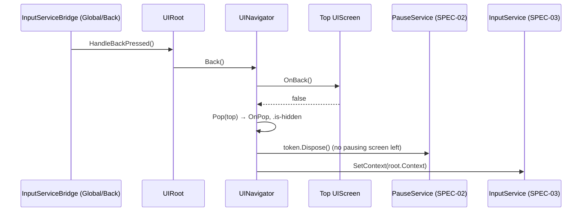

# SPEC-60 — UI framework

| | |
|---|---|
| **Status** | Draft |
| **Area code** | UI (task IDs are `UI-001`, `UI-002`, …) |
| **Module(s)** | `Game.UI` (folder `Assets/Game/UI/`) |
| **Depends on specs** | SPEC-02 (`InputContext`, `IPauseService`, `PauseToken`, `Services`, `GameLog`), SPEC-03 (`InputService.SetContext`, `Controls.Global.Back`, binding display strings), SPEC-01 (`GameRoot` builds `UIRoot` + `UINavigator` at service step 9, ticks `UIRoot`, `SceneFlow` sets root screens), SPEC-71 (test helpers), SPEC-80 (token values and component look; owner approval gate) |
| **Depended on by** | SPEC-61 (every screen), SPEC-51 (editor panels), SPEC-41 (dialog presenter writes `DialogViewModel` hosted by SPEC-61), SPEC-62 (map view transform lives in `Game.UI`; reduce-motion flag), SPEC-70 (harness finds elements by name), SPEC-01 (`SetRoot`, construction) |
| **Milestone** | M1 (root, navigator, pause/input, theme skeleton, MVVM base, base controls), M3 (components, tooltip, notifications, dialogs, audits, accessibility) |

> Read [01-architecture.md](../01-architecture.md), [02-conventions.md](../02-conventions.md) and [03-glossary.md](../03-glossary.md) before this spec. This spec may not contradict them.

## 1. Purpose

This spec builds the one UI stack of the game: a single `UIDocument` with fixed DOM layers, a `UINavigator` stack that is the **only** thing that opens or closes screens and the **only** caller that sets the input context and holds UI pause tokens, an MVVM base for view models bound with Unity 6 runtime data binding, a small library of token-styled controls, and shared services (tooltip, notifications, confirm dialog, text prompt). Everything visual comes from `tokens.uss` variables and component classes so the owner-approved design system (SPEC-80) can replace the look without code changes. It removes the old prototype's 17 UIDocuments with sorting-order fights (audit 06-E2), the boolean pause and close-button bugs (06-B1…B6, 04-B16), hotkeys firing while typing (06-B5, R17), hidden toasts, per-frame GC churn (06-P6) and the layout bugs R4, R7, R11, R12, R31.

## 2. Scope

**In scope:**
- `UIRoot`: the single `UIDocument`, `PanelSettings` (1920×1080 reference, match 0.5), six DOM layers.
- `UIScreen` base class and `UINavigator` (push, pop, back, root screens, pause token, input context, HUD hiding, world-pointer gate).
- Text-entry detection (`InputContext.TextEntry`) and the Esc rule (Esc = `Back()` always).
- MVVM conventions: `ViewModelBase`, `[CreateProperty]`, `INotifyBindablePropertyChanged`, `IDataSourceViewHashProvider`, UXML bindings, converter groups, zero-allocation number strings.
- Controls: buttons (5 variants), panel pattern, list pattern, `TabBar`, `Meter`, `Slot`, `KeyHint`, text field, slider, toggle styling.
- Services: `TooltipService`, `NotificationService` (coalescing), `ConfirmDialog`, `TextPrompt`, UI sound hooks.
- Theme file structure under `Assets/Game/UI/Theme/` (except token **values**, owned by SPEC-80/81).
- Element naming convention for tests and the CLI harness.
- Accessibility basics: UI scale, text scale, reduce motion, colour-vision-safe ally/enemy check, shape coding rule.
- Test utilities: `UILayoutAudit`, `ContrastAudit`, `UITestPanel`.

**Out of scope (and who owns it instead):**
- Every concrete game screen, the HUD and `HudSyncSystem` → SPEC-61.
- Ship editor panels → SPEC-51. Dialog presentation logic → SPEC-41.
- Token values, fonts, icons, final component look → SPEC-80 (design), SPEC-81 (assets).
- Input action maps, bindings, rebinding → SPEC-03. Pause effect on the simulation → SPEC-01/SPEC-02.
- Map view transform math (`MapViewTransform`, file in `Game.UI`) → SPEC-62.
- Localization → not in v1 (vision non-goal).

## 3. Decisions (binding)

1. **One `UIDocument`, one `PanelSettings`, one theme.** Owned by `UIRoot`, living on the `GameRoot` prefab (DontDestroyOnLoad). Reason: ADR-0005; no sorting-order integers.
2. **Six layers, fixed order** under `#ui-root`: `layer-world`, `layer-hud`, `layer-screens`, `layer-modals`, `layer-toasts`, `layer-tooltip` (bottom to top). Toasts are always above screens and modals. Reason: 06-E2 (toasts hidden behind merchant).
3. **`PanelSettings`:** `ScaleWithScreenSize`, reference 1920×1080, `MatchWidthOrHeight`, match 0.5, `scale` driven by the UI-scale setting (0.8–1.5). Reason: R7/E7 (1200×800 width-match compressed layouts).
4. **`UINavigator` is the single owner of navigation, UI pause tokens and the input context.** No other code calls `InputService.SetContext` (architecture §8). UI-004 replaces ADR-0044 with navigator ownership; ADR-0047 supplies temporary scene-root navigation until HUD-002. The App adapter navigates only and never writes input context. Screens never show/hide themselves.
5. **Root screens.** Each scene has exactly one root screen at the bottom of the stack (`MainMenuView`, `FlightHudView`, `ShipEditorView`, SPEC-61). Only `SetRoot` installs a root; `Back()` never pops a root. Reason: removes the "base context" special case and B7/R13 (editor HUD left in the galaxy).
6. **Esc is `Back()`, always**, via the Global map action `Back`. Screens never handle `NavigationCancelEvent` or Esc key events themselves.
7. **Pause is derived, never set.** The navigator holds at most **one** `PauseToken` named `"UINavigator"` while any screen in the stack has `PausesSimulation == true`. Reason: 06-B4 (boolean pause).
8. **Input context is derived:** `TextEntry` while a `TextField` has focus, otherwise the top screen's `Context`, otherwise `None`. Reason: 06-B5 (typing triggers hotkeys).
9. **Closing is always `Navigator.Pop(screen)`** (helper `UIScreen.Close()`); popping a screen also pops every screen above it.
10. **Screens are built once and cached.** A popped screen is hidden with `.is-hidden`, never destroyed. Reason: no rebuild cost, no lost subscriptions.
11. **No inline styles and no hard-coded colours, sizes, fonts in UXML or C#.** The only allowed C# style writes are **data-driven geometry**: `style.width`/`style.height` as a percentage for fills, `style.translate`, `style.left`/`style.top` for tooltip and markers, `style.rotate`, `style.backgroundImage` from a content icon. Screen USS files (`Theme/screens/*.uss`) may use literal layout dimensions (px or %) for widths/heights of regions; colours, fonts, font sizes, spacing, radii, borders and durations come only from tokens.
12. **Class names are BEM-like and the shared ones are defined only in §4.6.** Block `.btn`, element `.panel__title`, modifier `.btn--primary`, state `.is-selected`. Screen-scoped classes are allowed only inside `Theme/screens/<stem>.uss`, must start with that file's stem followed by `-` (for example `.hud-narrow` in `hud.uss`, `.maps-color-3` in `maps.uss`, `.editor-palette-grid` in `editor.uss`), and are listed in the owning spec. Code queries elements **by name only**, never by class (exception: `UILayoutAudit`).
13. **Every interactive element and every bound label has a `name`** following §4.7. Reason: tests and the `gh_ui`/`gh_click` harness.
14. **View models are plain C#** deriving from `ViewModelBase`; they never reference ECS, services or session objects. Presenters (SPEC-61/SPEC-51) write them. Views never read ECS, services or session state.
15. **Default binding is UXML `DataBinding`.** Exception: values that can change every frame (HUD meters, cooldowns, speed, radar) are pushed by view code from `propertyChanged` using `NumberStringCache` strings and percentage styles, because flight must allocate 0 B/frame (06 budgets).
16. **No per-frame allocation in the UI framework.** Toast and tooltip elements are pooled; list screens use `ListView` virtualization (`makeItem`/`bindItem`) or a fixed pool created at build time; property-changed args are cached per property.
17. **Built-in controls first** (`Button`, `TextField`, `Toggle`, `Slider`, `ListView`, `ScrollView`). Custom controls use Unity 6 `[UxmlElement]` + `partial` + `[UxmlAttribute]` (the removed `UxmlFactory`/`UxmlTraits` APIs are forbidden).
18. **UI sounds are one root-level hook** (`ClickEvent`, `PointerOverEvent` bubbling to `#ui-root`), so buttons created later also make sounds. Reason: 06-D4.
19. **Ally/enemy are never colour-only.** Every allegiance marker also differs by shape (`.marker--ally` circle, `.marker--enemy` diamond, `.marker--neutral` square). Reason: colour-vision accessibility.
20. **Folder `Assets/Game/UI/Controls/`** holds custom `VisualElement`s (namespace `Game.UI.Controls`). Reason: `Components/` is reserved for ECS components by convention. **Folder `Assets/Game/UI/Theme/`** holds USS/TSS/PanelSettings/font assets (required path of `tokens.uss`).

## 4. Data model

All types below are *public contract* unless marked *internal*. Namespaces equal folders: `Game.UI.Data`, `Game.UI.Services`, `Game.UI.Views`, `Game.UI.ViewModels`, `Game.UI.Controls`.

### 4.1 Enums, config and value types (`Assets/Game/UI/Data/`)

```csharp
namespace Game.UI.Data
{
    /// Implements SPEC-60 §4.1. DOM layer order bottom→top; value = child index under #ui-root.
    public enum UILayer : byte { World = 0, Hud = 1, Screens = 2, Modals = 3, Toasts = 4, Tooltip = 5 }

    public enum UISound : byte { Click = 0, Hover = 1, Open = 2, Close = 3, Error = 4, Confirm = 5 }
    public enum ButtonVariant : byte { Primary = 0, Secondary = 1, Ghost = 2, Danger = 3, Icon = 4 }
    public enum NotificationKind : byte { Info = 0, Positive = 1, Warning = 2, Danger = 3 }
    public enum TextScale : byte { Percent100 = 0, Percent115 = 1, Percent130 = 2 }
    public enum LayoutIssueKind : byte { OutOfViewport = 0, RegionOverlap = 1, TextOverflow = 2, OutsidePanel = 3 }

    [System.Serializable]
    public struct ScreenAsset
    {
        public string Key;                 // equals UIScreen.Key, kebab-case, unique
        public UnityEngine.UIElements.VisualTreeAsset Uxml;
        public bool Prewarm;               // build at UIRoot construction instead of first push
    }

    /// Implements SPEC-60 §4.1. One asset: Assets/Game/UI/Data/UIConfig.asset, referenced by the GameRoot prefab.
    [UnityEngine.CreateAssetMenu(menuName = "Game/UI/UI Config")]
    public sealed class UIConfig : UnityEngine.ScriptableObject
    {
        public UnityEngine.UIElements.PanelSettings PanelSettings;   // Theme/GamePanelSettings.asset
        public UnityEngine.UIElements.VisualTreeAsset RootUxml;      // Views/Uxml/UIRoot.uxml
        public UnityEngine.UIElements.VisualTreeAsset ToastUxml;     // Views/Uxml/Toast.uxml
        public UnityEngine.UIElements.VisualTreeAsset TooltipUxml;   // Views/Uxml/Tooltip.uxml
        public ScreenAsset[] Screens = new ScreenAsset[0];
        public float TooltipDelaySeconds = 0.35f;
        public int MaxVisibleToasts = 4;
        public int MaxQueuedToasts = 32;
        public float ToastLifetimeSeconds = 4.0f;
        public float ToastCoalesceWindowSeconds = 2.5f;
        public int ToastPoolSize = 8;
        public float MinUiScale = 0.8f;
        public float MaxUiScale = 1.5f;
        public string[] SoundCueIds = new string[6];   // index = (int)UISound; AudioCueDefinition ids, e.g. "cue_ui_click" (SPEC-64 §6.4)
    }

    /// A toast request. Amount 0 = no amount prefix; otherwise "+12 Hull" / "−3 Hull".
    public struct Notification
    {
        public NotificationKind Kind;
        public string Label;          // shown text, e.g. "Hull" or "Game saved"
        public int Amount;            // summed when coalesced
        public string CoalesceKey;    // null or "" = never coalesce; e.g. "item:block_hull"
    }

    public struct TooltipStat { public string Label; public string Value; public int Sign; } // Sign: -1 worse, 0 neutral, +1 better

    /// Reused instance; providers fill it on show. Max 8 stat rows are displayed.
    public sealed class TooltipContent
    {
        public string Title;
        public string Subtitle;
        public string Body;
        public readonly System.Collections.Generic.List<TooltipStat> Stats = new System.Collections.Generic.List<TooltipStat>(8);
        public void Clear() { Title = null; Subtitle = null; Body = null; Stats.Clear(); }
    }

    public struct ConfirmOption
    {
        public string Label;          // button text
        public string ElementName;    // button name, e.g. "confirm-commit"; null → "confirm-option-<index>"
        public ButtonVariant Variant;
        public bool Enabled;
        public string DisabledReason; // shown as the button tooltip when Enabled == false
    }

    public sealed class ConfirmRequest
    {
        public string Title;
        public string Body;
        public ConfirmOption[] Options;   // 1..3 options, left to right
        public int CancelIndex = -1;      // option chosen by Back (Esc); -1 = Back is consumed and ignored
        public int DefaultFocusIndex = 0;
    }

    public sealed class TextPromptRequest
    {
        public string Title;
        public string Label;
        public string InitialText = "";
        public int MaxLength = 32;
        public string OkLabel = "OK";
        public string CancelLabel = "Cancel";
        public System.Func<string, string> Validate;  // input is trimmed; returns error text or null when valid. null delegate = non-empty check only
    }

    public struct AccessibilityOptions
    {
        public float UiScale;         // clamped to [UIConfig.MinUiScale, MaxUiScale]; default 1.0
        public TextScale TextScale;   // default Percent100
        public bool ReduceMotion;     // default false
    }

    public struct LayoutIssue
    {
        public LayoutIssueKind Kind;
        public string ElementPath;    // "screen-pause/pause-resume"
        public UnityEngine.Rect Bounds;
        public UnityEngine.Rect Container;
    }

    public struct ContrastIssue
    {
        public string ElementPath;
        public UnityEngine.Color Foreground;
        public UnityEngine.Color Background;
        public float Ratio;
        public float Required;        // 4.5 or 3.0
    }
}
```

### 4.2 Service interfaces (`Assets/Game/UI/Services/`)

```csharp
namespace Game.UI.Services
{
    /// Implemented by InputServiceBridge (this spec) over SPEC-03's InputService. Tests use a fake.
    public interface IInputContextTarget { void SetContext(Game.Core.InputContext context); }

    /// Implemented in Game.App over the audio service (SPEC-64). NullUISoundSink when audio is absent.
    public interface IUISoundSink { void Play(Game.UI.Data.UISound sound); }

    /// Frame/time source; real one wraps UnityEngine.Time. Tests use a fake.
    public interface IFrameClock { int FrameCount { get; } float UnscaledTime { get; } }

    public sealed class NullUISoundSink : IUISoundSink { public void Play(Game.UI.Data.UISound sound) { } }
    public sealed class UnityFrameClock : IFrameClock
    {
        public int FrameCount => UnityEngine.Time.frameCount;
        public float UnscaledTime => UnityEngine.Time.unscaledTime;
    }
}
```

### 4.3 Screen base (`Assets/Game/UI/Views/UIScreen.cs`)

The class is named `UIScreen` (not `Screen`) to avoid the clash with `UnityEngine.Screen`. Concrete screens are named `<Name>View` (conventions §1).

```csharp
namespace Game.UI.Views
{
    /// Implements SPEC-60 §4.3. A navigable view. Built once, cached, hidden when popped.
    public abstract class UIScreen
    {
        public abstract string Key { get; }                                    // kebab-case, unique; root element name = "screen-" + Key
        public abstract Game.UI.Data.UILayer Layer { get; }                    // Hud, Screens or Modals only
        public virtual Game.Core.InputContext Context => Game.Core.InputContext.Menu;
        public virtual bool PausesSimulation => true;
        public virtual bool BlocksWorldPointer => true;
        public virtual bool HidesHud => false;                                 // true → layer-hud gets .is-hidden while in stack
        public virtual bool IsRoot => false;                                   // only installable through UINavigator.SetRoot

        public UnityEngine.UIElements.VisualElement Root { get; private set; }
        public Game.UI.Services.UINavigator Navigator { get; private set; }
        public bool IsBuilt => Root != null;
        public bool IsOpen { get; internal set; }

        /// Called once by UINavigator when the screen is first needed. Sets Root, then calls OnBuild().
        internal void Build(Game.UI.Services.UINavigator navigator, UnityEngine.UIElements.VisualElement root)
        { Navigator = navigator; Root = root; OnBuild(); }

        /// Query named elements, set Root.dataSource, register callbacks. Called exactly once.
        protected abstract void OnBuild();
        public virtual void OnPush(object args) { }
        public virtual void OnPop() { }
        /// Return true when the screen consumed Back (closed a sub-panel, cancelled a drag). false → navigator pops it (non-root).
        public virtual bool OnBack() => false;
        public virtual void OnCovered() { }
        public virtual void OnRevealed() { }
        /// Element focused after push/reveal; null = keep current focus.
        public virtual UnityEngine.UIElements.VisualElement DefaultFocus => null;

        protected void Close() => Navigator.Pop(this);

        /// Fail-loud query by name. Throws InvalidOperationException("screen-<key>: missing element '<name>'").
        protected T Q<T>(string name) where T : UnityEngine.UIElements.VisualElement
        {
            var e = Root.Q<T>(name);
            if (e == null) throw new System.InvalidOperationException("screen-" + Key + ": missing element '" + name + "'");
            return e;
        }
    }
}
```

### 4.4 View model base (`Assets/Game/UI/ViewModels/ViewModelBase.cs`)

```csharp
namespace Game.UI.ViewModels
{
    /// Implements SPEC-60 §4.4. Base of every *ViewModel. Allocation-free notifications.
    public abstract class ViewModelBase : UnityEngine.UIElements.INotifyBindablePropertyChanged,
                                          UnityEngine.UIElements.IDataSourceViewHashProvider
    {
        public event System.EventHandler<UnityEngine.UIElements.BindablePropertyChangedEventArgs> propertyChanged;
        long version;

        public long GetViewHashCode() => version;

        /// Returns true when the value changed. `args` is a static readonly instance declared next to the property.
        protected bool Set<T>(ref T field, T value, in UnityEngine.UIElements.BindablePropertyChangedEventArgs args)
        {
            if (System.Collections.Generic.EqualityComparer<T>.Default.Equals(field, value)) return false;
            field = value;
            version++;
            propertyChanged?.Invoke(this, args);
            return true;
        }

        /// For collection properties whose contents changed in place.
        protected void Notify(in UnityEngine.UIElements.BindablePropertyChangedEventArgs args)
        { version++; propertyChanged?.Invoke(this, args); }
    }
}
```

Property pattern every view model follows (example):

```csharp
public sealed class ExampleViewModel : ViewModelBase
{
    static readonly BindablePropertyChangedEventArgs HullFractionChanged = new BindablePropertyChangedEventArgs(nameof(HullFraction));
    float hullFraction;
    [Unity.Properties.CreateProperty] public float HullFraction { get => hullFraction; set => Set(ref hullFraction, value, HullFractionChanged); }
}
```

### 4.5 Controls (`Assets/Game/UI/Controls/`)

```csharp
namespace Game.UI.Controls
{
    /// Horizontal bar with fill, caption and numbers. Classes: .meter, .meter__fill, .meter__caption, .meter__value, .meter__max.
    [UnityEngine.UIElements.UxmlElement]
    public partial class Meter : UnityEngine.UIElements.VisualElement
    {
        [UnityEngine.UIElements.UxmlAttribute] public string Caption { get; set; }      // static text, e.g. "HULL"
        [UnityEngine.UIElements.UxmlAttribute] public string Variant { get; set; }      // "hull" | "shield" | "energy" | "neutral" → class .meter--<variant>
        [UnityEngine.UIElements.UxmlAttribute] public bool ShowNumbers { get; set; } = true;
        public float Fraction { get; }                     // 0..1
        /// Sets fill width as percent (rounded to 0.1 %) and value/max labels from NumberStringCache. No allocation.
        public void SetValue(int value, int max);
        public void SetFraction(float fraction);          // fill only, labels untouched
        /// Adds .meter--low when fraction < lowThreshold (default 0.25).
        public float LowThreshold { get; set; }
    }

    /// Icon tile with count badge, key hint and cooldown overlay. Classes: .slot, .slot__icon, .slot__count, .slot__key, .slot__cooldown; states .is-selected .is-empty .is-disabled .is-locked .is-ready
    [UnityEngine.UIElements.UxmlElement]
    public partial class Slot : UnityEngine.UIElements.VisualElement
    {
        public void SetIcon(UnityEngine.Sprite sprite);    // null → .is-empty
        public void SetCount(int count);                   // count <= 1 hides the badge; uses NumberStringCache
        public void SetKeyHint(string text);               // null hides
        public void SetCooldown(float remainingFraction);  // 0 hides overlay; overlay height = fraction %
        public void SetState(bool selected, bool disabled, bool locked);
    }

    /// Horizontal tab strip inside a horizontal ScrollView, so many tabs never overflow the screen (R12).
    /// Classes: .tab-bar, .tab-bar__tab (.is-selected).
    [UnityEngine.UIElements.UxmlElement]
    public partial class TabBar : UnityEngine.UIElements.VisualElement
    {
        public int SelectedIndex { get; set; }             // setting fires SelectionChanged only when the value changes
        public event System.Action<int> SelectionChanged;
        /// Rebuilds tab buttons (allowed only outside per-frame paths). names[i] becomes the button name.
        public void SetTabs(System.Collections.Generic.IReadOnlyList<string> labels, System.Collections.Generic.IReadOnlyList<string> names);
        public int TabCount { get; }
    }

    /// Label that shows the current binding of an input action, e.g. "E". Class .key-hint.
    [UnityEngine.UIElements.UxmlElement]
    public partial class KeyHint : UnityEngine.UIElements.Label
    {
        [UnityEngine.UIElements.UxmlAttribute] public string ActionPath { get; set; }   // "Flight/Interact"
        /// Resolver injected once by UIRoot; refreshed when SPEC-03 raises BindingsChanged.
        public void Refresh(System.Func<string, string> bindingDisplay);
    }
}
```

`PanelFrame` is **not** a custom control. A panel is the class pattern in §4.6, written explicitly in UXML:

```xml
<ui:VisualElement name="inventory-panel" class="panel">
  <ui:VisualElement class="panel__header">
    <ui:Label name="inventory-title" class="panel__title" text="Cargo"/>
    <ui:VisualElement class="panel__header-actions">
      <ui:Button name="inventory-sort" class="btn btn--secondary btn--small" text="Sort"/>
    </ui:VisualElement>
  </ui:VisualElement>
  <ui:VisualElement class="panel__body"> … </ui:VisualElement>
  <ui:VisualElement class="panel__footer"> … </ui:VisualElement>
</ui:VisualElement>
```

### 4.6 Class catalogue (the only allowed component class names)

| Block | Elements | Modifiers / states | File |
|---|---|---|---|
| `.ui-root` | — | `.text-scale-115`, `.text-scale-130`, `.reduce-motion` | `base.uss`, `accessibility.uss` |
| `.layer` | — | — | `base.uss` |
| `.screen` | — | `.screen--hud`, `.screen--screens`, `.screen--modals` | `base.uss` |
| `.btn` | `.btn__icon`, `.btn__label` | `--primary`, `--secondary`, `--ghost`, `--danger`, `--icon`, `--small`, `--wide` | `components/button.uss` |
| `.panel` | `__header`, `__title`, `__header-actions`, `__body`, `__footer` | `--floating`, `--hud`, `--modal` | `components/panel.uss` |
| `.list` | `__item`, `__item-label`, `__item-value`, `__empty` | `--compact` | `components/list.uss` |
| `.tab-bar` | `__tab` | — | `components/tab-bar.uss` |
| `.meter` | `__fill`, `__caption`, `__value`, `__max` | `--hull`, `--shield`, `--energy`, `--neutral`, `--low` | `components/meter.uss` |
| `.slot` | `__icon`, `__count`, `__key`, `__cooldown` | — | `components/slot.uss` |
| `.tooltip` | `__title`, `__subtitle`, `__body`, `__stats`, `__stat-row`, `__stat-label`, `__stat-value` | `__stat-value--better`, `__stat-value--worse` | `components/tooltip.uss` |
| `.toast` | `__icon`, `__text` | `--info`, `--positive`, `--warning`, `--danger`, `--enter`, `--exit`, `--bump` | `components/toast.uss` |
| `.toast-column` | — | — | `components/toast.uss` |
| `.modal` | `__scrim`, `__window`, `__title`, `__body`, `__actions` | — | `components/modal.uss` |
| `.text-field` (on `TextField`) | — | — | `components/text-field.uss` |
| `.slider` (on `Slider`/`SliderInt`) | — | — | `components/slider.uss` |
| `.toggle` (on `Toggle`) | — | — | `components/toggle.uss` |
| `.key-hint` | — | — | `components/key-hint.uss` |
| `.marker` | — | `--ally`, `--enemy`, `--neutral` (shape differs) | `components/marker.uss` |
| `.hud-region` | — | `.anchor-top-left`, `.anchor-top-center`, `.anchor-top-right`, `.anchor-center`, `.anchor-bottom-left`, `.anchor-bottom-center`, `.anchor-bottom-right`, `.anchor-right-center` | `components/hud.uss` |
| `.hud-plate` | — | — | `components/hud.uss` |
| typography | `.text-xs` … `.text-xxl`, `.text-muted`, `.text-mono`, `.text-display`, `.text-ellipsis` | — | `utilities.uss` |
| layout | `.row`, `.col`, `.grow`, `.center`, `.spacer`, `.stack-s`, `.stack-m`, `.stack-l` | — | `utilities.uss` |
| state | `.is-hidden`, `.is-covered`, `.is-selected`, `.is-disabled`, `.is-empty`, `.is-locked`, `.is-ready`, `.is-active`, `.is-invalid` | — | `base.uss` |

`UIStyleClasses` (`Assets/Game/UI/Data/UIStyleClasses.cs`) holds one `public const string` per class above (e.g. `public const string IsHidden = "is-hidden";`, `public const string BtnPrimary = "btn--primary";`). Code adds/removes classes only through these constants.

`.is-hidden` = `display: none`. `.is-covered` = `display: none` (separate class so covering never fights hiding). `.stack-m > *` gets `margin-bottom: var(--space-3)` (USS has no `gap`). `.text-ellipsis` = `-unity-text-overflow-position: end; text-overflow: ellipsis; overflow: hidden; white-space: nowrap`.

### 4.7 Element naming convention (binding)

| Element | Name pattern | Example |
|---|---|---|
| Root container | `ui-root` | — |
| Layer | `layer-<layer>` (`world`, `hud`, `screens`, `modals`, `toasts`, `tooltip`) | `layer-modals` |
| Screen root | `screen-<key>` | `screen-pause` |
| Static element in a screen | `<key>-<element>` kebab-case | `pause-resume`, `hud-hull-meter` |
| Dynamic item | `<key>-<collection>-<stableId>`; stableId = content id, slot index or option index | `inventory-slot-12`, `editor-palette-block_hull` |
| Confirm buttons | `ConfirmOption.ElementName`, else `confirm-option-<index>` | `confirm-commit` |
| Toast column / toast | `toast-column` / `toast-<poolIndex>` | `toast-0` |
| Tooltip | `tooltip` | — |

Rules: lowercase `a-z0-9-` plus `_` only inside content ids; unique within its screen; never renamed once a task ships (harness scripts depend on them). `UINames` (`Assets/Game/UI/Data/UINames.cs`) provides `ScreenRoot(string key)`, `Layer(UILayer layer)`, `Item(string key, string collection, string id)`; these allocate and are called only during build or pool setup.

### 4.8 Theme files (`Assets/Game/UI/Theme/`)

| File | Owner | Content |
|---|---|---|
| `tokens.uss` | exists; **values** owned by SPEC-80/81 | `:root` custom properties (names binding; do not edit values in this spec) |
| `accessibility.uss` | UI-013 | `.ui-root.text-scale-115 { --text-xs…--text-xxl }` = round(token × 1.15); `.text-scale-130` = round(token × 1.30); `.reduce-motion` sets `transition-duration: 0s` on `.toast`, `.tooltip`, `.btn`, `.modal__window` |
| `base.uss` | UI-002 | `.ui-root`, `.layer`, `.screen*`, state classes, default font (`-unity-font-definition: var(--font-body)`), default text colour/size |
| `utilities.uss` | UI-002 | typography and layout helpers (§4.6) |
| `components/*.uss` | UI-007, UI-008, UI-009, UI-010, UI-011 | one file per block in §4.6 |
| `screens/<key>.uss` | SPEC-61 / SPEC-51 tasks | region layout of one screen |
| `Game.tss` | UI-002 | `@import url("unity-theme://default");` then `tokens.uss`, `accessibility.uss`, `base.uss`, `utilities.uss`, every `components/*.uss`, every `screens/*.uss`, in that order |
| `GamePanelSettings.asset` | UI-002 | §3 decision 3, `themeStyleSheet = Game.tss`, `sortingOrder 0`, `clearColor false` |

## 5. Systems, services and flow

There are no ECS systems in this spec. All code runs on the main thread from `GameRoot.Update` (SPEC-01) calling `UIRoot.Tick(Time.unscaledDeltaTime)` once per frame, plus UI Toolkit event callbacks.

### 5.1 `UIRoot` construction (called by `GameRoot.Awake` at service step 9)

1. Validate `UIConfig`: every `Screens[i].Key` non-empty, unique, `Uxml != null`; `MaxVisibleToasts ≥ 1`. On failure `GameLog.Error("UI", …)` and throw `InvalidOperationException` (fail loudly at boot).
2. `document.panelSettings = config.PanelSettings; document.visualTreeAsset = config.RootUxml;` The document's root contains `#ui-root` with six `.layer` children in `UILayer` order, each `picking-mode="Ignore"` in UXML.
3. Cache the six layer elements by name into `VisualElement[6] layers` (index = `(int)UILayer`). Missing layer → throw.
4. Create `UINavigator(this, pause, contextTarget, clock)`, `TooltipService`, `NotificationService`, `ConfirmDialog`, `TextPrompt`. The two dialog services register their screens (`ConfirmDialogView` key `confirm`, `TextPromptView` key `text-prompt`) on the navigator.
5. Register root callbacks on `#ui-root`: `ClickEvent` (sound, §5.8), `PointerOverEvent` / `PointerOutEvent` (hover sound), `FocusInEvent` / `FocusOutEvent` with `TrickleDown.TrickleDown` (text entry, §5.4).
6. Register converter groups (§5.6) if not already registered in this domain.
7. Apply `AccessibilityOptions { UiScale = 1, TextScale = Percent100, ReduceMotion = false }`.
8. For every registered screen with `Prewarm == true`, build it now (§5.2 step "build").

### 5.2 `UINavigator` stack operations

State: `List<UIScreen> stack` (index 0 = root), `Dictionary<Type, UIScreen> registry`, `PauseToken token` + `bool holdsToken`, `InputContext lastContext = None`, `bool textEntry`, `bool hudHidden`, `int LastStackChangeFrame`, `Queue<PendingOp> pending` (capacity 16), `bool mutating`.

**Build (lazy, once per screen):** look up `ScreenAsset` by `screen.Key`; `var tc = asset.Uxml.Instantiate();` set `tc.name = "screen-" + Key`; add classes `.screen`, `.screen--<layer>`, `.is-hidden`; `layers[(int)Layer].Add(tc)`; `screen.Build(this, tc)`. A missing asset throws `InvalidOperationException` naming the key.

**`Push(UIScreen s, object args = null)`**
1. If `mutating`, enqueue `(Push, s, args)` and return. If more than 16 ops are pending, log `GameLog.Error("UI", "navigation loop")`, clear the queue and return.
2. If `s.IsRoot` throw `InvalidOperationException("use SetRoot")`. If `s` is not registered, throw.
3. `mutating = true`. Build `s` if needed.
4. If `s` is already in the stack: pop every screen above it top-down (each: `IsOpen=false`, `OnPop()`, add `.is-hidden`), then call `s.OnPush(args)` and go to step 7.
5. Add `s` to the stack, remove `.is-hidden`, `IsOpen = true`.
6. Call `s.OnPush(args)` inside try/catch. On exception: log `GameLog.Error("UI", …)`, remove `s` from the stack, add `.is-hidden`, `IsOpen = false`, continue to step 7 (no pause token leaks: 06-B6).
7. `Sync()`; focus `s.DefaultFocus` when not null; play `UISound.Open` when `s.Layer` is `Screens` or `Modals`.
8. `mutating = false`; drain `pending` FIFO.

**`Pop(UIScreen s)` → bool**
1. Deferred like Push when `mutating`.
2. If `s` not in stack → return false. If `s.IsRoot` → `GameLog.Error("UI", "cannot pop root")`, return false.
3. Pop top-down from the top until `s` is removed; for each: `IsOpen = false`, `OnPop()` (try/catch, log), add `.is-hidden`.
4. `Sync()`; play `UISound.Close`; focus new top's `DefaultFocus`; return true.

**`Back()`** (called by `UIRoot.HandleBackPressed`)
1. If `textEntry` is true: blur the focused element (`panel.focusController.focusedElement.Blur()`), return.
2. If the stack is empty, return.
3. `top = stack[^1]`. If `top.OnBack()` returns true, return.
4. If `top.IsRoot`, return. Otherwise `Pop(top)`.

**`SetRoot(UIScreen root, object args = null)`**
1. Requires `root.IsRoot`; otherwise throw.
2. Pop **every** screen including the old root, top-down (`OnPop`, `.is-hidden`).
3. Push `root` (steps 3–8 of Push, without the IsRoot check).

**`Toggle<T>()`**: `IsOpen<T>() ? Pop(Get<T>()) : Push(Get<T>())`.

**`Sync()`** (internal; after every operation)
1. `bool wantPause = any s in stack with s.PausesSimulation`.
2. If `wantPause && !holdsToken`: `token = pause.Acquire("UINavigator"); holdsToken = true`. If `!wantPause && holdsToken`: `token.Dispose(); holdsToken = false`.
3. `ctx = textEntry ? InputContext.TextEntry : (stack.Count > 0 ? stack[^1].Context : InputContext.None)`. If `ctx != lastContext`: `contextTarget.SetContext(ctx); lastContext = ctx`.
4. `bool hide = any s in stack with s.HidesHud`. If changed: toggle `.is-hidden` on `layer-hud`.
5. Covering: let `topScreens` = the highest stack entry whose `Layer == Screens`. Every other `Screens`-layer entry in the stack gets `.is-covered` (call `OnCovered()` when it gains the class); `topScreens` loses `.is-covered` (call `OnRevealed()` when it loses it). Hud and Modals entries are never covered.
6. `WorldPointerBlocked = any s in stack with s.BlocksWorldPointer`.
7. `LastStackChangeFrame = clock.FrameCount`.
8. Raise `StackChanged` (C# event, subscribers inside `Game.UI` only: tooltip hides, toasts ignore).

Iterations use `for` loops over the list (no LINQ, no allocation).

### 5.3 Flow diagram



### 5.4 Text entry

1. `FocusInEvent` (trickle-down on `#ui-root`): `var ve = evt.target as VisualElement; textEntry = ve is TextField || ve?.GetFirstAncestorOfType<TextField>() != null;` then `Sync()` if changed.
2. `FocusOutEvent`: if the element gaining focus (`evt.relatedTarget`) is not inside a `TextField`, `textEntry = false`, `Sync()`.
3. When a screen containing the focused field is popped, the field loses focus → step 2 runs.

### 5.5 World pointer gate — `UIRoot.IsWorldPointerAllowed(Vector2 screenPosBottomLeft)`

Used by the ship editor and flight aiming to ignore clicks meant for the UI.
1. If `Navigator.WorldPointerBlocked` → false.
2. If `clock.FrameCount - Navigator.LastStackChangeFrame <= 1` → false (06-B9: the click that closes a view must not also place a block).
3. `var p = RuntimePanelUtils.ScreenToPanel(panel, new Vector2(screenPos.x, UnityEngine.Screen.height - screenPos.y));`
4. If `panel.Pick(p) != null` → false (every non-interactive container is `picking-mode="Ignore"`, so a pick means a pickable element).
5. Return true.

### 5.6 Binding conventions

- A view sets `Root.dataSource = viewModel` once in `OnBuild()`. Sub-trees may set their own `dataSource` (list items get theirs from `ListView` with `binding-source-selection-mode="AutoAssign"`).
- UXML binding form: `<ui:Label name="pause-title"><Bindings><ui:DataBinding property="text" data-source-path="Title" binding-mode="ToTarget"/></Bindings></ui:Label>`.
- Converter groups registered by `UIConverters.RegisterAll()` (idempotent: checks `ConverterGroups.TryGetConverterGroup(id, out _)` first). All converters are static pure functions:

| Group id | From → to | Rule |
|---|---|---|
| `fraction-to-percent` | `float` → `StyleLength` | `Length.Percent(clamp01(v) * 100)` |
| `int-to-text` | `int` → `string` | `NumberStringCache.Get(v)` |
| `bool-to-display` | `bool` → `StyleEnum<DisplayStyle>` | true → `Flex`, false → `None` |
| `seconds-to-clock` | `float` → `string` | `mm:ss` via `NumberStringCache.Get2Digits` (no `string.Format`) |

- `NumberStringCache` (`Assets/Game/UI/Data/NumberStringCache.cs`, static class): `static readonly string[] positive` for 0…9999 and `negative` for −1…−9999 filled in the static constructor (immutable after construction, so not a mutable static); `Get(int v)` returns the cached string inside the range, otherwise `v.ToString(CultureInfo.InvariantCulture)` (allocates; only for rare large values); `Get2Digits(int v)` returns "00"…"99" from a 100-entry table.
- Collections: a view model exposes `List<TItemViewModel>` with `[CreateProperty]`; after changing contents in place it calls `Notify(…Changed)`; the view calls `listView.RefreshItems()` in its `propertyChanged` handler. Item view models are reused (list keeps its instances; presenters update fields).
- Commands: each screen declares an interface `I<Name>Commands` (in `Game.UI`, SPEC-61/SPEC-51); the view receives `(viewModel, commands)` in its constructor and wires `button.clicked += commands.X` in `OnBuild()`.

### 5.7 Tooltip service (`TooltipService`)

State: one tooltip element instantiated from `UIConfig.TooltipUxml` into `layer-tooltip` (named `tooltip`, `.is-hidden`), 8 pooled stat rows, one `TooltipContent`, one scheduled item for the delay, current target.
1. `Attach(VisualElement target, Action<TooltipContent> fill)` adds a `TooltipManipulator` (registers `PointerEnterEvent`, `PointerLeaveEvent`, `PointerMoveEvent`, `PointerDownEvent` on the target).
2. Pointer enter → remember target and fill callback, store pointer panel position, `delayItem.ExecuteLater((long)(TooltipDelaySeconds * 1000))`.
3. Delay elapsed and target still hovered → `content.Clear(); fill(content);` copy fields to labels; show up to 8 stat rows (rows beyond `Stats.Count` get `.is-hidden`; value class `__stat-value--better`/`--worse` by `Sign`); remove `.is-hidden`.
4. Position (on show, on `PointerMoveEvent`, on tooltip `GeometryChangedEvent`): read USS custom properties from the tooltip's `customStyle`: `--tooltip-offset-x` (default 16), `--tooltip-offset-y` (default 20), `--tooltip-edge-margin` (default 8), declared in `components/tooltip.uss`. `x = pointer.x + offX`, `y = pointer.y + offY`. If `x + w > panelW - margin`, `x = pointer.x - offX - w`. If `y + h > panelH - margin`, `y = pointer.y - offY - h`. Clamp both to `[margin, panelSize - size - margin]`. Write `style.left`/`style.top`.
5. Pointer leave, pointer down, target detached (`DetachFromPanelEvent`) or `Navigator.StackChanged` → hide and pause the delay item.
6. `ShowAtScreen(Action<TooltipContent> fill, Vector2 screenPosBottomLeft)` for world objects: converts with `RuntimePanelUtils.ScreenToPanel(panel, new Vector2(x, Screen.height - y))` and shows immediately; `HideScreenTooltip()` hides it.

### 5.8 Notification service (`NotificationService`)

Container: at construction the service adds one element `toast-column` (class `.toast-column`: absolute, `right: var(--space-5)`, `top: 296px` = 24 px margin + 240 px radar + 32 px gap so toasts sit below SPEC-61's top-right radar, `width: 360px`, flex column) to `layer-toasts`; all toasts are children of it, newest at the bottom.

State: `ToastSlot[ToastPoolSize]` (element instantiated from `ToastUxml` into `toast-column`, name `toast-<i>`), `List<ActiveToast> visible` (capacity `MaxVisibleToasts`), `Queue<Notification> queue` (capacity `MaxQueuedToasts`).
1. `Post(in Notification n)`:
   a. If `n.CoalesceKey` is non-empty and a visible toast has the same key and `now - lastBumpTime < ToastCoalesceWindowSeconds`: `Amount += n.Amount`, reset its remaining life to `ToastLifetimeSeconds`, refresh text, add `.toast--bump` and remove it after `--duration-fast`, return.
   b. Same check against queued notifications with the same key: add amounts in place, return.
   c. If `visible.Count < MaxVisibleToasts`: show now. Else enqueue; if the queue is full, drop the oldest queued `Info`/`Positive` notification; if none, drop the oldest queued notification.
2. Text: `Amount == 0` → `Label`; otherwise `(Amount > 0 ? "+" : "−") + NumberStringCache.Get(|Amount|) + " " + Label` (allocates once per post/bump, never per frame).
3. Show: take a free pool slot, set kind class `toast--<kind>`, add `.toast--enter`, next frame remove `.toast--enter` (USS transition does the animation).
4. `Tick(dt)`: for each visible toast `life -= dt`; when `life <= 0`: add `.toast--exit`, after `exitSeconds` (0.2 s; 0 when reduce motion) return the slot to the pool and show the next queued notification.
5. Toasts use unscaled time, so pause does not freeze them.

### 5.9 Confirm dialog and text prompt

`ConfirmDialog.Show(ConfirmRequest req, Action<int> onChosen)`:
1. Validate `1 ≤ Options.Length ≤ 3`; otherwise throw `ArgumentException`.
2. If the `confirm` screen is open, enqueue `(req, onChosen)` (FIFO) and return.
3. Fill title/body; the UXML has three buttons `confirm-option-0..2`; set `name` to `ElementName` (or default), text, variant class, `SetEnabled(Enabled)`, tooltip with `DisabledReason`; unused buttons get `.is-hidden`.
4. Push `ConfirmDialogView` (Layer `Modals`, Context `Menu`, `PausesSimulation = true`, `BlocksWorldPointer = true`).
5. Click option i → `Pop`, then invoke `onChosen(i)` (after the pop, so callbacks may push other screens), then show the next queued request.
6. `OnBack()`: if `CancelIndex ≥ 0` behave as clicking it; return true in all cases.

`TextPrompt.Show(TextPromptRequest req, Action<string> onSubmit, Action onCancel)`:
1. Push `TextPromptView` (key `text-prompt`, Modals, Menu, pauses, blocks pointer); field `text-prompt-field` gets `maxLength = req.MaxLength`, value `InitialText`, and focus (so the context becomes `TextEntry`).
2. On every value change: `t = value.Trim()`; `error = t.Length == 0 ? "Required" : req.Validate?.Invoke(t)`; label `text-prompt-error` shows the error; `text-prompt-ok` enabled iff `error == null`.
3. OK click or `KeyDownEvent` with `KeyCode.Return`/`KeyCode.KeypadEnter` on the field while valid → `Pop`, `onSubmit(t)`.
4. Cancel click → `Pop`, `onCancel?.Invoke()`. `OnBack()` → same as Cancel, return true. (The first Esc while typing only blurs, §5.2 Back step 1.)

### 5.10 Sounds

`ClickEvent` on `#ui-root`: `if (evt.target is Button b && b.enabledInHierarchy) sound.Play(UISound.Click)`. `PointerOverEvent`: `var b = (evt.target as VisualElement)?.GetFirstOfType<Button>()`; if `b != null && b != lastHover && b.enabledInHierarchy` → `Play(Hover)`, `lastHover = b`. `PointerOutEvent` whose target is `lastHover` → `lastHover = null`.

### 5.11 Accessibility — `UIRoot.ApplyAccessibility(in AccessibilityOptions o)`

1. `panelSettings.scale = clamp(o.UiScale, MinUiScale, MaxUiScale)`.
2. Remove `text-scale-115`, `text-scale-130` from `#ui-root`; add the one for `o.TextScale` (none for 100 %).
3. Toggle `.reduce-motion` on `#ui-root`; store `ReduceMotion` (read by `NotificationService` and SPEC-62's camera shake through SPEC-01 settings).
4. Called by `Game.App` when `SettingsService` raises a change (SPEC-01).

### 5.12 Audits (test and harness utilities)

`UILayoutAudit.Run(VisualElement root, Rect viewport, List<LayoutIssue> results)` walks the subtree (skipping `display: none` elements and descendants of a `ScrollView`'s content container):
1. **OutOfViewport:** every element with a non-empty `name` whose `worldBound` is not inside `viewport` (tolerance 0.5 px).
2. **RegionOverlap:** every pair of `.hud-region` elements with intersecting `worldBound` (intersection area > 1 px²).
3. **OutsidePanel:** every named descendant of a `.panel` whose `worldBound` is not inside that panel's `worldBound` (tolerance 0.5 px) — catches buttons floating outside panels (R31).
4. **TextOverflow:** every named `Label`/`Button` with non-empty text where `MeasureTextSize(text, contentRect.width, MeasureMode.AtMost, 0, MeasureMode.Undefined)` height > `contentRect.height + 0.5` (wrapping text) or, for `white-space: nowrap` without `.text-ellipsis`, width > `contentRect.width + 0.5`.

`ContrastAudit.Run(VisualElement root, List<ContrastIssue> results)`: for every visible `TextElement` with non-empty text: foreground = `resolvedStyle.color`; background = composite of every ancestor's `resolvedStyle.backgroundColor` (outermost first) over the resolved `--color-bg`; WCAG 2.1 contrast ratio; required = 3.0 when `fontSize ≥ 24` or (`fontSize ≥ 18.66` and bold), else 4.5.

`AllegianceColorCheck.Run(Color ally, Color enemy)` returns the minimum CIE76 ΔE between the two colours after simulating protanopia, deuteranopia and tritanopia (Machado 2009 severity 1.0 matrices); required ≥ 20.

`UITestPanel` (test assembly, `Assets/Game/Tests/PlayMode/UI/UITestPanel.cs`): creates a `PanelSettings` clone with `ConstantPixelSize`, scale 1, `targetTexture` = new `RenderTexture(w, h)`, theme `Game.tss`, a GameObject with `UIDocument`; `Load(VisualTreeAsset)`, `yield return` one frame for layout, `Dispose()`. Logical test sizes (match 0.5): **1920×1080** (16:9), **1663×1247** (4:3), **2226×932** (21:9), **1821×1138** (16:10), **1280×720** (16:9 at UI scale 1.5).

## 6. Public API

```csharp
namespace Game.UI.Services
{
    public sealed class UIRoot : System.IDisposable
    {
        public UIRoot(UnityEngine.UIElements.UIDocument document, Game.UI.Data.UIConfig config,
                      Game.Core.IPauseService pause, IInputContextTarget contextTarget,
                      IUISoundSink sound, IFrameClock clock);
        public UnityEngine.UIElements.IPanel Panel { get; }
        public UnityEngine.UIElements.VisualElement RootElement { get; }          // #ui-root
        public UnityEngine.UIElements.VisualElement GetLayer(Game.UI.Data.UILayer layer);
        public UINavigator Navigator { get; }
        public TooltipService Tooltips { get; }
        public NotificationService Notifications { get; }
        public ConfirmDialog Confirm { get; }
        public TextPrompt Prompt { get; }
        public bool ReduceMotion { get; }
        public void Register(Game.UI.Views.UIScreen screen);                     // = Navigator.Register
        public void Tick(float unscaledDeltaTime);                                // once per frame from GameRoot.Update
        public void HandleBackPressed();                                          // = Navigator.Back()
        public bool IsWorldPointerAllowed(UnityEngine.Vector2 screenPosBottomLeft);
        public void ApplyAccessibility(in Game.UI.Data.AccessibilityOptions options);
        public void Dispose();                                                    // pops all, releases token, unregisters callbacks
    }

    public sealed class UINavigator
    {
        public Game.UI.Views.UIScreen Top { get; }                                // null when empty
        public int Count { get; }
        public bool WorldPointerBlocked { get; }
        public int LastStackChangeFrame { get; }
        public Game.Core.InputContext CurrentContext { get; }
        public bool IsPausing { get; }                                            // holds its token
        public event System.Action StackChanged;
        public void Register(Game.UI.Views.UIScreen screen);                      // throws on duplicate type or key
        public T Get<T>() where T : Game.UI.Views.UIScreen;                       // throws when not registered
        public bool IsOpen<T>() where T : Game.UI.Views.UIScreen;
        public void Push(Game.UI.Views.UIScreen screen, object args = null);
        public T Push<T>(object args = null) where T : Game.UI.Views.UIScreen;
        public bool Pop(Game.UI.Views.UIScreen screen);
        public void Toggle<T>() where T : Game.UI.Views.UIScreen;
        public void Back();
        public void SetRoot(Game.UI.Views.UIScreen root, object args = null);
        public void CloseAllAboveRoot();                                          // pops every non-root screen
    }

    /// Adapter over SPEC-03. Constructed by GameRoot (SPEC-01) before UIRoot.
    public sealed class InputServiceBridge : IInputContextTarget, System.IDisposable
    {
        public InputServiceBridge(Game.Input.InputService input);
        public void SetContext(Game.Core.InputContext context);                   // → input.SetContext(context)
        public void BindBack(System.Action onBack);                               // subscribes Controls.Global.Back.performed
        public string GetBindingDisplay(string actionPath);                      // → SPEC-03 display string, e.g. "E"
        public void Dispose();                                                    // unsubscribes
    }

    public sealed class TooltipService
    {
        public void Attach(UnityEngine.UIElements.VisualElement target, System.Action<Game.UI.Data.TooltipContent> fill);
        public void Detach(UnityEngine.UIElements.VisualElement target);
        public void ShowAtScreen(System.Action<Game.UI.Data.TooltipContent> fill, UnityEngine.Vector2 screenPosBottomLeft);
        public void HideScreenTooltip();
        public bool IsVisible { get; }
    }

    public sealed class NotificationService
    {
        public void Post(in Game.UI.Data.Notification notification);
        public int VisibleCount { get; }
        public int QueuedCount { get; }
        public void ClearAll();                                                   // used on SessionReset by SPEC-61
    }

    public sealed class ConfirmDialog { public void Show(Game.UI.Data.ConfirmRequest request, System.Action<int> onChosen); public bool IsOpen { get; } }
    public sealed class TextPrompt { public void Show(Game.UI.Data.TextPromptRequest request, System.Action<string> onSubmit, System.Action onCancel); public bool IsOpen { get; } }
}
```

Pre/post-conditions: all methods are main-thread only. `Push`/`Pop`/`SetRoot` called during another navigator operation are deferred and executed in call order before the outer call returns. After every public navigator call, `IsPausing == (any stack screen pauses)` and `CurrentContext` equals the §5.2 Sync rule.

## 7. Edge cases and failure behaviour

| Situation | Required behaviour |
|---|---|
| `Push` of an unregistered screen | `InvalidOperationException` with the type name |
| `Push` of a root screen | `InvalidOperationException("use SetRoot")` |
| `OnPush` throws | Error logged; screen removed and hidden; pause/context recomputed; no token leak |
| `OnPop` throws | Error logged; screen still removed and hidden |
| `Pop` of a screen not in the stack | Returns false; nothing changes |
| `Pop` of the root | Error logged; returns false |
| Close button of a screen under another screen | Pops that screen and everything above it |
| Push/Pop from inside `OnPush`/`OnPop`/`OnBack` | Deferred; executed FIFO before the outer call returns |
| More than 16 deferred operations | Error "navigation loop", queue cleared |
| Esc while typing in a `TextField` | Blurs the field only; context returns to the top screen's context |
| Esc on a root screen | Root's `OnBack()` decides; root never popped |
| Esc with three screens open | Only the top screen pops (06-B2) |
| Two pausing screens, inner closed | Still paused (one token held) (06-B4) |
| Screen UXML asset missing in `UIConfig` | Exception at build naming the key |
| Element name missing in UXML (`Q<T>`) | `InvalidOperationException("screen-<key>: missing element '<name>'")` |
| Click on UI over the 3D world | `IsWorldPointerAllowed` false (pick hit) |
| Click in the frame a screen closes, or the next frame | `IsWorldPointerAllowed` false (06-B9) |
| Notification burst of 50 `+1 Hull` | One toast "+50 Hull" (06-E5) |
| More than `MaxQueuedToasts` toasts | Oldest Info/Positive dropped first; Danger kept |
| Confirm requested while another is open | Queued and shown after the first closes |
| Tooltip near the right/bottom edge | Flipped to the left/top of the cursor and clamped inside the panel |
| Tooltip target removed from the panel | Tooltip hidden |
| UI scale out of range | Clamped to [0.8, 1.5] |
| `UIConfig.Screens` has duplicate keys | Boot fails with an error naming the key |
| Domain reload disabled, second Play | Converter groups not re-registered (guarded); no statics leak |

## 8. Performance budget

| Gate (06) | Target | How measured |
|---|---|---|
| Menus and editor UI | Main thread ≤ 4 ms, GC ≤ 1 KB/frame | `Performance` test `UIPerformanceTests.MenuIdle_MainThreadAndGc` with Pause + Settings open, 300 frames after 60 warm-up, ProfilerRecorder `Main Thread` and `GC.Alloc` |
| Idle flight UI framework cost | 0 B GC/frame from `Game.UI` code | `UIPerformanceTests.IdleHudFrame_ZeroGc` (navigator, toasts idle, tooltip hidden) |
| Push/Pop of a built screen | ≤ 1 ms | `UIPerformanceTests.PushPop_BuiltScreen_Under1ms` (median of 100) |
| First build of a screen | ≤ 8 ms; screens with `Prewarm` built during boot | `UIPerformanceTests.FirstBuild_Under8ms` |
| `ViewModelBase.Set` | 0 B allocated for 10,000 calls | `ViewModelBaseTests.Set_TenThousandCalls_ZeroAlloc` (GC.GetAllocatedBytesForCurrentThread) |

Profiler markers (architecture §11 rule 11), created as `static readonly ProfilerMarker` fields: `UIRoot.Tick`, `UINavigator.Sync`, `UINavigator.Build`, `NotificationService.Tick`, `TooltipService.Position`. `gh_perf` reads them through `ProfilerRecorder`.

Scalability rules applied here: no per-frame allocation (pooled toasts, one tooltip element, cached screens, cached property-changed args); lists longer than one screen use `ListView` virtualization so element count is bounded by the visible rows, not the data size; no UI code reads ECS (SPEC-61 feeds view models from a once-per-frame snapshot).

## 9. Tasks

### UI-001 — Public contract types
- **Milestone:** M1
- **Tier:** standard — transcribes the exact code in §4.1–§4.5 and the API shells in §6
- **Depends on:** `CORE-001`, `INP-001`
- **Do:** Create every type in §4.1–§4.5 exactly as written, plus the §6 classes as shells whose methods throw `NotImplementedException` (except `NullUISoundSink`, `UnityFrameClock`, `ViewModelBase`, `UIScreen`, `TooltipContent`, which are complete as given). Create `UIStyleClasses` with one `const string` per class in §4.6 and `UINames` with the three methods of §4.7. Add `/// <summary>` lines naming this spec section.
- **Files:** `Assets/Game/UI/Data/{UILayer,UISound,ButtonVariant,NotificationKind,TextScale,LayoutIssueKind,ScreenAsset,UIConfig,Notification,TooltipStat,TooltipContent,ConfirmOption,ConfirmRequest,TextPromptRequest,AccessibilityOptions,LayoutIssue,ContrastIssue,UIStyleClasses,UINames}.cs`, `Assets/Game/UI/Services/{IInputContextTarget,IUISoundSink,IFrameClock,NullUISoundSink,UnityFrameClock,UIRoot,UINavigator,InputServiceBridge,TooltipService,NotificationService,ConfirmDialog,TextPrompt}.cs`, `Assets/Game/UI/Views/UIScreen.cs`, `Assets/Game/UI/ViewModels/ViewModelBase.cs`, `Assets/Game/UI/Controls/{Meter,Slot,TabBar,KeyHint}.cs`
- **Acceptance criteria:**
  - [ ] `tools/compile.sh` passes with zero warnings in `Game.UI`.
  - [ ] Every type name, namespace and member in §4 and §6 exists with the exact signature.
  - [ ] `UIStyleClasses` contains every class name listed in §4.6 and no others.
- **Tests:** `Assets/Game/Tests/EditMode/UI/UIContractTests.cs`: `UIStyleClasses_AllCatalogueNames_Present` (reflection over constants equals the §4.6 list), `UINames_Item_FormatsKebab` (`Item("inventory","slot","12") == "inventory-slot-12"`).

### UI-002 — Theme skeleton, panel settings and root UXML
- **Milestone:** M1
- **Tier:** standard — file contents fully specified in §3 and §4.8
- **Depends on:** `UI-001`
- **Do:** Create `GamePanelSettings.asset` (decision 3), `Game.tss` (import order of §4.8), `base.uss` (`.ui-root` absolute fill with `background-color: initial`, `.layer` absolute fill, `.screen` absolute fill, state classes of §4.6, default `-unity-font-definition: var(--font-body)`, `color: var(--color-text)`, `font-size: var(--text-m)`), `utilities.uss` (typography and layout classes of §4.6), empty `accessibility.uss` (filled by UI-013), `UIRoot.uxml` (`#ui-root.ui-root` with the six `.layer` children named per §4.7, all `picking-mode="Ignore"`), `UIConfig.asset` referencing these. Do not edit `tokens.uss`.
- **Files:** `Assets/Game/UI/Theme/{GamePanelSettings.asset,Game.tss,base.uss,utilities.uss,accessibility.uss}`, `Assets/Game/UI/Views/Uxml/UIRoot.uxml`, `Assets/Game/UI/Data/UIConfig.asset`
- **Acceptance criteria:**
  - [ ] Panel settings: ScaleWithScreenSize, 1920×1080, MatchWidthOrHeight, 0.5, theme `Game.tss`.
  - [ ] `UIRoot.uxml` has exactly six layers in `UILayer` order with `picking-mode="Ignore"`.
  - [ ] No literal colour, font or font size in any new USS file (only `var(--…)`).
- **Tests:** `Assets/Game/Tests/EditMode/UI/ThemeFilesTests.cs`: `PanelSettings_MatchesDecision3`, `RootUxml_HasSixLayersInOrder`, `ThemeUss_NoLiteralColorsOrFonts` (regex over every UI-owned `.uss` except `tokens.uss`, `accessibility.uss` and SPEC-80 direction token sources under `Directions/` (Q11) rejects `#[0-9a-fA-F]{3,8}`, `rgb(`, `url(` and `font-size:` not followed by `var(`).

### UI-003 — UIRoot construction, layers and sound hooks
- **Milestone:** M1
- **Tier:** frontier — F1: service lifecycle and the single UIDocument every screen builds on
- **Depends on:** `UI-002`, `CORE-001`
- **Do:** Implement `UIRoot` §5.1 steps 1–8 (dialog services and accessibility may be stubs until UI-011/UI-013: construct them, leave their bodies to those tasks), `Register`, `GetLayer`, `Tick` (calls notifications/tooltip tick when present), `HandleBackPressed`, `Dispose`, the sound hooks of §5.10, and `InputServiceBridge` (§6) over SPEC-03.
- **Files:** `Assets/Game/UI/Services/UIRoot.cs`, `Assets/Game/UI/Services/InputServiceBridge.cs`, navigator registration/build support in `UINavigator.cs`, App composition/config/root and `AppUiSoundSink.cs`, GameRoot prefab (Q12–14)
- **Harness integration:** register the owned `UIDocument` in `Services` alongside `UIRoot`, and unregister it on disposal; SPEC-70 Q14 uses it for dev UI query without scene searches.
- **Acceptance criteria:**
  - [ ] Construction with a valid config yields `#ui-root` with six layers reachable via `GetLayer`.
  - [ ] Invalid config (duplicate key, null UXML) throws and logs one `GameLog.Error("UI", …)`.
  - [ ] A `Button` created after construction plays `UISound.Click` on click and `Hover` once per enter.
  - [ ] `Dispose()` leaves no registered callbacks (second construction in the same domain works).
- **Tests:** `Assets/Game/Tests/PlayMode/UI/UIRootTests.cs`: `Construct_ValidConfig_SixLayersInOrder`, `Construct_DuplicateScreenKey_Throws`, `DynamicButton_Click_PlaysClickSound` (fake sink), `DynamicButton_Hover_PlaysOnce`, `Dispose_ThenConstructAgain_Works`.

### UI-004 — UINavigator stack, pause token and input context
- **Milestone:** M1
- **Tier:** frontier — F1/F5: single owner of navigation, pause and input context across all screens
- **Depends on:** `UI-003`
- **Do:** Remove/unbind the ADR-0044 SceneInputContextBridgeSystem fallback and its Escape pause token before this navigator takes input ownership. Implement `UINavigator` per §5.2 (build, Push, Pop, Back, SetRoot, Toggle, CloseAllAboveRoot, Sync, deferred queue, covering, HUD hiding) with `for` loops only.
- **Files:** `Assets/Game/UI/Services/UINavigator.cs`, supporting UIRoot/UIScreen lifecycle, temporary M1 scene/pause/blocker views and UXML, App SceneNavigationBridgeSystem/composition (ADR-0047)
- **Acceptance criteria:**
  - [ ] Every row of §7 that concerns the navigator holds.
  - [ ] `IsPausing` and `CurrentContext` satisfy the §6 post-condition after every call.
  - [ ] Covered screens get `.is-covered`; HUD layer hidden only while a `HidesHud` screen is in the stack.
  - [ ] No allocation in `Sync()` (verified by test).
- **Tests:** `Assets/Game/Tests/EditMode/UI/UINavigatorTests.cs` (fake `IPauseService`, fake `IInputContextTarget`, fake clock, screens built on detached `VisualElement`s): `Push_PausingScreen_AcquiresOneToken`, `Pop_LastPausingScreen_ReleasesToken`, `Pop_ViaCloseOnCoveredScreen_PopsItAndAbove` (06-B1/B3), `Back_ThreeScreens_PopsOnlyTop` (06-B2), `Back_OnRoot_NeverPopsRoot`, `NestedPausingScreens_PopInner_StaysPaused` (06-B4), `Push_OnPushThrows_NoTokenAndNotInStack` (06-B6), `SetRoot_ReplacesWholeStack_OnPopTopDown`, `Push_AlreadyOpenBelowTop_PopsAbove`, `Pop_CalledInsideOnPop_IsDeferred`, `Push_RootScreen_Throws`, `Sync_HidesHudOnlyWhileHidesHudScreenInStack`, `Sync_CoversLowerScreensLayerEntries`, `Sync_ZeroAllocation`, `Context_FollowsTopScreen_NoneWhenEmpty`.

### UI-005 — Text entry context and world-pointer gate
- **Milestone:** M1
- **Tier:** frontier — F5: input context derivation interacting with focus, navigator and SPEC-03 maps
- **Depends on:** `UI-004`
- **Do:** Implement §5.4 (focus tracking) and §5.5 (`IsWorldPointerAllowed`), and Back step 1 (blur while typing).
- **Files:** `Assets/Game/UI/Services/UIRoot.cs`, `Assets/Game/UI/Services/UINavigator.cs`
- **Acceptance criteria:**
  - [ ] Focusing a `TextField` sets context `TextEntry`; blurring restores the top screen's context (06-B5).
  - [ ] Esc while typing blurs only; second Esc reaches the top screen.
  - [ ] `IsWorldPointerAllowed` is false over a pickable element, while a blocking screen is open, and on the frame of a stack change and the next frame.
- **Tests:** `Assets/Game/Tests/PlayMode/UI/TextEntryTests.cs`: `FocusTextField_ContextTextEntry`, `BlurTextField_ContextRestored`, `BackWhileTyping_BlursOnly`. `Assets/Game/Tests/PlayMode/UI/WorldPointerGateTests.cs`: `OverButton_NotAllowed`, `OverEmptyHudLayer_Allowed`, `BlockingScreenOpen_NotAllowed`, `FrameOfPopAndNext_NotAllowed` (06-B9).

### UI-006 — MVVM base, converters and number strings
- **Milestone:** M1
- **Tier:** frontier — F1/F4: every view model builds on it and it owns the zero-allocation binding path
- **Depends on:** `UI-001`
- **Do:** Finish `ViewModelBase` (as §4.4), implement `NumberStringCache` and `UIConverters.RegisterAll()` (§5.6), and a sample `BindingSampleViewModel` + `BindingSample.uxml` used only by tests (place under `Assets/Game/Tests/PlayMode/UI/Fixtures/`).
- **Files:** `Assets/Game/UI/ViewModels/ViewModelBase.cs`, `Assets/Game/UI/Data/NumberStringCache.cs`, `Assets/Game/UI/Data/UIConverters.cs`, `Assets/Game/Tests/PlayMode/UI/Fixtures/{BindingSampleViewModel.cs,BindingSample.uxml}`
- **Acceptance criteria:**
  - [ ] Setting an equal value raises no event and does not change `GetViewHashCode()`.
  - [ ] A UXML `DataBinding` on a label updates within one frame after `Set` and not at all when unchanged.
  - [ ] `NumberStringCache.Get(v)` returns the same instance for repeated calls with v in [−9999, 9999].
  - [ ] `RegisterAll()` twice in one domain does not throw.
- **Tests:** `Assets/Game/Tests/EditMode/UI/ViewModelBaseTests.cs`: `Set_SameValue_NoEvent`, `Set_NewValue_OneEventAndHashBump`, `Set_TenThousandCalls_ZeroAlloc`. `Assets/Game/Tests/EditMode/UI/NumberStringCacheTests.cs`: `Get_InRange_SameInstance`, `Get_OutOfRange_Correct`, `Get2Digits_PadsZero`. `Assets/Game/Tests/PlayMode/UI/BindingTests.cs`: `UxmlBinding_UpdatesOnChange`, `Converters_RegisterTwice_NoThrow`, `FractionToPercent_Clamps`.

### UI-007 — Base controls: buttons, panel, list, inputs, key hint, markers, HUD plates
- **Milestone:** M1
- **Tier:** standard — USS files from the §4.6 catalogue using tokens only, plus `KeyHint`
- **Depends on:** `UI-002`, `UI-006`
- **Do:** Write `components/button.uss` (all variants; primary text `--color-bg` on `--color-accent`; disabled uses `--color-text-muted` and `--color-surface-2`; `:hover`, `:active`, `:focus` states; transitions use `var(--duration-fast)`), `panel.uss`, `list.uss`, `text-field.uss` (input background `--color-surface-2`, text `--color-text`, border `--color-border`, focus border `--color-accent`), `slider.uss`, `toggle.uss`, `key-hint.uss`, `marker.uss` (ally = circle via `border-radius: 50%`, enemy = square rotated 45° via `rotate: 45deg`, neutral = square), `hud.uss` (`.hud-region` absolute + the eight anchors with `var(--space-5)` offsets, `.hud-plate` background `--color-surface-1`). Implement `KeyHint.Refresh`. Create `ControlsGallery.uxml` (test fixture) showing every control and state.
- **Files:** `Assets/Game/UI/Theme/components/{button,panel,list,text-field,slider,toggle,key-hint,marker,hud}.uss`, `Assets/Game/UI/Controls/KeyHint.cs`, `Assets/Game/Tests/PlayMode/UI/Fixtures/ControlsGallery.uxml`
- **Acceptance criteria:**
  - [ ] Every text in `ControlsGallery.uxml` passes `ContrastAudit` once UI-012 lands (test added there).
  - [ ] Text field text and background differ per the rule above (R4 unreadable field cannot recur).
  - [ ] No literal colours/fonts/font sizes (UI-002 test covers the new files).
- **Tests:** `Assets/Game/Tests/PlayMode/UI/ControlsTests.cs`: `KeyHint_Refresh_ShowsResolverText`, `Gallery_Loads_NoMissingClasses` (every class used in the gallery exists in some USS selector).

### UI-008 — Meter, Slot and TabBar controls
- **Milestone:** M3
- **Tier:** standard — APIs fully given in §4.5
- **Depends on:** `UI-007`
- **Do:** Implement `Meter`, `Slot`, `TabBar` per §4.5 with child elements created in the constructor (classes from §4.6), and `meter.uss`, `slot.uss`, `tab-bar.uss`. `TabBar` wraps tabs in a `ScrollView` with `mode = Horizontal`, `horizontalScrollerVisibility = Auto`. `SetValue`/`SetFraction`/`SetCooldown`/`SetCount` must not allocate.
- **Files:** `Assets/Game/UI/Controls/{Meter,Slot,TabBar}.cs`, `Assets/Game/UI/Theme/components/{meter,slot,tab-bar}.uss`
- **Acceptance criteria:**
  - [ ] `Meter.SetValue(50, 200)` → fill width 25 %, labels "50" and "200", `.meter--low` absent at threshold 0.25 (equal is not low).
  - [ ] Nine tabs with 12-character labels at logical 1280×720 stay inside the parent (R12).
  - [ ] Zero GC for 10,000 `SetValue` calls with changing values in [0, 9999].
- **Tests:** `Assets/Game/Tests/PlayMode/UI/ControlsTests.cs`: `Meter_SetValue_FillAndLabels`, `Meter_Low_ClassBelowThreshold`, `Meter_SetValue_ZeroAlloc`, `Slot_CountOne_HidesBadge`, `Slot_Cooldown_OverlayHeight`, `TabBar_NineTabs_NoOverflowAt1280x720` (uses `UILayoutAudit`), `TabBar_SelectSame_NoEvent`.

### UI-009 — Tooltip service
- **Milestone:** M3
- **Tier:** standard — algorithm fully given in §5.7
- **Depends on:** `UI-008`
- **Do:** Implement `TooltipService`, internal `TooltipManipulator`, `Tooltip.uxml`, `components/tooltip.uss` (including the three custom properties with their defaults).
- **Files:** `Assets/Game/UI/Services/{TooltipService,TooltipManipulator}.cs`, `Assets/Game/UI/Views/Uxml/Tooltip.uxml`, `Assets/Game/UI/Theme/components/tooltip.uss`
- **Acceptance criteria:**
  - [ ] Tooltip appears after 0.35 s hover and hides on leave, pointer down, detach and navigator stack change.
  - [ ] Near the right/bottom edge it stays fully inside the panel.
  - [ ] `ShowAtScreen` converts with `RuntimePanelUtils.ScreenToPanel` (bottom-left input flipped).
- **Tests:** `Assets/Game/Tests/PlayMode/UI/TooltipServiceTests.cs`: `Hover_AfterDelay_Shows`, `Leave_Hides`, `NearRightEdge_FlipsInside`, `NearBottomEdge_FlipsInside`, `StackChanged_Hides`, `ShowAtScreen_FlipsY`, `NineStats_ShowsEight`.

### UI-010 — Notification service
- **Milestone:** M3
- **Tier:** standard — algorithm fully given in §5.8
- **Depends on:** `UI-008`
- **Do:** Implement `NotificationService`, `Toast.uxml`, `components/toast.uss` (enter/exit transitions with `var(--duration-normal)`).
- **Files:** `Assets/Game/UI/Services/NotificationService.cs`, `Assets/Game/UI/Views/Uxml/Toast.uxml`, `Assets/Game/UI/Theme/components/toast.uss`
- **Acceptance criteria:**
  - [ ] 50 posts with key `item:block_hull`, Amount 1, within 2.5 s → one toast reading "+50 Hull".
  - [ ] Max 4 visible; overflow queued; queue overflow drops Info/Positive before Danger.
  - [ ] Toasts expire after 4.0 s of unscaled time; 0 B GC per `Tick` when nothing changes.
- **Tests:** `Assets/Game/Tests/EditMode/UI/NotificationServiceTests.cs` (detached elements, fake clock): `Post_SameKeyInWindow_Coalesces`, `Post_AfterWindow_NewToast`, `Post_FifthToast_Queued`, `QueueFull_DropsOldestInfoFirst`, `Tick_Lifetime_ExpiresAndDequeues`, `Tick_Idle_ZeroAlloc`, `NegativeAmount_UsesMinusSign`.

### UI-011 — Confirm dialog and text prompt
- **Milestone:** M3
- **Tier:** standard — behaviour fully given in §5.9
- **Depends on:** `UI-005`, `UI-008`
- **Do:** Implement `ConfirmDialog` + `ConfirmDialogView` (`ConfirmDialog.uxml`: `confirm-title`, `confirm-body`, three option buttons), `TextPrompt` + `TextPromptView` (`TextPrompt.uxml`: `text-prompt-title`, `text-prompt-label`, `text-prompt-field`, `text-prompt-error`, `text-prompt-ok`, `text-prompt-cancel`), `components/modal.uss`.
- **Files:** `Assets/Game/UI/Services/{ConfirmDialog,TextPrompt}.cs`, `Assets/Game/UI/Views/{ConfirmDialogView,TextPromptView}.cs`, `Assets/Game/UI/Views/Uxml/{ConfirmDialog,TextPrompt}.uxml`, `Assets/Game/UI/Theme/components/modal.uss`
- **Acceptance criteria:**
  - [ ] Three options render left-to-right with given names and variants; a disabled option shows its reason as tooltip.
  - [ ] Back chooses `CancelIndex`; with `CancelIndex == -1` Back is consumed and the dialog stays.
  - [ ] Callbacks run after the pop; a callback that opens another confirm works.
  - [ ] Text prompt: empty or invalid input disables OK; Enter submits trimmed text; Cancel and Back call `onCancel`.
- **Tests:** `Assets/Game/Tests/PlayMode/UI/ConfirmDialogTests.cs`: `ThreeOptions_RenderInOrder`, `Back_ChoosesCancelIndex`, `Back_NoCancel_Consumed`, `CallbackOpensAnother_Works`, `SecondRequest_Queued`. `Assets/Game/Tests/PlayMode/UI/TextPromptTests.cs`: `Empty_OkDisabled`, `ValidatorError_Shown`, `Enter_SubmitsTrimmed`, `Back_Cancels`, `Focus_SetsTextEntryContext`.

### UI-012 — Layout, contrast and allegiance-colour audits
- **Milestone:** M3
- **Tier:** frontier — F1/F3: every screen's regression tests rely on it; a wrong audit silently passes broken layouts
- **Depends on:** `UI-008`
- **Do:** Implement `UILayoutAudit`, `ContrastAudit`, `AllegianceColorCheck` (§5.12) in `Game.UI` (so the harness can call them), and `UITestPanel` with the five logical sizes in the test assembly. Add gallery tests for UI-007/UI-008 controls.
- **Files:** `Assets/Game/UI/Services/{UILayoutAudit,ContrastAudit,AllegianceColorCheck}.cs`, `Assets/Game/Tests/PlayMode/UI/UITestPanel.cs`
- **Acceptance criteria:**
  - [ ] A fixture with a button positioned outside its `.panel` reports `OutsidePanel`; two overlapping `.hud-region`s report `RegionOverlap`; an unwrapped 200-character label in a 100 px box reports `TextOverflow`.
  - [ ] White text on `#F0F0F0` reports a contrast issue (R4 regression); `--color-text` on `--color-surface-2` passes with current tokens.
  - [ ] `AllegianceColorCheck` on current `--color-ally`/`--color-enemy` returns ≥ 20; on pure red/green (#D04040/#40A040) returns < 20.
- **Tests:** `Assets/Game/Tests/PlayMode/UI/AuditTests.cs`: `Layout_ButtonOutsidePanel_Reported`, `Layout_OverlappingRegions_Reported`, `Layout_TextOverflow_Reported`, `Layout_CleanFixture_NoIssues`, `Contrast_WhiteOnLightGrey_Reported`, `Contrast_ControlsGallery_AllPass_AllSizes`, `Allegiance_CurrentTokens_Distinguishable`, `Allegiance_RedGreen_Fails`.

### UI-013 — Accessibility options
- **Milestone:** M3
- **Tier:** standard — behaviour fully given in §5.11 and §4.8
- **Depends on:** `UI-010`, `UI-012`
- **Do:** Implement `ApplyAccessibility`; fill `accessibility.uss` with `.text-scale-115` and `.text-scale-130` blocks (values = round(token value × factor) of the current `tokens.uss`) and `.reduce-motion` rules; make `NotificationService` use exit time 0 when reduce motion is on.
- **Files:** `Assets/Game/UI/Services/UIRoot.cs`, `Assets/Game/UI/Theme/accessibility.uss`, `Assets/Game/UI/Services/NotificationService.cs`
- **Acceptance criteria:**
  - [ ] Text scale 130 % changes `resolvedStyle.fontSize` of a `.text-m` label to round(15 × 1.3) = 20 px with the current tokens.
  - [ ] UI scale 2.0 is clamped to 1.5.
  - [ ] `ControlsGallery` at text scale 130 % and logical 1280×720 has no `TextOverflow` issues.
- **Tests:** `Assets/Game/Tests/EditMode/UI/AccessibilityTokensTests.cs`: `ScaledTokens_MatchBaseTimesFactor` (parses `tokens.uss` and `accessibility.uss` text). `Assets/Game/Tests/PlayMode/UI/AccessibilityTests.cs`: `TextScale130_FontSizeScaled`, `UiScale_Clamped`, `ReduceMotion_ToastExitImmediate`, `Gallery_TextScale130_NoOverflow`.

## 10. Open questions

| # | Question | Default if unanswered | Decider | Answer |
|---|---|---|---|---|
| 1 | SPEC-03: exact API to set the context and the Back action | `InputService.SetContext(InputContext)`; `InputService.Controls.Global.Back` (Esc), `performed` event | Tech lead (SPEC-03) |  |
| 2 | SPEC-03: binding display strings and change event | `string InputService.GetBindingDisplay(string actionPath)` ("Map/Action"), `event Action InputService.BindingsChanged` | Tech lead (SPEC-03) |  |
| 3 | SPEC-03: may the Global map contain character keys? | No: Global holds only Esc and function keys, so `TextEntry` cannot trigger screen hotkeys | Tech lead (SPEC-03) |  |
| 4 | SPEC-02: `PauseToken` release API | `PauseToken : IDisposable`; `Dispose()` releases; disposing twice is a no-op | Tech lead (SPEC-02) |  |
| 5 | SPEC-01: who ticks `UIRoot` and when | `GameRoot.Update` calls `uiRoot.Tick(Time.unscaledDeltaTime)` every frame | Tech lead (SPEC-01) |  |
| 6 | SPEC-01: who wires `InputServiceBridge.BindBack`, the sound sink and accessibility settings | `GameRoot` at step 9: `new InputServiceBridge(input)` → `new UIRoot(...)` → `bridge.BindBack(uiRoot.HandleBackPressed)`; App sound sink over SPEC-64; settings change → `ApplyAccessibility` | Tech lead (SPEC-01) |  |
| 7 | Gamepad navigation (focus rings, D-pad) | Out of v1 UI scope until M4 gamepad work; screens still set `DefaultFocus` | Owner |  |
| 8 | Fonts: `tokens.uss` points at `.otf/.ttf` files; does UI Toolkit accept them for `-unity-font-definition` on 6.6? | If not, UI-002 creates dynamic `FontAsset`s next to the theme (`Assets/Game/UI/Theme/Fonts/*_PH.asset`) and a SPEC-80/81 task re-points the tokens; this spec never edits token values | Tech lead (SPEC-80) |  |
| 9 | `tokens.uss` comment says ally/enemy "differ in lightness", but current values have equal luminance (~0.33) | `AllegianceColorCheck` (CVD ΔE ≥ 20) is the gate instead of lightness; SPEC-80 fixes the comment | Owner (SPEC-80) |  |
| 10 | Hover sound for every button may be noisy | Keep; SPEC-64 may map `UISound.Hover` to silence | Owner |  |
| 11 | The no-literal style audit includes SPEC-80 direction token sources | Audit UI-owned styles; retain token-source exemptions | Tech lead | Resolved: exclude Directions/ alongside tokens.uss and accessibility.uss. Alternative direction sheets intentionally contain token values and are not imported by Game.tss. All component and screen styles remain audited. |

| 12 | Root construction precedes navigator, bindings, focus and toast/tooltip implementations | Stage only the implemented lifecycle | Tech lead | Resolved in UI-003: construct the service shells, implement navigator registration/build/prewarm support, and wire the persistent document/root at boot. UI-004 supplies stack operations and binds Back after unbinding ADR-0044; UI-005 adds focus/pointer gates; UI-006 registers converters; UI-009/010 add service ticks; UI-011 registers dialog screens; UI-013 adds accessibility. Until then Tick is an explicit staged hook and defaults are scale 1 / normal text / no reduced motion. Do not invoke throwing future methods or claim those features implemented. |
| 13 | InputServiceBridge needs the package assembly owning the action callback type | Reference installed Unity.InputSystem | Tech lead | Resolved by accepted ADR-0046; no package change, new Game.* edge or additional context writer. |
| 14 | UI and audio sound enums have different ordinals and UI Confirm has no identical audio name | Explicit semantic mapping | Tech lead | Resolved: AppUiSoundSink uses a nonempty UIConfig.SoundCueIds override through PlayCue; otherwise maps Hover/Click/Open/Close/Error by name and Confirm to Success. Never cast the enum. Playback remains subject to the audio implementation/content tasks. |

| 15 | Reentrant Back and one-at-a-time navigation loops, deferred Pop return value, failed push focus | Bounded FIFO and successful-view focus only | Tech lead | Resolved UI-004 / ADR-0047: Back is queued like other mutations; cap queued and drained operations at 16. Queued Pop returns acceptance, then checks membership when executed. Failed pushes remain hidden without focus/open sound; pause/context are recomputed even after partial failure. |
| 16 | Removing the temporary input bridge before M3 scene screens disables flight | Navigator-owned temporary scene roots | Tech lead | Resolved by ADR-0047: transparent M1 scene root, minimal Paused/Resume view and an external-pause blocker; App bridge navigates before input sampling, never writes context or acquires pause. HUD-002 replaces this adapter and its temporary views. |

## 11. References

- Audit `06-ui-shipeditor.md` §1.2–1.3 (old navigation), §2 B1–B12 and D/E bugs, §5.2 (target UI architecture); `04-persistence-data.md` B16–B18; `LEDGER.md` R4, R7, R11, R12, R13, R17, R31; screenshots `02-newgame.png`, `04-after-intro.png`, `07-ark-dialog.png`, `09-trade.png`, `22-inventory.png`, `23-fleet.png`.
- Synthesis §6j (UI).
- Unity 6 manual: Runtime data binding, `INotifyBindablePropertyChanged`, `IDataSourceViewHashProvider`, `ConverterGroups`, `UxmlElement`/`UxmlAttribute`, `RuntimePanelUtils`, Panel Settings scale modes.
- WCAG 2.1 contrast ratio; Machado, Oliveira, Fernandes (2009) colour-vision-deficiency simulation.
