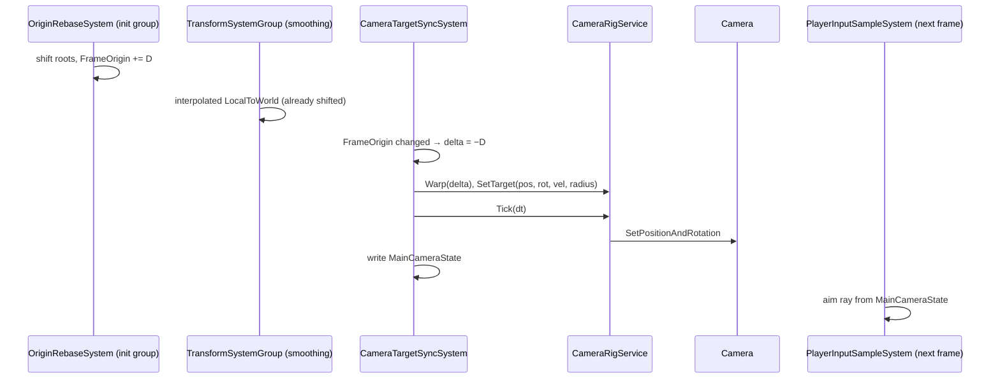

# SPEC-62 — Camera

| | |
|---|---|
| **Status** | Draft |
| **Area code** | CAM (task IDs are `CAM-001`, `CAM-002`, …) |
| **Module(s)** | `Game.Presentation` (folder `Assets/Game/Presentation/`); one pure-math file in `Game.UI` (`MapViewTransform`, because map screens live in `Game.UI`, which cannot reference `Game.Presentation`) |
| **Depends on specs** | SPEC-01 (`GameRoot` constructs `CameraRigService`, binds systems, forwards settings), SPEC-03 (camera input actions), SPEC-10 (`VoxelGrid`), SPEC-12 (`PhysicsLayers` camera query filter), SPEC-20 (`PlayerShip`, graphical smoothing on the player ship), SPEC-30 (`FrameOrigin`), SPEC-63 (`FxEvent` frame view for shake), SPEC-60 (reduce-motion flag) |
| **Depended on by** | SPEC-03 (`MainCameraState` for mouse aim), SPEC-51 (editor orbit mode, picking ray), SPEC-61 (radar orientation from camera yaw; map screens use `MapViewTransform`), SPEC-63/64 (camera position for culling and the listener) |
| **Milestone** | M1 (rig, flight follow), M2 (shake), M3 (origin warp, occlusion, editor orbit, map transform) |

> Read [01-architecture.md](../01-architecture.md), [02-conventions.md](../02-conventions.md) and [03-glossary.md](../03-glossary.md) before this spec. This spec may not contradict them.

## 1. Purpose

The camera shows the planar game from above and behind the player ship so the flight plane always reads as a plane, follows the ship smoothly at any frame rate, zooms between close inspection and tactical overview, and never pops when the floating origin moves. The same rig provides the ship editor's orbit camera and the main-menu backdrop, and publishes an unmanaged `MainCameraState` so ECS code (mouse aiming) never touches the managed camera. The 2D map screens use a separate pan/zoom view transform. It replaces the old prototype's camera that started edge-on to the play plane (pitch overwritten to 0, audit LEDGER R7 fix note), swooped 5,000 units after an origin shift (03-B9c), used frame-rate-dependent lerps (03-B26), sat at the star centre when the player had no ship (03-S5), and the scene without a camera (06-E11).

## 2. Scope

**In scope:**
- Decision and ADR: custom rig, no Cinemachine.
- `CameraRigService` (one `Camera` for the whole app), modes `Menu`, `Flight`, `EditorOrbit`, `Hold`, blends and cuts.
- `CameraTargetSyncSystem`: reads the player ship's interpolated `LocalToWorld`, warps on origin change, cuts on teleport, writes `MainCameraState`.
- Flight follow: pitch, zoom, mouse orbit, look-ahead, heading follow, occlusion pull-in.
- Screen shake from `FxEvent`s, scaled by a setting and disabled by reduce motion.
- Editor orbit camera API for SPEC-51.
- `MapViewTransform` (2D pan/zoom) for the galaxy and star-system map screens (SPEC-61).

**Out of scope (and who owns it instead):**
- Mouse-aim ray to `ShipCommand.AimWorld` → SPEC-03 (reads `MainCameraState`).
- Audio listener placement → SPEC-64 (AudioRoot owns the listener; the rig supplies a pivot, ADR-0039).
- Map rendering, markers and selection → SPEC-61.
- Cinematic sequences → not in v1.
- Post-processing volumes → SPEC-80/81.

## 3. Decisions (binding)

1. **Custom rig, no Cinemachine package.** Reasons: (a) Cinemachine's de-occluder/decollider uses PhysX queries and this game has no PhysX colliders at runtime (ADR-0004); (b) Cinemachine targets `Transform`s, so every ECS target would need a synced proxy GameObject; (c) `CinemachineInputAxisController` reads input directly and would bypass `InputService` contexts (architecture §8); (d) the needs are small (follow, orbit, zoom, shake, warp) and pure-math testable; (e) adding a package needs an ADR (ADR-0011). Recorded by CAM-002 in [ADR-0038](../decisions/ADR-0038-camera-rig.md).
2. **One `Camera` for the whole app**, instantiated by `CameraRigService` from `CameraConfig.CameraPrefab` as a child of `GameRoot` (DontDestroyOnLoad). Content scenes (`MainMenu`, `World`, `BlueprintLab`) contain **no** `Camera` component. Reason: 06-E11 (uncleared back buffer) and one owner.
3. **The flight plane never reads edge-on.** Flight pitch (angle between camera forward and the XZ plane) is clamped to **[35°, 80°]**, default **55°** (DESIGN-SYSTEM §4 reference camera). Config validation rejects `MinPitchDeg < 20`.
4. **Distances are absolute metres**, default **150 m**, range **[25 m, 400 m]** (DESIGN-SYSTEM §4: 50 / 150 / 300 m reference), vertical FOV **40°**.
5. **All smoothing is exponential with half-lives** (`Damp(current, target, halfLife, dt) = lerp(target, current, exp2(-dt / halfLife))`), using `Time.unscaledDeltaTime` clamped to [0, 0.1] s. Reason: frame-rate independence (03-B26) and settling while paused.
6. **The target is the interpolated `LocalToWorld`** of the entity with `PlayerShip` (smoothing on, SPEC-20), read once per frame by `CameraTargetSyncSystem`. Gameplay never reads the camera.
7. **Origin shift = warp, star-system entry or spawn = cut.** The rig detects origin changes from the `FrameOrigin` singleton (binding type) in the same frame the rebase happened, so there is never a one-frame pop. A target jump larger than **250 m** that is not explained by the origin delta is a cut.
8. **Only `CameraTargetSyncSystem` reads ECS for the camera**; the rig (`CameraRigService`) is plain C# fed by that system and by `ICameraInput`. UI code never reads the camera or ECS.
9. **Camera input comes only through `InputService` actions** (SPEC-03). Disabled maps read zero, so context gating is automatic.
10. **Maps are 2D UI**, not 3D camera modes. The 3D camera keeps its last mode under an opaque map screen.
11. **Shake is additive presentation offset**, never moves the logical focus, and is zero when reduce motion is on.
12. **Occlusion pull-in uses Unity Physics** (`PhysicsWorldSingleton.CastRay`) with `PhysicsLayers` camera query filter (SPEC-12), ignoring the player's own grid.

## 4. Data model

### 4.1 Public contract (`Game.Presentation`)

```csharp
namespace Game.Presentation.Data
{
    /// Implements SPEC-62 §4.1.
    public enum CameraMode : byte { Menu = 0, Flight = 1, EditorOrbit = 2, Hold = 3 }
    public enum CameraYawMode : byte { FollowHeading = 0, Free = 1 }
    public enum EditorView : byte { Iso = 0, Top = 1, Front = 2, Side = 3 }

    /// Player settings forwarded by Game.App from SettingsService (SPEC-01).
    public struct CameraSettings
    {
        public float MouseSensitivity;   // 0.1..3.0, default 1.0
        public bool InvertOrbitY;        // default false
        public CameraYawMode YawMode;    // default FollowHeading
        public float ShakeScale;         // 0..1, default 1.0
        public bool ReduceMotion;        // default false (same value as SPEC-60 AccessibilityOptions)
    }

    [System.Serializable]
    public struct ShakeRule
    {
        public FxKind Kind;                     // SPEC-63 contract enum; add the `using` of the namespace SPEC-63 defines (§10 Q4)
        public float Strength;                  // trauma added at distance 0
        public float RadiusMeters;              // linear falloff to 0 at this distance
    }

    /// Implements SPEC-62 §4.1. One asset: Assets/Game/Presentation/Data/CameraConfig.asset.
    [UnityEngine.CreateAssetMenu(menuName = "Game/Presentation/Camera Config")]
    public sealed class CameraConfig : UnityEngine.ScriptableObject
    {
        public UnityEngine.GameObject CameraPrefab;          // Presentation/Data/MainCamera.prefab
        public float VerticalFovDeg = 40f;
        public float NearClip = 0.3f;
        public float FarClip = 50000f;
        // flight
        public float DefaultPitchDeg = 55f, MinPitchDeg = 35f, MaxPitchDeg = 80f;
        public float DefaultDistance = 150f, MinDistance = 25f, MaxDistance = 400f;
        public float ZoomStepFactor = 0.88f;                 // distance *= factor^steps (steps > 0 = zoom in)
        public float OrbitDegPerPixel = 0.25f;
        public float FocusHalfLife = 0.06f, YawHalfLife = 0.12f, PitchHalfLife = 0.08f, ZoomHalfLife = 0.12f;
        public float LookAheadSeconds = 0.4f, LookAheadMaxFraction = 0.35f, LookAheadHalfLife = 0.35f;
        public float TeleportCutDistance = 250f;
        public float OcclusionMargin = 1.0f, OcclusionMinDistance = 5f, OcclusionReleaseHalfLife = 0.3f;
        // editor orbit
        public float EditorMinPitchDeg = -89f, EditorMaxPitchDeg = 89f;
        public float EditorMinDistance = 2f, EditorDistanceRadiusFactor = 2.5f, EditorDistancePad = 5f;
        public float EditorMaxDistanceRadiusFactor = 6f, EditorMaxDistancePad = 100f;
        public float EditorPanPerPixelPerMeter = 0.0015f, EditorHalfLife = 0.05f, EditorFocusPadding = 1.2f;
        public float EditorPivotBoundsPad = 50f;
        // blends and menu
        public float BlendSeconds = 0.5f;
        public UnityEngine.Vector3 MenuPosition = new UnityEngine.Vector3(0f, 60f, -120f);
        public UnityEngine.Vector3 MenuLookAt = UnityEngine.Vector3.zero;
        public float MenuDriftDegPerSecond = 2f;
        // shake
        public float TraumaDecayPerSecond = 1.4f, ShakeFrequencyHz = 22f;
        public float ShakeMaxOffsetFraction = 0.01f;         // × current distance, metres
        public float ShakeMaxAngleDeg = 2.0f;
        public ShakeRule[] ShakeRules = new ShakeRule[0];
    }
}

namespace Game.Presentation.Components
{
    /// Written once per frame by CameraTargetSyncSystem (end of its OnUpdate). Read by ECS code that needs the view (SPEC-03 aim).
    public struct MainCameraState : Unity.Entities.IComponentData
    {
        public Unity.Mathematics.float3 Position;          // local frame (relative to FrameOrigin)
        public Unity.Mathematics.quaternion Rotation;
        public float VerticalFovDeg;
        public float Aspect;
        public float NearClip, FarClip;
        public Unity.Mathematics.float2 ScreenSizePx;
        public Unity.Mathematics.float4x4 ViewProjection;  // GL.GetGPUProjectionMatrix not applied; camera.projectionMatrix × worldToCameraMatrix
        public Game.Presentation.Data.CameraMode Mode;
        public uint FrameIndex;                            // Time.frameCount at write
    }
}

namespace Game.Presentation.Services
{
    /// Per-frame camera input, sampled by InputCameraInput (CAM-005) from SPEC-03 actions.
    public interface ICameraInput
    {
        UnityEngine.Vector2 OrbitDelta { get; }   // pixels this frame; zero unless the orbit hold is active
        UnityEngine.Vector2 PanDelta { get; }     // pixels this frame; editor only
        float ZoomSteps { get; }                  // scroll notches this frame; +1 = zoom in
        bool RecenterPressed { get; }
        bool FocusPressed { get; }                // editor
        bool ViewIsoPressed { get; }
        bool ViewTopPressed { get; }
        bool ViewFrontPressed { get; }
        bool ViewSidePressed { get; }
        void Sample();                            // called once per frame by CameraRigService.Tick before reading
    }
}
```

### 4.2 Internal state (`CameraRigService`)

```csharp
// internal fields of CameraRigService (Game.Presentation.Services)
UnityEngine.Camera camera; UnityEngine.Transform cameraTransform;
CameraMode mode; CameraSettings settings; bool reduceMotion;
// follow target (set by CameraTargetSyncSystem)
bool hasTarget; float3 targetPos; quaternion targetRot; float3 targetVel; float targetRadius;
// flight state
float yawDeg, yawOffsetDeg, pitchDeg, pitchTargetDeg, distance, distanceTarget, occlusionDistance;
float3 focus, lookAhead, previousFollowPosition, framingOffset;
bool hasBounds; float3 boundsMin, boundsMax; float4x4 boundsTransform; // CAM-012: local solid bounds and their world transform
// editor state
float3 pivot, pivotTarget; float edYaw, edYawTarget, edPitch, edPitchTarget, edDistance, edDistanceTarget;
float3 boundsCenter; float boundsRadius; bool suppressZoom, suppressOrbit;
// blend
bool blending; float blendT; float3 blendFromPos; quaternion blendFromRot;
// shake
float trauma, shakeTime;
// output
float3 outPos; quaternion outRot;
float3 unshakenPos; quaternion unshakenRot; // Hold/targetless Flight retain this logical pose, preventing accumulated shake offsets
```

### 4.3 Map view transform (`Assets/Game/UI/Data/MapViewTransform.cs`, *public contract*, namespace `Game.UI.Data`)

```csharp
namespace Game.UI.Data
{
    /// Implements SPEC-62 §4.3. 2D pan/zoom between map units (light-years or metres) and panel pixels. +Y map = up on screen.
    public struct MapViewTransform
    {
        public Unity.Mathematics.double2 Center;          // map units at the view centre
        public double UnitsPerPixel;                      // zoom; smaller = closer
        public double MinUnitsPerPixel, MaxUnitsPerPixel;
        public Unity.Mathematics.float2 ViewSize;         // panel pixels (contentRect size)

        public Unity.Mathematics.float2 MapToView(Unity.Mathematics.double2 p);   // ((p - Center) / UnitsPerPixel) with y flipped, + ViewSize / 2
        public Unity.Mathematics.double2 ViewToMap(Unity.Mathematics.float2 v);   // exact inverse of MapToView
        public void ZoomAt(Unity.Mathematics.float2 viewPoint, float steps);     // UnitsPerPixel *= 0.85^steps (clamped); map point under viewPoint stays fixed
        public void Pan(Unity.Mathematics.float2 viewDelta);                      // Center -= (viewDelta.x, -viewDelta.y) * UnitsPerPixel
        public void Frame(Unity.Mathematics.double2 min, Unity.Mathematics.double2 max, float paddingPx); // fits the box, centred, clamped zoom
        public void ClampCenter(Unity.Mathematics.double2 min, Unity.Mathematics.double2 max);           // Center stays inside the box
    }
}
```

## 5. Systems, services and flow

### 5.1 `CameraTargetSyncSystem`

- **Type:** managed `SystemBase` in `Game.Presentation.Systems` (a presentation bridge listed in the architecture pipeline). `[UpdateInGroup(typeof(PresentationBridgeGroup))]`, `[UpdateAfter(typeof(AudioEventDrainSystem))]`, `[UpdateBefore(typeof(HudSyncSystem))]`.
- **Runs in every scene** (menu, world, lab): it is presentation, not gameplay. `OnCreate` creates the `MainCameraState` singleton entity and calls `RequireForUpdate<MainCameraState>()`.
- **Binding:** `public void Bind(CameraRigService rig, IFxFrameReader fx)` called once by `Game.App` (SPEC-01) after services are built; unbound → `OnUpdate` returns immediately.
- **Reads:** `FrameOrigin` (optional), `PlayerShip` + `LocalToWorld` + `VoxelGrid` + `PhysicsVelocity` (optional) of the player ship, `PhysicsWorldSingleton` (occlusion, Flight only), the frame's `FxEvent`s through `IFxFrameReader`.
- **Writes:** `MainCameraState` (sole writer); the camera `Transform` through the rig. No structural changes after `OnCreate`.

Per-frame algorithm:
1. If not bound, return. `dt = clamp(Time.unscaledDeltaTime, 0, 0.1)`.
2. **Origin warp** (marker `CameraTargetSyncSystem.Origin`): if a `FrameOrigin` singleton exists, `o = FrameOrigin.OriginInStarSystem`. If `hasLastOrigin && any(o != lastOrigin)`: `float3 delta = (float3)(lastOrigin - o); rig.Warp(delta); warpDelta = delta;` else `warpDelta = 0`. Set `lastOrigin = o; hasLastOrigin = true`. If no `FrameOrigin` exists, `hasLastOrigin = false`.
3. **Target** (marker `CameraTargetSyncSystem.ReadTarget`): query entities with `PlayerShip` and `LocalToWorld`. If none: `rig.ClearTarget()`, `lastTarget = Entity.Null`, go to step 6. If more than one: take the lowest `Entity.Index` and `GameLog.WarnOnce("camera.multiplayership", …)`.
4. Read `pos = ltw.Position`, `rot = quaternion(ltw.Value)` (orthonormalised), `vel = PhysicsVelocity.Linear` or 0, `radius = max(2, 0.5 * length((CellMax + 1 - CellMin) * CellSize))` or 10 when no `VoxelGrid`. For grids use the conservative solid bounds `[CellMin * CellSize, (CellMax + 1) * CellSize]`, transformed by LocalToWorld, for flight framing (Q15); brick allocation bounds are not hull bounds.
5. `bool cut = entity != lastTarget || length(pos - (lastTargetPos + warpDelta)) > TeleportCutDistance`. `rig.SetTarget(pos, rot, vel, radius, cut)`. Supply those local bounds and LocalToWorld through the rig's internal `SetTargetBounds` after SetTarget. Store `lastTarget`, `lastTargetPos = pos`.
6. **Shake input** (marker `CameraTargetSyncSystem.Shake`): if `rig.Mode == Flight`, for each `FxEvent e` in `fx.Current` whose `Kind` has a `ShakeRule`: `rig.AddImpulse(e.Pos, rule.Strength * max(e.Scale, 0), rule.RadiusMeters)`. At most 256 events are examined per frame (the rest ignored).
7. **Occlusion** (marker `CameraTargetSyncSystem.Occlusion`, Flight with target only): desired camera position `d = rig.DesiredFlightPosition()`; ray from `rig.Focus` to `d` using `PhysicsWorldSingleton.CollisionWorld.CastRay` with `PhysicsLayers` camera query filter (§10 Q3) and an `IgnoreEntityClosestHitCollector` that skips hits whose `Entity` is the player ship entity. Call `CompleteDependency()` before the cast (allowed: presentation group, not the fixed step). Hit at fraction f → `rig.SetOcclusionDistance(max(OcclusionMinDistance, f * length(d - focus) - OcclusionMargin))`, else `rig.SetOcclusionDistance(float.PositiveInfinity)`.
8. `rig.Tick(dt)` (§5.2).
9. Write `MainCameraState` from `rig.Camera` (`Position`, `Rotation`, FOV, `aspect`, clips, `pixelWidth/Height`, `projectionMatrix * worldToCameraMatrix`, `Mode`, `Time.frameCount`).

### 5.2 `CameraRigService.Tick(dt)` (marker `CameraRigService.Tick`)

1. `input.Sample()`.
2. Compute the mode pose `(p, r)`:
   - **Menu:** `yaw += MenuDriftDegPerSecond * dt` (0 when reduce motion). `p` = `MenuLookAt + rotateY(yaw) * (MenuPosition - MenuLookAt)`; `r = LookRotation(MenuLookAt - p, up)`.
   - **Hold:** `p, r` = last output pose.
   - **Flight:** §5.3. Without a target: Hold.
   - **EditorOrbit:** §5.4.
3. **Blend:** if `blending`: `blendT += dt / BlendSeconds`; `w = smoothstep(0, 1, blendT)`; `p = lerp(blendFromPos, p, w)`; `r = slerp(blendFromRot, r, w)`; stop when `blendT ≥ 1`.
4. **Shake:** retain the unshaken mode/blend pose separately for Hold and targetless Flight; `trauma = max(0, trauma - TraumaDecayPerSecond * dt)`; `s = trauma * trauma * settings.ShakeScale`; `shakeTime += dt`; `n(k) = noise.snoise(float2(shakeTime * ShakeFrequencyHz, k))`; `offset = float3(n(0), n(10), 0) * ShakeMaxOffsetFraction * currentDistance * s` in camera space; `rShake = Euler(radians(n(20) * ShakeMaxAngleDeg * s), radians(n(30) * ShakeMaxAngleDeg * s), radians(n(40) * ShakeMaxAngleDeg * 0.5 * s))`. Skip when `s == 0` or reduce motion.
5. `outPos = p + mul(r, offset)`, `outRot = mul(r, rShake)`; `cameraTransform.SetPositionAndRotation(outPos, outRot)`.

`AddImpulse(worldPos, strength, radius)` adds `strength * saturate(1 - distance(worldPos, Focus) / radius)` to trauma, saturating the result to [0,1]. Nonpositive strength/radius or nonfinite inputs are ignored. Accessibility suppresses/scales only the output; trauma still decays with unscaled time.

`SetMode(CameraMode m, bool cut)`: if `cut` or reduce motion → `blending = false`; else `blending = true, blendT = 0, blendFrom = last output pose`. Entering Flight resets `pitchTarget = DefaultPitch`, `distanceTarget = DefaultDistance`, `yawOffset = 0`.

### 5.3 Flight follow

1. Orbit: `k = OrbitDegPerPixel * settings.MouseSensitivity`. `yawOffsetDeg += input.OrbitDelta.x * k`; `pitchTargetDeg -= input.OrbitDelta.y * k * (InvertOrbitY ? -1 : 1)`; clamp `pitchTargetDeg` to `[MinPitchDeg, MaxPitchDeg]`.
2. Zoom: `distanceTarget = clamp(distanceTarget * pow(ZoomStepFactor, input.ZoomSteps), MinDistance, MaxDistance)`.
3. Recenter pressed: `yawOffsetDeg = 0; pitchTargetDeg = DefaultPitchDeg`.
4. Ship heading: `f = mul(targetRot, float3(0,0,1))`; `shipYaw = degrees(atan2(f.x, f.z))` (ship forward is +Z, §10 Q7). `desiredYaw = (YawMode == FollowHeading ? shipYaw : 0) + yawOffsetDeg`.
5. On cut: `yaw = desiredYaw; pitch = pitchTarget; distance = distanceTarget; lookAhead = 0; focus = targetPos;` skip step 6.
6. `yaw = DampAngle(yaw, desiredYaw, YawHalfLife, dt)` (shortest arc); `pitch = Damp(pitch, pitchTarget, PitchHalfLife, dt)`; `distance = Damp(distance, distanceTarget, ZoomHalfLife, dt)`. `la = targetVel * LookAheadSeconds; la.y = 0; la = clampLength(la, LookAheadMaxFraction * distance)`; Integrate the look-ahead/focus cascade exactly for a linearly interpolated target position over the frame and a constant `la` goal (Q13): `kf=ln(2)/FocusHalfLife`, `kl=ln(2)/LookAheadHalfLife`, `A=exp(-kf*dt)`, `B=exp(-kl*dt)`. With old look-ahead `L`, `focus = lerp(targetPos+la, focus, A) + (targetPos-previousFollowPosition)*(A-(1-A)/(kf*dt)) + (L-la)*kf*(B-A)/(kf-kl)`; then `lookAhead = lerp(la,L,B)`. For equal rates the last coefficient is `kf*dt*A`; use its series near equality and the small-step series for the ramp coefficient to avoid cancellation. At dt=0 skip integration. Store `previousFollowPosition=targetPos` after each Flight pose, including cuts. This preserves exponential half-lives without endpoint-sampling bias.
7. Occlusion: `effective = min(distance, occlusionDistance)`; when `occlusionDistance` is infinite or larger than the previous effective distance, the effective distance returns with `OcclusionReleaseHalfLife` (pull-in is immediate, release is smooth).
8. `r = quaternion.Euler(radians(pitch), radians(yaw), 0)` (yaw about Y, then pitch about local X; positive pitch looks down); `p = focus - mul(r, float3(0,0,1)) * effective`.
9. **Flight framing (CAM-012, Q15):** preserve the unconstrained `focus` filter state and compute a separate output offset. Let `c` be the transformed solid-bounds center, `t = inverse(r) * (focus - c)`. A camera centered on `c` at the requested effective distance defines each corner `v = inverse(r) * (corner - c) + (0,0,effective)`. At translation fraction `a`, the corner is `v - a*t`. Clip the interval `a ∈ [0,1]` against all eight corners and the camera's six frustum half-spaces: `z*tanX ± x`, `z*tanY ± y`, `z-near`, `far-z` must stay nonnegative (`tanX = tan(FOV/2)*aspect`). Each margin is linear in `a`; a decreasing margin limits `a` to `margin(0)/-slope`. Use the greatest admissible fraction. If the hull does not fit even at `a=0`, use `a=0` (deliberate close inspection keeps its center visible). The output focus is `c + a*(focus-c)` and `p = outputFocus - forward*effective`; never change distance, pitch, yaw, look-ahead/filter state or input targets. `Focus`/`DesiredFlightPosition` expose the corrected output focus/pose. SetTarget without explicit voxel bounds uses a conservative cube of the supplied radius around the target; cuts and Menu reset the output offset. Bounds and calculations are allocation-free; no target scan or new ECS component. Framing is applied before the existing mode blend and future shake/occlusion behavior; those tasks must preserve their specified effects.

`Warp(delta)` adds `delta` to `focus`, `targetPos`, `pivot`, `pivotTarget`, `boundsCenter`, `blendFromPos`, `previousFollowPosition` and the last output pose. Also translate the cached flight `boundsTransform` when `hasBounds`; `framingOffset` is a displacement and stays unchanged. Nothing else changes, so the camera-to-target offset is identical before and after the shift.

### 5.4 Editor orbit

`EnterEditorOrbit(float3 center, float radius, bool cut)`: `boundsCenter = center; boundsRadius = max(radius, 1)`; `pivotTarget = center`; `edYawTarget = 45; edPitchTarget = 30`; `edDistanceTarget = clamp(radius * EditorDistanceRadiusFactor + EditorDistancePad, EditorMinDistance, MaxEd)` with `MaxEd = radius * EditorMaxDistanceRadiusFactor + EditorMaxDistancePad`; `SetMode(EditorOrbit, cut)`; on cut copy targets to current values.

Per tick:
1. Unless `suppressOrbit`: `edYawTarget += OrbitDelta.x * k`; `edPitchTarget = clamp(edPitchTarget - OrbitDelta.y * k * inv, EditorMinPitchDeg, EditorMaxPitchDeg)`.
2. Pan: `right = mul(r, float3(1,0,0)); up = mul(r, float3(0,1,0))`; `pivotTarget += (-right * PanDelta.x + -up * PanDelta.y) * edDistance * EditorPanPerPixelPerMeter`; clamp `pivotTarget` to the AABB `boundsCenter ± (boundsRadius + EditorPivotBoundsPad)`.
3. Unless `suppressZoom`: `edDistanceTarget = clamp(edDistanceTarget * pow(ZoomStepFactor, ZoomSteps), EditorMinDistance, MaxEd)`.
4. View keys: Iso → (45°, 30°); Top → (current yaw, 89°); Front → (0°, 0°); Side → (90°, 0°).
5. Damp yaw (angle), pitch, distance, pivot with `EditorHalfLife`. `r = Euler(radians(edPitch), radians(edYaw), 0)`; `p = pivot - mul(r, float3(0,0,1)) * edDistance`.

`FocusOn(float3 center, float radius)`: `pivotTarget = center; edDistanceTarget = clamp(radius * EditorFocusPadding / sin(radians(VerticalFovDeg / 2)), EditorMinDistance, MaxEd)`. `SetEditorSuppression(bool zoom, bool orbit)` sets the flags; they reset to false on every `SetMode`.

`FocusPressed` calls `FocusOn(boundsCenter, boundsRadius)` after the view keys; selection-specific framing is supplied through the public `FocusOn` API. `Focus`, `CurrentDistance` and `YawDeg` expose the editor pivot/distance/yaw while in EditorOrbit, leaving flight filter state separate. A reduced-motion mode entry copies the editor targets immediately, just as an explicit cut does (Q18).

### 5.5 Flow



## 6. Public API

```csharp
namespace Game.Presentation.Services
{
    public sealed class CameraRigService : System.IDisposable
    {
        /// Instantiates config.CameraPrefab under `parent` (GameRoot transform). Throws when the prefab has no Camera.
        public CameraRigService(Game.Presentation.Data.CameraConfig config, UnityEngine.Transform parent, ICameraInput input);
        public UnityEngine.Camera Camera { get; }
        public UnityEngine.Transform ListenerPivot { get; }        // ADR-0039: AudioService follows this; rig owns its lifetime
        public Game.Presentation.Data.CameraMode Mode { get; }
        public Unity.Mathematics.float3 Focus { get; }
        public float CurrentDistance { get; }
        public float YawDeg { get; }                                // radar orientation (SPEC-61)
        public void SetMode(Game.Presentation.Data.CameraMode mode, bool cut);
        public void ApplySettings(in Game.Presentation.Data.CameraSettings settings);
        public void SetTarget(Unity.Mathematics.float3 pos, Unity.Mathematics.quaternion rot, Unity.Mathematics.float3 vel, float radius, bool cut);
        public void ClearTarget();
        public void Warp(Unity.Mathematics.float3 delta);
        public void AddImpulse(Unity.Mathematics.float3 worldPos, float strength, float radius);
        public Unity.Mathematics.float3 DesiredFlightPosition();
        public void SetOcclusionDistance(float distance);
        public void EnterEditorOrbit(Unity.Mathematics.float3 center, float radius, bool cut);
        public void FocusOn(Unity.Mathematics.float3 center, float radius);
        public void SnapView(Game.Presentation.Data.EditorView view);
        public void SetEditorSuppression(bool zoom, bool orbit);
        public UnityEngine.Ray ScreenPointToRay(UnityEngine.Vector2 screenPosBottomLeft);   // = Camera.ScreenPointToRay
        public void Tick(float dt);
        public void Dispose();                                       // destroys the camera GameObject
    }

    /// Frame view of FxEvents (implemented over SPEC-63; see §10 Q4).
    public interface IFxFrameReader { Unity.Collections.NativeArray<FxEvent>.ReadOnly Current { get; } }   // FxEvent: architecture §6.6, namespace per SPEC-63
}
```

Mode ownership: `Game.App` sets `Menu` when MainMenu is ready, `Flight` (cut) when World is ready, and SPEC-51's editor host calls `EnterEditorOrbit` (cut in the Lab, blend for in-world edit). Nobody else calls `SetMode`.

## 7. Edge cases and failure behaviour

| Situation | Required behaviour |
|---|---|
| No `PlayerShip` entity (intro, death cleanup, menu) | Flight holds the last pose; never moves to the origin (03-S5) |
| Player ship entity replaced (respawn, editor round trip) | Cut to the new target |
| Origin rebase of 2,000 m | Warp; camera-to-target offset unchanged to 1e-3 m; no smoothing transient |
| Star-system entry (origin reset plus target placed at lane entry) | Warp by the origin delta, then cut if the residual jump > 250 m |
| Two entities with `PlayerShip` | Use lowest `Entity.Index`, warn once |
| `dt` spike (alt-tab, 2 s frame) | `dt` clamped to 0.1 s |
| Paused (time scale 0) | Smoothing continues with unscaled time; no flight input (context Menu) |
| Mouse orbit beyond limits | Pitch clamped to [35°, 80°] in flight, [−89°, 89°] in the editor |
| Large station between ship and camera | Pull-in to hit distance − 1 m, minimum 5 m; smooth release |
| Ray starts inside the player's own grid | Own grid ignored by the collector |
| No `PhysicsWorldSingleton` (menu, lab) | Occlusion skipped |
| Reduce motion on | No shake, no menu drift, mode changes cut instead of blending |
| Shake events beyond 256 in a frame | Extra events ignored |
| `CameraConfig.MinPitchDeg < 20` | Constructor throws `InvalidOperationException` |
| A content scene contains a `Camera` | `ContentScenesTests` fails (CAM-004) |
| Map screen open | 3D camera unchanged (Flight input disabled by context) |

## 8. Performance budget

| Gate | Target | Measured by |
|---|---|---|
| `CameraTargetSyncSystem` + `CameraRigService.Tick` | ≤ 0.05 ms main thread without occlusion, ≤ 0.15 ms with one raycast | `CameraPerformanceTests.FlightFrame_Under0_15ms` (300 frames after 60 warm-up) |
| GC | 0 B/frame | `CameraPerformanceTests.FlightFrame_ZeroGc` |
| Origin rebase (06 world gate "no visible pop") | Camera-target offset error ≤ 1e-3 m across the rebase frame | `CameraOriginShiftTests` |

M1 CAM-011 measures the actual no-occlusion path against **0.05 ms** and zero GC; CAM-007 extends the same timing test with a real raycast fixture against **0.15 ms**. Origin-rebase accuracy belongs to CAM-006. Inclusive system timing includes `CameraRigService.Tick`; do not double count nested markers (Q14).

Profiler markers: `CameraTargetSyncSystem.Origin`, `CameraTargetSyncSystem.ReadTarget`, `CameraTargetSyncSystem.Shake`, `CameraTargetSyncSystem.Occlusion`, `CameraRigService.Tick`. Scale: the system touches one entity (the player ship) and at most 256 Fx events per frame; it never iterates other entities.

## 9. Tasks

### CAM-001 — Public contract types
- **Milestone:** M1
- **Tier:** standard — transcribes the exact code in §4.1, §4.3 and §6 shells
- **Depends on:** `CORE-001`
- **Do:** Create the types of §4.1, `MapViewTransform` (§4.3, methods throw `NotImplementedException`), and `CameraRigService`, `ICameraInput`, `IFxFrameReader` shells (§6). If SPEC-63's `FxKind`/`FxEvent` do not exist yet, `ShakeRule.Kind` and `IFxFrameReader.Current` are added by CAM-008 instead (the empty interface keeps CAM-004 binding independent; Q9) (leave a `// TODO(CAM-008)` comment).
- **Files:** `Assets/Game/Presentation/Data/{CameraMode,CameraYawMode,EditorView,CameraSettings,ShakeRule,CameraConfig}.cs`, `Assets/Game/Presentation/Components/MainCameraState.cs`, `Assets/Game/Presentation/Services/{ICameraInput,IFxFrameReader,CameraRigService}.cs`, `Assets/Game/UI/Data/MapViewTransform.cs`
- **Acceptance criteria:**
  - [x] `tools/compile.sh` passes; all names and signatures match §4 and §6.
  - [x] `MainCameraState` is unmanaged (no reference fields).
- **Tests:** `Assets/Game/Tests/EditMode/Presentation/CameraContractTests.cs`: `MainCameraState_IsUnmanaged` (`UnsafeUtility.IsUnmanaged<MainCameraState>()`), `CameraConfig_Defaults_MatchSpec`.

### CAM-002 — ADR: custom camera rig instead of Cinemachine
- **Milestone:** M1
- **Tier:** frontier — F6: design decision record
- **Depends on:** —
- **Do:** Write `docs/decisions/ADR-NNNN-camera-rig.md` (NNNN = next free number, status *Proposed*) using `ADR-0000-template.md`: context (03 §5.11 recommended Cinemachine 3; ADR-0011 deferred it), decision = §3 decision 1 with reasons (a)–(e), consequences (no authoring tools; cinematic sequences out of v1; revisit via a new ADR if cutscenes are added), alternatives (Cinemachine 3 with proxy transforms and manual axis input). Link it from this spec's §11 in the same commit.
- **Files:** `docs/decisions/ADR-NNNN-camera-rig.md`, `docs/specs/SPEC-62-camera.md`
- **Acceptance criteria:**
  - [x] ADR follows the template and lists all five reasons.
  - [x] `tools/check-docs.py` passes.
- **Tests:** none (document); `tools/check-docs.py` run recorded in the ledger log.

### CAM-003 — Camera math helpers
- **Milestone:** M1
- **Tier:** standard — formulas given exactly in §3 decision 5 and §5.3–§5.4
- **Depends on:** `CAM-001`
- **Do:** Create `static class CameraMath` with `Damp(float, float, float halfLife, float dt)`, `Damp(float3, float3, float, float)`, `DampAngle(float deg, float targetDeg, float halfLife, float dt)` (shortest arc, result in (−180, 180]), `OrbitRotation(float pitchDeg, float yawDeg)`, `OrbitPosition(float3 focus, quaternion r, float distance)`, `ClampLength(float3 v, float max)`, `HeadingYawDeg(quaternion rot)`.
- **Files:** `Assets/Game/Presentation/Services/CameraMath.cs`
- **Acceptance criteria:**
  - [x] `Damp` with halfLife h after time h moves exactly half way.
  - [x] Damping a constant target over 1 s gives the same result (±1e-4) with 30, 60 or 144 equal steps.
  - [x] `DampAngle(170, -170, …)` moves through 180°, not through 0°.
- **Tests:** `Assets/Game/Tests/EditMode/Presentation/CameraMathTests.cs`: `Damp_OneHalfLife_HalfWay`, `Damp_FrameRateIndependent_30_60_144`, `DampAngle_ShortestArc`, `OrbitRotation_PositivePitch_LooksDown`, `HeadingYaw_PlusZ_IsZero`.

### CAM-004 — Rig service, camera prefab, Menu/Hold modes and the sync system shell
- **Milestone:** M1
- **Tier:** frontier — F1/F5: the single app camera and its frame-ordering in the presentation pipeline
- **Depends on:** `CAM-003`, `FND-001`
- **Do:** Create `MainCamera.prefab` (Camera with FOV/clips from config, `UniversalAdditionalCameraData`, no `AudioListener` (ADR-0039)). Implement `CameraRigService` constructor, `Dispose`, `SetMode`, blends, Menu and Hold modes, `Tick` steps 1–3 and 5 (shake added by CAM-008), `ApplySettings`, `ScreenPointToRay`. Implement `CameraTargetSyncSystem` with `OnCreate` (singleton, `RequireForUpdate<MainCameraState>`), `Bind`, steps 1, 3–5, 8, 9 of §5.1. Add `ProfilerMarker`s of §8. Add a guard test that content scenes contain no `Camera`. Wire SPEC-01 step 11 (serialized config, scene modes, settings, listener target and optional thumbnails); update the existing composition-order expectation. Input/FX staging follows Q11.
- **Files:** `Assets/Game/Presentation/Data/{MainCamera.prefab,CameraConfig.asset}`, `Assets/Game/Presentation/Services/CameraRigService.cs`, `Assets/Game/Presentation/Systems/CameraTargetSyncSystem.cs`; SPEC-01 composition/config/settings and GameRoot prefab; existing `CompositionTests`.
- **Acceptance criteria:**
  - [x] Constructing the rig creates exactly one `Camera` under the parent; `Dispose` destroys it.
  - [x] Menu mode drifts 2°/s; reduce motion stops the drift.
  - [x] Unbound system does nothing; bound system writes `MainCameraState` every frame in a scene without gameplay.
  - [x] `MainMenu`, `World`, `BlueprintLab` scenes contain no `Camera` component (06-E11).
- **Tests:** `Assets/Game/Tests/EditMode/Presentation/CameraRigServiceTests.cs`: `Construct_CreatesOneCamera`, `Dispose_DestroysCamera`, `MinPitchBelow20_Throws`, `SetMode_Blend_ReachesTargetAfterBlendSeconds`, `SetMode_ReduceMotion_Cuts`, `Menu_Drift_TwoDegreesPerSecond`. `Assets/Game/Tests/EditMode/Presentation/CameraTargetSyncSystemTests.cs` (`EcsTestWorld`): `Unbound_NoWrite`, `Bound_WritesMainCameraStateEveryFrame`, `NoPlayerShip_ClearsTarget`. `Assets/Game/Tests/EditMode/Presentation/ContentScenesTests.cs`: `ContentScenes_HaveNoCamera`.

### CAM-005 — Flight follow mode and camera input
- **Milestone:** M1
- **Tier:** frontier — F3/F6: resolve and verify moving-target damping discretisation (Q13)
- **Depends on:** `CAM-004`, `FLT-001`, `VOX-001`, `INP-001`
- **Do:** Implement §5.3 steps 1–6 and 8 (occlusion = infinite until CAM-007), target cut rules (§5.1 step 5), and `InputCameraInput : ICameraInput` over SPEC-03 actions (§10 Q1).
- **Files:** `Assets/Game/Presentation/Services/CameraRigService.cs`, `Assets/Game/Presentation/Input/InputCameraInput.cs`, `Assets/Game/Presentation/Systems/CameraTargetSyncSystem.cs`
- **Acceptance criteria:**
  - [x] Default flight pose: pitch 55°, distance 150 m, behind the ship's heading.
  - [x] Under any orbit input the angle between camera forward and the XZ plane stays in [35°, 80°] (regression: plane never edge-on).
  - [x] Following a target moving at 100 m/s for 2 s gives the same final camera position (±0.05 m) at 30, 60 and 144 FPS.
  - [x] New player ship entity → cut (no swoop).
- **Tests:** `Assets/Game/Tests/EditMode/Presentation/FlightCameraModeTests.cs`: `Default_PitchIs55_NotEdgeOn`, `FuzzOrbitInput_1000Frames_PitchInRange` (fixed-seed `RngStreams`), `Zoom_ClampedToRange`, `Recenter_ResetsOffsetAndPitch`, `FollowHeading_YawTracksShip`, `FrameRateIndependence_30_60_144`, `LookAhead_ClampedToFractionOfDistance`. `CameraTargetSyncSystemTests`: `NewTargetEntity_Cuts`.

### CAM-006 — Origin warp and teleport cut
- **Milestone:** M3
- **Tier:** frontier — F5: ordering with `OriginRebaseSystem`, smoothing and the transform group; regression of the 03-B9c swoop
- **Depends on:** `CAM-005`, `GAL-001`
- **Do:** Implement §5.1 step 2, the teleport rule in step 5, and `Warp` (§5.3 last paragraph).
- **Files:** `Assets/Game/Presentation/Systems/CameraTargetSyncSystem.cs`, `Assets/Game/Presentation/Services/CameraRigService.cs`
- **Acceptance criteria:**
  - [ ] A 2,000 m origin change plus the matching target shift leaves `outPos - targetPos` unchanged (±1e-3 m) in that frame and the next 10 frames.
  - [ ] A 600 m target jump with no origin change cuts.
  - [ ] Star-system entry (origin reset by 1e6 m, target at lane entry) shows no intermediate frames between the old and new view.
- **Tests:** `Assets/Game/Tests/EditMode/Presentation/CameraOriginShiftTests.cs`: `Warp_OffsetPreserved_SameFrame`, `Warp_NoTransient_Next10Frames`, `TargetJumpWithoutOriginChange_Cuts`, `OriginChangeWithMatchingTargetShift_DoesNotCut`, `NoFrameOrigin_NoWarp`.

### CAM-007 — Occlusion pull-in
- **Milestone:** M3
- **Tier:** frontier — F2: main-thread physics query with an explicit dependency completion in the presentation group
- **Depends on:** `CAM-005`, `PHY-001`
- **Do:** Implement §5.1 step 7 and §5.3 step 7 with `IgnoreEntityClosestHitCollector : ICollector<RaycastHit>`. Extend `CameraPerformanceTests.FlightFrame_Under0_15ms` with a real raycast fixture and measure the 0.15 ms gate (Q14).
- **Files:** `Assets/Game/Presentation/Systems/CameraTargetSyncSystem.cs`, `Assets/Game/Presentation/Services/{CameraRigService,IgnoreEntityClosestHitCollector}.cs`
- **Acceptance criteria:**
  - [ ] A box collider between focus and camera pulls the camera to hit distance − 1 m (min 5 m) in the same frame.
  - [ ] Removing the box restores the distance with half-life 0.3 s.
  - [ ] The player's own grid never causes a pull-in.
  - [ ] Combined camera CPU cost with a real raycast is ≤0.15 ms median; recorded in the ledger (Q14).
- **Tests:** `Assets/Game/Tests/PlayMode/Presentation/CameraOcclusionTests.cs`: `BoxBetween_PullsIn`, `BoxRemoved_ReleasesSmoothly`, `OwnGrid_Ignored`, `NoPhysicsWorld_NoOcclusion`; extend `CameraPerformanceTests.FlightFrame_Under0_15ms` with the raycast fixture (Q14).

### CAM-008 — Screen shake from FxEvents
- **Milestone:** M2
- **Tier:** standard — trauma model given in §5.2 step 4 and §5.1 step 6
- **Depends on:** `CAM-005`, `SPEC-63`
- **Do:** Implement `AddImpulse`, shake in `Tick`, `FxFrameReader : IFxFrameReader` over SPEC-63 (§10 Q4), §5.1 step 6, and the default `ShakeRules` rows in `CameraConfig.asset` (§10 Q5).
- **Files:** `Assets/Game/Presentation/Services/{CameraRigService,FxFrameReader}.cs`, `Assets/Game/Presentation/Systems/CameraTargetSyncSystem.cs`, `Assets/Game/Presentation/Data/{ShakeRule.cs,CameraConfig.asset}`
- **Acceptance criteria:**
  - [ ] An impulse of strength 1 at distance 0 gives trauma 1, which decays to 0 in 1/1.4 s.
  - [ ] An impulse beyond its radius adds nothing.
  - [ ] `ShakeScale = 0` or reduce motion → output pose identical to the unshaken pose.
  - [ ] The logical `Focus` is never changed by shake.
- **Tests:** `Assets/Game/Tests/EditMode/Presentation/CameraShakeTests.cs`: `Impulse_AtZero_TraumaOne`, `Trauma_Decays`, `Impulse_BeyondRadius_Ignored`, `ShakeScaleZero_NoOffset`, `ReduceMotion_NoOffset`, `Shake_DoesNotMoveFocus`, `Over256Events_Capped`.

### CAM-009 — Editor orbit mode
- **Milestone:** M3
- **Tier:** standard — algorithm fully given in §5.4
- **Depends on:** `CAM-005`
- **Do:** Implement `EnterEditorOrbit`, `FocusOn`, `SnapView`, `SetEditorSuppression`, the editor branch of `Tick`, and the editor actions in `InputCameraInput`.
- **Files:** `Assets/Game/Presentation/Services/CameraRigService.cs`, `Assets/Game/Presentation/Input/InputCameraInput.cs`
- **Acceptance criteria:**
  - [ ] Entering with radius 10 → distance 30 m, yaw 45°, pitch 30°.
  - [ ] Pitch clamps at ±89°; pan keeps the pivot within bounds + 50 m.
  - [ ] `SetEditorSuppression(zoom: true, …)` ignores scroll; `SetMode` clears suppression.
  - [ ] `FocusOn` frames a sphere of the given radius inside the vertical FOV.
- **Tests:** `Assets/Game/Tests/EditMode/Presentation/EditorOrbitCameraModeTests.cs`: `Enter_DefaultPose`, `Orbit_PitchClamped`, `Pan_PivotClamped`, `Zoom_Suppressed`, `SnapViews_Angles`, `FocusOn_SphereFitsFov`.

### CAM-010 — Map view transform
- **Milestone:** M3
- **Tier:** standard — formulas given in §4.3
- **Depends on:** `CAM-001`
- **Do:** Implement `MapViewTransform` methods exactly as documented in §4.3 (double precision; zoom factor 0.85 per step; `Frame` uses the larger of the two axis fits).
- **Files:** `Assets/Game/UI/Data/MapViewTransform.cs`
- **Acceptance criteria:**
  - [ ] `ViewToMap(MapToView(p)) == p` within 1e-9 relative for |p| ≤ 1e12.
  - [ ] `ZoomAt(cursor, s)` keeps the map point under the cursor fixed (±0.01 px).
  - [ ] Zoom clamps to `[MinUnitsPerPixel, MaxUnitsPerPixel]`.
- **Tests:** `Assets/Game/Tests/EditMode/UI/MapViewTransformTests.cs`: `RoundTrip_Exact`, `ZoomAt_KeepsPointUnderCursor`, `Zoom_Clamped`, `Pan_MovesOppositeToDrag`, `Frame_FitsBoxWithPadding`, `ClampCenter_StaysInside`.

### CAM-011 — Camera performance and framing tests
- **Milestone:** M1
- **Tier:** standard — measurement of already-specified behaviour
- **Depends on:** `CAM-005`, `TST-001`
- **Do:** Add PlayMode `Performance` tests for §8 and a scripted flight scenario test (player ship flying a circle at 80 m/s for 10 s) asserting zero GC and pitch range each frame.
- **Files:** `Assets/Game/Tests/PlayMode/Presentation/CameraPerformanceTests.cs`
- **Acceptance criteria:**
  - [x] Medians recorded in the ledger *Measurements* table.
  - [x] M1 no-occlusion CPU (≤0.05 ms) and zero-GC gates of §8 pass on the reference machine; CAM-007 owns raycast timing and CAM-006 owns origin accuracy (Q14).
- **Tests:** `CameraPerformanceTests.FlightFrame_Under0_15ms`, `CameraPerformanceTests.FlightFrame_ZeroGc`, `CameraPerformanceTests.CircleFlight_PitchInRangeEveryFrame`.

### CAM-012 — Keep the imported player ship framed during fast close-zoom flight
- **Milestone:** M1
- **Tier:** frontier — F5: camera focus, real target bounds and the playable flight loop
- **Depends on:** `CAM-005`, `FND-001`
- **Do:** Reproduce the UI-005 live finding: the imported Fighter at about 53 m/s, ten zoom-in notches from the default distance and a 25-degree orbit offset is clipped by the bottom of the viewport (`Logs/playtest/fighter-input-isolation.png`). Correct flight framing so follow lag/look-ahead cannot push an otherwise fitting ship out of view. Account for the actual target bounds, camera pitch, FOV and aspect; preserve deliberate close inspection when the hull cannot fit even when centered. Specify the correction in §5 before implementing it, preserving the existing input, damping and origin contracts. Run the real imported ship and capture before/after evidence; this is a gameplay correctness task, not performance tuning or new art.
- **Files:** `Assets/Game/Presentation/Services/CameraRigService.cs`, `Assets/Game/Presentation/Systems/CameraTargetSyncSystem.cs`, `Assets/Game/Tests/PlayMode/Presentation/FlightFramingTests.cs`, `Assets/Game/Tests/PlayMode/App/ProductionSessionFixture.cs` (settle/quit the active test session before restoring a boot root)
- **Acceptance criteria:**
  - [ ] With the existing Fighter, a close zoom that fits the stationary ship continues to show its bounds during sustained 53 m/s flight and heading/orbit changes at 16:9 and 4:3.
  - [ ] When the player deliberately zooms closer than the hull fits, its center remains in view; no silent reset of the requested zoom or orbit.
  - [ ] Existing camera/flight tests pass; an actual game capture demonstrates the corrected fast-flight framing.
- **Tests:** `FlightFramingTests.Fighter_FastFlight_KeepsFittingHullInViewport`, `FlightFramingTests.CloseInspection_KeepsCenterWithoutResettingInput`.

## 10. Open questions

| # | Question | Default if unanswered | Decider | Answer |
|---|---|---|---|---|
| 1 | SPEC-03: camera actions and bindings | Flight map: `CameraOrbitHold` (Button, middle mouse), `CameraLook` (Vector2, pointer delta), `CameraZoom` (float, scroll y / 120 per notch), `CameraRecenter` (Button, C). Editor map: `Orbit` (Vector2 pointer delta while middle mouse or Alt+left mouse), `Pan` (Vector2 delta while Shift+middle mouse), `Zoom` (scroll), `Focus` (F), `ViewIso` (Numpad 5), `ViewTop` (Numpad 7), `ViewFront` (Numpad 1), `ViewSide` (Numpad 3) | Tech lead (SPEC-03) |  |
| 2 | SPEC-01: construction slot and binding of camera services | `GameRoot` constructs `CameraRigService` right after step 9 (`UIRoot`), registers it in `Services`, calls `CameraTargetSyncSystem.Bind(rig, fxReader)`, forwards `CameraSettings` on settings change, and sets `Menu`/`Flight` on scene ready | Tech lead (SPEC-01) |  |
| 3 | SPEC-12: name of the camera query filter in `PhysicsLayers` | `PhysicsLayers.CameraOcclusionQuery` — hits grids (ships, stations, asteroids, hulks), not debris, chunk bodies or sensors | Tech lead (SPEC-12) |  |
| 4 | SPEC-63: how the camera reads the frame's `FxEvent`s | SPEC-63 keeps the frame's events readable as a `NativeArray<FxEvent>.ReadOnly` until the end of `PresentationBridgeGroup`; `FxFrameReader` exposes it; `CameraTargetSyncSystem` runs after `FxUploadSystem` | Tech lead (SPEC-63) |  |
| 5 | Which `FxKind`s shake, and how much | Explosion: 0.5 / 300 m; ship destroyed: 1.0 / 600 m; ram impact: 0.4 / 200 m; projectile hit: 0.05 / 80 m (rows only for kinds that exist in SPEC-63's enum) | Owner |  |
| 6 | SPEC-64: where the `AudioListener` lives | AudioRoot, with camera-owned target pivot | Tech lead (SPEC-64) | Resolved CAM-004 / ADR-0039: retain SPEC-64 ownership; no listener on camera prefab. |
| 7 | SPEC-20: ship forward axis and graphical smoothing on the player ship | Forward = grid +Z, up = +Y; the player ship has `PhysicsGraphicalSmoothing` | Tech lead (SPEC-20) |  |
| 8 | Should the flight yaw default to following the ship heading or stay north-up? | `FollowHeading` (controls are ship-relative); `Free` available in settings | Owner |  |
| 9 | Deferring the whole IFxFrameReader interface to CAM-008 prevents CAM-004 Bind from compiling (CAM-008 depends on CAM-005) | Add an empty binding interface now; defer only its FxEvent property | Tech lead | Resolved CAM-001: retain the §6 interface name with a CAM-008 TODO for Current, and defer ShakeRule.Kind as instructed. No FxKind/FxEvent substitute is invented; VFX-001 owns those contracts. |
| 10 | Camera-prefab listener contradicts SPEC-64’s existing single-listener service | Keep AudioService ownership; expose and bind a rig-owned ListenerPivot | Tech lead | Resolved CAM-004 / ADR-0039; app binds/clears the existing target API, and the rig disposes its pivot. |
| 11 | CAM-004 composition precedes camera input, Fx events, persisted yaw mode and ordering peers | Wire available contracts; explicitly defer missing adapters and peer attributes | Tech lead | Resolved CAM-004 / ADR-0039: null input/FX until CAM-005/CAM-008, FollowHeading default, sensitivity clamped to 0.1–3. AudioEventDrainSystem/HudSyncSystem ordering attributes are added when those types exist. Write the existing optional VoxelViewer for SPEC-11; no lazy singleton creation. Lab uses Hold until CAM-009. |
| 12 | SPEC-03 applies orbit sensitivity/inversion in the adapter and SPEC-62 applies them again; adapter namespace/ownership also differs | Raw orbit pixels from the canonical SPEC-03 Input namespace; rig applies settings once | Tech lead | Resolved CAM-005: implement the Flight branch in Game.Presentation.Input.InputCameraInput; INP-006 extends Editor sampling and owns adapter tests. Zoom sensitivity remains in the adapter, once. CAM-009 consumes the Editor branch. ICameraInput already promises pixel deltas; no public signature changes. |
| 13 | Endpoint-only focus damping violates the moving-target FPS acceptance | Integrate the same exponential cascade with linear target motion over each frame | Tech lead | Resolved CAM-005: initial 100 m/s, 2 s X positions were 232.0124 / 231.2455 / 230.7731 m at 30/60/144 FPS (30–60 error 0.766891 m vs 0.05 m). §5.3 now gives the closed-form integration, including equal-rate/small-step limits; required test and tolerance remain unchanged. Task raised to frontier for this numerical decision. |
| 14 | M1 camera performance task references occlusion/origin paths implemented in M3 | Measure actual no-occlusion CPU/GC now; extend the same timing test in CAM-007 | Tech lead | Resolved CAM-011: enforce 0.05 ms without a raycast, not the looser 0.15 ms label. CAM-007 explicitly owns the real-raycast fixture and 0.15 ms evidence; CAM-006 owns origin accuracy. The ten-second circle advances from the same clamped unscaled dt as the production bridge; captureDeltaTime does not fix unscaledDeltaTime in this Editor (verified by the initial test failure). A real-time timeout bounds a stalled clock. Allocation measurement covers the inclusive bridge/rig update, excluding fixture mutation and assertions. |
| 15 | Fast close-zoom flight pushes the imported Fighter out of frame despite fitting while stationary | Clip the output focus translation against the actual solid-bounds frustum | Tech lead | Resolved CAM-012: use CellMin/CellMax bounds, not brick capacity or a corner-centered radius. Keep damping state and zoom/orbit intact; retain as much desired focus displacement as all bounds permit. Center the hull when deliberate close zoom cannot fit it. Internal bounds handoff only; public camera and ECS contracts unchanged. |
| 16 | The VFX uploader retains its drained list but has no camera view; generic shake-kind names differ from the actual enum | Borrow an internal read-only view of the completed drain, valid for the current rendered frame and consumed synchronously after FxUploadSystem; preserve existing allocation/disposal and queue ownership. Configure both ExplosionSmall/ExplosionLarge at 0.5 / 300 m, RamImpact at 0.4 / 200 m and both HitKinetic/HitEnergy at 0.05 / 80 m; omit ship-destroyed because no such FxKind exists | Tech lead | CAM-008 implements this default. Lead owns GameComposition binding under ADR-0062. |
| 17 | CAM-010's universal 1e-9 round-trip criterion cannot hold through its binding float2 pixel API: at Center=0, UnitsPerPixel=1, ViewSize=(1024,768), p=(0.123456789,0), pixel rounding alone loses about 1.7e-5 map units | Preserve public signatures and exact formulas, compute in double until the final pixel cast, and keep the 1e-9 assertion on independently selected pixel-representable/conditioned points up to 1e12. General inverse error includes UnitsPerPixel times half a pixel float ULP plus double arithmetic error; no universal 1e-9 claim. Zoom anchoring similarly requires double map resolution finer than 0.01 pixel. Frame requires positive viewport area after padding and configured positive ordered zoom limits | Tech lead | CAM-010 records this limitation for lead review; no signature or assembly change. |
| 18 | Focus key has no selection payload, and editor-mode public pose getters/reduced-motion entry need explicit semantics | Focus key frames the configured whole bounds; hosts frame selections through FocusOn. Pose getters expose editor state in EditorOrbit; reduced-motion entry snaps targets as an explicit cut does | Tech lead | CAM-009 uses these defaults and the already implemented INP-006 Editor input adapter; no public signatures or shared composition changes. |

## 11. References

- [ADR-0039 — Camera/listener binding](../decisions/ADR-0039-camera-listener-binding.md).
- [ADR-0038 — Custom camera rig instead of Cinemachine](../decisions/ADR-0038-camera-rig.md) (CAM-002 decision record).

- Audit `03-galaxy-world.md` §5.11 (camera), B9c, B26, S5; `LEDGER.md` R7 (pitch overwritten to 0 → edge-on plane); `06-ui-shipeditor.md` E11, §5.3.2 (editor orbit camera).
- `docs/design/DESIGN-SYSTEM.md` §4 (reference viewing conditions: 40° FOV, 55° pitch, 50/150/300 m).
- Synthesis §6n (Cinemachine disagreement) and ADR-0011.
- "Juicing your cameras with math" (Squirrel Eiserloh, GDC 2016) for trauma-based shake.
