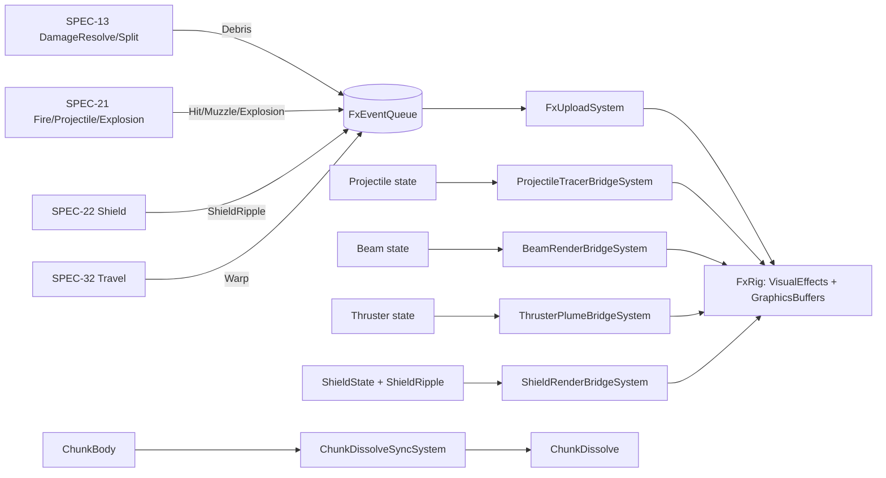

# SPEC-63 — Visual effects

| | |
|---|---|
| **Status** | Draft |
| **Area code** | VFX (task IDs are `VFX-001`, `VFX-002`, …) |
| **Module(s)** | `Game.Presentation` (folder `Assets/Game/Presentation/Vfx/`); shared stream types in `Game.Voxel` (folder `Assets/Game/Voxel/PresentationStreams/`); definitions in `Game.Data` (folder `Assets/Game/Data/Definitions/Vfx/`) |
| **Depends on specs** | SPEC-01 (GameRoot creates and binds `FxRig`), SPEC-02 (`ContentHash`, `SimClock`, `EventBus<T>`, custom system groups in `Game.Core`), SPEC-04 (`ContentDefinition`, `ContentDatabase`, `ValidationReport`), SPEC-13 (debris `FxEvent`s, `ChunkBody`), SPEC-20 (thruster state), SPEC-21 (projectiles, beams, hit/muzzle/explosion `FxEvent`s), SPEC-22 (`ShieldState`, ripple buffer), SPEC-30 (`OriginShifted`), SPEC-32 (warp events), SPEC-71 (test and perf harness) |
| **Depended on by** | SPEC-13, SPEC-20, SPEC-21, SPEC-22, SPEC-32 (emit `FxEvent`); SPEC-01 (creates the rig); SPEC-61 (VFX quality setting UI); SPEC-70 (`FxStats` in `gh_perf`); SPEC-81 (swaps template graphs and shaders through `FxDefinition` assets) |
| **Milestone** | M2 (contract types M1; origin shift and warp M3) |

> Read [01-architecture.md](../01-architecture.md), [02-conventions.md](../02-conventions.md) and [03-glossary.md](../03-glossary.md) before this spec. This spec may not contradict them.

## 1. Purpose

This spec turns simulation facts into pictures: flying voxel cubes when cells break, sparks and flashes on hits, explosions, muzzle flashes, projectile tracers, beams clipped at their hit point, thruster plumes, shield shells with ripples, chunk-body dissolve and the warp effect. Simulation code never touches a `GameObject`, `VisualEffect` or `GraphicsBuffer`: it appends unmanaged `FxEvent`s to one queue, and `FxUploadSystem` drains that queue once per frame into VFX Graph `GraphicsBuffer`s with hard caps. Persistent visuals (tracers, beams, plumes, shields) are rebuilt every frame from ECS state and drawn with one instanced draw call each. Every look is a content asset (`FxDefinition`), so SPEC-81 can replace every placeholder without code changes. This replaces the old prototype's per-hit `Instantiate` "pool" (audit 02-C29), its unparented beams that never clipped (02-C22, ledger R26) and its 55 pre-placed explosion GameObjects (ledger R5).

## 2. Scope

**In scope:**
- The `FxEvent` stream contract: `FxKind`, `FxEvent`, `FxEventFlags`, the `FxEventQueue` singleton and its owner system, producer helpers.
- `FxDefinition` and `VfxConfigDefinition` content types; the template VFX graphs and template shaders that define the asset contract.
- `FxRig`: the one managed object that owns every `VisualEffect`, `GraphicsBuffer` and instanced-draw buffer.
- `FxUploadSystem`: drain, resolve, budget, cull, upload, stats.
- Tier-1 voxel debris particles (cube particles, per-cell colour, inherited velocity, scale-to-zero fade).
- Projectile tracers, beams, thruster plumes and shield shells drawn from ECS state.
- Chunk-body dissolve hook (`ChunkDissolve` material property).
- Pooled "hero" effects (large explosions, warp).
- Quality scaling (`VfxQuality`), floating-origin shift of live particles, clearing on jump and load.
- The 50,000-debris GPU gate and the no-`Instantiate` regression test.

**Out of scope (and who owns it instead):**
- Deciding *when* an effect happens and filling its `FxEvent` (producers: SPEC-13, SPEC-20, SPEC-21, SPEC-22, SPEC-32).
- Chunk-body simulation, meshes and lifetime (SPEC-13); the voxel shader's `_DissolveAmount` property (SPEC-11).
- Brick meshes and voxel materials (SPEC-11).
- Camera shake on explosions (SPEC-62); screen-space warp transition and post-processing (SPEC-32 / SPEC-62).
- Sounds for the same events (SPEC-64).
- The VFX quality option on the settings screen and where it is stored (SPEC-61 / SPEC-01).
- Final art for graphs, shaders and textures (SPEC-80 / SPEC-81, after owner approval).

> **Playable integration staging:** [ADR-0053](../decisions/ADR-0053-playable-firing-range-first.md) permits the bounded FND-020 firing/breakup slice before this spec is complete. It implements portions of the production path in place; tasks below remain open until their full acceptance criteria pass. Follow the ADR's explicit staging exceptions for this checkpoint.

## 3. Decisions (binding)

1. **One unmanaged queue, drained once per frame.** All producers append `FxEvent`s to `FxEventQueue.Queue` (`NativeQueue<FxEvent>`, `Allocator.Persistent`) through `ParallelWriter`. The queue accumulates across the 0..N fixed ticks of a frame; `FxUploadSystem` empties it exactly once per frame. Reason: presentation runs once per frame while simulation runs 0..N ticks.
2. **FxKind lives in `Game.Data.Definitions`** (`Data/Definitions/Vfx/`, ADR-0050), because FxDefinition needs it. **The remaining stream types live in `Game.Voxel`** (`Assets/Game/Voxel/PresentationStreams/`, namespace `Game.Voxel.PresentationStreams`). Reason: `Game.Voxel` is the lowest producer and allows Entities; this follows the `ExplosionRequest` precedent in architecture §6.3. No other spec may create these types.
3. **`FxEvent` keeps the binding fields of architecture §6.6** (`Kind, Pos, Dir, Vel, Scale, Color`) and adds `Flags` and `Fx`. Total size 56 bytes.
4. **Content references are `ContentHash`.** `FxEvent.Fx` is the `ContentHash` (architecture §6.1) of a specific `FxDefinition`; `default(ContentHash)` (`Value == 0`) means "the default for `Kind`". Reason: `ContentId` is managed and never appears in ECS data; hashes are stable across builds.
5. **Event-driven effects go through VFX Graph `GraphicsBuffer`s.** One `VisualEffect` per batched `FxDefinition`, fed by one `GraphicsBuffer` of `FxGpuEvent` and one `SendEvent("OnFxBatch")` per frame. No `GameObject` is created after `FxRig.Create`. Reason: 02-C29; 100k particles at under 1 ms GPU.
6. **State-driven visuals are instanced draws, not particles or GameObjects.** Tracers, beams, plumes and shields are rebuilt every frame from ECS state into a `NativeArray`, uploaded to a `GraphicsBuffer` and drawn with `Graphics.RenderMeshPrimitives` (one call per kind). Reason: they must follow ships exactly and never orphan (02-C22).
7. **Hard caps everywhere.** At most 65,536 events are drained per frame (the rest are cleared and counted). Each `FxDefinition` has `maxEventsPerFrame`; debris has a live-particle cap per quality level. Overflow is dropped and counted in `FxStats`, never queued for later.
8. **Debris is one cube particle per removed or detached cell** (glossary: debris particle). Colour comes from the cell palette, velocity from the producer (`v + ω×r + kick`), lifetime 3–6 s, size shrinks to 0 over the last 25% of life. No collision, no CPU simulation. Reason: synthesis §6n (VFX Graph for cosmetic debris).
9. **Particles simulate in local space of a per-family anchor `Transform`.** On a floating-origin shift the anchor moves by the shift delta; live particles move with it at zero GPU cost. New events are written relative to the anchor. An anchor resets to the origin whenever its family has no live particles.
10. **VFX reacts to `OriginShifted` in the same frame** (architecture §6.5, 07-implementation-traps T5.1), read on the ECS side (open question 11 gives the delivery), never through the deferred `EventBus`. Reason: `OriginRebaseSystem` runs in `InitializationSystemGroup`, so presentation sees the shift in the frame it happens and no particle visibly jumps. A delta longer than 20,000 m is a discontinuity (jump): clear instead of shift.
11. **Quality scales budgets, never correctness.** `VfxQuality` (Low/Medium/High) changes caps and particle counts only. Default `High`; the 06 gates are measured at `High`.
12. **No ordering sort of events.** FX never feeds back into simulation, so drain order may vary between runs; tests assert counts and caps, not order. Decimation is by index stride, which is cheap and stable for a given drain order.
13. **Distance culling and LOD use the player ship** (`PlayerShip` root `LocalToWorld.Position`), or `float3.zero` when there is no player ship. Reason: the camera is a third-person rig around the player; this needs no camera reference in ECS.
14. **Managed GPU work happens only in `FxUploadSystem` and the four `*BridgeSystem`s** (`SystemBase`, Game.Presentation). Pure per-element work runs in Burst jobs with `.Run()` on the main thread (single-threaded) except the tracer gather, which is `ScheduleParallel` (up to 16,384 projectiles).
15. **Template assets are contracts, not art.** Template graphs and shaders live in `Assets/Game/Presentation/Vfx/Templates/` and `Assets/Game/Presentation/Vfx/Shaders/`, are plain (white/grey plus data colour) and are referenced only from `FxDefinition` assets in `Assets/Game/Content/Vfx/`. Code never names an asset path. SPEC-81 replaces them by pointing `FxDefinition`s at new assets that honour §6.3.
16. **`FxRig` binds by injection.** `GameRoot` (SPEC-01) calls `FxRig.Create(...)` then `rig.BindTo(world)`. Bridge systems never read `Services` or statics. Until bound, `FxUploadSystem` drains and discards (so the queue cannot grow).

## 4. Data model

### 4.1 Stream types (public contract; FxKind in `Game.Data.Definitions`, remaining types in `Game.Voxel.PresentationStreams`)

```csharp
namespace Game.Data.Definitions
{
    /// Implements SPEC-63 §4.1. Add values at the end only; never reorder (values are stored in FxDefinition assets).
    public enum FxKind : byte
    {
        None = 0,
        Debris = 1,          // event: one voxel cube (removed cell or tier-1 island cell)
        HitKinetic = 2,      // event: sparks + flash on a hull hit by kinetic/explosive projectiles
        HitEnergy = 3,       // event: energy splash on a hull hit by energy projectiles or beams
        ExplosionSmall = 4,  // event: blast with radius < 4 m
        ExplosionLarge = 5,  // event: blast with radius >= 4 m (pooled hero effect)
        ShieldRipple = 6,    // event: sparks at a shield impact point (the shell ripple itself comes from SPEC-22 state)
        Beam = 7,            // state: beam look (never sent as an event)
        Muzzle = 8,          // event: muzzle flash
        Thruster = 9,        // state: thruster plume look (never sent as an event)
        Warp = 10,           // event: lane-jump departure/arrival (pooled hero effect)
        Tracer = 11,         // state: projectile tracer look (never sent as an event)
        ShieldShell = 12,    // state: shield shell look (never sent as an event)
        RamImpact = 13,      // collision contact/energy event (SPEC-13 §5.2, ADR-0058)
    }

}

namespace Game.Voxel.PresentationStreams
{
    // Uses Game.Data.Definitions.FxKind and Game.Data.Streams.GuardedHandles (ADR-0050).
    [System.Flags]
    public enum FxEventFlags : byte
    {
        None = 0,
        PaletteColor = 1,    // Color's low byte is a cell palette index (PaletteEntry.Color), resolved by FxUploadSystem
        PlayerSource = 2,    // emitted by or on the player ship: never distance-culled
    }

    /// One visual effect request. Implements SPEC-63 §4.1 (architecture §6.6 binding fields + Flags, Fx).
    public struct FxEvent
    {
        public FxKind Kind;        // binding
        public FxEventFlags Flags; // added by SPEC-63
        public ushort Reserved;    // keep 0 (padding made explicit)
        public float3 Pos;         // binding: position in the local frame (metres)
        public float3 Dir;         // binding: unit direction; meaning per kind (§5.6). Zero = (0,1,0)
        public float3 Vel;         // binding: velocity to inherit (m/s, local frame)
        public float Scale;        // binding: size in metres; meaning per kind (§5.6). <= 0 = definition default
        public uint Color;         // binding: 0 = definition default; else sRGB RGBA8 packed R | G<<8 | B<<16 | A<<24,
                                   //          or a palette index in the low byte when Flags has PaletteColor
        public ContentHash Fx;     // added by SPEC-63: hash of a specific FxDefinition; default (Value 0) = default for Kind
    }

    /// Singleton. FxEventQueueCreateSystem owns the queue and guard. Producers register atomic writes through Access.
    public struct FxEventQueue : IComponentData
    {
        public NativeQueue<FxEvent> Queue;
        public GuardedHandles Access; // main-thread scheduling only; shared atomic producers, exclusive drain
    }

    /// Material property for chunk-body dissolve. SPEC-13 adds it (Value = 0) to every chunk-body render entity;
    /// only ChunkDissolveSyncSystem (SPEC-63) writes Value afterwards.
    [MaterialProperty("_DissolveAmount")]
    public struct ChunkDissolve : IComponentData
    {
        public float Value; // 0 = solid, 1 = fully dissolved
    }
}
```

`FxEventQueueCreateSystem` (public contract; the only behaviour in `VFX-001`, given here as exact code):

```csharp
namespace Game.Voxel.PresentationStreams
{
    /// Owns the FxEvent queue for the lifetime of the world. Implements SPEC-63 §4.1.
    /// Structural changes happen only in OnCreate/OnDestroy (world lifetime), never per tick.
    [UpdateInGroup(typeof(InitializationSystemGroup))]
    [BurstCompile]
    public partial struct FxEventQueueCreateSystem : ISystem
    {
        NativeQueue<FxEvent> queue;
        GuardedHandles access;

        [BurstCompile]
        public void OnCreate(ref SystemState state)
        {
            queue = new NativeQueue<FxEvent>(Allocator.Persistent);
            access = GuardedHandles.Create();
            state.EntityManager.CreateSingleton(new FxEventQueue { Queue = queue, Access = access }, "FxEventQueue");
            state.Enabled = false; // never updates; exists to own the allocation
        }

        [BurstCompile]
        public void OnUpdate(ref SystemState state) { }

        [BurstCompile]
        public void OnDestroy(ref SystemState state)
        {
            state.EntityManager.CompleteAllTrackedJobs();
            access.CompleteAccess();
            if (queue.IsCreated) queue.Dispose();
            access.Dispose();
        }
    }
}
```

`FxEvents` (public contract, static, pure; builds events with the field meanings of §5.6 so producers cannot get them wrong):

```csharp
namespace Game.Voxel.PresentationStreams
{
    public static class FxEvents
    {
        public static FxEvent Debris(float3 cellCentre, float3 velocity, float cellSize, byte paletteColor, float3 kickDir) =>
            new FxEvent { Kind = FxKind.Debris, Flags = FxEventFlags.PaletteColor, Pos = cellCentre, Dir = kickDir,
                          Vel = velocity, Scale = cellSize, Color = paletteColor };
        public static FxEvent Hit(FxKind kind, float3 point, float3 surfaceNormal, float3 targetVelocity, float damageAmount, ContentHash fx = default) =>
            new FxEvent { Kind = kind, Pos = point, Dir = surfaceNormal, Vel = targetVelocity,
                          Scale = math.clamp(damageAmount / 50f, 0.5f, 3f), Fx = fx };
        public static FxEvent Explosion(float3 centre, float radius, float3 velocity, ContentHash fx = default) =>
            new FxEvent { Kind = radius >= 4f ? FxKind.ExplosionLarge : FxKind.ExplosionSmall, Pos = centre,
                          Dir = new float3(0, 1, 0), Vel = velocity, Scale = radius, Fx = fx };
        public static FxEvent Muzzle(float3 muzzle, float3 fireDir, float3 shooterVelocity, float calibre, uint rgba8 = 0, ContentHash fx = default) =>
            new FxEvent { Kind = FxKind.Muzzle, Pos = muzzle, Dir = fireDir, Vel = shooterVelocity, Scale = calibre, Color = rgba8, Fx = fx };
        public static FxEvent ShieldRipple(float3 point, float3 outwardNormal, float3 shipVelocity, float strength01) =>
            new FxEvent { Kind = FxKind.ShieldRipple, Pos = point, Dir = outwardNormal, Vel = shipVelocity, Scale = math.saturate(strength01) };
        public static FxEvent Warp(float3 shipPos, float3 jumpDir, float3 shipVelocity, float shipRadius) =>
            new FxEvent { Kind = FxKind.Warp, Flags = FxEventFlags.PlayerSource, Pos = shipPos, Dir = jumpDir, Vel = shipVelocity, Scale = shipRadius };

        /// Main-thread enqueue for managed producers (SPEC-32 travel). Completes writers of the queue first.
        public static void EnqueueMainThread(EntityManager em, in FxEvent e)
        {
            using var q = em.CreateEntityQuery(ComponentType.ReadWrite<FxEventQueue>());
            if (q.IsEmpty) return;                       // no presentation in this world (tests)
            em.CompleteDependencyBeforeRW<FxEventQueue>();
            var stream = q.GetSingleton<FxEventQueue>();
            stream.Access.CompleteAccess();
            stream.Queue.Enqueue(e);
        }
    }
}
```

### 4.2 Definitions (public contract, `Game.Data`, folder `Assets/Game/Data/Definitions/Vfx/`, namespace `Game.Data.Definitions`)

```csharp
public enum VfxQuality : byte { Low = 0, Medium = 1, High = 2 }

public enum FxMode : byte
{
    Batched = 0,   // one VisualEffect, events via GraphicsBuffer (debris, hits, small explosions, muzzle, shield sparks)
    Pooled = 1,    // poolSize VisualEffect instances, one per event (large explosions, warp)
    Instanced = 2, // mesh + material drawn with Graphics.RenderMeshPrimitives from ECS state (tracer, beam, plume, shield)
}

/// Implements SPEC-63 §4.2. Content id prefix: "fx_" (e.g. fx_hit_kinetic_default).
[ContentIdPrefix("fx_")]
public sealed class FxDefinition : ContentDefinition
{
    [SerializeField] FxKind kind;
    [SerializeField] FxMode mode = FxMode.Batched;
    [SerializeField] VisualEffectAsset graph;              // Batched/Pooled; null for Instanced
    [SerializeField] Mesh mesh;                            // Instanced only (built-in Quad or Sphere for templates)
    [SerializeField] Material material;                    // Instanced only
    [SerializeField] Color defaultColor = Color.white;     // used when FxEvent.Color == 0
    [SerializeField, Min(0.01f)] float scale = 1f;         // multiplier on FxEvent.Scale
    [SerializeField, Range(1, 64)] int particlesPerEvent = 8;      // Batched, at High quality; Debris must be 1
    [SerializeField, Range(1, 65536)] int maxEventsPerFrame = 2048;// Batched/Pooled: GraphicsBuffer capacity
    [SerializeField, Range(1, 16)] int poolSize = 4;               // Pooled
    [SerializeField, Min(0.1f)] float maxLifetime = 2f;            // seconds; live-count estimate and anchor reset
    [SerializeField, Min(1f)] float cullDistance = 1500f;          // metres from the reference point (§3.13)
    [SerializeField, Min(1f)] float lodDistance = 300f;            // beyond: particle count × lodParticleFactor, size × 1.6
    [SerializeField, Range(0.05f, 1f)] float lodParticleFactor = 0.25f;
    [SerializeField] VfxQuality minQuality = VfxQuality.Low;       // effect skipped below this level

    public FxKind Kind => kind; public FxMode Mode => mode; public VisualEffectAsset Graph => graph;
    public Mesh Mesh => mesh; public Material Material => material; public Color DefaultColor => defaultColor;
    public float Scale => scale; public int ParticlesPerEvent => particlesPerEvent; public int MaxEventsPerFrame => maxEventsPerFrame;
    public int PoolSize => poolSize; public float MaxLifetime => maxLifetime; public float CullDistance => cullDistance;
    public float LodDistance => lodDistance; public float LodParticleFactor => lodParticleFactor; public VfxQuality MinQuality => minQuality;

    public override void Validate(ValidationScope scope, ContentValidationContext context)
    {
        // Errors (asset path + field): kind == None; Batched/Pooled with graph == null; Instanced with mesh or material null;
        // Instanced with kind not in {Beam, Thruster, Tracer, ShieldShell}; Batched/Pooled with kind in that set;
        // kind == Debris with particlesPerEvent != 1 or mode != Batched; kind in {ExplosionLarge, Warp} with mode != Pooled.
    }
}

[System.Serializable]
public struct FxQualityBudget
{
    public int DebrisLiveCap;        // max live debris particles (estimate, §5.2 step 9)
    public int DebrisSpawnPerFrame;  // max new debris particles per frame
    public float ParticleFactor;     // multiplies FxDefinition.particlesPerEvent (result clamped to >= 1)
    public int MaxTracers, MaxBeams, MaxPlumes, MaxShields;
}

/// Implements SPEC-63 §4.2. Exactly one instance: Assets/Game/Content/Vfx/config_vfx.asset (id "config_vfx").
[ContentIdPrefix("config_")]
public sealed class VfxConfigDefinition : ContentDefinition
{
    [SerializeField] FxDefinition[] defaults = new FxDefinition[14]; // index = (int)FxKind; [0] stays null
    [SerializeField] FxQualityBudget low    = new FxQualityBudget { DebrisLiveCap = 10000, DebrisSpawnPerFrame = 4000,  ParticleFactor = 0.25f, MaxTracers = 4096,  MaxBeams = 64,  MaxPlumes = 256,  MaxShields = 32 };
    [SerializeField] FxQualityBudget medium = new FxQualityBudget { DebrisLiveCap = 25000, DebrisSpawnPerFrame = 10000, ParticleFactor = 0.5f,  MaxTracers = 8192,  MaxBeams = 128, MaxPlumes = 512,  MaxShields = 64 };
    [SerializeField] FxQualityBudget high   = new FxQualityBudget { DebrisLiveCap = 50000, DebrisSpawnPerFrame = 20000, ParticleFactor = 1f,    MaxTracers = 16384, MaxBeams = 256, MaxPlumes = 1024, MaxShields = 128 };
    [SerializeField] Color32[] fallbackCellPalette = new Color32[256]; // used when GameRoot passes no palette
    [SerializeField] float debrisLifetimeMin = 3f, debrisLifetimeMax = 6f;
    [SerializeField] float debrisFullDetailDistance = 150f;   // beyond: keep 1 debris event in 4, size × 1.6
    [SerializeField] float tracerLengthSeconds = 0.02f, tracerMinLength = 0.5f, tracerMaxLength = 12f, tracerWidth = 0.15f;
    [SerializeField] Color[] tracerColorByDamageType = { new Color(1f, .85f, .4f), new Color(.4f, .9f, 1f), new Color(1f, .5f, .2f), Color.white };
    [SerializeField] float beamDefaultWidth = 0.4f;
    [SerializeField] float plumeLengthAtFullIntensity = 6f, plumeMinIntensity = 0.02f;
    [SerializeField] float shieldRippleSeconds = 0.6f, shieldHitFlashSeconds = 0.15f;
    [SerializeField] float chunkDissolveSeconds = 2f;
    // Read-only properties with the same names in PascalCase; Budget(VfxQuality q) returns low/medium/high.
    public override void Validate(ValidationScope scope, ContentValidationContext context)
    {
        // Errors: defaults.Length != 14; defaults[k] == null for every k in 1..13; defaults[k].Kind != (FxKind)k;
        // fallbackCellPalette.Length != 256; debrisLifetimeMin > debrisLifetimeMax; tracerColorByDamageType.Length != 4.
    }
}
```

### 4.3 Presentation types (`Game.Presentation`, folder `Assets/Game/Presentation/Vfx/`, namespace `Game.Presentation.Vfx`)

```csharp
/// GPU layout of one event (80 bytes, std430-compatible). Public contract for graph authors (SPEC-81).
[VFXType(VFXTypeAttribute.Usage.GraphicsBuffer)]
public struct FxGpuEvent
{
    public Vector3 position;     public float size;          // position relative to the family anchor (m); size (m)
    public Vector3 direction;    public float lifetimeScale; // unit; 1 = graph default lifetime (debris: lifetime/maxLifetime)
    public Vector3 velocity;     public uint seed;           // m/s; per-event random seed
    public Vector4 color;                                    // linear RGBA
    public uint particleCount;   public uint kind;  public Vector2 pad; // particles to keep for this event (<= ParticlesPerEvent); FxKind
}

// Instanced-draw element layouts (internal; must match the template shaders in §6.4). All 16-byte aligned.
public struct TracerInstance { public float3 Head; public float Length; public float3 Dir; public float Width; public float4 Color; }          // 48 B
public struct BeamInstance   { public float3 Start; public float Width; public float3 End; public float Intensity; public float4 Color; }        // 48 B
public struct PlumeInstance  { public float3 Nozzle; public float Radius; public float3 Dir; public float Length; public float4 Color; }        // 48 B
public struct ShieldInstance { public float4x4 EllipsoidToWorld; public float4 Color; public float HpFraction, Flash, Pad0, Pad1;
                               public float4 Ripple0, Ripple1, Ripple2, Ripple3, Ripple4, Ripple5, Ripple6, Ripple7; } // xyz = unit-sphere point, w = age s (<0 = inactive); 224 B

/// Per-frame counters (public contract; read by SPEC-70 gh_perf and tests). Reset at the start of each FxUploadSystem update.
public sealed class FxStats
{
    public int EventsDrained, EventsOverHardCap, Unresolved, StateKindRejected, QualitySkipped, Culled, BudgetDropped;
    public int BatchesSubmitted, PooledPlayed, DebrisSpawned, DebrisLiveEstimate;
    public int TracersDrawn, BeamsDrawn, PlumesDrawn, ShieldsDrawn, DissolvingChunks;
    public bool Bound;
}

/// Internal: one resolved FxDefinition (slot index 1..N; slot 0 = invalid).
internal struct FxSlot { public FxKind Kind; public FxMode Mode; public float Scale; public uint DefaultColorRgba8;
                         public int ParticlesPerEvent, MaxEventsPerFrame, BufferOffset; public float MaxLifetime,
                         CullDistanceSq, LodDistanceSq, LodParticleFactor; public VfxQuality MinQuality; }
```

`FxRig` (public contract, `MonoBehaviour`, thin; owns all managed and native resources) — members listed in §6.1.

`FxInstanceBatch<T> where T : unmanaged` (internal, created by `FxRig` for each `Instanced` definition): owns `NativeArray<T> Data` (`Allocator.Persistent`, capacity = the High budget for its kind), `GraphicsBuffer Buffer` (`Target.Structured`, same capacity, stride `UnsafeUtility.SizeOf<T>()`), `int Count`, `MaterialPropertyBlock`/`RenderParams`. Methods: `Begin()` sets `Count = 0`; `Draw()` uploads `Data[0..Count)` with `Buffer.SetData(Data, 0, 0, Count)`, sets `_Instances` on the material property block and calls `Graphics.RenderMeshPrimitives(rp, mesh, 0, Count)` when `Count > 0`; `Dispose()`.

## 5. Systems, services and flow



All VFX systems are in `PresentationBridgeGroup`. Ordering: `FxUploadSystem` first among VFX systems; the four bridge systems and `ChunkDissolveSyncSystem` use `[UpdateAfter(typeof(FxUploadSystem))]`. No other ordering constraint. None of them is in the fixed step, none makes structural changes, none writes simulation state.

**Profiler markers** (architecture §11.11; created with the SPEC-71 `PerfMarkers` naming helper, read by `gh_perf`):

| System | Markers |
|---|---|
| `FxUploadSystem` | `FxUploadSystem.Drain`, `FxUploadSystem.Batch`, `FxUploadSystem.Submit` |
| `ProjectileTracerBridgeSystem` | `ProjectileTracerBridgeSystem.Gather`, `ProjectileTracerBridgeSystem.Draw` |
| `BeamRenderBridgeSystem` | `BeamRenderBridgeSystem.Gather`, `BeamRenderBridgeSystem.Draw` |
| `ThrusterPlumeBridgeSystem` | `ThrusterPlumeBridgeSystem.Gather`, `ThrusterPlumeBridgeSystem.Draw` |
| `ShieldRenderBridgeSystem` | `ShieldRenderBridgeSystem.Gather`, `ShieldRenderBridgeSystem.Draw` |
| `ChunkDissolveSyncSystem` | `ChunkDissolveSyncSystem.Update` |

### 5.1 `FxEventQueueCreateSystem`
`InitializationSystemGroup`. Code in §4.1. Never updates. Owns the queue memory.

### 5.2 `FxUploadSystem` (managed `SystemBase`, listed in architecture §5)
- **Group:** `PresentationBridgeGroup`. `RequireForUpdate<FxEventQueue>()` only (not `GameplayActive`, so leftovers are drained after leaving the World scene).
- **Reads:** `FxEventQueue` (and empties it), `PlayerShip` + `LocalToWorld`, `OriginShifted` (from VFX-013), `SystemAPI.Time.ElapsedTime`. **Writes:** nothing in ECS; GPU buffers through `FxRig`.
- **Owned memory:** `NativeList<FxEvent> drained` (Persistent, initial capacity 32,768), `NativeArray<FxGpuEvent> gpuEvents` (Persistent, length = Σ slot `MaxEventsPerFrame`, allocated in `Bind`), `NativeArray<int> slotCounts`, `NativeArray<int> counters` (one per `FxStats` counter); disposed in `OnDestroy` and on re-`Bind`.

Per-frame algorithm:
1. `var q = SystemAPI.GetSingleton<FxEventQueue>(); q.Access.CompleteAccess();` (outside fixed-step; completes every registered native queue producer, ADR-0050).
2. Run `FxDrainJob` (Burst `IJob`, `.Run()`): `drained.Clear()`; dequeue until empty or `drained.Length == 65536`; if items remain, `counters[EventsOverHardCap] = q.Queue.Count`, then `q.Queue.Clear()`.
3. If `Rig == null`: `stats.Bound = false`, add `drained.Length` to `EventsOverHardCap`, return.
4. Reference point `refPos` = position of the first `PlayerShip` root `LocalToWorld`, else `float3.zero`.
5. (VFX-013) Origin shift: see §5.8. Runs before step 6 so this frame's events use the new anchors.
6. Run `FxBatchJob` (Burst `IJob`, `.Run()`) with: `drained`, `slots` (`NativeArray<FxSlot>`), `slotByHash` (`NativeHashMap<ulong,int>` keyed by `ContentHash.Value`, used for lookup only, never iterated), `defaultSlotByKind` (`NativeArray<int>`, length 14, −1 = none), `palette` (`NativeArray<uint>`, 256 linear-RGBA-packed entries), `anchorPos` (`NativeArray<float3>` per slot), budget (§4.2 for the current quality), `debrisBudget = max(0, min(DebrisSpawnPerFrame, DebrisLiveCap − DebrisLiveEstimate))`, `frameIndex` (uint). For each event `i`:
   1. Slot: if `Fx.Value != 0` and `slotByHash` has it and that slot's `Kind == Kind`, use it; else `defaultSlotByKind[Kind]`. If −1: `Unresolved++`, skip.
   2. If the slot is `Instanced` (state kinds): `StateKindRejected++`, skip.
   3. If `slot.MinQuality > quality`: `QualitySkipped++`, skip.
   4. `d2 = lengthsq(Pos − refPos)`. If `(Flags & PlayerSource) == 0` and `d2 > slot.CullDistanceSq`: `Culled++`, skip.
   5. `size = (Scale > 0 ? Scale : 1) * slot.Scale`; `count = max(1, (int)round(slot.ParticlesPerEvent * budget.ParticleFactor))`.
   6. Debris only: if `d2 > debrisFullDetailDistance²`: keep only when `i % 4 == 0` (else `Culled++`, skip) and `size *= 1.6`. Then if `debrisBudget == 0`: `BudgetDropped++`, skip. Reserve the debris budget and increment `DebrisSpawned` only after the slot-cap check succeeds; `lifetimeScale = lerp(min, max, hash01(seed)) / max` (Q21).
   7. Other kinds: if `d2 > slot.LodDistanceSq`: `count = max(1, (int)ceil(count * slot.LodParticleFactor))`, `size *= 1.6`.
   8. If `slotCounts[slot] == slot.MaxEventsPerFrame`: `BudgetDropped++`, skip.
   9. Colour: `PaletteColor` flag → `palette[Color & 0xFF]` (including index 0); otherwise `Color == 0` → `slot.DefaultColorRgba8`; else `Color`. Unpack palette entries directly as linear `float4`; convert raw/default sRGB RGBA8 to linear once (Q20).
   10. Write `gpuEvents[slot.BufferOffset + slotCounts[slot]++] = { position = Pos − anchorPos[slot], size, direction = normalizesafe(Dir, (0,1,0)), lifetimeScale (1 for non-debris), velocity = Vel, seed = math.hash(new uint2((uint)i, frameIndex)), color, particleCount = (uint)count, kind = (uint)Kind }`.
7. For every slot with `slotCounts[s] > 0`: `Rig.Submit(s, gpuEvents, slot.BufferOffset, slotCounts[s])` (§6.1). `BatchesSubmitted++` per batched slot; `PooledPlayed += n` per pooled slot.
8. Debris live estimate: push `(ElapsedTime, DebrisSpawned)` into a 1,024-entry ring; `DebrisLiveEstimate = Σ count of entries with ElapsedTime − t < debrisLifetimeMax`. Push only non-empty submissions. If wrapping would overwrite an unexpired entry, merge its count into the new bucket and extend its expiry: conservative overestimation is permitted; undercounting live particles is not (Q21).
9. Copy `counters` into `Rig.Stats`; zero `slotCounts` and `counters`.

### 5.3 `ProjectileTracerBridgeSystem` (managed `SystemBase`)
`PresentationBridgeGroup`, after `FxUploadSystem`. `RequireForUpdate<GameplayActive>()`, `RequireForUpdate<ProjectileStore>()`. Projectiles are rows of SPEC-21's `ProjectileStore` (§4.6 there), not entities.
1. If `Rig == null` return. `batch = Rig.Tracers`; `batch.Begin()`.
2. `alpha = clamp(ElapsedTime − MostRecentFixedTime.ElapsedTime, 0, 1/60)` when the `Unity.Physics.GraphicsIntegration.MostRecentFixedTime` singleton exists, else 0.
3. `store = SystemAPI.GetSingleton<ProjectileStore>(); store.CompleteAccess();` (main thread outside the fixed step: SPEC-12 §5.1 pattern; it completes only the last projectile jobs, which finished long before presentation). `n = min(store.Rows.Length, cap)` with `cap = budget.MaxTracers`.
4. **Pending origin shift** (rows are shifted lazily by SPEC-21 at the next tick): `rec = SystemAPI.GetSingleton<OriginShiftRecord>()` (SPEC-02); `applied = store.AppliedShiftSequence.Value`.
   - `applied == rec.Sequence` → `correction = 0`;
   - `rec.Sequence − applied == 1` and `rec.StarSystemChanged == 0` → `correction = rec.Delta` (rows are still in the old frame);
   - otherwise (a star-system change or a missed rebase) → `n = 0`: draw nothing this frame; SPEC-21 clears the rows next tick.
5. `TracerGatherJob` (Burst `IJobParallelFor`, batch 256, `.Schedule(n, …)` then `Complete`): for row `i`: `r = Rows[i]`; if `(r.Flags & Dead) != 0` or `speed = length(r.Velocity) < 0.01` → write a zero-width instance; else `Head = r.Position + correction + r.Velocity × alpha`; `Dir = −r.Velocity / speed`; `Length = clamp(speed × tracerLengthSeconds, tracerMinLength, tracerMaxLength)`; `Width = tracerWidth`; `Color = tracerColorByDamageType[(int)r.Type]` (linear). Each index is written by exactly one thread.
6. `batch.Count = n`; `batch.Draw()`; `Stats.TracersDrawn = n`.

Rows are in fire order (SPEC-21 compacts stably), so over the cap the oldest `MaxTracers` projectiles are drawn.

### 5.4 `BeamRenderBridgeSystem` (managed `SystemBase`)
`PresentationBridgeGroup`, after `FxUploadSystem`. `RequireForUpdate<GameplayActive>()`. Query: `BeamState` (SPEC-21) + `FunctionalBlock`.
1. `batch = Rig.Beams; batch.Begin()`.
2. Burst `IJob` (`.Run()`) over the query arrays: skip if `Active == 0`. `gridL2W = LocalToWorld[FunctionalBlock.Grid]` (skip if the grid has no `LocalToWorld`). `Start = transform(gridL2W, MuzzleLocal)`; `End = EndWorld` (already clipped at the hit by SPEC-21); `Width = Width > 0 ? Width : beamDefaultWidth`; `Intensity = 1`; `Color` = the beam `FxDefinition`'s default colour (`Fx` hash, else `defaults[Beam]`). Stop at `budget.MaxBeams`.
3. For each beam with `HitSomething != 0`, also append one `FxEvent` `HitEnergy` (Pos = End, Dir = normalize(Start − End), Scale = 1) to `Rig.PendingImpacts` at most every 6th frame per beam (`(frameIndex + entityIndex) % 6 == 0`), so beam sparks cost at most 10 events/s per beam. `FxUploadSystem` merges `PendingImpacts` into the next frame's drain (step 2 appends them after dequeuing).
4. `batch.Draw()`; `Stats.BeamsDrawn = batch.Count`.

### 5.5 `ThrusterPlumeBridgeSystem` and `ShieldRenderBridgeSystem` (managed `SystemBase`)
Both `PresentationBridgeGroup`, after `FxUploadSystem`, `RequireForUpdate<GameplayActive>()`, Burst `IJob` gathers with `.Run()`, one instanced draw each.

Plumes — query `ThrusterState` + `ThrusterVisual` + `FunctionalBlock` (SPEC-20), skip `Hulk` grids:
1. Skip when `Intensity < plumeMinIntensity`.
2. `Nozzle = transform(gridL2W, NozzleLocal)`, `Dir = rotate(gridL2W, ExhaustDirLocal)`, `Radius = NozzleRadius`, `Length = plumeLengthAtFullIntensity * Intensity * NozzleRadius / 0.75`, `Color = defaults[Thruster].DefaultColor` with alpha = `Intensity`.
3. Stop at `budget.MaxPlumes`; draw.

Shields — query `ShieldState` + `LocalToWorld` + buffer `ShieldRipple` (SPEC-22), grid roots only:
1. Skip when `Active == 0` or `MaxHp <= 0`.
2. `EllipsoidToWorld = gridL2W × translate(Center) × scale(Radii)`; `HpFraction = Hp / MaxHp`; `Color = defaults[ShieldShell].DefaultColor`.
3. For each of up to 8 ripple elements: `age = (SimClock.Tick − StartTick) / 60f`; if `StartTick == 0` or `age > shieldRippleSeconds` → `w = −1`; else `xyz = normalize(LocalPoint − Center) / Radii` normalised to the unit sphere, `w = age`. `Flash = 1 − min(1, youngestAge / shieldHitFlashSeconds)`.
4. Stop at `budget.MaxShields`; draw.

### 5.6 Field meanings per kind (producers must follow this table; `FxEvents` helpers in §4.1 implement it)

| Kind | Producer (spec, system) | Pos | Dir | Vel | Scale | Color | Rate limit at the producer |
|---|---|---|---|---|---|---|---|
| Debris | SPEC-13 `DamageResolveSystem` (each removed cell), `SplitSystem` (each cell of a 1–8-cell island; up to 64 sampled cells of a dissolving chunk body) | cell centre | kick direction | `v + ω×r + kick` | grid `CellSize` | palette index + `PaletteColor` | none (budgeted here) |
| HitKinetic / HitEnergy | SPEC-21 `ProjectileStepSystem` | hit point | outward surface normal | target body velocity | `clamp(amount/50, 0.5, 3)` | 0 or weapon colour | one per hit |
| ExplosionSmall / Large | SPEC-21 `ExplosionSystem` | centre | (0,1,0) | source velocity or 0 | radius (m) | 0 | one per `ExplosionRequest` |
| ShieldRipple | the producer that hit the shield (SPEC-21) or SPEC-22 `ShieldSystem` | impact point on the ellipsoid | outward normal | ship velocity | strength 0..1 = `min(1, amount / 100)` | 0 or shield colour | one per `ShieldHit` |
| Muzzle | SPEC-21 `WeaponFireSystem` | muzzle | fire direction | shooter velocity | calibre (m) | 0 or weapon colour | one per weapon per tick |
| Warp | SPEC-32 travel (departure and arrival) | ship centre | jump direction | ship velocity | ship radius | 0 | one per jump phase |
| Beam, Thruster, Tracer, ShieldShell | never sent as events | — | — | — | — | — | — |

### 5.7 `ChunkDissolveSyncSystem` (Burst `ISystem`)
`PresentationBridgeGroup`, after `FxUploadSystem`. `RequireForUpdate<GameplayActive>()`. `IJobEntity` over `ChunkBody` (SPEC-13) + `RefRW<ChunkDissolve>`: `Value = saturate(1 − TimeLeft / chunkDissolveSeconds)` (config value baked into a `VfxRuntimeConfig` singleton by `FxRig.BindTo`). Only writer of `ChunkDissolve.Value`. Counts entities with `Value > 0` into `Stats.DissolvingChunks` (read back by `FxUploadSystem` next frame through a `NativeReference<int>`).

### 5.8 Origin shift and clears (VFX-013)
1. `FxUploadSystem` keeps `uint lastShiftSequence` (initialised from the singleton when first seen). Each frame, if the `OriginShifted` singleton (open question 11) exists and its `Sequence != lastShiftSequence`: `delta = OriginShifted.Delta` (the amount `OriginRebaseSystem` added to every root local position this frame); store `Sequence`. Otherwise `delta = 0`.
2. If `delta == 0`: nothing. If `length(delta) > 20000`: `Rig.ClearAll(exceptWarp: true)`. Else `Rig.ShiftAnchors(delta)`: every batched family anchor `Transform.position += delta`, every active pooled instance `Transform.position += delta`.
3. `FxRig` subscribes (in `OnEnable`, unsubscribes in `OnDisable`) to `EventBus<StarSystemEntered>` → `ClearAll(exceptWarp: true)` and `EventBus<SessionReset>` → `ClearAll(exceptWarp: false)`. `ClearAll` calls `VisualEffect.Reinit()` on every batched effect, stops every pooled instance, resets every anchor to `Vector3.zero` and empties the debris ring.
4. Anchor reset: in step 7 of §5.2, a batched family whose last submit is older than its `MaxLifetime` (debris: `debrisLifetimeMax`) resets its anchor to `Vector3.zero`.

### 5.9 Pooled effects
`Rig.Submit` for a `Pooled` slot plays one instance per event: take `pool[next]`, `next = (next + 1) % poolSize` (steals the oldest), set its `Transform.position = event position + anchor` (pooled instances are not under a family anchor), set event attributes `direction`, `velocity`, `color` (rgb), `alpha`, `size`, then `SendEvent("OnFxPlay", attr)`. At most `poolSize` pooled plays per slot per frame; the rest count as `BudgetDropped`.

## 6. Public API

### 6.1 `FxRig` (Game.Presentation; called by SPEC-01 `GameRoot`)

```csharp
public sealed class FxRig : MonoBehaviour
{
    /// Creates the rig under parent: one child GameObject per batched/pooled definition (with VisualEffect),
    /// one FxInstanceBatch per instanced definition, GraphicsBuffers sized from §4.2. Validates every graph (§6.3)
    /// and logs GameLog.Error("Vfx", ...) once per broken definition, which is then skipped (never throws).
    public static FxRig Create(Transform parent, VfxConfigDefinition config, IReadOnlyList<FxDefinition> definitions,
                               Color32[] cellPalette /* 256 entries or null → config fallback */, VfxQuality quality);
    public void BindTo(World world);    // binds FxUploadSystem, the 4 bridge systems, ChunkDissolveSyncSystem; creates VfxRuntimeConfig singleton
    public void Unbind(World world);    // systems return to "not bound" (drain and discard)
    public void SetQuality(VfxQuality q); // takes effect next frame; does not reallocate buffers
    public VfxQuality Quality { get; }
    public FxStats Stats { get; }
    public void Submit(int slot, NativeArray<FxGpuEvent> events, int start, int count); // called by FxUploadSystem only
    public void ShiftAnchors(float3 delta);
    public void ClearAll(bool exceptWarp);
    public void Dispose();              // releases GraphicsBuffers and native arrays, destroys child GameObjects
}
```
Pre: `definitions` contains every `FxDefinition` of the `ContentDatabase`; `config.Validate` passed at import. Post (Create): no further `GameObject` or `VisualEffect` is created for the rest of the session. Re-`BindTo` on the same world replaces the previous binding.

### 6.2 Producer pattern (SPEC-13/20/21/22)

```csharp
// In OnUpdate of a producing ISystem (fixed step). Do NOT RequireForUpdate<FxEventQueue>; GetSingleton throws
// a clear error in a test world that forgot FxEventQueueCreateSystem — tests add typeof(FxEventQueueCreateSystem).
// Read-only access (never GetSingletonRW in the fixed step: it would serialise producers and complete other systems' jobs).
var stream = SystemAPI.GetSingleton<FxEventQueue>();
var fx = stream.Queue.AsParallelWriter();
state.Dependency = new MyJob { Fx = fx /* ... */ }.ScheduleParallel(stream.Access.BeginRead(state.Dependency));
stream.Access.EndRead(state.Dependency); // shared atomic enqueue; the guard stays on the main thread
// in the job struct: [NativeDisableContainerSafetyRestriction] public NativeQueue<FxEvent>.ParallelWriter Fx;
// in the job:        Fx.Enqueue(FxEvents.Hit(FxKind.HitKinetic, point, normal, targetVel, amount));
// FxUploadSystem (§5.2 step 1) completes guarded access before draining. Concurrent atomic enqueues use shared access;
// a scheduled exclusive drain/clear uses Access.Acquire/Release. Never pass the guard into a job.
```

### 6.3 Batched and pooled graph contract (every graph referenced by an `FxDefinition`)

| Item | Batched | Pooled |
|---|---|---|
| Exposed `GraphicsBuffer FxEvents` (type `FxGpuEvent`) | required | — |
| Exposed `int FxEventCount`, `int ParticlesPerEvent`, `float QualityFactor` | required | `QualityFactor` only |
| Event | `OnFxBatch` with event attribute `spawnCount` = `FxEventCount × ParticlesPerEvent` | `OnFxPlay` with attributes `direction`, `velocity`, `color`, `alpha`, `size` |
| Initialize | `e = FxEvents[spawnIndex / ParticlesPerEvent]`; kill the particle if `spawnIndex % ParticlesPerEvent >= e.particleCount` | from event attributes |
| Simulation space | Local (relative to the family anchor) | Local |
| Bounds | fixed: centre (0,0,0), size (8000, 8000, 8000) | fixed: size (400, 400, 400) |
| Capacity | Debris 65,536; HitKinetic/HitEnergy 16,384; ExplosionSmall 8,192; Muzzle 8,192; ShieldRipple 4,096 | per graph ≤ 4,096 |
| Shadows | off | off |

`FxRig.Create` checks each instance with `VisualEffect.HasGraphicsBuffer("FxEvents")`, `HasInt("FxEventCount")`, `HasInt("ParticlesPerEvent")`, `HasFloat("QualityFactor")` (batched) or `HasFloat("QualityFactor")` (pooled). A failed check is a boot-time error for that definition (§7).

Debris template (`FxDebrisTemplate.vfx`) specifics: output **Output Particle Mesh** with the built-in cube mesh, URP Lit, no shadows; angular velocity random ±360°/s per axis from `seed`; lifetime = `lifetimeScale × debrisLifetimeMax` (exposed float `DebrisLifetimeMax`, set by the rig); size = `size × 0.95`; size-over-life multiplier 1.0 until 75% of life, then linear to 0; no gravity, no drag.

### 6.4 Instanced shader contract (`Assets/Game/Presentation/Vfx/Shaders/`)
Each shader declares `StructuredBuffer<T> _Instances;` with `T` exactly as in §4.3, reads `_Instances[instanceID]` with `SV_InstanceID`, is URP unlit transparent (pass `UniversalForward`, `ZWrite Off`), and builds its geometry in the vertex shader from the built-in Quad (tracer, beam, plume: camera-facing quad stretched between two points) or Sphere (shield: `EllipsoidToWorld`, rim + ripple rings from the eight `Ripple` vectors). Files: `FxTracer.shader`, `FxBeam.shader`, `FxPlume.shader`, `FxShieldShell.shader`. `RenderParams`: `worldBounds` centre 0, size 8000 m; `shadowCastingMode = Off`; `receiveShadows = false`; `layer = 0`.

### 6.5 Requested inputs from other specs (defaults until those specs answer; see §10)

| Spec | Type | Fields this spec reads |
|---|---|---|
| SPEC-21 | `ProjectileStore` singleton (rows, `AppliedShiftSequence`; access per SPEC-12 §5.1) | `ProjectileRow.Position`, `Velocity`, `Type`, `Flags` (`Dead`) |
| SPEC-02 | `OriginShiftRecord` singleton | `Sequence`, `Delta`, `StarSystemChanged` |
| SPEC-21 | `BeamState` on the beam weapon's functional entity (+ `FunctionalBlock`) | `float3 MuzzleLocal` (grid space), `float3 EndWorld` (clipped), `float Width`, `byte Active`, `byte HitSomething`, `ContentHash Fx` |
| SPEC-20 | `ThrusterState` + `ThrusterVisual` on thruster functional entities | `float Intensity` (0..1); `float3 NozzleLocal`, `float3 ExhaustDirLocal`, `float NozzleRadius` (grid space) |
| SPEC-22 | `ShieldState` on the grid root; buffer `ShieldRipple` (capacity 8) | `float3 Center, Radii; float Hp, MaxHp; byte Active`; `float3 LocalPoint; uint StartTick; float Strength` |
| SPEC-13 | `ChunkBody` on chunk-body entities | `float TimeLeft` |
| SPEC-30 | `OriginShifted` (binding event `{ float3 Delta }`), ECS-side delivery per open question 11 | `float3 Delta`, `uint Sequence` |

## 7. Edge cases and failure behaviour

| Situation | Required behaviour |
|---|---|
| More than 65,536 events queued in one frame | First 65,536 processed; the rest cleared; `EventsOverHardCap` counts them; `GameLog.WarnOnce("Vfx.HardCap", …)` |
| `FxRig` not bound (boot, tests, menus before binding) | Queue drained and discarded every frame; `Stats.Bound = false`; no exception |
| `FxEvent.Fx` hash unknown, or its definition's kind differs from `Kind` | Kind default used; if none, `Unresolved++`; `GameLog.WarnOnce("Vfx.Unresolved." + hash)` |
| Event sent with a state kind (Beam, Thruster, Tracer, ShieldShell) | Skipped, `StateKindRejected++`, `WarnOnce` |
| Graph missing a required exposed property or event | Boot `GameLog.Error` naming the asset and property; that slot is disabled (its events count as `Unresolved`); the game continues |
| `FxDefinition.graph` is null for a batched/pooled definition | Rejected by `Validate` at import; at runtime treated as the previous row |
| Debris live estimate ≥ cap | New debris dropped (`BudgetDropped`); no other kind is affected |
| `FxEvent.Pos` contains NaN or infinity | Skipped and counted as `Culled` (test `math.all(math.isfinite(Pos))` in step 6.4) |
| `Dir` is zero | `(0,1,0)` used |
| `Scale <= 0` | Definition scale used |
| Quality changed mid-frame | Applied at the start of the next `FxUploadSystem` update; buffers keep their High-size capacity |
| Origin shift | Anchors and pooled instances move by `delta` the same frame; no particle visibly jumps (test in VFX-013) |
| `|delta| > 20,000 m` or `StarSystemEntered` | All effects cleared except running warp instances |
| `SessionReset` (load) | All effects cleared, including warp |
| Projectile count > `MaxTracers` | The first `MaxTracers` rows (oldest shots) drawn; `TracersDrawn = MaxTracers` |
| Rebase between the last fixed tick and this frame | Rows drawn with the record's `Delta` (one rebase) or not at all (star-system change or missed rebase) for that one frame; no tracer jumps (VFX-006) |
| Beam grid entity destroyed (ship died) while `BeamState.Active` is still 1 | Skipped (no `LocalToWorld` on `FunctionalBlock.Grid`); never drawn from a stale position |
| Hulk ship with thrusters | No plume (query excludes `Hulk` grids) |
| Shield ripple `StartTick == 0` or older than `shieldRippleSeconds` | `w = −1`, shader ignores it |
| `MostRecentFixedTime` singleton absent | `alpha = 0` (tracers drawn at physics position) |
| Domain reload disabled, second Play | `FxRig` is destroyed with `GameRoot` and recreated; systems are recreated with the world; no static state exists |

## 8. Performance budget

| What | Budget | Source | Measured by |
|---|---|---|---|
| 50,000 live debris particles | ≤ 1.0 ms GPU (median over 300 frames, 60 warm-up) | 06 Combat gates | `DebrisGpuBenchmarkTests.Debris50k_GpuDelta_UnderBudget` (VFX-005): GPU frame time with 50k live debris minus the same scene without, `FrameTimingManager` GPU time, 1920×1080, High quality, fixed seed 63001, fixed camera pose (0, 60, −120) looking at (0,0,0) |
| `FxUploadSystem` main thread | ≤ 0.25 ms at 5,000 events/frame; ≤ 0.6 ms at 20,000 debris events/frame | this spec | `FxUploadPerfTests.Upload5k_MainThread_Smoke` / `Upload20kDebris_MainThread` (ProfilerRecorder on the system marker) |
| All VFX systems together, 30-ship skirmish | ≤ 0.5 ms main thread | share of 06 heavy-combat 10 ms | SPEC-71 skirmish benchmark, `PerfSample` of the six VFX system markers |
| 5,000 tracers | ≤ 0.3 ms main thread (gather + upload), ≤ 0.3 ms GPU | share of 06 GPU 12 ms | `TracerPerfTests.Tracers5k_Smoke` |
| GC allocation | 0 B/frame in every VFX system after the first frame | 06 frame budget | `FxRegressionTests.Hits10k_NoGcAlloc` (`GC Allocated In Frame` recorder) |
| Memory | ≤ 12 MB for all VFX GraphicsBuffers and native arrays at High | this spec | `FxRigTests.Create_TotalBufferBytes_Under12MB` |

All perf tests write their results through the SPEC-71 harness (`Logs/perf/latest.json`) and sample the §5 markers through `ProfilerRecorder`. Burst on; safety checks off for the timing tests (the SPEC-71 perf fixture asserts it). Every functional test, and every test run for a frontier task's review, runs with Burst safety checks on and `NativeLeakDetection.Mode = EnabledWithStackTrace` (SPEC-71 `TestRunSettings`).

## 9. Tasks

### VFX-001 — Public contract types
- **Milestone:** M1
- **Tier:** frontier — native queue ownership and guarded producer access (ADR-0050), plus exact content/GPU layouts
- **Depends on:** `CORE-001`, `DATA-001`
- **Do:** Create the stream types, `FxEventQueueCreateSystem` and `FxEvents` exactly as in §4.1; `VfxQuality`, `FxMode`, `FxDefinition`, `FxQualityBudget`, `VfxConfigDefinition` exactly as in §4.2 with the `Validate` rules in their comments; `FxGpuEvent`, the four instance structs, `FxStats` as in §4.3; an empty `FxRig : MonoBehaviour` with the §6.1 signatures throwing `NotImplementedException`. Make sure `Game.Voxel.asmdef` references `Unity.Entities.Graphics` (allowed by architecture §3.1; `[MaterialProperty]` needs it).
- **Files:** `Assets/Game/Voxel/PresentationStreams/{FxEventFlags,FxEvent,FxEventQueue,FxEventQueueCreateSystem,FxEvents,ChunkDissolve}.cs`; `Assets/Game/Data/Definitions/Vfx/{FxKind,VfxQuality,FxMode,FxDefinition,FxQualityBudget,VfxConfigDefinition}.cs`; `Assets/Game/Presentation/Vfx/Data/{FxGpuEvent,TracerInstance,BeamInstance,PlumeInstance,ShieldInstance,FxStats}.cs`; `Assets/Game/Presentation/Vfx/FxRig.cs`; `Assets/Game/Tests/EditMode/Vfx/{FxContractTests,FxEventQueueTests,FxEventsTests,FxDefinitionValidationTests}.cs`; `Assets/Game/Tests/EditMode/Voxel/VoxelContractTests.cs` (register the explicitly permitted module singleton, as its existing VFX-001 comment requires)
- **Acceptance criteria:**
  - [x] `UnsafeUtility.SizeOf<FxEvent>() == 56`, `SizeOf<FxGpuEvent>() == 80`, `SizeOf<ShieldInstance>() == 224`, the other instance structs 48.
  - [x] A world containing `FxEventQueueCreateSystem` has exactly one `FxEventQueue` singleton; disposing the world leaks nothing.
  - [x] `FxDefinition.Validate` and `VfxConfigDefinition.Validate` report every error listed in their comments.
  - [x] `tools/compile.sh` clean; `AssemblyRulesTests` pass.
- **Tests:** `FxContractTests.FxEvent_Size_Is56`, `FxContractTests.FxGpuEvent_Size_Is80`, `FxContractTests.InstanceStructs_HaveShaderSizes`, `FxEventQueueTests.World_CreatesSingleton_AndDisposesWithoutLeak` (EcsTestWorld, leak check on), `FxEventsTests.Helpers_FillFieldsPerTable` (one assertion per §5.6 row), `FxDefinitionValidationTests.InvalidCombinations_ReportErrors`.

### VFX-002 — FxRig: slots, effects, buffers and binding
- **Milestone:** M2
- **Tier:** frontier — F2: GraphicsBuffers and Persistent native arrays living for the session, F1: every VFX task builds on it
- **Depends on:** `VFX-001`, `TST-001`
- **Do:** Implement `FxRig.Create/BindTo/Unbind/SetQuality/Dispose/Stats` per §6.1: build `FxSlot`s (slot 0 invalid, slots 1..N in the given definition order), `slotByHash`, `defaultSlotByKind` (from `config.defaults`), palette (256 linear-packed entries from `cellPalette` or `config.fallbackCellPalette`); per batched slot one child `GameObject` "Fx_<id>" with `VisualEffect` (asset = graph) acting as its anchor and one `GraphicsBuffer` (`Structured`, count = `MaxEventsPerFrame`, stride 80); per pooled slot `poolSize` children; per instanced definition one `FxInstanceBatch<T>` sized by the High budget. Implement the graph contract check of §6.3. `BindTo` stores the rig in each system's `Rig` property and creates the `VfxRuntimeConfig` singleton (`float ChunkDissolveSeconds`) with `EntityManager.CreateSingleton` (main thread, bind time only). Implement `FxInstanceBatch<T>` (§4.3).
- **Files:** `Assets/Game/Presentation/Vfx/FxRig.cs`, `Assets/Game/Presentation/Vfx/FxInstanceBatch.cs`, `Assets/Game/Presentation/Vfx/Data/FxSlot.cs`, `Assets/Game/Presentation/Vfx/Components/VfxRuntimeConfig.cs`
- **Acceptance criteria:**
  - [x] `Create` with N definitions creates exactly (batched + Σ poolSize) child GameObjects and no more for the rest of the session.
  - [x] A definition whose graph lacks `FxEvents` logs one error naming the asset and is skipped; the rig still works for the others.
  - [x] `Dispose` releases every `GraphicsBuffer` (count of live buffers returns to the pre-Create value) and every native array (leak check passes).
  - [ ] Total buffer bytes at High ≤ 12 MB with the content set of VFX-004. Advisory follow-up when that content exists; VFX-002 representative rig measures 950,272 bytes (Q20).
- **Tests:** `FxRigTests.Create_BuildsOneChildPerBatchedAndPoolSlot`, `FxRigTests.Create_GraphMissingProperty_LogsErrorAndSkips`, `FxRigTests.Dispose_ReleasesAllBuffers`, `FxRigTests.Create_TotalBufferBytes_Under12MB`, `FxRigTests.SlotByHash_ResolvesEveryDefinition` (PlayMode, test definitions created in code).

### VFX-003 — FxUploadSystem: drain, batch, submit, stats
- **Milestone:** M2
- **Tier:** frontier — F2: drains a queue written by parallel jobs of other systems; F4: owns the upload budget
- **Depends on:** `VFX-002`
- **Do:** Implement `FxUploadSystem` exactly per §5.2 steps 1–9 (step 5 left as a call to an empty `ApplyOriginShift()` filled by VFX-013), `FxDrainJob`, `FxBatchJob`, the debris ring, and `FxRig.Submit` for batched slots (`SetData(events, start, 0, count)`, `SetInt("FxEventCount")`, `SetInt("ParticlesPerEvent")`, `SetFloat("QualityFactor")`, `SendEvent("OnFxBatch", attr)` with `spawnCount`) and pooled slots (§5.9). Cache property IDs with `Shader.PropertyToID` once. Merge `Rig.PendingImpacts` (a `NativeList<FxEvent>`, Persistent, capacity 1,024) after the dequeue in step 2.
- **Files:** `Assets/Game/Presentation/Vfx/Systems/FxUploadSystem.cs`, `Assets/Game/Presentation/Vfx/Jobs/FxDrainJob.cs`, `Assets/Game/Presentation/Vfx/Jobs/FxBatchJob.cs`, `Assets/Game/Presentation/Vfx/FxRig.cs`
- **Acceptance criteria:**
  - [x] After the update the queue is empty, whatever was enqueued (including 100,000 events: 65,536 processed, 34,464 counted in `EventsOverHardCap`).
  - [x] Unbound: queue drained, nothing submitted, no exception.
  - [x] Per-slot counts never exceed `MaxEventsPerFrame`; debris never exceeds `min(DebrisSpawnPerFrame, DebrisLiveCap − estimate)`.
  - [x] Culling, LOD, palette resolution and colour default follow §5.2 step 6 exactly.
  - [x] 0 B GC per frame after the first frame.
  - [x] Markers `FxUploadSystem.Drain`, `.Batch`, `.Submit` exist and report non-zero samples through `ProfilerRecorder` while events flow.
- **Tests:** `FxBatchJobTests` (EditMode, job run directly): `UnknownHash_FallsBackToKindDefault`, `StateKind_IsRejected`, `BeyondCullDistance_IsCulled`, `PlayerSource_IsNeverCulled`, `FarDebris_KeepsOneInFour_AndScales`, `DebrisBudget_StopsAtCap`, `SlotCap_DropsOverflow`, `PaletteFlag_ResolvesPaletteIndex`, `NaNPosition_IsSkipped`; `FxUploadSystemTests` (EcsTestWorld + fake rig): `Unbound_DrainsAndDiscards`, `HardCap_ClearsRemainder`, `MultipleTicksPerFrame_AllEventsSubmittedOnce`.

### VFX-004 — Template graphs and content assets for hits, explosions, muzzle and shield sparks
- **Milestone:** M2
- **Tier:** standard — content authoring against the contract in §6.3
- **Depends on:** `VFX-003`
- **Do:** Author template graphs honouring §6.3: `FxHitTemplate.vfx` (8 sparks + 1 flash per event, life 0.25–0.5 s), `FxExplosionSmallTemplate.vfx` (24 particles, life 0.6–1.0 s, radius = size), `FxExplosionLargeTemplate.vfx` (pooled; 400 particles, life 1.5–2.5 s), `FxMuzzleTemplate.vfx` (4 particles, life 0.08 s along `direction`), `FxShieldSparkTemplate.vfx` (12 particles, life 0.3 s). Create `FxDefinition` assets `fx_hit_kinetic_default`, `fx_hit_energy_default` (same graph, different `defaultColor`), `fx_explosion_small_default`, `fx_explosion_large_default` (Pooled, poolSize 4), `fx_muzzle_default`, `fx_shield_ripple_default`, and `config_vfx.asset` with `defaults` filled for every kind present (Debris, Tracer, Beam, Thruster, ShieldShell, Warp are filled by their tasks; until then `Validate` warnings, not errors, for those kinds — change the rule to error in VFX-014). Register all assets in the `ContentDatabase` (SPEC-04 mechanism).
- **Files:** `Assets/Game/Presentation/Vfx/Templates/{FxHitTemplate,FxExplosionSmallTemplate,FxExplosionLargeTemplate,FxMuzzleTemplate,FxShieldSparkTemplate}.vfx`; `Assets/Game/Content/Vfx/{fx_hit_kinetic_default,fx_hit_energy_default,fx_explosion_small_default,fx_explosion_large_default,fx_muzzle_default,fx_shield_ripple_default,config_vfx}.asset`
- **Acceptance criteria:**
  - [x] `FxRig.Create` with these assets logs no contract error.
  - [x] PlayMode: 100 `HitKinetic` events in one frame produce `100 × 8` spawn requests in one `OnFxBatch` (spy on `Stats.BatchesSubmitted == 1`) and visible particles (`aliveParticleCount > 0` within 5 frames).
  - [x] No asset path appears in any `.cs` file (ConventionsTests unchanged and passing).
- **Tests:** `FxContentTests.AllDefinitions_PassValidate`, `FxContentTests.Rig_CreatesWithoutContractErrors`, `FxHitPlayModeTests.HundredHits_OneBatch_ParticlesAlive`.

### VFX-005 — Voxel debris particles and the 50k GPU gate
- **Milestone:** M2
- **Tier:** frontier — F4: owns the 06 debris gate
- **Depends on:** `VFX-004`
- **Do:** Author `FxDebrisTemplate.vfx` per §6.3 (capacity 65,536, Output Particle Mesh cube, Lit, no shadows, scale-to-zero over the last 25% of life, exposed `float DebrisLifetimeMax` set by the rig from config). Create `fx_debris_default.asset` (Batched, particlesPerEvent 1, maxEventsPerFrame 20,000, maxLifetime 6, cullDistance 2000, minQuality Low) and fill `defaults[Debris]`. Implement the debris-specific parts of `FxBatchJob` if VFX-003 stubbed them. Write the GPU benchmark (§8): PlayMode, SPEC-71 perf fixture, test config with `debrisLifetimeMin = debrisLifetimeMax = 20` so 50,000 particles stay alive; spawn 20,000 + 20,000 + 10,000 debris events over three frames at positions from `Random(63001)` inside a sphere of radius 50 m at the origin, velocities ≤ 2 m/s; measure 300 frames with and 300 without the rig bound.
- **Files:** `Assets/Game/Presentation/Vfx/Templates/FxDebrisTemplate.vfx`, `Assets/Game/Content/Vfx/fx_debris_default.asset`, `Assets/Game/Content/Vfx/config_vfx.asset`, `Assets/Game/Tests/PlayMode/Presentation/Vfx/DebrisGpuBenchmarkTests.cs`, `Assets/Game/Tests/PlayMode/Presentation/Vfx/DebrisPlayModeTests.cs`
- **Acceptance criteria:**
  - [ ] Each debris particle uses its event colour and velocity (readback test: one event with colour (255,0,0) and velocity (10,0,0) → particle moves +X and renders red in a 64×64 capture).
  - [ ] Live estimate never exceeds 50,000 at High, 25,000 at Medium, 10,000 at Low over a 600-frame stress run at 20,000 events/frame.
  - [ ] GPU delta median ≤ 1.0 ms at 1920×1080 on the reference machine; result written to `Logs/perf/latest.json` with gate id `G-CMB-DEBRIS-50K` and logged in the ledger *Measurements*.
- **Tests:** `DebrisPlayModeTests.Debris_ColourAndVelocityFromEvent`, `DebrisPlayModeTests.Stress_LiveEstimateRespectsCapPerQuality`, `DebrisGpuBenchmarkTests.Debris50k_GpuDelta_UnderBudget` (`[Category("Performance")]`).

### VFX-006 — Projectile tracers
- **Milestone:** M2
- **Tier:** frontier — F2: parallel `IJobChunk` writes into a shared array by base entity index
- **Depends on:** `VFX-002`, `WPN-001`, `CORE-001`
- **Do:** Implement `ProjectileTracerBridgeSystem` per §5.3, `TracerGatherJob`, `FxTracer.shader` per §6.4, `fx_tracer_default.asset` (Instanced, built-in Quad, material with `FxTracer.shader`), fill `defaults[Tracer]`.
- **Files:** `Assets/Game/Presentation/Vfx/Systems/ProjectileTracerBridgeSystem.cs`, `Assets/Game/Presentation/Vfx/Jobs/TracerGatherJob.cs`, `Assets/Game/Presentation/Vfx/Shaders/FxTracer.shader`, `Assets/Game/Presentation/Vfx/Shaders/FxTracer.mat`, `Assets/Game/Content/Vfx/fx_tracer_default.asset`, `Assets/Game/Tests/PlayMode/Presentation/Vfx/TracerPerfTests.cs`
- **Acceptance criteria:**
  - [ ] Rows flagged `Dead` are never drawn.
  - [ ] With 8,192 rows at Low (`MaxTracers` 4,096), exactly 4,096 instances are drawn and no index is written twice (test fills a sentinel and checks every slot once).
  - [ ] A rebase of `d` recorded in `OriginShiftRecord` but not yet applied to the rows draws every tracer at `Position + d`; a star-system change draws none until the rows are cleared.
  - [ ] Tracer length and colour follow §5.3 step 4.
  - [ ] 5,000 tracers: ≤ 0.3 ms main thread median (`Tracers5k_Smoke`), measured from the `ProjectileTracerBridgeSystem.Gather` and `.Draw` markers.
- **Tests:** `TracerGatherJobTests.DeadRows_Skipped`, `TracerGatherJobTests.OverCap_WritesEachIndexOnce`, `TracerGatherJobTests.PendingShift_Corrected`, `.StarSystemChange_DrawsNothing`, `TracerGatherJobTests.LengthAndColour_FollowSpec`, `TracerPerfTests.Tracers5k_Smoke` (`[Category("Performance")]`).

### VFX-007 — Beams clipped at the hit point
- **Milestone:** M2
- **Tier:** standard — gather and draw through `FxInstanceBatch` with the exact steps of §5.4
- **Depends on:** `VFX-003`, `WPN-001`
- **Do:** Implement `BeamRenderBridgeSystem` per §5.4 including throttled impact sparks via `PendingImpacts`, `FxBeam.shader` per §6.4, `fx_beam_default.asset`, fill `defaults[Beam]`.
- **Files:** `Assets/Game/Presentation/Vfx/Systems/BeamRenderBridgeSystem.cs`, `Assets/Game/Presentation/Vfx/Shaders/FxBeam.shader`, `Assets/Game/Presentation/Vfx/Shaders/FxBeam.mat`, `Assets/Game/Content/Vfx/fx_beam_default.asset`
- **Acceptance criteria:**
  - [ ] A beam's drawn end equals `BeamState.EndWorld` (never full range through the target, ledger R26).
  - [ ] A beam whose grid lost `LocalToWorld` is not drawn.
  - [ ] Impact sparks: exactly one `HitEnergy` event every 6 frames per hitting beam.
- **Tests:** `BeamRenderTests.End_IsClippedHitPoint`, `BeamRenderTests.DestroyedGrid_NotDrawn`, `BeamRenderTests.ImpactSparks_EverySixthFrame` (EcsTestWorld + fake rig).

### VFX-008 — Thruster plumes
- **Milestone:** M2
- **Tier:** standard — gather and draw with the exact steps of §5.5
- **Depends on:** `VFX-002`, `FLT-001`
- **Do:** Implement `ThrusterPlumeBridgeSystem` per §5.5, `FxPlume.shader`, `fx_thruster_default.asset` (default colour (0.5, 0.8, 1, 1)), fill `defaults[Thruster]`.
- **Files:** `Assets/Game/Presentation/Vfx/Systems/ThrusterPlumeBridgeSystem.cs`, `Assets/Game/Presentation/Vfx/Shaders/FxPlume.shader`, `Assets/Game/Presentation/Vfx/Shaders/FxPlume.mat`, `Assets/Game/Content/Vfx/fx_thruster_default.asset`
- **Acceptance criteria:**
  - [ ] Intensity 0 → no instance; intensity 1 → length `6 × NozzleRadius / 0.75` m.
  - [ ] Plume direction follows grid rotation (rotate grid 90° about Y → plume direction rotates 90°).
  - [ ] Hulk grids draw no plume.
- **Tests:** `PlumeRenderTests.IntensityZero_NoInstance`, `PlumeRenderTests.LengthScalesWithIntensity`, `PlumeRenderTests.FollowsGridRotation`, `PlumeRenderTests.Hulk_NoPlume`.

### VFX-009 — Shield shells and ripples
- **Milestone:** M2
- **Tier:** standard — gather and draw with the exact steps of §5.5
- **Depends on:** `VFX-002`, `PWR-001`, `CORE-001`
- **Do:** Implement `ShieldRenderBridgeSystem` per §5.5, `FxShieldShell.shader` (rim + up to 8 expanding rings over `shieldRippleSeconds`, flash on the youngest hit), `fx_shield_shell_default.asset` (built-in Sphere, default colour (0.2, 0.6, 1, 0.35)), fill `defaults[ShieldShell]`.
- **Files:** `Assets/Game/Presentation/Vfx/Systems/ShieldRenderBridgeSystem.cs`, `Assets/Game/Presentation/Vfx/Shaders/FxShieldShell.shader`, `Assets/Game/Presentation/Vfx/Shaders/FxShieldShell.mat`, `Assets/Game/Content/Vfx/fx_shield_shell_default.asset`
- **Acceptance criteria:**
  - [ ] Inactive or `MaxHp <= 0` shields are not drawn.
  - [ ] Ripple `w` equals age in seconds for ripples younger than 0.6 s and −1 otherwise.
  - [ ] `EllipsoidToWorld` maps the unit sphere onto the ellipsoid (point (1,0,0) → `Center + (Radii.x,0,0)` in grid space).
- **Tests:** `ShieldRenderTests.Inactive_NotDrawn`, `ShieldRenderTests.RippleAges_PerSpec`, `ShieldRenderTests.EllipsoidMatrix_MapsUnitSphere`.

### VFX-010 — Chunk-body dissolve hook
- **Milestone:** M2
- **Tier:** standard — one `IJobEntity` with the formula of §5.7
- **Depends on:** `VFX-002`, `DMG-001`
- **Do:** Implement `ChunkDissolveSyncSystem` per §5.7 reading `VfxRuntimeConfig`.
- **Files:** `Assets/Game/Presentation/Vfx/Systems/ChunkDissolveSyncSystem.cs`
- **Acceptance criteria:**
  - [ ] `TimeLeft = 3` → `Value = 0`; `TimeLeft = 1` → `0.5`; `TimeLeft = 0` → `1` (with `chunkDissolveSeconds = 2`).
  - [ ] No other system writes `ChunkDissolve`.
- **Tests:** `ChunkDissolveTests.Value_FollowsTimeLeft` (EcsTestWorld).

### VFX-011 — Quality levels and the settings hook
- **Milestone:** M2
- **Tier:** standard — applies the budget table of §4.2
- **Depends on:** `VFX-003`
- **Do:** `FxRig.SetQuality` switches the active `FxQualityBudget`, sets `QualityFactor` on every effect, and is read by every VFX system at the start of its next update. Document for SPEC-01/SPEC-61 that the settings code calls `rig.SetQuality(q)` on change (open question 2).
- **Files:** `Assets/Game/Presentation/Vfx/FxRig.cs`
- **Acceptance criteria:**
  - [ ] Each quality level enforces its row of §4.2 (debris cap, spawn per frame, particle factor, max tracers/beams/plumes/shields).
  - [ ] Switching quality allocates no new buffers.
- **Tests:** `FxQualityTests.EachLevel_EnforcesBudgetRow`, `FxQualityTests.Switch_NoReallocation`.

### VFX-012 — Regression and budget tests (02-C29, GC, upload)
- **Milestone:** M2
- **Tier:** standard — tests of behaviour already specified in §3 and §8
- **Depends on:** `VFX-005`, `VFX-006`, `VFX-007`
- **Do:** PlayMode tests: 10,000 hit events over 100 frames → child GameObject and `VisualEffect` counts under the rig unchanged and `GC Allocated In Frame` = 0 after frame 2; upload throughput at 5,000 mixed events and 20,000 debris events (§8 budgets).
- **Files:** `Assets/Game/Tests/PlayMode/Presentation/Vfx/FxRegressionTests.cs`, `Assets/Game/Tests/PlayMode/Presentation/Vfx/FxUploadPerfTests.cs`
- **Acceptance criteria:**
  - [ ] All tests pass on the reference machine; perf rows written to `Logs/perf/latest.json`.
- **Tests:** `FxRegressionTests.Hits10k_NoNewGameObjects`, `FxRegressionTests.Hits10k_NoGcAlloc`, `FxUploadPerfTests.Upload5k_MainThread_Smoke`, `FxUploadPerfTests.Upload20kDebris_MainThread`.

### VFX-013 — Floating-origin shift and clears
- **Milestone:** M3
- **Tier:** frontier — F1: origin rebasing; F5: ordering between `OriginRebaseSystem`, `FxUploadSystem` and `EventBus` clears
- **Depends on:** `VFX-003`, `GAL-001`, `SYS-001`, `FND-001`
- **Do:** Implement §5.8 steps 1–4 (`ApplyOriginShift`, `FxRig.ShiftAnchors`, `FxRig.ClearAll`, `EventBus` subscriptions, anchor reset).
- **Files:** `Assets/Game/Presentation/Vfx/Systems/FxUploadSystem.cs`, `Assets/Game/Presentation/Vfx/FxRig.cs`
- **Acceptance criteria:**
  - [ ] PlayMode: spawn 1,000 debris at local (1990, 0, 0) moving 0 m/s; write the `OriginShifted` singleton with `Delta = (−2000, 0, 0)` and a new `Sequence` (simulating a rebase; root transforms shifted by −2000); in the same frame every particle's world position is within 0.01 m of (−10, 0, 0) (GPU readback of 16 sample particles through a test graph that writes positions to a buffer).
  - [ ] `|delta| > 20,000` clears all effects except warp; `StarSystemEntered` clears all except warp; `SessionReset` clears all.
  - [ ] An anchor with no live particles for `MaxLifetime` returns to (0,0,0).
- **Tests:** `FxOriginShiftTests.Rebase_ParticlesKeepWorldPositionSameFrame`, `FxOriginShiftTests.HugeDelta_ClearsExceptWarp`, `FxOriginShiftTests.StarSystemEntered_ClearsExceptWarp`, `FxOriginShiftTests.SessionReset_ClearsAll`, `FxOriginShiftTests.IdleAnchor_ResetsToOrigin`.

### VFX-014 — Warp effect and strict config validation
- **Milestone:** M3
- **Tier:** standard — content authoring plus one validation rule change
- **Depends on:** `VFX-004`, `TRV-001`
- **Do:** Author `FxWarpTemplate.vfx` (pooled: streak tunnel along `direction`, 2.5 s, 600 particles), `fx_warp_default.asset` (Pooled, poolSize 2), fill `defaults[Warp]`; change `VfxConfigDefinition.Validate` so a null default for any kind 1..12 is an error.
- **Files:** `Assets/Game/Presentation/Vfx/Templates/FxWarpTemplate.vfx`, `Assets/Game/Content/Vfx/fx_warp_default.asset`, `Assets/Game/Content/Vfx/config_vfx.asset`, `Assets/Game/Data/Definitions/Vfx/VfxConfigDefinition.cs`
- **Acceptance criteria:**
  - [ ] A `Warp` event plays one pooled instance at the event position; a third concurrent warp steals the oldest instance.
  - [ ] `config_vfx.asset` passes the strict rule.
- **Tests:** `WarpFxTests.WarpEvent_PlaysPooledInstance`, `WarpFxTests.ThirdWarp_StealsOldest`, `FxContentTests.VfxConfig_AllDefaultsPresent`.

### VFX-015 — Owner-requested complete effects batch and larger range
- **Milestone:** M2
- **Tier:** frontier — cross-module VFX integration and staged producer contracts
- **Depends on:** `VFX-004`
- **Do:** Complete VFX-005 through VFX-014 together, bringing forward only their missing specified input contracts; triple the test station geometry at unchanged cell size. Owner 2026-10-12 explicitly requests one implementation batch and testing only at the end; this overrides per-task validation/branch sequencing for this batch.
- **Files:** VFX-005…014 file lists; `Assets/Game/App/Session/FiringRangeService.cs`; specified shield and star-system entry contracts.
- **Acceptance criteria:**
  - [ ] All remaining VFX functional criteria implemented and validated in one final validation phase.
  - [ ] Station geometry is three times larger on each axis, using normal cells and working real shooting/destruction.
  - [ ] Missing gameplay producers remain explicitly tracked under their owning tasks; no claim of implemented travel, shields or galaxy streaming.
- **Tests:** VFX-005…014 required tests plus `FiringRangeTests.RealFire_DamagesStationaryTarget` extended for station dimensions (one existing functional feature test).

## 10. Open questions

| # | Question | Default if unanswered | Decider | Answer |
|---|---|---|---|---|
| 1 | SPEC-01: does `GameRoot` create the rig? | Yes: after `UIRoot`, `GameRoot` calls `FxRig.Create(transform, config, allFxDefinitions, cellPalette, settings.VfxQuality)` then `rig.BindTo(World.DefaultGameObjectInjectionWorld)`; on shutdown `rig.Unbind(world)` and `rig.Dispose()` | Tech lead | — |
| 2 | SPEC-01/SPEC-61: where is the VFX quality stored and how is a change applied? | `SettingsService` stores `VfxQuality` (default `High`); the settings apply code calls `rig.SetQuality(q)` | Tech lead | — |
| 3 | SPEC-13: confirm debris emission (one `FxEvents.Debris` per removed cell and per tier-1 island cell; 64 sampled cells when a chunk body dissolves) and that `FxUploadSystem` never reads `CellRemoved` | Yes as stated | Tech lead | — |
| 4 | SPEC-13: name and fields of the chunk-body lifetime component | `ChunkBody { float TimeLeft; float Lifetime; }`; SPEC-13 adds `ChunkDissolve` at chunk creation | Tech lead | — |
| 5 | SPEC-11: does the voxel/chunk shader expose a per-instance `_DissolveAmount` (DOTS instanced)? | Yes, 0 = solid, 1 = gone (alpha-clip dissolve with noise) | Tech lead | — |
| 6 | SPEC-11/SPEC-04: where is the 256-entry cell colour palette? | A `Color32[256]` on a SPEC-11 definition; `GameRoot` passes it to `FxRig.Create`; else `config_vfx.fallbackCellPalette` (grey ramp) | Tech lead | — |
| 7 | SPEC-21: projectile, beam and weapon visual fields (§6.5) | As in §6.5; projectile entities carry no Entities Graphics render components (this spec draws them); missiles are drawn as tracers in M2 | Tech lead | — |
| 8 | SPEC-21: per-weapon FX overrides | `WeaponDefinition` gets optional `FxDefinition hitFx, muzzleFx`; their `Id.Hash` (`ContentHash`) is baked into the weapon blob and written to `FxEvent.Fx` | Tech lead | — |
| 9 | SPEC-20: thruster visual fields (§6.5) | `ThrusterState { float Intensity }` written by `PropulsionSystem`; `ThrusterVisual { float3 NozzleLocal, ExhaustDirLocal; float NozzleRadius }` written once at spawn | Tech lead | — |
| 10 | SPEC-22: shield state and ripple ring buffer (§6.5) | As in §6.5; ShieldSystem writes the oldest of 8 `ShieldRipple` slots on each hit | Tech lead | — |
| 11 | SPEC-30: how do ECS-side presentation consumers receive `OriginShifted` in the frame it happens? | `OriginRebaseSystem` also keeps a singleton `OriginShifted : IComponentData { float3 Delta; uint Sequence; }`; each shift sets `Delta` (amount added to every root local position) and increments `Sequence`; at most one shift per frame | Tech lead | — |
| 12 | SPEC-04: does `ContentDefinition` expose `public virtual void Validate(ValidationReport report)`? | Use the canonical SPEC-04 API | Tech lead | Resolved VFX-001 / Q18: Validate(ValidationScope, ContentValidationContext); diagnostics through the asset-bound scope. |
| 13 | Is `UnityEngine.VFX.VisualEffectAsset` (engine module type) allowed in `Game.Data` although VFX Graph is listed for Presentation only (architecture §3.1)? | Yes: the type is in the engine's VFX module; `Game.Data` does not reference `Unity.VisualEffectGraph.Runtime` | Tech lead | — |
| 14 | Should hits leave persistent scorch/burn marks on hulls? | No in v1 (cells are removed instead) | Owner | — |
| 15 | Which specs own the managed event types `SessionReset` and `StarSystemEntered`? | `SessionReset`: SPEC-01 (`FND-001`); `StarSystemEntered`: SPEC-31 (`SYS-001`) | Tech lead | — |

| 16 | FxDefinition cannot reference FxKind in Voxel | Shared enum in Data | Tech lead | Resolved ADR-0050: Game.Data.Definitions.FxKind, unchanged byte values; remaining streams stay in Voxel. |
| 17 | Queue producer handles are not owned by the specified queue contract | Embed GuardedHandles | Tech lead | Resolved ADR-0050: shared atomic enqueue registration, exclusive drain, complete and dispose guard with queue; VFX-001 raised to frontier. |
| 18 | Validation signature and diagnostics differ from implemented SPEC-04 | Canonical scope/context validation | Tech lead | Resolved: use Validate(ValidationScope, ContentValidationContext). FxDefinition codes VFX-E001 None, E002 missing graph, E003 missing mesh/material, E004 mode/kind mismatch, E005 debris, E006 large/warp pooled. Config codes E010 defaults length, E011 missing default, E012 wrong kind, E013 palette length, E014 lifetime order, E015 damage-colour length. Strict defaults until VFX-004's documented staged relaxation. |
| 19 | RamImpact requested by SPEC-13 is absent from FxKind | Append RamImpact = 13 and extend defaults to 14 entries | Tech lead | Resolved DMG-007 / ADR-0058: preserve values 0–12; producer supplies contact point, A-to-B normal and energy-based scale. VFX-003 still owns visual content; no asset or art direction is created here. |
| 20 | Staged rig binding and palette colour space | Internal consumer binding hook; linear-packed palette is converted exactly once | Tech lead | Resolved VFX-002: existing/future VFX consumers implement an internal rig property hook; the session rig registry resets at SubsystemRegistration and Unbind/Dispose removes its binding. Bind creates the runtime singleton; no placeholder systems. Palette is packed linear at Create, so upload must not apply sRGB conversion again. Raw/default colours remain sRGB. Defaults length is 14 per ADR-0058. VFX-004 content-budget validation remains pending its actual content; representative buffers are measured now. |
| 21 | Upload accounting, palette index zero, and fake-rig seam | Count accepted debris only; preserve live estimates on ring wrap; palette flag takes precedence | Tech lead | Resolved VFX-003: slot overflow does not spend debris budget or inflate live estimates; merge unexpired overwritten ring buckets conservatively. PaletteColor index 0 is valid. Internal IFxUploadTarget exposes the same rig data/submission to the specified fake-rig tests without requiring GPU assets. The combined queue plus pending-impact input obeys the 65,536 cap. Unresolved warnings retain at most 65,536 unique hashes per world (architecture §11.1); later unresolved events are still fully counted. No public producer contract change. |

| 22 | Eight hit particles plus a flash, staged boot defaults and real weapon integration | Follow the specified eight spawn requests; render one additional flash output | Tech lead | Resolved VFX-004 / ADR-0059: every eighth hit particle also draws a 55 ms impact flash, giving eight sparks plus one flash without a ninth spawn. Add RamImpact content per ADR-0058. Bind the rig before the boot snapshot; Null graphics skips GPU allocation. Missing future defaults remain warnings until VFX-014. Guarded weapon producers now emit muzzle, hull-hit and explosion events; full weapon tasks remain open. Own procedural radial texture uses the approved design palette. |

| 23 | Bulk completion before missing gameplay producers and stale origin/chunk inputs | Canonical contracts, OriginShiftRecord and EndTick | Tech lead | Resolved ADR-0060 / VFX-015: owner-authorized single implementation batch followed by final validation. Bring shield/entry payloads forward, use same-frame OriginShiftRecord and derive chunk lifetime from EndTick. Triple station geometry at unchanged cell size. |

## 11. References

- Audit: `docs/reference/audit-2026-10/02-combat-destruction.md` §5.8 (FxUpload design), C29 (Instantiate per hit), C22 (beam defects), C11 (debris velocity); `00-synthesis.md` §6e (debris tiers), §6n (VFX Graph for cosmetic debris); `LEDGER.md` R5 (55 pre-placed explosions), R26 (beams through targets).
- Unity: VFX Graph "Sample Graphics Buffer", `VFXTypeAttribute`, `spawnIndex` attribute, `VisualEffect.SendEvent`; `Graphics.RenderMeshPrimitives`; `GraphicsBuffer.SetData`; `EntityQuery.CalculateBaseEntityIndexArrayAsync`; Unity Physics `MostRecentFixedTime`.
- Placeholder sources (look reference only): `Assets/Game/Art/_Placeholder/VFX/*.vfx`, `Shaders/ShieldShader.shader`, `Textures/thruster_alpha.png`.
