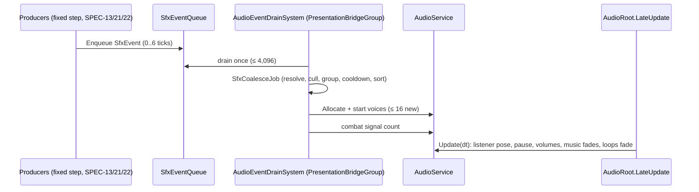

# SPEC-64 — Audio

| | |
|---|---|
| **Status** | Draft |
| **Area code** | AUD (task IDs are `AUD-001`, `AUD-002`, …) |
| **Module(s)** | `Game.Presentation` (folder `Assets/Game/Presentation/Audio/`); shared stream types in `Game.Voxel` (`Assets/Game/Voxel/PresentationStreams/`); `IAudioService` in `Game.Core` (`Assets/Game/Core/Audio/`); definitions in `Game.Data` (`Assets/Game/Data/Definitions/Audio/`); import, provenance and build checks in `Game.Editor` (`Assets/Game/Editor/Audio/`) |
| **Depends on specs** | SPEC-01 (constructs `AudioService` as service #4, registers it, pushes volumes and pause), SPEC-02 (`ContentId`, `ContentHash`, `EventBus<T>`, `IPauseService`, `Services`, system groups), SPEC-04 (`ContentDefinition`, `ContentDatabase` lookup by `ContentHash`), SPEC-20 (thruster state for the engine loop), SPEC-21 (beam state for beam loops; weapon fire cues), SPEC-30 (`OriginShifted`), SPEC-62 (listener pivot), SPEC-71 (test and perf harness) |
| **Depended on by** | SPEC-13, SPEC-21, SPEC-22 (emit `SfxEvent`, read `CombatAudioCues`); SPEC-60 (UI sounds through `IAudioService`); SPEC-40/41 (dialog and narrative sounds and music overrides); SPEC-51 (editor place/remove sounds); SPEC-61 (volume sliders via SPEC-01 settings); SPEC-62 (registers the listener pivot); SPEC-70 (`AudioStats` in `gh_perf`) |
| **Milestone** | M2 (contract types, mixer and service core M0; UI sounds and provenance check M1; origin shift and licence gate M3) |

> Read [01-architecture.md](../01-architecture.md), [02-conventions.md](../02-conventions.md) and [03-glossary.md](../03-glossary.md) before this spec. This spec may not contradict them.

## 1. Purpose

This spec gives the game one sound system: a mixer with Master/Music/Sfx/Ui/Ambience groups driven by the player's volume settings, data-driven cues (`AudioCueDefinition`), voice-capped playback of the `SfxEvent` stream that combat produces, a music state machine (menu, exploration, combat, editor, scripted overrides, stingers) with crossfades, UI sounds for SPEC-60, and exactly one `AudioListener` from boot to quit. Hundreds of hits in one frame become a handful of audible voices through per-frame coalescing, per-cue voice caps and priority stealing. It fixes the old prototype's missing listener (5,772 "no audio listeners" warnings, ledger R5/R7), one-entity-per-sound and accumulating events (02-C29, 04 §9), compounding music volume and missed settings subscription (04-B12), and the absent mixer.

## 2. Scope

**In scope:**
- `SfxEvent` stream contract (`SfxEvent`, `SfxEventFlags`, `SfxEventQueue`, owner system, helpers) and the `CombatAudioCues` singleton.
- `IAudioService`, `UiSound`, `AudioVolumes` (Game.Core) for managed callers below Presentation.
- `AudioCueDefinition`, `AudioConfigDefinition`, `AudioBus`, `CoalesceMode`.
- The mixer asset, its groups and exposed log-dB volume parameters.
- `AudioService`: pooled voices, the single listener, volumes, pause, UI sounds, stingers, music state machine.
- `AudioEventDrainSystem`: drain, resolve, cull, coalesce, cooldown, voice allocation.
- `AudioLoopBridgeSystem`: player engine loop and beam hums.
- Audio import rules, legacy `AudioLibrary` mapping, audio provenance table, release-build licence check, and the owner licence gate.

**Out of scope (and who owns it instead):**
- Deciding when a sound happens and filling `SfxEvent` (SPEC-13, SPEC-21, SPEC-22).
- Storing settings and the settings screen (SPEC-01, SPEC-61).
- Wiring hover/click callbacks into UI elements (SPEC-60; it calls `IAudioService.PlayUi`).
- Dialog page sounds and narrative `play_sound` effects (SPEC-40/41 call `IAudioService.PlayCue`).
- Camera rig and its listener pivot transform (SPEC-62).
- New audio assets and final mix (SPEC-81, after SPEC-80 approval).

## 3. Decisions (binding)

1. **One unmanaged queue, drained once per frame.** Producers append `SfxEvent`s to `SfxEventQueue.Queue` (`NativeQueue<SfxEvent>`, Persistent) through `ParallelWriter`; it accumulates across the 0..6 fixed ticks of a frame and `AudioEventDrainSystem` empties it once per frame. Hard cap 4,096 events per frame; the rest are cleared and counted. Reason: architecture §5.1 allows `NativeQueue` only for presentation streams; order does not affect simulation.
2. **The stream types live in `Game.Voxel/PresentationStreams`**, next to `FxEvent` (SPEC-63 §3.2), for the same reason (lowest producer with Entities). No other spec creates them.
3. **`SfxEvent` is `ContentHash Cue; float3 Pos; float Volume`** (architecture §6.6) plus `Flags`. Producers get cue hashes from definitions baked into their blobs or from the `CombatAudioCues` singleton; a hash of 0 means "no sound" and producers emit nothing.
4. **Exactly one `AudioListener` exists from boot to quit, owned by `AudioService`.** It lives on `AudioRoot/AudioListener` (child of `GameRoot`, `DontDestroyOnLoad`) and copies the pose of the listener target (the camera rig's pivot, registered by SPEC-62) every `LateUpdate`. No scene, prefab or camera may contain an `AudioListener`. Reason: ledger R5/R7; a listener parented to a scene object would die with the scene.
5. **All voices are pooled at construction.** 40 SFX voices, 8 UI voices, 3 music voices (A, B, stinger), 1 ambience voice, 8 loop voices: 60 `AudioSource`s created once by `AudioService`, never created or destroyed afterwards. Project audio settings: Real Voices 64, Virtual Voices 512.
6. **Coalescing before allocation.** Within a frame, SFX events with the same cue in the same coalescing cell (default 16 m cube) become one voice at the loudest event's position, with volume `min(1, maxVolume × (1 + coalesceGain × log2(count)))`.
7. **Voice limits:** per cue `maxVoices`; globally the 40-voice SFX pool; at most 16 new SFX voices start per frame. When full, a new sound steals only from a voice with a lower priority (higher `priority` number), or the same priority and lower audibility. Unity convention: `priority` 0 = most important, 255 = least.
8. **Volumes are mixer parameters in dB.** `dB = linear <= 0.0001 ? −80 : 20 × log10(linear)`, applied to exposed parameters `MasterVolume`, `MusicVolume`, `SfxVolume`, `UiVolume`, `AmbienceVolume`. Source volumes never multiply settings in (fixes 04-B12). Settings are pushed by SPEC-01 through `AudioService.ApplyVolumes`.
9. **Pause silences the world, not the menus.** While `IPauseService.IsPaused`, `AudioListener.pause = true`; UI, music and stinger voices have `ignoreListenerPause = true`.
10. **Music is a pure state machine (`MusicDirector`) plus two crossfading voices.** Scene context comes from the active scene name mapped in `AudioConfigDefinition.sceneMusic` (data, not code). Combat music is driven by `combatSignal` cues heard within 500 m of the listener. Scripted overrides (`SetMusicOverride`) beat everything except `Silent`.
11. **Drain logic is Burst; voice bookkeeping is managed but allocation-free.** `SfxCoalesceJob` runs with `.Run()` on the main thread; `SfxVoiceAllocator` works on preallocated arrays; nothing allocates per frame.
12. **Presentation randomness** (clip choice, volume and pitch jitter) uses `Unity.Mathematics.Random` seeded from `(frameCount, candidateIndex)`. It never touches simulation.
13. **Origin shifts move playing spatial voices** by `OriginShifted.Delta` in the frame they happen (SPEC-63 §3.10 mechanism); a delta over 20,000 m stops SFX and loop voices instead.
14. **Clips with unknown licences never ship.** Every clip under `Assets/Game/Audio/` has a row in `AudioProvenance.asset`; `Blocked` clips may not be referenced by any cue; release (non-development) builds fail if any referenced clip is not `Confirmed`.

## 4. Data model

### 4.1 Stream types (public contract, `Game.Voxel`, folder `Assets/Game/Voxel/PresentationStreams/`, namespace `Game.Voxel.PresentationStreams`)

```csharp
[System.Flags]
public enum SfxEventFlags : byte
{
    None = 0,
    PlayerSource = 1,   // emitted by or on the player ship: never distance-culled, sorts before equal priority
}

/// Implements SPEC-64 §4.1 (architecture §6.6 binding fields + Flags). Size 32 bytes.
public struct SfxEvent
{
    public ContentHash Cue;     // binding: hash of an AudioCueDefinition; Value 0 = no sound
    public float3 Pos;          // binding: position in the local frame (ignored for 2D cues)
    public float Volume;        // binding: 0..1 multiplier on the cue volume
    public SfxEventFlags Flags; // added by SPEC-64
    public byte Reserved0;      // keep 0
    public ushort Reserved1;    // keep 0
}

/// Singleton. Owned by SfxEventQueueCreateSystem.
public struct SfxEventQueue : IComponentData { public NativeQueue<SfxEvent> Queue; }

/// Singleton created by AudioService.BindTo from AudioConfigDefinition. Producers read it; Value 0 = no cue.
public struct CombatAudioCues : IComponentData
{
    public ContentHash ImpactKinetic, ImpactEnergy, ImpactExplosive, ImpactRam;
    public ContentHash ExplosionSmall, ExplosionLarge, ShieldHit;
    public ContentHash CellBreak, BreakOff, ShipDeath;
}

public static class SfxEvents
{
    public static SfxEvent At(ContentHash cue, float3 pos, float volume = 1f, bool player = false) =>
        new SfxEvent { Cue = cue, Pos = pos, Volume = math.saturate(volume), Flags = player ? SfxEventFlags.PlayerSource : SfxEventFlags.None };

    /// Main-thread enqueue for managed producers. No-op when the world has no queue or cue.Value == 0.
    public static void EnqueueMainThread(EntityManager em, in SfxEvent e)
    {
        if (e.Cue.Value == 0) return;
        using var q = em.CreateEntityQuery(ComponentType.ReadWrite<SfxEventQueue>());
        if (q.IsEmpty) return;
        em.CompleteDependencyBeforeRW<SfxEventQueue>();
        q.GetSingleton<SfxEventQueue>().Queue.Enqueue(e);
    }
}
```

`SfxEventQueueCreateSystem` is identical to SPEC-63's `FxEventQueueCreateSystem` (§4.1 there) with `SfxEvent`/`SfxEventQueue` and entity name `"SfxEventQueue"`: `[UpdateInGroup(typeof(InitializationSystemGroup))]`, Burst, allocates in `OnCreate`, `state.Enabled = false`, `CompleteAllTrackedJobs` + dispose in `OnDestroy`.

### 4.2 Core interfaces (public contract, `Game.Core`, folder `Assets/Game/Core/Audio/`, namespace `Game.Core.Audio`)

The `Audio/` sub-folder holds the audio types that modules below Presentation (UI, Narrative, ShipEditor) need (architecture §3.3).

```csharp
public enum UiSound : byte { Hover = 0, Click = 1, Open = 2, Close = 3, Back = 4, Error = 5, Success = 6,
                             SlotHover = 7, SlotClick = 8, Notify = 9, Tab = 10 }   // add at the end only

public struct AudioVolumes  // linear 0..1, as stored by SettingsService
{
    public float Master, Music, Sfx, Ui, Ambience;
    public static AudioVolumes Default => new AudioVolumes { Master = 0.8f, Music = 0.6f, Sfx = 0.8f, Ui = 0.7f, Ambience = 0.6f };
}

/// Implemented by Game.Presentation AudioService; registered in Services by GameRoot (SPEC-01).
public interface IAudioService
{
    void PlayUi(UiSound sound);                                   // 2D, Ui bus, respects cue cooldown
    void PlayCue(ContentId cue);                                  // 2D one-shot on the cue's bus
    void PlayCueAt(ContentId cue, float3 position, float volume); // spatial one-shot through the SFX pool
    void PlayStinger(ContentId cue);                              // music bus, ducks music
    void SetMusicOverride(ContentId cue, float fadeSeconds);      // scripted music; replaces the current override
    void ClearMusicOverride(float fadeSeconds);
}
```

### 4.3 Definitions (public contract, `Game.Data`, folder `Assets/Game/Data/Definitions/Audio/`, namespace `Game.Data.Definitions`)

```csharp
public enum AudioBus : byte { Sfx = 0, Ui = 1, Music = 2, Ambience = 3 }
public enum CoalesceMode : byte { None = 0, PerCue = 1, PerCell = 2 }

/// Implements SPEC-64 §4.3. Content id prefix "cue_" (e.g. cue_weapon_laser_fire).
[ContentIdPrefix("cue_")]
public sealed class AudioCueDefinition : ContentDefinition
{
    [SerializeField] AudioClip[] clips = new AudioClip[0];        // >= 1; never the same clip twice in a row when >= 2
    [SerializeField] AudioBus bus = AudioBus.Sfx;
    [SerializeField, Range(0f, 1f)] float volume = 1f;
    [SerializeField, Range(0f, 0.5f)] float volumeRandom = 0.1f;   // ± fraction
    [SerializeField, Range(0.1f, 3f)] float pitch = 1f;
    [SerializeField, Range(0f, 0.5f)] float pitchRandom = 0.05f;   // ± fraction
    [SerializeField, Range(1, 32)] int maxVoices = 4;
    [SerializeField, Range(0, 255)] int priority = 128;            // 0 = most important
    [SerializeField, Range(0f, 1f)] float spatialBlend = 1f;       // 0 = 2D, 1 = 3D
    [SerializeField, Min(0.1f)] float minDistance = 30f;           // metres, logarithmic rolloff
    [SerializeField, Min(1f)] float maxDistance = 600f;            // also the distance-cull radius
    [SerializeField, Min(0f)] float cooldown = 0.05f;              // seconds between starts in the same coalescing group
    [SerializeField] bool loop;                                    // music, ambience, loop voices only
    [SerializeField] CoalesceMode coalesce = CoalesceMode.PerCell;
    [SerializeField, Min(1f)] float coalesceCellSize = 16f;
    [SerializeField, Range(0f, 1f)] float coalesceGain = 0.25f;
    [SerializeField] bool combatSignal;                            // counts toward combat music
    // PascalCase read-only properties for every field.
    public override void Validate(ValidationReport report)
    {
        // Errors: clips empty or containing null; minDistance >= maxDistance; bus == Music/Ambience with loop == false
        // for cues referenced as music/ambience (checked by AudioConfigDefinition); bus == Ui with spatialBlend > 0.
    }
}

[System.Serializable] public struct SceneMusicEntry { public string sceneName; public MusicContext context; }
public enum MusicContext : byte { Silent = 0, Menu = 1, World = 2, Editor = 3 }

/// Implements SPEC-64 §4.3. Exactly one instance: Assets/Game/Content/Audio/config_audio.asset (id "config_audio").
[ContentIdPrefix("config_")]
public sealed class AudioConfigDefinition : ContentDefinition
{
    [SerializeField] AudioMixer mixer;                              // Assets/Game/Audio/Mixer/GameMixer.mixer
    [SerializeField] AudioMixerGroup sfxGroup, uiGroup, musicGroup, ambienceGroup;
    [SerializeField] AudioCueDefinition[] uiSounds = new AudioCueDefinition[11];   // index = (int)UiSound
    [SerializeField] AudioCueDefinition musicMenu, musicExploration, musicCombat, musicEditor, ambienceWorld;
    [SerializeField] AudioCueDefinition impactKinetic, impactEnergy, impactExplosive, impactRam,
                                        explosionSmall, explosionLarge, shieldHit, cellBreak, breakOff, shipDeath;
    [SerializeField] AudioCueDefinition engineLoop, beamLoop;       // may be null: that loop stays silent
    [SerializeField] SceneMusicEntry[] sceneMusic = {
        new SceneMusicEntry { sceneName = "Boot", context = MusicContext.Silent },
        new SceneMusicEntry { sceneName = "MainMenu", context = MusicContext.Menu },
        new SceneMusicEntry { sceneName = "World", context = MusicContext.World },
        new SceneMusicEntry { sceneName = "BlueprintLab", context = MusicContext.Editor } };
    [SerializeField] float combatRadius = 500f, combatWindowSeconds = 2f, combatHoldSeconds = 8f;
    [SerializeField] int combatEnterSignals = 3;
    [SerializeField] float fadeDefault = 2f, fadeToCombat = 1f, fadeFromCombat = 4f;
    [SerializeField] float stingerDuckDb = -8f, stingerAttack = 0.2f, stingerRelease = 1f;
    [SerializeField] float loopFadeSeconds = 0.1f, beamLoopRadius = 300f;
    // PascalCase read-only properties.
    public override void Validate(ValidationReport report)
    {
        // Errors: mixer or any group null; uiSounds.Length != 11 or any null; any music* cue null, not on the Music bus or
        // loop == false; ambienceWorld non-null and (not on the Ambience bus or loop == false); any combat cue null;
        // combatEnterSignals < 1; sceneMusic missing one of the four scenes. ambienceWorld, engineLoop, beamLoop may be null.
    }
}
```

### 4.4 Presentation types (`Game.Presentation`, folder `Assets/Game/Presentation/Audio/`, namespace `Game.Presentation.Audio`)

```csharp
public enum MusicState : byte { Silent = 0, Menu = 1, Exploration = 2, Combat = 3, Editor = 4, Override = 5 }

public sealed class AudioStats   // public contract; reset each frame by AudioEventDrainSystem
{
    public int EventsDrained, EventsOverHardCap, Unresolved, Silent, Culled, Groups, CooldownDropped;
    public int Started, Stolen, RejectedNoVoice, ActiveSfxVoices, ActiveLoopVoices, CombatSignals;
    public MusicState Music; public bool Bound;
}

internal struct SfxCueInfo { public int Slot; public byte Priority; public float Volume, SpatialBlend, MinDistance, MaxDistance,
                             Cooldown, CoalesceCellSize, CoalesceGain; public CoalesceMode Coalesce; public int MaxVoices;
                             public bool CombatSignal; }
internal struct SfxCandidate { public int Slot; public float3 Pos; public float MaxVolume, FinalVolume, Audibility;
                               public int Count; public ulong GroupKey; public SfxEventFlags Flags; public int Order; }
internal struct VoiceInfo { public int Slot; public byte Priority; public float Audibility; public double StartTime; public bool Active; }
```

Mixer asset `Assets/Game/Audio/Mixer/GameMixer.mixer`: groups `Master` → `Music`, `Sfx`, `Ui`, `Ambience`; each group's Volume exposed as `MasterVolume`, `MusicVolume`, `SfxVolume`, `UiVolume`, `AmbienceVolume`; one snapshot `Default`; no effects.

Editor types (`Game.Editor`, `Assets/Game/Editor/Audio/`, namespace `Game.Editor.Audio`): `AudioProvenanceTable : ScriptableObject` with `List<AudioProvenanceEntry>`; `AudioProvenanceEntry { AudioClip clip; string source; string licence; ProvenanceStatus status; string note; }`; `enum ProvenanceStatus { Unverified = 0, Confirmed = 1, Blocked = 2 }`. Asset: `Assets/Game/Audio/AudioProvenance.asset`.

## 5. Systems, services and flow



### 5.1 `SfxEventQueueCreateSystem`
`InitializationSystemGroup`; owns the queue; never updates (§4.1).

### 5.2 `AudioService` (managed service #4; plain C# class plus thin `AudioRoot : MonoBehaviour`)
Construction (`new AudioService(config, content, initialVolumes, parent)`), in this order:
1. Create `GameObject "AudioRoot"` under `parent` (or adopt the empty FND-002 prefab placeholder, rejecting a nonempty one) with `AudioRoot` (`[DefaultExecutionOrder(10000)]`, calls `service.Update(Time.unscaledDeltaTime)` in `LateUpdate`).
2. Create child `"AudioListener"` with the only `AudioListener`.
3. Create children `SfxVoice_00..39` (Sfx group, `spatialBlend` set per play, `rolloffMode = Logarithmic`, `playOnAwake = false`), `UiVoice_0..7` (Ui group, 2D, `ignoreListenerPause = true`), `MusicA`, `MusicB`, `Stinger` (Music group, 2D, `ignoreListenerPause = true`, `loop` per cue), `Ambience` (Ambience group, 2D, loop), `LoopVoice_0..7` (Sfx group, 3D, loop).
4. Build the cue table: every `AudioCueDefinition` in `ContentDatabase.Definitions` (open question 3) gets slot `1..N` in database order; `NativeHashMap<ulong,int> cueSlotByHash` (`ContentHash.Value` → slot, lookup only) and `NativeArray<SfxCueInfo> cueInfo` (Persistent). Store `pendingVolumes = initialVolumes`.
5. Subscribe to `SceneManager.activeSceneChanged` (unsubscribed in `Dispose`).

`Update(float dt)` (called from `AudioRoot.LateUpdate`, main thread, every frame including menus):
1. If `pendingVolumes` set: `mixer.SetFloat` for the five parameters (§3.8); clear. (Volumes are applied here, not in the constructor, because mixer parameters set during `Awake` can be ignored.)
2. If the listener target is set and not destroyed: copy its `position` and `rotation` to the listener transform. If destroyed: clear the target (listener stays where it is).
3. `AudioListener.pause = pause != null && pause.IsPaused`.
4. Music: `cmd = musicDirector.Update(inputs, dt)` (§5.5); apply the command to `MusicA`/`MusicB`; advance the equal-power crossfade (`a = cos(t·π/2)`, `b = sin(t·π/2)`, `t` from 0 to 1 over the fade duration); apply stinger ducking (multiply music voice volumes by `duck`, which moves to `10^(stingerDuckDb/20)` over `stingerAttack` while the stinger plays and back to 1 over `stingerRelease`).
5. Mark SFX voices whose `AudioSource.isPlaying` is false as free (`VoiceInfo.Active = false`).
6. Reset the per-frame `combatSignals` input after the music director consumed it.

### 5.3 `AudioEventDrainSystem` (managed `SystemBase`, listed in architecture §5)
- **Group:** `PresentationBridgeGroup`. `RequireForUpdate<SfxEventQueue>()` only (not `GameplayActive`, so leftovers drain after leaving the World scene).
- **Reads:** `SfxEventQueue` (and empties it), `OriginShifted` (AUD-012). **Writes:** nothing in ECS.
- **Owned memory (Persistent, disposed in `OnDestroy`):** `NativeList<SfxEvent> drained` (capacity 4,096), `NativeList<SfxCandidate> candidates` (capacity 4,096), `NativeHashMap<ulong,int> groupIndex` (capacity 4,096, lookup only), `NativeHashMap<ulong,double> lastStart` (capacity 1,024; entries older than 2 s removed each frame by a key list), `NativeArray<int> counters`.

Per-frame algorithm:
1. `var q = SystemAPI.GetSingleton<SfxEventQueue>(); q.Access.CompleteAccess();` (ADR-0067: complete the actual native queue producers).
2. `SfxDrainJob` (Burst, `.Run()`): clear `drained`; dequeue until empty or 4,096; remaining → `EventsOverHardCap`, `q.Queue.Clear()`.
3. If `Service == null`: `Stats.Bound = false`; return.
4. (AUD-012) Origin shift per §3.13 → `Service.ShiftSpatialVoices(delta)` or `Service.StopSfxAndLoops()`.
5. `SfxCoalesceJob` (Burst, `.Run()`) with `drained`, `cueSlotByHash`, `cueInfo`, `listenerPos`, `now = Time.unscaledTimeAsDouble`, `lastStart`. For each event `i` in drain order:
   1. `Cue.Value == 0` or not in `cueSlotByHash` → `Unresolved++` (and `GameLog.WarnOnce` outside the job for each new unknown hash, from a list the job fills), skip.
   2. `!math.all(math.isfinite(Pos))` → `Culled++`, skip. `Volume <= 0.001` → `Silent++`, skip.
   3. Spatial cue (`SpatialBlend > 0`) without `PlayerSource`: `distance(Pos, listenerPos) > MaxDistance` → `Culled++`, skip.
   4. Group key: `None` → `StableHash.Combine((ulong)slot, (ulong)i | 1UL << 63)`; `PerCue` → `(ulong)slot`; `PerCell` (spatial only; 2D cues use `PerCue`) → `StableHash.Combine((ulong)slot, hash(int3 floor(Pos / CoalesceCellSize)))`.
   5. New group → append candidate `{Slot, Pos, MaxVolume = Volume, Count = 1, GroupKey, Flags, Order = candidates.Length}`; existing → `Count++`, `Flags |= Flags`, and when `Volume > MaxVolume`: `MaxVolume = Volume`, `Pos = event Pos`.
   6. After all events, per candidate: `FinalVolume = min(1, MaxVolume × (1 + CoalesceGain × log2(Count)))`; cooldown: if `lastStart[GroupKey]` exists and `now − it < Cooldown` → `CooldownDropped++`, mark dropped; `Audibility = FinalVolume × cue.Volume × (spatial ? saturate(MinDistance / max(dist, MinDistance)) : 1)`; `CombatSignals += Count` when `CombatSignal` and `dist <= combatRadius`.
   7. Sort the surviving candidates by (`Priority` ascending, `PlayerSource` first, `Audibility` descending, `Order` ascending).
6. `SfxVoiceAllocator.Allocate(candidates, voices, cueInfo, maxNew: 16)` (managed, allocation-free). For each candidate in sorted order, stop after 16 starts:
   1. `same` = active voices of this slot. If `same >= MaxVoices`: oldest voice of this slot; if `candidate.Audibility > voice.Audibility` → steal it (`Stolen++`), else `RejectedNoVoice++`, next.
   2. Else first free voice; if none: victim = the active voice with the largest `Priority`, ties broken by the lowest `Audibility`, then oldest; steal when `victim.Priority > cand.Priority` or (`==` and `victim.Audibility < cand.Audibility`); else `RejectedNoVoice++`, next.
   3. `Service.StartSfxVoice(voiceIndex, slot, candidate)`: pick a clip (never the previous clip of this cue when ≥ 2), `volume = cue.Volume × FinalVolume × (1 + r1 × VolumeRandom)`, `pitch = cue.Pitch × (1 + r2 × PitchRandom)` with `r1, r2` in [−1, 1] from `Random((uint)(frameCount × 7919 + order + 1))`, `spatialBlend`, `minDistance`, `maxDistance`, `transform.position = Pos`, `Play()`. Record `VoiceInfo` and `lastStart[GroupKey] = now`. `Started++`.
7. `Service.ReportCombatSignals(CombatSignals)`; copy counters into `Service.Stats`.

### 5.4 `AudioLoopBridgeSystem` (managed `SystemBase`)
`PresentationBridgeGroup`, `[UpdateAfter(typeof(AudioEventDrainSystem))]`, `RequireForUpdate<GameplayActive>()`. `OnStopRunning` (the World or Lab was left) stops every loop voice at once, so no loop outlives its scene.
1. Engine loop (voice 0, cue `engineLoop`): `intensity` = max `ThrusterState.Intensity` over thruster entities whose `FunctionalBlock.Grid` has `PlayerShip` (Burst `IJob`, `.Run()`). Target volume = `intensity`; pitch = `0.8 + 0.4 × intensity`; position = the player grid root `LocalToWorld.Position`.
2. Beam loops (voices 1..6, cue `beamLoop`): active beams (`BeamState.Active != 0`) within `beamLoopRadius` of the listener, sorted by distance, nearest 6. A beam keeps its voice while it stays in the set (map `Entity → voice` in a `NativeHashMap`, lookup only); free voices go to newcomers in distance order. Position = beam start (world).
3. Voice 7 is spare (unused in v1).
4. Fades: each loop voice's volume moves toward its target by `dt / loopFadeSeconds`; a voice whose target is 0 and volume reaches 0 is stopped.
5. If a loop cue is null, its voices stay stopped.

### 5.5 `MusicDirector` (pure C#, no Unity calls)
Input each frame: `MusicContext context` (from the active scene via `sceneMusic`; unknown scene → `Silent`), `int combatSignals` (this frame), `bool hasOverride`, `float dt`. State per §4.4. Rules, in priority order:
1. `context == Silent` → target `Silent` (fade `fadeDefault`).
2. `hasOverride` → target `Override` (fade = the caller's `fadeSeconds`).
3. `context == Menu` → `Menu`; `context == Editor` → `Editor`.
4. `context == World`: keep a ring of the last 32 signal timestamps (director time). Enter `Combat` when at least `combatEnterSignals` signals fall within the last `combatWindowSeconds` (fade `fadeToCombat`). Leave `Combat` to `Exploration` when no signal arrived for `combatHoldSeconds` (fade `fadeFromCombat`). Otherwise `Exploration` (fade `fadeDefault`).
Output: `MusicCommand { bool Change; MusicState Target; ContentHash Cue; float Fade; }`; `Change` only when the target state changes. Re-entering a state restarts its clip from the beginning. A fade that starts before the previous one finished starts from the current voice volumes.

### 5.6 UI sounds, cues and stingers (main thread)
- `PlayUi(sound)`: cue = `uiSounds[(int)sound]`; skip when `now − lastStart[cue] < cue.Cooldown`; play on the next `UiVoice` round-robin (stealing the oldest).
- `PlayCue(id)`: resolve through `ContentDatabase`; 2D on a UI voice when `bus == Ui`, else on the SFX pool as a candidate with `PlayerSource` at the listener position.
- `PlayCueAt(id, pos, vol)`: one candidate through `SfxVoiceAllocator` with `maxNew` 1. Until AUD-006, AUD-005 supports only explicitly 2D cues (Q15).
- `PlayStinger(id)`: play on `Stinger` (replacing any playing stinger), start ducking.
- Unknown `ContentId` → `GameLog.WarnOnce("Audio.UnknownCue." + id.Value, …)`, no sound.

### 5.7 Who emits which `SfxEvent` (producers follow this table)

| Sound | Producer (spec, system) | Cue source | Volume | Rate limit at the producer |
|---|---|---|---|---|
| Weapon fired | SPEC-21 `WeaponFireSystem` | `WeaponDefinition.fireCue` hash in the weapon blob | 1 | one per weapon per tick |
| Hull hit | SPEC-21 `ProjectileStepSystem` | `CombatAudioCues.ImpactKinetic/Energy/Explosive` by `DamageType` | `clamp(amount / 100, 0.2, 1)` | one per hit |
| Explosion | SPEC-21 `ExplosionSystem` | `ExplosionSmall` (radius < 4 m) / `ExplosionLarge` | 1 | one per request |
| Shield hit | the producer that hit the shield or SPEC-22 `ShieldSystem` | `ShieldHit` | `clamp(amount / 100, 0.2, 1)` | one per `ShieldHit` |
| Ram | SPEC-13 `ImpactEventSystem` | `ImpactRam` | `clamp(energy / 50000, 0.2, 1)` | one per pair per 10 ticks |
| Cells removed | SPEC-13 `DamageResolveSystem` | `CellBreak` | `clamp(removed / 20, 0.2, 1)` | one per `DamageEvent` that removed ≥ 1 cell |
| Break-off (chunk or hulk) | SPEC-13 `SplitSystem` | `BreakOff` | `clamp(cells / 500, 0.3, 1)` | one per split |
| Ship death | SPEC-13 `ShipDeathSystem` | `ShipDeath` | 1 | one per ship |
| UI, dialog, editor | SPEC-60, SPEC-41, SPEC-51 | `IAudioService` (not events) | — | — |

### 5.8 Profiler markers (architecture §11.11; SPEC-71 `PerfMarkers` naming)
`AudioEventDrainSystem.Drain`, `AudioEventDrainSystem.Coalesce`, `AudioEventDrainSystem.Allocate`, `AudioLoopBridgeSystem.Update`, `AudioService.Update`.

## 6. Public API

### 6.1 `AudioService` (Game.Presentation; constructed by SPEC-01 `GameRoot`)

```csharp
public sealed class AudioService : IAudioService, IDisposable
{
    public AudioService(AudioConfigDefinition config, ContentDatabase content, AudioVolumes initialVolumes, Transform parent);
    public void ApplyVolumes(in AudioVolumes v);          // stored; applied to the mixer on the next Update
    public void BindPause(IPauseService pause);           // called by GameRoot after PauseService exists
    public void BindTo(World world);                      // binds AudioEventDrainSystem + AudioLoopBridgeSystem; creates/sets CombatAudioCues
    public void Unbind(World world);
    public void SetListenerTarget(Transform pivot);       // SPEC-62 camera rig, on enable
    public void ClearListenerTarget(Transform pivot);     // no-op unless pivot is the current target
    public float3 ListenerPosition { get; }
    public AudioStats Stats { get; }
    public MusicState MusicState { get; }
    // IAudioService members (§4.2)
    public void Dispose();                                // stops all voices, destroys AudioRoot, disposes native memory, unsubscribes
    // internal (systems only): StartSfxVoice, ReportCombatSignals, ShiftSpatialVoices(float3), StopSfxAndLoops(), Update(float)
}
```
Pre: when present, `config` passed validation and `content` contains every cue. Until AUD-007 creates audio content, a null config creates the listener and silent voice pools, with no mixer writes (Q14). Post (constructor): exactly one `AudioListener` exists in the process; 60 `AudioSource`s exist under `AudioRoot`; no further `AudioSource` or `AudioListener` is ever created. Errors: a null mixer group at construction is `GameLog.Error` and that bus routes to `Master`.

### 6.2 Producer pattern

```csharp
// In a producer's OnUpdate (fixed step). Tests add typeof(SfxEventQueueCreateSystem) to their EcsTestWorld.
var stream = SystemAPI.GetSingleton<SfxEventQueue>();
var sfx = stream.Queue.AsParallelWriter();
// Schedule with stream.Access.BeginRead(state.Dependency), then stream.Access.EndRead(the scheduled handle).
// in the job struct: [NativeDisableContainerSafetyRestriction] public NativeQueue<SfxEvent>.ParallelWriter Sfx;
// AudioEventDrainSystem completes stream.Access before drain/clear. The creation system owns and disposes queue + guard (ADR-0067).
SystemAPI.TryGetSingleton<CombatAudioCues>(out var cues);           // absent in tests: all hashes 0 → emit nothing
// in the job: if (cues.ImpactKinetic.Value != 0) sfx.Enqueue(SfxEvents.At(cues.ImpactKinetic, point, vol));
```

### 6.3 Rules for SPEC-60 UI sounds
Register once on the `UIRoot` document root (TrickleDown): `PointerEnterEvent` on a `Button` → `PlayUi(Hover)`; `ClickEvent` and `NavigationSubmitEvent` on a `Button` → `PlayUi(Click)`; screen push → `Open`; pop → `Close`; `Back()` → `Back`. Only events caused by player input play sounds; programmatic selection and focus at screen build never do (fixes 06-D3/D8).

### 6.4 Legacy `AudioLibrary` mapping (`Import/Legacy/content/Audio/AudioLibrary.json`)

Clips come from `Assets/Game/Audio/Sfx/` or `Assets/Game/Audio/Music/` with the same file name as the legacy `$ref`. Volume is copied exactly. Columns `Spatial`, `Max`, `Prio`, `Cooldown`, `Coalesce`, `Combat` set the new fields.

| Legacy ID | New cue id | Bus | Clip | Vol | Spatial | Max | Prio | Cooldown | Coalesce | Combat |
|---|---|---|---|---|---|---|---|---|---|---|
| UI_Button_Click | `cue_ui_click` | Ui | INTERFACE-MetallicClick.wav | 1.0 | 0 | 4 | 64 | 0.03 | PerCue | no |
| UI_Button_Hover | `cue_ui_hover` | Ui | UIHover_INTERFACE-Positive Click_HY_PC-002.wav | 1.0 | 0 | 2 | 96 | 0.05 | PerCue | no |
| UI_Slot_Click | `cue_ui_slot_click` | Ui | INTERFACE-MetallicClick.wav | 1.0 | 0 | 4 | 64 | 0.03 | PerCue | no |
| UI_Slot_Hover | `cue_ui_slot_hover` | Ui | UIHover_INTERFACE-Positive Click_HY_PC-002.wav | 0.1 | 0 | 2 | 96 | 0.05 | PerCue | no |
| UI_View_Open | `cue_ui_view_open` | Ui | UIClick_INTERFACE-OpenClose.wav | 0.5 | 0 | 2 | 64 | 0.1 | PerCue | no |
| UI_View_Close | `cue_ui_view_close` | Ui | UIClick_INTERFACE-OpenClose.wav | 0.5 | 0 | 2 | 64 | 0.1 | PerCue | no |
| UI_Fail | `cue_ui_fail` | Ui | Failure Stinger.wav | 0.3 | 0 | 1 | 32 | 0.3 | PerCue | no |
| UI_Success | `cue_ui_success` | Ui | Success Stinger.wav | 0.3 | 0 | 1 | 32 | 0.3 | PerCue | no |
| Weapon_Laser_Fire | `cue_weapon_laser_fire` | Sfx | Projectile_EXPLOSION-Bit Bomb_HY_PC-001.wav | 0.2 | 1 | 6 | 128 | 0.05 | PerCell | yes |
| Weapon_Plasma_Fire | `cue_weapon_plasma_fire` | Sfx | EXPLOSION-Cruncher_HY_PC-003.wav | 0.1 | 1 | 6 | 128 | 0.05 | PerCell | yes |
| Weapon_Cannon_Fire | `cue_weapon_cannon_fire` | Sfx | EXPLOSION-Cruncher_HY_PC-003.wav | 0.3 | 1 | 6 | 128 | 0.05 | PerCell | yes |
| Impact_Hull | `cue_impact_hull` | Sfx | explosion_hull_impact.wav | 0.3 | 1 | 8 | 140 | 0.04 | PerCell | yes |
| Impact_Explosion_Small | `cue_explosion_small` | Sfx | EXPLOSION-Cruncher_HY_PC-003.wav | 0.5 | 1 | 6 | 100 | 0.05 | PerCell | yes |
| Impact_Explosion_Large | `cue_explosion_large` | Sfx | EXPLOSION-Cruncher_HY_PC-003.wav | 0.3 | 1 | 4 | 80 | 0.1 | PerCell | yes |
| Editor_Place_Voxel | `cue_editor_place` | Ui | Rooted_Dirt_break3_placeholder.ogg | 1.0 | 0 | 4 | 96 | 0.03 | PerCue | no |
| Editor_Remove_Voxel | `cue_editor_remove` | Ui | Rooted_Dirt_break3_placeholder.ogg | 1.0 | 0 | 4 | 96 | 0.03 | PerCue | no |
| Combat_Standard (music) | `cue_music_combat` | Music | 10 Boarding the Mechanism.wav | 0.1 | 0 | 1 | 0 | 0 | None | no (loop) |
| Exploration (music) | `cue_music_exploration` | Music | 02 The Restricted Hangar.wav | 0.1 | 0 | 1 | 0 | 0 | None | no (loop) |
| MainMenu (music) | `cue_music_menu` | Music | 02 The Restricted Hangar.wav | 0.1 | 0 | 1 | 0 | 0 | None | no (loop) |
| SpaceStation (music) | `cue_music_station` | Music | 03 Promising Development.wav | 0.1 | 0 | 1 | 0 | 0 | None | no (loop) |

New cues with no legacy entry (placeholder clips; spatial 1, max 6, prio 120, cooldown 0.05, PerCell, combat yes unless stated): `cue_impact_energy` (explosion_hull_impact.wav, 0.25, pitch 1.3), `cue_impact_explosive` (EXPLOSION-Cruncher_HY_PC-005.wav, 0.4), `cue_impact_ram` (EXPLOSION-Cruncher_HY_PC-005.wav, 0.6, pitch 0.8), `cue_shield_hit` (PROJECTILE-Laser Bursts_HY_PC-005.wav, 0.2, pitch 1.5), `cue_cell_break` (Rooted_Dirt_break3_placeholder.ogg, 0.4, pitch 0.7, combat no), `cue_break_off` (EXPLOSION-Cruncher_HY_PC-005.wav, 0.5, pitch 0.8), `cue_ship_death` (EXPLOSION-Cruncher_HY_PC-005.wav, 0.8, max 2, prio 40), `cue_warp` (DSGNMisc_MOVEMENT-Mecha Large Takeoff_HY_PC-004.wav, 0.6, spatial 0, combat no), `cue_ui_trade` (DSGNTonl_USABLE-Coin Toss_HY_PC-002.wav, Ui, 0.5), `cue_stinger_discovery` (Fantasy_Stinger_1.mp3, Music, 0.5). `config_audio` maps `musicEditor` → `cue_music_station`, `ambienceWorld` → null (no ambience clip exists yet), `engineLoop` → null, `beamLoop` → null, `uiSounds`: Hover → `cue_ui_hover`, Click → `cue_ui_click`, Open → `cue_ui_view_open`, Close → `cue_ui_view_close`, Back → `cue_ui_view_close`, Error → `cue_ui_fail`, Success → `cue_ui_success`, SlotHover → `cue_ui_slot_hover`, SlotClick → `cue_ui_slot_click`, Notify → `cue_ui_success`, Tab → `cue_ui_click`.

`ComfyUI_00018_.mp3` and `upbeat.mp3` are **not mapped** and stay `Blocked` until the owner rules (AUD-011).

### 6.5 Import rules (`AudioImportPostprocessor`, applied on every import)

| Folder | Load type | Format, quality | Mono | Preload | Load in background |
|---|---|---|---|---|---|
| `Assets/Game/Audio/Music/` | Streaming | Vorbis 0.6 | no | no | yes |
| `Assets/Game/Audio/Sfx/` | Decompress On Load | Vorbis 0.7 | yes | yes | no |
| `Assets/Game/Audio/Ambience/` | Compressed In Memory | Vorbis 0.6 | no | yes | yes |

## 7. Edge cases and failure behaviour

| Situation | Required behaviour |
|---|---|
| More than 4,096 events in one frame | First 4,096 processed; rest cleared; `EventsOverHardCap`; `WarnOnce("Audio.HardCap")` |
| Not bound to the world | Queue drained and discarded each frame; `Stats.Bound = false` |
| Unknown cue hash | Skipped, `Unresolved++`, one warning per hash |
| `Cue.Value == 0` | Skipped, counted as `Unresolved`, no warning |
| NaN/infinite position | Skipped (`Culled`) |
| Spatial event beyond `maxDistance` and not `PlayerSource` | Culled |
| 200 hull hits on one ship in one frame | One `cue_impact_hull` voice at the loudest hit, volume `min(1, v × (1 + 0.25 × log2(200)))` |
| All 40 SFX voices busy with higher priority | New candidate rejected, `RejectedNoVoice++` |
| Same cue retriggered within its cooldown in the same cell | Dropped, `CooldownDropped++` |
| No listener target (menus, benchmarks without camera rig) | Listener stays at its last pose (initially origin); 2D sounds unaffected |
| Listener target destroyed with its scene | Target cleared; listener survives |
| Any scene or prefab contains an `AudioListener` | `AudioListenerSceneTests` fails at edit time; at runtime the extra listener is not created by us, and the PlayMode test fails |
| Game paused | SFX, loops and ambience pause; music, stinger and UI continue |
| Volume slider at 0 | Mixer parameter −80 dB |
| `SetFloat` during `Awake` ignored by Unity | Volumes are applied in the first `Update` (§5.2 step 1) |
| Scene not listed in `sceneMusic` | Music context `Silent` |
| `SessionReset` | `StopSfxAndLoops()`; music director reset to the current scene context |
| `StarSystemEntered` | `StopSfxAndLoops()`; music unchanged |
| Origin shift ≤ 20,000 m | Playing SFX and loop voices move by `delta` the same frame |
| Origin shift > 20,000 m | `StopSfxAndLoops()` |
| Loop cue null | Its loop voices stay stopped, no warning |
| Clip `Blocked` referenced by a cue | `AudioProvenanceTests` fails; release build fails |
| Release (non-development) build with an `Unverified` referenced clip | `AudioReleaseBuildCheck` throws `BuildFailedException` listing each clip |
| Second Play with domain reload off | `AudioService` is disposed with `GameRoot` and recreated; no statics; `AudioListener.pause` reset to false in `Dispose` |

## 8. Performance budget

| What | Budget | Measured by |
|---|---|---|
| `AudioEventDrainSystem` main thread | ≤ 0.15 ms at 500 events/frame; ≤ 0.4 ms at 4,096 events/frame | `AudioPerfTests.Drain500_Smoke`, `AudioPerfTests.Drain4096` (markers in §5.8) |
| `AudioService.Update` + `AudioLoopBridgeSystem` | ≤ 0.05 ms main thread together | `AudioPerfTests.ServiceAndLoops_Smoke` |
| GC | 0 B/frame in every audio path after the first frame (including `PlayUi`) | `AudioRegressionTests.Combat500PerFrame_NoGcAlloc` |
| Voices | ≤ 64 real voices; ≤ 16 new SFX voices per frame | `AudioServiceTests.Construct_CreatesExactly60Sources`, allocator tests |
| Memory | SFX clips decompressed ≤ 24 MB total; music streamed | `AudioImportTests.SfxDecompressedSize_Under24MB` (sum of `AudioClip` sample data for the Sfx folder) |

Timing tests run with safety checks off (SPEC-71 perf fixture). Functional tests and frontier-review runs use Burst safety checks on and `NativeLeakDetection.Mode = EnabledWithStackTrace`. Results go to `Logs/perf/latest.json`.

## 9. Tasks

### AUD-001 — Public contract types
- **Milestone:** M0
- **Tier:** standard — transcribes the exact code of §4.1–§4.4
- **Depends on:** `CORE-001`, `DATA-001`
- **Do:** Create the §4.1 stream types, `SfxEventQueueCreateSystem` (copy of SPEC-63's owner system with Sfx types), `CombatAudioCues`, `SfxEvents`; the §4.2 Core types; the §4.3 definitions with their `Validate` rules; the §4.4 presentation types; `AudioService` with the §6.1 signatures where every method is a no-op that returns defaults (so SPEC-01 can construct it at M0); `AudioRoot` empty.
- **Files:** `Assets/Game/Voxel/PresentationStreams/{SfxEventFlags,SfxEvent,SfxEventQueue,SfxEventQueueCreateSystem,CombatAudioCues,SfxEvents}.cs`; `Assets/Game/Core/Audio/{UiSound,AudioVolumes,IAudioService}.cs`; `Assets/Game/Data/Definitions/Audio/{AudioBus,CoalesceMode,MusicContext,SceneMusicEntry,AudioCueDefinition,AudioConfigDefinition}.cs`; `Assets/Game/Presentation/Audio/{MusicState,AudioStats,AudioService,AudioRoot}.cs`; `Assets/Game/Presentation/Audio/Data/{SfxCueInfo,SfxCandidate,VoiceInfo}.cs`
- **Acceptance criteria:**
  - [ ] `UnsafeUtility.SizeOf<SfxEvent>() == 32`.
  - [ ] A world with `SfxEventQueueCreateSystem` has one `SfxEventQueue`; disposing leaks nothing.
  - [ ] Both `Validate` methods report every listed error.
  - [ ] `new AudioService(...)` with test arguments does not throw.
- **Tests:** `AudioContractTests.SfxEvent_Size_Is32`, `SfxEventQueueTests.World_CreatesSingleton_AndDisposesWithoutLeak`, `AudioDefinitionValidationTests.InvalidCue_ReportsErrors`, `AudioDefinitionValidationTests.InvalidConfig_ReportsErrors`.

### AUD-002 — Mixer asset, voice settings and import rules
- **Milestone:** M0
- **Tier:** standard — asset setup with the exact structure of §4.4 and §6.5
- **Depends on:** `AUD-001`
- **Do:** In the Editor create `Assets/Game/Audio/Mixer/GameMixer.mixer` (Assets ▸ Create ▸ Audio Mixer): rename the root group `Master`; add child groups `Music`, `Sfx`, `Ui`, `Ambience`; right-click each group's Volume ▸ "Expose … to script"; in the Exposed Parameters list rename them exactly `MasterVolume`, `MusicVolume`, `SfxVolume`, `UiVolume`, `AmbienceVolume`. Under Frank’s CLI-only instruction, a temporary Editor script may use the installed Editor mixer-authoring API to create the exact same asset, then verify the saved groups and exposed parameters through runtime AudioMixer APIs (Q13). Set `ProjectSettings/AudioManager.asset` Real Voice Count 64 and Virtual Voice Count 512. Implement `AudioImportPostprocessor` (§6.5) and reimport `Assets/Game/Audio/`.
- **Files:** `Assets/Game/Audio/Mixer/GameMixer.mixer`, `ProjectSettings/AudioManager.asset`, `Assets/Game/Editor/Audio/AudioImportPostprocessor.cs`, `Assets/Game/Tests/EditMode/Presentation/Audio/AudioAssetTests.cs`
- **Acceptance criteria:**
  - [ ] `mixer.FindMatchingGroups("Master/Music")` (and Sfx, Ui, Ambience) each return one group.
  - [ ] `mixer.GetFloat(name, out _)` is true for the five exposed names.
  - [ ] Every clip under `Music/` imports as Streaming, every clip under `Sfx/` as Decompress On Load + mono.
  - [ ] `AudioSettings.GetConfiguration().numRealVoices == 64`.
- **Tests:** `AudioAssetTests.Mixer_HasFourChildGroups`, `AudioAssetTests.Mixer_ExposesFiveVolumes`, `AudioImportTests.MusicFolder_IsStreaming`, `AudioImportTests.SfxFolder_DecompressOnLoadMono`, `AudioImportTests.SfxDecompressedSize_Under24MB`, `AudioAssetTests.ProjectVoiceCounts`.

### AUD-003 — AudioService core: root, single listener, voice pools, volumes, pause
- **Milestone:** M0
- **Tier:** frontier — F1: boot service lifecycle (service #4) and the single-listener rule
- **Depends on:** `AUD-002`
- **Do:** Implement §5.2 construction steps 1–5 and `Update` steps 1–3, 5; `ApplyVolumes`, `BindPause`, `SetListenerTarget`/`ClearListenerTarget`, `ListenerPosition`, `Dispose` (also sets `AudioListener.pause = false`); `VolumeMath.ToDb`. Music, loops and SFX allocation come in later tasks.
- **Files:** `Assets/Game/Presentation/Audio/AudioService.cs`, `Assets/Game/Presentation/Audio/AudioRoot.cs`, `Assets/Game/Presentation/Audio/VolumeMath.cs`
- **Acceptance criteria:**
  - [ ] After construction there is exactly one `AudioListener` and exactly 60 `AudioSource`s under `AudioRoot`, with the bus routing of §5.2 step 3.
  - [ ] `ApplyVolumes(0.5)` sets the parameter to −6.02 dB (±0.01) on the next `Update`; `0` → −80; `1` → 0.
  - [ ] Pause on → `AudioListener.pause == true`; UI/music/stinger voices have `ignoreListenerPause`.
  - [ ] The listener copies the target's pose each `LateUpdate`; destroying the target leaves the listener alive.
  - [ ] `Dispose` destroys everything it created and leaks no native memory.
- **Tests:** `VolumeMathTests.ToDb_KnownValues`, `AudioServiceTests.Construct_CreatesOneListenerAnd60Sources`, `AudioServiceTests.ApplyVolumes_SetsMixerOnNextUpdate`, `AudioServiceTests.Pause_PausesWorldNotUi`, `AudioServiceTests.ListenerFollowsTarget_SurvivesTargetDestroy`, `AudioServiceTests.Dispose_CleansUp` (PlayMode).

### AUD-004 — Listener regression and scene validation (R5/R7)
- **Milestone:** M1
- **Tier:** standard — tests of behaviour specified in §3.4
- **Depends on:** `AUD-003`, `SPEC-01`
- **Do:** EditMode test that opens each scene of the build list (`Boot`, `MainMenu`, `World`, `BlueprintLab`) with `EditorSceneManager.OpenScene(..., Additive)` and asserts it contains no `AudioListener`. PlayMode test: boot → MainMenu → World → BlueprintLab → MainMenu through `SceneFlow`; after each transition exactly one enabled `AudioListener` exists and no log line contains "There are no audio listeners".
- **Files:** `Assets/Game/Tests/EditMode/Presentation/Audio/AudioListenerSceneTests.cs`, `Assets/Game/Tests/PlayMode/Presentation/Audio/AudioListenerFlowTests.cs`
- **Acceptance criteria:**
  - [x] Both tests pass; adding an `AudioListener` to any scene makes the EditMode test fail with the scene name.
- **Tests:** `AudioListenerSceneTests.Scenes_ContainNoAudioListener`, `AudioListenerFlowTests.SceneTransitions_ExactlyOneListener_NoWarnings`.

### AUD-005 — UI sounds, PlayCue and stingers
- **Milestone:** M1
- **Tier:** standard — implements §5.6 exactly
- **Depends on:** `AUD-003`
- **Do:** Implement `PlayUi`, `PlayCue`, `PlayCueAt` (2D path only until AUD-006; spatial path then routes through the allocator), `PlayStinger` with ducking (§5.2 step 4 ducking part), cooldowns per cue for UI, round-robin UI voices.
- **Files:** `Assets/Game/Presentation/Audio/AudioService.cs`, `Assets/Game/Presentation/Audio/UiVoicePool.cs`; `Assets/Game/Tests/PlayMode/Presentation/Audio/AudioUiTests.cs`
- **Acceptance criteria:**
  - [x] `PlayUi(Hover)` twice within 0.05 s plays once; after 0.06 s plays again.
  - [x] Nine `PlayUi` calls in one frame use 8 voices and steal the oldest.
  - [x] A stinger lowers music voice volume to `10^(−8/20)` of normal within 0.2 s and restores it 1 s after the stinger ends.
  - [x] 0 B GC per `PlayUi` call after the first.
- **Tests:** `AudioUiTests.Hover_RespectsCooldown`, `AudioUiTests.NinthVoice_StealsOldest`, `AudioUiTests.Stinger_DucksAndRestoresMusic`, `AudioUiTests.PlayUi_NoGcAlloc` (PlayMode).

### AUD-006 — SfxEvent drain: coalescing, cooldown and voice allocation
- **Milestone:** M2
- **Tier:** frontier — F2: drains a queue written by parallel producer jobs; F4: owns the audio frame budget
- **Depends on:** `AUD-005`, `TST-001`
- **Do:** Implement `AudioEventDrainSystem` per §5.3 steps 1–3, 5–7, `SfxDrainJob`, `SfxCoalesceJob`, `SfxVoiceAllocator`, `AudioService.StartSfxVoice`, `BindTo/Unbind` (system binding only; `CombatAudioCues` comes in AUD-007), the stats and the §5.8 markers.
- **Files:** `Assets/Game/Presentation/Audio/Systems/AudioEventDrainSystem.cs`, `Assets/Game/Presentation/Audio/Jobs/SfxDrainJob.cs`, `Assets/Game/Presentation/Audio/Jobs/SfxCoalesceJob.cs`, `Assets/Game/Presentation/Audio/SfxVoiceAllocator.cs`, `Assets/Game/Presentation/Audio/AudioService.cs`
- **Acceptance criteria:**
  - [ ] Queue empty after every update; 10,000 queued → 4,096 processed, 5,904 in `EventsOverHardCap`.
  - [ ] 200 events of one PerCell cue within one 16 m cell → one voice; volume per §3.6.
  - [ ] Per-cue cap, global pool, 16-new-per-frame limit and stealing follow §5.3 step 6 exactly.
  - [ ] Distance culling exempts `PlayerSource`.
  - [ ] 0 B GC per frame at 500 events/frame after the first frame.
- **Tests:** `SfxCoalesceJobTests` (EditMode, job run directly): `UnknownHash_Unresolved`, `BeyondMaxDistance_Culled`, `PlayerSource_NotCulled`, `SameCell_CoalescesToLoudest`, `DifferentCells_SeparateGroups`, `Cooldown_DropsRetrigger`, `Sort_PriorityThenPlayerThenAudibility`; `SfxVoiceAllocatorTests`: `PerCueCap_StealsOldestOnlyIfLouder`, `PoolFull_StealsLowerPriority`, `PoolFull_EqualPriorityLouderWins`, `MaxSixteenNewPerFrame`; `AudioEventDrainSystemTests`: `Unbound_DrainsAndDiscards`, `HardCap_ClearsRemainder` (EcsTestWorld + test service).

### AUD-007 — Cue content, legacy import and the CombatAudioCues singleton
- **Milestone:** M2
- **Tier:** standard — converter with the explicit field map of §6.4
- **Depends on:** `AUD-006`
- **Do:** Write `LegacyAudioCueImporter` (Editor menu `Game/Audio/Import Legacy Audio Library`): reads `Import/Legacy/content/Audio/AudioLibrary.json` with Newtonsoft (`MissingMemberHandling.Error`), creates or updates one `AudioCueDefinition` per row of the §6.4 table in `Assets/Game/Content/Audio/`, finds clips by file name under `Assets/Game/Audio/`, fails with a listed error for any row whose clip is missing. Create the new cues listed under the table and `config_audio.asset` with the mapping given there. `AudioService.BindTo` creates (or sets) `CombatAudioCues` from the config's combat cues. Register all assets in the `ContentDatabase`.
- **Files:** `Assets/Game/Editor/Audio/LegacyAudioCueImporter.cs`, `Assets/Game/Content/Audio/*.asset`, `Assets/Game/Presentation/Audio/AudioService.cs`
- **Acceptance criteria:**
  - [ ] Running the importer twice creates exactly the 20 legacy cues once, with the table's volumes and clips; the second run changes nothing (asset hashes equal).
  - [ ] No cue references `ComfyUI_00018_.mp3` or `upbeat.mp3`.
  - [ ] After `BindTo`, `CombatAudioCues` hashes equal the config cues' `Id.Hash`.
- **Tests:** `LegacyAudioImportTests.Import_Creates20CuesWithTableValues`, `LegacyAudioImportTests.Import_IsIdempotent`, `AudioContentTests.Config_PassesValidate`, `AudioContentTests.NoCueReferencesBlockedClips`, `AudioBindTests.BindTo_CreatesCombatAudioCues`.

### AUD-008 — Music director, crossfades and scene contexts
- **Milestone:** M2
- **Tier:** standard — pure state machine with the exact rules of §5.5
- **Depends on:** `AUD-006`, `FND-001`
- **Do:** Implement `MusicDirector` (§5.5), the `activeSceneChanged` → `MusicContext` mapping, `AudioService.ReportCombatSignals`, music parts of `Update` (§5.2 step 4), `SetMusicOverride`/`ClearMusicOverride`, `SessionReset` handling (subscribe `EventBus<SessionReset>` in the service constructor, unsubscribe in `Dispose`).
- **Files:** `Assets/Game/Presentation/Audio/MusicDirector.cs`, `Assets/Game/Presentation/Audio/MusicCommand.cs`, `Assets/Game/Presentation/Audio/AudioService.cs`
- **Acceptance criteria:**
  - [ ] Director tests cover every rule of §5.5 with simulated time (no wall clock).
  - [ ] Equal-power crossfade: at mid-fade both voices are at `cos(π/4)` of their target volume (±0.01).
  - [ ] Override beats combat; clearing it returns to the context state.
- **Tests:** `MusicDirectorTests.MenuScene_PlaysMenu`, `MusicDirectorTests.ThreeSignalsInTwoSeconds_EntersCombat`, `MusicDirectorTests.TwoSignals_StaysExploration`, `MusicDirectorTests.EightSecondsQuiet_LeavesCombat`, `MusicDirectorTests.Override_BeatsCombat`, `MusicDirectorTests.SilentContext_BeatsOverride`, `MusicPlayModeTests.Crossfade_IsEqualPower`.

### AUD-009 — Loop voices: player engine and beams
- **Milestone:** M2
- **Tier:** standard — implements §5.4 exactly
- **Depends on:** `AUD-006`, `FLT-001`, `WPN-001`
- **Do:** Implement `AudioLoopBridgeSystem` per §5.4 and `AudioService` loop-voice control.
- **Files:** `Assets/Game/Presentation/Audio/Systems/AudioLoopBridgeSystem.cs`, `Assets/Game/Presentation/Audio/AudioService.cs`, `Assets/Game/Tests/PlayMode/Presentation/Audio/AudioLoopTests.cs`
- **Acceptance criteria:**
  - [ ] Engine loop volume follows the max player thruster intensity with a 0.1 s fade; pitch `0.8 + 0.4 × intensity`.
  - [ ] Eight active beams in range → the nearest six get voices; a beam keeps its voice while it stays among the six.
  - [ ] Null loop cue → voices stay stopped.
- **Tests:** `AudioLoopTests.EngineVolumeFollowsIntensity`, `AudioLoopTests.NearestSixBeams_StableAssignment`, `AudioLoopTests.NullCue_Silent` (EcsTestWorld + test service).
- **Lead validation:** `tools/test.sh playmode AudioLoopTests` selects exactly three required tests (extra: 0). Run compatible existing audio service/UI/drain checks and the normal full suites after merging AUD-007/AUD-008 service edits. No asset generation is required; the shipped engineLoop/beamLoop references remain null until suitable clips are supplied. The tests create and dispose runtime synthetic clips only, with no import/provenance asset changes. Zero initial optimization passes; performance measurements remain AUD-013.

### AUD-010 — Audio provenance table and release-build check
- **Milestone:** M1
- **Tier:** standard — data entry plus a build check with exact rules (§3.14)
- **Depends on:** `AUD-002`
- **Do:** Create `AudioProvenanceTable`/`AudioProvenanceEntry`/`ProvenanceStatus` and `Assets/Game/Audio/AudioProvenance.asset` with one row per clip in `Assets/Game/Audio/` (19 clips today: 5 music, 14 SFX): `ComfyUI_00018_.mp3` and `upbeat.mp3` → `Blocked`, note "AI-generated-looking / unknown origin, awaiting owner (AUD-011)"; all others `Unverified`, source "carried over from the prototype". Implement `AudioReleaseBuildCheck : IPreprocessBuildWithReport` (§3.14).
- **Files:** `Assets/Game/Editor/Audio/{AudioProvenanceTable,AudioProvenanceEntry,ProvenanceStatus,AudioReleaseBuildCheck}.cs`, `Assets/Game/Audio/AudioProvenance.asset`, `Assets/Game/Tests/EditMode/Presentation/Audio/AudioProvenanceTests.cs`
- **Acceptance criteria:**
  - [x] Every `AudioClip` under `Assets/Game/Audio/` has exactly one row; adding a clip without a row fails the test.
  - [x] No `AudioCueDefinition` references a `Blocked` clip.
  - [x] The build check fails a non-development build listing every `Unverified` referenced clip and passes a development build.
- **Tests:** `AudioProvenanceTests.EveryClip_HasOneRow`, `AudioProvenanceTests.NoCue_ReferencesBlocked`, `AudioProvenanceTests.ReleaseCheck_FailsOnUnverified`, `AudioProvenanceTests.ReleaseCheck_PassesDevelopmentBuild`.

### AUD-011 — GATE: Owner confirms licences of the carried-over audio
- **Milestone:** M3
- **Tier:** standard — records an owner decision
- **Depends on:** `AUD-010`
- **Do:** Present the provenance table to the owner. For each clip record source, licence and status `Confirmed` or `Blocked` as the owner states; for `ComfyUI_00018_.mp3` and `upbeat.mp3` record the owner's ruling (keep with licence, or delete in a follow-up task). Write the approval date and note into this spec (§10 row 9) and the ledger *Owner gates* table.
- **Files:** `Assets/Game/Audio/AudioProvenance.asset`, `docs/specs/SPEC-64-audio.md`, `docs/LEDGER.md`
- **Acceptance criteria:**
  - [ ] No row is `Unverified`.
  - [ ] Owner approval date and note recorded in the spec and the ledger.
- **Tests:** `AudioProvenanceTests.NoUnverifiedRows` (added with this task, `[Category("Gate")]`).

### AUD-012 — Floating-origin shift and clears
- **Milestone:** M3
- **Tier:** frontier — F1/F5: origin rebasing reaction ordered after `OriginRebaseSystem`, plus `EventBus` clears
- **Depends on:** `AUD-006`, `GAL-001`, `SYS-001`
- **Do:** Implement §5.3 step 4 with the `OriginShifted` singleton (SPEC-63 open question 11 defines it; same `Sequence` handling as SPEC-63 §5.8), `ShiftSpatialVoices`, `StopSfxAndLoops`, and the `StarSystemEntered` subscription.
- **Files:** `Assets/Game/Presentation/Audio/Systems/AudioEventDrainSystem.cs`, `Assets/Game/Presentation/Audio/AudioService.cs`
- **Acceptance criteria:**
  - [ ] A playing SFX voice at (1990,0,0) is at (−10,0,0) in the frame a `Delta (−2000,0,0)` shift appears.
  - [ ] A shift over 20,000 m stops SFX and loop voices; music continues.
  - [ ] `StarSystemEntered` stops SFX and loops; `SessionReset` also resets the music director.
- **Tests:** `AudioOriginShiftTests.Shift_MovesPlayingVoicesSameFrame`, `AudioOriginShiftTests.HugeShift_StopsSfx`, `AudioOriginShiftTests.StarSystemEntered_StopsSfxKeepsMusic`.

### AUD-013 — Audio performance and allocation tests
- **Milestone:** M2
- **Tier:** standard — tests of the budgets in §8
- **Depends on:** `AUD-008`, `AUD-009`
- **Do:** PlayMode perf tests through the SPEC-71 harness: 500 and 4,096 events/frame of mixed combat cues at fixed seed 64001 positions in a 400 m cube around the listener; GC test over 300 frames.
- **Files:** `Assets/Game/Tests/PlayMode/Presentation/Audio/AudioPerfTests.cs`, `Assets/Game/Tests/PlayMode/Presentation/Audio/AudioRegressionTests.cs`
- **Acceptance criteria:**
  - [ ] Budgets of §8 met on the reference machine; rows in `Logs/perf/latest.json`; measurements logged in the ledger.
- **Tests:** `AudioPerfTests.Drain500_Smoke`, `AudioPerfTests.Drain4096`, `AudioPerfTests.ServiceAndLoops_Smoke`, `AudioRegressionTests.Combat500PerFrame_NoGcAlloc`.

## 10. Open questions

| # | Question | Default if unanswered | Decider |
|---|---|---|---|
| 1 | SPEC-01: construction and wiring of `AudioService` | `GameRoot.Awake` step 4: `new AudioService(audioConfig, config.ContentDatabase, settings.AudioVolumes, transform)`, registered as `AudioService` and `IAudioService`; after `PauseService` exists: `audio.BindPause(pause)`; after the default world exists: `audio.BindTo(world)`; on every volume change: `audio.ApplyVolumes(v)`; shutdown: `Unbind`, `Dispose` | Tech lead |
| 2 | SPEC-01: default volumes | `AudioVolumes.Default` (0.8 / 0.6 / 0.8 / 0.7 / 0.6) | Owner |
| 3 | SPEC-04: how does `AudioService` enumerate and resolve cues? | **Resolved in AUD-003:** enumerate ContentDatabase.Definitions in stored order and select AudioCueDefinition; lookup tables are built at construction. ContentCatalog owns typed ID/hash lookup. Composition passes GameRootConfig.ContentDatabase directly (ContentService has no Database property). Do not invent APIs on either type. | Tech lead |
| 4 | SPEC-62: what does the listener follow? | Resolved CAM-004 / ADR-0039: GameComposition binds the camera rig’s `ListenerPivot` transform: at the followed ship's position with the camera's rotation; composition calls `SetListenerTarget` on construction and `ClearListenerTarget` before disposal, and never adds an `AudioListener` | Tech lead |
| 5 | SPEC-21: weapon fire cues | `WeaponDefinition.fireCue : AudioCueDefinition`; its `Id.Hash` (`ContentHash`) baked into the weapon blob | Tech lead |
| 6 | SPEC-20/21: loop-voice inputs | Same components as SPEC-63 §6.5 (`ThrusterState.Intensity`; `BeamState.Active`, muzzle start) | Tech lead |
| 7 | SPEC-51: editor place/remove sounds | SPEC-51 calls `IAudioService.PlayCue(cue_editor_place / cue_editor_remove)`; at most one call per tool stroke step | Tech lead |
| 8 | Should combat music also start when the player is targeted by a hostile without shots fired? | No; combat music needs combat-signal cues | Owner |
| 9 | Licences of the carried-over clips, especially `ComfyUI_00018_.mp3` and `upbeat.mp3` | Both `Blocked`; all others `Unverified` (dev builds only) until AUD-011 | Owner |
| 10 | Station music (`cue_music_station`) | Used for the BlueprintLab `Editor` context and as a scripted override at stations through `SetMusicOverride` | Owner |
| 11 | Which specs own the managed event types `SessionReset` and `StarSystemEntered`? | `SessionReset`: SPEC-01 (`FND-001`); `StarSystemEntered`: SPEC-31 (`SYS-001`) | Tech lead |
| 12 | §4.3 lists the cue and config validation rules without codes | AUD-001 uses AUD-E001 clips empty or null, AUD-E002 minDistance ≥ maxDistance, AUD-E003 Ui cue with spatialBlend > 0; AUD-E010 mixer or group missing, AUD-E011 uiSounds not 11 or one missing, AUD-E012 music cue missing/not Music bus/not looping, AUD-E013 ambienceWorld not an Ambience loop, AUD-E014 combat cue missing, AUD-E015 combatEnterSignals < 1, AUD-E016 sceneMusic lacks a scene | Tech lead |
| 13 | AUD-002 assumes manual Editor UI, but Frank requires CLI/headless jobs | **Answer (resolved in AUD-002):** use the installed Unity Editor mixer-authoring API through a temporary reflected Editor job, delete it after creation, and verify the saved mixer with AudioMixer.FindMatchingGroups/GetFloat. No runtime reflection or package/assembly change. This produces the specified asset without owner intervention. | Tech lead |
| 14 | AUD-003 must compose audio in M0, but config_audio/cue content is AUD-007 in M2 | **Answer (resolved in AUD-003):** boot resolves config_audio when available and always constructs/registers the core service. A null config is a silent staging mode: one listener, all 60 pools, pause/follow/disposal, no mixer writes or playback. Missing groups in an existing config still error and fall back to Master. AUD-007 supplies the fully validated config and cues; no fake content or weakened content validation. | Tech lead |

| 15 | AUD-005 needs managed 2D playback before AUD-006's SFX allocator and AUD-008's music director exist | Use existing pooled sources and the specified victim rules; keep spatial playback deferred, retain unducked music gains | Tech lead | Resolved AUD-005: per-cue cached definitions/clip history and UI cooldowns allocate only at construction. Non-UI 2D calls use the existing 40-source pool with §5.3 priority/audibility victim rules until AUD-006 centralizes allocation. PlayCueAt skips spatial cues until then. AUD-008 supplies base crossfade gains through internal SetMusicVoiceVolumes before ducking; source/mixer volumes never compound. Null config stays silent until AUD-007. |

| 16 | Native queue producer lifetime cannot rely on component reads alone (ledger Q169) | Resolved ADR-0067: embed GuardedHandles in SfxEventQueue; shared atomic producers publish BeginRead/EndRead handles, presentation/managed enqueue complete guarded access, and the creation system disposes both allocations after completion. Update ram, split and ship-death producers together. No event-layout or assembly changes. | Tech lead |
| 17 | The two new nonspatial bus cues inherit abbreviated spatial/combat defaults that conflict with their use | AUD-007 default: cue_ui_trade is 2D Ui, PerCue, combat=false, retaining the stated max 6/priority 120/cooldown 0.05; cue_stinger_discovery is a 2D non-looping Music one-shot, max 1/priority 0/cooldown 0/None/combat=false. Other omitted fields retain AudioCueDefinition defaults. Legacy volumes are the source doubles converted once to float; clips must match the exact table file names. No new audio or licence ruling. | Tech lead |
| 18 | Updating MIG-011's ownership hashes would let a later Run All erase AUD-007 playback fields; importer failure behavior is unspecified | Use Import/Migration/audio-content-manifest.json for audio ownership. Adopt only unchanged legacy assets proven by the old manifest and only when no AUD ownership row exists. Leave the old hashes unchanged, protecting upgraded cues from MIG-011. Preflight all 30 cues and config before writes; preserve hand-edited/unowned differences, dirty assets, GUIDs and type/ID collisions; no Force path. Reuse LegacyJson strict Newtonsoft reader and LegacyAssetWriter. AUD-E030 reports source/shape/table errors (strict unknown fields retain MIG-E002), E031 missing/ambiguous clips, E032 missing/duplicate/Blocked provenance, E033 target type/ID collisions, E034 protected differences. Unverified clips remain dev-only through the existing release gate. | Tech lead |
| 19 | CombatAudioCues ownership across repeat BindTo and silent staging is abbreviated | BindTo creates or sets exactly one boot-owned singleton with all ten authored hashes; repeat binding to the same world refreshes values without another entity. Null config or optional missing cue yields zero. Unbind detaches systems but leaves the boot singleton for world/SceneFlow lifecycle; no guarded queue access/layout changes. Lead runs the tracked generation recipe, retains byte/GUID/catalog readback, and commits generated assets, config, database and separate ownership manifest. | Tech lead |
| 20 | §5.5 omits director construction/lifecycle details and says Change only follows state changes, while SetMusicOverride must also replace cues within Override. | Keep MusicDirector/MusicCommand internal, with configured cue hashes and numeric tunables supplied at construction; no Unity calls in the director. Use double simulated time, an inclusive signal window and quiet deadline, bounded 32 timestamps, and a combat latch updated during World overrides. Clear history on context changes; the service consumes/reset counts once per frame. The service forces an override replacement without changing the director's state-only Change contract, and uses the caller's clear fade when leaving Override; Silent retains fadeDefault priority. Reject nonfinite/negative durations and enter counts below 1; nonfinite/negative frame dt advances by zero. | Tech lead — AUD-008 implementation default; lead validation pending. |
| 21 | Two voices cannot retain three clips when a new transition interrupts an existing fade, and current incoming gain may be nonzero. | Replace the quieter voice, retaining both current unducked gains. Outgoing gain is start × cos(tπ/2); incoming gain is sqrt(start²cos²(tπ/2) + target²sin²(tπ/2)). This is the prescribed equal-power sin/cos fade from a steady track and is continuous at interruption, even with unequal cue volumes. Silence fades both current gains to zero; zero duration finishes immediately. Use the existing clip/jitter selector and authored loop flag; stop/clear the retired voice at completion. Mixer settings remain separate and ducking is applied once after base-gain updates. Missing/null cue content stays silent without a retained idle fade. | Tech lead — AUD-008 implementation default; lead validation pending. |
| 22 | SessionReset and shared AudioService edits overlap future audio tasks. | AUD-008 subscribes/unsubscribes one SessionReset handler, clears combat counts/history/override/fade/stinger state, and restarts music in the currently mapped scene context. AUD-012 retains SFX/loop session/system clears; AUD-007 owns combat-cue binding and AUD-009 owns loop voices. The only drain edit forwards its already computed combat count, preserving ADR-0067 guards and all coalescing/allocation behavior. New tests are exactly six simulated director methods and one source-level equal-power PlayMode method; silent synthetic clips exist only in memory, with no asset generation or licence changes. | Tech lead — AUD-008 implementation default; lead integration/Unity validation pending. |

| 23 | AUD-009 needs an order-independent maximum and nearest-six selection, with stable ownership and valid world-space inputs | Gather player ThrusterState/FunctionalBlock inputs synchronously in a Burst IJobEntity after completing their actual component producers. Use the owning root's LocalToWorld position, ignore nonfinite inputs and hulk/missing roots, saturate intensity and break equal-intensity root ties by Entity.Index/Version. Gather active beam starts through math.transform(root LocalToWorld, BeamState.MuzzleLocal), ignore nonfinite/stale/hulk roots, and retain a bounded sorted six-element prefix by distance squared then Entity.Index/Version. NativeHashMap maps Entity→voice for lookup only; surviving members retain voices and newcomers take the lowest free voice in distance order. No BeamState/ThrusterState writes or dependency on the pending beam pulse implementation. | Tech lead — AUD-009 default; central mirror/Unity validation pending. |
| 24 | Loop envelopes, cue gain/pitch and reusable voices are not fully specified | Retain the construction-time eight-source pool, with voice 0 engine, 1–6 beams and 7 spare. Fade a normalized 0..1 envelope with MoveTowards by max(0,dt)/loopFadeSeconds, and apply cue.Volume once to the source; mixer settings remain separate. Engine pitch is exactly 0.8+0.4×target intensity, beam pitch is cue.Pitch, with no per-frame jitter. Choose a clip once at start using the existing per-cue last-clip history, keep it while owned, and restart a newcomer from volume zero. Departing voices fade at their last position; reaching zero stops and clears the clip. Null cues stop immediately and silently. Gameplay stop, unbind and bridge teardown stop all loop voices immediately and clear the world-owned assignments. Invalid dt contributes no fade step; nonpositive/nonfinite fade duration is immediate. | Tech lead — AUD-009 default; central mirror/Unity validation pending. |
| 25 | Three concurrent audio tasks share AudioService and authored loop content is unavailable | AUD-009 binds/unbinds AudioLoopBridgeSystem alongside the existing drain, adds only pooled loop fields/controls and the UpdateLoopVoices call in late service Update, and exposes internal StopLoopVoices for AUD-008's reset hook. AUD-007 owns CombatAudioCues creation; AUD-008 owns music/scene/reset subscriptions and should call StopLoopVoices from its StopSfxAndLoops implementation. Preserve ADR-0067 SFX queue ownership and all one-shot/UI/music behavior. No loop clip, cue, configuration or provenance asset is invented; default null loops remain silent. The three required tests cover fades/pitch, actual transformed muzzle ordering and stable membership/radius/ties, stale roots, scene stop, spare voice, null-cue silence and the unchanged 60-source count. | Tech lead — AUD-009 default; central integration/Unity validation pending. |
| 26 | AUD-012 names the old OriginShifted singleton and leaves resets, first observation and listener culling unspecified | Use the canonical Core OriginShiftRecord (ADR-0060), initialise sequence on first observation, apply each new single-step sequence once and clear on missed sequence, system change, nonfinite delta or shifts over 20 km. Move the listener with small shifts so same-frame spatial culling uses the new coordinates until its target is copied in LateUpdate. Clears stop SFX and loop envelopes, discard pending queue/drain/cooldown state and combat signal input, while system entry retains music; SessionReset also invokes the existing music reset. Event subscriptions are disposed. | Tech lead |
| 27 | AUD-013 abbreviates mixed-cue/loop workload construction while approved loop assets remain absent | Use the validated AUD-007 config and ten authored combat cues, cloned config only, seed 64001 through RngStreams.For(Test, salt 64), event offsets independently in [-200,200) on each axis around the listener, and varying positive gains/player-source flags. Create and dispose two silent runtime loop clips/cues only; ten player thrusters and eight nearby active beams exercise one engine plus six selected beam voices. Drive the actual bound service/drain/bridge with its AudioRoot disabled, assert resolution/drain/voice caps and actual playback, and preserve the construction-time 60-source pool. No authored asset, provenance, runtime code or assembly change. | Tech lead — AUD-013 default; lead Unity validation pending. |
| 28 | Which cost includes the full drain, and how are missing measurements handled under ADR-0042? | Time the inclusive ECS drain marker (guard completion, pruning, coalescing, allocation and reporting included), and sum the inclusive loop-system marker with AudioService.Update without adding nested markers. Retain both component costs to detect an unrecorded half of the sum. Use SPEC-71 PerfRun with 60 warm-up/300 measured frames and a disposable reference-settings scope; retain unchanged 0.15/0.4/0.05 ms budgets as advisory warnings/JSON FAIL records. Missing markers or nonpositive/nonfinite medians retain false/null JSON and are inconclusive; no timer fallback or tuning. Zero initial optimization passes. | Tech lead — AUD-013 default; measurements pending the lead's compatible batch. |
| 29 | The old latest.json wording conflicts with SPEC-71's canonical per-test records, and a zero median can hide one allocating frame | Use existing PerfRun's Logs/perf/&lt;qualified-test-name&gt;.json records for all four required tests, consumed by tools/perf_summary.py; do not add a parallel aggregate format. The GC regression runs with safety/leak checks on, warms 60 frames, then measures guarded enqueue, drain, loops, PlayUi and service update for 300 frames with GC.GetAllocatedBytesForCurrentThread. Prepare inputs/assert/report outside that window. Retain the 300-frame distribution and use its worst frame as the JSON zero-byte gate; AssertMax and total bytes are hard correctness checks. No extra tests or speculative optimization. | Tech lead — AUD-013 default; lead owns compile, execution, JSON readback and central closeout. |

## 11. References

- Audit: `docs/reference/audit-2026-10/LEDGER.md` R5/R7 (missing listener); `04-persistence-data.md` B12 (compounding volume), §6.7 (mixer groups, log-dB), §9 (entity per sound); `02-combat-destruction.md` C29 (audio events accumulating), §5.6 (one ram sound per pair per cooldown), §5.8 (aggregate SfxEvent per frame); `06-ui-shipeditor.md` D3/D4/D8 (UI sound bugs); `07-project-health.md` §5 (music should stream), §6 (unreachable mp3s).
- Legacy data: `Import/Legacy/content/Audio/AudioLibrary.json`.
- Unity: `AudioMixer.SetFloat` and exposed parameters; `AudioListener.pause` and `AudioSource.ignoreListenerPause`; `AudioImporter` / `AssetPostprocessor.OnPreprocessAudio`; `IPreprocessBuildWithReport`.
