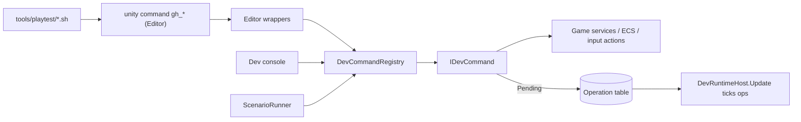

# SPEC-70 — Dev tools and CLI harness

| | |
|---|---|
| **Status** | Draft |
| **Area code** | DEV (task IDs are `DEV-001`, `DEV-002`, …) |
| **Module(s)** | `Game.DevTools.Editor` (folder `Assets/Game/DevTools/Editor/`, Editor only); dev-build runtime code in `Game.App` (folder `Assets/Game/App/DevRuntime/`, every file inside `#if UNITY_EDITOR \|\| DEVELOPMENT_BUILD`); scripts in `tools/playtest/`; scenario files in `TestData/Scenarios/` |
| **Depends on specs** | SPEC-01 (GameRoot creates `DevRuntimeHost`; `SceneFlow` new game and sandbox; `ShipSpawnService`), SPEC-02 (`Services`, `EventBus<T>`, `GameLog`, `PersistentId`, `SimClock`), SPEC-03 (action names), SPEC-05 (save slots, harness profile), SPEC-10/11/12 (grid, brick, collider data for `gh_grid` and overlays), SPEC-21/23 (weapons, spatial hash), SPEC-31/32 (bodies, interaction, travel), SPEC-40 (facts, condition compiler), SPEC-50 (inventory), SPEC-60/62 (screens, camera), SPEC-63/64 (`FxStats`, `AudioStats`), SPEC-71 (test fixtures, `PerfMarkers`, PlayerCommand replay) |
| **Depended on by** | Every spec whose regression scenarios (05-testing §5) are written as `.scenario` files; SPEC-71 benchmark debugging; human and AI playtesting |
| **Milestone** | M0 (harness, scenario engine, host) with game commands landing in M1–M3 as their systems exist |

> Read [01-architecture.md](../01-architecture.md), [02-conventions.md](../02-conventions.md) and [03-glossary.md](../03-glossary.md) before this spec. This spec may not contradict them.

## 1. Purpose

Developers and AI agents must be able to drive the running game from a terminal in seconds: start a new game with a seed, teleport, spawn ships, aim and fire, interact, save, load, jump, read and set facts, inspect any grid, read performance counters, and run scripted scenarios that end in an exit code. This spec documents the generic CLI harness that already exists, adds the game-specific commands on top of one shared command registry (used by the CLI, an in-game dev console and scenario files), defines the scenario file language so the old prototype's regressions (ledger R10, R15, R16/R19, R25/R26, R28, R30) become data, adds debug overlays, and guarantees nothing ships in release builds. It keeps the lessons of the prototype's harness (audit synthesis §6m, ledger "TOOLING v1–v5"): input through Input System state events and a virtual mouse, no `capture_game_view --save_path`, no modal dialogs, and — new — no bypass of game rules that would hide the very bugs we test for (the prototype's `gh_interact` bypassed the broken interaction radius of R10).

## 2. Scope

**In scope:**
- Documentation of the as-built generic harness (`GameTestHarness.cs`) and scripts.
- `DevRuntimeHost`, the dev command registry, async operations, runtime input injection and UI query.
- Game commands: `newgame`, `sandbox`, `teleport`, `spawn`, `aim`, `fire`, `interact`, `inv`, `give`, `save`, `load`, `jump`, `facts`, `grid`, `perf` extensions, `overlay`, `record`, `replay`, `until`, `op`, `help`, plus their `gh_*` CLI wrappers.
- The scenario language, runner, results JSON, `gh_scenario*` commands, the PlayMode test that runs every active scenario file, and draft regression scenario files.
- Debug overlays: brick bounds, dirty bricks, collider boxes, islands, spatial hash, interaction radius.
- In-game dev console (UI Toolkit, dev builds only, no QFSW).
- Scripts `tools/playtest/newgame.sh`, `toworld.sh`, `scenario.sh`, `scenarios.sh`.
- The release-strip guarantee and its test.

**Out of scope (and who owns it instead):**
- The tick-level PlayerCommand recording/replay mechanism and its file format (SPEC-71); this spec only exposes commands for it.
- Test fixtures, perf harness, benchmark setups, determinism hashing (SPEC-71).
- Making regression scenarios pass (each owning spec, 05-testing §5); this spec writes drafts.
- The gameplay APIs the commands call (owning specs; requested in §6.4).

## 3. Decisions (binding)

1. **One command implementation, three front-ends.** Every game command is an `IDevCommand` in `Game.App.DevRuntime`. The CLI wrapper (`gh_*` in `Game.DevTools.Editor`), the dev console and scenario steps all call `DevCommandRegistry.Execute`. Reason: no drift between how agents, humans and tests drive the game.
2. **Runtime dev code lives in `Game.App/DevRuntime/` and is compiled only in the Editor and development builds** (`#if UNITY_EDITOR || DEVELOPMENT_BUILD` around each whole file). It follows every runtime convention (`ConventionsTests` covers it): no `Find*`, no `Debug.Log` (use `GameLog`), no `Resources.Load`, no mutable statics. Reason: architecture §3 has no runtime DevTools assembly; `Game.App` may reference every module.
3. **Nothing from DevTools ships in release builds.** Enforced by: the Editor-only asmdef; the `#if` guards; `GameRoot` creating `DevRuntimeHost` only under the same `#if`; no dev assets at all (the console is built in C# with theme classes; overlays use the built-in `Hidden/Internal-Colored` shader); and `DevReleaseStripTests` compiling release player scripts and asserting no `Game.App.DevRuntime` type exists.
4. **Commands use the real game paths.** Fire presses the real input action; interact presses the real Interact action and only moves the ship to a legal distance first; save/load/jump call the same service methods the UI calls. Commands never call private methods or reflection-invoke game internals.
5. **Dev writes outside architecture §8 are exhaustively listed** (§5.4): teleporting the player root and dev inventory/fact/credit grants. Each happens on the main thread between world updates after `EntityManager.CompleteAllTrackedJobs()`. Nothing else in this spec writes game state directly.
6. **Long operations are asynchronous.** A CLI call must return while the Editor keeps ticking, so commands that take frames return an operation id; `gh_op` polls it and scripts loop. No command blocks the main thread or waits on wall-clock sleeps inside C#.
7. **Scenario files are a line-based text language** (§6.2), parsed by hand. No JSON library is involved (Newtonsoft is not allowed in `Game.App` or DevTools, architecture §3.1). Results are written as JSON by a small hand-written writer.
8. **Exit codes:** 0 pass, 1 fail (assertion false, wait timed out, scenario timeout, unexpected error logs), 2 error (parse error, unknown command, command could not run, exception, play mode exited), 3 Editor unreachable (scripts only).
9. **Draft scenarios do not fail the suite.** A scenario with `status draft` is reported as ignored by the PlayMode runner; the owning spec flips it to `status active` when its feature lands.
10. **Grids are addressed by `PersistentId`** (architecture §6.1) in commands, probes and output, never by `Entity` alone, so scenarios survive save/load.
11. **No modal dialogs.** No DevTools or game code path reachable from the CLI may open `EditorUtility.DisplayDialog` or any modal window; a modal blocks the Editor main thread and the CLI times out.
12. **Outputs go under `Logs/`** (`Logs/playtest/…`), never `Temp/` (Unity deletes it) and never `Assets/`.

## 4. Data model

All runtime types: namespace `Game.App.DevRuntime` (plus sub-namespaces by folder), folder `Assets/Game/App/DevRuntime/`, each file wrapped in `#if UNITY_EDITOR || DEVELOPMENT_BUILD`. *Public contract* for SPEC-71 and the Editor wrappers.

```csharp
/// One dev command. Implementations are stateless; state lives in DevContext/DevRuntimeHost.
public interface IDevCommand
{
    string Name { get; }          // lowercase, one word: "teleport"
    string Usage { get; }         // "teleport x=<m> z=<m> [yaw=<deg>] | sx=<m> sz=<m> | near=<body> [offset=<m>]"
    string Summary { get; }       // one line for help
    DevCommandResult Execute(DevArgs args, DevContext ctx);
}

public enum DevResultKind : byte { Ok = 0, Pending = 1, Failed = 2 }

public readonly struct DevCommandResult
{
    public readonly DevResultKind Kind;
    public readonly string Text;          // human/agent readable, never null
    public readonly int OperationId;      // > 0 when Kind == Pending
    public static DevCommandResult Ok(string text);
    public static DevCommandResult Fail(string text);
    public static DevCommandResult Pending(int operationId, string text);
}

/// Parsed "key=value" arguments. Keys are lowercase. Values may be quoted with "..." (\" escapes a quote).
public sealed class DevArgs
{
    public static bool TryParse(string line, out string command, out DevArgs args, out string error);
    public bool Has(string key);
    public string GetString(string key, string fallback);
    public bool TryGetString(string key, out string value);
    public double GetDouble(string key, double fallback);   // invariant culture
    public long GetLong(string key, long fallback);
    public ulong GetULong(string key, ulong fallback);
    public bool GetBool(string key, bool fallback);          // true/false/1/0
    public IReadOnlyList<string> Keys { get; }
    public IReadOnlyList<string> Positional { get; }         // tokens without '=' (e.g. "record start")
}

public enum DevOperationStatus : byte { Running = 0, Succeeded = 1, Failed = 2 }

/// A multi-frame command. Advanced once per frame by DevRuntimeHost.Update until not Running.
public interface IDevOperation
{
    DevOperationStatus Status { get; }
    string Message { get; }               // progress or final result
    double TimeoutSeconds { get; }        // realtime; host fails the op when exceeded
    void Tick(DevContext ctx);
}

/// What commands may touch. Created by DevRuntimeHost.
public sealed class DevContext
{
    public World World { get; }                      // World.DefaultGameObjectInjectionWorld
    public EntityManager EntityManager { get; }
    public bool TryGetService<T>(out T service) where T : class;   // wraps Services.TryGet
    public DevInputInjector Input { get; }
    public DevUiQuery Ui { get; }
    public DevLogCapture Logs { get; }
    public DevEventCounter Events { get; }           // counts managed events (§6.2 probe events.count)
    public Camera GameplayCamera { get; }            // from SPEC-62 (open question 10); null outside the World scene
    public Entity PlayerShipRoot { get; }            // Entity.Null when none
}

/// Scenario probe: a named value source for expressions (player.pos.x, fact("x"), ...).
public interface IScenarioProbe
{
    string Name { get; }                             // dotted path or function name: "player.pos.x", "fact"
    int ArgCount { get; }                            // 0 for paths
    ScenarioValue Read(DevContext ctx, ReadOnlySpan<ScenarioValue> args);
}

public enum ScenarioValueKind : byte { Number = 0, Bool = 1, String = 2 }
public readonly struct ScenarioValue { public readonly ScenarioValueKind Kind; public readonly double Number; public readonly bool Bool; public readonly string String; }

public enum ScenarioOutcome : byte { Running = 0, Passed = 1, Failed = 2, Error = 3, Ignored = 4 }

public sealed class ScenarioRun
{
    public string Name { get; }  public string FilePath { get; }  public int RunId { get; }
    public ScenarioOutcome Outcome { get; }  public int ExitCode { get; }      // 0/1/2 per §3.8; Ignored → 0
    public string Message { get; }  public int CurrentLine { get; }  public double ElapsedSeconds { get; }
    public string ResultJsonPath { get; }                                     // Logs/playtest/scenarios/<name>-<UTC yyyyMMdd-HHmmss>-<runId>[-<collision>].json
}
```

`DevRuntimeHost : MonoBehaviour` (public contract; thin): owns `DevCommandRegistry Commands`, `DevInputInjector`, `DevUiQuery`, `DevLogCapture`, `DevEventCounter`, `DevOverlayRenderer`, `DevConsole`, the operation table (`Dictionary<int, IDevOperation>`, ids start at 1 and never repeat in a session) and active `ScenarioRunner`s. Static factory `DevRuntimeHost.Create(Transform parent)`. `Update()` pumps input releases, ticks operations and scenario runners; `LateUpdate()` draws overlays.

Results JSON (written by `ScenarioRunner` with `DevJsonWriter`, UTF-8, no BOM):

```json
{ "scenario": "r28_pause_load", "file": "TestData/Scenarios/r28_pause_load.scenario", "status": "active",
  "result": "pass", "exitCode": 0, "message": "", "startedUtc": "2026-10-09T10:00:00Z", "durationSeconds": 41.2,
  "failedLine": 0, "seed": 28028,
  "steps": [ { "line": 7, "text": "newgame seed=28028", "outcome": "ok", "seconds": 5.1, "output": "op 3 succeeded: in world" } ],
  "logs": { "errors": 0, "exceptions": 0, "warnings": 2 } }
```

## 5. Systems, services and flow



### 5.1 Generic harness (as built; Editor)
`Assets/Game/DevTools/Editor/GameTestHarness.cs` (`[InitializeOnLoad]`): log collector (deduplicated, per-message counts, first `Assets/Game` frame), unfocused-input mode (on in play mode, restored on exit), virtual `AgentMouse` (native mice disabled during play, restored on exit and after reloads), reflection helpers. Commands in §6.1.

### 5.2 `DevRuntimeHost` per frame (`Update`, main thread, outside world updates)
1. `Input.Pump(Time.unscaledTimeAsDouble)`: release keys/buttons whose hold time ended (one state event per device when anything changed).
2. For each running operation (ascending id): `op.Tick(ctx)`; if still `Running` and its realtime age > `TimeoutSeconds` → mark `Failed` with "timeout after N s".
3. For each active `ScenarioRunner`: `runner.Step(ctx)` (§5.3).
4. Console: handled by its screen (event-driven).
5. `LateUpdate`: `DevOverlayRenderer.Draw()` when any overlay is on.

### 5.3 `ScenarioRunner.Step` (once per frame)
1. If finished, return. If total realtime > the file's `timeout` (default 300 s) → fail "scenario timeout".
2. Current statement:
   - **command** (`teleport x=1 z=2`): `Execute` once. `Ok` → next statement this same frame (at most 32 statements per frame). `Failed` → error (exit 2). `Pending` → remember the op id; each frame check it: `Succeeded` → next; `Failed` → error (exit 2).
   - **wait cond [timeout=s]** (default 30 s): evaluate each frame; true → next; timeout → fail "wait timed out: <cond>".
   - **wait ticks=N**: record `SimClock.Tick` at start; next when `Tick − start >= N`; if no `SimClock`, fall back to frames.
   - **wait frames=N**: next after N `Step` calls.
   - **assert cond ["message"]**: false → fail with message and both operand values when the top node is a comparison.
   - **let name = expr**: evaluate and store; `$name` reads it.
   - **expect_errors N**: sets the error-log allowance (default 0).
3. After the last statement: if `logs.errors > allowance` → fail "unexpected error logs: <first 3 messages>"; else pass.
4. On finish: write the results JSON, set `Outcome`, `ExitCode`, `Message`.

### 5.4 Dev writes outside architecture §8 (complete list)
| Write | Code | Rule kept |
|---|---|---|
| Player root `LocalTransform` (position, yaw), `PhysicsVelocity = default`, Unity Physics graphical-smoothing history reset | `DevEcs.TeleportRoot(EntityManager, Entity root, float3 pos, quaternion rot)` | Main thread, between world updates, after `CompleteAllTrackedJobs()`; `OriginRebaseSystem` rebases next frame if the new position is > 2,000 m from the origin |
| Inventory add, credits add | `InventoryModel` / `Wallet` public methods (owner methods, dev caller) | No direct field writes |
| Fact set | `FactStore.SetBySlot(slot, value, FactWriteSource.Debugger)` (owner method, dev caller) | No direct field writes |
| `PlayerCommand` during replay | SPEC-71 replay system | Specified by SPEC-71 |

## 6. Public API

### 6.1 Generic CLI commands (as built in `GameTestHarness.cs`; reconciled with the code by DEV-002 on 2026-10-11)

| Command | Args (default) | Purpose |
|---|---|---|
| `gh_snapshot` | `logs` (true), `mark` (true), `ecs` (true), `ui` (true) | Frame/time, scenes, visible UI text, camera + AudioListener count, ECS summary, deduplicated logs since mark. DEV-009 adds `[session]` and `[player]` sections |
| `gh_logs` | `level` all\|warn\|error (all), `mark` (true), `max` (80) | Deduplicated logs since the last mark |
| `gh_mark` | — | Move the log mark |
| `gh_ui` | `max` (60), `chars` (200) | Visible UI Toolkit text per document |
| `gh_click` | `target` (name or text), `index` (0) | Click a visible element |
| `gh_key` | `keys` (comma list of `Key` names), `hold` (0.12 s; 0 = until `release`), `release` (false) | Keyboard state-event injection |
| `gh_mouse` | `x`, `y` (−1 = keep; game-view pixels, origin bottom-left), `button` none\|left\|right\|middle, `down` (true), `scroll`, `dx`, `dy` | Virtual AgentMouse |
| `gh_unfocused_input` | `enable` (true) | Route input to the game while the Editor is unfocused |
| `gh_get` / `gh_invoke` / `gh_find` | `type`, `path` (""), `depth` (1) / `type`, `method`, `args` (""), `path` ("") / `type`, `max` (30) | Reflection reads, calls, scene lookups (debugging only; scenarios must not use them) |
| `gh_ecs` | `filter` (""), `max` (60) | Component counts |
| `gh_entities` | `component`, `max` (10) | Entities with a component and its field values |
| `gh_perf` | — (DEV-011 adds `voxel`, `combat`, `markers`, `json`, all false) | Main-thread ms, draws, triangles, GC alloc/frame, memory, entities |

### 6.2 Scenario language

Files: `TestData/Scenarios/<name>.scenario`, UTF-8, one statement per line, `#` starts a comment, blank lines ignored, keywords lowercase.

```
header      := 'scenario' NAME | 'desc' STRING | 'status' ('draft'|'active') | 'tags' NAME+ | 'timeout' NUMBER
step        := 'wait' expr ['timeout=' NUMBER] | 'wait' 'ticks=' INT | 'wait' 'frames=' INT
             | 'assert' expr [STRING] | 'let' NAME '=' expr | 'expect_errors' INT
             | COMMAND (KEY '=' VALUE | WORD)*                # any registered dev command, same syntax as the console
expr        := or ;  or := and ('||' and)* ;  and := cmp ('&&' cmp)*
cmp         := sum [('=='|'!='|'<'|'<='|'>'|'>=') sum] ;  sum := term (('+'|'-') term)* ;  term := unary (('*'|'/') unary)*
unary       := ('!'|'-') unary | primary
primary     := NUMBER | STRING | 'true' | 'false' | '$' NAME | probe | '(' expr ')'
probe       := NAME ('.' NAME)* ['(' [expr (',' expr)*] ')']
```
Rules: `scenario` must be the first statement; NAME is `[a-z0-9_]+` (tags also allow uppercase, e.g. `R28`; variable/probe names start with a letter or underscore); STRING is `"…"` with `\"` and `\\` escapes; numbers are invariant-culture doubles; `==` on strings is ordinal; mixing kinds in a comparison is a runtime error (exit 2); unknown probe or command is a parse error (exit 2) reported with the line number.

Built-in probes (DEV-005 unless noted):

| Probe | Value |
|---|---|
| `scene` | Active scene name |
| `frame`, `tick` | `Time.frameCount`; `SimClock.Tick` (−1 when absent) |
| `paused` | `IPauseService.IsPaused` |
| `context` | Active `InputContext` name |
| `services.ready` | `GameRoot` finished constructing services |
| `ui.visible("text")` | Any visible text element contains the text (case-insensitive) |
| `logs.errors`, `logs.exceptions`, `logs.warnings`, `logs.contains("text")` | Counts since the run started |
| `events.count("Name")` | Count since the run started of the managed event `Name` (any of the ten in architecture §6.6) |
| `ecs.count("Component")` | Entities with that component type name (disabled entities excluded) |
| `audio.listeners` | Enabled `AudioListener` count (dev code may count through `AudioService`; never `Find*`) |
| `abs(x)`, `min(a,b)`, `max(a,b)`, `distance(x1,z1,x2,z2)` | Math helpers |
| `player.exists`, `player.ready` (DEV-008) | `PlayerShip` exists; ready = exists, `GameplayActive`, player grid has `PhysicsCollider`, context `Flight` |
| `player.pos.x/y/z`, `player.upos.x/z`, `player.speed`, `player.id`, `player.cells` (DEV-009) | Local position; `UniversePosition`; speed m/s; `PersistentId.Value`; solid cell count |
| `grid(id).exists`, `grid(id).cells`, `grid(id).kind`, `grids.count("Ship"\|"Station"\|"Asteroid"\|"Hulk")` (DEV-009) | By `PersistentId` |
| `star_system` (DEV-018) | Current `StarSystemId.Value` (−1 when none) |
| `interaction.target`, `interaction.inrange` (DEV-014) | Target body name or ""; in range |
| `fact("name")`, `cond("condition text")`, `inv("item_id")`, `credits` (DEV-017) | Fact value; compiled condition result; item count (cargo + overflow, `CountOf`); wallet |
| `travel.phase`, `travel.arrival_gap`, `travel.inside_ring` (SPEC-32 TRV-011) | `TravelService.Phase` name; metres from the arrival point; whether the player is inside the lane ring |
| `quest("id")`, `clue("id")` (SPEC-42 QST-010) | Status name of the latest instance (`"None"` if never started); clue ordinal (0 = not found) |
| `encounters.active`, `encounters.ships`, `relation("faction_id")`, `stance("faction_id")`, `encounter_defeated("encounter_id")` (SPEC-33 ENC-012) | Director counts; relation −100..100; stance name; defeats since the run started |
| `fx.drained`, `sfx.voices` (DEV-011) | `FxStats.EventsDrained` last frame; `AudioStats.ActiveSfxVoices` |

Complete example (draft until SPEC-05/SPEC-31 land):

```
scenario r28_pause_load
desc "Loading from the pause menu restores the saved position and keeps the star system (ledger R28)"
status draft
tags regression R28
timeout 180
newgame seed=28028
wait player.ready timeout=60
teleport sx=250 sz=-300
wait ticks=30
let sx = player.upos.x
let sz = player.upos.z
let sys = star_system
save slot=r28
teleport sx=600 sz=600
wait ticks=30
key keys=Escape
wait ui.visible("Load") timeout=5
click target="Load"
wait ui.visible("r28") timeout=5
click target="r28"
wait events.count("GameLoaded") == 1 timeout=30
wait player.ready timeout=30
wait ticks=60
assert abs(player.upos.x - $sx) < 1 && abs(player.upos.z - $sz) < 1 "player is where it was saved"
assert star_system == $sys "same star system"
assert ecs.count("Brick") > 0 "voxels present"
```

### 6.3 Game commands (runtime registry name → CLI wrapper `gh_<name>`)

| Command | Args | Behaviour | Result |
|---|---|---|---|
| `help` | `[cmd]` | Lists commands or one usage | Ok |
| `op` | `id` | Status of an operation | Ok: `running\|succeeded\|failed: message` |
| `until` | `cond` (expression text) | Evaluates once | Ok: `true` or `false` |
| `newgame` | `seed` (ulong, required), `ship` (start scenario id, default `ContentId.None` = SPEC-01 default), `intro` (false), `profile` (`harness`) | Edit mode (CLI wrapper only): open `Assets/Game/Scenes/Boot.unity`, enter play mode, wait for the host. Then select the save profile (`SaveService.ListProfiles()` entry whose display name is `profile`, else `CreateProfile(profile)`; `SetActiveProfile(id)`), set `GameRootTestHooks.SkipIntroScreens = !intro` for the next boot only when the CLI wrapper started play mode, and call `IGameFlow.NewGameAsync(new NewGameArgs("Harness", seed, false, ship))` (SPEC-02 §4.8). Done when `player.ready` (or context `Dialog` when `intro=true`). Timeout 60 s | Pending → `in world: seed S, player id P` |
| `sandbox` | `player` (true), `seed` (1) | `SceneFlow.EnterSandboxAsync(new SandboxArgs(player, seed))` (SPEC-01 §4.3). Done when `GameplayActive` exists (and `player.ready` when `player=true`). Timeout 30 s | Pending |
| `teleport` | `x`,`z` (local) or `sx`,`sz` (star-system metres; converted with `FrameOrigin`) or `near` (body query) + `offset` (40), `yaw` (degrees, keep current) | `DevEcs.TeleportRoot` (§5.4). `near`: body via `DevBodyQuery.TryFind` (§6.4); target = body centre − (0, 0, surfaceRadius + offset) | Ok: new local and universe position |
| `spawn` | `blueprint` (required), `x`,`z` or `dx`,`dz` (relative to player; default dz=80), `yaw` or `face=player`, `faction` (id), `team` (1), `count` (1), `spacing` (60), `ai` (true) | One `ShipSpawnService.Spawn` per ship, placed along +X by `spacing`. Done when every requested `PersistentId` has a grid root. Timeout 10 s | Pending → `spawned N: ids …` |
| `aim` | `target` = `nearest_hostile` (default) \| `nearest` \| `id:<PersistentId>` \| `point` with `x`,`z`; `track` (0 s) | Projects the target with `GameplayCamera.WorldToScreenPoint`, moves the AgentMouse; with `track > 0` an operation re-aims every frame. Hostile = `Allegiance.Team` differs from the player's | Ok or Pending |
| `fire` | `group` (1..3, default 1), `seconds` (0.5) | Presses the first bound control of action `Flight/FirePrimary` (1), `Flight/FireSecondary` (2) or `Flight/FireTertiary` (3) (SPEC-03 §4.2) through `DevInputInjector` for `seconds` | Pending |
| `interact` | `body` (optional query) | With `body`: teleport to `surfaceRadius + 0.5 × interactionRange` from the body (never closer than the rule allows, never beyond it). Then press `Flight/Interact` for 0.1 s. Never calls interaction code directly | Pending → target before/after |
| `inv` | `max` (80) | One line per occupied slot `slot: id×count`, overflow slots (index ≥ `Capacity`) marked `[overflow]`; then `capacity N`, `credits C` (SPEC-50 §4.3) | Ok |
| `give` | `item` + `count` (1), or `credits` | `InventoryModel.TryAdd(ContentId, int, out string reason)` (cargo only; refused when full) / `Wallet.Add(long)` (SPEC-50 §4.3–§4.4) | Ok or Fail with reason |
| `save` | `slot` (required) | `IGameFlow.SaveGameAsync(slot, SaveReason.Manual)` in the active profile; done on `GameSaved` | Pending |
| `load` | `slot` (required) | `IGameFlow.LoadGameAsync(slot)`; done on `GameLoaded` and `player.ready` | Pending |
| `jump` | `to` (StarSystemId number or authored name/ID) | `TravelService.RequestJump(id, JumpSource.Dev)` (SPEC-32 §4.4; Dev jumps skip the gate distance and fuel checks); refused → Fail with `JumpRequestResult.Reason`; done on `StarSystemEntered` for that id. Timeout 30 s | Pending |
| `facts` | `get` \| `set=name=value` \| `list=prefix` \| `eval="condition"` | `slot = store.Catalog.SlotOf(name)`; `GetBySlot`/`SetBySlot(slot, v, FactWriteSource.Debugger)`; `list` walks `Catalog` names with the prefix; `eval` compiles with `LogicCompiler.TryCompileExpression(text, new LogicCompileOptions(LogicUsage.BeatCondition, "dev", "eval"), report, out cond)`, binds it with a `LogicBinder` and evaluates with the game's `ILogicContext` (SPEC-40 §4.5) | Ok |
| `grid` | `id` (PersistentId) \| `player=true` \| `nearest=true`; `bricks` (false) | Prints §6.5 fields; `bricks=true` adds one line per brick (max 200) | Ok |
| `perf` | `voxel`, `combat`, `markers`, `json` (all false) | §6.6 | Ok |
| `overlay` | `name` = bricks\|dirty\|colliders\|islands\|spatial\|interaction\|all\|none; `on` (true); `id` (islands target, default player) | Toggles overlays | Ok |
| `record` | `start` \| `stop` \| `save name=<file>` | SPEC-71 `PlayerCommandRecorder` | Ok |
| `replay` | `name=<file>` | SPEC-71 replay; done when the script ends | Pending |
| `key`, `mouse`, `click`, `ui` | as §6.1 | Runtime equivalents of the generic commands (for scenarios and the console) | Ok / Pending |

CLI-only: `gh_scenario --file <path>` (starts a run, enters play mode first when needed; returns the run id), `gh_scenario_status --run <id>` (outcome, line, message, JSON path), `gh_scenario_stop --run <id>`, `gh_dev --cmd "<console line>"` (any registry command). Arguments of wrappers use the same names as the registry; ulong values are passed as strings.

### 6.4 Requested game APIs (defaults in §10)

| Spec | API the commands call |
|---|---|
| SPEC-01 | `DevRuntimeHost.Create` call in `GameRoot` (§5.2 step 16); `IGameFlow.NewGameAsync(NewGameArgs)` (SPEC-02); `SceneFlow.EnterSandboxAsync(SandboxArgs)`; `ShipSpawnService.Spawn(ContentId blueprint, float3 pos, quaternion rot, Allegiance al, bool withAi) → PersistentId` (§4.4); `GameRootTestHooks` (SPEC-71) |
| SPEC-03 | Action names `Flight/FirePrimary`, `Flight/FireSecondary`, `Flight/FireTertiary`, `Flight/Interact`, `Global/DevConsole` (F1); `InputService.CurrentContext` |
| SPEC-05 | `SaveService.ListProfiles`, `CreateProfile`, `SetActiveProfile`; saving and loading go through `IGameFlow.SaveGameAsync(slotId, reason)` / `LoadGameAsync(slotId)` |
| SPEC-10/11/12 | `BrickDirty` flag field, `Brick.SolidCount`, mesh-applied marker on bricks, provisional vs compound collider detection |
| SPEC-23 | `SpatialHash.CellSize` and its `SpatialProxy` entries (`Entity`, `Center`, `Radius`) for the spatial overlay |
| SPEC-31 | `StarSystemBody` (`Id`, `RadiusM`, `Grid`), `Interactable.DistanceM`, `InteractionTarget` singleton; names through `GalaxyService.GetBodyName`. `DevBodyQuery.TryFind(EntityManager, GalaxyService, string query, out Entity body, out float surfaceRadius, out float interactionRange)` is this spec's own helper over those (DEV-014): `query` matches the body key, the display name (case-insensitive) or the template `storyTag`; ties → nearest |
| SPEC-32 | `TravelService.RequestJump(StarSystemId, JumpSource) → JumpRequestResult { bool Accepted; JumpRefusal Refusal; string Reason; }` |
| SPEC-40 | `FactStore.Catalog.SlotOf`, `GetBySlot`, `SetBySlot`; `LogicCompiler.TryCompileExpression`, `LogicBinder` |
| SPEC-50 | `InventoryModel.TryAdd(ContentId, int, out string reason)`, `Capacity`, slot enumeration, `CountOf`; `Wallet.Add(long)`, `Wallet.Credits` |
| SPEC-60/62 | `Screen` base class and `UINavigator.Push/Pop`; gameplay `Camera` |

### 6.5 `grid` output fields
`PersistentId`, `Entity`, `GridKind`, `Hulk`, `Dormant`, `CellSize`, `BrickMin`, `BrickDims`, `Revision`, bricks (count), solid cells (Σ `Brick.SolidCount`), block instances, dirty bricks (mesh / collider / both), bricks with an applied mesh, collider (`none` / `provisional box` / `compound N children`), mass (from `PhysicsMass.InverseMass`), linear speed, angular speed, `UniversePosition`.

### 6.6 `perf` output (also `gh_perf`)
- Default line (as built): main ms (15-frame average), draws, triangles, GC alloc/frame, system memory, entities.
- `voxel`: grids by kind, bricks, solid cells, dirty bricks, chunk bodies, hulks.
- `combat`: live projectiles (SPEC-21 `ProjectileStore.Stats.Live`, read after `CompleteAccess()`), active beams, `FxStats` (drained, culled, budget-dropped, debris live estimate), `AudioStats` (drained, started, active voices).
- `markers`: the 15 slowest `<System>.<Step>` markers in the last frame through SPEC-71 `PerfMarkers.SampleLastFrame` (ms, sorted).
- `json`: the same data as one JSON object (hand-written) for scripts.

### 6.7 Scripts (`tools/playtest/`, zsh, source `_env.sh`)

| Script | Does | Exit |
|---|---|---|
| `newgame.sh [seed=1] [ship]` | `g.sh newgame --seed … --ship …`, polls `g.sh op --id N` every 0.5 s (max 90 s), then `g.sh snapshot --ui false` | 0 ok, 1 op failed, 3 Editor unreachable |
| `toworld.sh` | Real UI path: enters play mode from `Boot`, clicks the MainMenu "New Game" flow by element names (SPEC-61), advances the opening dialog with `key --keys Digit1` until context is `Flight`, snapshot. Uses the real menu default seed; explicit seed arguments fail while no seed UI exists (Q31) | same |
| `scenario.sh <name or path> [timeout=600]` | Resolves `TestData/Scenarios/<name>.scenario`, `g.sh scenario --file …`, polls `scenario_status` every 1 s, prints the outcome line and the JSON path | the scenario exit code (0/1/2), 3 unreachable |
| `scenarios.sh [tag=regression]` | Runs every `status active` file with the tag one by one, prints a table `name result seconds`, writes `Logs/playtest/scenarios/summary.json` | 0 when all pass, else 1 |

All use `to.sh` for hard timeouts and print `Editor unreachable (is a modal dialog open?)` on CLI timeouts.

### 6.8 Regression scenario drafts (`TestData/Scenarios/`, written by DEV-019 as `status draft`)

| File | Owner spec flips to active | Key steps → assertions |
|---|---|---|
| `r10_station_interaction.scenario` | SPEC-31 | newgame → `interact body=<hub station>` → `interaction.inrange` true and context `Dialog` within 5 s |
| `r15_editor_no_dupe.scenario` | SPEC-51, SPEC-50 | newgame → `let n = inv("block_hull")` → open the editor at the hub, remove 10 blocks, cancel → `inv("block_hull") == $n` |
| `r16_r19_editor_round_trip.scenario` | SPEC-51, SPEC-01 | newgame → record `player.upos`, `ecs.count("Brick")` → editor round trip with commit → position within 1 m, brick count equals the committed ship's, `interact` still reaches `Dialog` |
| `r25_r26_ship_death_no_ecb_errors.scenario` | SPEC-13 | sandbox → `spawn blueprint=<frigate> count=30 spacing=5 team=2 ai=true` → `wait ticks=1200` → `logs.exceptions == 0 && !logs.contains("EntityCommandBuffer")`, `grids.count("Hulk") > 0` |
| `r28_pause_load.scenario` | SPEC-05, SPEC-31 | §6.2 example |
| `r30_lane_jump_entry.scenario` | SPEC-32 TRV-011 (active) | newgame → jump to Drift → return to the exact captured Ark system ID; after each Idle arrival, actual player gap 0..200 m and inside that system's lane ring |

## 7. Edge cases and failure behaviour

| Situation | Required behaviour |
|---|---|
| CLI command needs play mode and the Editor is in edit mode | `newgame`, `sandbox`, `gh_scenario` enter play mode themselves; every other game command returns `not playing` |
| `DevRuntimeHost` missing in play mode (release-like config, SPEC-01 not wired) | Wrappers return `dev runtime not available`; scenario runs fail with exit 2 |
| Play mode exits during an operation or scenario | Operation `Failed: play mode exited`; scenario exit 2; JSON still written (by the Editor driver from the last known state) |
| Unknown command or argument | `Fail("unknown command 'x'; see help")` / `Fail("unknown argument 'y' for teleport")` |
| Argument parse error (`seed=abc`) | Fail naming the argument and expected type |
| `teleport` with no player ship | Fail `no player ship` |
| `spawn` with an unknown blueprint | Fail from `ShipSpawnService` passed through |
| `aim` target behind the camera | Fail `target behind camera` (mouse not moved) |
| `fire` action has no binding | Fail `action Flight/Fire2 has no binding` |
| Operation exceeds its timeout | Failed `timeout after N s` |
| Two scenario runs at once | Allowed; both advance each frame (scenario authors must not overlap commands) |
| Scenario `wait` condition throws (bad probe argument) | Error exit 2 with line number |
| Scenario never ends (missing timeout) | File-level `timeout` (default 300 s) fails it |
| Overlay line buffer exceeds 262,144 vertices | Truncated; overlay status shows `truncated` |
| Islands overlay on a grid over 2,000,000 cells | Skipped with message `grid too large for islands overlay` |
| Console open | Input context `TextEntry`; gameplay maps off (SPEC-60/03 rules) |
| Release build | No dev type, command, console or overlay exists (`DevReleaseStripTests`) |
| Second Play with domain reload off | `DevRuntimeHost` recreated by `GameRoot`; operation ids restart at 1; Editor-side run table survives and marks old runs `play mode exited` |

## 8. Performance budget

| What | Budget | Measured by |
|---|---|---|
| `DevRuntimeHost.Update` with no operations, runs or overlays | ≤ 0.02 ms, 0 B GC | `DevHostPerfTests.Idle_Smoke` |
| Scenario runner step | ≤ 0.1 ms per frame excluding the commands it runs | `ScenarioRunnerPerfTests.Step_Smoke` |
| Overlays `bricks` on the 1M-cell station (≈ 870 bricks) | ≤ 1.5 ms main thread (dev only; not a game gate) | `DevOverlayPerfTests.Bricks1M` |
| Harness commands | Each sync command returns within 50 ms | Manual timing in DEV tasks |

Overlays and the console are dev-only and excluded from the 06 frame budgets; perf benchmarks (SPEC-71) assert all overlays are off.

## 9. Tasks

### DEV-001 — Public contract types
- **Milestone:** M0
- **Tier:** standard — transcribes the types of §4
- **Depends on:** `CORE-001`
- **Do:** Create the §4 types with the given members; `DevCommandResult` factories implemented; other members throw `NotImplementedException` except trivial getters. Every file wrapped in `#if UNITY_EDITOR || DEVELOPMENT_BUILD`.
- **Files:** `Assets/Game/App/DevRuntime/{IDevCommand,DevCommandResult,DevResultKind,DevArgs,IDevOperation,DevOperationStatus,DevContext,DevRuntimeHost}.cs`, `Assets/Game/App/DevRuntime/Scenarios/{IScenarioProbe,ScenarioValue,ScenarioValueKind,ScenarioOutcome,ScenarioRun}.cs`
- **Acceptance criteria:**
  - [ ] Compiles in Editor and development player script compilation; `ConventionsTests` pass.
- **Tests:** `DevContractTests.ResultFactories_SetKindAndText`.

### DEV-002 — Verify and document the as-built generic harness
- **Milestone:** M0
- **Tier:** standard — documentation reconciled with existing code
- **Depends on:** —
- **Do:** Compare §6.1 with `GameTestHarness.cs` (names, args, defaults). Where they differ, the code wins: update §6.1 in this spec and `tools/playtest/README.md`. Add a "Game commands" section to the README listing §6.3 commands as they land (each later task appends its rows).
- **Files:** `docs/specs/SPEC-70-devtools-harness.md`, `tools/playtest/README.md`
- **Acceptance criteria:**
  - [ ] Every `[CliCommand]` in `Assets/Game/DevTools/Editor/` appears in the README with its args.
- **Tests:** `HarnessCommandTests.EveryCliCommand_IsDocumentedInReadme` (EditMode: reflection over `[CliCommand]` methods, text search in the README).

### DEV-003 — DevRuntimeHost, command registry, operations, help/op/until
- **Milestone:** M0
- **Tier:** frontier — F1: every dev command, the console and scenarios build on it; F5: lifetime tied to `GameRoot`, play-mode transitions and the Editor
- **Depends on:** `DEV-001`, `FND-001`
- **Do:** Implement `DevArgs.TryParse` (§4), `DevCommandRegistry` (explicit registration list in `DevCommandRegistry.CreateDefault()`, no reflection scanning; duplicate names throw at creation), `DevRuntimeHost.Create/Update/LateUpdate/OnDestroy` (§5.2), the operation table, `DevContext`, `DevLogCapture` (subscribes `Application.logMessageReceivedThreaded` in `OnEnable`, unsubscribes in `OnDisable`; thread-safe counters and the last 200 messages), `DevEventCounter` (subscribes to the ten managed events of architecture §6.6), commands `help`, `op`, `until` (until uses DEV-005's evaluator; until DEV-005 lands it returns `Fail("expressions not available")`). Editor wrappers `gh_op`, `gh_until`, `gh_dev`, `gh_help` that find the host through `Services.TryGet<DevRuntimeHost>`.
- **Files:** `Assets/Game/App/DevRuntime/{DevRuntimeHost,DevCommandRegistry,DevArgs,DevContext,DevLogCapture,DevEventCounter,DevJsonWriter}.cs`, `Assets/Game/App/DevRuntime/Commands/{HelpDevCommand,OpDevCommand,UntilDevCommand}.cs`, `Assets/Game/DevTools/Editor/Commands/CoreDevCliCommands.cs`
- **Acceptance criteria:**
  - [ ] `DevArgs` parses quoted values, escapes, positional words and rejects unterminated quotes with the column number.
  - [ ] An operation that never finishes fails after its timeout; ids never repeat within a session.
  - [ ] `gh_dev --cmd "help"` lists every registered command.
  - [ ] No allocation per frame in `Update` when idle.
- **Tests:** `DevArgsTests.Parse_QuotedEscapedPositional`, `DevArgsTests.Parse_UnterminatedQuote_Error`, `DevRegistryTests.DuplicateName_Throws`, `DevHostTests.Operation_TimesOut` (PlayMode), `DevHostTests.LogCapture_CountsErrors`, `DevHostPerfTests.Idle_Smoke`.

### DEV-004 — Runtime input injection and UI query
- **Milestone:** M0
- **Tier:** standard — ports the existing, specified technique (state events, AgentMouse)
- **Depends on:** `DEV-003`
- **Do:** `DevInputInjector`: keyboard state events with timed release, AgentMouse (add device, disable native mice, restore on destroy), `PressAction(InputAction action, double seconds)` (first binding's control: keyboard key or mouse button). `DevUiQuery`: visible text listing and click by name or text on the `UIRoot` document (from `Services`), using `NavigationSubmitEvent` for buttons and `ClickEvent` otherwise. Runtime commands `key`, `mouse`, `click`, `ui`. Change `gh_key`, `gh_mouse`, `gh_click`, `gh_ui` to delegate to the host when it exists and keep their current code path otherwise.
- **Files:** `Assets/Game/App/DevRuntime/Input/DevInputInjector.cs`, `Assets/Game/App/DevRuntime/Ui/DevUiQuery.cs`, `Assets/Game/App/DevRuntime/Commands/{KeyDevCommand,MouseDevCommand,ClickDevCommand,UiDevCommand}.cs`, `Assets/Game/DevTools/Editor/GameTestHarness.cs`
- **Acceptance criteria:**
  - [ ] `key keys=W hold=0.2` makes `Keyboard.current.wKey.isPressed` true for 0.2 s (±1 frame) then false.
  - [ ] After play mode exits, every native mouse is enabled and no `AgentMouse` device remains.
  - [ ] `click target="New Game"` clicks the button whose text contains it.
- **Tests:** `DevInputTests.KeyHold_ReleasesAfterHold`, `DevInputTests.AgentMouse_RestoresNativeMice`, `DevUiQueryTests.Click_ByText_InvokesButton` (PlayMode, test UI built in code).

### DEV-005 — Scenario language: parser, expressions and built-in probes
- **Milestone:** M0
- **Tier:** frontier — F6: defines the format and vocabulary every regression scenario is written in
- **Depends on:** `DEV-003`
- **Do:** Implement the §6.2 grammar as a hand-written tokenizer and recursive-descent parser producing `ScenarioScript` (headers + statements with line numbers) and expression trees; evaluation with `ScenarioValue` kinds and the runtime type errors of §6.2; `ScenarioProbeRegistry` with the built-in probes marked "DEV-005" in §6.2.
- **Files:** `Assets/Game/App/DevRuntime/Scenarios/{ScenarioTokenizer,ScenarioParser,ScenarioScript,ScenarioStatement,ScenarioExpression,ScenarioProbeRegistry,BuiltInScenarioProbes}.cs`
- **Acceptance criteria:**
  - [ ] Parse errors carry line and column; `scenario` not first is an error.
  - [ ] Operator precedence `! > * / > + - > comparisons > && > ||`.
  - [ ] Comparing a string with a number is a runtime error, not false.
  - [ ] The §6.2 R28 example parses without error.
- **Tests:** `ScenarioParserTests.Precedence`, `ScenarioParserTests.Strings_Escapes`, `ScenarioParserTests.HeaderOrder_Error`, `ScenarioParserTests.UnknownProbe_ErrorWithLine`, `ScenarioParserTests.R28Example_Parses`, `ScenarioEvalTests.MixedKinds_RuntimeError`, `ScenarioEvalTests.LetAndVariable`.

### DEV-006 — Scenario runner, results JSON and CLI/scripts
- **Milestone:** M0
- **Tier:** frontier — F5: one flow across Editor play-mode transitions, the runtime host and shell scripts
- **Depends on:** `DEV-004`, `DEV-005`
- **Do:** `ScenarioRunner` per §5.3; JSON per §4 via `DevJsonWriter` into `Logs/playtest/scenarios/`; `EditorScenarioDriver` (Editor): starts runs, enters play mode from `Boot.unity` when needed, hands the run to the host when `Services.TryGet<DevRuntimeHost>` succeeds, records `play mode exited`; CLI `gh_scenario`, `gh_scenario_status`, `gh_scenario_stop`; scripts `scenario.sh`, `scenarios.sh` (§6.7).
- **Files:** `Assets/Game/App/DevRuntime/Scenarios/ScenarioRunner.cs`, `Assets/Game/DevTools/Editor/Scenarios/EditorScenarioDriver.cs`, `Assets/Game/DevTools/Editor/Commands/ScenarioCliCommands.cs`, `tools/playtest/scenario.sh`, `tools/playtest/scenarios.sh`, `TestData/Scenarios/smoke_boot.scenario`, `TestData/Scenarios/smoke_fail.scenario`
- **Acceptance criteria:**
  - [ ] `scenario.sh smoke_boot` exits 0 (`wait scene == "MainMenu"`, `assert audio.listeners == 1`); `smoke_fail` (an `assert false`) exits 1; a file with a syntax error exits 2.
  - [ ] A wait that times out reports the condition text; an assert failure reports both operand values.
  - [ ] The JSON file exists for every finished run and matches §4's keys.
- **Tests:** `ScenarioRunnerTests.Pass_Fail_Error_ExitCodes` (PlayMode), `ScenarioRunnerTests.WaitTimeout_Message`, `ScenarioRunnerTests.UnexpectedErrorLogs_Fail`, `ScenarioRunnerTests.Json_HasAllKeys`, `ScenarioRunnerPerfTests.Step_Smoke`.

### DEV-007 — PlayMode test that runs every active scenario file
- **Milestone:** M1
- **Tier:** standard — test wiring on top of DEV-006 and SPEC-71 fixtures
- **Depends on:** `DEV-006`, `SPEC-71`
- **Do:** `ScenarioFileTests : GameFlowFixture` (SPEC-71) with UnityTest `[ValueSource]` (Q23) listing every `TestData/Scenarios/*.scenario` tagged `regression` or `smoke`; `status draft` → `Assert.Ignore("draft")`; else run through `ScenarioRunner` with a frame-count timeout equal to `timeout × 60` and assert outcome `Passed`, printing the JSON path. Category `Scenario`.
- **Files:** `Assets/Game/Tests/PlayMode/DevTools/ScenarioFileTests.cs`
- **Acceptance criteria:**
  - [ ] Adding a new active file adds a test case without code changes.
  - [ ] Draft files appear as ignored, not failed.
- **Tests:** `ScenarioFileTests.Run(scenarioName)` (one case per file).

### DEV-008 — newgame and sandbox commands, newgame.sh
- **Milestone:** M1
- **Tier:** standard — commands calling specified service APIs
- **Depends on:** `DEV-006`, `FND-001`, `PERS-001`
- **Do:** Commands `newgame`, `sandbox` and probes `player.exists`, `player.ready` (§6.2, §6.3); CLI wrappers `gh_newgame`, `gh_sandbox` (edit-mode handling through `EditorScenarioDriver`'s play-mode entry); `tools/playtest/newgame.sh`.
- **Files:** `Assets/Game/App/DevRuntime/Commands/{NewGameDevCommand,SandboxDevCommand,SessionDevOperation}.cs`, `Assets/Game/App/DevRuntime/Scenarios/PlayerScenarioProbes.cs`, `Assets/Game/DevTools/Editor/Commands/SessionCliCommands.cs`, `tools/playtest/newgame.sh`
- **Acceptance criteria:**
  - [ ] From edit mode, `newgame.sh 42` reaches `player.ready` in ≤ 20 s and prints the snapshot.
  - [ ] Two runs with seed 42 report the same player `PersistentId` and spawn position.
  - [ ] Saves created by harness runs go to the `harness` profile only.
- **Tests:** `NewGameCommandTests.Seed42_ReachesReady` (PlayMode), `NewGameCommandTests.SameSeed_SameSpawn`, `SandboxCommandTests.NoPlayer_GameplayActive`.

### DEV-009 — teleport, spawn and grid commands; snapshot game sections
- **Milestone:** M1
- **Tier:** standard — commands with exact behaviour in §5.4, §6.3, §6.5
- **Depends on:** `DEV-008`, `VOX-001`, `PHY-001`
- **Do:** Prerequisite implementation audit: FND-012 and SPEC-30/31 coordinate/current-system services must exist (Q20; contract-only dependencies do not establish this). `DevEcs.TeleportRoot`; commands `teleport` (local and `sx/sz`; `near` arrives with DEV-014), `spawn`, `grid`; probes `player.pos.*`, `player.upos.*`, `player.speed`, `player.id`, `player.cells`, `grid(id).*`, `grids.count`; CLI wrappers; `gh_snapshot` gains `[session]` (seed, scene, star system, tick) and `[player]` (PersistentId, local and universe position, speed, cells) sections through `DevSnapshotSections` (Editor).
- **Files:** `Assets/Game/App/DevRuntime/DevEcs.cs`, `Assets/Game/App/DevRuntime/Commands/{TeleportDevCommand,SpawnDevCommand,GridDevCommand}.cs`, `Assets/Game/App/DevRuntime/Scenarios/GridScenarioProbes.cs`, `Assets/Game/DevTools/Editor/Commands/WorldCliCommands.cs`, `Assets/Game/DevTools/Editor/DevSnapshotSections.cs`, `Assets/Game/DevTools/Editor/GameTestHarness.cs`
- **Acceptance criteria:**
  - [ ] After `teleport x=100 z=-50`, the player root is at (100, 0, −50) with zero velocity on the next frame and no physics pop on the following frame.
  - [ ] `spawn blueprint=<test> count=3 spacing=60` creates 3 grids with distinct `PersistentId`s 60 m apart.
  - [ ] `grid player=true` prints every §6.5 field.
- **Tests:** `TeleportCommandTests.SetsPositionZeroVelocity`, `SpawnCommandTests.CountSpacing_DistinctIds`, `GridCommandTests.PrintsAllFields` (PlayMode, sandbox).

### DEV-010 — aim and fire commands
- **Milestone:** M2
- **Tier:** standard — input-path commands with exact behaviour in §6.3
- **Depends on:** `DEV-009`, `WPN-001`, `INP-001`, `CAM-001`
- **Do:** Commands `aim` (including `track`) and `fire`; CLI wrappers `gh_aim`, `gh_fire`.
- **Files:** `Assets/Game/App/DevRuntime/Commands/{AimDevCommand,FireDevCommand}.cs`, `Assets/Game/DevTools/Editor/Commands/CombatCliCommands.cs`
- **Acceptance criteria:**
  - [ ] `aim target=nearest_hostile` puts the AgentMouse within 2 px of the target's screen projection.
  - [ ] `fire group=1 seconds=1` produces at least one `Muzzle` FxEvent from the player's group-1 weapons (via `FxStats`).
- **Tests:** `AimCommandTests.NearestHostile_MouseOnTarget`, `FireCommandTests.Group1_FiresWeapons` (PlayMode, sandbox with one hostile).

### DEV-011 — perf command and gh_perf extensions
- **Milestone:** M2
- **Tier:** standard — counters listed in §6.6
- **Depends on:** `DEV-009`, `VFX-001`, `AUD-001`, `TST-001`
- **Do:** `DevPerfCounters` (voxel, combat, markers through `PerfMarkers.SampleLastFrame`), command `perf`, `gh_perf` args `voxel`, `combat`, `markers`, `json`; probes `fx.drained`, `sfx.voices`.
- **Files:** `Assets/Game/App/DevRuntime/Perf/DevPerfCounters.cs`, `Assets/Game/App/DevRuntime/Commands/PerfDevCommand.cs`, `Assets/Game/DevTools/Editor/GameTestHarness.cs`
- **Acceptance criteria:**
  - [ ] `gh_perf --json true` output parses with `python3 -m json.tool`.
  - [ ] `markers` lists `FxUploadSystem.Batch` while FX events flow.
- **Tests:** `PerfCommandTests.Json_IsValid`, `PerfCommandTests.Markers_ListsActiveMarkers`.

### DEV-012 — Overlay renderer and voxel overlays (bricks, dirty, colliders)
- **Milestone:** M1
- **Tier:** frontier — F2: unsafe traversal of Unity Physics collider blobs and Persistent native line buffers
- **Depends on:** `DEV-009`, `REN-001`, `PHY-001`
- **Do:** `DevOverlayRenderer`: one dynamic `Mesh` (`MeshTopology.Lines`, `IndexFormat.UInt32`, max 262,144 vertices, vertex = `float3` position + `Color32`), material from `Shader.Find("Hidden/Internal-Colored")` with `_ZTest` = Always, drawn with `Graphics.RenderMesh` in `LateUpdate`. Gather jobs (Burst `IJob`, `.Run()`) for grids within 300 m of the player: `bricks` (white AABB per brick), `dirty` (yellow mesh-dirty, red collider-dirty, orange both), `colliders` (green box per leaf `BoxCollider` of the root compound, cyan for a provisional root box). Command `overlay`, CLI `gh_overlay`.
- **Files:** `Assets/Game/App/DevRuntime/Overlays/{DevOverlayRenderer,DevLineBatch,BrickOverlayJob,DirtyOverlayJob,ColliderOverlayJob}.cs`, `Assets/Game/App/DevRuntime/Commands/OverlayDevCommand.cs`, `Assets/Game/DevTools/Editor/Commands/OverlayCliCommands.cs`
- **Acceptance criteria:**
  - [ ] A 2×1×1-brick test grid produces exactly 24 brick edges.
  - [ ] Collider overlay box count equals the number of leaf boxes in the compound.
  - [ ] Buffers are disposed on host destroy (leak check on).
- **Tests:** `OverlayTests.BrickEdges_Count`, `OverlayTests.ColliderBoxes_MatchCompound`, `OverlayTests.Dispose_NoLeak`, `DevOverlayPerfTests.Bricks1M`.

### DEV-013 — Overlays: islands and spatial hash
- **Milestone:** M2
- **Tier:** standard — single-threaded Burst flood fill and a grid draw with exact rules
- **Depends on:** `DEV-012`, `AI-001`
- **Do:** `islands`: every 60 frames for the target grid (≤ 2,000,000 cells) a Burst `IJob` flood-fills solid cells with 6-connectivity using a `NativeBitArray` visited set and draws each island's AABB in colour `hue = (islandIndex × 0.618) mod 1`, the largest island white. `spatial`: occupied cells of `SpatialHash.CellSize` within 1 km, as XZ squares at y = 0.
- **Files:** `Assets/Game/App/DevRuntime/Overlays/{IslandOverlayJob,SpatialHashOverlayJob}.cs`
- **Acceptance criteria:**
  - [ ] A test grid of two separate 3×3×3 blocks shows 2 islands; joined by one cell, 1 island.
  - [ ] Grids over 2,000,000 cells show the skip message.
- **Tests:** `IslandOverlayTests.TwoBlocks_TwoIslands`, `IslandOverlayTests.Joined_OneIsland`, `IslandOverlayTests.TooLarge_Skipped`.

### DEV-014 — interact command and interaction overlay
- **Milestone:** M3
- **Tier:** standard — input-path command and overlay with exact rules
- **Depends on:** `DEV-009`, `SYS-008`, `DEV-012`, `INP-005`
- **Do:** `DevBodyQuery` (§6.4 SPEC-31 row); `teleport near=`; command `interact` (§6.3); probes `interaction.target`, `interaction.inrange`; overlay `interaction` (32-segment XZ circle of radius `surfaceRadius + interactionRange` per interactable, line player→target green in range, red otherwise).
- **Files:** `Assets/Game/App/DevRuntime/DevBodyQuery.cs`, `Assets/Game/App/DevRuntime/Commands/InteractDevCommand.cs`, `Assets/Game/App/DevRuntime/Overlays/InteractionOverlayJob.cs`, `Assets/Game/App/DevRuntime/Scenarios/InteractionScenarioProbes.cs`
- **Acceptance criteria:**
  - [ ] `interact body=<station>` places the ship inside the legal range measured from the surface and the real Interact action opens the station's interaction.
  - [ ] The command never invokes interaction code directly (code review + test with the Interact action unbound → Fail).
- **Tests:** `InteractCommandTests.Station_OpensInteraction`, `InteractCommandTests.UnboundAction_Fails`.

### DEV-015 — In-game dev console
- **Milestone:** M1
- **Tier:** standard — UI Toolkit screen over the existing registry
- **Depends on:** `DEV-003`, `UI-001`, `INP-001`
- **Do:** `DevConsoleScreen : UIScreen` (SPEC-60, ADR-0049) with `Context = TextEntry`, `PausesSimulation = false`, `BlocksWorldPointer = true`, built in C# using theme classes only (no UXML/USS asset, no inline styles): output list (last 200 lines, `ListView` with pooled items), input `TextField`, history (↑/↓, 50 entries), Tab completion of command names, Enter executes through the registry (Pending results print when the op ends). Toggled by `Global/DevConsole`.
- **Files:** `Assets/Game/App/DevRuntime/Console/{DevConsole,DevConsoleScreen}.cs`; `Assets/Game/App/DevRuntime/DevRuntimeHost.cs`; `Assets/Game/App/Boot/GameComposition.cs`; `Assets/Game/UI/Views/UIScreen.cs`; `Assets/Game/UI/Services/UIRoot.cs`; `Assets/Game/Tests/PlayMode/App/DevConsoleTests.cs`
- **Acceptance criteria:**
  - [x] F1 (`Global/DevConsole`, SPEC-03) opens and closes the console; gameplay input is off while open.
  - [x] `help` output appears; ↑ recalls the last command; Tab completes registered command names (`tel` → `teleport` in the test registry; production `newg` → `newgame` until DEV-009 lands).
  - [x] No allocation per frame while the console is closed.
- **Tests:** `DevConsoleTests.Toggle_ChangesContext`, `DevConsoleTests.History_And_Completion`, `DevConsoleTests.Closed_NoGcAlloc` (PlayMode).

### DEV-016 — record and replay commands
- **Milestone:** M1
- **Tier:** standard — commands on top of the SPEC-71 replay mechanism
- **Depends on:** `DEV-008`, `SPEC-71`
- **Do:** Commands `record start|stop|save name=` (files in `TestData/Replays/<name>.pcr`), `replay name=` (Pending until the script ends); CLI `gh_record`, `gh_replay`.
- **Files:** `Assets/Game/App/DevRuntime/Commands/{RecordDevCommand,ReplayDevCommand}.cs`, `Assets/Game/DevTools/Editor/Commands/ReplayCliCommands.cs`
- **Acceptance criteria:**
  - [ ] Record 300 ticks of flying after `newgame seed=7`, replay after a fresh `newgame seed=7`: player local position after exactly 300 ticks equal within 1e-4 m in M1 (Q22). Extend the same check to canonical `UniversePosition` when SPEC-30/31 implements it.
- **Tests:** `ReplayCommandTests.RecordReplay_SamePosition` (PlayMode).

### DEV-017 — inv, give and facts commands
- **Milestone:** M3
- **Tier:** standard — commands calling the APIs listed in §6.4
- **Depends on:** `DEV-009`, `ECO-001`, `NAR-001`
- **Do:** Commands `inv`, `give`, `facts`; probes `fact()`, `cond()`, `inv()`, `credits`; CLI wrappers.
- **Files:** `Assets/Game/App/DevRuntime/Commands/{InvDevCommand,GiveDevCommand,FactsDevCommand}.cs`, `Assets/Game/App/DevRuntime/Scenarios/StateScenarioProbes.cs`, `Assets/Game/DevTools/Editor/Commands/StateCliCommands.cs`
- **Acceptance criteria:**
  - [ ] `give item=item_fuel count=5` then `inv` shows +5; `facts set=story_count=3` then `facts get=story_count` prints 3; `facts eval="$story_count >= 3"` prints true (declared fixture fact; canonical SPEC-40 syntax, Q28).
  - [ ] Unknown item or malformed condition → Fail with the validator message.
- **Tests:** `StateCommandTests.GiveThenInv`, `StateCommandTests.FactsSetGetEval`, `StateCommandTests.BadCondition_Fails`.

### DEV-018 — save, load and jump commands; toworld.sh
- **Milestone:** M3
- **Tier:** standard — commands calling the APIs listed in §6.4
- **Depends on:** `DEV-008`, `PERS-001`, `TRV-001`, `HUD-001`
- **Do:** Commands `save`, `load`, `jump`; probe `star_system`; CLI wrappers; `tools/playtest/toworld.sh` (§6.7).
- **Files:** `Assets/Game/App/DevRuntime/Commands/{SaveDevCommand,LoadDevCommand,JumpDevCommand}.cs`, `Assets/Game/DevTools/Editor/Commands/TravelCliCommands.cs`, `tools/playtest/toworld.sh`
- **Acceptance criteria:**
  - [ ] `save slot=a`, move, `load slot=a` returns the player to the saved `UniversePosition` within 0.01 m.
  - [ ] `jump to=<adjacent>` succeeds and `star_system` equals the target; a gated lane returns Fail with the reason.
  - [ ] `toworld.sh` reaches context `Flight` through the real menus.
- **Tests:** `SaveLoadCommandTests.RoundTrip_Position`, `JumpCommandTests.Adjacent_Succeeds`, `JumpCommandTests.Gated_FailsWithReason`.

### DEV-019 — Draft regression scenario files
- **Milestone:** M1
- **Tier:** standard — writes files in the §6.2 language from the §6.8 table
- **Depends on:** `DEV-007`
- **Do:** Write the six files of §6.8 with `status draft`, `tags regression <id>`, full step lists using only commands and probes of §6.2/§6.3 (commands that land later are allowed; drafts are not run).
- **Files:** `TestData/Scenarios/{r10_station_interaction,r15_editor_no_dupe,r16_r19_editor_round_trip,r25_r26_ship_death_no_ecb_errors,r28_pause_load,r30_lane_jump_entry}.scenario`
- **Acceptance criteria:**
  - [ ] All six parse (`ScenarioParser`) and show as ignored in `ScenarioFileTests`.
- **Tests:** `ScenarioDraftTests.AllDrafts_Parse`.

### DEV-020 — Release-strip guarantee
- **Milestone:** M0
- **Tier:** standard — a build check and a compile test with exact rules (§3.3)
- **Depends on:** `DEV-003`
- **Do:** `DevReleaseStripTests` (EditMode, category `Slow`): `PlayerBuildInterface.CompilePlayerScripts` for the active target without `ScriptCompilationOptions.DevelopmentBuild` into `Logs/tools/release-scripts/`, then assert the bytes of `Game.App.dll` do not contain the UTF-8 string `Game.App.DevRuntime`, and that no `Game.DevTools*` assembly is produced. `DevStripBuildCheck : IPreprocessBuildWithReport` (Editor): for non-development builds, fails when any scene or prefab in the build references a type whose namespace starts with `Game.App.DevRuntime` or `Game.DevTools`.
- **Files:** `Assets/Game/Tests/EditMode/DevTools/DevReleaseStripTests.cs`, `Assets/Game/DevTools/Editor/Build/DevStripBuildCheck.cs`
- **Acceptance criteria:**
  - [ ] The test passes on main and fails when a test file removes the `#if` from one DevRuntime file.
- **Tests:** `DevReleaseStripTests.ReleaseScripts_ContainNoDevRuntime`, `DevReleaseStripTests.ReleaseScripts_NoDevToolsAssembly`.

### DEV-021 — Interactive development playground
- **Milestone:** M3
- **Tier:** standard — composes existing dev commands and canonical session flow
- **Depends on:** `DEV-008`, `DEV-009`, `DEV-010`, `DEV-017`, `FND-021`
- **Do:** Owner-requested quiet World playground with labeled spatial interaction pads, stationary destruction and opt-in hostile fighter trials, a flight checkpoint course, real inventory, settings and merchant screens. Direct World Play or the visible Enter playground control enters; `playground reset` recreates the isolated session through normal cleanup. F activates the nearby pad; `playground goto=<id>` relocates to a pad for accessibility and quick testing. Informational-only circles are not feature tests: remove them or replace them with actual screens/actions. Real inventory, merchant and settings screens are connected. Broader campaign/story/editor integration remains with its owning tasks.
- **Files:** `Assets/Game/App/DevRuntime/Playground/DevPlayground.cs`, `Assets/Game/App/DevRuntime/Commands/PlaygroundDevCommand.cs`, existing host/registry, `Assets/Game/Tests/PlayMode/App/PlaygroundTests.cs`, `tools/playtest/README.md`
- **Acceptance criteria:**
  - [ ] Entry isolates the sandbox profile, preserves any prior campaign with its normal exit-save, and spawns no hostile until interaction.
  - [ ] Labeled pads invoke real APIs; activation requires proximity and flight context. Combat can be activated once per reset; no accidental growing enemy wave.
  - [ ] Reset rebuilds player/station and clears session entities, pad activation state, inventory and facts through scene/session owners. Reset is a command, never a UI button.
  - [ ] Direct Editor Play from World automatically enters the playground once ready. A visible Console control and tools/playtest/playground.sh provide entry without function keys. Temporary presentation cleans up on session exit; release builds exclude the playground.
- **Tests:** `PlaygroundTests.Enter_Interact_Reset` (one owner-feature functional test; direct operations, no combat soak).

## 10. Open questions

| # | Question | Default if unanswered | Decider | Answer |
|---|---|---|---|---|
| 1 | SPEC-01: creating the host | `GameRoot`, last step of `Awake`, inside `#if UNITY_EDITOR \|\| DEVELOPMENT_BUILD`: `var dev = DevRuntimeHost.Create(transform); Services.Register(dev);` | Tech lead |  |
| 2 | SPEC-01: new-game and sandbox entry points | **Answered:** `IGameFlow.NewGameAsync(new NewGameArgs(name, seed, creative, startScenario))` and `SceneFlow.EnterSandboxAsync(new SandboxArgs(spawnPlayer, seed))` (SPEC-01 §4.3, §5.4.4) | Tech lead |  |
| 3 | SPEC-01: `ShipSpawnService.Spawn` signature | **Answered:** SPEC-01 §4.4 keeps exactly this overload | Tech lead |  |
| 4 | SPEC-05: harness saves must not mix with player saves | **Answered:** the harness uses its own profile (`newgame profile=harness`); PlayMode tests set `GameRootTestHooks.SaveRoot`/`SettingsPath` to a temp folder (SPEC-01 §5.1, SPEC-71 TST-003) | Tech lead |  |
| 5 | SPEC-03: action names for fire groups, interact and the console | **Answered:** `Flight/FirePrimary`/`FireSecondary`/`FireTertiary`, `Flight/Interact`, `Global/DevConsole` on F1 (the Global map holds only Esc and function keys) | Tech lead |  |
| 6 | SPEC-31: body lookup and interaction state | **Answered:** `DevBodyQuery` (this spec, §6.4) over SPEC-31's public components; `InteractionTarget` as in SPEC-31 §4.3 | Tech lead |  |
| 7 | SPEC-32: jump request API | **Answered:** `TravelService.RequestJump(StarSystemId, JumpSource.Dev) → JumpRequestResult` (SPEC-32 §4.4); `travel.*` probes from TRV-011 | Tech lead |  |
| 8 | SPEC-40: fact access and condition compiler | **Answered:** slot API of `FactStore` and `LogicCompiler.TryCompileExpression` (§6.4) | Tech lead |  |
| 9 | SPEC-50: dev grants | **Answered:** `InventoryModel.TryAdd(ContentId, int, out string reason)`, `Wallet.Add(long)` (SPEC-50 §4.3–§4.4) | Tech lead |  |
| 10 | SPEC-62: gameplay camera access | `CameraRigService.Camera` (registered in `Services`) | Tech lead |  |
| 11 | SPEC-60: theme classes for a code-built screen | Generic classes `panel`, `label`, `label--mono`, `text-field`, `list` exist in the theme | Tech lead |  |
| 12 | Where do non-asset test inputs live? | `TestData/` at the project root (`Scenarios/`, `Replays/`, `Golden/`); see Proposed change in the report | Tech lead |  |

| 13 | DEV-003 precedes seven managed-event payloads and the camera/player contracts. How is the M0 host staged? | **Answered:** subscribe to the three existing types (SessionReset, GameSaved, GameLoaded); reserve all ten counter names with zero until their owning payload tasks add typed subscriptions. CAM-004/DEV-009 wire camera/player lookups when available; return null/Entity.Null in M0. DEV-004 adds input/UI, DEV-005 expressions, DEV-006 runners. No speculative shared contracts or assembly changes. | Tech lead |  |

| 14 | DEV-004 needs UIRoot before UI-003; how is its document obtained in M0? | **Answered:** DevUiQuery accepts an explicit root resolver for its real-panel tests; default resolver reads a registered UIDocument service. UI-003 registers its owned document at composition (alongside UIRoot) and unregisters it on disposal. With no UI in M0, commands report UI root unavailable. No scene search or placeholder UI. | Tech lead |  |

| 15 | DEV-005 grammar conflicts with highest-precedence `!`, uppercase R28 tags, and missing future registrations in its example | **Answered:** follow the acceptance precedence (`!`/unary minus highest), allow uppercase in tags only, and test the exact R28 example with explicitly registered parse-only fixtures for future commands/probes. Production still rejects unregistered names. Omitted status is active; header timeout defaults to 300 s and wait timeout to 30 s. | Tech lead |  |

| 16 | Same-second runs overwrite result files; how should the intentional failing smoke fit active suites? | **Answered:** append runId (and a collision suffix if needed) to result filenames. Tag smoke_fail as negative, not smoke/regression; direct invocation still exits 1. Parse/start failures also write JSON. Script polling timeout stops the run (error/exit 2); transport timeouts remain exit 3. | Tech lead |  |

| 17 | The ship argument names start scenarios, but no start-scenario content or consumer exists | Use configured starter | Tech lead | Resolved: reject nonempty ship explicitly; default uses GameConfig starter. Do not silently ignore selection or reinterpret it as a blueprint. |
| 18 | Edit-mode launch needs a runtime operation ID before the runtime host exists | Asynchronous boot dispatch | Tech lead | Resolved: Task-based CLI waits for host and settled MainMenu, then dispatches the registry command and returns its real operation ID. Intro hook applies before the boot started by this wrapper and is restored after dispatch. |
| 19 | Sandbox scene exit may autosave an active player profile | Keep harness sessions isolated | Tech lead | Resolved: select/create harness only without a session; refuse sandbox from an active non-harness profile. Busy flow/save checks precede profile changes. |
| 20 | DEV-009 contract dependencies are ready, but its required ShipSpawnService and universe coordinates are absent | Block the complete command task until the canonical services exist; continue ready prerequisites | Tech lead | Resolved dependency audit: DEV-009 needs implemented FND-012 plus FrameOrigin/UniversePosition and current-system state from SPEC-30/31. Do not replace ShipSpawnService with dev-owned spawn logic, silently ignore AI/allegiance, or invent zero universe coordinates. Keep all original command scope and acceptance criteria. Ledger status is blocked even if contract-only Ready is yes; revisit after the canonical services land. |

| 21 | Console requires code-built UI while UIRoot requires assets, and teleport is still blocked in DEV-009 | Opt-in programmatic view; complete only registered commands | Tech lead | Resolved ADR-0049 / DEV-015: canonical base is UIScreen. Host owns toggle/subscription/pending completion; navigator owns context. A test-only teleport entry verifies the specified completion example without advertising an unavailable production command. |

| 22 | Replay files use a different suffix, absolute script ticks and a position type not implemented in M1 | Preserve SPEC-71 text, shift only the tick origin, compare existing local position | Tech lead | Resolved DEV-016: `.pcr` files contain the existing `cmdrec 1` format; file stems are bounded and cannot escape TestData/Replays. Playback shifts sparse ticks to the current clock without changing their spacing, stays Pending until the exclusive end, and cancels on session change/timeout. M1 acceptance runs the actual boot, seed-7 imported Fighter, input sampler and physics for exactly 300 ticks and compares LocalTransform position; canonical universe position remains a SPEC-30/31 follow-up, never synthesized. The deterministic acceptance uses one fixed tick per input frame; this is not a guarantee for arbitrary catch-up/frame schedules (SPEC-71 Q8). |

| 23 | File cases are coroutines and draft steps reference future vocabulary | Use UnityTest parameter sources and inspect draft headers before full parsing | Tech lead | Resolved DEV-007: installed UnityTest adapts ValueSource cases for IEnumerator methods. Discover sorted smoke/regression file stems through a ValueSource, parse headers with the canonical parser, ignore draft cases before resolving future steps, and run active files against the real host. Keep the requested timeout × 60 frame bound plus the runner’s existing real-time timeout and print its JSON path. Production parsing remains strict. |

| 24 | Draft editor input cannot be verified before the editor exists | Explicit provisional clicks and activation prerequisites | Tech lead | Resolved DEV-019: keep all six scenarios draft. Editor fixtures use provisional 1280×720 clicks; owning tasks must bind ten distinct hull cells, verify the pending refund text, a paint colour change and the Ark leave option before activation. Paint-only commit preserves topology. R30 visits Drift then returns to the exact captured Ark system ID, checking both arrival rings against TRV-011’s tighter 200 m limit. Future vocabulary uses explicit parse-only fixtures as in Q15; no production stubs. |
| 25 | DEV-009 optional faction indices, missing dynamic-root UniversePosition, and command/probe selection edges | Canonical FactionService.Indices (or a registered FactionIndexMap) resolves explicit factions; fail clearly while ENC-003/004 is unavailable, never approximate catalog order. Unspecified faction is Allegiance.None with the requested team. Teleport synchronizes an existing UniversePosition; roots without it expose actual FrameOrigin + LocalTransform coordinates without adding components or fabricating a zero origin. Coordinate forms require both axes and are mutually exclusive; nearest excludes the player and ties by PersistentId. Grid lookup includes disabled roots; nonexistent grid cells/kind return 0/empty, nonexistent player coordinates fail. Exact unsigned IDs may be passed as strings to grid probes. No near support before DEV-014. | Tech lead | DEV-009 defaults; ledger Q366. |
| 26 | Sandbox NPC spawning requires explicit owner reconciliation | ADR-0079: public ShipSpawnService permits unscoped NPCs only when its bound GameSession.IsSandbox is true. Campaign and explicit IShipSpawner remain strict; commands delegate validation to the spawner. SceneFlow owns unscoped cleanup. | Tech lead | Resolved; ledger Q367. |

| 27 | DEV-010 tracking identity, offscreen projection and hold edge behavior are unspecified | Retain the selected PersistentId during tracking; use the existing injector and action paths | Tech lead | DEV-010 default: nearest searches enabled other grids by local distance with PersistentId tie-breaks; hostile means a different Team and excludes hulks/unfinished spawns. Track reprojects the initially selected ID, failing on missing target or changed World/player; point coordinates remain local y=0. Behind-camera projection fails before mutation; an internal injector helper preserves exact negative offscreen positions without changing the existing mouse CLI. Fire requires Flight context and finite positive seconds, holds the first resolved bound control and releases through the injector on completion/cancellation. No public contract changes. Exactly two required PlayMode cases use a small sandbox, real input sampling/command application/firing/FX drain and controlled clocks; no wall-time hold or production tuning. Lead owns compile/runtime acceptance and the central ledger mirror. |

| 28 | DEV-017's example uses an invalid fact name and an unsupported function; state command edge behavior is unspecified | Follow accepted SPEC-40 syntax and owner semantics | Tech lead | DEV-017 default: declare story_count and evaluate `$story_count >= 3`; `fact("story_count")` remains the separate numeric scenario probe. No alternate condition dialect or runtime API changes. Blank conditions follow the compiler's unconditional-true behavior. Fact sets require Int32 values and return the owner's normalized value; all changes retain Debugger provenance, including generated slots. Grants require a live world, complete tracked jobs, and use cargo-only TryAdd or nonnegative saturating Wallet.Add. inv shows ordinal slots, preserved missing IDs and overflow, with max 0..200 (default 80), explicit truncation, capacity and credits. Unknown inventory probes follow CountOf (zero); unknown facts fail without an invalid-slot log. cond caches bound nodes per source/catalog and evaluates with a fresh BeatCondition scope against the current registered context. gh_facts with no arguments lists all. Lead owns the central question mirror and Unity acceptance. |

| 29 | DEV-014 declares only interaction contracts, not functioning owners | Require SYS-008 query/docking/BodyInteracted, DEV-012 overlay rendering and INP-005 actual action sampling. Real Dock acceptance observes docking/event delivery; merchant/dialog UI retains its owners. | Tech lead | Resolved; ledger Q385. |
| 30 | DEV-011 references a superseded marker accessor and leaves diagnostic lifetime/output edges unspecified | Use accepted owner APIs and explicit availability | Tech lead | DEV-011 default: SampleLastFrame after idempotent StartRecording, 15 entries sorted by descending ms then ordinal name. Host owns generic recorders and cached ECS queries; Editor-only fallback supports gh_perf outside play and disposes on play exit/domain reload/quit. PerfMarkers retains its own shared ownership. Main-thread mean uses up to 15 recorded frames; unavailable generic metrics/projectile store are null in JSON or unavailable in text. Requested sections only; worldAvailable distinguishes absent-world zero counts. Voxel totals include disabled storage roots/bricks; dirty requires enabled BrickDirty and relevant flags; live chunks require Live and enabled entity. Active beams exclude disabled entities. Projectile Stats.Live is read only after CompleteAccess. FX/audio use existing systems and AudioService fallback, never create systems or drain queues. Probes return zero when absent. Exactly two functional cases; the marker case enters player mode with isolated boot paths and CPU profiling enabled, retaining real FX uploads and positive last-frame timing. UnityTearDown disposes the fixture, exits play and restores profiler/hooks even on failure. At most four player frames; headless backends without completed samples report inconclusive with observed real current-frame work (08-tools), never pass zeros. No benchmarks, tuning passes or Unity runs by worker. Lead owns central mirror and runtime validation. |

| 31 | DEV-018 runtime owners now exist, but menu composition and seed selection remain staged | Use real flow/PLOC/player and travel/loader/event owners; keep menu entry through public UI callbacks and its normal seed default. | Tech lead | DEV-018 completion delivery reuses 866cb01b, removes obsolete TRV-006/GAL-008/SYS-009 staging notes, and authors exactly RoundTrip_Position, Adjacent_Succeeds and Gated_FailsWithReason. No fabricated state/events or position restoration in dev code. The production-session fixture checks the actual saved/restored player pose within 0.01 m; the jump case advances spool ticks directly, then lets the real loader/origin/streaming systems deliver entry. Unique authored display names resolve case-insensitively, IDs take precedence, ambiguity fails. Pending jumps fail on session changes or an aborted timeline. toworld.sh waits for the real button, submits the public name field and advances dialog input; explicit seed arguments fail because the real MainMenuPresenter passes seed 0 with no seed control. GameComposition still does not call BindMenuNavigation and SceneNavigationBridgeSystem still installs the M1 root: frontier HUD-002 remains the concrete live-menu integration prerequisite. Lead owns that binding, serialized Unity validation/live menu acceptance and the central ledger mirror. |

| 32 | DEV-012 overlay lifetime, traversal and truncation details | Host owns persistent bounded vertex/overflow storage and cached queries; draw completes tracked jobs between updates, then runs read-only Burst gather jobs. Root LocalToWorld supplies rendered transforms and 300 m root-centre filtering. Unity Physics leaf collector composes nested transforms; standalone root boxes are cyan. Truncate whole boxes at 262,144 vertices and expose status through overlay with no arguments. Dispose queries on world changes and native/GPU resources with the host. Future island/spatial/interaction names remain explicitly unavailable until their tasks land. | Tech lead | Resolved; ledger Q472. |

| 33 | DEV-013 island cap/cache, bounded result ordering and spatial neighbourhood | **DEV-013 default:** the 2M limit applies to the inclusive `VoxelGrid.CellMin..CellMax` address volume, including air, with overflow-safe checks before mask snapshots or flood allocation. Snapshot actual committed dense/sparse-independent solid masks; flood uses a NativeBitArray and six neighbours. Cache local bounds for 60 enabled Gather/Draw calls; changing target, grid serial, world or re-enabling islands refreshes immediately. Missing targets report unavailable and clear the cache. Keep only line-budget-sized bounds plus the largest separately, draw the largest white first (ties use earliest scan index), and report normal line truncation if more islands exist. `id=0`/omitted uses the player; nonzero IDs select the persistent root without the voxel overlays' 300m filter. Spatial uses guarded read-only coordinate lookups of actual occupied buckets, includes cells whose XZ square intersects the closed 1km disk, draws at y=0, and reports missing hash explicitly. Large proxies remain outside the hash buckets as specified by SPEC-23. | Tech lead | Resolved; ledger Q477. |

| 34 | DEV-014 body matching, legal input timing and shared interaction lines | Match loaded, non-destroyed current-system body anchors by full/short location key, display name or story tag (case-insensitive); choose nearest player-root centre, then stable BodyId.LocalKey/entity index. Use live Interactable.DistanceM when available, otherwise the canonical template interaction range while its T2 grid is pending; input still waits for the real query. Teleport near accepts only non-negative finite surface offsets. Interact validates Flight context and a supported bound action before any movement, positions at radius + half range, waits for the actual matching InteractionTarget.InRange, then injects the real action for 0.1 s. Success requires matching BodyInteracted; world/session/input changes fail without fabricated docking or dialog. Probes read the cached owner singleton and return empty/false for absent targets. Interaction uses flag32 in the existing renderer; gather one cyan 32-segment circle per live interactable (body/grid-owner radius, otherwise0) and put the real green/red target line first. Truncate whole circles in the existing bounded batch, with no extra mesh. When islands are also enabled, reserve 24 vertices for their largest white box after the interaction target line/circles. Exactly Station_OpensInteraction and UnboundAction_Fails use real boot/Ark station input/query/event/docking; Q29 still leaves the unrelated dialog route pending. Lead reconciles parallel renderer changes and runs Unity validation. | Tech lead — resolved; ledger Q478. |

## 11. References

- `docs/reference/audit-2026-10/00-synthesis.md` §6m (harness, lessons, plan); `LEDGER.md` TOOLING v1–v5, R10, R15, R16, R18 (modal blocks CLI), R19, R25, R26, R28, R30.
- As-built: `Assets/Game/DevTools/Editor/GameTestHarness.cs`, `tools/playtest/README.md`.
- Unity: `com.unity.pipeline` `[CliCommand]`/`[CliArg]`; Input System `InputSystem.QueueStateEvent`, `InputSystem.AddDevice<Mouse>`; `PlayerBuildInterface.CompilePlayerScripts`; `Graphics.RenderMesh`.
