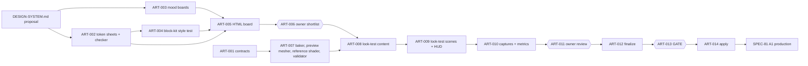

# SPEC-80 — Art direction and design system

| | |
|---|---|
| **Status** | Draft |
| **Area code** | ART |
| **Module(s)** | `Game.Data` (art definition classes, `Assets/Game/Data/Definitions/Art/`); `Game.Editor` (baker, preview mesher, validator, `Assets/Game/Editor/Art/`); `Game.Presentation` (look-test scripts only, `Assets/Game/Presentation/LookTest/`, deleted at A2); theme `Assets/Game/UI/Theme/`; art `Assets/Game/Art/`; documents `docs/design/`; scripts `tools/art/` |
| **Depends on specs** | SPEC-04 (`ContentDefinition`, `IContentDatabaseValidator`, `BlockDefinition.materialLayer/propMesh`, `ItemDefinition.icon`), SPEC-11 (implements the master brick and prop shaders against DESIGN-SYSTEM §10.14–§10.15), SPEC-31 (`BodyVisualDefinition` fields), SPEC-62 (real camera values), SPEC-63 (`FxDefinition` fields) |
| **Depended on by** | SPEC-81 (gate `ART-013`, contract types, tokens); SPEC-11 (shader property contract); SPEC-60 and SPEC-61 (`tokens.uss`); SPEC-63 (damage-type colours); SPEC-31 (sky and body looks); SPEC-51 (paint palette, `defaultPaint`, overlay colours); SPEC-72 (paint index mapping) |
| **Milestone** | A0 (`ART-001` … `ART-013`), A1 (`ART-014`) |

> Read [01-architecture.md](../01-architecture.md), [02-conventions.md](../02-conventions.md) and [03-glossary.md](../03-glossary.md) before this spec. This spec may not contradict them. The design content itself is in [docs/design/DESIGN-SYSTEM.md](../design/DESIGN-SYSTEM.md); this spec is the **process and the contract types**.

## 1. Purpose

The owner must approve one coherent look before any production art is made ([ADR-0009](../decisions/ADR-0009-placeholder-art-and-design-gate.md)). This spec takes the three-direction proposal in DESIGN-SYSTEM.md to an approved, binding design system: mood boards, an interactive design board, a block-kit style test, in-engine look tests of two finalists, an owner review, and the gate. It also creates the contract types and theme file that let code reference art only through definitions and tokens, so the approved art can replace the placeholders in one place. It avoids the old prototype's five mixed UI vocabularies, washed-out backdrops and unreadable block functions (audit 06 §E, 07 §5, screenshots `05-flying`, `22-inventory`).

## 2. Scope

**In scope:**
- `tokens.uss` with every binding token name (placeholder values now, approved values at A1).
- Art definition classes: `ArtDirectionDefinition`, `BrickMaterialDefinition`, `BlockVisualDefinition` and their structs.
- Per-direction token sheets, the token/contrast/colour-blind checker, the board token exporter.
- Mood boards, the HTML design board, the block-kit style test, look-test content and scenes, the capture pack with luminance metrics.
- The brick material baker, the preview mesher and the reference brick shader used by look tests and golden images.
- The owner review, the finalized DESIGN-SYSTEM.md, the gate, and applying the approved direction.

**Out of scope (and who owns it instead):**
- The runtime master brick shader, packed vertex format, prop instancing, LOD switching: SPEC-11 (it implements DESIGN-SYSTEM §10.14–§10.15).
- `FxDefinition` and every VFX system: SPEC-63. `BodyVisualDefinition` and body rendering: SPEC-31. `AudioCueDefinition`: SPEC-64.
- `BlockDefinition`, `ItemDefinition.icon`, `ContentDatabase`: SPEC-04.
- UI framework (`UIRoot`, PanelSettings, navigator): SPEC-60. Real screens and HUD: SPEC-61. Camera: SPEC-62.
- All production assets and placeholder removal: SPEC-81.

## 3. Decisions (binding)

1. **No SPEC-81 task with milestone A1 or A2 starts before `ART-013` is `done`.** Reason: ADR-0009.
2. **DESIGN-SYSTEM.md is the single source of design values;** this spec never repeats a value it can reference. Reason: one place to change.
3. **`Assets/Game/UI/Theme/tokens.uss` is owned by this spec.** It is created by `ART-001` with placeholder values and rewritten only by `ART-014` or by a task that cites a DESIGN-SYSTEM §12 decision row. Token names never change. Reason: single writer; other specs already use the names.
4. **Blocks and items keep their runtime presentation fields in SPEC-04** (`materialLayer`, `propMesh`, `icon`). `BlockVisualDefinition` holds only art extras (LOD1 mesh, moving parts, sockets, default paint). Reason: no second source of truth for SPEC-04 fields.
5. **Exactly one `ArtDirectionDefinition` has `isActive = true`** in the database; runtime code finds the look through it. Reason: no SPEC-04 change needed, swap in one place.
6. **One shared brick material and one shared prop material** (architecture §11.3); all art variation goes through the texture arrays, the paint palette, the per-vertex data and material-property components (DESIGN-SYSTEM §10.14.1). No material instance per grid, block, faction or damage state. Reason: SRP Batcher and Entities Graphics scale to 1M cells only this way.
7. **Art definitions in `Game.Data` reference only UnityEngine core types** (`Material`, `Mesh`, `Texture2D`, `Texture2DArray`, `Color`, `Vector3`, `Vector4`) and other definitions. No `UnityEngine.UIElements`, no URP types (architecture §3.1). UI theming is done only by `tokens.uss`. Reason: assembly rules.
8. **At most two finalist directions get look tests.** Reason: cost.
9. **Look-test material is review material, not game content.** It lives in `Assets/Game/Art/LookTest/<direction>/` (assets), `Assets/Game/Presentation/LookTest/` (scripts) and `docs/design/` (captures); look-test scenes are not in Build Settings, may host one `UIDocument` of their own, and are deleted at A2 (`AST-034`). Reason: the owner must judge the look in engine before SPEC-11 and SPEC-61 exist.
10. **The reference brick shader (`ART-007`) implements the same art contract as SPEC-11's master shader** on simple editor-built meshes. The approved look-test captures become **golden images** in `docs/design/golden/`, the visual target for SPEC-11 and SPEC-81. Reason: art can be judged before M1 rendering is done.
11. **Fonts are SIL OFL 1.1 static instances only**, stored with their `OFL.txt`. Look-test fonts are allowed before approval in `Assets/Game/Art/LookTest/Fonts/`. Reason: legal safety; the placeholder Kontrapunkt has no licence file.
12. **Mood boards store no copyrighted images**; only public-domain, CC0 or own images, plus links. Reason: legal safety.
13. **Owner decisions are written down verbatim** in DESIGN-SYSTEM.md §1.3 and §12, in this spec's §12, and in the ledger. Workers never decide on the owner's behalf; an owner task without an answer stays `blocked`. Reason: workflow §6.

## 4. Data model

All types: namespace `Game.Data.Definitions`, folder `Assets/Game/Data/Definitions/Art/`, one public type per file (conventions §1). All are **public contract**. Field types and order are exact.

### 4.1 Art direction

```csharp
namespace Game.Data.Definitions
{
    /// <summary>Function colours by role. Implements SPEC-80 §4.1 (DESIGN-SYSTEM §10.13, indices 20–25).</summary>
    [System.Serializable]
    public struct ArtFunctionColors
    {
        public UnityEngine.Color thruster, weapon, power, shield, core, utility;            // sRGB, alpha 1
        public float thrusterEmissive, weaponEmissive, powerEmissive, shieldEmissive, coreEmissive, utilityEmissive; // DESIGN-SYSTEM §10.16 units
    }
    // BlockCategory (SPEC-04 §4.6, display only) → field: Propulsion→thruster, Weapon→weapon, Power→power, Shield→shield,
    // Core→core, Utility→utility; Structure and Detail have no function colour. Paint index: thruster 20, weapon 21, power 22, shield 23, core 24, utility 25.

    /// <summary>Team colours of one faction (paint slots 17, 18, 19). Implements SPEC-80 §4.1.</summary>
    [System.Serializable]
    public struct ArtFactionLook
    {
        public string factionId;                                  // FactionDefinition id, e.g. "faction_vestari" (validated, ART-E004)
        public UnityEngine.Color primary, secondary, accent;      // sRGB
        public UnityEngine.Color light;                           // faction light / seam colour, sRGB
    }

    /// <summary>FxEvent.Color per DamageType (architecture §6.3/§6.6). Implements SPEC-80 §4.1.</summary>
    [System.Serializable]
    public struct ArtDamageTypeColors { public UnityEngine.Color kinetic, energy, explosive, ram; }

    /// <summary>Scene lighting look. Implements SPEC-80 §4.1 (DESIGN-SYSTEM §5.4/§6.4/§7.4).</summary>
    [System.Serializable]
    public struct ArtLightingLook
    {
        public float keyIntensity;                 // DRYDOCK 2.0, NOCTURNE 1.6, PULP 1.8
        public float keyPitchDegrees;              // 35 / 25 / 45 (rule R4)
        public float keySaturation;                // 0..1 of the spectral colour: 0.6 / 1.0 / 0.3
        public UnityEngine.Color fillColor;        // fill (or rim) light colour, sRGB
        public float fillIntensity;                // 0.3 / 0.56 / 0.54
        public float fillPitchDegrees;             // 50 / 20 / 45
        public bool fillFromCameraForward;         // false = opposite the key azimuth; true = camera-forward rim (NOCTURNE)
        public UnityEngine.Color ambientSky, ambientEquator, ambientGround; // flat ambient = three equal colours
        public int reflectionCubemapSize;          // 128
    }

    /// <summary>Post-processing look. Implements SPEC-80 §4.1.</summary>
    [System.Serializable]
    public struct ArtPostLook
    {
        public bool acesTonemapping;               // false = Neutral
        public float bloomThreshold, bloomIntensity, bloomScatter;
        public float vignette, filmGrain;          // 0..1
        public float saturation, contrast;         // URP Color Adjustments units (−100..100)
    }

    /// <summary>The root of one art direction. Exactly one is active. Implements SPEC-80 §4.1.</summary>
    [ContentIdPrefix("artdir_")]
    [UnityEngine.CreateAssetMenu(menuName = "Game/Art/Art Direction", fileName = "artdir_new")]
    public sealed class ArtDirectionDefinition : ContentDefinition
    {
        [UnityEngine.SerializeField] private string displayName;                    // "DRYDOCK"
        [UnityEngine.SerializeField] private bool isActive;                         // exactly one true (ART-E001)
        [UnityEngine.SerializeField] private BrickMaterialDefinition brickMaterial;
        [UnityEngine.SerializeField] private UnityEngine.Material propMaterial;      // M_Prop_Trim.mat (SPEC-11 prop shader)
        [UnityEngine.SerializeField] private UnityEngine.Material skyMaterial;       // M_Sky_Procedural.mat
        [UnityEngine.SerializeField] private UnityEngine.Color[] paintPalette = new UnityEngine.Color[32]; // indices 0..31, DESIGN-SYSTEM §10.13
        [UnityEngine.SerializeField] private ArtFunctionColors functionColors;
        [UnityEngine.SerializeField] private ArtFactionLook[] factionLooks = System.Array.Empty<ArtFactionLook>();
        [UnityEngine.SerializeField] private string fallbackFactionId = "faction_ark"; // look used when a faction has none
        [UnityEngine.SerializeField] private ArtDamageTypeColors damageTypeColors;
        [UnityEngine.SerializeField] private UnityEngine.Color[] spectralColors = new UnityEngine.Color[7]; // O, B, A, F, G, K, M
        [UnityEngine.SerializeField] private ArtLightingLook lighting;
        [UnityEngine.SerializeField] private ArtPostLook post;
        [UnityEngine.SerializeField] private float hulkPowerDownSeconds = 0.6f;     // 0.6 / 1.2 / 0.8

        public string DisplayName => displayName;
        public bool IsActive => isActive;
        public BrickMaterialDefinition BrickMaterial => brickMaterial;
        public UnityEngine.Material PropMaterial => propMaterial;
        public UnityEngine.Material SkyMaterial => skyMaterial;
        public System.Collections.Generic.IReadOnlyList<UnityEngine.Color> PaintPalette => paintPalette;
        public ArtFunctionColors FunctionColors => functionColors;
        public System.Collections.Generic.IReadOnlyList<ArtFactionLook> FactionLooks => factionLooks;
        public string FallbackFactionId => fallbackFactionId;
        public ArtDamageTypeColors DamageTypeColors => damageTypeColors;
        public System.Collections.Generic.IReadOnlyList<UnityEngine.Color> SpectralColors => spectralColors;
        public ArtLightingLook Lighting => lighting;
        public ArtPostLook Post => post;
        public float HulkPowerDownSeconds => hulkPowerDownSeconds;
    }
}
```

### 4.2 Brick material

```csharp
namespace Game.Data.Definitions
{
    public enum BrickEmissiveMode : byte { LayerColor = 0, TeamAccent = 1 }          // add at end only

    /// <summary>One slice of the brick texture arrays (index = BlockDefinition.materialLayer). Implements SPEC-80 §4.2.</summary>
    [System.Serializable]
    public struct BrickLayer
    {
        public string name;                                   // DESIGN-SYSTEM §10.12 name, e.g. "hull_plain"
        public UnityEngine.Texture2D albedo;                  // 256×256, sRGB
        public UnityEngine.Texture2D mask;                    // 256×256, linear: R metallic, G smoothness, B paint mask, A emissive mask
        public UnityEngine.Texture2D normal;                  // 256×256, normal map
        public int copyOf;                                    // −1 = own textures; else index of the layer copied ("→ n")
        [UnityEngine.ColorUsage(false, true)] public UnityEngine.Color emissive;   // linear HDR
        public BrickEmissiveMode emissiveMode;
        [UnityEngine.Range(1, 2)] public int macroTile;       // 1 or 2 cells
        public bool scorchable;
        [UnityEngine.Range(0f, 1f)] public float crackStrength;
        [UnityEngine.Range(0f, 1f)] public float edgeWear;
    }

    /// <summary>Scalar brick shader parameters (DESIGN-SYSTEM §10.14.3). Implements SPEC-80 §4.2.</summary>
    [System.Serializable]
    public struct BrickShaderParams
    {
        public float crackTiling;
        public UnityEngine.Color scorchColor; public float scorchStrength;
        [UnityEngine.ColorUsage(false, true)] public UnityEngine.Color emberColor;
        public float emberIntensity, emberFadeSeconds;
        public UnityEngine.Vector4 exposedLayers;             // x, y, z = layer indices, w = count
        public float aoStrength; public UnityEngine.Color aoColor;
        public float macroScale, macroStrength;
        public float emissiveIntensity;
        public float seamEmission, seamFadeStart, seamFadeEnd;
        public UnityEngine.Color rimColor; public float rimStrength;
        public float shadingMode;                             // 0 PBR, 1 toon ramp
        public float halftoneScale;
    }

    /// <summary>All brick looks of one art direction; baked into M_Brick. Implements SPEC-80 §4.2.</summary>
    [ContentIdPrefix("brickmat_")]
    [UnityEngine.CreateAssetMenu(menuName = "Game/Art/Brick Material", fileName = "brickmat_new")]
    public sealed class BrickMaterialDefinition : ContentDefinition
    {
        public const int LayerCount = 64;
        public const int LayerSize = 256;
        public const int MissingLayer = 63;                   // SPEC-04 block_missing

        [UnityEngine.SerializeField] private BrickLayer[] layers = new BrickLayer[LayerCount];
        [UnityEngine.SerializeField] private UnityEngine.Texture2D crackTexture;      // 256² R8
        [UnityEngine.SerializeField] private UnityEngine.Texture2D damageRamp;        // 256×1 sRGB
        [UnityEngine.SerializeField] private UnityEngine.Texture2D macroNoise;        // 256² R8
        [UnityEngine.SerializeField] private UnityEngine.Texture2D toonRamp;          // 256×1 (may be null when shadingMode = 0)
        [UnityEngine.SerializeField] private BrickShaderParams shaderParams;

        [UnityEngine.Header("Baked by BrickMaterialBaker (ART-007). Do not edit by hand.")]
        [UnityEngine.SerializeField] private UnityEngine.Texture2DArray albedoArray;
        [UnityEngine.SerializeField] private UnityEngine.Texture2DArray maskArray;
        [UnityEngine.SerializeField] private UnityEngine.Texture2DArray normalArray;
        [UnityEngine.SerializeField] private UnityEngine.Texture2D layerParams;       // 64×2 RGBAHalf
        [UnityEngine.SerializeField] private UnityEngine.Texture2D paintPaletteTexture; // 256×1 RGBA8 sRGB
        [UnityEngine.SerializeField] private UnityEngine.Material material;           // M_Brick.mat

        public System.Collections.Generic.IReadOnlyList<BrickLayer> Layers => layers;
        public UnityEngine.Texture2D CrackTexture => crackTexture;
        public UnityEngine.Texture2D DamageRamp => damageRamp;
        public UnityEngine.Texture2D MacroNoise => macroNoise;
        public UnityEngine.Texture2D ToonRamp => toonRamp;
        public BrickShaderParams ShaderParams => shaderParams;
        public UnityEngine.Texture2DArray AlbedoArray => albedoArray;
        public UnityEngine.Texture2DArray MaskArray => maskArray;
        public UnityEngine.Texture2DArray NormalArray => normalArray;
        public UnityEngine.Texture2D LayerParams => layerParams;
        public UnityEngine.Texture2D PaintPaletteTexture => paintPaletteTexture;
        public UnityEngine.Material Material => material;
    }
}
```

### 4.3 Block visual extras

```csharp
namespace Game.Data.Definitions
{
    public enum PropPartRole : byte { Yaw = 0, Spin = 1 }                                              // add at end only
    public enum VisualSocketKind : byte { Muzzle = 0, Nozzle = 1, Emitter = 2, Light = 3, Fx = 4 }    // add at end only

    /// <summary>A moving part of a prop mesh. Implements SPEC-80 §4.3.</summary>
    [System.Serializable]
    public struct PropPart
    {
        public PropPartRole role;
        public UnityEngine.Mesh meshLod0, meshLod1;           // same units and pivot rules as BlockDefinition.propMesh
        public UnityEngine.Vector3 pivot;                     // cells, block-local
    }

    /// <summary>A visual attachment point imported from FBX empties. Implements SPEC-80 §4.3.</summary>
    [System.Serializable]
    public struct VisualSocket
    {
        public VisualSocketKind kind;
        public byte index;                                    // from the empty's name suffix, MUZZLE_00 → 0
        public UnityEngine.Vector3 position;                  // cells, block-local
        public UnityEngine.Vector3 forward;                   // unit vector, block-local
    }

    /// <summary>Art-only extras for one block. Implements SPEC-80 §4.3. Id = "vis_" + block id.</summary>
    [ContentIdPrefix("vis_")]
    [UnityEngine.CreateAssetMenu(menuName = "Game/Art/Block Visual", fileName = "vis_new")]
    public sealed class BlockVisualDefinition : ContentDefinition
    {
        [UnityEngine.SerializeField] private BlockDefinition block;
        [UnityEngine.SerializeField] private UnityEngine.Mesh propMeshLod1;            // LOD1 of block.PropMesh; null if no prop mesh
        [UnityEngine.SerializeField] private PropPart[] parts = System.Array.Empty<PropPart>();
        [UnityEngine.SerializeField] private VisualSocket[] sockets = System.Array.Empty<VisualSocket>();
        [UnityEngine.SerializeField] private byte defaultPaint;                         // paint index on placement (0 = team primary)
        [UnityEngine.SerializeField] private bool paintable = true;                     // false = paint tool skips this block

        public BlockDefinition Block => block;
        public UnityEngine.Mesh PropMeshLod1 => propMeshLod1;
        public System.Collections.Generic.IReadOnlyList<PropPart> Parts => parts;
        public System.Collections.Generic.IReadOnlyList<VisualSocket> Sockets => sockets;
        public byte DefaultPaint => defaultPaint;
        public bool Paintable => paintable;
    }
}
```

### 4.4 `tokens.uss` (exact content written by `ART-001`)

```css
/* Implements SPEC-80 §4.4. Binding token names (DESIGN-SYSTEM §10.1). Values: placeholder until ART-014. */
:root {
    --color-bg: #111214;          --color-surface-1: #1A1B1E;   --color-surface-2: #232428;   --color-surface-3: #2D2F33;
    --color-border: #4A4D52;      --color-text: #EDEDED;        --color-text-muted: #A6A6A6;
    --color-accent: #7AA7D9;      --color-accent-strong: #B3CDEB;
    --color-positive: #8CCB6A;    --color-warning: #E3BE5A;     --color-danger: #F06A7E;      --color-info: #6CB8F0;
    --color-ally: #5C9BFF;        --color-enemy: #FF7A4D;       --color-neutral: #C8C8C8;
    --color-shield: #5CC8FF;      --color-hull: #E0E0E0;        --color-energy: #EFD25A;
    --color-faction-ark: #7AA7D9; --color-faction-raiders: #E5533D; --color-faction-xeno: #9B6CF0; --color-faction-vestari: #4FC3A1;
    --color-faction-tlaxcala: #E3A04F; --color-faction-khuchad-clan: #C9C25A; --color-faction-neutral: #C8C8C8;   /* SPEC-33 mapColorToken */
    --color-travel-cover: #F4F6FA;                                /* SPEC-32 §5.8 jump cover (direction A white-out) */
    --space-1: 4px; --space-2: 8px; --space-3: 12px; --space-4: 16px; --space-5: 24px; --space-6: 32px; --space-7: 48px; --space-8: 64px;
    --radius-s: 2px; --radius-m: 4px; --radius-l: 8px;
    --border-thin: 1px; --border-thick: 2px;
    --font-display: url("project://database/Assets/Game/Art/_Placeholder/Fonts/OfficeCodePro-Bold_SDF.asset");
    --font-body: url("project://database/Assets/Game/Art/_Placeholder/Fonts/OfficeCodePro-Regular_SDF.asset");
    --font-mono: url("project://database/Assets/Game/Art/_Placeholder/Fonts/OfficeCodePro-Regular_SDF.asset");
    --text-xs: 12px; --text-s: 14px; --text-m: 16px; --text-l: 20px; --text-xl: 28px; --text-xxl: 40px;
    --duration-fast: 100ms; --duration-normal: 200ms; --duration-slow: 400ms;
    --duration-travel-fade: 0.5s;                                 /* SPEC-32 §5.8 timing contract: never changed by art */
}
```

Direction sheets (`ART-002`) have the same shape at `Assets/Game/UI/Theme/Directions/tokens-drydock.uss`, `tokens-nocturne.uss`, `tokens-pulp-horizon.uss`, with the values of DESIGN-SYSTEM §8.1 and every proposed token of §11; their font URLs point to `Assets/Game/Art/LookTest/Fonts/`.

### 4.5 Fields this spec needs from other specs (they own the classes)

| Class (owner) | Art-facing fields needed | Status |
|---|---|---|
| `FxDefinition` (SPEC-63) | `UnityEngine.VFX.VisualEffectAsset graph`; `float duration`; `UnityEngine.Color tint` (multiplied with the damage-type colour); `float sizeScale`; `int maxSpawnsPerFrame` | Open question 5 |
| `BodyVisualDefinition` (SPEC-31) | `Material material` (shared per body class); `Mesh mesh` (shared sphere); `Texture2D ramp` (256×1 colour ramp); `Color atmosphereColor`; `float atmosphereRim` (fraction of radius); `float emissiveIntensity` (stars); `byte spectralClass` (0 = O … 6 = M) | Open question 6 |

### 4.6 Document and tool files

| Path | Created by | Content |
|---|---|---|
| `docs/design/DESIGN-SYSTEM.md` | (exists) | The proposal; becomes binding at `ART-013` |
| `docs/design/moodboards/<direction>.md`, `img/<direction>/` | `ART-003` | Mood boards |
| `docs/design/board/` (`index.html`, `board.css`, `board.js`, `tokens/*.css`, `img/`) | `ART-004`, `ART-005` | Interactive board |
| `docs/design/captures/<direction>/` | `ART-010` | Stills and `metrics.md` |
| `docs/design/reviews/YYYY-MM-DD-<topic>.md` | `ART-006`, `ART-011` | Owner feedback, verbatim |
| `docs/design/golden/` | `ART-012` | Approved reference images + `README.md` |
| `tools/art/check_tokens.py`, `tools/art/export_board_tokens.py`, `tools/art/check_art_docs.py` | `ART-002`, `ART-003` … `ART-010` | Checkers (Python 3 standard library only, no pip packages) |

## 5. Systems, services and flow

This spec adds **no ECS systems** and no runtime services. It adds editor tools, scripts and a review process.



### 5.1 `BrickMaterialBaker` (editor, `Game.Editor.Art`)

`Bake(BrickMaterialDefinition brick, ArtDirectionDefinition direction, ValidationReport report)`:
1. For each layer `i` in 0..63: resolve the source (`copyOf` ≥ 0 → that layer's textures; empty slot → layer 63). Missing textures or sizes other than 256 × 256 → `ART-E010`, stop.
2. Build three `Texture2DArray`s 256 × 256 × 64 with full mips: albedo BC7 sRGB, mask BC7 linear, normal BC5. Compress per slice with `EditorUtility.CompressTexture` and copy with `Graphics.CopyTexture` (no CPU re-encode at runtime).
3. **Mask mips:** for mip level m ≥ 1, multiply G (smoothness) by `|N̄|²`, where `|N̄|` is the length of the average of the unit normals from the normal map covering that texel. Reason: no specular sparkle on distant voxels.
4. `layerParams` 64 × 2 RGBAHalf, point filter, no mips: row 0 = (emissive.r, .g, .b, emissiveMode); row 1 = (macroTile, scorchable ? 1 : 0, crackStrength, edgeWear).
5. `paintPaletteTexture` 256 × 1 RGBA8 sRGB, point, clamp, no mips: indices 0..31 from `direction.PaintPalette`, 32..255 = index 0.
6. Write every property of DESIGN-SYSTEM §10.14.3 into `brick.Material` by name (`SetTexture`, `SetFloat`, `SetColor`, `SetVector`). Save assets as sub-assets of `brickmat_<dir>.asset`.

### 5.2 `BrickPreviewMeshBuilder` (editor)

`Mesh Build(PreviewCell[] cells, int3 size, float cellSize)` with `struct PreviewCell { byte layer, paint, damageStage, flags; }` (flags bit 0 = exposed): one quad per exposed face (2 triangles), faces between two solid cells culled. Vertex attributes: position (float3, metres), normal, `uv0 = (layer, paint, damageStage, exposed)`, `uv1 = cell-face UV`, `color.r` = AO (0, 0.33, 0.66, 1 from the 3 neighbours of each corner). Used by look tests and by SPEC-81's icon renderer. Wedges are not supported (look tests use cube cells only).

### 5.3 `SH_BrickReference` (look tests only)

URP Lit Shader Graph (or HLSL) in `Assets/Game/Art/Shaders/SH_BrickReference.shadergraph` that reads the preview mesh attributes above and implements every property of DESIGN-SYSTEM §10.14.3 and §10.14.4 (per-grid properties as material properties here), with all properties in `UnityPerMaterial` (SRP Batcher compatible). It is **not** used at runtime; SPEC-11's master shader is.

### 5.4 `ArtDatabaseValidator : IContentDatabaseValidator` (`Order = 800`)

| Code | Severity | Rule |
|---|---|---|
| ART-E001 | Error | Not exactly one `ArtDirectionDefinition` with `IsActive` |
| ART-E002 | Error | `paintPalette.Length != 32` or `spectralColors.Length != 7` |
| ART-E003 | Error | `BrickMaterialDefinition.layers.Length != 64` |
| ART-E004 | Error | `factionLooks[i].factionId` (or `fallbackFactionId`) is not a `faction_` id in the database |
| ART-E005 | Error | `BlockVisualDefinition` id ≠ `"vis_" + block.IdString`, or two visuals for one block |
| ART-E006 | Error | A `BlockDefinition.materialLayer` points at an empty layer slot of the active brick material |
| ART-E007 | Error | A block palette default (`defaultPaint`) ≥ 32 |
| ART-E010 | Error | A layer texture is missing, not 256 × 256, or has the wrong sRGB setting |
| ART-W001 | Warning | Active brick material not baked since its last edit (hash of inputs ≠ stored hash) |

## 6. Public API

- Definition getters in §4 (read-only; runtime never writes definitions).
- `Game.Editor.Art.BrickMaterialBaker.Bake(BrickMaterialDefinition, ArtDirectionDefinition, ValidationReport)` — §5.1; menu `Game/Art/Bake Brick Material` bakes the active direction.
- `Game.Editor.Art.BrickPreviewMeshBuilder.Build(PreviewCell[], int3, float)` — §5.2; pre: `cells.Length == size.x*size.y*size.z`, size ≤ 64 per axis, else `ArgumentException`.
- `tools/art/check_tokens.py [--sheet PATH ...]` — exit 0 when every binding token is present in every sheet and rules T1–T3 and C4 (DESIGN-SYSTEM §10.2–§10.3) hold; prints the contrast and ΔE tables.
- `tools/art/export_board_tokens.py` — writes `docs/design/board/tokens/<direction>.css`.
- `tools/art/check_art_docs.py {moodboards|blocks|board|captures}` — exit 0 when the named deliverable meets its task's acceptance criteria.

## 7. Edge cases and failure behaviour

| Situation | Required behaviour |
|---|---|
| Owner rejects all three directions | Add one task "Direction D proposal" (F6, frontier) to this spec before `ART-006`; DESIGN-SYSTEM.md gets a §7b; the shortlist repeats |
| Owner shortlists only one direction | `ART-008`…`ART-010` run for that one; no comparison captures |
| Owner borrows elements across directions | Each borrowed element becomes a §12 row; the token checker runs on the merged sheet |
| Owner does not answer `ART-006`, `ART-011` or `ART-013` | Task stays `blocked` with Notes `waiting for owner`; no default, no worker decision |
| A token sheet fails `check_tokens.py` after a revision | Fix values before the review; never present failing values |
| A font's licence cannot be verified | Use the alternate: DRYDOCK display Saira Condensed SemiBold, body IBM Plex Sans; NOCTURNE display Chakra Petch Medium, body Manrope; PULP HORIZON display Bungee, body Nunito Sans (all OFL) |
| USS `var()` cannot carry a font URL | Use classes `.font-display`, `.font-body`, `.font-mono` in `tokens.uss` (open question 9) |
| SPEC-11's master shader is done before `ART-009` | Look tests may use it instead of the reference shader if it implements §10.14 fully; captures note which shader was used |
| Look test fails luminance rules L1–L5 | Listed in `metrics.md` as revision items; the owner may accept a failure only in writing (§12 row) |
| Board opened offline (no Google Fonts) | Falls back to system fonts and shows a banner "fonts not loaded — type specimens are not accurate" |

## 8. Performance budget

Runtime art budgets are in DESIGN-SYSTEM §10.10–§10.11 and enforced by SPEC-81. This spec's own limits:

| Item | Budget | Measured by |
|---|---|---|
| `BrickMaterialBaker.Bake`, 64 layers | ≤ 60 s on the reference machine | `ART-007` test log |
| `check_tokens.py`, 4 sheets | ≤ 2 s | Script timer |
| Look-test scene at 150 m, 1920 × 1080 | ≤ 8 ms GPU and ≤ 4 ms main thread (median of 300 frames) | `ART-010`, ledger *Measurements* |
| Board page | ≤ 25 MB including images; first render ≤ 3 s from `file://` | `ART-005` |

## 9. Tasks

### ART-001 — Public contract types
- **Milestone:** A0
- **Tier:** standard — §4 gives the exact code and file content
- **Depends on:** `DATA-001`
- **Do:** Create every type of §4.1–§4.3 exactly as written, one public type per file. Create `Assets/Game/UI/Theme/tokens.uss` with the exact content of §4.4. Create the placeholder font assets `OfficeCodePro-Regular_SDF.asset` and `OfficeCodePro-Bold_SDF.asset` next to their TTFs in `Assets/Game/Art/_Placeholder/Fonts/` with the FontAsset settings of DESIGN-SYSTEM §10.9. Create the empty folders `Assets/Game/Content/Art/`, `Assets/Game/Art/LookTest/`, `Assets/Game/Editor/Art/`.
- **Files:** `Assets/Game/Data/Definitions/Art/{ArtFunctionColors,ArtFactionLook,ArtDamageTypeColors,ArtLightingLook,ArtPostLook,ArtDirectionDefinition,BrickEmissiveMode,BrickLayer,BrickShaderParams,BrickMaterialDefinition,PropPartRole,VisualSocketKind,PropPart,VisualSocket,BlockVisualDefinition}.cs`; `Assets/Game/UI/Theme/tokens.uss`; `Assets/Game/Art/_Placeholder/Fonts/OfficeCodePro-{Regular,Bold}_SDF.asset`; `Assets/Game/Tests/EditMode/Data/Art/ArtContractTests.cs`
- **Acceptance criteria:**
  - [ ] `tools/compile.sh` passes with zero new warnings; `AssemblyRulesTests` pass (no UIElements or URP reference from `Game.Data`).
  - [ ] `tokens.uss` defines all 44 binding custom properties of DESIGN-SYSTEM §10.1 exactly once, with the §4.4 values.
  - [ ] A test label using `-unity-font-definition: var(--font-body)` renders with OfficeCodePro (open question 9 answered in the ledger).
- **Tests:** `ArtContractTests.Definitions_DeclareIdPrefixes` (`artdir_`, `brickmat_`, `vis_`); `.TokensUss_DefinesEveryBindingTokenOnce` (parses the file); `.BrickMaterial_DefaultsToSixtyFourLayers`; `.ArtDirection_PaletteHasThirtyTwoEntries`.

### ART-002 — Direction token sheets and the token checker
- **Milestone:** A0
- **Tier:** standard — values and formulas are given in DESIGN-SYSTEM §8.1, §10.2, §10.3, §11
- **Depends on:** `ART-001`
- **Do:** Write the three direction sheets (§4.4) with every binding token and every §11 proposed token. Write `tools/art/check_tokens.py`: parse `:root` custom properties of each sheet; WCAG relative luminance and contrast; Machado-2009 severity-1.0 matrices (protan, deutan, tritan, applied in linear RGB) and CIEDE2000; check rule T1 for `--color-text`, `--color-text-muted`, `--color-accent` and the six semantic colours on `--color-bg`, `--color-surface-1`, `--color-surface-2`, rule T2 for `--color-border-strong` on surfaces 1–3 (≥ 3:1), and the C4 minima. Write `tools/art/export_board_tokens.py` (copies colour, space, radius, border, text and duration tokens to CSS; fonts become Google Fonts family names from a table in the script).
- **Files:** `Assets/Game/UI/Theme/Directions/tokens-{drydock,nocturne,pulp-horizon}.uss`; `tools/art/check_tokens.py`; `tools/art/export_board_tokens.py`; `tools/art/test_check_tokens.py`
- **Acceptance criteria:**
  - [ ] `check_tokens.py` exits 0 for `tokens.uss` and the three sheets, and its printed contrast values equal DESIGN-SYSTEM §8.1 to 2 decimals and its ΔE values equal §10.2 to 1 decimal.
  - [ ] Removing any binding token from a sheet makes the script exit 1 naming the token.
- **Tests:** `test_check_tokens.py` (Python `unittest`): contrast `#FFFFFF`/`#000000` = 21.00; CIEDE2000 of Lab (50, 2.6772, −79.7751) vs (50, 0, −82.7485) = 2.0425 ± 0.0001 (Sharma 2005 pair 1); a sheet missing `--color-hull` fails.

### ART-003 — Mood boards per direction
- **Milestone:** A0
- **Tier:** frontier — F6 design work
- **Depends on:** —
- **Do:** For DRYDOCK, NOCTURNE and PULP HORIZON write `docs/design/moodboards/<direction>.md` with 16–24 references in six groups (ships and stations; space and lighting; destruction and VFX; UI and typography; Otherness; audio playlist), at least 2 per group, plus 3 anti-references. Each reference: title, creator, year, one sentence on what to take. Images only if public domain, CC0 or own work, with source URL and licence on the line under the image; otherwise a link only. Images JPEG quality 85, long side ≤ 1600 px, ≤ 400 KB, ≤ 12 per direction. Add subcommand `moodboards` to `tools/art/check_art_docs.py`.
- **Files:** `docs/design/moodboards/{drydock,nocturne,pulp-horizon}.md`; `docs/design/moodboards/img/<direction>/*.jpg`; `tools/art/check_art_docs.py`
- **Acceptance criteria:**
  - [ ] `check_art_docs.py moodboards` exits 0: counts per group met, every image has a licence line of `Public domain`, `CC0` or `Own work`, every image within the size limits.
  - [ ] Each board names at least one touchstone from its DESIGN-SYSTEM §x.2 list in every visual group.
- **Tests:** `check_art_docs.py moodboards` run in the task log.

### ART-004 — Block-kit style test: five blocks per direction
- **Milestone:** A0
- **Tier:** frontier — F6 design spike
- **Depends on:** `ART-002`
- **Do:** In Blender (a Python script that builds the scene is allowed), model per direction: `block_hull` and `block_hull_angled` as a 4 × 4 × 1 plate patch textured with that direction's `hull_plain` and `hull_heavy` layers (256 px, procedural), `block_thruster_small`, `weapon_plasma_turret_small` (base + yaw part) and `block_core_small` following DESIGN-SYSTEM §x.5, §10.6, §10.11, §10.15. Show damage stages 0–3 on four copies of the hull patch. Render with an orthographic camera matching the reference pixel density of DESIGN-SYSTEM §4: 14.8, 4.9 and 2.5 px per cell, pitched 55°, lit per §x.4. Export a 1920 × 1080 composite per direction and `stats.json` (triangles per mesh, texture sizes).
- **Files:** `ArtSource/StyleTest/<direction>/style_test.blend`; `ArtSource/StyleTest/build_style_test.py`; `docs/design/board/img/blocks/<direction>/{<block>_{050,150,300}.png,damage_strip.png,composite.png,stats.json}`
- **Acceptance criteria:**
  - [ ] Every mesh is within the §10.11 triangle budget for its footprint (from `stats.json`).
  - [ ] Pixels per cell in each render is within ±10 % of §4.
  - [ ] In every 50 m render the function glyph of the thruster, turret and core is recognisable, and in every 150 m render their function colour is identifiable, by a second reviewer who has not seen the block names (reviewer named in the ledger log). (Amended 2026-10-10 by owner decision, DESIGN-SYSTEM §12 row 1: 1-cell-wide blocks show about 5 px glyphs at 150 m.)
- **Tests:** `check_art_docs.py blocks` (all files exist, image sizes, budgets from `stats.json`).

### ART-005 — Interactive HTML design board
- **Milestone:** A0
- **Tier:** frontier — F6 design presentation
- **Depends on:** `ART-002`, `ART-003`, `ART-004`
- **Do:** Build `docs/design/board/index.html` with `board.css` and `board.js` (plain HTML/CSS/JS, no build step, no framework; only external URLs `fonts.googleapis.com` and `fonts.gstatic.com`). One tab per direction plus a Compare tab. Per direction: palette swatches with hex and contrast badges; type specimen for every text token; components in every state (button default/hover/pressed/disabled/primary, tab, panel with header, inventory slot empty/filled/selected, tooltip, the four notice toasts with glyphs, hull/shield/energy bars at 100/50/15 %, dialog choice list, text field, toggle, slider); a 1920 × 1080 HUD mock scaled to fit, using the zones of DESIGN-SYSTEM §10.4.2 and the direction's variant; block-kit renders from `ART-004`; damage strip; VFX colour and timing strip (CSS animations with the §x.7 durations); space swatches. Global toggles: colour-vision simulation (SVG `feColorMatrix` with the Machado matrices, applied to the whole page) and reduced motion. A scorecard form with a "Copy as Markdown" button that outputs the DESIGN-SYSTEM §1.3 block filled in; `localStorage` use wrapped in `try/catch`.
- **Files:** `docs/design/board/{index.html,board.css,board.js}`; `docs/design/board/tokens/*.css` (generated)
- **Acceptance criteria:**
  - [ ] Opens from `file://` in Chrome and Safari with zero console errors.
  - [ ] Every token value shown equals its `.uss` sheet; HUD zone rectangles equal §10.4.2 at 1:1 scale (±1 px).
  - [ ] Page weight ≤ 25 MB; first render ≤ 3 s.
- **Tests:** `check_art_docs.py board` (generated CSS matches the sheets; only the two allowed external hosts appear).

### ART-006 — Owner shortlist of finalist directions
- **Milestone:** A0
- **Tier:** standard — records the owner's decision verbatim
- **Depends on:** `ART-005`
- **Do:** Give the owner DESIGN-SYSTEM.md and the board. Write his answer verbatim in `docs/design/reviews/YYYY-MM-DD-shortlist.md`, fill the SHORTLIST part of DESIGN-SYSTEM §1.3, add a §12 row, and add a ledger *Log* entry. Without an answer the task stays `blocked` (Decision 13).
- **Files:** `docs/design/reviews/YYYY-MM-DD-shortlist.md`; `docs/design/DESIGN-SYSTEM.md`; `docs/LEDGER.md`
- **Acceptance criteria:**
  - [ ] One or two finalist names (or a request for a new direction) are recorded in all three places with the same date.
- **Tests:** `tools/check-docs.py` passes.

### ART-007 — Brick material baker, preview mesher, reference shader and art validator
- **Milestone:** A0
- **Tier:** frontier — shader and material architecture (texture arrays, palette texture, SRP Batcher compatibility)
- **Depends on:** `ART-001`
- **Do:** Implement §5.1–§5.4 exactly: `BrickMaterialBaker`, `BrickPreviewMeshBuilder`, `SH_BrickReference`, `ArtDatabaseValidator` and `Validate` overrides on the three definitions emitting the §5.4 codes. Register the validator through SPEC-04's `IContentDatabaseValidator` discovery.
- **Files:** `Assets/Game/Editor/Art/{BrickMaterialBaker,BrickPreviewMeshBuilder,PreviewCell,ArtDatabaseValidator,ArtMenu}.cs`; `Assets/Game/Art/Shaders/SH_BrickReference.shadergraph`; `Assets/Game/Tests/EditMode/Editor/Art/{BrickMaterialBakerTests,BrickPreviewMeshBuilderTests,ArtDatabaseValidatorTests,BrickReferenceShaderTests}.cs`
- **Acceptance criteria:**
  - [ ] Baking a 64-layer test definition produces three arrays 256 × 256 × 64 with 9 mips in BC7/BC7/BC5, a 64 × 2 layer-params texture and a 256 × 1 palette, in ≤ 60 s.
  - [ ] The Material inspector of `SH_BrickReference` reports "SRP Batcher: compatible" (screenshot in the ledger log).
  - [ ] A 16 × 16 × 16 solid cube builds exactly 6 × 256 × 2 = 3,072 triangles.
- **Tests:** `BrickMaterialBakerTests.Bake_ProducesSixtyFourSlicesPerArray`, `.CopyOf_CopiesSourceSlice`, `.EmptySlot_CopiesMissingLayer`, `.Palette_IsIndex0Above31`, `.LayerParams_EncodeMacroTileAndEmissiveMode`, `.MaskMips_SmoothnessReducedByNormalVariance`; `BrickPreviewMeshBuilderTests.SolidCube_TwoTrianglesPerExposedFace`, `.SharedFaces_AreCulled`, `.Ao_ThreeNeighboursGiveZero`; `ArtDatabaseValidatorTests.TwoActiveDirections_E001`, `.UnknownFaction_E004`, `.WrongVisualId_E005`, `.EmptyLayerReferenced_E006`, `.WrongTextureSize_E010`; `BrickReferenceShaderTests.DeclaresEveryContractProperty` (every name of DESIGN-SYSTEM §10.14.3–§10.14.4 found with `Shader.FindPropertyIndex`).

### ART-008 — Look-test content for each finalist
- **Milestone:** A0
- **Tier:** frontier — F6 design spike before approval
- **Depends on:** `ART-004`, `ART-006`, `ART-007`
- **Do:** For each finalist: `artdir_<dir>.asset` (active only in its own look-test scene through a scene override; the database keeps the placeholder direction active) with every value of the direction's §x.3–§x.4; `brickmat_<dir>.asset` with at least layers 0, 1, 3, 4, 5, 8, 9, 16, 17, 18, 20, 21, 40, 43, 63 (procedural 256 px textures) and baked; a shared look-test prop material `M_LookTest_Prop_<dir>.mat`; the five `ART-004` meshes imported per DESIGN-SYSTEM §10.15; a look-test sky shader `SH_Sky_LookTest.shadergraph` (3 star tiers, galaxy band, nebula noise, lower-hemisphere authoring); one planet and one star. Structures as JSON cell arrays (`{"size":[x,y,z],"cells":[[x,y,z,layer,paint,damage,flags],…]}`): a ship of 2,500–3,500 cells about 40 m long following §x.5 silhouette guidance; its hulk copy; a station chunk of 50,000–70,000 cells (about 120 × 60 × 30 m of a ring station with habitat windows, docking markings, navigation-light props) including a 20 × 20 damage patch with stages 0–3 and a cut-open section showing exposed internals.
- **Files:** `Assets/Game/Content/Art/{artdir,brickmat}_<dir>.asset`; `Assets/Game/Art/LookTest/<dir>/{Layers/,Meshes/,Materials/,Structures/*.json}`; `Assets/Game/Art/LookTest/Shaders/SH_Sky_LookTest.shadergraph`; `Assets/Game/Art/LookTest/Fonts/` (the direction's OFL fonts with `OFL.txt`)
- **Acceptance criteria:**
  - [ ] `ArtDatabaseValidator` reports zero errors; texture sizes and triangle counts meet DESIGN-SYSTEM §10.10–§10.11.
  - [ ] Every colour value in the two definitions equals a hex value in DESIGN-SYSTEM.md for that direction (`check_art_docs.py captures --definitions` compares them).
  - [ ] Cell counts within the ranges above.
- **Tests:** `check_art_docs.py captures --definitions`; `ArtDatabaseValidatorTests` re-run.

### ART-009 — Look-test scenes with HUD mock
- **Milestone:** A0
- **Tier:** frontier — F6 integration of an unapproved look
- **Depends on:** `ART-002`, `ART-008`
- **Do:** Scene `Assets/Game/Art/LookTest/<dir>/LookTest_<dir>.unity` (not in Build Settings) containing the reference camera (FOV 40°, pitch 55°; keys `1` 50 m, `2` 150 m, `3` 300 m, `4` 5 m), the key and fill lights and a URP Volume profile `VP_LookTest_<dir>.asset` per §x.4, the ship (powered), the hulk (`_GridPowered` 0), the station chunk, planet, star and sky, all meshes built by `BrickPreviewMeshBuilder`. Script `LookTestSequence` plays a 20 s loop: thrusters at 0 → 100 % throttle, three weapon hits with VFX mock-ups following §x.7 colours and timings, one small explosion on the station patch. HUD: `LookTestHud.uxml` with the direction's sheet and `LookTestComponents.uss`, one `UIDocument` with `PS_LookTest.asset` (1920 × 1080, match 0.5), static values: hull 72 %, shield 40 %, energy 90 %, three radar blips (ally, enemy, neutral) with C1 shapes, a target panel, two toasts, a three-line objective tracker, weapon groups 1–5 with group 2 selected, and a dialog panel toggled with `D`.
- **Files:** `Assets/Game/Art/LookTest/<dir>/{LookTest_<dir>.unity,VP_LookTest_<dir>.asset,UI/LookTestHud.uxml,UI/LookTestComponents.uss,UI/PS_LookTest.asset}`; `Assets/Game/Presentation/LookTest/{LookTestCameraRig,LookTestSequence,LookTestStructureLoader}.cs`
- **Acceptance criteria:**
  - [ ] Entering Play Mode in each scene shows all listed objects with zero console errors.
  - [ ] HUD zones match DESIGN-SYSTEM §10.4.2 (±2 px at 1920 × 1080) and use only `var(--…)` tokens (no literal colours or sizes in the USS).
  - [ ] Nothing outside `Assets/Game/Art/LookTest/` and `Assets/Game/Presentation/LookTest/` references these files.
- **Tests:** `Game.Tests.PlayMode` `LookTestSceneTests.Scene_LoadsWithoutErrors` (per scene, category `Scenario`).

### ART-010 — Look-test capture pack and metrics
- **Milestone:** A0
- **Tier:** frontier — F6 measurement
- **Depends on:** `ART-009`
- **Do:** Script `LookTestCapture` takes, per finalist, 12 stills at 1920 × 1080 (3 distances × ship idle, ship firing with an explosion frame, station damage patch, hulk next to ship) plus, for each still, an ID pass rendered by temporarily swapping every renderer to an unlit ID material (backdrop black; lit hull red 1.0; shadowed hull red 0.5, from N·L of the key light; function emissive areas green; VFX blue) and a HUD-only pass (world camera off, black clear). Extend `check_art_docs.py captures` to compute rules L1–L5 (DESIGN-SYSTEM §10.3) from beauty + ID passes, HUD coverage (pixels ≥ 70 % opaque) from the HUD pass, and protan/deutan/tritan simulations of the HUD stills; write `metrics.md`. Record GPU and main-thread time (median of 300 frames at 150 m) in the ledger *Measurements*.
- **Files:** `Assets/Game/Presentation/LookTest/LookTestCapture.cs`; `Assets/Game/Art/LookTest/Materials/M_LookTest_Id.mat`; `docs/design/captures/<dir>/{*.png,metrics.md}`; `tools/art/check_art_docs.py`
- **Acceptance criteria:**
  - [ ] 12 beauty stills, 12 ID passes, 12 HUD passes and 3 × 12 colour-vision simulations per finalist exist.
  - [ ] `metrics.md` lists L1–L5 values and pass/fail per still, HUD coverage, and the performance numbers against §8.
- **Tests:** `check_art_docs.py captures` (files complete; metric computation verified on a synthetic image pair with known answers committed under `tools/art/testdata/`).

### ART-011 — Owner look-test review and one revision round
- **Milestone:** A0
- **Tier:** frontier — F6 design revision
- **Depends on:** `ART-010`
- **Do:** Show the owner the live scenes and `docs/design/captures/`. Write his feedback verbatim in `docs/design/reviews/YYYY-MM-DD-look-test.md`. Make the requested changes inside the finalist directions (values, layers, UI) in at most 3 working days, re-run `ART-010`, and ask the owner to choose the direction. A second revision round requires a new task added to this spec.
- **Files:** `docs/design/reviews/YYYY-MM-DD-look-test.md`; files of `ART-008`/`ART-009` as changed; `docs/design/captures/<dir>/`
- **Acceptance criteria:**
  - [ ] Every owner request has a line "done / not done + reason" in the review file.
  - [ ] Revised captures pass L1–L5, or each failure is accepted in writing by the owner (quoted in the review file).
- **Tests:** `check_art_docs.py captures`; `check_tokens.py`.

### ART-012 — Finalize the design system for approval
- **Milestone:** A0
- **Tier:** frontier — design-system authoring
- **Depends on:** `ART-011`
- **Do:** Edit DESIGN-SYSTEM.md: mark the chosen direction "proposed for approval", integrate every revised value from `ART-011` into its §x tables, §8.1, §10.13 and §11, add draft §12 rows for every requested change, and set any open DESIGN-SYSTEM detail the revisions decided. Copy the approved stills and HUD captures to `docs/design/golden/` with a `README.md` (scene, camera distance, commit hash, shader used). Do not move the other directions yet.
- **Files:** `docs/design/DESIGN-SYSTEM.md`; `docs/design/golden/*.png`; `docs/design/golden/README.md`; `Assets/Game/UI/Theme/Directions/tokens-<dir>.uss`
- **Acceptance criteria:**
  - [ ] `check_tokens.py` exits 0 on the chosen direction's sheet; the sheet equals the §8.1 column.
  - [ ] Every owner request in the review files maps to a §12 draft row.
  - [ ] `docs/design/golden/` holds at least 12 images and the README.
- **Tests:** `check_tokens.py`; `check_art_docs.py captures`.

### ART-013 — GATE: Owner approves design system
- **Milestone:** A0
- **Tier:** standard — records the owner's decision verbatim
- **Depends on:** `ART-012`
- **Do:** The owner fills the APPROVAL part of DESIGN-SYSTEM §1.3 (or dictates it and confirms the written text). Then: set the DESIGN-SYSTEM.md status to `BINDING — approved YYYY-MM-DD (<direction>)`; finalize the §12 rows with the owner's date; move the non-chosen direction sections unchanged into Appendix A; fill §12 *Approval* of this spec; set the ledger *Owner gates* row to `approved` with the date; add a ledger *Log* entry. Without the owner's approval the task stays `blocked`.
- **Files:** `docs/design/DESIGN-SYSTEM.md`; `docs/specs/SPEC-80-art-direction.md`; `docs/LEDGER.md`
- **Acceptance criteria:**
  - [ ] The same direction name and approval date appear in DESIGN-SYSTEM §1.3, DESIGN-SYSTEM §12, this spec's §12 and the ledger *Owner gates* row.
  - [ ] `tools/check-docs.py` passes.
- **Tests:** `tools/check-docs.py`.

### ART-014 — Apply the approved direction
- **Milestone:** A1
- **Tier:** standard — mechanical application of approved values
- **Depends on:** `ART-013`
- **Do:** Rewrite `tokens.uss` with the approved column of DESIGN-SYSTEM §8.1 plus the §11 tokens accepted in §12; move the chosen direction's OFL fonts from `Assets/Game/Art/LookTest/Fonts/` to `Assets/Game/UI/Theme/Fonts/` and point the font tokens there. Set `isActive = true` on the chosen `artdir_<dir>` (and false everywhere else), set `fallbackFactionId` to SPEC-33's ARK faction id. Delete the non-chosen `artdir_`, `brickmat_`, token sheet and `Assets/Game/Art/LookTest/<other>/`.
- **Files:** `Assets/Game/UI/Theme/tokens.uss`; `Assets/Game/UI/Theme/Fonts/`; `Assets/Game/Content/Art/`; `Assets/Game/UI/Theme/Directions/`; `Assets/Game/Art/LookTest/`
- **Acceptance criteria:**
  - [ ] `check_tokens.py` exits 0 on `tokens.uss`, whose values equal the approved column.
  - [ ] `ArtDatabaseValidator` reports zero errors and exactly one active direction.
  - [ ] No asset references a deleted file (Unity "missing reference" search returns nothing).
- **Tests:** `ArtContractTests.TokensUss_DefinesEveryBindingTokenOnce`; `check_tokens.py`; `ArtDatabaseValidatorTests` re-run.

## 10. Open questions

| # | Question | Default if unanswered | Decider |
|---|---|---|---|
| 1 | Who applies the active `ArtDirectionDefinition` at runtime (key/fill lights, Volume, palette texture, per-grid team colours from `Allegiance`)? | SPEC-11 owns an `ArtDirectionApplier` in `Game.Presentation`; SPEC-31 provides each star's spectral class | Tech lead |
| 2 | Architecture §11.3 says "materials are shared, one per material layer". Is one shared brick material with texture arrays (DESIGN-SYSTEM §10.14.1) acceptable? | Yes: it is one material for all layers, selected per vertex; if SPEC-11 prefers one material per layer, each uses the same shader and arrays with a fixed `_LayerIndex` | Tech lead, SPEC-11 |
| 3 | Damage stage per vertex: does the resolver mark a brick mesh-dirty when a cell crosses a quarter of its HP? Is there an "exposed" bit in `Cell.Flags`? | Yes for the stage change (≤ 3 remeshes per cell lifetime); no exposed bit until SPEC-13 adds one (exposed faces then look like normal hull) | SPEC-11, SPEC-13 |
| 4 | Shader property names of the per-grid and per-prop material-property components (DESIGN-SYSTEM §10.14.4, §10.15) | SPEC-11 declares exactly those names | SPEC-11 |
| 5 | `FxDefinition` art-facing fields (§4.5) | SPEC-63 includes them; damage-type colours come from `ArtDirectionDefinition` | SPEC-63 |
| 6 | `BodyVisualDefinition` art-facing fields (§4.5) | SPEC-31 includes them | SPEC-31 |
| 7 | Add the prefixes `artdir_`, `brickmat_`, `vis_` to SPEC-04's prefix registry | Yes, as in §4 | SPEC-04 |
| 8 | Content ID of the player's ARK expedition faction | **Answered:** `faction_ark` (SPEC-33); faction tokens `--color-faction-{ark,raiders,xeno,vestari,tlaxcala,khuchad-clan,neutral}` are in §4.4 with placeholder values; each direction sheet sets them, and ART-014 keeps the names | SPEC-33 |
| 9 | Can a USS custom property carry a font URL (`-unity-font-definition: var(--font-body)`)? | **Answered (2026-10-10, `ART-001`): yes.** `TokenFontTests.FontBodyToken_ResolvesToPlaceholderFontAsset` (PlayMode) resolves `var(--font-body)` to `OfficeCodePro-Regular_SDF.asset`; no font classes needed | Tech lead |
| 10 | Reference camera (FOV 40°, pitch 55°, 50/150/300 m) vs SPEC-62's real values | Use the reference; `ART-010` re-measures when SPEC-62 differs | SPEC-62 |
| 11 | OFL fonts in `Assets/Game/Art/LookTest/Fonts/` before approval, given conventions §5 "no new third-party art" | Allowed as review material (Decision 11); non-chosen fonts deleted at `ART-014` | Owner |
| 12 | AI-generated assets (DESIGN-SYSTEM §10.19) | Allowed only with the owner's approval per asset, recorded in the licence register | Owner |
| 13 | Glossary additions: paint palette, team colour slot, function colour, brick layer, look test, golden image | **Done (2026-10-10, `ART-001`):** 03-glossary *Art and presentation* | Tech lead |
| 14 | Wedge slope face UVs | SPEC-11 maps the slope with U along X and V along the slope; layers must tolerate the √2 stretch (DESIGN-SYSTEM §10.12) | SPEC-11 |

## 11. References

- Design content: [docs/design/DESIGN-SYSTEM.md](../design/DESIGN-SYSTEM.md).
- Audit background: `docs/reference/audit-2026-10/00-synthesis.md` §2c (visual bugs), §5 (third-party assets, Starsector legal note), §6c (rendering), §6j (UI); `06-ui-shipeditor.md` §2.E, §5.2; `07-project-health.md` §2, §5; screenshots `01-start`, `05-flying`, `06-ark-station`, `11-firing`, `18-12-enemies`, `22-inventory`, `23-fleet`.
- Machado, Oliveira, Fernandes (2009), "A Physiologically-based Model for Simulation of Color Vision Deficiency"; Sharma, Wu, Dalal (2005), "The CIEDE2000 Color-Difference Formula" (test data); WCAG 2.2 §1.4.3, §1.4.11.
- Unity: `Texture2DArray`, `EditorUtility.CompressTexture`, SRP Batcher compatibility, Entities Graphics `MaterialProperty`, UI Toolkit USS custom properties and transitions.

## 12. Approval

Filled by `ART-013` only.

| Field | Value |
|---|---|
| Chosen direction | — |
| Borrowed elements | — |
| Approved by | — |
| Approval date | — |
| DESIGN-SYSTEM.md decision log rows | — |
