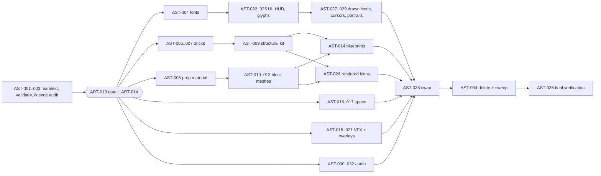

# SPEC-81 — Asset production and placeholder replacement

| | |
|---|---|
| **Status** | Draft |
| **Area code** | AST |
| **Module(s)** | Assets in `Assets/Game/Art/`, `Assets/Game/UI/Theme/`, `Assets/Game/Audio/`, `Assets/Game/Content/`; editable sources in `ArtSource/`; editor tools in `Game.Editor` (`Assets/Game/Editor/Art/`); registers `docs/design/asset-manifest.csv` and `docs/design/LICENSES.md` |
| **Depends on specs** | SPEC-80 (gate `ART-013`, contract types, approved DESIGN-SYSTEM.md), SPEC-04 (`BlockDefinition`, `ItemDefinition.icon`), SPEC-10 (`ShipBlueprintDefinition`), SPEC-11 (master brick and prop shaders, LOD), SPEC-21 (weapons, projectiles), SPEC-31 (`BodyVisualDefinition`, sky hookup), SPEC-32 (gates, jumps), SPEC-51 (Blueprint Lab, overlays), SPEC-60 and SPEC-61 (UI framework, screens, HUD), SPEC-63 (`FxDefinition`, VFX systems), SPEC-64 (`AudioCueDefinition`), SPEC-72 (converted legacy content) |
| **Depended on by** | Every spec that shows art or plays audio (they switch from placeholders at A2) |
| **Milestone** | A0 (`AST-001` … `AST-003`, no assets produced), A1 (`AST-004` … `AST-032`), A2 (`AST-033` … `AST-035`) |

> Read [01-architecture.md](../01-architecture.md), [02-conventions.md](../02-conventions.md) and [03-glossary.md](../03-glossary.md) before this spec. This spec may not contradict them. [DESIGN-GUIDE.md](../design/DESIGN-GUIDE.md) is the approved source of design values; its adopted DESIGN-SYSTEM §4 and §10–§11 supply the shared technical rules. Direction sections of DESIGN-SYSTEM are reference only unless the guide adopts them (Q16).

## 1. Purpose

Produce every art and audio asset of the game in the approved design system, then remove every placeholder. Production is blocked behind the owner's approval ([ADR-0009](../decisions/ADR-0009-placeholder-art-and-design-gate.md), `ART-013`); only the A0 bookkeeping tasks of this spec (manifest, validator, licence audit) may run earlier because they create no art. The list below covers every block of SPEC-04 §4.10, the M3 vertical-slice block list in [00-vision](../00-vision.md), the cosmetic block kit, space, VFX, UI, icons for every item, cursors, fonts and audio. It ends the old prototype's legal and coherence problems: unlicensed Starsector art (including the default cursor), mixed asset-store packs and unreadable placeholder visuals (audit 00 §5, 07 §2).

## 2. Scope

**In scope:**
- Asset manifest, naming rules, licence register, import rules and the asset validator.
- Licence audit of everything carried over.
- Fonts; brick texture array layers; brick material, paint palette and damage look; shared prop material and trim sheet.
- Block kit: cosmetic structural blocks, every functional block mesh (21), detail prop blocks; restyle of reference ship and station blueprints.
- Procedural sky; stars, planets, moons and rings; gates, lanes and anomalies.
- VFX: destruction, weapons and projectiles, ship systems and travel; editor overlay look.
- UI kit, HUD kit, system glyphs, rendered and drawn icons for every item and block, cursors, comms portraits, NORA avatar, main-menu backdrop, wordmark, app icon.
- Audio: UI/editor SFX, combat/destruction/ship-system SFX, music and ambience, all licence-verified.
- A2: swap every placeholder reference, delete `Assets/Game/Art/_Placeholder/` and placeholder audio, verify no third-party art remains, final look verification.

**Out of scope (and who owns it instead):**
- Design decisions and the gate: SPEC-80. Any style change needs a DESIGN-SYSTEM §12 row first.
- Shader *architecture* (master brick and prop shaders, packed vertex, LOD switching): SPEC-11. VFX *systems* (event upload, pooling): SPEC-63. Audio *system* (mixer, voice caps): SPEC-64.
- Gameplay values of any block, weapon or item: SPEC-04, SPEC-13, SPEC-21, SPEC-50. Art tasks never change them.
- Screens and HUD *logic* and view models: SPEC-61. Editor overlay *rendering*: SPEC-51.

## 3. Decisions (binding)

1. **Every A1 and A2 task depends on `SPEC-80`**, which includes the gate `ART-013` and `ART-014`. Reason: ADR-0009.
2. **The approved DESIGN-GUIDE.md and its adopted technical appendix are the source of values.** A new design value needs an owner/guide decision before use; the old direction proposals do not override the guide. Reason: coherence; SPEC-80 §3.2 and DESIGN-GUIDE §0.3 (Q16).
3. **World art uses exactly two materials: `M_Brick.mat` and `M_Prop_Trim.mat`** (plus art-owned materials for sky, bodies, VFX and overlays). No material is created per block, grid, faction or damage state (architecture §11.3, DESIGN-SYSTEM §10.14.1). Reason: SRP Batcher and Entities Graphics at 1M cells.
4. **Art tasks never change gameplay data.** Cosmetic structural blocks copy `block_hull`'s gameplay values exactly; meshes fit the SPEC-04 footprint, never the other way round (conventions §5). Reason: placeholder policy.
5. **Block, ship and paint icons are rendered by `BlockIconRenderer` (`AST-026`), never drawn.** Reason: consistency and cost.
6. **No file ships without a row in `docs/design/LICENSES.md`** with status `verified`. Reason: legal safety; at A2 the validator turns a missing row into an error.
7. **Editable sources go to `ArtSource/`**, never under `Assets/`; binaries are stored in Git LFS through `.gitattributes` ([ADR-0008](../decisions/ADR-0008-no-lfs-yet.md)). Reason: repository size (the old repo reached 1.9 GB).
8. **Every A1 task is reviewed with DESIGN-SYSTEM §10.20** by someone other than its author; the reviewer and screenshots at 50/150/300 m go in the ledger log. Reason: one look.
9. **A2 deletes every placeholder and look-test file**; only `docs/design/golden/` and the captures stay. Reason: ROADMAP A2 gate.

## 4. Data model

### 4.1 `ArtAssetRules` (public contract, `Game.Editor.Art`, editor only)

```csharp
namespace Game.Editor.Art
{
    /// <summary>Naming, folder and budget rules of DESIGN-SYSTEM §10.7–§10.11. Implements SPEC-81 §4.1. Constants and pure lookups only.</summary>
    public static class ArtAssetRules
    {
        // Folders (DESIGN-SYSTEM §10.8)
        public const string BricksFolder = "Assets/Game/Art/Bricks";
        public const string PropsFolder = "Assets/Game/Art/Props";
        public const string SpaceFolder = "Assets/Game/Art/Space";
        public const string VfxFolder = "Assets/Game/Art/VFX";
        public const string ShadersFolder = "Assets/Game/Art/Shaders";
        public const string LookTestFolder = "Assets/Game/Art/LookTest";
        public const string PlaceholderFolder = "Assets/Game/Art/_Placeholder";
        public const string ThemeFolder = "Assets/Game/UI/Theme";
        public const string IconsFolder = "Assets/Game/UI/Theme/Icons";
        public const string AudioFolder = "Assets/Game/Audio";
        public const string ArtContentFolder = "Assets/Game/Content/Art";
        public const string LicenseRegisterPath = "docs/design/LICENSES.md";
        public const string ManifestPath = "docs/design/asset-manifest.csv";

        // Naming (DESIGN-SYSTEM §10.7), matched against the file name only
        public const string BrickLayerSourcePattern = @"^TL_\d{2}_[a-z0-9_]+_(Albedo|Mask|Normal)\.png$";
        public const string TextureArrayPattern = @"^TA_Brick_(Albedo|Mask|Normal)\.asset$";
        public const string TexturePattern = @"^T_[A-Z][A-Za-z0-9]*_[A-Za-z0-9]+(_[A-Za-z0-9]+)*\.png$";
        public const string MaterialPattern = @"^M_[A-Za-z0-9_]+\.mat$";
        public const string ShaderPattern = @"^SH_[A-Za-z0-9_]+\.(shadergraph|shadersubgraph|shader|hlsl)$";
        public const string MeshPattern = @"^SM_[a-z0-9_]+?(_[A-Z][A-Za-z0-9]*)?_LOD[0-2]\.fbx$";
        public const string VfxPattern = @"^VFX_[A-Z][A-Za-z0-9]*_[A-Za-z0-9]+\.vfx$";
        public const string IconPattern = @"^ICO_[a-z0-9_]+\.png$";
        public const string GlyphPattern = @"^GLY_[a-z0-9_]+\.svg$";
        public const string UiSpritePattern = @"^UI_[A-Z][A-Za-z0-9]*_[A-Za-z0-9]+\.png$";
        public const string CursorPattern = @"^CUR_[A-Z][A-Za-z0-9]*_(32|64)\.png$";
        public const string FontSourcePattern = @"^FNT_[A-Za-z0-9]+-[A-Za-z0-9]+\.(ttf|otf)$";
        public const string FontAssetPattern = @"^FNT_[A-Za-z0-9]+-[A-Za-z0-9]+_SDF\.asset$";
        public const string SfxPattern = @"^SFX_[A-Z][A-Za-z0-9]*_[A-Za-z0-9]+_\d{2}\.wav$";
        public const string MusicPattern = @"^MUS_[A-Z][A-Za-z0-9]*_[A-Za-z0-9]+\.ogg$";
        public const string AmbiencePattern = @"^AMB_[A-Z][A-Za-z0-9]*_[A-Za-z0-9]+\.ogg$";

        // Sizes and densities
        public const int BrickLayerSize = 256;
        public const int TrimSheetSize = 2048;
        public const int IconMasterSize = 256;
        public const int IconShippedSize = 128;
        public const int MaxTextureSize = 2048;
        public const int MaxVfxTextureSize = 1024;
        public const float PropTexelsPerCell = 128f;          // trim sheet density
        public const float PropTexelDensityTolerance = 0.25f; // ±25 %

        // Texture budgets in bytes (DESIGN-SYSTEM §10.10)
        public const long BrickArraysBudget = 18L << 20;
        public const long BrickSupportBudget = 512L << 10;
        public const long PropTrimBudget = 17L << 20;
        public const long VfxBudget = 16L << 20;
        public const long SpaceBudget = 8L << 20;
        public const long BodiesBudget = 8L << 20;
        public const long UiBudget = 24L << 20;
        public const long TotalBudget = 92L << 20;
        public const long TotalHardCap = 128L << 20;

        // Triangle budgets (DESIGN-SYSTEM §10.11)
        public const int ProjectileTriangleBudget = 100;
        public const int GateLod0Budget = 20000, GateLod1Budget = 5000;
        public const int PlanetSphereBudget = 8192, StarSphereBudget = 2048;
        public static int Lod0Budget(int footprintCells) =>
            footprintCells <= 1 ? 150 : footprintCells <= 4 ? 600 : footprintCells <= 18 ? 1500 : footprintCells <= 64 ? 3000 : 5000;
        public static int Lod1Budget(int footprintCells) =>
            footprintCells <= 1 ? 40 : footprintCells <= 4 ? 150 : footprintCells <= 18 ? 375 : footprintCells <= 64 ? 750 : 1250;
    }
}
```

### 4.2 `docs/design/asset-manifest.csv` (public contract)

Header line exactly: `asset_id,kind,path,content_ids,budget,task,source,licence,status`

| Column | Meaning |
|---|---|
| `asset_id` | File name without extension (`SM_block_thruster_small_LOD0`), or the content ID for definitions |
| `kind` | One of `brick_layer`, `texture`, `material`, `shader`, `mesh`, `vfx`, `icon`, `glyph`, `ui_sprite`, `cursor`, `font`, `sfx`, `music`, `ambience`, `definition` |
| `path` | Planned path under the repository root |
| `content_ids` | `;`-separated content IDs that use it, or empty |
| `budget` | `tris:<n>`, `tex:<w>x<h>`, `bytes:<n>`, or empty |
| `task` | The AST task that produces it |
| `source` | `own`, `cc0`, `ofl`, `cc-by`, `licensed`, or `ai` (owner-approved only) |
| `licence` | Licence name or `-` |
| `status` | `planned`, `in-progress`, `review`, `done`, `dropped` |

AST-001 inventories planned imported outputs and edits, not produced assets. Paths are unique; shared outputs use their earliest producing task. Filename stems can repeat across types/folders. `definition` also covers authored Unity text definitions (theme sheets, UXML, scene composition and accompanying font licence text), without adding a new kind. Editable masters, tool code, receipts and review captures are recorded by their producing task/source documentation rather than counted as runtime art. Planned source/licence fields describe intended routes only (Q17).

### 4.3 `docs/design/LICENSES.md` (public contract)

One table, columns exactly: `| Path | Kind | Source | Licence | Author | Date | Proof | Status |`. *Source* is a URL or `own work`; *Proof* is a file in `docs/design/licenses/` (licence text, receipt, written permission) or `-` for own work; *Status* is `verified`, `placeholder-only` or `remove`.

### 4.4 Definitions used (owned elsewhere)

`BlockDefinition` (`materialLayer`, `propMesh`), `ItemDefinition.icon` (SPEC-04); `ArtDirectionDefinition`, `BrickMaterialDefinition`, `BlockVisualDefinition` (SPEC-80 §4); `FxDefinition` (SPEC-63, area `Vfx`, prefix `fx_`); `BodyVisualDefinition` (SPEC-30, rendered by SPEC-31, prefix `bodyvis_`); `AudioCueDefinition` (SPEC-64, prefix `cue_` for all buses); `ShipBlueprintDefinition` (SPEC-10). This spec creates **instances** of them under `Assets/Game/Content/<Area>/` and never edits their classes (Q16).

## 5. Systems, services and flow

No ECS systems, no runtime services. Editor tools: `ArtImportPostprocessor` and `ArtAssetValidator` (`AST-002`), `BlockIconRenderer` (`AST-026`).



### 5.1 `ArtImportPostprocessor` (applies DESIGN-SYSTEM §10.9 by folder)

| Folder / pattern | Settings applied |
|---|---|
| `Bricks/Layers/TL_*_Albedo.png` | sRGB, Read/Write on, 256 max, no compression (the baker compresses) |
| `Bricks/Layers/TL_*_Mask.png` | Linear, Read/Write on, 256 max |
| `Bricks/Layers/TL_*_Normal.png` | Normal map, Read/Write on, 256 max |
| `Props/Textures/T_Prop_Trim_*` | BC7 (BC5 for `_Normal`), 2048 max, mips, aniso 4, Repeat |
| `UI/Theme/Icons/ICO_*.png` | Sprite (single), BC7, 128 max, no mips, Bilinear, Clamp |
| `UI/Theme/Sprites/UI_*.png` | Sprite, BC7, no mips, Clamp |
| `UI/Theme/Cursors/CUR_*.png` | Cursor, Read/Write on, no compression |
| `Props/Meshes/SM_*.fbx`, `Space/**/SM_*.fbx` | Scale 1, Read/Write off, normals Import, tangents Mikktspace, compression Off, materials None, no animation |
| `Audio/Sfx/SFX_*.wav` | Force To Mono; Decompress On Load if < 2 s, Compressed In Memory if 2–10 s, else Streaming; Vorbis quality 0.7 |
| `Audio/Music/MUS_*.ogg`, `Audio/Ambience/AMB_*.ogg` | Streaming, Load In Background |

### 5.2 `ArtAssetValidator` (menu `Game/Art/Validate Assets`, CLI `-executeMethod Game.Editor.Art.ArtAssetValidator.RunCli`)

| Code | Severity | Rule |
|---|---|---|
| AST-E001 | Error | File name does not match its `ArtAssetRules` pattern for its folder |
| AST-E002 | Error | Import settings differ from §5.1 |
| AST-E003 | Error | Mesh LOD0/LOD1 triangles over `Lod0Budget`/`Lod1Budget` of the block footprint it is assigned to |
| AST-E004 | Error | Texture larger than `MaxTextureSize` (VFX: `MaxVfxTextureSize`) or wrong exact size (brick layers 256, trim 2048, icons 128) |
| AST-E005 | Error | A prop or functional mesh renderer or definition uses a material other than `M_Prop_Trim.mat` |
| AST-E006 | Error (A2) / Warning (A1) | Any asset outside `_Placeholder` references a GUID inside `_Placeholder` or a placeholder audio file |
| AST-E007 | Error (A2) / Warning (A1) | A file under the art, theme or audio folders has no `verified` row in `LICENSES.md` |
| AST-E008 | Error | Group texture memory over its budget (`Profiler.GetRuntimeMemorySizeLong` of the imported textures, summed by folder group) |
| AST-W001 | Warning | Prop UV texel density outside 128 px/cell ±25 % |
| AST-W002 | Warning | Manifest row without a file, or file without a manifest row |

## 6. Public API

- `ArtAssetRules` (§4.1).
- `ArtAssetValidator.Run(ValidationReport report, bool a2Mode)`; `RunCli` exits 1 on any error.
- `BlockIconRenderer.Render(BlockDefinition block, string outputPath)` and `RenderShip(ShipBlueprintDefinition ship, string outputPath)`; menu `Game/Art/Render All Icons` renders every block, ship and paint and assigns `ItemDefinition.icon`.

## 7. Edge cases and failure behaviour

| Situation | Required behaviour |
|---|---|
| A dependency spec is not done (for example the master brick shader) | The task stays `blocked` with Notes naming the spec; no workaround material is created |
| An asset exceeds its budget | Reduce the asset; budgets change only through a DESIGN-SYSTEM §12 row |
| A licence cannot be verified | Row status `placeholder-only`; the asset must be replaced before `AST-034` |
| The owner changes the style during production | New §12 row; affected tasks are reopened by adding new tasks (workflow §2), never by silent edits |
| Another spec adds a block or item after A1 | A new AST task is added with the same acceptance criteria as `AST-010`…`AST-013` or `AST-026`/`AST-027` |
| A mesh does not fit its SPEC-04 footprint | Fix the mesh; never change the footprint |
| A visual muzzle socket disagrees with gameplay data | Move the socket within 0.25 cell of `WeaponParams` muzzle; gameplay data wins |
| A restyled blueprint changes cell count or mass | Revert; restyling may change only paint indices and swap blocks for cosmetic variants with identical values |

## 8. Performance budget

All budgets come from DESIGN-SYSTEM §10.10–§10.11 and [06-performance-budgets.md](../06-performance-budgets.md):

| Item | Budget | Measured by |
|---|---|---|
| Art textures total (runtime) | ≤ 92 MB (hard cap 128 MB); group budgets in §4.1 | `ArtAssetValidator` + Memory Profiler in `AST-035` |
| Prop and block meshes | §4.1 triangle lookups | `ArtAssetValidator` |
| Debris VFX | 50,000 live particles ≤ 1 ms GPU (06 combat gate) | `AST-018` perf test |
| Projectile visuals | 5,000 live projectiles ≤ 1 ms GPU for their VFX | `AST-019` perf test |
| Sky pass | ≤ 0.3 ms GPU at 1080p | `AST-015` |
| Screen-filling planet | ≤ 0.5 ms GPU at 1080p | `AST-016` |
| Heavy-combat frame after the swap | GPU ≤ 12 ms (06 frame budget), no regression > 5 % vs the placeholder build | `AST-035` |
| Audio memory | ≤ 64 MB resident; music and ambience streamed | `AST-032`, `AST-035` |

## 9. Tasks

### AST-001 — Public contract types: asset manifest, naming rules and licence register
- **Milestone:** A0
- **Tier:** standard — §4 gives the exact code and file formats; no art is produced
- **Depends on:** `ART-001`
- **Do:** Create `ArtAssetRules` exactly as §4.1. Create `docs/design/asset-manifest.csv` with the §4.2 header and one `planned` row for every asset named in `AST-004` … `AST-032`. Create `docs/design/LICENSES.md` with the §4.3 table header and `docs/design/licenses/` with a `README.md` that states the proof-file rules. Add `ArtSource/` with a `README.md` (folder layout of DESIGN-SYSTEM §10.8) and add `ArtSource/**/*.blend`, `*.kra`, `*.mmg`, `*.psd`, `*.wav`, `*.exr` as `binary` in `.gitattributes` (LFS lines commented, ADR-0008).
- **Files:** `Assets/Game/Editor/Art/ArtAssetRules.cs`; `docs/design/asset-manifest.csv`; `docs/design/LICENSES.md`; `docs/design/licenses/README.md`; `ArtSource/README.md`; `.gitattributes`; `Assets/Game/Tests/EditMode/Editor/Art/ArtAssetRulesTests.cs`
- **Acceptance criteria:**
  - [ ] The manifest has rows for every asset listed in this spec's tasks (at least 400 rows), all `planned`.
  - [ ] `tools/compile.sh` passes.
- **Tests:** `ArtAssetRulesTests.Patterns_AcceptDesignSystemExamples` (every example of DESIGN-SYSTEM §10.7 matches its pattern; definition/source examples use canonical ContentIdRules), `.Patterns_RejectSpacesAndWrongCase`, `.Lod0Budget_MatchesTable` (1→150, 4→600, 18→1500, 64→3000, 65→5000), `.Lod1Budget_IsAtMostQuarterOfLod0` (explicit one-cell 40-triangle exception; all larger footprints ≤25%, Q15).

### AST-002 — Art import rules and asset validator
- **Milestone:** A0
- **Tier:** standard — rules and codes are listed in §5.1–§5.2
- **Depends on:** `AST-001`
- **Do:** Implement `ArtImportPostprocessor` (§5.1) and `ArtAssetValidator` (§5.2) with menu and CLI. The placeholder scan (AST-E006) builds the GUID set of every file in `Assets/Game/Art/_Placeholder/` and of the placeholder audio files listed by `AST-003`, then searches every `.asset`, `.mat`, `.prefab`, `.unity`, `.uss`, `.uxml`, `.vfx`, `.shadergraph` outside that folder for those GUIDs or paths.
- **Files:** `Assets/Game/Editor/Art/{ArtImportPostprocessor,ArtAssetValidator}.cs`; `Assets/Game/Tests/EditMode/Editor/Art/ArtAssetValidatorTests.cs`
- **Acceptance criteria:**
  - [ ] On today's project the validator reports AST-E006 warnings for every current placeholder reference and no errors in A1 mode.
  - [ ] Running the CLI with `a2Mode` on today's project exits 1.
- **Tests:** `ArtAssetValidatorTests.BadName_E001`, `.WrongIconImport_E002`, `.MeshOverBudget_E003`, `.WrongLayerSize_E004`, `.ForeignMaterialOnProp_E005`, `.PlaceholderReference_E006_WarningInA1_ErrorInA2`, `.MissingLicenceRow_E007` (temporary assets under `Assets/Game/Content/_Test/` deleted in `TearDown`).

### AST-003 — Licence audit of carried-over placeholders
- **Milestone:** A0
- **Tier:** standard — fixed list, fixed outcome states
- **Depends on:** `AST-001`
- **Do:** Add one `LICENSES.md` row per file in `Assets/Game/Art/_Placeholder/` and `Assets/Game/Audio/`. Ask the owner for receipts or sources of: the three music tracks `02 The Restricted Hangar.wav`, `03 Promising Development.wav`, `10 Boarding the Mechanism.wav`; `ComfyUI_00018_.mp3` (AI-generated; owner decision per DESIGN-SYSTEM §10.19); `upbeat.mp3`; every SFX file (the `_HY_PC` suffix suggests a commercial pack); `item_icons_sheet.png`; `T_YFMeM_13_s.tga` (Yughues Free Metal Materials); `cloud.png`, `metalpatern.png`, `noise_vhs.jpg`, `sun_noise.png`, `thruster_alpha.png`; the meshes, shaders and VFX graphs (owner-made per audit 00 §7 — record the owner's confirmation). OfficeCode Pro is `verified` (OFL, licence present). Kontrapunkt is `remove` (no licence file). Store proofs in `docs/design/licenses/`. Record Starsector-named files if any are found as `remove`.
- **Files:** `docs/design/LICENSES.md`; `docs/design/licenses/*`
- **Acceptance criteria:**
  - [ ] Every file in the two folders has exactly one row with status `verified`, `placeholder-only` or `remove`.
  - [ ] Every `verified` row has a proof file or says `own work` with the owner's confirmation date.
- **Tests:** `ArtAssetValidator` AST-E007 count for the two folders = 0 missing rows.

### AST-004 — Fonts and type ramp
- **Milestone:** A1
- **Tier:** standard — fonts and sizes are fixed by the approved direction
- **Depends on:** `SPEC-80`, `AST-002`
- **Do:** For the approved direction's display, body, body-strong and mono fonts (DESIGN-SYSTEM §8.1, §11): download from the font's official repository, create static instances where the source is variable (fontTools `instancer`; Archivo: `wdth=125, wght=800`), name per §10.7, place `OFL.txt` next to them, create FontAssets per §10.9. Point `tokens.uss` font tokens (and `--font-body-strong` if accepted) at them. Restyle the existing `Assets/Game/UI/Theme/utilities.uss` with SPEC-60 §4.6’s typography classes (`.text-xs` … `.text-xxl`, `.text-display`, `.text-mono`) using only tokens; body typography remains on `.ui-root`, and a specimen `Assets/Game/UI/Theme/Gallery/TypeSpecimen.uxml` showing every character of the §10.9 set at every size. Remove the placeholder font references from `tokens.uss`.
- **Files:** `Assets/Game/UI/Theme/Fonts/*`; `Assets/Game/UI/Theme/tokens.uss`; `Assets/Game/UI/Theme/utilities.uss`; `Assets/Game/UI/Theme/Gallery/TypeSpecimen.uxml`; `docs/design/LICENSES.md`
- **Acceptance criteria:**
  - [ ] The specimen shows no missing-glyph boxes (screenshot in the ledger log).
  - [ ] Each FontAsset atlas is 1024 × 1024 or smaller and each font asset file ≤ 4 MB.
  - [ ] `check_tokens.py` exits 0; four `verified` licence rows.
- **Tests:** `ThemeTests.FontTokens_ResolveToExistingFontAssets` (EditMode, parses `tokens.uss`).

### AST-005 — Brick layers: hull and internals (layers 0–19)
- **Milestone:** A1
- **Tier:** standard — production against the approved layer plan
- **Depends on:** `SPEC-80`, `SPEC-11`, `AST-002`
- **Do:** Author layers 0–11 and 16–18 of DESIGN-SYSTEM §10.12 for the approved direction (copies where the plan says "→ n"), following §x.5 block language and §x.6 material ranges. Sources in `ArtSource/Bricks/` (Material Maker `.mmg` or Blender); export albedo, mask and normal PNGs 256 × 256 named `TL_<NN>_<name>_<Map>.png`. Fill each layer's `emissive`, `emissiveMode`, `macroTile`, `scorchable`, `crackStrength`, `edgeWear` in the approved `brickmat_<dir>` and bake (`ART-007`).
- **Files:** `ArtSource/Bricks/*`; `Assets/Game/Art/Bricks/Layers/TL_{00..11,16..18}_*`; `Assets/Game/Content/Art/brickmat_<dir>.asset`
- **Acceptance criteria:**
  - [ ] Each layer tiles seamlessly at its `macroTile`: a 3 × 3 tiled render shows no channel step larger than 4/255 across tile borders (`tools/art/check_tiling.py`, added in this task).
  - [ ] Albedo values stay inside the §x.6 range; the paint mask (B) of `hull_plain` covers ≥ 60 % of its area; emissive masks (A) are zero on every non-emissive layer.
  - [ ] A 64 × 64-cell test wall rendered with SPEC-11's master shader at 50/150/300 m shows no moiré at 300 m (reviewer check, screenshots in the log).
- **Tests:** `check_tiling.py`; `ArtAssetValidator`; `BrickMaterialBakerTests` re-run.

### AST-006 — Brick layers: station, asteroid, Otherness, debug and missing (layers 20–63)
- **Milestone:** A1
- **Tier:** standard — production against the approved layer plan
- **Depends on:** `AST-005`
- **Do:** As `AST-005` for layers 20–23, 28–33, 40–46, 62 and 63. Layer 63 (`missing`, SPEC-04 binding) is a 1-cell checker of `#FF00FF` and `#000000` in 4 × 4 squares; layer 62 a grey checker with a cell-border grid. Otherness layers follow §x.3 *Otherness*. Fill reserved slices by baking (copies of 63).
- **Files:** `ArtSource/Bricks/*`; `Assets/Game/Art/Bricks/Layers/TL_{20..23,28..33,40..46,62,63}_*`; `Assets/Game/Content/Art/brickmat_<dir>.asset`
- **Acceptance criteria:**
  - [ ] Same tiling, range and mask criteria as `AST-005`.
  - [ ] The baked arrays total ≤ 18 MB (`ArtAssetValidator` AST-E008).
- **Tests:** `check_tiling.py`; `ArtAssetValidator`.

### AST-007 — Brick material, paint palette and damage look
- **Milestone:** A1
- **Tier:** standard — values come from DESIGN-SYSTEM §10.13–§10.14 and §x.3
- **Depends on:** `AST-006`
- **Do:** Author `_CrackTex` (256² R8 distance field of Voronoi cell edges, tileable), `_DamageRamp` (256 × 1, the §x.3 damage stages at x = 0, 0.25, 0.5, 0.75), `_MacroNoiseTex` (256² R8 tileable fBm, 4 octaves) and, for PULP HORIZON only, `_ToonRamp`. Set every scalar of DESIGN-SYSTEM §10.14.3 for the approved column in `brickmat_<dir>`; set paint palette indices 0–31, function colours, faction looks, damage-type colours, spectral colours, lighting and post looks in `artdir_<dir>` from the approved §x.3–§x.4 and §10.13. Bake.
- **Files:** `Assets/Game/Art/Bricks/T_Brick_{Crack,DamageRamp,MacroNoise,ToonRamp}.png`; `Assets/Game/Content/Art/{artdir,brickmat}_<dir>.asset`
- **Acceptance criteria:**
  - [ ] Every colour and scalar equals DESIGN-SYSTEM (`tools/art/check_art_docs.py captures --definitions` exits 0).
  - [ ] On a damage test wall at 150 m the mean luminance of consecutive damage stages differs by ≥ 10 % (capture + script output in the log).
- **Tests:** `check_art_docs.py captures --definitions`; `ArtDatabaseValidatorTests` re-run.

### AST-008 — Shared prop material and trim sheet
- **Milestone:** A1
- **Tier:** standard — layout and density are fixed here
- **Depends on:** `SPEC-80`, `SPEC-11`, `AST-002`
- **Do:** Author the 2048² trim sheet (albedo, mask, normal) as 16 horizontal strips of 2048 × 128 px (128 px = 1 cell): strips per the approved §x.6 trim list, documented in `ArtSource/Props/trim_layout.md` (strip index → content, emissive yes/no). Create `M_Prop_Trim.mat` with SPEC-11's prop shader and all §10.15 material properties; assign it in `artdir_<dir>.propMaterial`.
- **Files:** `ArtSource/Props/trim_sheet.*`, `ArtSource/Props/trim_layout.md`; `Assets/Game/Art/Props/Textures/T_Prop_Trim_{Albedo,Mask,Normal}.png`; `Assets/Game/Art/Props/M_Prop_Trim.mat`
- **Acceptance criteria:**
  - [ ] Three textures 2048², BC7/BC7/BC5, total ≤ 17 MB.
  - [ ] Material Inspector shows "SRP Batcher: compatible" (screenshot).
- **Tests:** `ArtAssetValidator` (AST-E002, AST-E004, AST-E008).

### AST-009 — Structural block kit
- **Milestone:** A1
- **Tier:** standard — content authoring with fixed values
- **Depends on:** `AST-007`
- **Do:** Set `materialLayer` of `block_hull` and `block_hull_angled` to 0. Author these cosmetic structural `BlockDefinition`s (Kind Structural, gameplay values copied exactly from `block_hull`; Shape Cube unless marked Wedge) and one `BlockVisualDefinition` each: `block_hull_panel_a` (1), `block_hull_panel_a_angled` (1, Wedge), `block_hull_panel_b` (2), `block_hull_heavy` (3), `block_hull_heavy_angled` (3, Wedge), `block_hull_hazard` (4), `block_hull_window` (5), `block_hull_grate` (6), `block_hull_vent` (7), `block_hull_frame` (8), `block_hull_light` (9), `block_hull_marking` (10), `block_hull_dock` (11), `block_station_plating` (20), `block_station_habitat` (21), `block_station_solar` (22), `block_station_glass` (23), `block_asteroid_rock` (28), `block_asteroid_rock_dark` (29), `block_asteroid_ice` (30), `block_asteroid_metal` (31), `block_asteroid_crystal` (32), `block_asteroid_regolith` (33), `block_vanguard_ceramic` (40), `block_vanguard_glass` (41), `block_vanguard_light` (42), `block_silence_void` (43), `block_silence_growth` (44), `block_xeno_chitin` (45), `block_xeno_membrane` (46). `paintable = false` and `defaultPaint` = the matching index 26–31 for hazard, asteroid, Vanguard, Silence and Xeno blocks; `paintable = true`, `defaultPaint = 0` for the rest. Display names are the layer names in title case.
- **Files:** `Assets/Game/Content/Blocks/block_*.asset` (30 new, 2 edited); `Assets/Game/Content/Art/vis_block_*.asset` (32)
- **Acceptance criteria:**
  - [ ] SPEC-04's validator and `ArtDatabaseValidator` report zero errors.
  - [ ] Each new block's gameplay fields equal `block_hull`'s (test).
  - [ ] A Blueprint Lab test plate of all 32 blocks at 150 m shows every one distinct (screenshot).
- **Tests:** `StructuralKitTests.CosmeticBlocks_CopyHullGameplayValues`, `.EveryStructuralBlock_HasVisual`.

### AST-010 — Propulsion block meshes
- **Milestone:** A1
- **Tier:** standard — production against fixed budgets and conventions
- **Depends on:** `AST-008`
- **Do:** Model `block_thruster_small` (2 cells), `block_thruster_medium` (10 cells), `block_thruster_large` (4 cells) per DESIGN-SYSTEM §10.15 and §x.5 (function glyph on every exposed face, nozzle emissive in vertex colour A driven by `_Throttle`, `NOZZLE_nn` empties on the exhaust exit facing +Z). LOD0 and LOD1 each. Assign `propMesh`; create `vis_` definitions with `propMeshLod1` and sockets.
- **Files:** `ArtSource/Blocks/block_thruster_*.blend`; `Assets/Game/Art/Props/Meshes/SM_block_thruster_{small,medium,large}_LOD{0,1}.fbx`; `Assets/Game/Content/Blocks/block_thruster_*.asset`; `Assets/Game/Content/Art/vis_block_thruster_*.asset`
- **Acceptance criteria:**
  - [ ] Triangles within `Lod0Budget`/`Lod1Budget` (small and large ≤ 600/150, medium ≤ 1,500/375); mesh inside footprint + 0.1 cell except the nozzle (≤ 1 cell into clearance).
  - [ ] Texel density 128 px/cell ±25 %; only `M_Prop_Trim.mat`.
  - [ ] Thrust direction reads from above at 150 m for all three (second reviewer, silhouettes rendered black on white).
- **Tests:** `ArtAssetValidator`; `BlockMeshTests.Thrusters_HaveNozzleSockets`.

### AST-011 — Weapon block meshes
- **Milestone:** A1
- **Tier:** standard — production against fixed budgets and conventions
- **Depends on:** `AST-008`, `SPEC-21`
- **Do:** Model the 9 weapons of SPEC-04 §4.10: `weapon_plasma_turret_small`, `weapon_plasma_turret_small_fixed`, `weapon_plasma_turret_medium`, `weapon_small_beam_turret`, `weapon_fixed_beam_turret_small`, `weapon_railgun_medium`, `weapon_ark_lance_medium`, `weapon_flak_cannon_medium`, `weapon_missile_launcher_small`, plus the missile projectile mesh `SM_projectile_missile_LOD0.fbx` (≤ 100 triangles). Weapons whose SPEC-21 `WeaponDefinition` has a rotation arc > 0 get a base mesh and a `Yaw` part (pivot on the yaw axis). Six silhouette families (plasma, beam, railgun, lance, flak, missile) must differ from above. `MUZZLE_nn` empties within 0.25 cell of the SPEC-04 muzzle offsets.
- **Files:** `ArtSource/Blocks/weapon_*.blend`; `Assets/Game/Art/Props/Meshes/SM_weapon_*_{LOD0,LOD1,Yaw_LOD0,Yaw_LOD1}.fbx`; `SM_projectile_missile_LOD0.fbx`; `Assets/Game/Content/Blocks/weapon_*.asset`; `Assets/Game/Content/Art/vis_weapon_*.asset`
- **Acceptance criteria:**
  - [ ] Budgets per footprint (2-cell and 4-cell weapons ≤ 600/150; ark lance 6 cells and flak 9 cells ≤ 1,500/375), parts included.
  - [ ] In a black-on-white silhouette render at 4.9 px/cell from above, a second reviewer names all six families correctly.
  - [ ] Socket distance to gameplay muzzle ≤ 0.25 cell (test).
- **Tests:** `BlockMeshTests.Weapons_MuzzleSocketsMatchGameplay`, `.RotatingWeapons_HaveYawPart`; `ArtAssetValidator`.

### AST-012 — Power, shield, core and utility block meshes
- **Milestone:** A1
- **Tier:** standard — production against fixed budgets and conventions
- **Depends on:** `AST-008`
- **Do:** Model `block_core_small` (1 cell), `block_core_cross` (7), `block_reactor_small` (8), `block_capacitor_small` (4), `block_shield_small` (1), `block_cargo_small` (2), `block_portal_small` (1), `block_prismatic_mirror_small` (1, `Spin` part), `block_prismatic_mirror_fixed_small` (1). Core beacon and reactor vents emissive through vertex colour A; `EMITTER_00` on the shield emitter; `LIGHT_nn` on the core beacon.
- **Files:** `ArtSource/Blocks/*.blend`; `Assets/Game/Art/Props/Meshes/SM_block_{core_small,core_cross,reactor_small,capacitor_small,shield_small,cargo_small,portal_small,prismatic_mirror_small,prismatic_mirror_fixed_small}*_LOD{0,1}.fbx`; matching `block_*.asset` and `vis_block_*.asset`
- **Acceptance criteria:**
  - [ ] Budgets: 1-cell ≤ 150/40; 2–4 cells ≤ 600/150; 7–8 cells ≤ 1,500/375.
  - [ ] The six function glyphs of DESIGN-SYSTEM §10.6 are correctly identified by a second reviewer at 50 m.
- **Tests:** `ArtAssetValidator`; `BlockMeshTests.FunctionalBlocks_AllHavePropMeshAndVisual`.

### AST-013 — Detail prop kit
- **Milestone:** A1
- **Tier:** standard — production against fixed budgets and conventions
- **Depends on:** `AST-008`
- **Do:** Author Prop-kind blocks (gameplay values per open question 3) with meshes and visuals: `block_prop_antenna_whip` (1×1×1), `block_prop_antenna_dish` (2×1×2), `block_prop_sensor_mast` (1×3×1), `block_prop_nav_light_red`, `block_prop_nav_light_green`, `block_prop_nav_light_white` (1 cell each; blink phases 0.25 / 0.5 / 0.75 in UV1.x, DESIGN-SYSTEM §10.15), `block_prop_floodlight` (1), `block_prop_vent_stack` (1×2×1), `block_prop_docking_clamp` (2×1×2), `block_prop_pipe_run` (1×1×4).
- **Files:** `ArtSource/Blocks/block_prop_*.blend`; `Assets/Game/Art/Props/Meshes/SM_block_prop_*_LOD{0,1}.fbx`; `Assets/Game/Content/Blocks/block_prop_*.asset`; `Assets/Game/Content/Art/vis_block_prop_*.asset`
- **Acceptance criteria:**
  - [ ] Budgets per footprint; only `M_Prop_Trim.mat`.
  - [ ] Navigation lights blink at 1 Hz with 0.1 s flashes in a 10 s capture (frame analysis in the log).
- **Tests:** `ArtAssetValidator`; `BlockMeshTests.PropBlocks_HaveMeshAndVisual`.

### AST-014 — Reference ship and station blueprints restyle
- **Milestone:** A1
- **Tier:** standard — paint and cosmetic swaps only, with invariants tested
- **Depends on:** `AST-009`, `AST-010`, `AST-011`, `AST-012`, `AST-013`, `SPEC-10`, `SPEC-51`, `SPEC-72`
- **Do:** In the Blueprint Lab, restyle the 13 converted ships (`ship_base`, `ship_bastion`, `ship_beetle`, `ship_butterfly`, `ship_crescent`, `ship_fighter`, `ship_freighter`, `ship_frigate`, `ship_icarus`, `ship_red_elite`, `ship_shuttle`, `ship_striker`, `ship_vestari`) and every station blueprint that exists at A1, following the approved §x.5 silhouette guidance: change only palette colours and swap structural blocks for cosmetic variants; add Prop-kind blocks (navigation lights, antennas) on structures longer than 100 m (one light set per 20–40 m).
- **Files:** `Assets/Game/Content/Ships/ship_*.asset` (and station blueprints); `docs/design/captures/ships/*.png`
- **Acceptance criteria:**
  - [ ] For every blueprint, structural cell count, total mass and the multiset of functional blocks are unchanged (test compares with values recorded before the task).
  - [ ] ≥ 80 % of structural cells use paint index 0, 17, 18 or 19, so faction colours apply.
  - [ ] One 150 m capture per blueprint in the captures folder.
- **Tests:** `BlueprintRestyleTests.Restyle_PreservesCellsMassAndFunctions`, `.Restyle_UsesTeamSlotsForEightyPercent`.

### AST-015 — Procedural sky
- **Milestone:** A1
- **Tier:** frontier — new full-screen shader with a GPU budget and luminance rules
- **Depends on:** `AST-007`, `SPEC-31`
- **Do:** `SH_Sky_Procedural.shadergraph` and `M_Sky_Procedural.mat` for the approved direction (§x.3 space, §10.16): three star tiers hashed on a cube-sphere grid with spectral tints; a galaxy band; nebula from a 128³ R8 noise volume with 3-octave domain warping; features authored for the lower hemisphere and horizon band; per-star-system properties `_SkySeed`, `_NebulaColorA`, `_NebulaColorB`, `_BandColor` (PULP HORIZON adds `_SkyKeyTop`, `_SkyKeyHorizon`, `_SkyKeyBand`), set by SPEC-31 at load. Bake the 128 px reflection cubemap on load.
- **Files:** `Assets/Game/Art/Space/Sky/{SH_Sky_Procedural.shadergraph,M_Sky_Procedural.mat,T_Sky_NoiseVolume.asset}`
- **Acceptance criteria:**
  - [ ] Rule L1 (DESIGN-SYSTEM §10.3) passes on captures of 20 random seeds at 150 m.
  - [ ] Sky pass ≤ 0.3 ms GPU at 1080p; reflection cubemap bake ≤ 20 ms; textures ≤ 8 MB.
- **Tests:** `SkyTests.TwentySeeds_PassL1` (PlayMode, category `Performance`); `ArtAssetValidator`.

### AST-016 — Stars, planets, moons and rings
- **Milestone:** A1
- **Tier:** frontier — new shaders feeding SPEC-31's body definitions, with GPU budgets
- **Depends on:** `AST-015`, `SPEC-31`
- **Do:** `SH_Star.shadergraph`, `SH_Planet.shadergraph`, `SH_PlanetRing.shadergraph` per the approved §x.4; one shared sphere mesh (≤ 8,192 triangles) and star sphere (≤ 2,048). `BodyVisualDefinition` assets for star classes O, B, A, F, G, K, M; planet types barren, gas giant, ice, ice giant, rocky, terrestrial, water; moon; ring — each with a 256 × 1 ramp and no per-planet bitmap.
- **Files:** `Assets/Game/Art/Space/Bodies/*`; `Assets/Game/Content/Bodies/*` (body visual assets)
- **Acceptance criteria:**
  - [ ] Screen-filling planet ≤ 0.5 ms GPU at 1080p; body textures ≤ 8 MB total.
  - [ ] Key light colour equals the spectral table × the direction's saturation for each class (test).
- **Tests:** `BodyVisualTests.EveryStarClassAndPlanetType_HasVisual`; perf capture in the ledger.

### AST-017 — Gates, lanes and anomalies
- **Milestone:** A1
- **Tier:** standard — production on top of `AST-016` shaders
- **Depends on:** `AST-016`, `SPEC-32`
- **Do:** Gate mesh (dormant and active states driven only by the emission colour that SPEC-32's `TravelPresentationSystem` writes — `URPMaterialPropertyEmissionColor`, black = dormant/locked; Vanguard look §x.3, LOD0 ≤ 20,000, LOD1 ≤ 5,000 triangles), lane entry beacon, black hole (dark sphere, accretion ring and lensing rim computed in the shader without sampling the opaque texture), Silence anomaly (Void sphere with the direction's Silence fringe).
- **Files:** `Assets/Game/Art/Space/Gates/*`, `Assets/Game/Art/Space/Anomalies/*`; matching body visual assets
- **Acceptance criteria:**
  - [ ] Budgets met; no shader requires the URP opaque texture.
  - [ ] Dormant and active gate are distinguishable in a 300 m capture (reviewer).
- **Tests:** `ArtAssetValidator`.

### AST-018 — VFX: destruction
- **Milestone:** A1
- **Tier:** frontier — owns the 06 debris GPU budget
- **Depends on:** `AST-007`, `SPEC-63`
- **Do:** VFX Graphs per the approved §x.7 and §10.17, fed by SPEC-63's event buffers: `VFX_Debris_Cells` (cube particles, colour from `_PaintPalette` by `CellRemoved.Color`, hot start, spin, life 3–6 s, scale-out), `VFX_Explosion_Small`, `VFX_Explosion_Large`, `VFX_Explosion_Reactor`, `VFX_Hit_Kinetic`, `VFX_Hit_Energy`, `VFX_Hulk_Sparks`, `VFX_Ember_Edges`; chunk-body dissolve through `_Dissolve01` (DESIGN-SYSTEM §10.14.4). `FxDefinition` assets for each.
- **Files:** `Assets/Game/Art/VFX/Destruction/*`; `Assets/Game/Content/Vfx/*`
- **Acceptance criteria:**
  - [ ] 50,000 live debris particles ≤ 1 ms GPU on the reference machine (06 gate); ≤ 20,000 spawns per frame.
  - [ ] Timings equal §10.17 within one frame at 60 FPS (capture analysis).
- **Tests:** `DebrisVfxPerfTests.FiftyThousandParticles_UnderOneMillisecond` (PlayMode, `Performance`).

### AST-019 — VFX: weapons and projectiles
- **Milestone:** A1
- **Tier:** standard — production within SPEC-63's system and listed budgets
- **Depends on:** `AST-018`, `SPEC-21`
- **Do:** Muzzle flashes for the six weapon families; projectile visuals for `projectile_bullet`, `projectile_energybullet`, `projectile_flak_shell` (+ burst), `projectile_missile` (exhaust + trail), beam visuals for `projectile_beam` (core + halo + impact glow); impacts for the four damage types; all per the approved §x.7 with damage-type colours from `artdir_<dir>`.
- **Files:** `Assets/Game/Art/VFX/Weapons/*`; `Assets/Game/Content/Vfx/*`
- **Acceptance criteria:**
  - [ ] 5,000 live projectiles render in ≤ 1 ms GPU.
  - [ ] Each damage type's impact is identified correctly by a second reviewer from a 150 m capture.
- **Tests:** `ProjectileVfxPerfTests.FiveThousandProjectiles_UnderOneMillisecond`.

### AST-020 — VFX: ship systems and travel
- **Milestone:** A1
- **Tier:** standard — production within SPEC-63's system
- **Depends on:** `AST-018`, `SPEC-32`
- **Do:** Thruster plumes (small, medium, large; throttle-driven), shield shader `SH_Shield.shadergraph` (ellipsoid, ring buffer of 8 hit ripples per ship, collapse, raise), lane jump transition (look of SPEC-32's `travel-cover` per direction — white-out, black-out or sky-key wipe — through `--color-travel-cover` and `screens/travel.uss`; the timing is SPEC-32 §5.8's contract: opaque from commit until the arrival area is ready, transparent `--duration-travel-fade` (0.5 s) later; spool and arrival Fx on `FxKind.Warp`), supercruise streaks, interact beacon, ability effects for `ability_speed_boost` and `ability_shield_toggle`, motion dust (3 parallax layers).
- **Files:** `Assets/Game/Art/VFX/Systems/*`; `Assets/Game/Art/Shaders/SH_Shield.shadergraph`; `Assets/Game/Content/Vfx/*`
- **Acceptance criteria:**
  - [ ] The jump cover follows SPEC-32 §5.8 exactly (fully opaque while `CoverRequested`, fully transparent 0.5 s after) and hides the whole star-system load (06 world gate); art changes only its look.
  - [ ] Shield ripple duration 0.4 s; 8 simultaneous ripples render without artefacts.
- **Tests:** `ShieldVfxTests.EightRipples_AllVisible` (PlayMode).

### AST-021 — Editor overlay look
- **Milestone:** A1
- **Tier:** standard — colours and materials for SPEC-51's overlay renderer
- **Depends on:** `AST-004`, `SPEC-51`
- **Do:** Material values for SPEC-51's overlay shader: ghost valid = `--color-accent` at 35 %; ghost invalid = `--color-danger` at 45 % pulsing 2 Hz; footprint outline 2 px `--color-accent-strong`; clearance cells `--color-warning` at 25 % with 45° hatching; mirror planes `--color-info` at 20 %; selection outline 2 px `--color-accent-strong`; weapon arc `--color-enemy` at 15 % fill plus a 1 px edge; layer-slice plane `--color-text-muted` at 10 %; build grid `--color-text-muted` at 15 %.
- **Files:** `Assets/Game/Art/Overlays/M_Overlay_*.mat`
- **Acceptance criteria:**
  - [ ] Every overlay colour equals a token value of the approved direction (script compare).
  - [ ] Ghost valid vs invalid passes rule C4 (ΔE ≥ 20 under all simulations).
- **Tests:** `check_tokens.py --overlays`.

### AST-022 — UI kit: components and theme
- **Milestone:** A1
- **Tier:** standard — styles from approved tokens
- **Depends on:** `AST-004`, `SPEC-60`
- **Do:** Restyle the canonical `Assets/Game/UI/Theme/Game.tss`, `utilities.uss` and lowercase `components/*.uss`, preserving SPEC-60 §4.6's class catalogue and §4.8's imports. Do not introduce a parallel theme, legacy `.bar`/`.tab`/`.keyhint` names or new shared classes. Apply the approved guide's hover/pressed/disabled/focus look; 9-slice sprites or shadow templates only where it requires them. A component gallery `Gallery/ComponentGallery.uxml` shows every class in every state (Q16).
- **Files:** `Assets/Game/UI/Theme/{Game.tss,utilities.uss,components/*.uss,Sprites/UI_*.png,Gallery/ComponentGallery.uxml}`
- **Acceptance criteria:**
  - [ ] No literal colour, size, font or duration in any component USS (grep test).
  - [ ] Rules T1–T4 pass on a gallery capture; sizes equal DESIGN-SYSTEM §10.4.1.
  - [ ] Gallery capture matches the board's component section of the approved direction (reviewer).
- **Tests:** `ThemeTests.ComponentUss_UsesTokensOnly`, `.Gallery_LoadsWithoutErrors`.

### AST-023 — HUD kit
- **Milestone:** A1
- **Tier:** standard — styles and vector symbols from approved rules
- **Depends on:** `AST-022`, `SPEC-61`
- **Do:** Vector symbols (SVG → `VectorImage`): reticles (default, arc-limited, locked), markers ally (circle), enemy (diamond), neutral (square), objective, clue/rumor, interact, dock, gate, waypoint; radar blips in the same shapes; damage-direction indicator; target-frame brackets. `components/hud.uss` with the zone layout of DESIGN-SYSTEM §10.4.2 and the approved direction's variant (§x.8); `HudZones.uxml` template.
- **Files:** `Assets/Game/UI/Theme/Glyphs/GLY_{reticle_*,marker_*,blip_*}.svg`; `Assets/Game/UI/Theme/components/hud.uss`; `Assets/Game/UI/Theme/Gallery/HudZones.uxml`
- **Acceptance criteria:**
  - [ ] Zones within ±2 px of §10.4.2; HUD coverage ≤ 15 % in flight (capture analysis as in `ART-010`).
  - [ ] Marker colours pass rule C4; shapes follow rule C1.
- **Tests:** `ThemeTests.HudZones_MatchDesignSystem`.

### AST-024 — System glyphs I: navigation, notices, markers, functions, input
- **Milestone:** A1
- **Tier:** standard — fixed list on a fixed grid
- **Depends on:** `AST-022`
- **Do:** SVG glyphs on the 24 px grid (DESIGN-SYSTEM §10.5, approved §x.8 icon style): `close`, `back`, `menu`, `settings`, `save`, `load`, `quit`, `confirm`, `cancel`, `inventory`, `fleet`, `map`, `codex`, `quests`, `trade`, `editor`, `positive`, `warning`, `danger`, `info`, `fn_thruster`, `fn_weapon`, `fn_reactor`, `fn_capacitor`, `fn_shield`, `fn_core`, `fn_cargo`, `fn_beam_combiner`, `fn_portal`, `mouse_left`, `mouse_right`, `mouse_wheel`, `key_cap`, `lock`, `unlock`, `star`, `filter`, `sort`, `search`, `plus`, `minus`, `chevron_left`, `chevron_right`, `chevron_up`, `chevron_down` (45).
- **Files:** `Assets/Game/UI/Theme/Glyphs/GLY_*.svg`; `ArtSource/Glyphs/*.svg`
- **Acceptance criteria:**
  - [ ] All 45 import as `VectorImage`; strokes land on whole pixels at 24 px; readable at 16 px (reviewer).
- **Tests:** `GlyphTests.AllListedGlyphsExist_AndImportAsVectorImage`.

### AST-025 — System glyphs II: editor tools, stats, damage types
- **Milestone:** A1
- **Tier:** standard — fixed list on a fixed grid
- **Depends on:** `AST-024`
- **Do:** As `AST-024` for: `tool_place`, `tool_line`, `tool_box`, `tool_fill`, `tool_remove`, `tool_replace`, `tool_paint`, `tool_eyedropper`, `tool_select`, `tool_move`, `tool_rotate`, `tool_copy`, `tool_paste`, `undo`, `redo`, `sym_x`, `sym_y`, `sym_z`, `layer_slice`, `xray`, `blueprint`, `commit`, `discard`, `grid`, `stat_mass`, `stat_thrust`, `stat_turn`, `stat_power_gen`, `stat_power_storage`, `stat_dps`, `stat_shield`, `stat_hull`, `stat_cost`, `stat_cells`, `stat_speed`, `stat_heat`, `stat_cargo`, `stat_fuel`, `stat_credits`, `stat_crew`, `dmg_kinetic`, `dmg_energy`, `dmg_explosive`, `dmg_ram` (44).
- **Files:** `Assets/Game/UI/Theme/Glyphs/GLY_*.svg`; `ArtSource/Glyphs/*.svg`
- **Acceptance criteria:**
  - [ ] Same as `AST-024` for all 44.
- **Tests:** `GlyphTests.AllListedGlyphsExist_AndImportAsVectorImage`.

### AST-026 — Rendered icons: icon renderer, blocks, ships and paints
- **Milestone:** A1
- **Tier:** standard — tool with fixed camera parameters, then batch output
- **Depends on:** `AST-009`, `AST-010`, `AST-011`, `AST-012`, `AST-013`, `AST-014`
- **Do:** `BlockIconRenderer` (§6): DESIGN-SYSTEM §10.5 rig (orthographic, yaw 35°, pitch 30°, key from top left, transparent background), renders prop meshes with `M_Prop_Trim.mat` and brick-drawn blocks with `BrickPreviewMeshBuilder` (`ART-007`) and `M_Brick.mat`, team colours = ARK; 256 px master, downsampled to 128 px `ICO_<id>.png`; assigns `ItemDefinition.icon`. Render every block (23 legacy and v2 blocks, 30 cosmetic, 10 props), the 13 ships (`ICO_ship_<id>.png`), and 17 paint swatches (`paint_00` … `paint_16`: a paint-can glyph tinted with the palette colour).
- **Files:** `Assets/Game/Editor/Art/BlockIconRenderer.cs`; `Assets/Game/UI/Theme/Icons/ICO_*.png`; edited `Assets/Game/Content/{Blocks,Items}/*.asset`
- **Acceptance criteria:**
  - [ ] Every `BlockDefinition` and paint item has a non-null icon (SPEC-04 `DATA-W023` count = 0 for them).
  - [ ] Icons UI group ≤ 24 MB together with `AST-027`.
- **Tests:** `IconTests.EveryBlockAndPaint_HasIcon`; `BlockIconRendererTests.Render_Produces128PxSprite`.

### AST-027 — Drawn icons: items, officers, abilities and faction crests
- **Milestone:** A1
- **Tier:** standard — fixed list in the approved icon style
- **Depends on:** `AST-024`
- **Do:** 256 px masters → 128 px sprites in the approved style for the modules (`module_increase_weapon_rotation`, `module_micro_plating`, `module_trained_crew`, `module_scrap_collector`, `module_shield_efficiency`, `module_coolant_injector`, `module_armor_plating`, `strange_matter_container_full`), consumables and resources (`item_regeneration_serum`, `strange_matter_container_empty`, `resource_fuel`, `slot_expansion_item`, `palladium_resource`, `item_research_blueprint`, `item_strange_matter`, `resource_crew`), abilities (`ability_shield_toggle`, `ability_speed_boost`), `item_missing`, and SVG faction crests (ARK, Vestari, Khuchad Clan, Tlaxcala, Scavengers, Vanguard, Silence, Xeno). Use the IDs written by SPEC-72; assign `icon` fields.
- **Files:** `ArtSource/Icons/*`; `Assets/Game/UI/Theme/Icons/ICO_*.png`; `Assets/Game/UI/Theme/Glyphs/GLY_crest_*.svg`
- **Acceptance criteria:**
  - [ ] Every non-block `ItemDefinition` and `AbilityDefinition` has an icon; 8 crests import as `VectorImage`.
  - [ ] All drawn icons share the grid and style (reviewer side-by-side sheet in the log).
- **Tests:** `IconTests.EveryItemAndAbility_HasIcon`.

### AST-028 — Cursors
- **Milestone:** A1
- **Tier:** standard — fixed list
- **Depends on:** `AST-024`, `SPEC-60`
- **Do:** `CUR_<Name>_{32,64}.png` for `Default`, `Target`, `Interact`, `Grab`, `Grabbing`, `Text`, `Place`, `Remove`, `Paint`, `Eyedropper`, `Disabled`, with hotspots listed in the cursor configuration that SPEC-60 defines (open question 5). Set `PlayerSettings` default cursor to `CUR_Default_32.png` (removes any trace of the excluded Starsector cursor).
- **Files:** `Assets/Game/UI/Theme/Cursors/CUR_*.png`; `ProjectSettings/ProjectSettings.asset`
- **Acceptance criteria:**
  - [ ] 22 files; the default cursor is set; hotspots documented.
- **Tests:** `CursorTests.DefaultCursor_IsGameCursor`.

### AST-029 — Comms portraits, NORA avatar, main-menu backdrop, wordmark and app icon
- **Milestone:** A1
- **Tier:** standard — fixed list in the approved style
- **Depends on:** `AST-022`, `AST-014`, `AST-015`
- **Do:** NORA avatar animated in UI Toolkit per the approved §x.8 (vector frames or USS transitions only); comms portraits 256 px as silhouettes in faction colours (8 factions) and for `officer_august`, `officer_gunner_vax`; MainMenu backdrop composition in `Assets/Game/Scenes/MainMenu.unity` (one hero ship, a hulk, a station silhouette, sky; no managers); a text wordmark in the display font (open question 7); app icon 1024 px with platform sizes set in PlayerSettings.
- **Files:** `Assets/Game/UI/Theme/Sprites/UI_Portrait_*.png`; `Assets/Game/UI/Theme/screens/nora.uss`; `Assets/Game/Scenes/MainMenu.unity`; `Assets/Game/UI/Theme/Sprites/UI_Wordmark_Main.png`; `Assets/Game/Art/AppIcon/T_AppIcon_1024.png`
- **Acceptance criteria:**
  - [ ] MainMenu backdrop passes L1–L4 in a capture; app icon readable at 32 px (reviewer).
- **Tests:** `MainMenuSceneTests.Backdrop_LoadsWithoutErrors` (PlayMode).

### AST-030 — Audio: UI and editor SFX
- **Milestone:** A1
- **Tier:** standard — fixed cue list and loudness rules
- **Depends on:** `SPEC-80`, `AST-003`, `SPEC-64`
- **Do:** Source or make, per the approved §x.9 and §10.18–§10.19, the cues `cue_ui_click`, `cue_ui_hover`, `cue_ui_open`, `cue_ui_close`, `cue_ui_tab`, `cue_ui_confirm`, `cue_ui_cancel`, `cue_ui_error`, `cue_ui_success`, `cue_ui_notify`, `cue_ui_slot_pick`, `cue_ui_slot_drop`, `cue_ui_type`, `cue_editor_place`, `cue_editor_remove`, `cue_editor_rotate`, `cue_editor_paint`, `cue_editor_invalid`, `cue_editor_commit`, `cue_editor_undo`, `cue_editor_redo`, `cue_editor_symmetry`, with 2–3 variations for `click`, `hover`, `place`, `remove`; `AudioCueDefinition` assets; licence rows.
- **Files:** `Assets/Game/Audio/Sfx/SFX_Ui_*`, `SFX_Editor_*`; `Assets/Game/Content/Audio/cue_*.asset`; `docs/design/LICENSES.md`
- **Acceptance criteria:**
  - [ ] Short-term loudness ≤ −20 LUFS, peaks ≤ −1 dBTP (measurement report in the log); every file `verified`.
- **Tests:** `AudioCueTests.UiAndEditorCues_AllExist`.

### AST-031 — Audio: combat, destruction and ship-system SFX
- **Milestone:** A1
- **Tier:** standard — fixed cue list and loudness rules
- **Depends on:** `AST-030`, `SPEC-21`
- **Do:** Cues with 2–4 variations each: weapon fire per family (`plasma`, `beam_start`, `beam_loop`, `beam_end`, `railgun`, `lance`, `flak`, `missile_launch`), projectile flyby (2), impacts per damage type on hull and on shield (8), cell break (small, medium, large), chunk tear, hulk groan, explosions (small, large, reactor), debris rattle, thruster loops (small, medium, large) and boost, shield hit, shield down, shield up, power up, power down, core lost alarm, hull critical alarm, docking clamp, lane jump spool, lane jump whoosh, lane jump arrival, supercruise loop, scan ping.
- **Files:** `Assets/Game/Audio/Sfx/SFX_*`; `Assets/Game/Content/Audio/cue_*.asset`; `docs/design/LICENSES.md`
- **Acceptance criteria:**
  - [ ] Peaks ≤ −1 dBTP; loops seamless; 3D cues mono; every file `verified`.
- **Tests:** `AudioCueTests.CombatCues_AllExist`, `.LoopingCues_AreMarkedLooping`.

### AST-032 — Audio: music and ambience
- **Milestone:** A1
- **Tier:** standard — fixed track list and loudness rules
- **Depends on:** `AST-030`
- **Do:** Per the approved guide's audio section: main-menu theme; 3 exploration tracks (2–4 min, loopable); 2 combat tracks as stems (base + intensity layer); 6 mystery stingers (clue found, gate activates, Silence presence, message from yourself, Vanguard, the Whisper); a Silence theme; a wake-up / cryo intro cue; station ambience (hub, derelict); space ambience per star temperature (hot, sun-like, red dwarf). `AudioCueDefinition` assets retain prefix `cue_` on every bus (Q16). Sourcing per open question 8.
- **Files:** `Assets/Game/Audio/Music/MUS_*.ogg`; `Assets/Game/Audio/Ambience/AMB_*.ogg`; `Assets/Game/Content/Audio/*.asset`; `docs/design/LICENSES.md`
- **Acceptance criteria:**
  - [ ] Music −16 LUFS ±1 integrated, ambience −24 LUFS ±1; all streamed; resident audio memory ≤ 64 MB in heavy combat.
  - [ ] Every file `verified`.
- **Tests:** `AudioCueTests.MusicAndAmbience_AllExist_AndStream`.

### AST-033 — A2: swap every placeholder reference
- **Milestone:** A2
- **Tier:** standard — mechanical swap verified by the validator
- **Depends on:** `AST-004`, `AST-007`, `AST-008`, `AST-016`, `AST-017`, `AST-019`, `AST-020`, `AST-021`, `AST-023`, `AST-025`, `AST-026`, `AST-027`, `AST-028`, `AST-029`, `AST-031`, `AST-032`, `SPEC-61`, `SPEC-63`, `SPEC-64`
- **Do:** Replace every remaining reference to `Assets/Game/Art/_Placeholder/` and to placeholder audio: block `propMesh`, item icons, font tokens, materials in scenes and definitions, `FxDefinition` graphs, `BodyVisualDefinition` materials, `AudioCueDefinition` clips, overlay materials. Run the validator in A2 mode until AST-E006 reports zero.
- **Files:** edited assets under `Assets/Game/Content/`, `Assets/Game/Scenes/`, `Assets/Game/UI/Theme/`
- **Acceptance criteria:**
  - [ ] `ArtAssetValidator` in A2 mode: zero AST-E006.
  - [ ] PlayMode smoke and scenario tests pass (`tools/test.sh playmode`).
- **Tests:** `tools/test.sh playmode`; `ArtAssetValidator.RunCli` (A2 mode).

### AST-034 — A2: delete placeholders and sweep for third-party content
- **Milestone:** A2
- **Tier:** standard — deletion plus scripted sweep
- **Depends on:** `AST-033`
- **Do:** Delete `Assets/Game/Art/_Placeholder/`, the placeholder audio files (every `LICENSES.md` row with status `placeholder-only` or `remove`), `Assets/Game/Art/LookTest/`, `Assets/Game/Presentation/LookTest/` and `Assets/Game/UI/Theme/Directions/`. Run the sweep: search file names and contents under `Assets/` for `Starsector`, `Yughues`, `YFMeM`, `JMO`, `CFXR`, `SBS Space`, `Planets of the Solar System`, `HOLO UI`, `scifi_ui`, `Kontrapunkt`, `QFSW`, `OfficeCode`, `spritetest2`; every hit is removed or justified in `LICENSES.md`. Build a development player for macOS and run the PlayMode boot smoke test against it.
- **Files:** deletions as listed; `tools/art/sweep_third_party.py`; `docs/design/LICENSES.md`
- **Acceptance criteria:**
  - [ ] `Assets/Game/Art/_Placeholder/` does not exist (ROADMAP A2 gate).
  - [ ] Sweep reports zero unjustified hits; `ArtAssetValidator` A2 mode reports zero errors (including AST-E007).
  - [ ] The development build boots to the main menu.
- **Tests:** `sweep_third_party.py` exit 0; `ArtAssetValidator.RunCli` (A2 mode); PlayMode boot smoke test.

### AST-035 — A2: final look verification against golden images and budgets
- **Milestone:** A2
- **Tier:** frontier — F6 measurement against golden images and perf gates
- **Depends on:** `AST-034`
- **Do:** In the real `World` scene, capture the golden-image set again (same shots as `docs/design/golden/README.md`: real ship, real station, combat) at 50/150/300 m; compute L1–L5, HUD coverage and colour-blind simulations with `check_art_docs.py captures`; measure the heavy-combat scenario of 06 (GPU, main thread) and art texture memory with the Memory Profiler; show the owner captures side by side with the golden images and record his note as a DESIGN-SYSTEM §12 row.
- **Files:** `docs/design/captures/final/*`; `docs/design/DESIGN-SYSTEM.md` (§12 row); `docs/LEDGER.md` (*Measurements*)
- **Acceptance criteria:**
  - [ ] L1–L5 pass on every final capture.
  - [ ] Heavy combat GPU ≤ 12 ms and no regression > 5 % against the last placeholder measurement; art textures ≤ 92 MB.
  - [ ] Owner note recorded.
- **Tests:** `check_art_docs.py captures`; `tools/test.sh perf`.

## 10. Open questions

| # | Question | Default if unanswered | Decider |
|---|---|---|---|
| 1 | Gameplay values of cosmetic structural blocks (`AST-009`) | Exact copy of `block_hull`; SPEC-13 may later give `block_hull_heavy` an armour class | SPEC-04, SPEC-13 |
| 2 | Are asteroid, Vanguard, Silence and Xeno blocks placeable by the player? | Hidden from the editor palette except in Creative mode | SPEC-51 |
| 3 | Gameplay values of Prop-kind blocks (`AST-013`) | Kind Prop, CellHp 50, CellMass 5, price 4, rarity Common, no function | SPEC-04 |
| 4 | Where do ship icons live? | `ICO_ship_<id>.png`; SPEC-10 adds `Sprite icon` to `ShipBlueprintDefinition` (or SPEC-61 references the files through its own config) | SPEC-10, SPEC-61 |
| 5 | Cursor configuration | SPEC-60 defines a cursor-set definition with texture and hotspot per cursor; until then only the PlayerSettings default cursor is set | SPEC-60 |
| 6 | Which station blueprints exist at A1? | `AST-014` restyles those present; any added later get a new task | SPEC-31, SPEC-33 |
| 7 | Game name and wordmark | Text wordmark "SPACESHIP GAME" in the display font until the owner names the game | Owner |
| 8 | Music sourcing: commission, licensed library, CC0/CC-BY, or owner-made | CC0 or CC-BY 4.0 from libraries with downloadable licence proof; commissioning only on owner request | Owner |
| 9 | May carried-over audio verified by `AST-003` be kept as production audio? | Yes, if it matches the approved §x.9 mood and §10.18 loudness; decided per file in `AST-030`–`AST-032` review | Owner |
| 10 | Turret rotation arcs for yaw parts | From SPEC-21 `WeaponDefinition`; until it exists, the legacy `IsRotating` flag | SPEC-21 |
| 11 | Chunk-body dissolve property `_Dissolve01` | SPEC-11 declares it; SPEC-13 animates it over 1.2 s | SPEC-11, SPEC-13 |
| 12 | Officer portrait style | Silhouettes in faction colours, no painted faces | Owner |
| 13 | Architecture §10 lists SPEC-81 under area code ART; this spec uses AST to keep task IDs unique | AST (architecture §10 row to be updated) | Tech lead |
| 14 | Black hole look without the URP opaque texture | Shader-only lensing rim; no scene-colour sampling | Tech lead |
| 15 | The one-cell LOD1 row is 40 triangles, exceeding 25% of the 150-triangle LOD0 row | **Resolved AST-001:** preserve the exact §4.1 lookup and shared table. The four required tests record one cell as the explicit 40-triangle exception, and assert ≤25% for every larger footprint; no target was lowered or represented as a measured pass | Tech lead |
| 16 | This draft predates the approved guide and canonical UI/audio/content paths | **Resolved AST-001:** DESIGN-GUIDE wins; retain SPEC-60 Game.tss/lowercase components and its catalogue, SPEC-63 Content/Vfx and instanced state effects, SPEC-30 bodyvis_ ownership and SPEC-64 cue_ prefixes. Preserve canonical existing cue IDs; AST-030 resolves new aliases before authoring. No runtime types, assets or theme values change in AST-001 | Tech lead |
| 17 | Wildcard tasks and source ranges do not give a finite manifest or kinds for UI/scene text assets | **Resolved AST-001:** one planned row per imported output/edit, shared paths deduplicated under the earliest producer; definition includes authored Unity text definitions. Use the minimum stated variation counts, two combat stem pairs and whole-block moving-part budget reservations. Sources/code/proofs/captures stay with their tasks. Planning never certifies production, licences, visual choices or purchases | Tech lead |
| 18 | The existing provenance register has a different header and grouped paths without verification statuses | **Resolved AST-001:** retain its creation/authorship evidence in the exact eight-column table, split the previously documented five VFX graphs into exact paths and keep all retained rows placeholder-only pending AST-003. Creation dates are not owner licence-confirmation dates; no new verified row or proof is invented | Tech lead |
| 19 | The icon count predates the approved hip/long-slope blocks and omits the missing block/officers; station blueprints are future-dependent | **Resolved AST-001:** enumerate current canonical block/item/paint/ship IDs plus the named cosmetic/prop/ability kit, including slopes, block_missing and both officers. Use ICO_<content_id> without doubling ship_. TODO(AST-014): extend station rows when authored station blueprints exist; do not invent one for the procedural range | Tech lead |
| 20 | Future art tasks name legacy dissolve fields, event graphs for state effects and generated texture files not covered by the PNG pattern | **Resolved AST-001:** inventory state-driven beam/tracer/plume/shield materials/shaders and retain SPEC-63's ownership; TODO(AST-018): use canonical _DissolveAmount and resolve hulk/ember producer kinds. **Resolved AST-002 (Q24):** generated texture .asset LUTs are validated natively; layerParams remains RGBAHalf, not a lossy PNG. Exact ArtAssetRules code remains unchanged | Tech lead |
| 21 | AST import policy overlaps SPEC-64's retained audio importer; AST-003's complete audio register is not ready | **Resolved AST-002:** opt into import rules only for canonical production names, with postprocess order 100 after the legacy importer. Identify retained audio by exact placeholder-only/remove licence paths and, until audited, unconfirmed/blocked clips in the existing AudioProvenance table. Preserve those imports and filenames; report their references/licences as A1 warnings and A2 errors. A verified register row supersedes the unaudited audio fallback; no evidence or confirmation is invented | Tech lead |
| 22 | AST-E003/E008 specify errors for performance-only triangle/memory misses, contrary to ADR-0042 | **Resolved AST-002:** retain codes, measurements and unchanged targets, but report misses as advisory warnings in both stages. Functional naming/import/size/material errors stay errors. No optimization pass is taken | Tech lead |
| 23 | Validator CLI stage selection, scene inspection and temporary test-folder routing are unspecified | **Resolved AST-002:** RunCli defaults to A1; the explicit -a2Mode flag selects A2, and both paths explicitly exit with the error-derived status. Scan serialized scene renderers without opening scenes; inspect prefabs/models through AssetDatabase. Internal validation seams accept an effective production path for assets physically in Content/_Test; the production importer never opts that test folder into its policy | Tech lead |
| 24 | Generated LUT names and desktop compression/UV measurements need concrete handling | **Resolved AST-002:** accept T_* .asset generated textures using the existing texture stem pattern, validate actual dimensions without a TextureImporter and preserve native formats (including RGBAHalf layerParams). Apply/check explicit BC7/BC5 default and Standalone texture formats; check audio desktop overrides too. Measure prop UV density from read-only editor mesh snapshots as area-weighted trim texels per cell, including meshes imported unreadable. Group canonical Space/Bodies textures separately; exclude source brick layers and retained placeholders from approved-production texture memory totals, reporting that scope explicitly | Tech lead |

| 25 | Unity rejects BC7 as the default sprite import format | **Resolved AST-002 integration:** use Automatic for compressed default-platform textures and require the explicit Standalone BC7/BC5 override. The desktop format target is unchanged; validation requires the override instead of accepting inheritance. Confirmed by two required tests failing on Unity 6000.6.5f1 before repair | Tech lead |

| 26 | A1 zero-error acceptance conflicts with retained verified Office Code Pro filenames and the absent AST-008 shared prop material | **Resolved integration:** report verified OfficeCodePro subtree naming and an unassigned ArtDirection prop material as A1 warnings, A2 errors, retaining E001/E005. AST-004 owns filename migration and AST-008 owns production material creation. Other naming violations, foreign assigned materials and functional import defects remain hard errors. No visual content or licence status changes | Tech lead |

## 11. References

- [DESIGN-SYSTEM.md](../design/DESIGN-SYSTEM.md) (approved version), [SPEC-80](SPEC-80-art-direction.md).
- SPEC-04 §4.10 (block list, footprints, muzzles), §4.4 (`icon`).
- Legacy content: `Import/Legacy/content/Items/**` (blocks, ships, modules, consumables, officers, paints), `Import/Legacy/content/Abilities/`, `Import/Legacy/content/Audio/AudioLibrary.json`, `Import/Legacy/content/Galaxies/` (body types).
- Audit: `docs/reference/audit-2026-10/00-synthesis.md` §5 (third-party assets and the Starsector legal note), §7 (what to keep); `07-project-health.md` §2–§3.
- EBU R 128 / ITU-R BS.1770 (loudness), SIL Open Font License 1.1, Creative Commons 4.0 licences.
